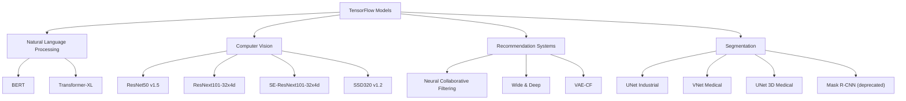
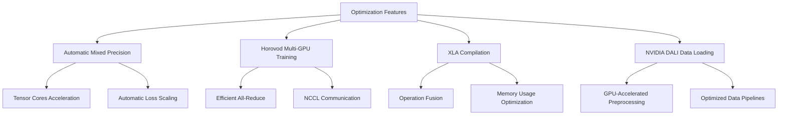
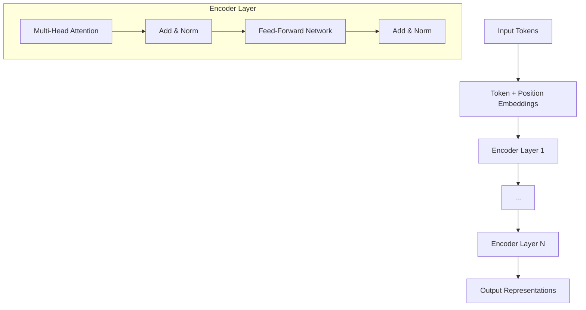
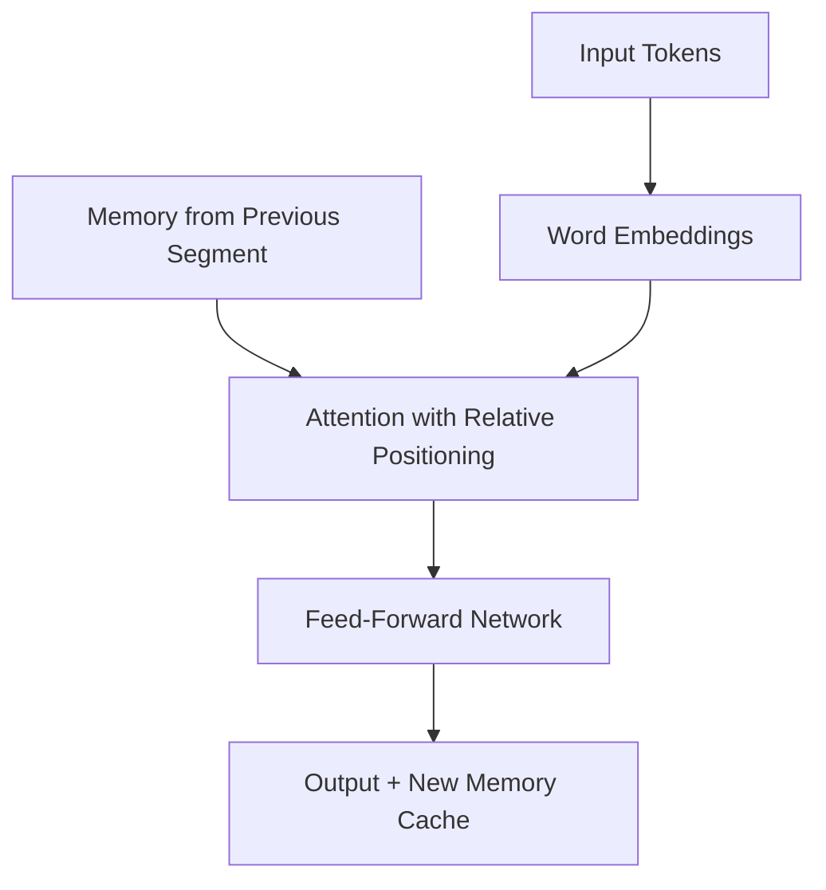
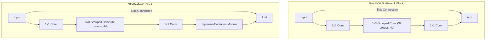
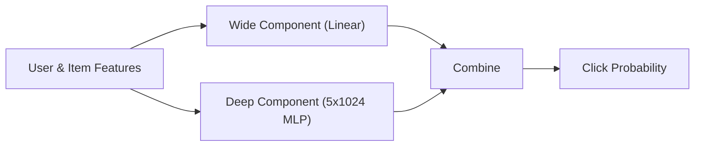
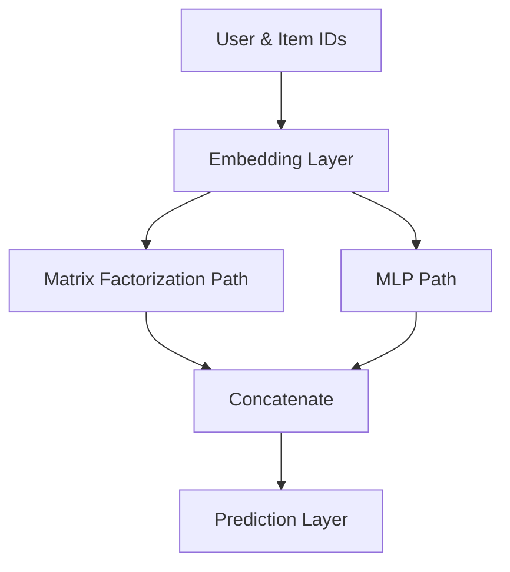
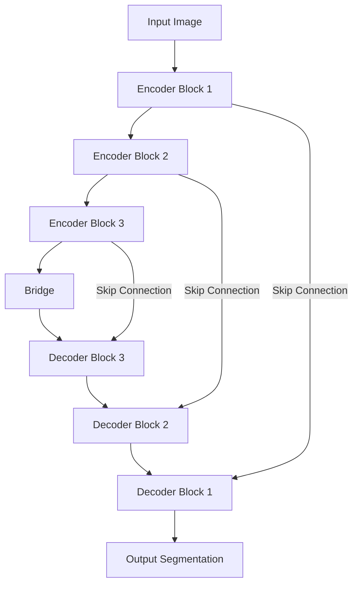
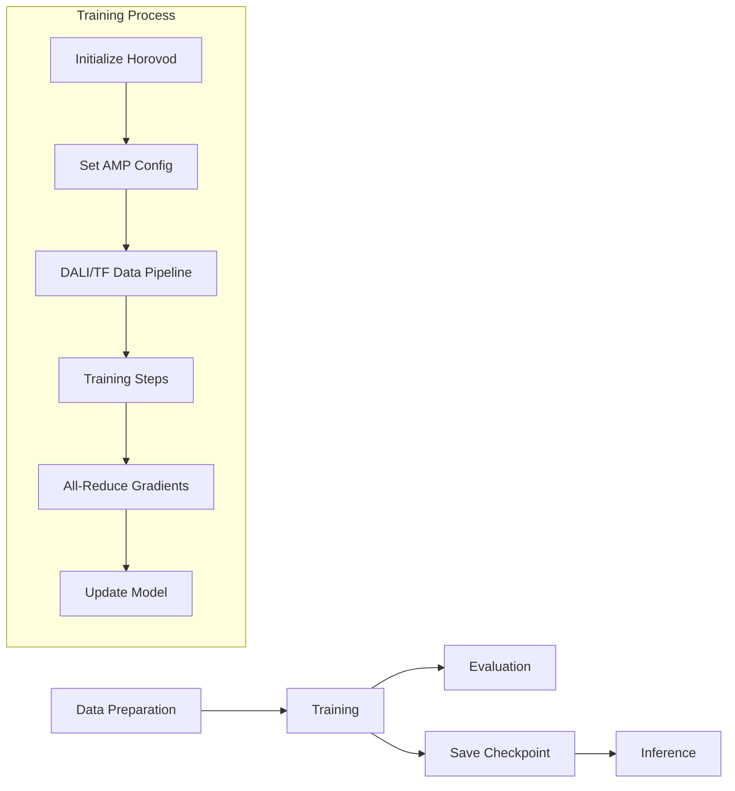

<!-- source: DeepWiki mcp.deepwiki.com · repo NVIDIA/DeepLearningExamples · page 3 TensorFlow Models · fetched 2026-10-26 -->

# TensorFlow Models

<details>
<summary>Relevant source files</summary>

The following files were used as context for generating this wiki page:

- [TensorFlow/Classification/ConvNets/README.md](TensorFlow/Classification/ConvNets/README.md)
- [TensorFlow/Classification/ConvNets/resnet50v1.5/README.md](TensorFlow/Classification/ConvNets/resnet50v1.5/README.md)
- [TensorFlow/Classification/ConvNets/resnext101-32x4d/README.md](TensorFlow/Classification/ConvNets/resnext101-32x4d/README.md)
- [TensorFlow/Classification/ConvNets/se-resnext101-32x4d/README.md](TensorFlow/Classification/ConvNets/se-resnext101-32x4d/README.md)
- [TensorFlow/Detection/SSD/README.md](TensorFlow/Detection/SSD/README.md)
- [TensorFlow/LanguageModeling/BERT/README.md](TensorFlow/LanguageModeling/BERT/README.md)
- [TensorFlow/LanguageModeling/Transformer-XL/README.md](TensorFlow/LanguageModeling/Transformer-XL/README.md)
- [TensorFlow/Recommendation/NCF/README.md](TensorFlow/Recommendation/NCF/README.md)
- [TensorFlow/Recommendation/VAE-CF/README.md](TensorFlow/Recommendation/VAE-CF/README.md)
- [TensorFlow/Recommendation/WideAndDeep/README.md](TensorFlow/Recommendation/WideAndDeep/README.md)
- [TensorFlow/Segmentation/MaskRCNN/README.md](TensorFlow/Segmentation/MaskRCNN/README.md)
- [TensorFlow/Segmentation/UNet_3D_Medical/README.md](TensorFlow/Segmentation/UNet_3D_Medical/README.md)
- [TensorFlow/Segmentation/UNet_Industrial/README.md](TensorFlow/Segmentation/UNet_Industrial/README.md)
- [TensorFlow/Segmentation/VNet/README.md](TensorFlow/Segmentation/VNet/README.md)

</details>


This page provides an overview of the TensorFlow 1.x model implementations available in the NVIDIA DeepLearningExamples repository. These implementations offer optimized, high-performance models across various domains including natural language processing, computer vision, and recommendation systems, all tuned for NVIDIA GPUs.

Note that TensorFlow 1.x models are no longer actively maintained and will soon become unavailable. Consider using PyTorch or TensorFlow 2.x models from the repository as alternatives for your requirements.

## Model Categories and Architecture

The TensorFlow models in this repository span multiple domains and application areas:



Sources: [TensorFlow/LanguageModeling/BERT/README.md](TensorFlow/LanguageModeling/BERT/README.md), [TensorFlow/LanguageModeling/Transformer-XL/README.md](TensorFlow/LanguageModeling/Transformer-XL/README.md), [TensorFlow/Classification/ConvNets/README.md](TensorFlow/Classification/ConvNets/README.md), [TensorFlow/Detection/SSD/README.md](TensorFlow/Detection/SSD/README.md), [TensorFlow/Recommendation/NCF/README.md](TensorFlow/Recommendation/NCF/README.md), [TensorFlow/Recommendation/WideAndDeep/README.md](TensorFlow/Recommendation/WideAndDeep/README.md), [TensorFlow/Recommendation/VAE-CF/README.md](TensorFlow/Recommendation/VAE-CF/README.md), [TensorFlow/Segmentation/UNet_Industrial/README.md](TensorFlow/Segmentation/UNet_Industrial/README.md), [TensorFlow/Segmentation/VNet/README.md](TensorFlow/Segmentation/VNet/README.md), [TensorFlow/Segmentation/UNet_3D_Medical/README.md](TensorFlow/Segmentation/UNet_3D_Medical/README.md), [TensorFlow/Segmentation/MaskRCNN/README.md](TensorFlow/Segmentation/MaskRCNN/README.md)

## Common Optimization Features

All models in this repository benefit from several performance optimizations specifically designed for NVIDIA GPUs:



Sources: [TensorFlow/LanguageModeling/BERT/README.md:124-163](TensorFlow/LanguageModeling/BERT/README.md), [TensorFlow/Classification/ConvNets/resnet50v1.5/README.md:126-167](TensorFlow/Classification/ConvNets/resnet50v1.5/README.md), [TensorFlow/Segmentation/UNet_Industrial/README.md:135-156](TensorFlow/Segmentation/UNet_Industrial/README.md)

### Mixed Precision Training

A key optimization across all models is mixed precision training (FP16 computation with FP32 master weights), which provides significant performance gains:

- Leverages Tensor Cores on Volta, Turing, and Ampere GPUs
- Automatically applies loss scaling to preserve gradient values
- Typically delivers 1.5-3x speedup with negligible accuracy impact
- Enabled via TF-AMP (TensorFlow Automatic Mixed Precision)

To enable mixed precision in any of the models, you can set:

```python
os.environ["TF_ENABLE_AUTO_MIXED_PRECISION_GRAPH_REWRITE"] = "1"
os.environ["TF_ENABLE_AUTO_MIXED_PRECISION"] = "1"
```

Or use the `--amp` flag when running the training scripts.

Sources: [TensorFlow/LanguageModeling/BERT/README.md:166-179](TensorFlow/LanguageModeling/BERT/README.md), [TensorFlow/Classification/ConvNets/resnet50v1.5/README.md:143-157](TensorFlow/Classification/ConvNets/resnet50v1.5/README.md)

### Multi-GPU Training

All models support multi-GPU training through Horovod, which provides:

- Efficient distributed training across multiple GPUs and nodes
- NCCL backend for optimal GPU-to-GPU communication
- Nearly linear scaling with proper batch size configuration
- Simple API integration with minimal code changes

Example of launching multi-GPU training:

```bash
mpiexec --allow-run-as-root --bind-to socket -np <num_gpus> python <script.py> [args]
```

Sources: [TensorFlow/LanguageModeling/BERT/README.md:112-142](TensorFlow/LanguageModeling/BERT/README.md), [TensorFlow/Recommendation/WideAndDeep/README.md:117-121](TensorFlow/Recommendation/WideAndDeep/README.md)

## Natural Language Processing Models

### BERT

BERT (Bidirectional Encoder Representations from Transformers) is a transformer-based language model that provides contextual word embeddings by considering both left and right contexts.



Key features of NVIDIA's BERT implementation:
- Supports both BERT Base (12 layers) and Large (24 layers) variants
- Pre-training on Wikipedia and BookCorpus datasets
- Fine-tuning for SQuAD (Question Answering) and GLUE tasks
- LAMB optimizer for large batch training
- Memory-optimized implementation with custom CUDA kernels

Sources: [TensorFlow/LanguageModeling/BERT/README.md:80-93](TensorFlow/LanguageModeling/BERT/README.md), [TensorFlow/LanguageModeling/BERT/README.md:110-126](TensorFlow/LanguageModeling/BERT/README.md)

### Transformer-XL

Transformer-XL extends traditional transformer models with a segment-level recurrence mechanism and relative positional encoding to handle longer text sequences.



Key features:
- Caches previous segment representations for longer context
- Relative positional encoding instead of absolute
- Modified architecture optimized for Tensor Cores (d_model=512, n_head=8)
- Implementation based on the paper "Transformer-XL: Attentive Language Models Beyond a Fixed-Length Context"

Sources: [TensorFlow/LanguageModeling/Transformer-XL/README.md:66-108](TensorFlow/LanguageModeling/Transformer-XL/README.md), [TensorFlow/LanguageModeling/Transformer-XL/README.md:123-132](TensorFlow/LanguageModeling/Transformer-XL/README.md)

## Computer Vision Models

### ResNet50 v1.5

ResNet50 v1.5 is a modified version of the original ResNet50 with the stride in bottleneck blocks moved from the first 1x1 convolution to the 3x3 convolution, providing slight accuracy improvements.

Key features:
- 50-layer deep residual network for image classification
- ~78% top-1 accuracy on ImageNet
- DALI integration for efficient data loading
- Cosine learning rate schedule and label smoothing

Sources: [TensorFlow/Classification/ConvNets/resnet50v1.5/README.md:52-66](TensorFlow/Classification/ConvNets/resnet50v1.5/README.md)

### ResNeXt101-32x4d and SE-ResNeXt101-32x4d

ResNeXt extends ResNet with grouped convolutions, while SE-ResNeXt adds Squeeze-and-Excitation blocks for attention.



Key features:
- Cardinality (number of groups) of 32 and bottleneck width of 4d
- SE blocks use global average pooling and MLP for channel attention
- ~80.2% top-1 accuracy for ResNeXt and ~80.9% for SE-ResNeXt
- Same training methodology as ResNet50 v1.5

Sources: [TensorFlow/Classification/ConvNets/resnext101-32x4d/README.md:51-70](TensorFlow/Classification/ConvNets/resnext101-32x4d/README.md), [TensorFlow/Classification/ConvNets/se-resnext101-32x4d/README.md:51-68](TensorFlow/Classification/ConvNets/se-resnext101-32x4d/README.md)

### SSD320 v1.2

Single Shot MultiBox Detector (SSD) is an object detection model that predicts bounding boxes and class probabilities in a single network pass.

Key features:
- Modified architecture with ResNet50 backbone instead of VGG
- Feature Pyramid Network (FPN) for multi-scale detection
- Focal Loss instead of hard negative mining
- 320×320 input resolution for better speed-accuracy tradeoff

Sources: [TensorFlow/Detection/SSD/README.md:52-59](TensorFlow/Detection/SSD/README.md)

## Recommendation Systems

### Wide & Deep Recommender

Wide & Deep combines the strengths of linear models (memorization) and deep neural networks (generalization) for recommendation tasks.



Key features:
- Linear wide component for direct feature interactions
- Deep component with 5 hidden layers of 1024 neurons
- Implementation based on Google's paper with enhanced deep network
- Applied to the Outbrain Click Prediction dataset

Sources: [TensorFlow/Recommendation/WideAndDeep/README.md:50-56](TensorFlow/Recommendation/WideAndDeep/README.md), [TensorFlow/Recommendation/WideAndDeep/README.md:75-102](TensorFlow/Recommendation/WideAndDeep/README.md)

### Neural Collaborative Filtering (NCF)

NCF is a neural network approach to collaborative filtering that learns user-item interactions through neural architectures.



Key features:
- NeuMF variant with Dropout in fully connected layers
- Combines matrix factorization and multi-layer perceptron
- Fast negative sample generation with CuPy
- Applied to MovieLens datasets (ml-1m, ml-20m)

Sources: [TensorFlow/Recommendation/NCF/README.md:49-68](TensorFlow/Recommendation/NCF/README.md), [TensorFlow/Recommendation/NCF/README.md:85-101](TensorFlow/Recommendation/NCF/README.md)

### VAE-CF

Variational Autoencoder for Collaborative Filtering uses a probabilistic approach to model user preferences.


Key features:
- Sparse matrix support for efficient representation
- Encoder learns variational distribution of user preferences
- Decoder reconstructs interaction probabilities
- Based on "Variational Autoencoders for Collaborative Filtering" paper

Sources: [TensorFlow/Recommendation/VAE-CF/README.md:50-57](TensorFlow/Recommendation/VAE-CF/README.md)

## Segmentation Models

### UNet Industrial

UNet adapted for industrial defect segmentation, with modifications to reduce over-fitting on small datasets.



Key features:
- Smaller network called "TinyUNet" compared to original UNet
- Adaptive loss function (switches between DICE and BCE)
- Applied to DAGM2007 industrial defect dataset
- Data augmentation with random flips and rotations

Sources: [TensorFlow/Segmentation/UNet_Industrial/README.md:46-73](TensorFlow/Segmentation/UNet_Industrial/README.md)

### VNet Medical

VNet extends UNet concepts to 3D for volumetric medical image segmentation.

Key features:
- 3D convolutions for processing volumetric data
- Modified architecture with 3x3x3 kernels instead of 5x5x5
- ReLU activation instead of PReLU for better performance
- Designed for medical image segmentation tasks

Sources: [TensorFlow/Segmentation/VNet/README.md:44-74](TensorFlow/Segmentation/VNet/README.md)

## Training Process and Workflow

The typical workflow for training and using these models follows this pattern:



Sources: [TensorFlow/LanguageModeling/BERT/README.md:283-379](TensorFlow/LanguageModeling/BERT/README.md), [TensorFlow/Classification/ConvNets/resnet50v1.5/README.md:235-256](TensorFlow/Classification/ConvNets/resnet50v1.5/README.md)

### Data Loading and Preprocessing

Most models support optimized data loading techniques:

- **DALI** for computer vision models - GPU-accelerated data loading and preprocessing
- **TFRecord format** for efficient data storage and access
- **Custom preprocessing pipelines** for specific tasks (e.g., tokenization for NLP)

Example of enabling DALI:

```bash
python main.py --data_dir=/data/tfrecords --dali --data_idx_dir=/data/idx
```

Sources: [TensorFlow/Classification/ConvNets/resnet50v1.5/README.md:228-256](TensorFlow/Classification/ConvNets/resnet50v1.5/README.md)

### Training Configuration

Common training parameters and optimizations:

| Model Type | Optimizer | Learning Rate | Batch Size | Mixed Precision Speedup |
|------------|-----------|---------------|------------|-------------------------|
| BERT       | LAMB      | 0.01 -> 0.001 | 256        | ~1.5x                  |
| ResNet50   | SGD+Mom   | 0.256 (scaled)| 256/GPU    | ~3.0x                  |
| Wide & Deep| Adam      | 0.00075       | 16K global | ~1.49x                 |
| UNet       | RMSProp   | 1e-4          | 16         | ~1.57x                 |

Sources: [TensorFlow/LanguageModeling/BERT/README.md:109-143](TensorFlow/LanguageModeling/BERT/README.md), [TensorFlow/Classification/ConvNets/resnet50v1.5/README.md:72-88](TensorFlow/Classification/ConvNets/resnet50v1.5/README.md), [TensorFlow/Recommendation/WideAndDeep/README.md:74-102](TensorFlow/Recommendation/WideAndDeep/README.md), [TensorFlow/Segmentation/UNet_Industrial/README.md:75-104](TensorFlow/Segmentation/UNet_Industrial/README.md)

## Performance Results

The models demonstrate significant performance benefits when using NVIDIA GPUs with the included optimizations:

1. **Mixed Precision Training**:
   - 1.5-3x speedup compared to FP32/TF32
   - Negligible impact on model accuracy
   - Greater benefits for models with more matrix multiplications

2. **Multi-GPU Scaling**:
   - Near-linear scaling with proper batch size configuration
   - Horovod + NCCL enables efficient distributed training

3. **XLA Compilation**:
   - Additional 10-30% performance improvement
   - Reduced memory usage through operation fusion

For specific performance numbers on different GPU architectures (A100, V100, T4), refer to each model's README file.

Sources: [TensorFlow/Classification/ConvNets/README.md:38-82](TensorFlow/Classification/ConvNets/README.md), [TensorFlow/LanguageModeling/BERT/README.md:48-73](TensorFlow/LanguageModeling/BERT/README.md)

## Conclusion

The TensorFlow models in the NVIDIA DeepLearningExamples repository provide highly optimized implementations of popular deep learning architectures across multiple domains. While these TensorFlow 1.x models will soon be deprecated, they offer valuable insights into performance optimization techniques that can be applied to newer frameworks.

For new projects, it's recommended to consider the PyTorch or TensorFlow 2.x implementations in the repository, which continue to be actively maintained and updated with the latest optimizations.

Sources: [TensorFlow/Classification/ConvNets/README.md:1-5](TensorFlow/Classification/ConvNets/README.md), [TensorFlow/Segmentation/MaskRCNN/README.md:1-3](TensorFlow/Segmentation/MaskRCNN/README.md)

---

