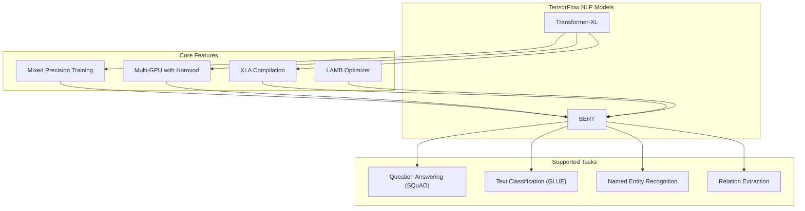
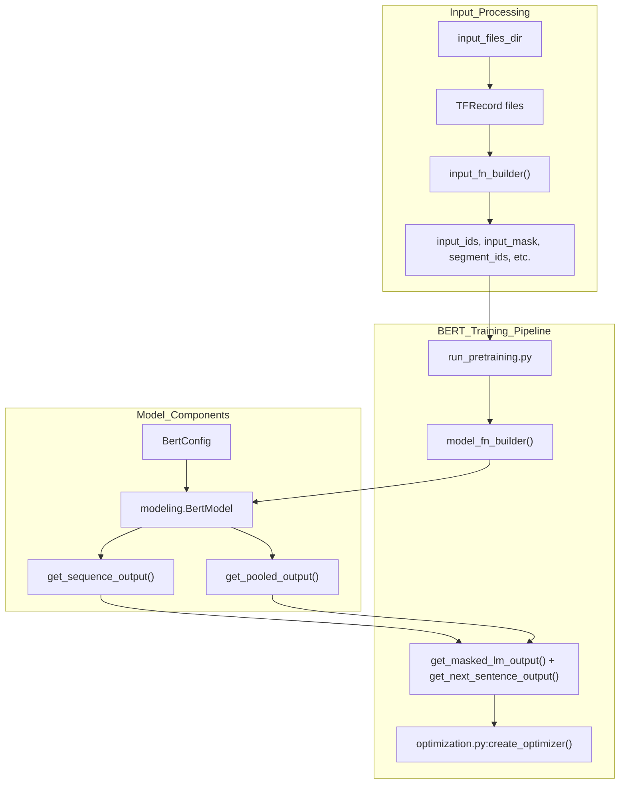
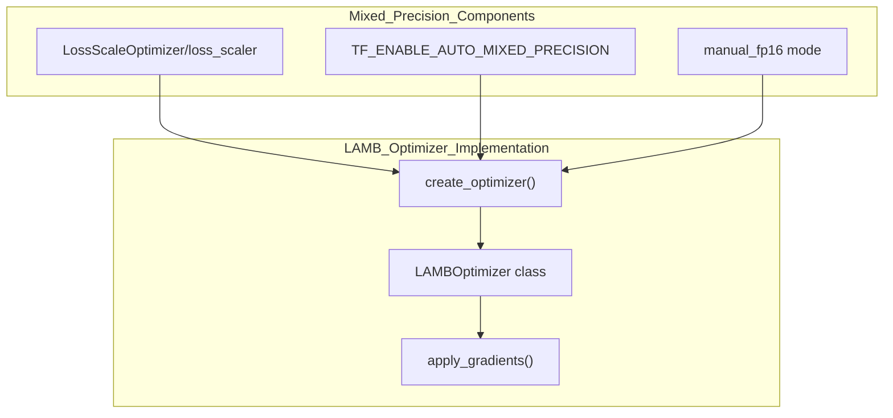
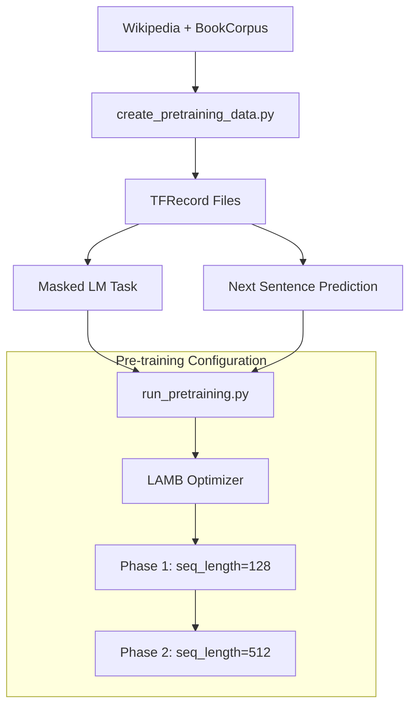
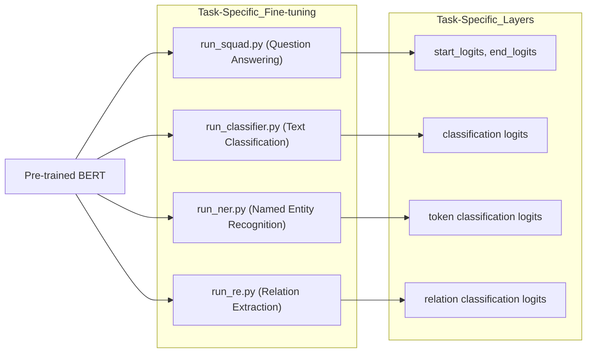
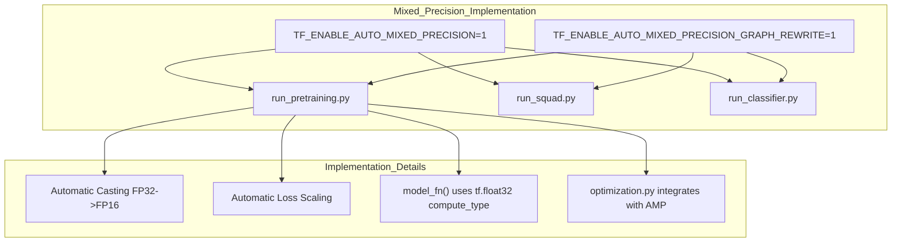
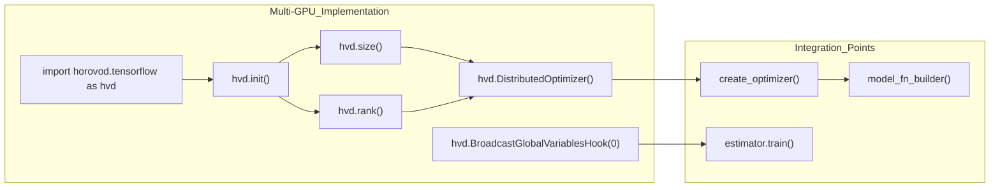
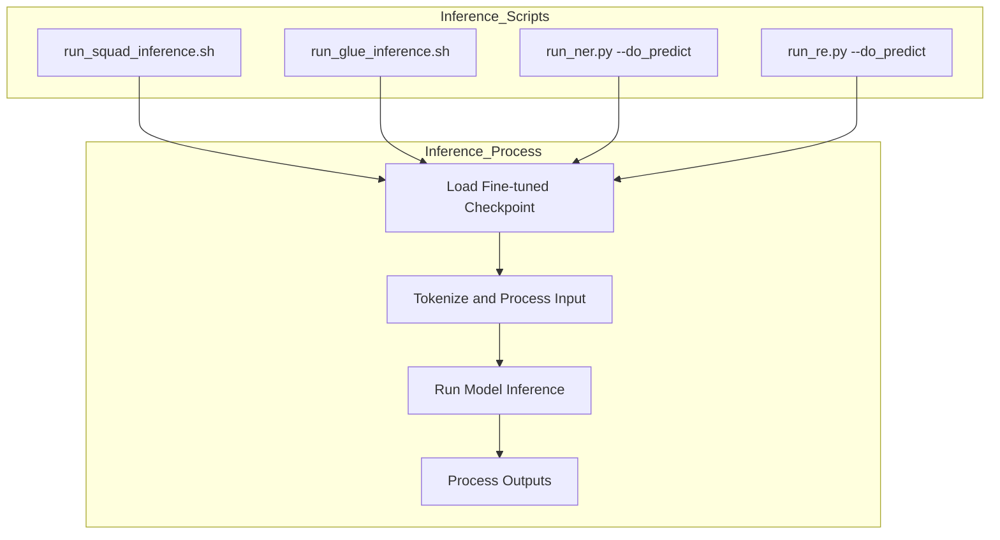
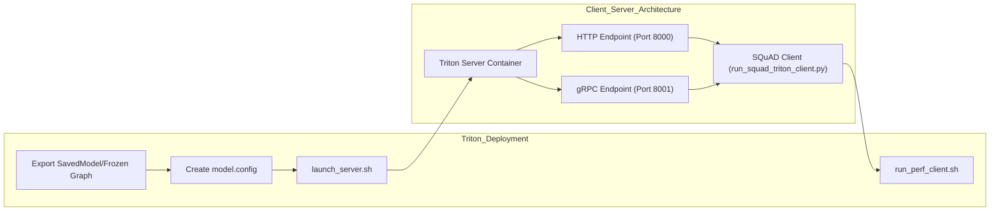

<!-- source: DeepWiki mcp.deepwiki.com · repo NVIDIA/DeepLearningExamples · page 3.1 TensorFlow Natural Language Processing · fetched 2026-10-26 -->

# TensorFlow Natural Language Processing

<details>
<summary>Relevant source files</summary>

The following files were used as context for generating this wiki page:

- [TensorFlow/Classification/ConvNets/README.md](TensorFlow/Classification/ConvNets/README.md)
- [TensorFlow/Classification/ConvNets/resnet50v1.5/README.md](TensorFlow/Classification/ConvNets/resnet50v1.5/README.md)
- [TensorFlow/Classification/ConvNets/resnext101-32x4d/README.md](TensorFlow/Classification/ConvNets/resnext101-32x4d/README.md)
- [TensorFlow/Classification/ConvNets/se-resnext101-32x4d/README.md](TensorFlow/Classification/ConvNets/se-resnext101-32x4d/README.md)
- [TensorFlow/Detection/SSD/README.md](TensorFlow/Detection/SSD/README.md)
- [TensorFlow/LanguageModeling/BERT/Dockerfile](TensorFlow/LanguageModeling/BERT/Dockerfile)
- [TensorFlow/LanguageModeling/BERT/README.md](TensorFlow/LanguageModeling/BERT/README.md)
- [TensorFlow/LanguageModeling/BERT/optimization.py](TensorFlow/LanguageModeling/BERT/optimization.py)
- [TensorFlow/LanguageModeling/BERT/run_classifier.py](TensorFlow/LanguageModeling/BERT/run_classifier.py)
- [TensorFlow/LanguageModeling/BERT/run_ner.py](TensorFlow/LanguageModeling/BERT/run_ner.py)
- [TensorFlow/LanguageModeling/BERT/run_pretraining.py](TensorFlow/LanguageModeling/BERT/run_pretraining.py)
- [TensorFlow/LanguageModeling/BERT/run_re.py](TensorFlow/LanguageModeling/BERT/run_re.py)
- [TensorFlow/LanguageModeling/BERT/run_squad.py](TensorFlow/LanguageModeling/BERT/run_squad.py)
- [TensorFlow/LanguageModeling/BERT/scripts/finetune_inference_benchmark.sh](TensorFlow/LanguageModeling/BERT/scripts/finetune_inference_benchmark.sh)
- [TensorFlow/LanguageModeling/BERT/scripts/finetune_train_benchmark.sh](TensorFlow/LanguageModeling/BERT/scripts/finetune_train_benchmark.sh)
- [TensorFlow/LanguageModeling/BERT/scripts/run_glue_inference.sh](TensorFlow/LanguageModeling/BERT/scripts/run_glue_inference.sh)
- [TensorFlow/LanguageModeling/BERT/scripts/run_squad_inference.sh](TensorFlow/LanguageModeling/BERT/scripts/run_squad_inference.sh)
- [TensorFlow/LanguageModeling/BERT/triton/run_squad_triton_client.py](TensorFlow/LanguageModeling/BERT/triton/run_squad_triton_client.py)
- [TensorFlow/LanguageModeling/BERT/triton/scripts/launch_server.sh](TensorFlow/LanguageModeling/BERT/triton/scripts/launch_server.sh)
- [TensorFlow/LanguageModeling/BERT/triton/scripts/run_perf_client.sh](TensorFlow/LanguageModeling/BERT/triton/scripts/run_perf_client.sh)
- [TensorFlow/LanguageModeling/BERT/triton/scripts/wait_for_triton_server.sh](TensorFlow/LanguageModeling/BERT/triton/scripts/wait_for_triton_server.sh)
- [TensorFlow/LanguageModeling/Transformer-XL/README.md](TensorFlow/LanguageModeling/Transformer-XL/README.md)
- [TensorFlow/Recommendation/NCF/README.md](TensorFlow/Recommendation/NCF/README.md)
- [TensorFlow/Recommendation/VAE-CF/README.md](TensorFlow/Recommendation/VAE-CF/README.md)
- [TensorFlow/Recommendation/WideAndDeep/README.md](TensorFlow/Recommendation/WideAndDeep/README.md)
- [TensorFlow/Segmentation/MaskRCNN/README.md](TensorFlow/Segmentation/MaskRCNN/README.md)
- [TensorFlow/Segmentation/UNet_3D_Medical/README.md](TensorFlow/Segmentation/UNet_3D_Medical/README.md)
- [TensorFlow/Segmentation/UNet_Industrial/README.md](TensorFlow/Segmentation/UNet_Industrial/README.md)
- [TensorFlow/Segmentation/VNet/README.md](TensorFlow/Segmentation/VNet/README.md)

</details>


This page documents the Natural Language Processing (NLP) models implemented in TensorFlow within the NVIDIA DeepLearningExamples repository. The primary focus is on BERT (Bidirectional Encoder Representations from Transformers) implementation, along with related models for various NLP tasks such as question answering, text classification, named entity recognition, and relation extraction. For PyTorch NLP implementations, see [PyTorch Natural Language Processing](#2.1).

## Overview

The TensorFlow NLP section provides optimized implementations of state-of-the-art language models, with a primary focus on BERT. These implementations include performance optimizations such as mixed precision training, multi-GPU support via Horovod, and XLA compilation support.



Sources: [TensorFlow/LanguageModeling/BERT/README.md:79-90](). [TensorFlow/LanguageModeling/Transformer-XL/README.md:67-85]()

## BERT Implementation

BERT (Bidirectional Encoder Representations from Transformers) is a transformer-based language model designed to learn contextual word representations. The NVIDIA implementation is based on Google's original BERT model with significant optimizations for performance on NVIDIA GPUs.

### Model Architecture

BERT's model architecture consists of a multi-layer bidirectional Transformer encoder. The repository supports two model configurations:

| Model | Hidden Layers | Hidden Unit Size | Attention Heads | Feedforward Filter Size | Max Sequence Length | Parameters |
|:-----:|:-------------:|:----------------:|:---------------:|:-----------------------:|:-------------------:|:----------:|
| BERTBASE | 12 encoder | 768 | 12 | 4 x 768 | 512 | 110M |
| BERTLARGE | 24 encoder | 1024 | 16 | 4 x 1024 | 512 | 330M |

The typical BERT pipeline includes pre-training on large amounts of unlabeled text data in an unsupervised manner, followed by fine-tuning on specific tasks using labeled data.



Sources: [TensorFlow/LanguageModeling/BERT/README.md:93-106](). [TensorFlow/LanguageModeling/BERT/run_pretraining.py:250-378]()

### Key Features

The NVIDIA implementation offers several key features and optimizations:

1. **Mixed precision support** with TensorFlow Automatic Mixed Precision (TF-AMP)
2. **Multi-GPU/Multi-node support** using Horovod
3. **XLA JIT compilation** support
4. **Custom fused CUDA kernels** for performance optimization
5. **LAMB optimizer** for large batch training

#### LAMB Optimizer

The repository implements NVLAMB (NVIDIA's implementation of the LAMB optimizer), which allows training with much larger batch sizes compared to Adam optimizer. This implementation adds necessary adjustments to LAMB version 1 to ensure correct convergence.



Sources: [TensorFlow/LanguageModeling/BERT/README.md:142-147](). [TensorFlow/LanguageModeling/BERT/optimization.py:30-108]()

## Training Process

The BERT training process consists of two main phases: pre-training and fine-tuning.

### Pre-training

Pre-training is performed using the unsupervised tasks of Masked Language Modeling (MLM) and Next Sentence Prediction (NSP) on large text corpora like Wikipedia and BooksCorpus.



Sources: [TensorFlow/LanguageModeling/BERT/README.md:299-319](). [TensorFlow/LanguageModeling/BERT/run_pretraining.py:500-652]()

Key configurations for pre-training:
- Two-phase training strategy: 90% with sequence length 128, 10% with sequence length 512
- LAMB optimizer to enable large batch training
- Mixed precision for performance
- Support for multiple GPUs via Horovod

### Fine-tuning

Fine-tuning adapts the pre-trained BERT model for specific downstream tasks by adding task-specific layers.



Sources: [TensorFlow/LanguageModeling/BERT/README.md:325-342](). [TensorFlow/LanguageModeling/BERT/run_squad.py:280-342](). [TensorFlow/LanguageModeling/BERT/run_classifier.py:283-352]()

## Supported Tasks

### Question Answering (SQuAD)

The SQuAD (Stanford Question Answering Dataset) task involves answering questions based on a given passage of text. BERT fine-tuning for SQuAD predicts the start and end positions of the answer span within the passage.

```python
# Model architecture for SQuAD fine-tuning
def create_model(bert_config, is_training, input_ids, input_mask, segment_ids, use_one_hot_embeddings):
  # Get BERT model output
  model = modeling.BertModel(...)
  final_hidden = model.get_sequence_output()
  
  # Add task-specific layers for SQuAD
  logits = tf.matmul(final_hidden_matrix, output_weights, transpose_b=True)
  logits = tf.reshape(logits, [batch_size, seq_length, 2])
  logits = tf.transpose(logits, [2, 0, 1])
  
  # Extract start and end logits
  (start_logits, end_logits) = (unstacked_logits[0], unstacked_logits[1])
  
  return (start_logits, end_logits)
```

Sources: [TensorFlow/LanguageModeling/BERT/run_squad.py:181-219](). [TensorFlow/LanguageModeling/BERT/README.md:357-368]()

### Text Classification (GLUE)

The GLUE (General Language Understanding Evaluation) benchmark consists of multiple text classification tasks. The implementation supports several GLUE tasks including MRPC, CoLA, and MNLI.

```python
# Model architecture for classification
def create_model(bert_config, is_training, input_ids, input_mask, segment_ids, labels, num_labels, use_one_hot_embeddings):
  # Get BERT model output
  model = modeling.BertModel(...)
  output_layer = model.get_pooled_output()
  
  # Add task-specific classification layer
  logits = tf.matmul(output_layer, output_weights, transpose_b=True)
  logits = tf.nn.bias_add(logits, output_bias)
  probabilities = tf.nn.softmax(logits, axis=-1)
  
  # Calculate loss
  per_example_loss = -tf.reduce_sum(one_hot_labels * log_probs, axis=-1)
  loss = tf.reduce_mean(per_example_loss)
  
  return (loss, per_example_loss, logits, probabilities)
```

Sources: [TensorFlow/LanguageModeling/BERT/run_classifier.py:182-224](). [TensorFlow/LanguageModeling/BERT/README.md:342-356]()

### Named Entity Recognition

The repository provides support for Named Entity Recognition tasks, particularly with the BioBERT variant, which is specialized for biomedical text.

```python
# NER model using token-level classification
def create_model(bert_config, is_training, input_ids, input_mask, segment_ids, label_ids, num_labels, use_one_hot_embeddings):
  # Get BERT model sequence output
  model = modeling.BertModel(...)
  output_layer = model.get_sequence_output()
  
  # Add token classification layer
  logits = tf.layers.dense(output_layer, num_labels)
  
  # Calculate loss
  losses = tf.nn.sparse_softmax_cross_entropy_with_logits(logits=logits, labels=label_ids)
  loss = tf.reduce_mean(losses)
  
  return (loss, logits)
```

Sources: [TensorFlow/LanguageModeling/BERT/run_ner.py:131-157]()

### Relation Extraction

Relation Extraction tasks identify relationships between entities in text. The implementation supports the ChemProt dataset for chemical-protein relation extraction.

Sources: [TensorFlow/LanguageModeling/BERT/run_re.py:202-241]()

## Performance Optimization

### Mixed Precision Training

Mixed precision training uses lower precision (FP16) for most operations while keeping some critical operations in FP32. This significantly improves performance on NVIDIA Tensor Core-enabled GPUs.



Sources: [TensorFlow/LanguageModeling/BERT/README.md:149-168]()

Key components:
- Enabling TF-AMP for automatic graph rewrites
- Loss scaling to preserve small gradient values
- Integration with optimizers for automatic handling

### Multi-GPU Training with Horovod

Horovod is used for distributed training across multiple GPUs and nodes, with optimized all-reduce operations using NCCL.



Sources: [TensorFlow/LanguageModeling/BERT/run_pretraining.py:558-612](). [TensorFlow/LanguageModeling/BERT/README.md:141-142]()

### XLA Support

XLA (Accelerated Linear Algebra) provides just-in-time compilation for TensorFlow operations, improving computational efficiency.

```python
# XLA configuration
if FLAGS.use_xla:
    config.graph_options.optimizer_options.global_jit_level = tf.OptimizerOptions.ON_1
    config.graph_options.rewrite_options.memory_optimization = rewriter_config_pb2.RewriterConfig.NO_MEM_OPT
```

Sources: [TensorFlow/LanguageModeling/BERT/run_pretraining.py:586-593](). [TensorFlow/LanguageModeling/BERT/README.md:124]()

## Inference and Deployment

The repository supports various inference options, including basic inference with the TensorFlow model and deployment with NVIDIA Triton Inference Server.

### Basic Inference

Inference for fine-tuned models can be performed using the respective task-specific scripts:
- `run_squad_inference.sh` for question answering
- `run_glue_inference.sh` for text classification
- `run_ner.py` with evaluation mode for named entity recognition



Sources: [TensorFlow/LanguageModeling/BERT/scripts/run_squad_inference.sh:1-32](). [TensorFlow/LanguageModeling/BERT/README.md:357-368]()

### Triton Inference Server Deployment

The implementation supports deploying BERT models using NVIDIA Triton Inference Server for efficient, scalable inference.



Sources: [TensorFlow/LanguageModeling/BERT/triton/scripts/launch_server.sh:1-23](). [TensorFlow/LanguageModeling/BERT/triton/scripts/run_perf_client.sh:1-32]()

## Conclusion

The TensorFlow Natural Language Processing implementation in the NVIDIA DeepLearningExamples repository provides optimized versions of state-of-the-art language models, particularly BERT, with various optimizations for NVIDIA GPUs. The implementation supports a wide range of NLP tasks and includes performance optimizations such as mixed precision training, multi-GPU support, and XLA compilation.

The repository serves as a production-ready starting point for building high-performance NLP applications using TensorFlow.

---

