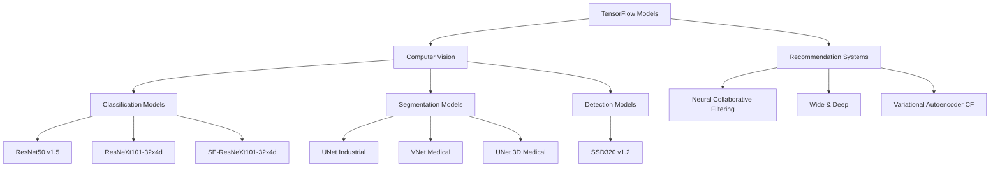
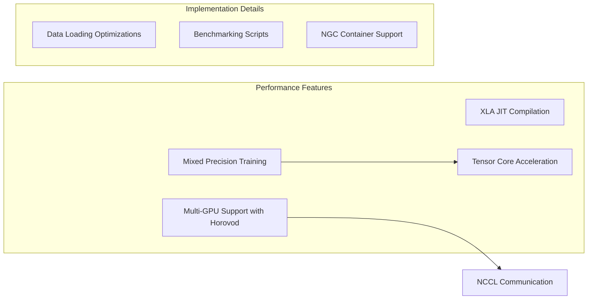
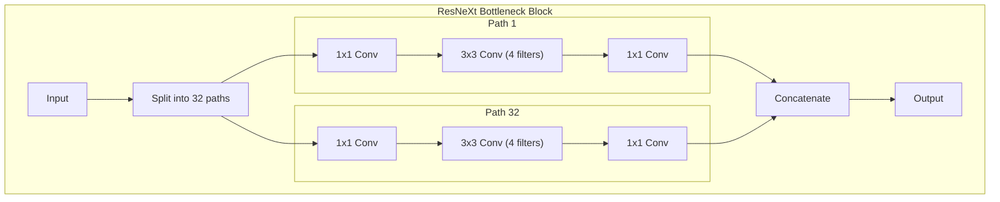
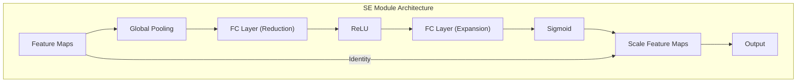
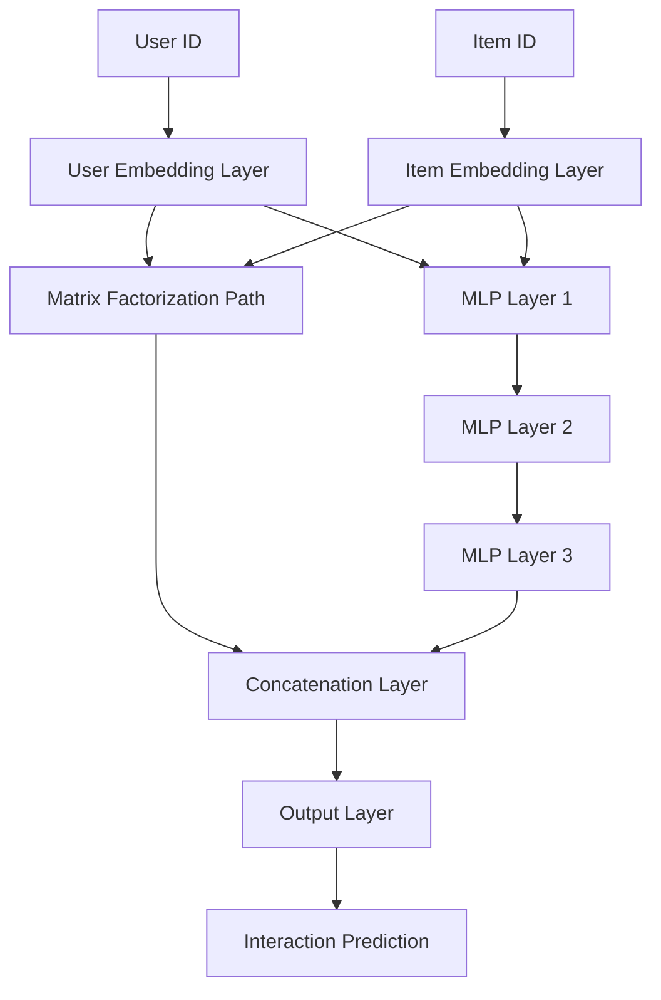
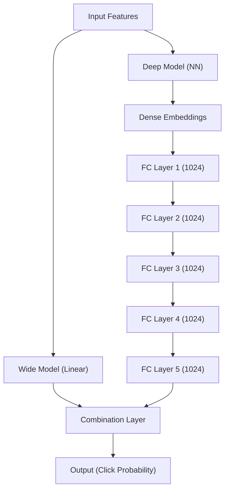
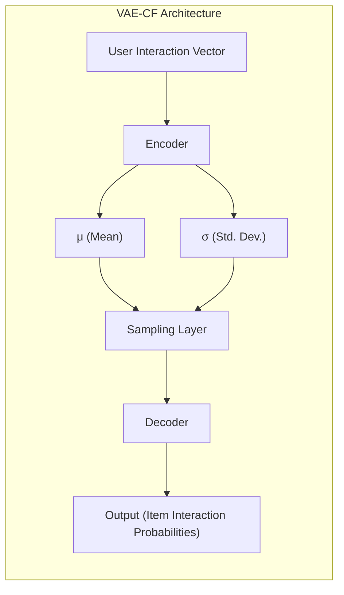

<!-- source: DeepWiki mcp.deepwiki.com · repo NVIDIA/DeepLearningExamples · page 3.2 TensorFlow Computer Vision and Recommendation · fetched 2026-10-26 -->

# TensorFlow Computer Vision and Recommendation

<details>
<summary>Relevant source files</summary>

The following files were used as context for generating this wiki page:

- [TensorFlow/Classification/ConvNets/README.md](TensorFlow/Classification/ConvNets/README.md)
- [TensorFlow/Classification/ConvNets/resnet50v1.5/README.md](TensorFlow/Classification/ConvNets/resnet50v1.5/README.md)
- [TensorFlow/Classification/ConvNets/resnext101-32x4d/README.md](TensorFlow/Classification/ConvNets/resnext101-32x4d/README.md)
- [TensorFlow/Classification/ConvNets/se-resnext101-32x4d/README.md](TensorFlow/Classification/ConvNets/se-resnext101-32x4d/README.md)
- [TensorFlow/Detection/SSD/README.md](TensorFlow/Detection/SSD/README.md)
- [TensorFlow/LanguageModeling/BERT/README.md](TensorFlow/LanguageModeling/BERT/README.md)
- [TensorFlow/LanguageModeling/Transformer-XL/README.md](TensorFlow/LanguageModeling/Transformer-XL/README.md)
- [TensorFlow/Recommendation/NCF/README.md](TensorFlow/Recommendation/NCF/README.md)
- [TensorFlow/Recommendation/VAE-CF/README.md](TensorFlow/Recommendation/VAE-CF/README.md)
- [TensorFlow/Recommendation/WideAndDeep/README.md](TensorFlow/Recommendation/WideAndDeep/README.md)
- [TensorFlow/Segmentation/MaskRCNN/README.md](TensorFlow/Segmentation/MaskRCNN/README.md)
- [TensorFlow/Segmentation/UNet_3D_Medical/README.md](TensorFlow/Segmentation/UNet_3D_Medical/README.md)
- [TensorFlow/Segmentation/UNet_Industrial/README.md](TensorFlow/Segmentation/UNet_Industrial/README.md)
- [TensorFlow/Segmentation/VNet/README.md](TensorFlow/Segmentation/VNet/README.md)

</details>


This page documents the TensorFlow 1.x implementations of Computer Vision and Recommendation models available in the NVIDIA DeepLearningExamples repository. It serves as a technical guide for understanding the architecture, capabilities, and implementation details of these models. Note that these models are no longer actively maintained and will soon become unavailable, as indicated in the repository. For newer projects, consider using the PyTorch or TensorFlow 2.x versions of similar models.

For information about Language Models in TensorFlow, see [TensorFlow Natural Language Processing](#3.1).

## Repository Structure

The following diagram shows the overall organization of the TensorFlow Computer Vision and Recommendation models in the repository:



Sources: 
- [TensorFlow/Classification/ConvNets/README.md:1-93](TensorFlow/Classification/ConvNets/README.md:1-93)
- [TensorFlow/Segmentation/UNet_Industrial/README.md:1-50](TensorFlow/Segmentation/UNet_Industrial/README.md:1-50)
- [TensorFlow/Segmentation/VNet/README.md:1-50](TensorFlow/Segmentation/VNet/README.md:1-50)
- [TensorFlow/Segmentation/UNet_3D_Medical/README.md:1-50](TensorFlow/Segmentation/UNet_3D_Medical/README.md:1-50)
- [TensorFlow/Detection/SSD/README.md:1-50](TensorFlow/Detection/SSD/README.md:1-50)
- [TensorFlow/Recommendation/NCF/README.md:1-50](TensorFlow/Recommendation/NCF/README.md:1-50)
- [TensorFlow/Recommendation/WideAndDeep/README.md:1-50](TensorFlow/Recommendation/WideAndDeep/README.md:1-50)
- [TensorFlow/Recommendation/VAE-CF/README.md:1-50](TensorFlow/Recommendation/VAE-CF/README.md:1-50)

## Common Features

All models in this collection share several optimizations and features designed to maximize performance on NVIDIA GPUs:



Sources:
- [TensorFlow/Classification/ConvNets/resnet50v1.5/README.md:52-68](TensorFlow/Classification/ConvNets/resnet50v1.5/README.md:52-68)
- [TensorFlow/Classification/ConvNets/resnext101-32x4d/README.md:52-60](TensorFlow/Classification/ConvNets/resnext101-32x4d/README.md:52-60)
- [TensorFlow/Detection/SSD/README.md:71-95](TensorFlow/Detection/SSD/README.md:71-95)

### Feature Support Matrix

The following table highlights key features supported by each model:

| Model | Mixed Precision | Multi-GPU (Horovod) | XLA | DALI Data Loading |
|-------|:--------------:|:------------------:|:---:|:-----------------:|
| ResNet50 v1.5 | ✓ | ✓ | ✓ | ✓ |
| ResNeXt101-32x4d | ✓ | ✓ | ✓ | ✓ |
| SE-ResNeXt101-32x4d | ✓ | ✓ | ✓ | ✓ |
| UNet Industrial | ✓ | ✓ | ✓ | ✗ |
| VNet | ✓ | ✓ | ✓ | ✗ |
| UNet 3D Medical | ✓ | ✓ | ✓ | ✗ |
| SSD320 v1.2 | ✓ | ✓ | ✗ | ✗ |
| NCF | ✓ | ✓ | ✗ | ✗ |
| Wide & Deep | ✓ | ✓ | ✗ | ✗ |
| VAE-CF | ✓ | ✓ | ✗ | ✗ |

Sources:
- [TensorFlow/Classification/ConvNets/resnet50v1.5/README.md:106-121](TensorFlow/Classification/ConvNets/resnet50v1.5/README.md:106-121)
- [TensorFlow/Classification/ConvNets/resnext101-32x4d/README.md:112-132](TensorFlow/Classification/ConvNets/resnext101-32x4d/README.md:112-132)
- [TensorFlow/Classification/ConvNets/se-resnext101-32x4d/README.md:107-128](TensorFlow/Classification/ConvNets/se-resnext101-32x4d/README.md:107-128)
- [TensorFlow/Segmentation/UNet_Industrial/README.md:107-135](TensorFlow/Segmentation/UNet_Industrial/README.md:107-135)
- [TensorFlow/Detection/SSD/README.md:71-96](TensorFlow/Detection/SSD/README.md:71-96)
- [TensorFlow/Recommendation/VAE-CF/README.md:79-96](TensorFlow/Recommendation/VAE-CF/README.md:79-96)

## Computer Vision Models

### Classification Models

The repository includes three primary convolutional neural network architectures for image classification tasks:

#### ResNet50 v1.5

ResNet50 v1.5 is a modified version of the original ResNet50 model with improved accuracy and performance characteristics. The key difference is in the bottleneck blocks that require downsampling - v1.5 has stride = 2 in the 3x3 convolution rather than in the first 1x1 convolution as in v1. This results in approximately 0.5% better top-1 accuracy at the cost of around 5% slower inference.

The implementation includes the following optimizations:
- JIT graph compilation with XLA
- Multi-GPU training with Horovod
- Automated mixed precision (AMP)

Default configuration:
- Optimizer: SGD with momentum (0.875)
- Learning rate: 0.256 for batch size 256, linearly scaled for other batch sizes
- Cosine learning rate schedule with linear warmup
- Weight decay: 3.0517578125e-05 (1/32768)
- Label smoothing: 0.1

Sources:
- [TensorFlow/Classification/ConvNets/resnet50v1.5/README.md:52-68](TensorFlow/Classification/ConvNets/resnet50v1.5/README.md:52-68)
- [TensorFlow/Classification/ConvNets/resnet50v1.5/README.md:71-96](TensorFlow/Classification/ConvNets/resnet50v1.5/README.md:71-96)

#### ResNeXt101-32x4d

ResNeXt101-32x4d is based on the paper "Aggregated Residual Transformations for Deep Neural Networks". It modifies the standard ResNet architecture by replacing the 3x3 convolutions in the bottleneck block with grouped convolutions.



Key architectural parameters:
- Cardinality: 32 (parallel paths)
- Bottleneck width: 4 (filters per path)

Default configuration shares the same training parameters as ResNet50 v1.5 with minor adjustments to the weight decay.

Sources:
- [TensorFlow/Classification/ConvNets/resnext101-32x4d/README.md:50-70](TensorFlow/Classification/ConvNets/resnext101-32x4d/README.md:50-70)
- [TensorFlow/Classification/ConvNets/resnext101-32x4d/README.md:76-95](TensorFlow/Classification/ConvNets/resnext101-32x4d/README.md:76-95)

#### SE-ResNeXt101-32x4d

SE-ResNeXt101-32x4d adds Squeeze-and-Excitation (SE) modules to the ResNeXt101-32x4d architecture. The SE module adaptively recalibrates channel-wise feature responses by explicitly modeling interdependencies between channels, improving the representational power of the network.



The SE module is placed at the end of each ResNeXt bottleneck block, allowing the network to perform feature recalibration adaptively.

Sources:
- [TensorFlow/Classification/ConvNets/se-resnext101-32x4d/README.md:50-70](TensorFlow/Classification/ConvNets/se-resnext101-32x4d/README.md:50-70)
- [TensorFlow/Classification/ConvNets/se-resnext101-32x4d/README.md:62-66](TensorFlow/Classification/ConvNets/se-resnext101-32x4d/README.md:62-66)

### Segmentation Models

#### UNet Industrial

UNet Industrial is an adaptation of the UNet architecture designed for industrial defect segmentation. The model is specifically optimized for the DAGM2007 dataset, which contains various types of industrial surface defects.

Key architectural features:
- Modified UNet architecture called "TinyUNet"
- Encoder with 3 downsampling blocks (2 convolutions + max pooling)
- Decoder with 3 upsampling blocks
- Skip connections between encoder and decoder
- Reduced model capacity to prevent overfitting on small datasets

Training features:
- Adaptive loss function that switches between DICE loss and Binary Cross Entropy
- Laplace smoothing for improved training efficiency
- ReLU activation functions
- He uniform weight initialization

The implementation achieves high accuracy on industrial defect detection tasks while maintaining efficient inference speed.

Sources:
- [TensorFlow/Segmentation/UNet_Industrial/README.md:51-74](TensorFlow/Segmentation/UNet_Industrial/README.md:51-74)
- [TensorFlow/Segmentation/UNet_Industrial/README.md:75-106](TensorFlow/Segmentation/UNet_Industrial/README.md:75-106)

#### VNet Medical

VNet is a convolutional neural network designed for 3D image segmentation, particularly for medical imaging applications. This implementation includes several optimizations to the original architecture:

- Reduced convolutional filter size (3x3x3 instead of 5x5x5) for better performance
- Fewer upsample/downsample levels to accommodate different input sizes
- ReLU activation instead of PReLU for increased performance
- Batchnorm used during training

The model consists of a contractive (left-side) path and an expanding (right-side) path with skip connections to help with gradient flow.

Sources:
- [TensorFlow/Segmentation/VNet/README.md:44-64](TensorFlow/Segmentation/VNet/README.md:44-64)
- [TensorFlow/Segmentation/VNet/README.md:65-74](TensorFlow/Segmentation/VNet/README.md:65-74)

#### UNet 3D Medical

UNet 3D Medical is an implementation of the 3D-UNet architecture for volumetric medical image segmentation, with modifications based on the "No New-Net" paper. The model provides seamless segmentation of 3D volumes with high accuracy and performance.

The architecture follows the classic U-shaped network design with a contractive and expanding path, adapted for 3D data. Skip connections help facilitate gradient flow during training.

The implementation includes several optimizations:
- XLA support
- Data-parallel multi-GPU training with Horovod
- Mixed precision support for faster training on Tensor Cores

Sources:
- [TensorFlow/Segmentation/UNet_3D_Medical/README.md:49-62](TensorFlow/Segmentation/UNet_3D_Medical/README.md:49-62)
- [TensorFlow/Segmentation/UNet_3D_Medical/README.md:63-74](TensorFlow/Segmentation/UNet_3D_Medical/README.md:63-74)

### Detection Models

#### SSD320 v1.2

SSD320 v1.2 is based on the "SSD: Single Shot MultiBox Detector" paper but includes several modifications to improve accuracy and throughput:

- ResNet50 backbone instead of VGG
- Feature Pyramid Network for multi-scale detection
- Focal Loss instead of hard negative mining
- Reduced input size (320x320)

Training configuration:
- SGDR with cosine decay learning rate
- Base learning rate: 0.16
- Momentum: 0.9
- Warmup learning rate: 0.0693312
- Warmup steps: 1000
- Batch size per GPU: 32

The model achieves state-of-the-art accuracy while maintaining high throughput, making it suitable for real-time object detection tasks.

Sources:
- [TensorFlow/Detection/SSD/README.md:47-60](TensorFlow/Detection/SSD/README.md:47-60)
- [TensorFlow/Detection/SSD/README.md:61-70](TensorFlow/Detection/SSD/README.md:61-70)

## Recommendation Models

### Neural Collaborative Filtering (NCF)

Neural Collaborative Filtering (NCF) is a neural network-based approach to collaborative filtering for implicit feedback scenarios. The model provides product recommendations based on user-item interactions.



Key implementation features:
- Model-parallel multi-GPU training with Horovod
- Mixed precision training with TF-AMP
- Fast negative sample generation with CuPy
- Dropout in fully connected layers to reduce overfitting

The NeuMF variant of NCF is implemented, which combines a matrix factorization component with a multilayer perceptron for improved recommendation quality.

Sources:
- [TensorFlow/Recommendation/NCF/README.md:47-62](TensorFlow/Recommendation/NCF/README.md:47-62)
- [TensorFlow/Recommendation/NCF/README.md:71-97](TensorFlow/Recommendation/NCF/README.md:71-97)

### Wide & Deep Recommender

The Wide & Deep model is designed to combine the memorization capabilities of wide linear models with the generalization capabilities of deep neural networks. This implementation is based on Google's "Wide & Deep Learning for Recommender Systems" paper, with modifications to the deep component architecture.



Key differences from the original paper:
- The deep component has 5 layers of 1024 neurons each (vs. 3 layers of 1024, 512, and 256 in the original)

The model supports both scalar numeric features and categorical features (one-hot and multi-hot), with trainable embeddings for categorical features.

Sources:
- [TensorFlow/Recommendation/WideAndDeep/README.md:48-62](TensorFlow/Recommendation/WideAndDeep/README.md:48-62)
- [TensorFlow/Recommendation/WideAndDeep/README.md:75-103](TensorFlow/Recommendation/WideAndDeep/README.md:75-103)

### Variational Autoencoder for Collaborative Filtering (VAE-CF)

VAE-CF is an optimized implementation of the architecture described in "Variational Autoencoders for Collaborative Filtering". The model learns a lower-dimensional latent representation of user preferences for recommendation tasks.



The model consists of two parts:
1. An encoder that transforms a user's interaction vector into a variational distribution
2. A decoder that generates item interaction probabilities from the latent representation

Key optimizations in this implementation:
- Sparse matrix support for efficiency
- Data-parallel multi-GPU training
- Dynamic loss scaling for mixed precision training
- Larger mini-batches than the original implementation

VAE-CF can achieve significantly higher training speeds while maintaining the same accuracy as the original model.

Sources:
- [TensorFlow/Recommendation/VAE-CF/README.md:48-70](TensorFlow/Recommendation/VAE-CF/README.md:48-70)
- [TensorFlow/Recommendation/VAE-CF/README.md:58-70](TensorFlow/Recommendation/VAE-CF/README.md:58-70)

## Performance Comparison

The following table compares the mixed precision training performance acceleration across different models:

| Model | Hardware | Mixed Precision Speedup |
|-------|----------|-------------------------|
| ResNet50 v1.5 | DGX A100 | 2.60x |
| ResNet50 v1.5 | DGX-1 V100 | 3.00x |
| ResNeXt101-32x4d | DGX A100 | 3.05x |
| ResNeXt101-32x4d | DGX-1 V100 | 3.44x |
| SE-ResNeXt101-32x4d | DGX A100 | 2.88x |
| SE-ResNeXt101-32x4d | DGX-1 V100 | 3.00x |
| UNet Industrial | DGX A100 | 1.88x |
| UNet Industrial | DGX-1 V100 | 1.94x |
| VAE-CF | NVIDIA GPUs | 1.9x |
| Wide & Deep | NVIDIA GPUs | 1.49x |
| NCF | NVIDIA GPUs | 1.6x |

Sources:
- [TensorFlow/Classification/ConvNets/README.md:44-82](TensorFlow/Classification/ConvNets/README.md:44-82)
- [TensorFlow/Segmentation/UNet_Industrial/README.md:446-465](TensorFlow/Segmentation/UNet_Industrial/README.md:446-465)
- [TensorFlow/Recommendation/VAE-CF/README.md:54](TensorFlow/Recommendation/VAE-CF/README.md:54)
- [TensorFlow/Recommendation/WideAndDeep/README.md:56](TensorFlow/Recommendation/WideAndDeep/README.md:56)
- [TensorFlow/Recommendation/NCF/README.md:66-67](TensorFlow/Recommendation/NCF/README.md:66-67)

## Implementation Notes

### Mixed Precision Training

All models in this collection support mixed precision training with TensorFlow Automatic Mixed Precision (TF-AMP). This feature performs automatic graph rewrites and loss scaling controlled by environment variables:

```
os.environ["TF_ENABLE_AUTO_MIXED_PRECISION_GRAPH_REWRITE"] = "1"
os.environ['TF_ENABLE_AUTO_MIXED_PRECISION'] = '1'
```

Mixed precision training offers significant computational speedups (1.5x-3.4x depending on the model) by performing operations in half-precision format while storing minimal information in single-precision.

### Multi-GPU Training with Horovod

All models support multi-GPU training using Horovod with NCCL, enabling efficient distributed training. The implementation typically follows this pattern:

```python
# Initialize Horovod
hvd.init()

# Pin GPU to local rank
gpus = tf.config.experimental.list_physical_devices('GPU')
tf.config.experimental.set_visible_devices(gpus[hvd.local_rank()], 'GPU')

# Broadcast initial variables
hvd.broadcast_variables(model.variables, root_rank=0)
hvd.broadcast_variables(optimizer.variables(), root_rank=0)
```

### Data Loading Optimizations

Classification models include NVIDIA DALI (Data Loading Library) support for faster data preprocessing. DALI accelerates the input pipeline through GPU-accelerated data loading and augmentation operations.

Sources:
- [TensorFlow/Classification/ConvNets/resnet50v1.5/README.md:143-162](TensorFlow/Classification/ConvNets/resnet50v1.5/README.md:143-162)
- [TensorFlow/Detection/SSD/README.md:97-137](TensorFlow/Detection/SSD/README.md:97-137)

---

