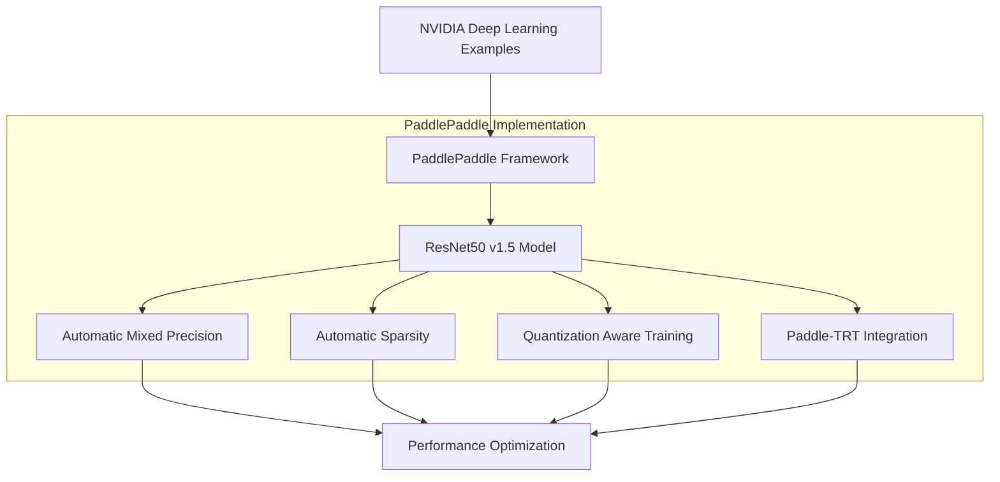
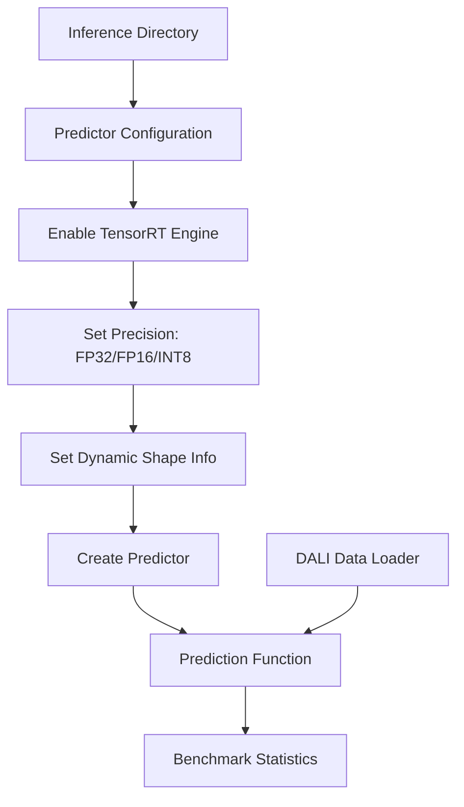
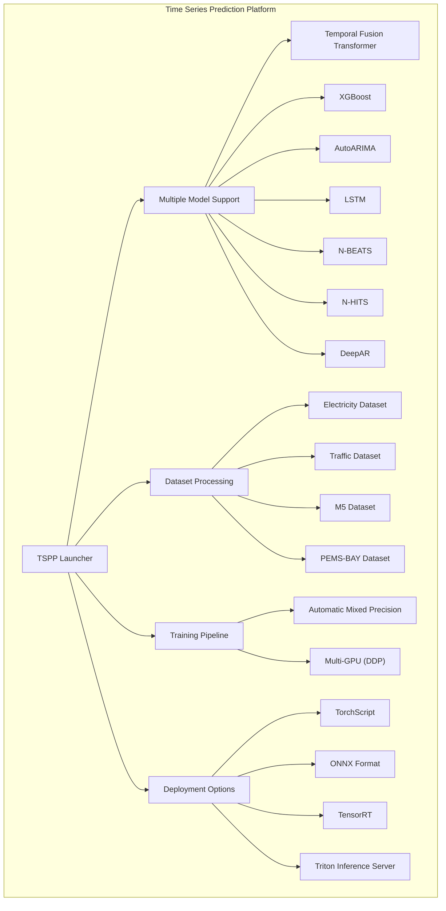
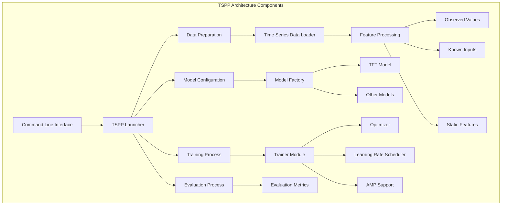
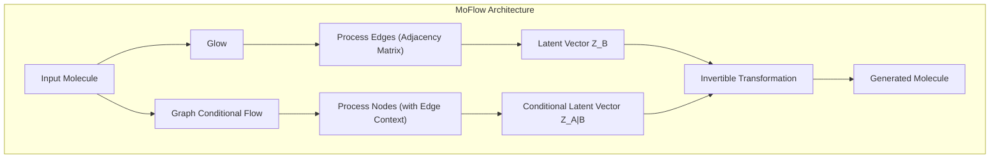
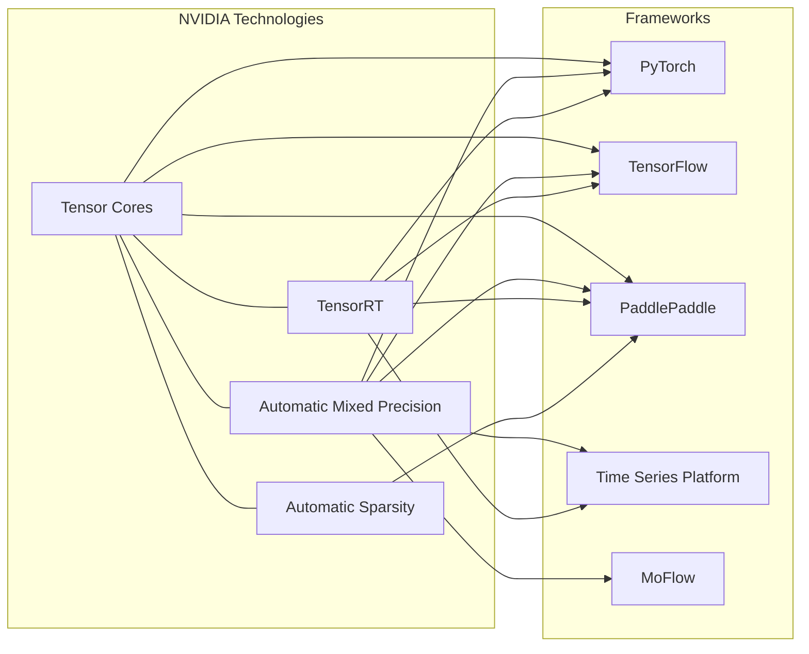

<!-- source: DeepWiki mcp.deepwiki.com · repo NVIDIA/DeepLearningExamples · page 4 Other Frameworks · fetched 2026-10-26 -->

# Other Frameworks

Relevant source files

The following files were used as context for generating this wiki page:

- [PaddlePaddle/Classification/RN50v1.5/Dockerfile](PaddlePaddle/Classification/RN50v1.5/Dockerfile)
- [PaddlePaddle/Classification/RN50v1.5/README.md](PaddlePaddle/Classification/RN50v1.5/README.md)
- [PaddlePaddle/Classification/RN50v1.5/inference.py](PaddlePaddle/Classification/RN50v1.5/inference.py)
- [PaddlePaddle/Classification/RN50v1.5/program.py](PaddlePaddle/Classification/RN50v1.5/program.py)
- [PaddlePaddle/Classification/RN50v1.5/scripts/inference/infer_resnet50_AMP.sh](PaddlePaddle/Classification/RN50v1.5/scripts/inference/infer_resnet50_AMP.sh)
- [PaddlePaddle/Classification/RN50v1.5/scripts/inference/infer_resnet50_TF32.sh](PaddlePaddle/Classification/RN50v1.5/scripts/inference/infer_resnet50_TF32.sh)
- [PaddlePaddle/Classification/RN50v1.5/scripts/training/train_resnet50_AMP_90E_DGXA100.sh](PaddlePaddle/Classification/RN50v1.5/scripts/training/train_resnet50_AMP_90E_DGXA100.sh)
- [PaddlePaddle/Classification/RN50v1.5/scripts/training/train_resnet50_TF32_90E_DGXA100.sh](PaddlePaddle/Classification/RN50v1.5/scripts/training/train_resnet50_TF32_90E_DGXA100.sh)
- [PaddlePaddle/Classification/RN50v1.5/train.py](PaddlePaddle/Classification/RN50v1.5/train.py)
- [PaddlePaddle/Classification/RN50v1.5/utils/config.py](PaddlePaddle/Classification/RN50v1.5/utils/config.py)
- [PyTorch/DrugDiscovery/MoFlow/Dockerfile](PyTorch/DrugDiscovery/MoFlow/Dockerfile)
- [PyTorch/DrugDiscovery/MoFlow/LICENSE](PyTorch/DrugDiscovery/MoFlow/LICENSE)
- [PyTorch/DrugDiscovery/MoFlow/NOTICE](PyTorch/DrugDiscovery/MoFlow/NOTICE)
- [PyTorch/DrugDiscovery/MoFlow/README.md](PyTorch/DrugDiscovery/MoFlow/README.md)
- [PyTorch/DrugDiscovery/MoFlow/img/moflow.png](PyTorch/DrugDiscovery/MoFlow/img/moflow.png)
- [PyTorch/DrugDiscovery/MoFlow/moflow/__init__.py](PyTorch/DrugDiscovery/MoFlow/moflow/__init__.py)
- [PyTorch/DrugDiscovery/MoFlow/moflow/config.py](PyTorch/DrugDiscovery/MoFlow/moflow/config.py)
- [PyTorch/DrugDiscovery/MoFlow/moflow/data/__init__.py](PyTorch/DrugDiscovery/MoFlow/moflow/data/__init__.py)
- [PyTorch/DrugDiscovery/MoFlow/moflow/data/data_frame_parser.py](PyTorch/DrugDiscovery/MoFlow/moflow/data/data_frame_parser.py)
- [PyTorch/DrugDiscovery/MoFlow/moflow/data/data_loader.py](PyTorch/DrugDiscovery/MoFlow/moflow/data/data_loader.py)
- [PyTorch/DrugDiscovery/MoFlow/moflow/data/encoding.py](PyTorch/DrugDiscovery/MoFlow/moflow/data/encoding.py)
- [README.md](README.md)
- [Tools/PyTorch/TimeSeriesPredictionPlatform/README.md](Tools/PyTorch/TimeSeriesPredictionPlatform/README.md)
- [Tools/PyTorch/TimeSeriesPredictionPlatform/requirements.txt](Tools/PyTorch/TimeSeriesPredictionPlatform/requirements.txt)
- [Tools/PyTorch/TimeSeriesPredictionPlatform/triton/requirements.txt](Tools/PyTorch/TimeSeriesPredictionPlatform/triton/requirements.txt)

This page provides an overview of alternative frameworks and specialized platforms supported in the NVIDIA Deep Learning Examples repository beyond the primary PyTorch and TensorFlow implementations. We'll explore PaddlePaddle, an emerging deep learning framework with significant performance optimizations, and the Time Series Prediction Platform, a specialized solution for time series forecasting.

## PaddlePaddle Framework

PaddlePaddle is an industrial-grade deep learning framework developed by Baidu to provide an easy-to-use, efficient, flexible, and scalable deep learning platform. The NVIDIA Deep Learning Examples repository includes an optimized ResNet50 v1.5 implementation using PaddlePaddle.

Sources: [PaddlePaddle/Classification/RN50v1.5/README.md:55-66](), [PaddlePaddle/Classification/RN50v1.5/README.md:125-149]()

### PaddlePaddle Feature Support

PaddlePaddle implementations in the repository showcase several advanced features:

| Feature | Description | Implementation |
|---------|-------------|----------------|
| Automatic Mixed Precision (AMP) | Mixed precision training using FP16 while maintaining FP32 master weights | [PaddlePaddle/Classification/RN50v1.5/program.py:160-189]() |
| Automatic Sparsity (ASP) | Workflow to transfer dense models to 2:4 structured sparse pattern | [PaddlePaddle/Classification/RN50v1.5/README.md:211-232]() |
| Quantization Aware Training (QAT) | Training models with awareness of quantization process | [PaddlePaddle/Classification/RN50v1.5/README.md:234-256]() |
| Paddle-TRT | Integration with TensorRT for optimized inference | [PaddlePaddle/Classification/RN50v1.5/inference.py:31-69]() |
| DALI Support | Accelerated data loading pipeline | [PaddlePaddle/Classification/RN50v1.5/README.md:150-155]() |

Sources: [PaddlePaddle/Classification/RN50v1.5/README.md:125-149](), [PaddlePaddle/Classification/RN50v1.5/README.md:211-232](), [PaddlePaddle/Classification/RN50v1.5/README.md:234-256](), [PaddlePaddle/Classification/RN50v1.5/README.md:150-155]()

### ResNet50 v1.5 PaddlePaddle Implementation

The repository includes a complete implementation of ResNet50 v1.5 using PaddlePaddle, with scripts for training and inference on the ImageNet dataset.

```mermaid
flowchart LR
    subgraph "Training Workflow"
        Config["Configuration Parser"] --> Fleet["Paddle Fleet API"]
        Fleet --> AMP["AMP Decorator"]
        AMP --> Optimizer["Distributed Optimizer"]
        Optimizer --> Train["Training Program"]
    end
    
    subgraph "Inference Workflow"
        InferConfig["Inference Configuration"] --> TRT["TensorRT Engine"]
        TRT --> Predict["Prediction Function"]
        Predict --> Benchmark["Performance Benchmark"]
    end
    
    Train --> SaveModel["Save Inference Model"]
    SaveModel --> InferConfig
```

Sources: [PaddlePaddle/Classification/RN50v1.5/train.py:67-205](), [PaddlePaddle/Classification/RN50v1.5/inference.py:207-221]()

### Training and Optimization Features

The PaddlePaddle implementation includes several advanced training and optimization features:

1. **Automatic Mixed Precision (AMP)**:
   - Uses the Paddle built-in AMP module for mixed precision training
   - Supports both static and dynamic loss scaling
   - Integrates with Fleet API for distributed training

2. **Automatic Sparsity (ASP)**:
   - Prunes well-trained dense models to 2:4 sparse pattern
   - Retrains sparse model to recover accuracy
   - Leverages NVIDIA Sparse Tensor Core for theoretical 2x speedup and 50% memory savings

3. **Quantization Aware Training (QAT)**:
   - Quantizes and dequantizes weights and inputs before feeding into weighted layers
   - Records scales of tensors for low-precision inference
   - Compatible with mixed precision training

Sources: [PaddlePaddle/Classification/RN50v1.5/README.md:160-181](), [PaddlePaddle/Classification/RN50v1.5/README.md:211-232](), [PaddlePaddle/Classification/RN50v1.5/README.md:234-256]()

### Inference with PaddlePaddle and TensorRT

The implementation includes a dedicated inference pipeline that integrates with TensorRT for optimized inference:

Sources: [PaddlePaddle/Classification/RN50v1.5/inference.py:31-69](), [PaddlePaddle/Classification/RN50v1.5/inference.py:72-101]()

## Time Series Prediction Platform

The Time Series Prediction Platform (TSPP) is a comprehensive solution for time series forecasting, built on PyTorch. It provides a unified interface for multiple models and datasets, enabling efficient experimentation and deployment.

Sources: [Tools/PyTorch/TimeSeriesPredictionPlatform/README.md:44-52](), [Tools/PyTorch/TimeSeriesPredictionPlatform/README.md:111-119](), [Tools/PyTorch/TimeSeriesPredictionPlatform/README.md:122-127]()

### TSPP Architecture and Components

The Time Series Prediction Platform is designed to support multiple data types for input features, including observed values of forecasted time-series, known supporting data, and static data.

Sources: [Tools/PyTorch/TimeSeriesPredictionPlatform/README.md:53-70]()

### Supported Models and Datasets

TSPP provides support for a variety of time series forecasting models and datasets:

**Models:**
- Temporal Fusion Transformer (TFT)
- XGBoost
- AutoARIMA
- LSTM
- N-BEATS
- N-HITS
- DeepAR
- MTGNN
- DCRNN

**Datasets:**
- Electricity - electricity consumption of 370 customers
- Traffic - occupancy rate of San Francisco freeways from 440 sensors
- M5 - retail sales data
- PEMS-BAY - traffic data from the Bay Area

Sources: [Tools/PyTorch/TimeSeriesPredictionPlatform/README.md:111-119](), [Tools/PyTorch/TimeSeriesPredictionPlatform/README.md:122-127]()

### Key Features of TSPP

The Time Series Prediction Platform includes several key features that enhance both training and inference performance:

| Feature | Description |
|---------|-------------|
| Automatic Mixed Precision (AMP) | Enables operations to use float16 instead of float32, accelerating computation |
| Multi-GPU Training | Uses PyTorch Distributed Data Parallel for parallel execution across multiple GPUs |
| Model Conversion | Supports conversion to TorchScript, ONNX, and TensorRT formats |
| Triton Deployment | Enables deployment to NVIDIA Triton inference server |
| Advanced Training Features | Includes Exponential Moving Averaging, Curriculum Learning, and hyperparameter search |
| Ensembling | Supports combining multiple models for better prediction accuracy |

Sources: [Tools/PyTorch/TimeSeriesPredictionPlatform/README.md:77-87](), [Tools/PyTorch/TimeSeriesPredictionPlatform/README.md:91-101]()

## MoFlow for Drug Discovery

MoFlow is a model for molecule generation that leverages Normalizing Flows, a class of generative neural networks that directly models the probability density of data. It enables generating novel molecules with similar properties to the training data, facilitating drug discovery.

Sources: [PyTorch/DrugDiscovery/MoFlow/README.md:74-83]()

MoFlow is trained with mixed precision using Tensor Cores on NVIDIA Ampere GPU architectures, offering up to 1.43x faster training while maintaining accuracy. The implementation includes several optimizations for performance:

- Data-parallel multi-GPU training (DDP)
- Mixed precision training with autocast and gradient scaling
- Just-in-time compilation
- CUDA graphs support
- Stream concurrency for parallel execution of model components

Sources: [PyTorch/DrugDiscovery/MoFlow/README.md:72-72](), [PyTorch/DrugDiscovery/MoFlow/README.md:89-104]()

## Framework Comparison and Integration

The NVIDIA Deep Learning Examples repository demonstrates how different frameworks and specialized platforms can be optimized for specific tasks while leveraging common NVIDIA technologies like Tensor Cores, mixed precision, and TensorRT.

Sources: [README.md:3-4](), [PaddlePaddle/Classification/RN50v1.5/README.md:132-136](), [Tools/PyTorch/TimeSeriesPredictionPlatform/README.md:77-80](), [PyTorch/DrugDiscovery/MoFlow/README.md:112-115]()

### Key Differentiators

Each framework and platform in the repository has specific strengths:

1. **PaddlePaddle**:
   - Native support for Automatic Sparsity (ASP)
   - Built-in Quantization Aware Training
   - Paddle-TRT integration for optimized inference

2. **Time Series Prediction Platform**:
   - Specialized for time series forecasting
   - Supports multiple models and datasets in a unified interface
   - Comprehensive deployment options including Triton Inference Server

3. **MoFlow**:
   - Specialized for molecular graph generation
   - Leverages normalizing flows for direct probability density modeling
   - Optimized for drug discovery applications

Sources: [PaddlePaddle/Classification/RN50v1.5/README.md:132-136](), [Tools/PyTorch/TimeSeriesPredictionPlatform/README.md:44-52](), [PyTorch/DrugDiscovery/MoFlow/README.md:47-71]()

## Summary

This page has explored the alternative frameworks and specialized platforms available in the NVIDIA Deep Learning Examples repository:

1. **PaddlePaddle** implementation of ResNet50 v1.5, showcasing optimization features like Automatic Mixed Precision, Automatic Sparsity, Quantization Aware Training, and Paddle-TRT integration.

2. **Time Series Prediction Platform**, a comprehensive solution for time series forecasting with support for multiple models and datasets, and advanced features for training and deployment.

3. **MoFlow for Drug Discovery**, a specialized model for molecule generation using normalizing flows, with optimizations for performance on NVIDIA GPUs.

These implementations demonstrate NVIDIA's commitment to supporting a diverse ecosystem of deep learning frameworks while providing optimizations that enable maximum performance on NVIDIA hardware.

Sources: [README.md:1-123]()

---

