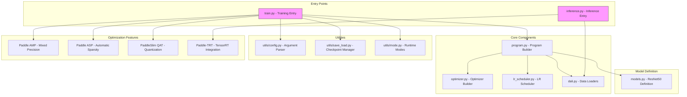
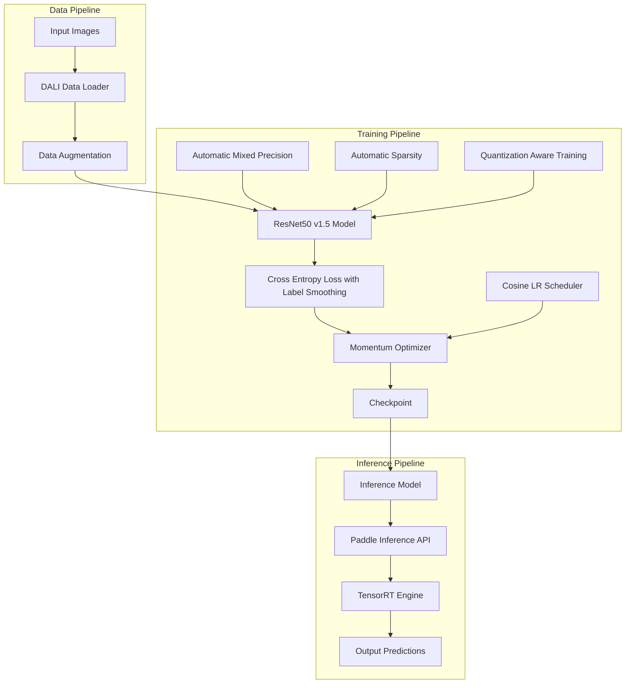
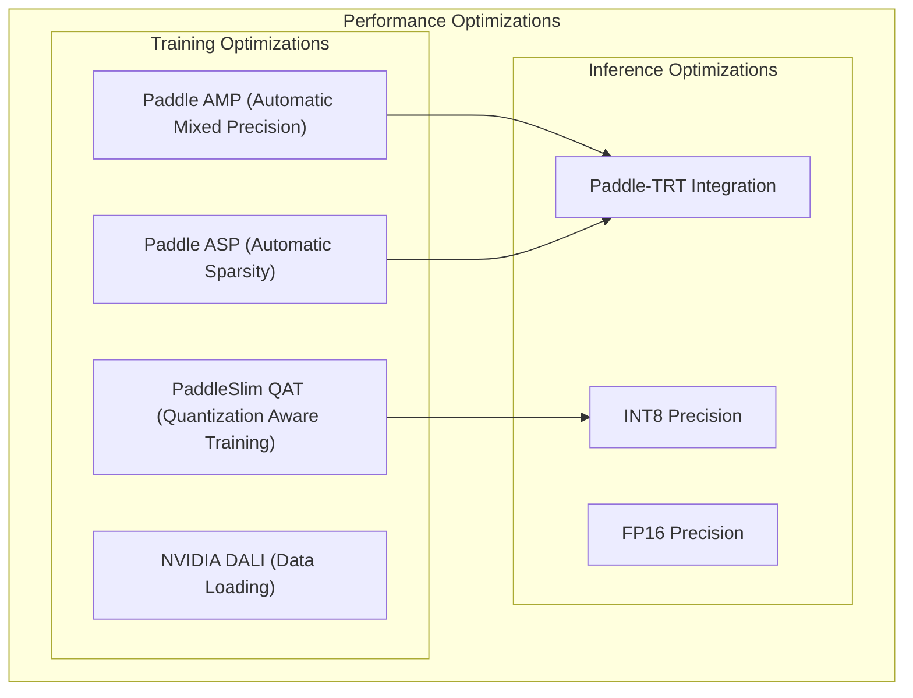
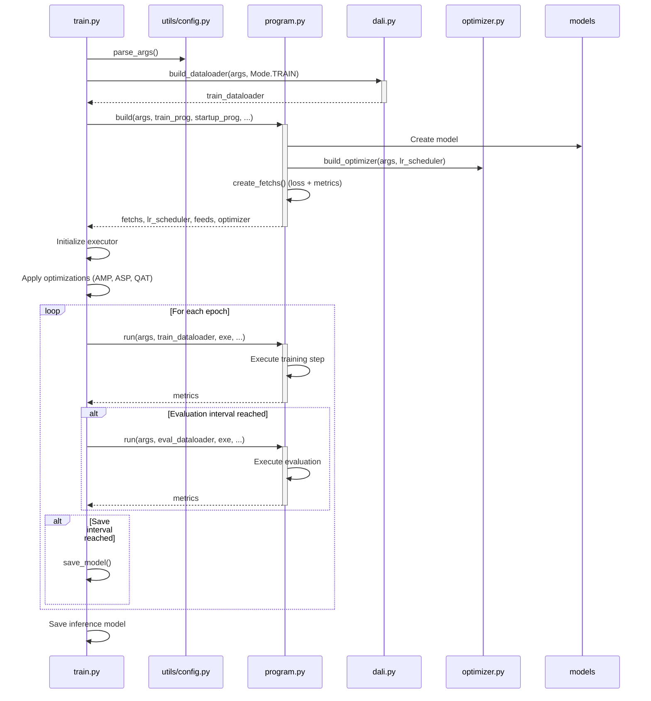

<!-- source: DeepWiki mcp.deepwiki.com · repo NVIDIA/DeepLearningExamples · page 4.1 PaddlePaddle Models · fetched 2026-10-26 -->

# PaddlePaddle Models

<details>
<summary>Relevant source files</summary>

The following files were used as context for generating this wiki page:

- [PaddlePaddle/Classification/RN50v1.5/Dockerfile](PaddlePaddle/Classification/RN50v1.5/Dockerfile)
- [PaddlePaddle/Classification/RN50v1.5/README.md](PaddlePaddle/Classification/RN50v1.5/README.md)
- [PaddlePaddle/Classification/RN50v1.5/inference.py](PaddlePaddle/Classification/RN50v1.5/inference.py)
- [PaddlePaddle/Classification/RN50v1.5/program.py](PaddlePaddle/Classification/RN50v1.5/program.py)
- [PaddlePaddle/Classification/RN50v1.5/scripts/inference/infer_resnet50_AMP.sh](PaddlePaddle/Classification/RN50v1.5/scripts/inference/infer_resnet50_AMP.sh)
- [PaddlePaddle/Classification/RN50v1.5/scripts/inference/infer_resnet50_TF32.sh](PaddlePaddle/Classification/RN50v1.5/scripts/inference/infer_resnet50_TF32.sh)
- [PaddlePaddle/Classification/RN50v1.5/scripts/training/train_resnet50_AMP_90E_DGXA100.sh](PaddlePaddle/Classification/RN50v1.5/scripts/training/train_resnet50_AMP_90E_DGXA100.sh)
- [PaddlePaddle/Classification/RN50v1.5/scripts/training/train_resnet50_TF32_90E_DGXA100.sh](PaddlePaddle/Classification/RN50v1.5/scripts/training/train_resnet50_TF32_90E_DGXA100.sh)
- [PaddlePaddle/Classification/RN50v1.5/train.py](PaddlePaddle/Classification/RN50v1.5/train.py)
- [PaddlePaddle/Classification/RN50v1.5/utils/config.py](PaddlePaddle/Classification/RN50v1.5/utils/config.py)

</details>


This document details the PaddlePaddle implementation of deep learning models in the NVIDIA DeepLearningExamples repository. Currently, this section focuses on the ResNet50 v1.5 model for image classification, which has been optimized for NVIDIA GPUs with advanced performance features.

## Table of Contents
- [Overview](#overview)
- [System Architecture](#system-architecture)
- [ResNet50 v1.5 Implementation](#resnet50-v15-implementation)
- [Optimization Features](#optimization-features)
- [Training Pipeline](#training-pipeline)
- [Inference Pipeline](#inference-pipeline)
- [Performance Benchmarks](#performance-benchmarks)

## Overview

The PaddlePaddle implementation in the NVIDIA DeepLearningExamples repository provides an optimized version of ResNet50 v1.5 for image classification. This implementation serves as a reference for building high-performance deep learning applications using the PaddlePaddle framework on NVIDIA hardware. The code showcases best practices for training and inference, including support for mixed precision training, multi-GPU training, automatic sparsity, quantization-aware training, and TensorRT integration.

Sources: [PaddlePaddle/Classification/RN50v1.5/README.md:1-54]()

## System Architecture

The following diagram illustrates the high-level architecture of the PaddlePaddle implementation:

### PaddlePaddle ResNet50 v1.5 System Architecture



Sources: [PaddlePaddle/Classification/RN50v1.5/train.py:1-209](), [PaddlePaddle/Classification/RN50v1.5/program.py:1-470](), [PaddlePaddle/Classification/RN50v1.5/utils/config.py:1-564]()

## ResNet50 v1.5 Implementation

The implementation is based on ResNet50 v1.5, a variant of the original ResNet50 architecture. The key difference is in the bottleneck blocks that require downsampling: v1 has stride=2 in the first 1x1 convolution, whereas v1.5 has stride=2 in the 3x3 convolution. This architectural change makes ResNet50 v1.5 slightly more accurate (~0.5% top1) but with a small performance drawback (~5% images/sec).

### Training and Inference Data Flow



Sources: [PaddlePaddle/Classification/RN50v1.5/README.md:55-122](), [PaddlePaddle/Classification/RN50v1.5/program.py:15-115]()

The implementation includes default configurations for optimal training:

- **Optimizer**: SGD with momentum (0.875)
- **Learning Rate**: Base LR of 0.256 for 256 batch size, linearly scaled for other batch sizes
- **LR Schedule**: Cosine LR schedule with 5-epoch linear warmup
- **Weight Decay**: 3.0517578125e-05 (1/32768)
- **Label Smoothing**: 0.1
- **Training Duration**: 50 epochs for 75.9% top1 accuracy or 90 epochs for 76.9% top1 accuracy

Sources: [PaddlePaddle/Classification/RN50v1.5/README.md:72-86]()

## Optimization Features

The implementation includes several key optimization features designed to maximize performance on NVIDIA GPUs:

### Optimization Features Overview



Sources: [PaddlePaddle/Classification/RN50v1.5/README.md:125-148](), [PaddlePaddle/Classification/RN50v1.5/program.py:132-194]()

### 1. Automatic Mixed Precision (AMP)

Paddle AMP enables mixed precision training, combining FP16 and FP32 operations to leverage Tensor Cores on NVIDIA GPUs for faster computation while maintaining accuracy. Key components include:

- FP16 for compute-intensive operations
- FP32 for precision-sensitive operations
- Loss scaling to prevent underflow

Implementation is straightforward:

```python
# For static graph
mp_optimizer = amp.decorate(optimizer=optimizer, init_loss_scaling=8.0)
ops, param_grads = mp_optimizer.minimize(loss)
scaled_loss = mp_optimizer.get_scaled_loss()

# For distributed training with Fleet
strategy = fleet.DistributedStrategy()
strategy.amp = True
optimizer = fleet.distributed_optimizer(optimizer, strategy=dist_strategy)
```

Sources: [PaddlePaddle/Classification/RN50v1.5/README.md:160-199](), [PaddlePaddle/Classification/RN50v1.5/program.py:180-188]()

### 2. Automatic Sparsity (ASP)

Automatic Sparsity provides a workflow to convert dense models to 2:4 structured sparse patterns, which allows inference to leverage Sparse Tensor Cores in Ampere architecture GPUs. This can theoretically achieve 2x speedup and save almost 50% memory usage. The workflow consists of two steps:

1. Prune a well-trained dense model to 2:4 sparse pattern
2. Retrain the sparse model to recover accuracy

Implementation requires minimal code changes:

```python
# Decorate optimizer
optimizer = sparsity.decorate(optimizer)
# Prune model
sparsity.prune_model(main_program)
```

Sources: [PaddlePaddle/Classification/RN50v1.5/README.md:211-231](), [PaddlePaddle/Classification/RN50v1.5/train.py:146-149]()

### 3. Quantization Aware Training (QAT)

QAT trains models with awareness of the quantization process, enabling better performance when deployed with reduced precision (INT8). The PaddleSlim toolkit provides simple APIs for quantization aware training:

```python
# Quantize the training program
quant_program = quanter.quant_aware(program)
# Convert to INT8 inference model
quant_infer_program = quanter.convert(quant_program)
```

Sources: [PaddlePaddle/Classification/RN50v1.5/README.md:234-256](), [PaddlePaddle/Classification/RN50v1.5/train.py:151-157]()

### 4. NVIDIA DALI Integration

The implementation uses NVIDIA DALI (Data Loading Library) for high-performance data loading and pre-processing, which helps eliminate CPU bottlenecks. DALI can use either CPU or GPU for data processing and outperforms PaddlePaddle's native data loader.

Sources: [PaddlePaddle/Classification/RN50v1.5/README.md:149-158]()

## Training Pipeline

The training pipeline encompasses model definition, optimizer configuration, data loading, and execution. Here's a detailed breakdown of the process flow:

### Training Process Flow



Sources: [PaddlePaddle/Classification/RN50v1.5/train.py:67-206](), [PaddlePaddle/Classification/RN50v1.5/program.py:198-470]()

### Key Components

1. **Program Creation**: The `build()` function in program.py creates the PaddlePaddle static computation graph, including model definition, loss function, and optimizer setup.

2. **Execution Strategy**: Configurations for efficiency like operation fusion, memory optimization, and multi-GPU synchronization.

3. **Training Loop**: Handles data loading, forward/backward passes, optimization steps, and metric collection.

4. **Checkpointing**: Periodic saving of model state for resuming training or inference.

The code supports three main running modes:
- `train_eval`: Train and evaluate the model
- `train_only`: Only perform training
- `eval_only`: Only evaluate a trained model

Sources: [PaddlePaddle/Classification/RN50v1.5/utils/config.py:154-255](), [PaddlePaddle/Classification/RN50v1.5/program.py:292-454]()

### Training Commands

Training can be launched using simple shell scripts:

```bash
# For TF32 and 8 GPUs training in 90 epochs
bash scripts/training/train_resnet50_TF32_90E_DGXA100.sh

# For AMP and 8 GPUs training in 90 epochs
bash scripts/training/train_resnet50_AMP_90E_DGXA100.sh
```

Or manually with specific options:

```bash
# For 8 GPUs training with AMP
python -m paddle.distributed.launch --gpus=0,1,2,3,4,5,6,7 train.py \
  --epochs 90 \
  --amp \
  --scale-loss 128.0 \
  --use-dynamic-loss-scaling \
  --data-layout NHWC
```

Sources: [PaddlePaddle/Classification/RN50v1.5/README.md:330-360](), [PaddlePaddle/Classification/RN50v1.5/scripts/training/train_resnet50_AMP_90E_DGXA100.sh:15-22]()

## Inference Pipeline

The inference pipeline leverages Paddle's inference API and TensorRT integration for optimized performance:

### Inference Process Flow

```mermaid
flowchart TD
    subgraph "Inference Pipeline"
        direction LR
        
        subgraph "Model Loading"
            load["Load inference model (.pdmodel, .pdiparams)"]
            config["Configure inference parameters"]
        end
        
        subgraph "TensorRT Optimization"
            trt_config["Enable TensorRT engine"]
            precision["Set precision (FP32/FP16/INT8)"]
            workspace["Configure workspace size"]
            shape["Set dynamic shape info"]
        end
        
        subgraph "Execution"
            predictor["Create predictor"]
            input_tensor["Prepare input tensors"]
            run["Run inference"]
            output["Collect outputs"]
        end
        
        load --> config
        config --> trt_config
        trt_config --> precision
        precision --> workspace
        workspace --> shape
        shape --> predictor
        predictor --> input_tensor
        input_tensor --> run
        run --> output
    end
```



Sources: [PaddlePaddle/Classification/RN50v1.5/inference.py:31-102]()

### Key Inference Components

1. **Paddle Inference API**: Used to load and execute trained models.

2. **Paddle-TRT Integration**: Integrates TensorRT for accelerated inference, supporting FP32, FP16, and INT8 precision.

3. **Dynamic Shape Support**: Configures dynamic input shapes for TensorRT optimization.

4. **Benchmarking**: Tools to measure throughput and latency on real or synthetic data.

The inference script (`inference.py`) supports both dataset-based inference (which includes data loading and pre-processing overhead) and synthetic data inference (which isolates model execution performance).

Sources: [PaddlePaddle/Classification/RN50v1.5/inference.py:104-217]()

### Inference Commands

Inference can be launched using shell scripts:

```bash
# FP32/TF32 inference
bash scripts/inference/infer_resnet50_TF32.sh

# FP16 inference with TensorRT
bash scripts/inference/infer_resnet50_AMP.sh
```

Or manually with specific options:

```bash
# For TensorRT FP16 inference
python inference.py \
    --data-layout NHWC \
    --inference-dir ./inference_amp \
    --precision FP16 \
    --batch-size 256
```

Sources: [PaddlePaddle/Classification/RN50v1.5/scripts/inference/infer_resnet50_AMP.sh:15-22](), [PaddlePaddle/Classification/RN50v1.5/scripts/inference/infer_resnet50_TF32.sh:15-22]()

## Performance Benchmarks

The implementation includes comprehensive benchmarking capabilities for both training and inference. Performance metrics are logged during execution and can be reported in JSON format.

### Training Metrics
- Loss
- Top-1 and Top-5 accuracy
- Images per second (throughput)
- Data loading time
- Computation time
- Batch time

### Inference Metrics
- Throughput (images per second)
- Average latency
- P90, P95, and P99 latency quantiles
- Accuracy (when using real dataset)

The codebase supports various hardware configurations, with performance optimizations specifically targeting NVIDIA Ampere architecture GPUs like the A100.

Sources: [PaddlePaddle/Classification/RN50v1.5/README.md:658-665](), [PaddlePaddle/Classification/RN50v1.5/program.py:456-469](), [PaddlePaddle/Classification/RN50v1.5/inference.py:143-204]()

---

