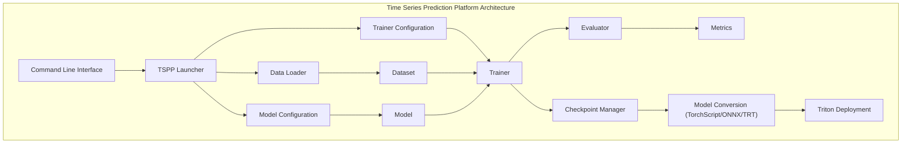
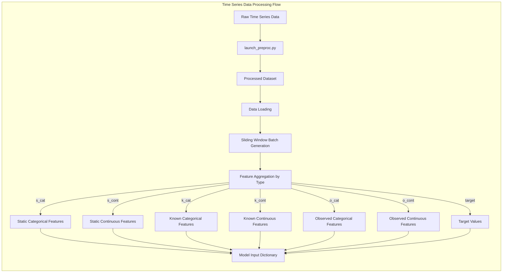
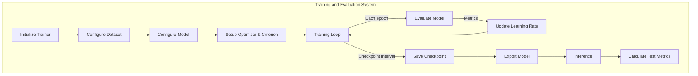
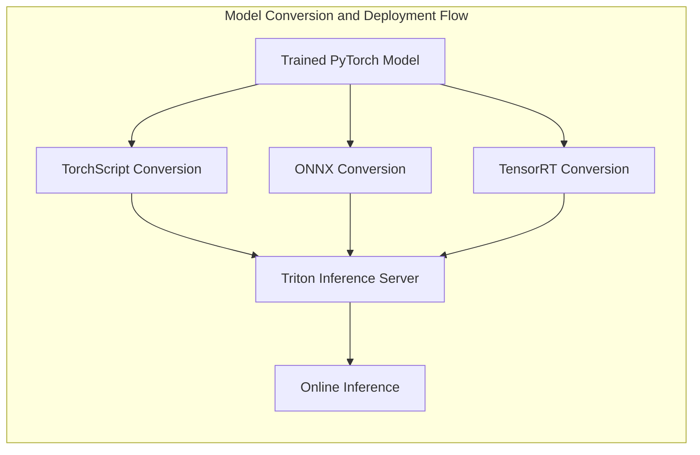

<!-- source: DeepWiki mcp.deepwiki.com · repo NVIDIA/DeepLearningExamples · page 4.2 Time Series Prediction Platform · fetched 2026-10-26 -->

# Time Series Prediction Platform

<details>
<summary>Relevant source files</summary>

The following files were used as context for generating this wiki page:

- [PyTorch/DrugDiscovery/MoFlow/Dockerfile](PyTorch/DrugDiscovery/MoFlow/Dockerfile)
- [PyTorch/DrugDiscovery/MoFlow/LICENSE](PyTorch/DrugDiscovery/MoFlow/LICENSE)
- [PyTorch/DrugDiscovery/MoFlow/NOTICE](PyTorch/DrugDiscovery/MoFlow/NOTICE)
- [PyTorch/DrugDiscovery/MoFlow/README.md](PyTorch/DrugDiscovery/MoFlow/README.md)
- [PyTorch/DrugDiscovery/MoFlow/img/moflow.png](PyTorch/DrugDiscovery/MoFlow/img/moflow.png)
- [PyTorch/DrugDiscovery/MoFlow/moflow/__init__.py](PyTorch/DrugDiscovery/MoFlow/moflow/__init__.py)
- [PyTorch/DrugDiscovery/MoFlow/moflow/config.py](PyTorch/DrugDiscovery/MoFlow/moflow/config.py)
- [PyTorch/DrugDiscovery/MoFlow/moflow/data/__init__.py](PyTorch/DrugDiscovery/MoFlow/moflow/data/__init__.py)
- [PyTorch/DrugDiscovery/MoFlow/moflow/data/data_frame_parser.py](PyTorch/DrugDiscovery/MoFlow/moflow/data/data_frame_parser.py)
- [PyTorch/DrugDiscovery/MoFlow/moflow/data/data_loader.py](PyTorch/DrugDiscovery/MoFlow/moflow/data/data_loader.py)
- [PyTorch/DrugDiscovery/MoFlow/moflow/data/encoding.py](PyTorch/DrugDiscovery/MoFlow/moflow/data/encoding.py)
- [README.md](README.md)
- [Tools/PyTorch/TimeSeriesPredictionPlatform/README.md](Tools/PyTorch/TimeSeriesPredictionPlatform/README.md)
- [Tools/PyTorch/TimeSeriesPredictionPlatform/requirements.txt](Tools/PyTorch/TimeSeriesPredictionPlatform/requirements.txt)
- [Tools/PyTorch/TimeSeriesPredictionPlatform/triton/requirements.txt](Tools/PyTorch/TimeSeriesPredictionPlatform/triton/requirements.txt)

</details>


The Time Series Prediction Platform (TSPP) is a comprehensive framework designed to facilitate the development, evaluation, and deployment of time series forecasting models. It provides a unified interface for researchers and practitioners to experiment with different models, datasets, and evaluation metrics in the domain of time series prediction. The platform enables users to compare various solutions side-by-side with complete control over evaluation metrics, datasets, prediction horizons, model choices, and hyperparameters.

## Purpose and Scope

This document covers the architecture, components, and workflows of the Time Series Prediction Platform. It explains how to use the platform for training, evaluation, and deployment of time series forecasting models, as well as how to extend it with custom datasets and models.

Sources: [Tools/PyTorch/TimeSeriesPredictionPlatform/README.md:1-43](), [Tools/PyTorch/TimeSeriesPredictionPlatform/README.md:44-72]()

## Platform Overview

Time-series prediction is a common problem across multiple domains including retail, industry, smart cities, and financial services. Research in this field is growing rapidly, but there has been a lack of a common framework to compare the accuracy and performance of models from both industry and academia. The Time Series Prediction Platform addresses this gap by providing:

1. A unified interface for multiple time series forecasting models
2. Support for various datasets and easy integration of custom data
3. Comprehensive evaluation metrics
4. Optimized training and inference pipelines
5. Deployment options for production environments

The platform supports handling multiple types of time series data, including:
- Observed values of the forecasted time-series
- Known data supporting the forecasts (e.g., day of the week)
- Static data (e.g., user ID)

Sources: [Tools/PyTorch/TimeSeriesPredictionPlatform/README.md:1-43](), [Tools/PyTorch/TimeSeriesPredictionPlatform/README.md:44-72]()

## Architecture

### Overall Architecture

Below is a diagram of the TSPP architecture:



The architecture consists of several key components:

1. **Command Line Interface**: Accepts user inputs to configure the training and evaluation process
2. **TSPP Launcher**: Sets up the components based on user inputs
3. **Data Loader**: Handles loading and preprocessing of data
4. **Model**: Implements the forecasting algorithm
5. **Trainer**: Manages the training process
6. **Evaluator**: Calculates performance metrics
7. **Checkpoint Manager**: Saves and loads model states
8. **Model Conversion**: Converts models to optimized formats
9. **Triton Deployment**: Deploys models to NVIDIA Triton Inference Server

Sources: [Tools/PyTorch/TimeSeriesPredictionPlatform/README.md:53-71]()

### Data Flow and Processing



The platform processes data through several stages:
1. Raw data is preprocessed using `launch_preproc.py`
2. Processed data is loaded into the platform
3. Data is organized into sliding windows for training and evaluation
4. Features are aggregated by type (static, known, observed) and data type (categorical, continuous)
5. The resulting feature dictionary is fed to the model

Sources: [Tools/PyTorch/TimeSeriesPredictionPlatform/README.md:344-359]()

## Key Components

### Supported Models

The TSPP includes implementations of several state-of-the-art time series forecasting models:

| Model | Description | Configuration File |
|-------|-------------|-------------------|
| Temporal Fusion Transformer (TFT) | Attention-based model incorporating temporal and feature-based attention | `conf/model/tft.yaml` |
| XGBoost | Gradient boosting framework for tabular data | `conf/model/xgboost.yaml` |
| AutoARIMA | Statistical model with automatic parameter selection | `conf/model/auto_arima.yaml` |
| LSTM | Long Short-Term Memory recurrent neural network | `conf/model/lstm.yaml` |
| N-BEATS | Neural basis expansion analysis for interpretable time series forecasting | `conf/model/nbeats.yaml` |
| N-HITS | Hierarchical interpolation for time series forecasting | `conf/model/nhits.yaml` |
| DeepAR | Autoregressive recurrent network | `conf/model/deepar.yaml` |
| MTGNN | Multivariate time series forecasting with graph neural networks | `conf/model/mtgnn.yaml` |
| DCRNN | Diffusion Convolutional Recurrent Neural Network | `conf/model/dcrnn.yaml` |

Sources: [Tools/PyTorch/TimeSeriesPredictionPlatform/README.md:110-120]()

### Supported Datasets

The platform supports several publicly available datasets out of the box:

| Dataset | Description | Source |
|---------|-------------|--------|
| Electricity | Electricity consumption of 370 customers | UCI Electricity Load Diagrams |
| Traffic | Occupancy rate of San Francisco freeways from 440 sensors | UCI PEMS-SF Data Set |
| M5 | Walmart retail forecasting data | M5 Competition |
| PEMS-BAY | Traffic data from the Bay Area | California DoT |

Sources: [Tools/PyTorch/TimeSeriesPredictionPlatform/README.md:121-127]()

### Training and Evaluation System



The training and evaluation process involves:
1. Initializing the trainer with the configured dataset and model
2. Setting up the optimizer and loss criterion
3. Running the training loop with periodic evaluation
4. Saving checkpoints at specified intervals
5. Exporting the trained model for inference
6. Running inference on test data and calculating metrics

Sources: [Tools/PyTorch/TimeSeriesPredictionPlatform/README.md:382-407]()

## Using the Platform

### Quick Start

To get started with the Time Series Prediction Platform:

1. Create a dataset directory
2. Build the Docker container with `docker build -t tspp .`
3. Run the container with `docker run -it --gpus all --ipc=host --network=host -v /your/datasets/:/workspace/datasets/ tspp bash`
4. Preprocess a dataset with `python data/script_preprocess_data.py --dataset {dataset_name} --output_dir /workspace/datasets/`
5. Run the preprocessing pipeline with `python launch_preproc.py dataset={dataset_name}`
6. Launch training with `python launch_training.py model=tft dataset={dataset_name} trainer/criterion=quantile`

Sources: [Tools/PyTorch/TimeSeriesPredictionPlatform/README.md:148-189]()

### Adding a New Dataset

The platform supports custom datasets through these steps:

1. Prepare your data in CSV format with at least three columns: time feature, labels, and dataset ID
2. Create a configuration file in `conf/dataset/` specifying:
   - Source and destination paths
   - Time ID column
   - Train/validation/test ranges
   - Encoder and example lengths
   - Features specifications
   - Sampling parameters
3. Preprocess the dataset with `python launch_preproc.py dataset={dataset_name}`
4. Train a model on the new dataset with `python launch_training.py dataset={dataset_name} model=tft trainer/criterion=quantile`

Sources: [Tools/PyTorch/TimeSeriesPredictionPlatform/README.md:191-254]()

### Adding a New Model

To integrate a custom model:

1. Implement your model using PyTorch
2. The model should handle data formatted as a dictionary with tensors representing different covariate types
3. Create a configuration file in `conf/model/` pointing to your model class
4. Include any dataset-specific configurations in `conf/model_dataset/{modelname_datasetname.yaml}`
5. Verify the model can be run with `python launch_training.py model={model_name}`

Sources: [Tools/PyTorch/TimeSeriesPredictionPlatform/README.md:341-397]()

## Advanced Features

### Multi-GPU Training

The platform supports multi-GPU training without requiring changes to model code:

```
python launch_training.py -m hydra/launcher=torchrun hydra.launcher.nproc_per_node={num_gpus} {override parameters}
```

This utilizes PyTorch's Distributed Data Parallel (DDP) framework to accelerate training.

Sources: [Tools/PyTorch/TimeSeriesPredictionPlatform/README.md:456-467]()

### Memory Mapping for Large Datasets

For large datasets that don't fit in RAM, memory mapping can be used:

```
python launch_training.py +dataset.config.memory_mapped=True trainer.config.num_workers={workers}
```

This allows the platform to work with datasets stored on disk rather than loading them entirely into memory.

Sources: [Tools/PyTorch/TimeSeriesPredictionPlatform/README.md:453-455]()

### Hyperparameter Search

Hyperparameter optimization is supported through Optuna:

```
python launch_training.py -m hydra/sweeper=optuna hydra.sweeper.n_trials={N} {parameter_ranges}
```

This enables automated search for optimal model configurations.

Sources: [Tools/PyTorch/TimeSeriesPredictionPlatform/README.md:493-522]()

### Parallel Training

For seed sweeps or hyperparameter searches on multi-GPU machines, parallel workloads can be run:

```
python launch_training.py -m seed='range(1,17)' model=tft dataset=electricity hydra/launcher=joblib hydra.launcher.n_jobs=8 hydra.sweeper.max_batch_size=8
```

This distributes different training runs across available GPUs.

Sources: [Tools/PyTorch/TimeSeriesPredictionPlatform/README.md:466-481]()

### Conversion, Deployment and Inference

The platform supports model conversion to optimized formats and deployment to NVIDIA Triton Inference Server:



The workflow involves:
1. Converting trained models to TorchScript, ONNX, or TensorRT formats
2. Deploying these models to Triton Inference Server
3. Performing online inference with optimized performance

Sources: [Tools/PyTorch/TimeSeriesPredictionPlatform/README.md:85-88](), [Tools/PyTorch/TimeSeriesPredictionPlatform/README.md:79-81]()

## Technical Optimizations

### Mixed Precision Training

The platform supports mixed precision training, which offers computational speedup by performing operations in half-precision format while storing minimal information in single-precision:

```
python launch_training.py model=tft dataset=electricity trainer.config.amp=True
```

This enables faster training on NVIDIA GPUs with Tensor Cores.

Sources: [Tools/PyTorch/TimeSeriesPredictionPlatform/README.md:90-105]()

### Curriculum Learning

Curriculum learning gradually increases the difficulty of the prediction task during training:

```
python launch_training.py model=tft dataset=electricity trainer.config.cl_start_horizon={start} trainer.config.cl_update={update}
```

This approach can improve convergence and final model performance.

Sources: [Tools/PyTorch/TimeSeriesPredictionPlatform/README.md:489-491]()

### Exponential Moving Averaging

EMA maintains a weighted moving average of model weights during training:

```
python launch_training.py model=tft dataset=electricity trainer.config.ema=True trainer.config.ema_decay={decay}
```

This technique often improves convergence properties and final model quality.

Sources: [Tools/PyTorch/TimeSeriesPredictionPlatform/README.md:483-487]()

## Integration with NVIDIA Infrastructure

The Time Series Prediction Platform is designed to work seamlessly with NVIDIA's infrastructure:

1. **GPU Acceleration**: Leverages NVIDIA GPUs for fast training and inference
2. **Tensor Cores**: Uses mixed precision to take advantage of Tensor Cores on Volta, Turing, and Ampere architectures
3. **Multi-GPU Support**: Scales to multiple GPUs using PyTorch's Distributed Data Parallel
4. **Triton Inference Server**: Supports deployment to NVIDIA Triton for optimized inference
5. **TensorRT**: Enables conversion to TensorRT for accelerated inference

This integration allows for both efficient research experimentation and production deployment of time series forecasting models.

Sources: [Tools/PyTorch/TimeSeriesPredictionPlatform/README.md:73-80]()

## Dependencies and Setup

The platform requires:
- NVIDIA GPU (Ampere, Volta, or Turing architecture)
- Ubuntu 20.04
- NVIDIA Docker
- Custom Docker container built for this tool

The Docker environment includes all necessary Python dependencies such as:
- PyTorch
- pmdarima (for statistical models)
- hydra-core (for configuration)
- optuna (for hyperparameter optimization)
- xgboost
- pandas and numpy (for data processing)

Sources: [Tools/PyTorch/TimeSeriesPredictionPlatform/requirements.txt:1-21](), [Tools/PyTorch/TimeSeriesPredictionPlatform/README.md:132-146]()

## Additional Features

The platform includes several other advanced features:
- **MoFlow for Drug Discovery**: While separate from the core time series functionality, the repository also includes MoFlow, a model for molecule generation that leverages Normalizing Flows. It enables navigation of chemical space for drug discovery.
- **XGBoost Training**: Supports GPU-accelerated XGBoost for time series, including training separate models for each step in the prediction horizon.
- **Ensembling**: Combines predictions from multiple models to improve overall accuracy.
- **Model Interpretation**: Provides tools to understand model decisions and feature importance.

Sources: [PyTorch/DrugDiscovery/MoFlow/README.md:47-71](), [Tools/PyTorch/TimeSeriesPredictionPlatform/README.md:541-551]()

## Conclusion

The Time Series Prediction Platform provides a comprehensive framework for developing, evaluating, and deploying time series forecasting models. It supports a wide range of models and datasets, offers robust optimization capabilities, and integrates with NVIDIA's infrastructure for accelerated performance. The platform is designed to be extensible, allowing users to add custom datasets and models to fit their specific needs.

Whether you're a researcher comparing different forecasting approaches or a practitioner developing production-ready models, the TSPP offers the tools and flexibility to achieve your time series prediction goals efficiently.

---

