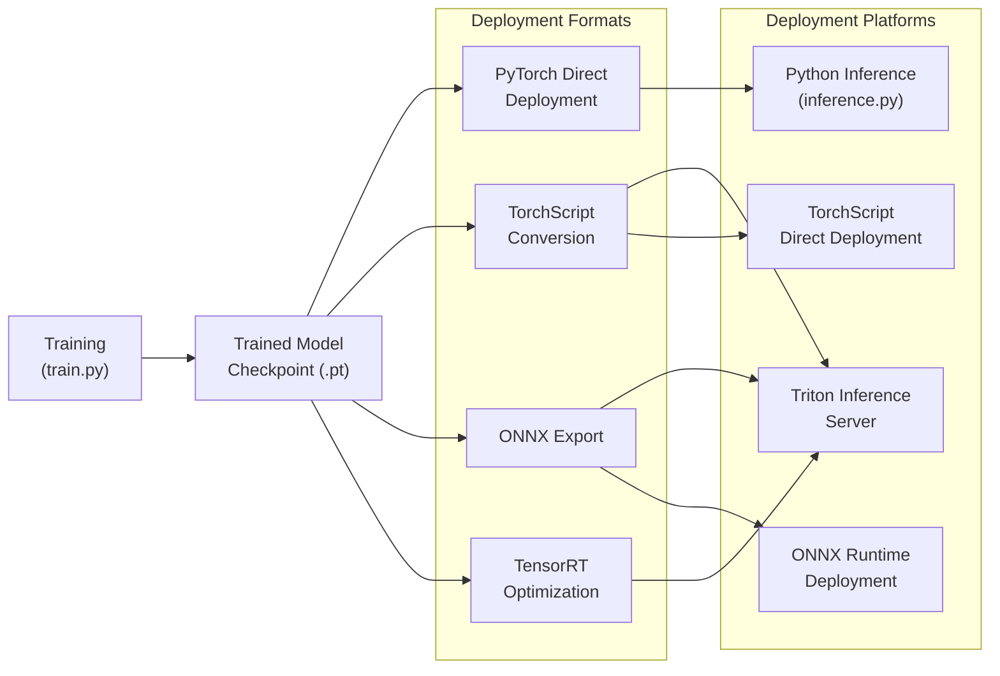
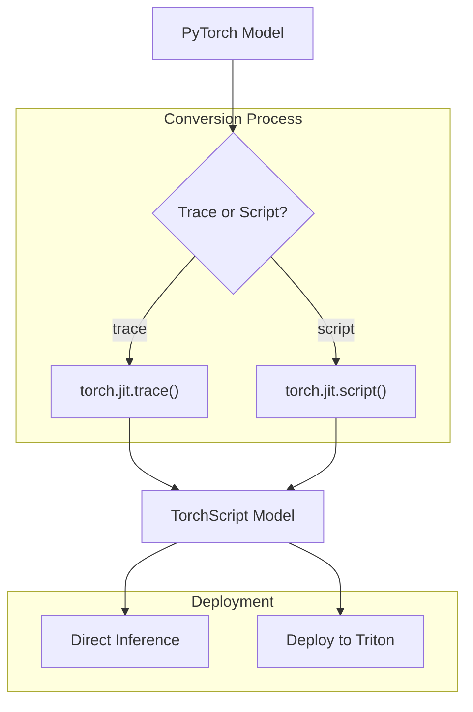
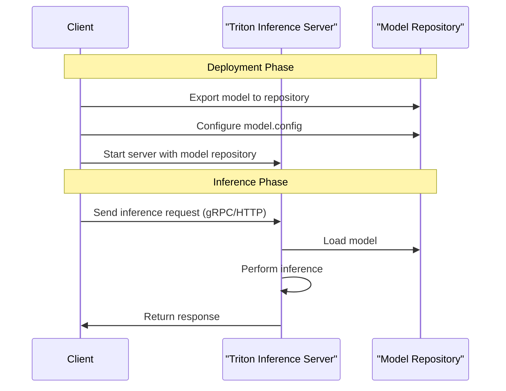
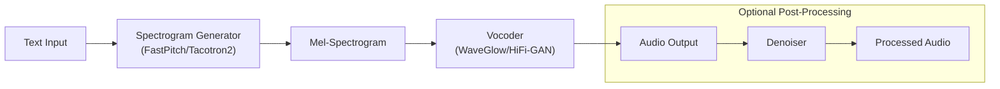
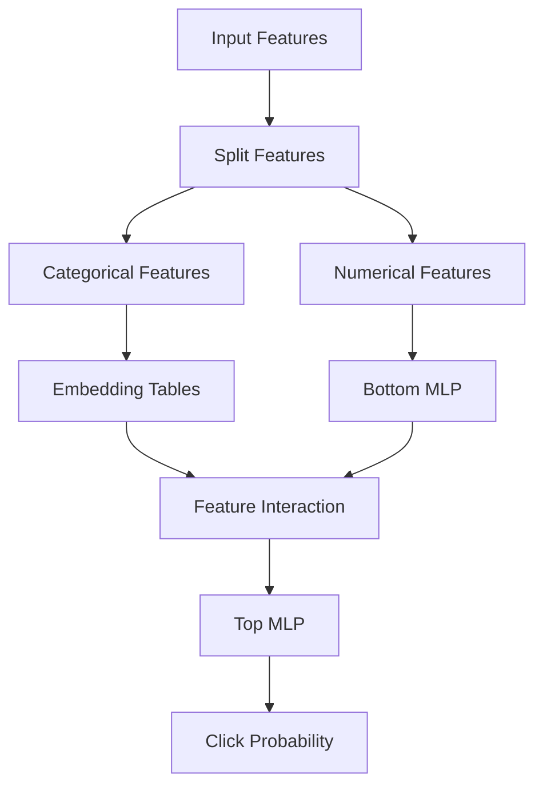
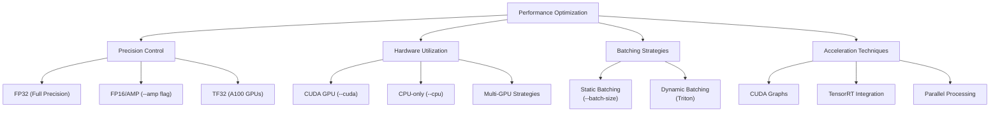

<!-- source: DeepWiki mcp.deepwiki.com · repo NVIDIA/DeepLearningExamples · page 5 Deployment · fetched 2026-10-26 -->

# Deployment

<details>
<summary>Relevant source files</summary>

The following files were used as context for generating this wiki page:

- [PyTorch/Recommendation/DLRM/dlrm/cuda_ext/dot_based_interact.py](PyTorch/Recommendation/DLRM/dlrm/cuda_ext/dot_based_interact.py)
- [PyTorch/Recommendation/DLRM/dlrm/cuda_ext/fused_gather_embedding.py](PyTorch/Recommendation/DLRM/dlrm/cuda_ext/fused_gather_embedding.py)
- [PyTorch/Recommendation/DLRM/dlrm/cuda_ext/sparse_embedding.py](PyTorch/Recommendation/DLRM/dlrm/cuda_ext/sparse_embedding.py)
- [PyTorch/Recommendation/DLRM/dlrm/data/data_loader.py](PyTorch/Recommendation/DLRM/dlrm/data/data_loader.py)
- [PyTorch/Recommendation/DLRM/dlrm/data/datasets.py](PyTorch/Recommendation/DLRM/dlrm/data/datasets.py)
- [PyTorch/Recommendation/DLRM/dlrm/data/feature_spec.py](PyTorch/Recommendation/DLRM/dlrm/data/feature_spec.py)
- [PyTorch/Recommendation/DLRM/dlrm/data/utils.py](PyTorch/Recommendation/DLRM/dlrm/data/utils.py)
- [PyTorch/Recommendation/DLRM/dlrm/model/distributed.py](PyTorch/Recommendation/DLRM/dlrm/model/distributed.py)
- [PyTorch/Recommendation/DLRM/dlrm/nn/embeddings.py](PyTorch/Recommendation/DLRM/dlrm/nn/embeddings.py)
- [PyTorch/Recommendation/DLRM/dlrm/scripts/main.py](PyTorch/Recommendation/DLRM/dlrm/scripts/main.py)
- [PyTorch/Recommendation/DLRM/dlrm/scripts/utils.py](PyTorch/Recommendation/DLRM/dlrm/scripts/utils.py)
- [PyTorch/Recommendation/DLRM/preproc/split_dataset.py](PyTorch/Recommendation/DLRM/preproc/split_dataset.py)
- [PyTorch/Recommendation/DLRM/triton/README.md](PyTorch/Recommendation/DLRM/triton/README.md)
- [PyTorch/Recommendation/DLRM/triton/client.py](PyTorch/Recommendation/DLRM/triton/client.py)
- [PyTorch/Recommendation/DLRM/triton/deployer.py](PyTorch/Recommendation/DLRM/triton/deployer.py)
- [PyTorch/SpeechSynthesis/FastPitch/Dockerfile](PyTorch/SpeechSynthesis/FastPitch/Dockerfile)
- [PyTorch/SpeechSynthesis/FastPitch/README.md](PyTorch/SpeechSynthesis/FastPitch/README.md)
- [PyTorch/SpeechSynthesis/FastPitch/inference.py](PyTorch/SpeechSynthesis/FastPitch/inference.py)
- [PyTorch/SpeechSynthesis/FastPitch/scripts/inference_benchmark.sh](PyTorch/SpeechSynthesis/FastPitch/scripts/inference_benchmark.sh)
- [PyTorch/SpeechSynthesis/FastPitch/scripts/inference_example.sh](PyTorch/SpeechSynthesis/FastPitch/scripts/inference_example.sh)
- [PyTorch/SpeechSynthesis/FastPitch/train.py](PyTorch/SpeechSynthesis/FastPitch/train.py)
- [PyTorch/SpeechSynthesis/FastPitch/triton/Dockerfile-model](PyTorch/SpeechSynthesis/FastPitch/triton/Dockerfile-model)
- [PyTorch/SpeechSynthesis/FastPitch/triton/calculate_metrics.py](PyTorch/SpeechSynthesis/FastPitch/triton/calculate_metrics.py)
- [PyTorch/SpeechSynthesis/FastPitch/triton/config_model_on_triton.py](PyTorch/SpeechSynthesis/FastPitch/triton/config_model_on_triton.py)
- [PyTorch/SpeechSynthesis/FastPitch/triton/deployment_toolkit/.version](PyTorch/SpeechSynthesis/FastPitch/triton/deployment_toolkit/.version)
- [PyTorch/SpeechSynthesis/FastPitch/triton/deployment_toolkit/args.py](PyTorch/SpeechSynthesis/FastPitch/triton/deployment_toolkit/args.py)
- [PyTorch/SpeechSynthesis/FastPitch/triton/deployment_toolkit/bermuda/tensorrt.py](PyTorch/SpeechSynthesis/FastPitch/triton/deployment_toolkit/bermuda/tensorrt.py)
- [PyTorch/SpeechSynthesis/FastPitch/triton/deployment_toolkit/core.py](PyTorch/SpeechSynthesis/FastPitch/triton/deployment_toolkit/core.py)
- [PyTorch/SpeechSynthesis/FastPitch/triton/deployment_toolkit/dump.py](PyTorch/SpeechSynthesis/FastPitch/triton/deployment_toolkit/dump.py)
- [PyTorch/SpeechSynthesis/FastPitch/triton/requirements.txt](PyTorch/SpeechSynthesis/FastPitch/triton/requirements.txt)
- [PyTorch/SpeechSynthesis/FastPitch/triton/run_inference_on_triton.py](PyTorch/SpeechSynthesis/FastPitch/triton/run_inference_on_triton.py)
- [PyTorch/SpeechSynthesis/Tacotron2/Dockerfile](PyTorch/SpeechSynthesis/Tacotron2/Dockerfile)
- [PyTorch/SpeechSynthesis/Tacotron2/inference.py](PyTorch/SpeechSynthesis/Tacotron2/inference.py)
- [PyTorch/SpeechSynthesis/Tacotron2/models.py](PyTorch/SpeechSynthesis/Tacotron2/models.py)
- [PyTorch/SpeechSynthesis/Tacotron2/phrases/phrase_1_128.txt](PyTorch/SpeechSynthesis/Tacotron2/phrases/phrase_1_128.txt)
- [PyTorch/SpeechSynthesis/Tacotron2/run_latency_tests.sh](PyTorch/SpeechSynthesis/Tacotron2/run_latency_tests.sh)
- [PyTorch/SpeechSynthesis/Tacotron2/run_latency_tests_cpu.sh](PyTorch/SpeechSynthesis/Tacotron2/run_latency_tests_cpu.sh)
- [PyTorch/SpeechSynthesis/Tacotron2/tacotron2/model.py](PyTorch/SpeechSynthesis/Tacotron2/tacotron2/model.py)
- [PyTorch/SpeechSynthesis/Tacotron2/test_infer.py](PyTorch/SpeechSynthesis/Tacotron2/test_infer.py)
- [PyTorch/SpeechSynthesis/Tacotron2/test_infer.sh](PyTorch/SpeechSynthesis/Tacotron2/test_infer.sh)
- [PyTorch/SpeechSynthesis/Tacotron2/waveglow/model.py](PyTorch/SpeechSynthesis/Tacotron2/waveglow/model.py)

</details>


This page covers the various approaches for deploying trained models from the NVIDIA Deep Learning Examples repository. It provides guidance on deployment formats, platforms, and optimization techniques to effectively serve models in production environments.

## Overview of Deployment Options

The Deep Learning Examples repository supports multiple deployment pathways, allowing flexibility in how models are served for inference:



Sources: [PyTorch/SpeechSynthesis/FastPitch/inference.py](), [PyTorch/SpeechSynthesis/Tacotron2/inference.py](), [PyTorch/Recommendation/DLRM/triton/README.md]()

## Model Export and Conversion

### PyTorch Native Format

The simplest deployment approach is using models directly in their native PyTorch format. Models can be loaded from checkpoints and used for inference without conversion.

```python
# Load trained model from checkpoint
model = load_and_setup_model('FastPitch', parser, args.fastpitch, 
                           args.amp, device, forward_is_infer=True)
# Run inference
output = model(input_data)
```

Sources: [PyTorch/SpeechSynthesis/FastPitch/inference.py](), [PyTorch/SpeechSynthesis/Tacotron2/models.py:65-92]()

### TorchScript Conversion

For better performance and portability, models can be converted to TorchScript format using either tracing or scripting methods:

```python
# Convert to TorchScript using tracing
traced_model = torch.jit.trace(model, example_input)

# or using scripting
scripted_model = torch.jit.script(model)
```

The repository supports this conversion as part of the deployment process:



TorchScript conversion is particularly useful for models with dynamic behavior and allows deployment on platforms without Python dependencies.

Sources: [PyTorch/SpeechSynthesis/FastPitch/inference.py:217-220](), [PyTorch/Recommendation/DLRM/triton/README.md:62-65]()

### ONNX Export

For maximum portability across inference platforms, models can be exported to ONNX (Open Neural Network Exchange) format:

```python
# Export model to ONNX
torch.onnx.export(model, example_input, "model.onnx", 
                 input_names=["input"], output_names=["output"],
                 dynamic_axes={"input": {0: "batch_size"}, 
                              "output": {0: "batch_size"}})
```

This format allows deployment on a wide range of platforms and hardware accelerators beyond NVIDIA GPUs.

Sources: [PyTorch/Recommendation/DLRM/triton/README.md:65](), [PyTorch/SpeechSynthesis/FastPitch/triton/config_model_on_triton.py]()

## Deployment Platforms

### Direct Python Inference

For simple use cases, models can be deployed directly using Python scripts. The repository includes dedicated inference scripts for each model:

```python
# Example inference command for FastPitch
python inference.py \
    --cuda \
    --fastpitch /path/to/checkpoint.pt \
    --waveglow /path/to/vocoder.pt \
    --input input_text.txt \
    --output output_dir
```

This approach is straightforward but may not be suitable for production environments with high throughput requirements.

Sources: [PyTorch/SpeechSynthesis/FastPitch/scripts/inference_example.sh](), [PyTorch/SpeechSynthesis/Tacotron2/inference.py:192-277]()

### Triton Inference Server

For production deployment, NVIDIA's Triton Inference Server provides an optimized serving platform:



Triton supports various model formats (PyTorch, TorchScript, ONNX, TensorRT) and provides features like:
- Dynamic batching
- Concurrent model execution
- Load balancing
- Model ensembles
- Hardware acceleration

To deploy a model to Triton:

1. Export your model to a supported format
2. Create a model repository structure:
   ```
   model_repository/
   ├── model_name/
   │   ├── 1/         # Version directory
   │   │   └── model.pt  # Model file
   │   └── config.pbtxt  # Model configuration
   ```
3. Configure the model (config.pbtxt)
4. Start the Triton server:
   ```bash
   docker run -d --gpus=all -p 8000:8000 -p 8001:8001 -p 8002:8002 \
      -v /path/to/model_repository:/models \
      nvcr.io/nvidia/tritonserver:21.08-py3 tritonserver \
      --model-repository=/models
   ```

Sources: [PyTorch/Recommendation/DLRM/triton/README.md:16-135](), [PyTorch/SpeechSynthesis/FastPitch/triton/run_inference_on_triton.py:35-71]()

## Model-Specific Deployment Workflows

### Speech Synthesis Models (FastPitch, Tacotron2, WaveGlow)

Speech synthesis in this repository typically involves two components:
1. A spectrogram generator (FastPitch or Tacotron2)
2. A vocoder (WaveGlow or HiFi-GAN)

The deployment workflow is:



Deployment example:
```python
# Load models
tacotron2 = load_model('Tacotron2', tacotron2_checkpoint)
waveglow = load_model('WaveGlow', waveglow_checkpoint)
denoiser = Denoiser(waveglow)

# Inference pipeline
text_encoded = text_to_sequence(input_text)
mel, mel_lengths = tacotron2.infer(text_encoded)
audio = waveglow.infer(mel)
audio_denoised = denoiser(audio, strength=0.01)
```

Sources: [PyTorch/SpeechSynthesis/FastPitch/inference.py:286-566](), [PyTorch/SpeechSynthesis/Tacotron2/inference.py:192-277]()

### Recommendation Models (DLRM)

DLRM (Deep Learning Recommendation Model) deployment has unique considerations due to its embedding tables:



For DLRM deployment, the repository supports:
- Direct PyTorch inference
- TorchScript export optimized for production
- Triton deployment with performance optimizations

Sources: [PyTorch/Recommendation/DLRM/triton/README.md:22-125](), [PyTorch/Recommendation/DLRM/dlrm/scripts/main.py:277-321]()

## Performance Optimization Techniques



### Mixed Precision Inference

Using mixed precision (FP16) can significantly improve performance with negligible accuracy impact:

```python
# Enable mixed precision
if args.amp:
    model = model.half()  # Convert model to FP16
    
# or selectively with CUDA AMP
with torch.cuda.amp.autocast(enabled=args.amp):
    output = model(input_data)
```

This can provide up to 2-3x speedup on V100 GPUs and even greater benefits on Ampere architecture.

Sources: [PyTorch/SpeechSynthesis/FastPitch/inference.py:166-168](), [PyTorch/SpeechSynthesis/Tacotron2/inference.py:64-68]()

### CUDA Graphs

For models with static input shapes, CUDA Graphs can eliminate CPU overhead:

```python
# Capture CUDA Graph
g = torch.cuda.CUDAGraph()
with torch.cuda.graph(g):
    output = model(static_input)
    
# Replay graph for inference
g.replay()
```

The repository implements this for DLRM inference, providing up to 30% latency reduction.

Sources: [PyTorch/Recommendation/DLRM/dlrm/scripts/main.py:194-274]()

### Batch Size Optimization

Selecting optimal batch size is crucial for maximizing throughput:

```bash
# Benchmarking different batch sizes
for BATCH_SIZE in 1 4 8 16 32 64; do
    python inference.py --batch-size $BATCH_SIZE --benchmark
done
```

The repository includes benchmarking scripts to identify the optimal batch size for specific models and hardware.

Sources: [PyTorch/SpeechSynthesis/FastPitch/scripts/inference_benchmark.sh:1-17](), [PyTorch/Recommendation/DLRM/dlrm/scripts/main.py:524-542]()

### CPU vs GPU Deployment

The repository supports both CPU and GPU deployment with specific optimizations:

- GPU deployment: Optimized with CUDA, TensorRT, and mixed precision
- CPU deployment: Thread affinity settings, optimized memory access patterns

To switch between them:

```python
# GPU deployment
if args.cuda:
    model = model.cuda()
    
# CPU deployment
if args.cpu:
    # CPU-specific optimizations
    model = model.cpu()
    set_cpu_affinity()  # Set thread affinity
```

Sources: [PyTorch/SpeechSynthesis/Tacotron2/run_latency_tests_cpu.sh:1-7](), [PyTorch/SpeechSynthesis/Tacotron2/test_infer.py:63-64]()

## Benchmarking and Performance Analysis

The repository includes tools for benchmarking model performance:

```python
# Measure inference time
with MeasureTime(measurements, 'inference_time', cuda=args.cuda):
    output = model(input_data)
    
# Calculate throughput and latency statistics
latency_avg = np.mean(latencies)
throughput = batch_size / latency_avg
```

Key metrics to monitor:
- Latency (ms): Time to process a single request
- Throughput (samples/s): Number of samples processed per second
- Memory usage: GPU/CPU memory consumption
- Hardware utilization: GPU, CPU utilization during inference

Sources: [PyTorch/SpeechSynthesis/FastPitch/inference.py:450-459](), [PyTorch/SpeechSynthesis/Tacotron2/test_infer.py:79-108]()

## Integration with Deployment Frameworks

### Triton Inference Server Integration

The repository provides detailed guidance for deploying models on Triton Inference Server:

1. Model conversion (PyTorch → TorchScript/ONNX)
2. Model repository setup
3. Model configuration
4. Server initialization
5. Client implementation

```python
# Client example for sending inference requests to Triton
with InferenceServerClient(args.triton_server_url) as client:
    inputs = [
        InferInput("input__0", input_tensor.shape, "FP32"),
    ]
    inputs[0].set_data_from_numpy(input_tensor)
    
    outputs = [
        InferRequestedOutput("output__0"),
    ]
    
    response = client.infer(args.triton_model_name, 
                           inputs, 
                           request_id=str(uuid.uuid4()), 
                           outputs=outputs)
    
    result = response.as_numpy("output__0")
```

Triton offers advantages like dynamic batching, multi-model serving, and optimized resource utilization.

Sources: [PyTorch/Recommendation/DLRM/triton/README.md:126-146](), [PyTorch/SpeechSynthesis/FastPitch/triton/run_inference_on_triton.py:75-136]()

### TensorRT Integration

For maximum GPU performance, TensorRT integration is supported:

```python
# Convert model to TensorRT
from torch2trt import torch2trt
trt_model = torch2trt(model, [example_input], 
                     fp16_mode=True, 
                     max_batch_size=64)

# Save TensorRT model
torch.save(trt_model.state_dict(), "model_trt.pth")
```

This can provide 2-5x throughput improvements over PyTorch, especially for inference-heavy workloads.

Sources: [PyTorch/SpeechSynthesis/FastPitch/triton/deployment_toolkit/bermuda/tensorrt.py]()

## Conclusion

The NVIDIA Deep Learning Examples repository provides comprehensive deployment options across multiple formats and platforms. The choice of deployment method depends on specific requirements:

- **Development/Testing**: Direct PyTorch inference is simplest
- **Production/High Throughput**: Triton Inference Server with TorchScript/TensorRT
- **Cross-Platform Deployment**: ONNX export for platform flexibility

By following the guidelines and examples in this page, you can effectively deploy trained models for inference in various environments.

Sources: [PyTorch/SpeechSynthesis/FastPitch/README.md:216-295](), [PyTorch/Recommendation/DLRM/triton/README.md:1-15]()