# Page: Overview

# Overview

<details>
<summary>Relevant source files</summary>

The following files were used as context for generating this wiki page:

- [PyTorch/DrugDiscovery/MoFlow/Dockerfile](PyTorch/DrugDiscovery/MoFlow/Dockerfile)
- [PyTorch/DrugDiscovery/MoFlow/LICENSE](PyTorch/DrugDiscovery/MoFlow/LICENSE)
- [PyTorch/DrugDiscovery/MoFlow/NOTICE](PyTorch/DrugDiscovery/MoFlow/NOTICE)
- [PyTorch/DrugDiscovery/MoFlow/README.md](PyTorch/DrugDiscovery/MoFlow/README.md)
- [PyTorch/DrugDiscovery/MoFlow/img/moflow.png](PyTorch/DrugDiscovery/MoFlow/img/moflow.png)
- [PyTorch/DrugDiscovery/MoFlow/moflow/__init__.py](PyTorch/DrugDiscovery/MoFlow/moflow/__init__.py)
- [PyTorch/DrugDiscovery/MoFlow/moflow/config.py](PyTorch/DrugDiscovery/MoFlow/moflow/config.py)
- [PyTorch/DrugDiscovery/MoFlow/moflow/data/__init__.py](PyTorch/DrugDiscovery/MoFlow/moflow/data/__init__.py)
- [PyTorch/DrugDiscovery/MoFlow/moflow/data/data_frame_parser.py](PyTorch/DrugDiscovery/MoFlow/moflow/data/data_frame_parser.py)
- [PyTorch/DrugDiscovery/MoFlow/moflow/data/data_loader.py](PyTorch/DrugDiscovery/MoFlow/moflow/data/data_loader.py)
- [PyTorch/DrugDiscovery/MoFlow/moflow/data/encoding.py](PyTorch/DrugDiscovery/MoFlow/moflow/data/encoding.py)
- [README.md](README.md)
- [Tools/PyTorch/TimeSeriesPredictionPlatform/README.md](Tools/PyTorch/TimeSeriesPredictionPlatform/README.md)
- [Tools/PyTorch/TimeSeriesPredictionPlatform/requirements.txt](Tools/PyTorch/TimeSeriesPredictionPlatform/requirements.txt)
- [Tools/PyTorch/TimeSeriesPredictionPlatform/triton/requirements.txt](Tools/PyTorch/TimeSeriesPredictionPlatform/triton/requirements.txt)

</details>


The NVIDIA Deep Learning Examples repository provides state-of-the-art deep learning model implementations that are optimized for NVIDIA GPUs. This repository serves as a comprehensive collection of reference architectures and optimized models across multiple frameworks and application domains. The examples are designed to achieve both high performance and accuracy while taking advantage of NVIDIA's hardware and software stack.

This page provides a high-level overview of the repository structure, common features and optimizations, and the range of models available. For detailed information about specific frameworks, refer to [PyTorch Models](#2), [TensorFlow Models](#3), or [Other Frameworks](#4).

## Repository Structure and Organization

The repository is organized primarily by deep learning framework, then by application domain, and finally by specific model implementations.

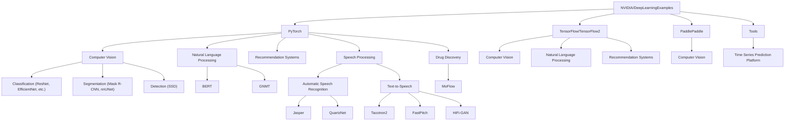

Sources: [README.md:3-89](https://github.com/NVIDIA/DeepLearningExamples/blob/master/README.md)

## Supported Models and Domains

The repository contains models across various domains:

### Computer Vision
- **Classification**: ResNet-50, ResNeXt-101, SE-ResNeXt-101, EfficientNet (v1/v2), GPUNet
- **Object Detection**: SSD
- **Segmentation**: Mask R-CNN, U-Net Medical, nnUNet

### Natural Language Processing
- **Language Understanding**: BERT, ELECTRA
- **Translation**: GNMT
- **Optimized Inference**: Faster Transformer

### Recommendation Systems
- DLRM (Deep Learning Recommendation Model)
- Neural Collaborative Filtering (NCF)
- Wide & Deep Learning
- Variational Autoencoder for Collaborative Filtering (VAE-CF)
- Search Interest Map (SIM)

### Speech Technologies
- **Speech Recognition**: Jasper, QuartzNet
- **Text-to-Speech**: Tacotron 2, FastPitch, HiFi-GAN

### Other Applications
- **Time Series Forecasting**: Time Series Prediction Platform (TSPP)
- **Drug Discovery**: MoFlow (molecular flow model)
- **Graph Neural Networks**: SE(3)-Transformer

Sources: [README.md:14-89](https://github.com/NVIDIA/DeepLearningExamples/blob/master/README.md)

## Training and Inference Pipeline

Most examples in the repository follow a common workflow pattern that spans training through inference to deployment:

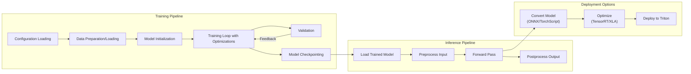

Sources: [README.md:91-122](https://github.com/NVIDIA/DeepLearningExamples/blob/master/README.md)

## Common Features and Optimizations

The examples in this repository implement various performance optimizations to maximize GPU utilization and minimize training and inference time:

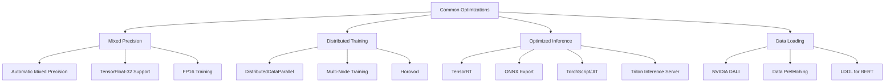

### Mixed Precision Training

Mixed precision combines different numerical precisions in a computational method. This approach:
- Performs operations in half-precision format (FP16) where possible
- Maintains critical information in single-precision (FP32)
- Provides up to 3x overall speedup on architectures with Tensor Cores
- Requires proper loss scaling to preserve small gradient values

### TensorFloat-32 (TF32)

TF32 is a math mode in NVIDIA A100 GPUs for tensor operations that:
- Provides up to 10x speedups compared to FP32 on Volta GPUs
- Is more robust than FP16 for models requiring high dynamic range
- Is enabled by default on Ampere architecture

### Distributed Training

Most examples support:
- Multi-GPU training using PyTorch's DistributedDataParallel or TensorFlow's distribution strategies
- Multi-node training on supported models
- Horovod integration for some models

### Optimized Inference

Inference optimizations include:
- TensorRT integration for faster inference
- ONNX export for framework-agnostic deployment
- TorchScript/JIT compilation for PyTorch models
- Triton Inference Server deployment examples

Sources: [README.md:99-116](https://github.com/NVIDIA/DeepLearningExamples/blob/master/README.md)

## Specialized Platforms

### Time Series Prediction Platform

The Time Series Prediction Platform (TSPP) is a comprehensive framework for time-series forecasting that enables mixing and matching of different datasets and models. This platform:

- Supports multiple models: Temporal Fusion Transformer, XGBoost, AutoARIMA, LSTM, N-BEATS, N-HITS, DeepAR, MTGNN, DCRNN
- Works with various datasets: Electricity, Traffic, M5, PEMS-BAY
- Enables advanced features like mixed precision, multi-GPU training, and deployment via ONNX/TensorRT/Triton
- Provides flexible experiment workflow with easy model and dataset customization

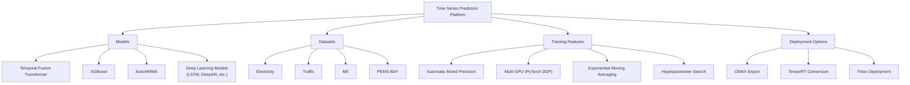

Sources: [Tools/PyTorch/TimeSeriesPredictionPlatform/README.md:1-131](https://github.com/NVIDIA/DeepLearningExamples/blob/master/Tools/PyTorch/TimeSeriesPredictionPlatform/README.md)

### MoFlow for Drug Discovery

MoFlow is a state-of-the-art model for molecule generation that leverages Normalizing Flows to generate novel molecular structures. Key features include:

- Generation of novel molecules with similar properties to training data
- Support for de-novo drug design by navigating chemical space
- Optimized implementation with CUDA parallelism and mixed precision
- Performance enhancements including stream concurrency and memory optimizations

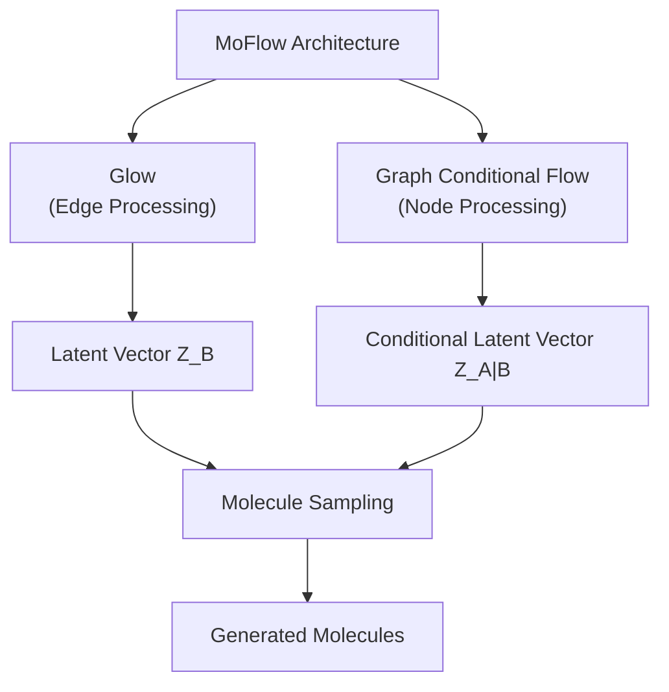

Sources: [PyTorch/DrugDiscovery/MoFlow/README.md:40-83](https://github.com/NVIDIA/DeepLearningExamples/blob/master/PyTorch/DrugDiscovery/MoFlow/README.md)

## NGC Container Support

The examples in this repository are also available through the NVIDIA GPU Cloud (NGC) Container Registry, which provides:

- Monthly updated Docker containers with the latest examples
- Latest NVIDIA contributions to the respective frameworks
- Quality-assured deep learning software libraries (cuDNN, NCCL, cuBLAS, etc.)
- Regular release notes for each optimized container

Sources: [README.md:6-12](https://github.com/NVIDIA/DeepLearningExamples/blob/master/README.md)

## Repository Features at a Glance

| Feature | Description |
|---------|-------------|
| Frameworks | PyTorch, TensorFlow, TensorFlow 2, PaddlePaddle |
| Application Domains | Computer Vision, NLP, Recommendation Systems, Speech, Drug Discovery, Time Series |
| Training Optimizations | Automatic Mixed Precision, Multi-GPU, Multi-Node, Fast Data Loading |
| Inference Optimizations | TensorRT, ONNX Export, TorchScript/JIT, Triton Inference Server |
| Container Support | NGC containers with all dependencies included |
| Documentation | README files with detailed instructions, performance benchmarks, and known issues |

Sources: [README.md:14-89](https://github.com/NVIDIA/DeepLearningExamples/blob/master/README.md)

## Getting Started 

To get started with these examples:

1. Access the NGC container registry
2. Pull the desired container
3. Run the container with appropriate GPU resources
4. Follow the example-specific instructions in the respective README

For detailed instructions, refer to:
- [Getting Started Using NVIDIA GPU Cloud](https://docs.nvidia.com/ngc/ngc-getting-started-guide/index.html)
- [Accessing And Pulling From The NGC Container Registry](https://docs.nvidia.com/deeplearning/frameworks/user-guide/index.html#accessing_registry)

Sources: [README.md:6-12](https://github.com/NVIDIA/DeepLearningExamples/blob/master/README.md)

---

# Page: Repository Structure

# Repository Structure

<details>
<summary>Relevant source files</summary>

The following files were used as context for generating this wiki page:

- [PyTorch/Classification/ConvNets/checkpoint2model.py](PyTorch/Classification/ConvNets/checkpoint2model.py)
- [PyTorch/Classification/ConvNets/image_classification/models/__init__.py](PyTorch/Classification/ConvNets/image_classification/models/__init__.py)
- [PyTorch/Classification/ConvNets/image_classification/models/common.py](PyTorch/Classification/ConvNets/image_classification/models/common.py)
- [PyTorch/Classification/ConvNets/image_classification/models/efficientnet.py](PyTorch/Classification/ConvNets/image_classification/models/efficientnet.py)
- [PyTorch/Classification/ConvNets/image_classification/models/entrypoints.py](PyTorch/Classification/ConvNets/image_classification/models/entrypoints.py)
- [PyTorch/Classification/ConvNets/image_classification/models/model.py](PyTorch/Classification/ConvNets/image_classification/models/model.py)
- [PyTorch/Classification/ConvNets/image_classification/models/resnet.py](PyTorch/Classification/ConvNets/image_classification/models/resnet.py)
- [PyTorch/Classification/ConvNets/image_classification/optimizers.py](PyTorch/Classification/ConvNets/image_classification/optimizers.py)
- [PyTorch/Classification/ConvNets/quant_main.py](PyTorch/Classification/ConvNets/quant_main.py)
- [PyTorch/DrugDiscovery/MoFlow/Dockerfile](PyTorch/DrugDiscovery/MoFlow/Dockerfile)
- [PyTorch/DrugDiscovery/MoFlow/LICENSE](PyTorch/DrugDiscovery/MoFlow/LICENSE)
- [PyTorch/DrugDiscovery/MoFlow/NOTICE](PyTorch/DrugDiscovery/MoFlow/NOTICE)
- [PyTorch/DrugDiscovery/MoFlow/README.md](PyTorch/DrugDiscovery/MoFlow/README.md)
- [PyTorch/DrugDiscovery/MoFlow/img/moflow.png](PyTorch/DrugDiscovery/MoFlow/img/moflow.png)
- [PyTorch/DrugDiscovery/MoFlow/moflow/__init__.py](PyTorch/DrugDiscovery/MoFlow/moflow/__init__.py)
- [PyTorch/DrugDiscovery/MoFlow/moflow/config.py](PyTorch/DrugDiscovery/MoFlow/moflow/config.py)
- [PyTorch/DrugDiscovery/MoFlow/moflow/data/__init__.py](PyTorch/DrugDiscovery/MoFlow/moflow/data/__init__.py)
- [PyTorch/DrugDiscovery/MoFlow/moflow/data/data_frame_parser.py](PyTorch/DrugDiscovery/MoFlow/moflow/data/data_frame_parser.py)
- [PyTorch/DrugDiscovery/MoFlow/moflow/data/data_loader.py](PyTorch/DrugDiscovery/MoFlow/moflow/data/data_loader.py)
- [PyTorch/DrugDiscovery/MoFlow/moflow/data/encoding.py](PyTorch/DrugDiscovery/MoFlow/moflow/data/encoding.py)
- [README.md](README.md)
- [Tools/PyTorch/TimeSeriesPredictionPlatform/README.md](Tools/PyTorch/TimeSeriesPredictionPlatform/README.md)
- [Tools/PyTorch/TimeSeriesPredictionPlatform/requirements.txt](Tools/PyTorch/TimeSeriesPredictionPlatform/requirements.txt)
- [Tools/PyTorch/TimeSeriesPredictionPlatform/triton/requirements.txt](Tools/PyTorch/TimeSeriesPredictionPlatform/triton/requirements.txt)
- [hubconf.py](hubconf.py)

</details>


This document provides an overview of the structure and organization of the NVIDIA Deep Learning Examples repository. It explains how the codebase is organized by frameworks and application domains, and describes key components and patterns found throughout the repository.

## Overview

The NVIDIA Deep Learning Examples repository contains optimized implementations of deep learning models across various frameworks and application domains. The repository is designed to demonstrate best practices for training and deploying state-of-the-art deep learning models on NVIDIA hardware.

The repository follows a hierarchical organization pattern:

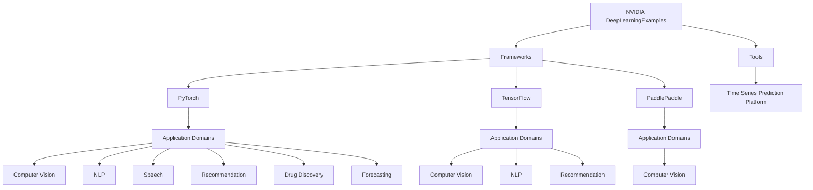

Sources: [README.md:1-123](), [hubconf.py:1-34]()

## Primary Framework Directories

The repository is organized first by framework, with each framework directory containing implementations for various application domains:

| Framework | Directory | Description |
|-----------|-----------|-------------|
| PyTorch | `PyTorch/` | Contains PyTorch implementations for CV, NLP, Speech, Recommendation, Drug Discovery, and Forecasting |
| TensorFlow | `TensorFlow/` | Contains TensorFlow implementations for CV, NLP, and Recommendation |
| PaddlePaddle | `PaddlePaddle/` | Contains PaddlePaddle implementations for CV |
| Tools | `Tools/` | Contains standalone tools like the Time Series Prediction Platform |

Each framework directory follows similar patterns but might have framework-specific organization details based on the framework's conventions.

Sources: [README.md:15-90]()

## Application Domain Organization

Within each framework directory, models are organized by application domain. Below is a breakdown of the main application domains and their subdirectories:

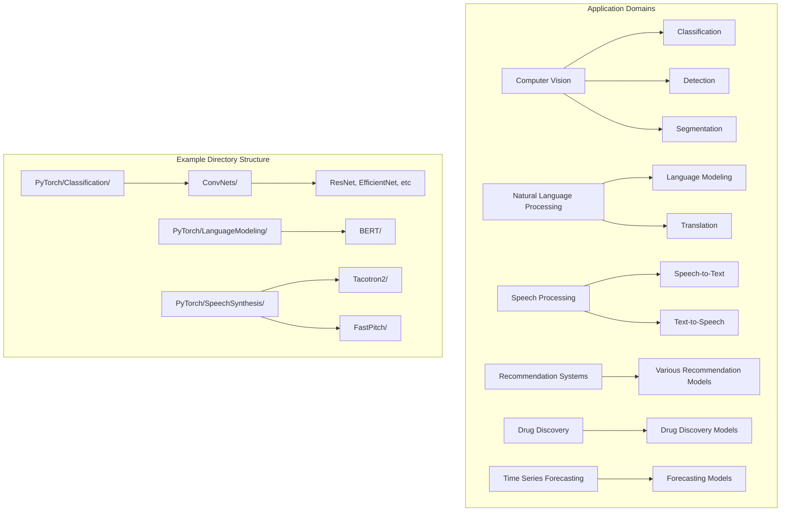

Sources: [README.md:15-90](), [hubconf.py:1-34]()

## Model Implementation Structure

Each model implementation typically follows a consistent structure, with slight variations based on the framework and domain. Here's a general pattern:

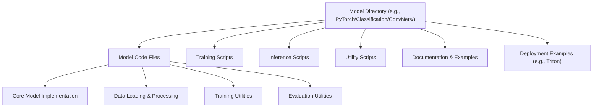

Sources: [PyTorch/Classification/ConvNets/image_classification/models/model.py:1-185](), [PyTorch/Classification/ConvNets/image_classification/models/resnet.py:1-459](), [PyTorch/Classification/ConvNets/image_classification/models/efficientnet.py:1-585]()

### PyTorch Models Directory Structure

The PyTorch models follow a particularly consistent structure, which helps with maintainability and code reuse. Let's look at the specific structure of PyTorch classification models:

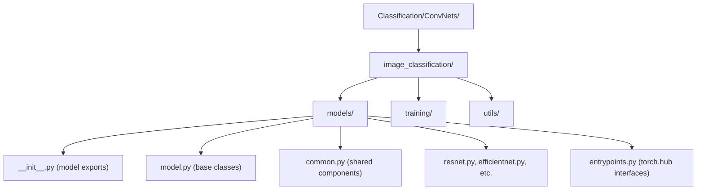

The key components in the PyTorch models directory are:

- `__init__.py`: Exports model constructors and entry points
- `model.py`: Contains base classes for models like `Model`, `ModelParams`, and `EntryPoint`
- `common.py`: Contains shared components like `LayerBuilder` and common layer definitions
- Model-specific files (e.g., `resnet.py`, `efficientnet.py`): Implement specific architectures
- `entrypoints.py`: Provides torch.hub interfaces for model loading

Sources: [PyTorch/Classification/ConvNets/image_classification/models/__init__.py:1-25](), [PyTorch/Classification/ConvNets/image_classification/models/model.py:1-185](), [PyTorch/Classification/ConvNets/image_classification/models/common.py:1-303](), [PyTorch/Classification/ConvNets/image_classification/models/resnet.py:1-459](), [PyTorch/Classification/ConvNets/image_classification/models/efficientnet.py:1-585](), [PyTorch/Classification/ConvNets/image_classification/models/entrypoints.py:1-116]()

### Model Definition Pattern

The repository uses a consistent pattern for defining models, which facilitates code reuse and maintainability. Here's the common pattern used for PyTorch models:

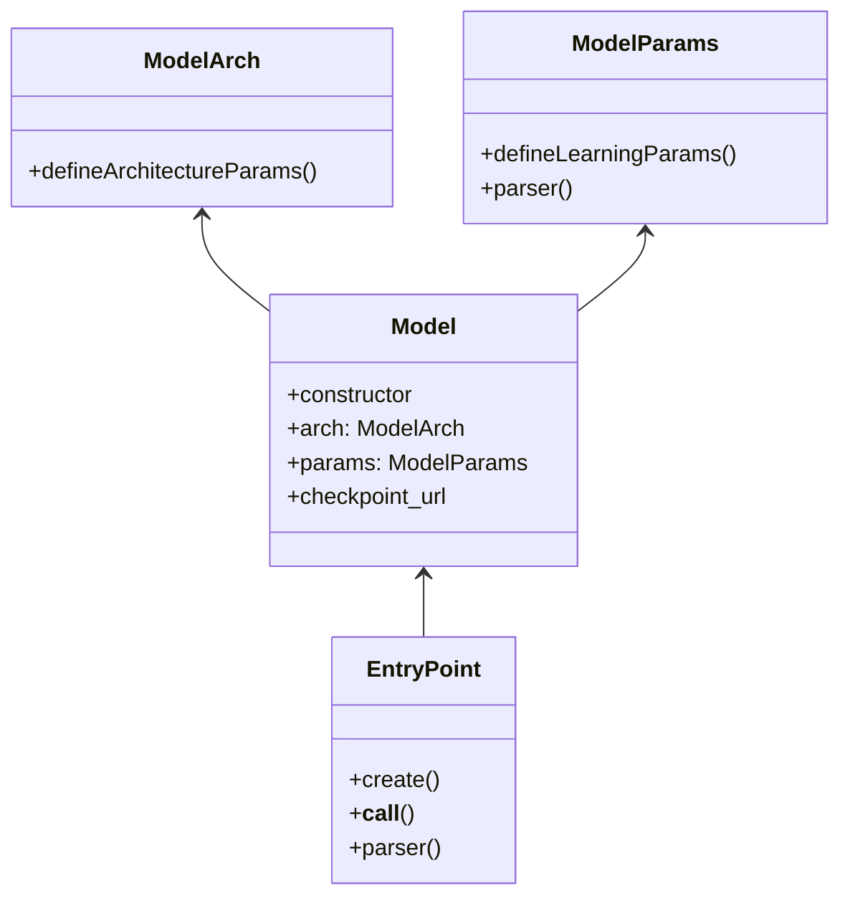

This pattern allows for:
- Clear separation of architecture parameters and training parameters
- Easy command-line argument parsing through the `parser()` methods
- Consistent model loading and checkpoint handling
- Unified interface for torch.hub

Sources: [PyTorch/Classification/ConvNets/image_classification/models/model.py:15-184](), [PyTorch/Classification/ConvNets/image_classification/models/resnet.py:212-252](), [PyTorch/Classification/ConvNets/image_classification/models/efficientnet.py:52-129]()

## Tools Directory

The `Tools` directory contains standalone utilities and platforms that complement the model implementations:

### Time Series Prediction Platform

The Time Series Prediction Platform (TSPP) is a comprehensive framework for time series forecasting:

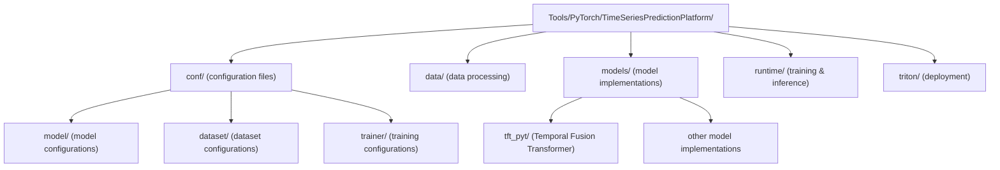

The TSPP follows a modular design that allows users to:
- Mix and match different datasets and models
- Configure training parameters
- Deploy models using Triton Inference Server
- Evaluate models using various metrics

The platform supports multiple models such as Temporal Fusion Transformer, XGBoost, AutoARIMA, LSTM, N-BEATS, N-HITS, DeepAR, MTGNN, and DCRNN.

Sources: [Tools/PyTorch/TimeSeriesPredictionPlatform/README.md:1-448](), [Tools/PyTorch/TimeSeriesPredictionPlatform/requirements.txt:1-21](), [Tools/PyTorch/TimeSeriesPredictionPlatform/triton/requirements.txt:1-24]()

## Drug Discovery Models

The repository includes specialized models for drug discovery, such as MoFlow:

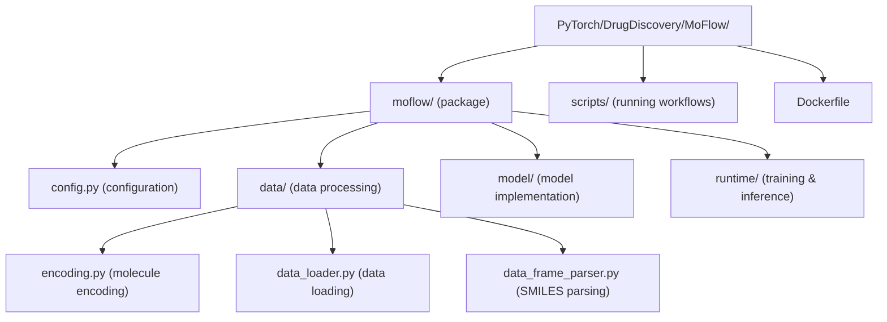

MoFlow is a model for molecule generation using normalizing flows, which allows for generating novel molecules with drug-like properties. The implementation includes:
- Molecule encoding and decoding
- Graph and bond processing
- Training and inference scripts
- Deployment examples

Sources: [PyTorch/DrugDiscovery/MoFlow/README.md:1-363](), [PyTorch/DrugDiscovery/MoFlow/moflow/config.py:1-143](), [PyTorch/DrugDiscovery/MoFlow/moflow/data/encoding.py:1-122](), [PyTorch/DrugDiscovery/MoFlow/moflow/data/data_loader.py:1-111](), [PyTorch/DrugDiscovery/MoFlow/moflow/data/data_frame_parser.py:1-110]()

## Common Utilities and Features

Across the repository, there are several common utilities and features that appear in most model implementations:

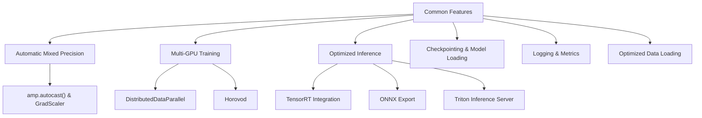

These common features ensure that all model implementations benefit from NVIDIA's performance optimizations and follow best practices for training and inference on NVIDIA GPUs.

Sources: [README.md:76-116](), [PyTorch/Classification/ConvNets/checkpoint2model.py:1-44](), [PyTorch/Classification/ConvNets/quant_main.py:1-166](), [PyTorch/Classification/ConvNets/image_classification/optimizers.py:1-161]()

## Hub Configuration

The repository includes a `hubconf.py` file that enables PyTorch Hub integration, allowing users to easily load pre-trained models:

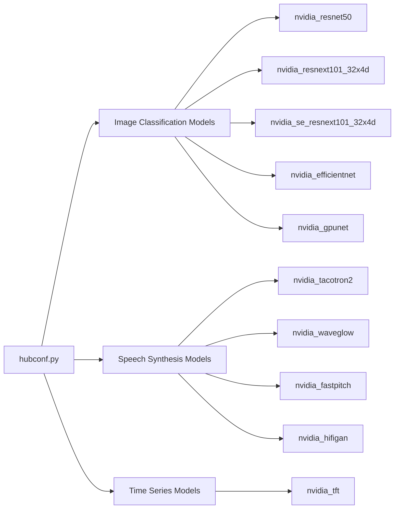

The hubconf.py file provides a convenient way to access the pre-trained models through PyTorch's torch.hub API, making it easy for users to incorporate these models into their own projects.

Sources: [hubconf.py:1-35]()

## Summary

The NVIDIA Deep Learning Examples repository is organized in a hierarchical structure, with framework-specific directories at the top level, followed by application domains. Each model implementation follows a consistent pattern that includes model definition, training and inference scripts, and deployment examples.

Key features of the repository structure:
- Organized by framework (PyTorch, TensorFlow, PaddlePaddle)
- Further organized by application domain (CV, NLP, Speech, etc.)
- Consistent model implementation patterns
- Common utilities and optimizations across models
- Standalone tools and platforms for specific use cases
- PyTorch Hub integration for easy model loading

This structure enables users to find and use the models they need efficiently, while also allowing for code reuse and consistent implementation of best practices across different models and domains.

---

# Page: Common Features and Optimizations

# Common Features and Optimizations

<details>
<summary>Relevant source files</summary>

The following files were used as context for generating this wiki page:

- [PyTorch/DrugDiscovery/MoFlow/Dockerfile](PyTorch/DrugDiscovery/MoFlow/Dockerfile)
- [PyTorch/DrugDiscovery/MoFlow/LICENSE](PyTorch/DrugDiscovery/MoFlow/LICENSE)
- [PyTorch/DrugDiscovery/MoFlow/NOTICE](PyTorch/DrugDiscovery/MoFlow/NOTICE)
- [PyTorch/DrugDiscovery/MoFlow/README.md](PyTorch/DrugDiscovery/MoFlow/README.md)
- [PyTorch/DrugDiscovery/MoFlow/img/moflow.png](PyTorch/DrugDiscovery/MoFlow/img/moflow.png)
- [PyTorch/DrugDiscovery/MoFlow/moflow/__init__.py](PyTorch/DrugDiscovery/MoFlow/moflow/__init__.py)
- [PyTorch/DrugDiscovery/MoFlow/moflow/config.py](PyTorch/DrugDiscovery/MoFlow/moflow/config.py)
- [PyTorch/DrugDiscovery/MoFlow/moflow/data/__init__.py](PyTorch/DrugDiscovery/MoFlow/moflow/data/__init__.py)
- [PyTorch/DrugDiscovery/MoFlow/moflow/data/data_frame_parser.py](PyTorch/DrugDiscovery/MoFlow/moflow/data/data_frame_parser.py)
- [PyTorch/DrugDiscovery/MoFlow/moflow/data/data_loader.py](PyTorch/DrugDiscovery/MoFlow/moflow/data/data_loader.py)
- [PyTorch/DrugDiscovery/MoFlow/moflow/data/encoding.py](PyTorch/DrugDiscovery/MoFlow/moflow/data/encoding.py)
- [PyTorch/LanguageModeling/BERT/Dockerfile](PyTorch/LanguageModeling/BERT/Dockerfile)
- [PyTorch/LanguageModeling/BERT/LICENSE](PyTorch/LanguageModeling/BERT/LICENSE)
- [PyTorch/LanguageModeling/BERT/README.md](PyTorch/LanguageModeling/BERT/README.md)
- [PyTorch/LanguageModeling/BERT/data/Downloader.py](PyTorch/LanguageModeling/BERT/data/Downloader.py)
- [PyTorch/LanguageModeling/BERT/data/bertPrep.py](PyTorch/LanguageModeling/BERT/data/bertPrep.py)
- [PyTorch/LanguageModeling/BERT/data/create_datasets_from_start.sh](PyTorch/LanguageModeling/BERT/data/create_datasets_from_start.sh)
- [PyTorch/LanguageModeling/BERT/modeling.py](PyTorch/LanguageModeling/BERT/modeling.py)
- [PyTorch/LanguageModeling/BERT/optimization.py](PyTorch/LanguageModeling/BERT/optimization.py)
- [PyTorch/LanguageModeling/BERT/run.sub](PyTorch/LanguageModeling/BERT/run.sub)
- [PyTorch/LanguageModeling/BERT/run_glue.py](PyTorch/LanguageModeling/BERT/run_glue.py)
- [PyTorch/LanguageModeling/BERT/run_pretraining.py](PyTorch/LanguageModeling/BERT/run_pretraining.py)
- [PyTorch/LanguageModeling/BERT/run_squad.py](PyTorch/LanguageModeling/BERT/run_squad.py)
- [PyTorch/LanguageModeling/BERT/run_swag.py](PyTorch/LanguageModeling/BERT/run_swag.py)
- [PyTorch/LanguageModeling/BERT/scripts/run_glue.sh](PyTorch/LanguageModeling/BERT/scripts/run_glue.sh)
- [PyTorch/LanguageModeling/BERT/scripts/run_pretraining.sh](PyTorch/LanguageModeling/BERT/scripts/run_pretraining.sh)
- [PyTorch/LanguageModeling/BERT/utils.py](PyTorch/LanguageModeling/BERT/utils.py)
- [README.md](README.md)
- [TensorFlow/Classification/ConvNets/README.md](TensorFlow/Classification/ConvNets/README.md)
- [TensorFlow/Classification/ConvNets/resnet50v1.5/README.md](TensorFlow/Classification/ConvNets/resnet50v1.5/README.md)
- [TensorFlow/Classification/ConvNets/resnext101-32x4d/README.md](TensorFlow/Classification/ConvNets/resnext101-32x4d/README.md)
- [TensorFlow/Classification/ConvNets/se-resnext101-32x4d/README.md](TensorFlow/Classification/ConvNets/se-resnext101-32x4d/README.md)
- [TensorFlow/Detection/SSD/README.md](TensorFlow/Detection/SSD/README.md)
- [TensorFlow/LanguageModeling/BERT/README.md](TensorFlow/LanguageModeling/BERT/README.md)
- [TensorFlow/LanguageModeling/Transformer-XL/README.md](TensorFlow/LanguageModeling/Transformer-XL/README.md)
- [TensorFlow/Recommendation/NCF/README.md](TensorFlow/Recommendation/NCF/README.md)
- [TensorFlow/Recommendation/VAE-CF/README.md](TensorFlow/Recommendation/VAE-CF/README.md)
- [TensorFlow/Recommendation/WideAndDeep/README.md](TensorFlow/Recommendation/WideAndDeep/README.md)
- [TensorFlow/Segmentation/MaskRCNN/README.md](TensorFlow/Segmentation/MaskRCNN/README.md)
- [TensorFlow/Segmentation/UNet_3D_Medical/README.md](TensorFlow/Segmentation/UNet_3D_Medical/README.md)
- [TensorFlow/Segmentation/UNet_Industrial/README.md](TensorFlow/Segmentation/UNet_Industrial/README.md)
- [TensorFlow/Segmentation/VNet/README.md](TensorFlow/Segmentation/VNet/README.md)
- [Tools/PyTorch/TimeSeriesPredictionPlatform/README.md](Tools/PyTorch/TimeSeriesPredictionPlatform/README.md)
- [Tools/PyTorch/TimeSeriesPredictionPlatform/requirements.txt](Tools/PyTorch/TimeSeriesPredictionPlatform/requirements.txt)
- [Tools/PyTorch/TimeSeriesPredictionPlatform/triton/requirements.txt](Tools/PyTorch/TimeSeriesPredictionPlatform/triton/requirements.txt)

</details>


This page provides an overview of the key performance optimizations and features that are implemented across models in the NVIDIA Deep Learning Examples repository. These common techniques enable efficient training and inference on NVIDIA GPUs, leveraging hardware capabilities such as Tensor Cores while maintaining accuracy.

## Mixed Precision Training

Mixed precision training combines different numerical precisions in a computational method to achieve significant speedups. By performing operations in half-precision format (FP16) while storing minimal information in single-precision (FP32), models can run much faster on GPUs with Tensor Core support.

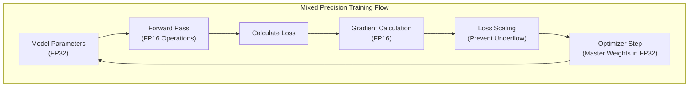

Sources: [TensorFlow/LanguageModeling/BERT/README.md:148-163](). [PyTorch/LanguageModeling/BERT/README.md:136-147](). [TensorFlow/Classification/ConvNets/resnet50v1.5/README.md:128-141]().

### Automatic Mixed Precision

Both TensorFlow and PyTorch implementations support automatic mixed precision:

- **TensorFlow AMP**: Uses the TensorFlow Automatic Mixed Precision extension that automatically modifies the computation graph.
  - Enabled via environment variables: `TF_ENABLE_AUTO_MIXED_PRECISION=1`
  - Automatically handles loss scaling to preserve small gradient values
  
- **PyTorch AMP**: Implemented through NVIDIA's Apex library or native PyTorch AMP.
  - PyTorch usage example:
  ```python
  # Using APEX
  from apex import amp
  model, optimizer = amp.initialize(model, optimizer, opt_level="O2")
  
  # Scaling loss
  with amp.scale_loss(loss, optimizer) as scaled_loss:
      scaled_loss.backward()
  ```

The mixed precision training provides performance improvements of 1.5-3x faster training when using the latest NVIDIA architectures with Tensor Cores.

Sources: [TensorFlow/LanguageModeling/BERT/README.md:166-178](). [PyTorch/LanguageModeling/BERT/README.md:148-165](). [PyTorch/LanguageModeling/BERT/run_pretraining.py:519-524]().

### TF32 Precision

TensorFloat-32 (TF32) is a math mode in NVIDIA A100 GPUs for tensor operations.

- Enabled by default on NVIDIA Ampere architecture
- Provides up to 10x speedup compared to FP32 on Volta GPUs
- Maintains similar accuracy levels to FP32
- Requires no code changes - the hardware handles the conversion

TF32 is a good balance for models that require higher precision than FP16 but can benefit from the performance of Tensor Cores.

Sources: [TensorFlow/LanguageModeling/BERT/README.md:179-188](). [PyTorch/LanguageModeling/BERT/README.md:167-176](). [TensorFlow/Classification/ConvNets/resnet50v1.5/README.md:159-167]().

## Multi-GPU and Multi-Node Training

The repository implements efficient scaling across multiple GPUs and nodes using various frameworks.

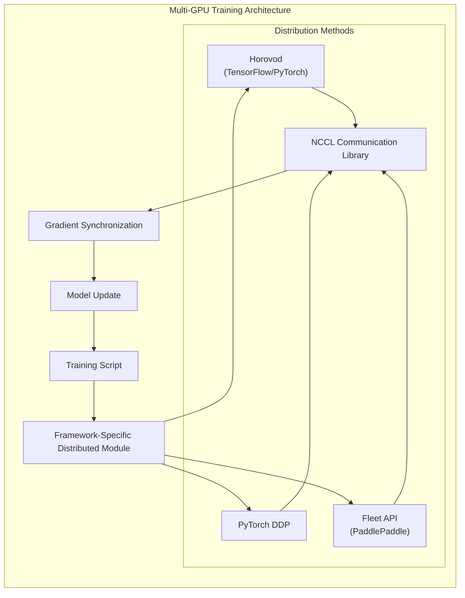

Sources: [README.md:96-104](). [PyTorch/LanguageModeling/BERT/README.md:119-127](). [TensorFlow/LanguageModeling/BERT/README.md:140-143]().

### Distributed Training Methods

The repository supports multiple methods for distributed training:

1. **Horovod Integration**
   - Framework-agnostic approach for distributed training
   - Efficient implementation with NCCL
   - Supported in TensorFlow, PyTorch models
   - Minimal code changes required to scale from single to multi-GPU

2. **PyTorch DistributedDataParallel (DDP)**
   - Native PyTorch distributed training
   - Implemented with communication hooks for efficiency
   - Can divide gradients by gradient accumulation steps
   - Example from BERT implementation:
   ```python
   model = DDP(model, device_ids=[args.local_rank], 
               output_device=args.local_rank, 
               bucket_cap_mb=torch.cuda.get_device_properties(device).total_memory,
               gradient_as_bucket_view=True)
   ```

3. **Multi-Node Training**
   - Supported through Slurm with Enroot/Pyxis
   - Documentation provided for cluster setups
   - Can scale to hundreds of GPUs for larger models

Sources: [PyTorch/LanguageModeling/BERT/run_pretraining.py:451-476](). [TensorFlow/LanguageModeling/BERT/README.md:225-228](). [PyTorch/LanguageModeling/BERT/README.md:219-221]().

## Optimized Data Loading

Efficient data loading is crucial for GPU utilization, particularly when training on large datasets.

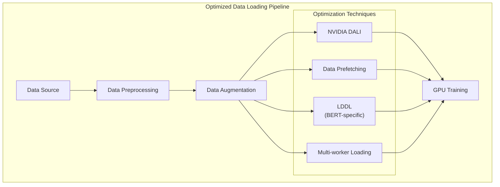

Sources: [README.md:21-39](). [TensorFlow/Classification/ConvNets/resnet50v1.5/README.md:120-126](). [PyTorch/LanguageModeling/BERT/README.md:132-134]().

### NVIDIA DALI

NVIDIA Data Loading Library (DALI) accelerates the input pipeline:

- GPU-accelerated data preprocessing
- Integrated with both TensorFlow and PyTorch models
- Particularly beneficial for image-based models (Classification, Detection)
- Supports various data augmentation operations

### LDDL for BERT

NVIDIA Language Datasets Data Loading Library (LDDL) is specifically designed for BERT pretraining:

- Highly scalable data preprocessing for language datasets
- Optimized for sharding and distributed training
- Uses Dask for parallel processing
- Dynamic vs. static masking options
- Configurable bin sizes for sequences

Sources: [PyTorch/LanguageModeling/BERT/run.sub:27-56](). [PyTorch/LanguageModeling/BERT/README.md:132-134]().

## Specialized Optimizers and Training Techniques

The repository implements various specialized optimization algorithms and training techniques.

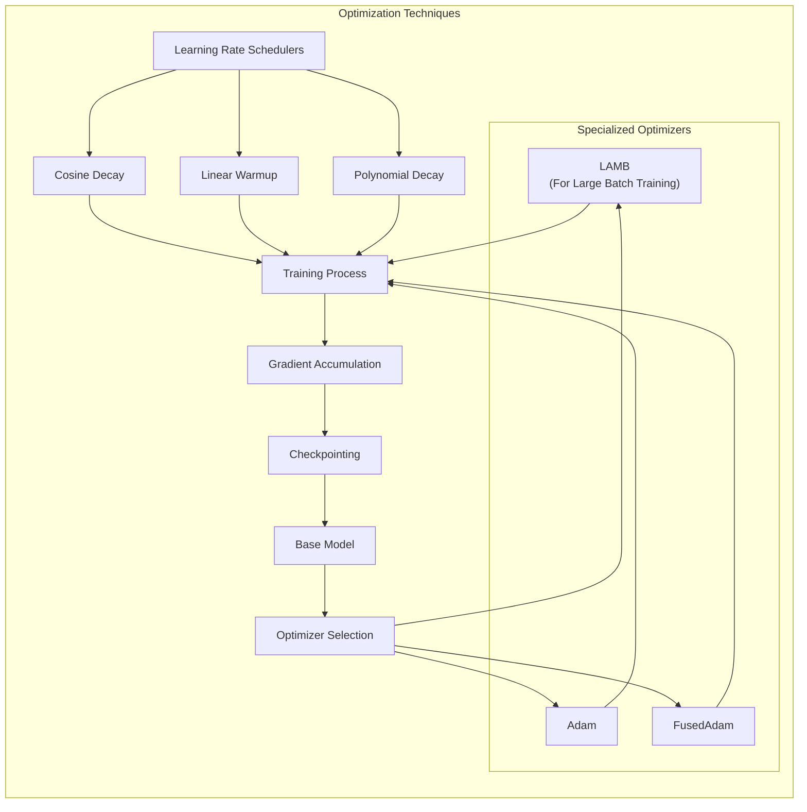

Sources: [PyTorch/LanguageModeling/BERT/README.md:125-131](). [TensorFlow/LanguageModeling/BERT/README.md:143-147](). [PyTorch/LanguageModeling/BERT/optimization.py:36-61]().

### LAMB Optimizer

LAMB (Layerwise Adaptive Moments based optimizer) enables training with exceptionally large batch sizes:

- Supports global batch sizes up to 65,536 for sequence length 128
- Uses layerwise learning rate adaptation
- Implemented in both TensorFlow and PyTorch versions
- Required for efficient large-scale pretraining

The NVLAMB implementation adds modifications to ensure correct convergence with large batch sizes.

```python
# NVLAMB Algorithm
# m_t = β_1 * m_{t-1} + (1 - β_1) * g_t
# v_t = β_2 * v_{t-1} + (1 - β_2) * g_t^2
# m̂_t = m_t / (1 - β_1^t)
# v̂_t = v_t / (1 - β_2^t)
# r_t = m̂_t / (√v̂_t + ε)
# φ = ||w_t||
# ŵ_t = w_t - η_t * r_t
# w_{t+1} = ŵ_t * min(max(||r_t||/clamp_value, 1/clamp_value), 1)
```

Sources: [TensorFlow/LanguageModeling/BERT/README.md:143-147](). [PyTorch/LanguageModeling/BERT/README.md:125-131]().

### Gradient Accumulation

Gradient accumulation allows training with effectively larger batch sizes:

- Accumulates gradients over multiple forward/backward passes
- Updates weights only after accumulation is complete
- Enables large batch training on limited GPU memory
- Implemented in both TensorFlow and PyTorch models

Sources: [PyTorch/LanguageModeling/BERT/scripts/run_pretraining.sh:144-146](). [PyTorch/LanguageModeling/BERT/run_pretraining.py:471-475]().

## Inference Optimizations

The repository provides various methods to optimize inference performance.

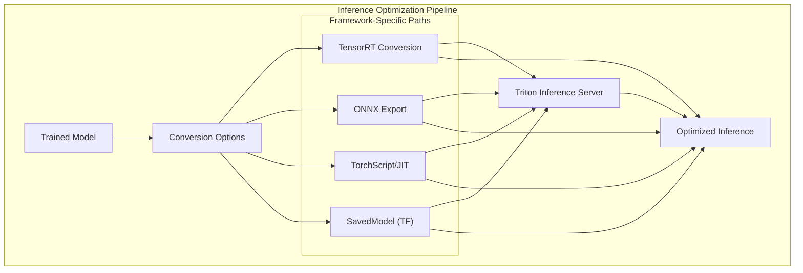

Sources: [README.md:15-90](). [TensorFlow/Classification/ConvNets/resnet50v1.5/README.md:254-258]().

### TensorRT Integration

TensorRT provides significant inference acceleration:

- Optimizes models for deployment on NVIDIA GPUs
- Supports both TensorFlow and PyTorch models
- Includes layer fusion, precision calibration, and kernel autotuning
- Many models have example TensorRT integration

### ONNX Export

Open Neural Network Exchange (ONNX) provides framework interoperability:

- Supported for select models
- Creates a framework-independent representation
- Can be used with various inference engines

### Triton Inference Server

NVIDIA Triton Inference Server provides a production deployment solution:

- Model-agnostic serving solution
- Supports TensorRT, TensorFlow, PyTorch, ONNX models
- Dynamic batching and concurrent model execution
- Several examples provided in the repository

Sources: [README.md:33](). [PyTorch/LanguageModeling/BERT/README.md:33-33]().

## XLA Compilation Support

XLA (Accelerated Linear Algebra) is a domain-specific compiler for linear algebra:

- Optimizes TensorFlow computation graphs
- Can provide 1.1-1.5x performance improvement
- Supports both training and inference
- Enabled via command-line flags in most models

Sources: [TensorFlow/Classification/ConvNets/resnet50v1.5/README.md:62-64](). [TensorFlow/LanguageModeling/BERT/README.md:123-125]().

## Cross-Framework Feature Support Table

This table summarizes the key optimization features available across different frameworks in the repository:

| Feature | TensorFlow | PyTorch | PaddlePaddle |
|---------|:----------:|:-------:|:------------:|
| Mixed Precision (AMP) | ✓ | ✓ | ✓ |
| TF32 Support | ✓ | ✓ | ✓ |
| Multi-GPU (Horovod) | ✓ | ✓ | - |
| Multi-GPU (Native) | - | ✓ (DDP) | ✓ (Fleet) |
| NVIDIA DALI | ✓ | ✓ | ✓ |
| LDDL | - | ✓ | - |
| TensorRT | ✓ | ✓ | ✓ |
| ONNX Export | Limited | ✓ | - |
| Triton Inference Server | ✓ | ✓ | ✓ |
| XLA Support | ✓ | - | - |
| LAMB Optimizer | ✓ | ✓ | - |
| Gradient Accumulation | ✓ | ✓ | ✓ |

Sources: [README.md:15-90]().

## Framework-Specific Implementation Details

Different frameworks have specific implementations of the common optimizations:

### PyTorch Optimizations

- Uses `DistributedDataParallel` for multi-GPU training
- Apex library for mixed precision (now also native PyTorch AMP)
- LDDL for efficient data loading
- TorchScript/JIT for optimized model deployment
- FusedAdam optimizer implementations
- NVFuser for kernel fusion

### TensorFlow Optimizations

- Horovod for distributed training
- XLA support for compilation
- TF-AMP for mixed precision
- Custom optimizers like LAMB
- SavedModel format for deployment

### PaddlePaddle Optimizations

- Fleet API for distributed training
- Mixed precision support
- Paddle-TRT for TensorRT integration

Sources: [README.md:96-104](). [PyTorch/LanguageModeling/BERT/README.md:119-127](). [TensorFlow/LanguageModeling/BERT/README.md:140-143]().

By leveraging these common features and optimizations, the models in this repository can achieve significantly better performance while maintaining accuracy, enabling researchers and practitioners to efficiently train and deploy state-of-the-art deep learning models on NVIDIA GPUs.

---

# Page: PyTorch Models

# PyTorch Models

<details>
<summary>Relevant source files</summary>

The following files were used as context for generating this wiki page:

- [PyTorch/Classification/ConvNets/Dockerfile](PyTorch/Classification/ConvNets/Dockerfile)
- [PyTorch/Classification/ConvNets/README.md](PyTorch/Classification/ConvNets/README.md)
- [PyTorch/Classification/ConvNets/checkpoint2model.py](PyTorch/Classification/ConvNets/checkpoint2model.py)
- [PyTorch/Classification/ConvNets/classify.py](PyTorch/Classification/ConvNets/classify.py)
- [PyTorch/Classification/ConvNets/configs.yml](PyTorch/Classification/ConvNets/configs.yml)
- [PyTorch/Classification/ConvNets/efficientnet/README.md](PyTorch/Classification/ConvNets/efficientnet/README.md)
- [PyTorch/Classification/ConvNets/image_classification/dataloaders.py](PyTorch/Classification/ConvNets/image_classification/dataloaders.py)
- [PyTorch/Classification/ConvNets/image_classification/gpu_affinity.py](PyTorch/Classification/ConvNets/image_classification/gpu_affinity.py)
- [PyTorch/Classification/ConvNets/image_classification/logger.py](PyTorch/Classification/ConvNets/image_classification/logger.py)
- [PyTorch/Classification/ConvNets/image_classification/models/__init__.py](PyTorch/Classification/ConvNets/image_classification/models/__init__.py)
- [PyTorch/Classification/ConvNets/image_classification/models/common.py](PyTorch/Classification/ConvNets/image_classification/models/common.py)
- [PyTorch/Classification/ConvNets/image_classification/models/efficientnet.py](PyTorch/Classification/ConvNets/image_classification/models/efficientnet.py)
- [PyTorch/Classification/ConvNets/image_classification/models/entrypoints.py](PyTorch/Classification/ConvNets/image_classification/models/entrypoints.py)
- [PyTorch/Classification/ConvNets/image_classification/models/model.py](PyTorch/Classification/ConvNets/image_classification/models/model.py)
- [PyTorch/Classification/ConvNets/image_classification/models/resnet.py](PyTorch/Classification/ConvNets/image_classification/models/resnet.py)
- [PyTorch/Classification/ConvNets/image_classification/optimizers.py](PyTorch/Classification/ConvNets/image_classification/optimizers.py)
- [PyTorch/Classification/ConvNets/image_classification/training.py](PyTorch/Classification/ConvNets/image_classification/training.py)
- [PyTorch/Classification/ConvNets/image_classification/utils.py](PyTorch/Classification/ConvNets/image_classification/utils.py)
- [PyTorch/Classification/ConvNets/main.py](PyTorch/Classification/ConvNets/main.py)
- [PyTorch/Classification/ConvNets/model2onnx.py](PyTorch/Classification/ConvNets/model2onnx.py)
- [PyTorch/Classification/ConvNets/quant_main.py](PyTorch/Classification/ConvNets/quant_main.py)
- [PyTorch/Classification/ConvNets/requirements.txt](PyTorch/Classification/ConvNets/requirements.txt)
- [PyTorch/Classification/ConvNets/resnet50v1.5/README.md](PyTorch/Classification/ConvNets/resnet50v1.5/README.md)
- [PyTorch/Classification/ConvNets/resnext101-32x4d/README.md](PyTorch/Classification/ConvNets/resnext101-32x4d/README.md)
- [PyTorch/Classification/ConvNets/se-resnext101-32x4d/README.md](PyTorch/Classification/ConvNets/se-resnext101-32x4d/README.md)
- [PyTorch/Classification/ConvNets/triton/deployer.py](PyTorch/Classification/ConvNets/triton/deployer.py)
- [hubconf.py](hubconf.py)

</details>


This page provides a technical overview of the PyTorch model implementations in the NVIDIA Deep Learning Examples repository. It covers the common infrastructure, model families, and shared optimizations across these implementations. For information about TensorFlow models, see [TensorFlow Models](#3), and for deployment details, see [Deployment](#5).

## Model Organization

The repository organizes PyTorch models primarily by application domain, with each model family having dedicated directories and shared components.

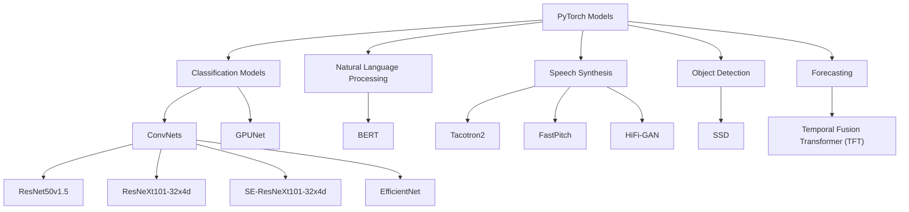

Sources: [hubconf.py:1-35](), [PyTorch/Classification/ConvNets/README.md:1-123]()

## Common Infrastructure

### Model Framework

The repository implements a consistent framework for defining models, with a focus on reusability and configurability. The core components include:

```mermaid
classDiagram
    class ModelArch {
        +String name
        +Int default_image_size
    }
    
    class ModelParams {
        +Int num_classes
        +parser()
    }
    
    class Model {
        +constructor: Callable
        +arch: ModelArch
        +params: ModelParams
        +optimizer_params: OptimizerParams
        +checkpoint_url: String
    }
    
    class EntryPoint {
        +String name
        +Model model
        +__call__()
        +parser()
    }
    
    Model --> ModelArch
    Model --> ModelParams
    EntryPoint --> Model
```

Sources: [PyTorch/Classification/ConvNets/image_classification/models/model.py:14-184]()

The architecture adopts a dataclass-based approach for model configuration:

1. `ModelArch` - Defines the architecture characteristics of a model
2. `ModelParams` - Contains model parameters like number of classes
3. `Model` - Combines architecture, parameters and construction logic
4. `EntryPoint` - Provides a standardized interface for model access

This design allows for:
- Consistent model instantiation across all model types
- Easy parameter configuration through common CLI interfaces
- Standardized checkpoint handling for pretrained weights

### Training Framework

The training infrastructure is designed for performance and flexibility:

```mermaid
classDiagram
    class Executor {
        +model: nn.Module
        +loss: nn.Module
        +amp: bool
        +scaler: GradScaler
        +forward_backward()
        +forward()
        +train()
        +eval()
        +distributed()
    }
    
    class Trainer {
        +executor: Executor
        +optimizer: Optimizer
        +grad_acc_steps: int
        +use_ema: bool
        +train_step()
        +train()
        +eval()
        +validation_steps()
        +state_dict()
    }
    
    Trainer --> Executor
```

Sources: [PyTorch/Classification/ConvNets/image_classification/training.py:46-202]()

Key components of the training infrastructure:

- `Executor`: Handles model forward/backward passes, loss computation, mixed precision operations, and distributed setup
- `Trainer`: Manages training state, optimization steps, EMA updates, and checkpointing
- Training utilities: Support for gradient accumulation, loss scaling, validation metrics

The training loop function connects these components to provide a complete training pipeline:

```mermaid
flowchart TD
    train_loop["train_loop()"]
    train_loop --> setup_training["Setup training metrics and checkpointer"]
    setup_training --> epoch_loop["For each epoch"]
    
    epoch_loop --> |"if not skip_training"| train_epoch["Train epoch"]
    epoch_loop --> |"if not skip_validation"| validate["Validate model"]
    validate --> |"if improved"| save_best["Save best checkpoint"]
    
    epoch_loop --> |"if early_stopping"| check_early_stop["Check early stopping"]
    epoch_loop --> |"if save_checkpoints"| save_checkpoint["Save epoch checkpoint"]
```

Sources: [PyTorch/Classification/ConvNets/image_classification/training.py:313-435]()

## Data Loading Framework

The repository implements multiple data backends for efficient input processing:

```mermaid
flowchart LR
    DataBackends["Data Backends"] --> PyTorch["PyTorch Native"]
    DataBackends --> DALI_CPU["DALI CPU"]
    DataBackends --> DALI_GPU["DALI GPU"]
    DataBackends --> Synthetic["Synthetic Data"]
    
    PyTorch --> PytorchLoaders["get_pytorch_train/val_loader()"]
    DALI_CPU --> DALILoaders_CPU["get_dali_train/val_loader(dali_cpu=True)"]
    DALI_GPU --> DALILoaders_GPU["get_dali_train/val_loader(dali_cpu=False)"]
    Synthetic --> SyntheticLoader["get_synthetic_loader()"]
    
    PytorchLoaders --> PrefetchedWrapper["PrefetchedWrapper"]
    DALILoaders_CPU --> DALIWrapper["DALIWrapper"]
    DALILoaders_GPU --> DALIWrapper
    SyntheticLoader --> SynteticDataLoader["SynteticDataLoader"]
```

Sources: [PyTorch/Classification/ConvNets/image_classification/dataloaders.py:30-577]()

Key features of the data loading framework:

- Support for multiple data backends (PyTorch, DALI-CPU, DALI-GPU, Synthetic)
- Prefetching and pipelining for maximizing GPU utilization
- Common data augmentation options (random resized crop, horizontal flip, etc.)
- Mixed precision data preprocessing

## Classification Models

### Model Architectures

The repository includes several state-of-the-art ConvNet architectures:

| Model | Description | Top-1 Accuracy | 
|-------|-------------|----------------|
| ResNet50 | ResNet50 v1.5 with bottleneck blocks | 78.6% |
| ResNeXt101-32x4d | ResNeXt with cardinality=32, bottleneck width=4 | 80.4% |
| SE-ResNeXt101-32x4d | ResNeXt with Squeeze-and-Excitation blocks | 81.0% |
| EfficientNet-B0 | EfficientNet baseline model | 77.6% |
| EfficientNet-B4 | EfficientNet wider/deeper variant | 83.0% |
| EfficientNet-WideSE-B0 | EfficientNet with wider SE layers | 77.9% |
| EfficientNet-WideSE-B4 | EfficientNet-B4 with wider SE layers | 83.3% |

Sources: [PyTorch/Classification/ConvNets/README.md:40-50](), [hubconf.py:7-13]()

### ResNet Architecture

The ResNet/ResNeXt family implements residual blocks with skip connections:

```mermaid
flowchart TD
    subgraph "ResNet Architecture"
        ResNetModel["ResNet Class"] --> Stem["Stem Layer\n(Conv7x7, BN, ReLU, MaxPool)"]
        Stem --> Layers["Layer Blocks 1-4"]
        Layers --> AvgPool["Global Average Pooling"]
        AvgPool --> FC["Fully Connected"]
        
        subgraph "Block Types"
            BasicBlock["BasicBlock\n(Conv3x3 → BN → ReLU → Conv3x3 → BN)"]
            Bottleneck["Bottleneck\n(Conv1x1 → BN → ReLU → Conv3x3 → BN → ReLU → Conv1x1 → BN)"]
            SEBottleneck["SEBottleneck\n(Bottleneck + Squeeze-and-Excitation)"]
        end
    end
```

Sources: [PyTorch/Classification/ConvNets/image_classification/models/resnet.py:56-407]()

### EfficientNet Architecture

EfficientNet models use compound scaling and mobile inverted bottleneck blocks:

```mermaid
flowchart TD
    subgraph "EfficientNet Architecture"
        EfficientNet["EfficientNet Class"] --> EfficientNetStem["Stem\n(Conv3x3, BN, SiLU)"]
        EfficientNetStem --> MBBlocks["Mobile Inverted Bottleneck Blocks"]
        MBBlocks --> Head["Head\n(Conv1x1, BN, SiLU, AvgPool, FC)"]
        
        subgraph "MBConv Block"
            DepthwiseConv["Depthwise Conv"]
            PointwiseConv["Pointwise Conv (Expansion)"]
            SEModule["Squeeze-and-Excitation"]
            ProjectConv["Projection Conv"]
            SkipConnection["Skip Connection"]
        end
    end
```

Sources: [PyTorch/Classification/ConvNets/image_classification/models/efficientnet.py:1-100]()

## Speech Synthesis Models

The repository includes state-of-the-art speech synthesis models:

1. **Tacotron2**: Neural text-to-speech model that generates mel-spectrograms from text
2. **WaveGlow**: Flow-based neural vocoder for high-quality audio generation
3. **FastPitch**: Fast, parallel text-to-speech model with explicit pitch control
4. **HiFi-GAN**: GAN-based neural vocoder for efficient, high-fidelity audio synthesis

Sources: [hubconf.py:23-31]()

## Model Optimization Features

### Mixed Precision Training

All models support mixed precision training using Automatic Mixed Precision (AMP):

```mermaid
flowchart TD
    MixedPrecision["Mixed Precision Training"]
    MixedPrecision --> AMPInitialize["Initialize model with AMP\nmodel, optimizer = amp.initialize()"]
    AMPInitialize --> ForwardPass["Forward Pass in FP16\nautocast(enabled=self.amp)"]
    ForwardPass --> ScaleLoss["Scale Loss\nscaler.scale_loss(loss)"]
    ScaleLoss --> Backward["Backward Pass"]
    Backward --> ScalerStep["Scaler Step\nscaler.step(optimizer)\nscaler.update()"]
```

Sources: [PyTorch/Classification/ConvNets/image_classification/training.py:90-105]()

Mixed precision training features:
- Uses `torch.cuda.amp` package for automatic mixed precision
- Implements dynamic loss scaling to prevent underflow
- Optimized NHWC memory format for Tensor Core acceleration
- TF32 precision support for NVIDIA Ampere GPUs

### Distributed Training

The repository provides robust distributed training support:

```mermaid
flowchart TD
    DistTraining["Distributed Training"]
    DistTraining --> DDP["DistributedDataParallel"]
    DistTraining --> DistSampler["DistributedSampler"]
    DistTraining --> AllReduce["All-Reduce for Metrics"]
    
    DDP --> GradSync["Synchronized Gradient Updates"]
    DistSampler --> DataPartition["Data Partitioning"]
    AllReduce --> GlobalMetrics["Global Metrics Computation"]
```

Sources: [PyTorch/Classification/ConvNets/main.py:360-374](), [PyTorch/Classification/ConvNets/image_classification/training.py:230-233]()

Key distributed training features:
- PyTorch DistributedDataParallel for gradient synchronization
- Multi-GPU and multi-node scaling
- Synchronized batch normalization
- Distributed data sampling

### Optimization Techniques

The repository implements numerous optimization techniques for improved performance and accuracy:

| Technique | Description | Implementation |
|-----------|-------------|----------------|
| Automatic Mixed Precision | FP16/FP32 mixed precision | `torch.cuda.amp` |
| DALI Data Loading | GPU-accelerated data loading | `nvidia.dali` integration |
| EMA | Exponential moving average of weights | `EMA` class |
| Label Smoothing | Softens one-hot labels | `LabelSmoothing` class |
| MixUp | Training on convex combinations of samples | `MixUpWrapper` class |
| Learning Rate Scheduling | Cosine, linear, step schedules | `lr_*_policy` functions |
| Weight Decay | Configurable regularization | Optimizer options |

Sources: [PyTorch/Classification/ConvNets/main.py:92-207](), [PyTorch/Classification/ConvNets/image_classification/training.py:137-152]()

## Model Deployment Options

The repository supports multiple deployment paths:

```mermaid
flowchart TD
    Model["PyTorch Model"] --> Checkpoint["Save Checkpoint\n.pth.tar"]
    Checkpoint --> Export["Export Options"]
    
    Export --> TorchScript["TorchScript\n--jit script"]
    Export --> ONNX["ONNX Export\nmodel2onnx.py"]
    Export --> TensorRT["TensorRT Conversion"]
    
    TorchScript --> ProductionServing["Production Serving"]
    ONNX --> Triton["Triton Inference Server"]
    TensorRT --> HighPerformance["High-Performance Inference"]
    
    Model --> Quantization["Quantization\nquant_main.py"]
    Quantization --> INT8Model["INT8 Model"]
    INT8Model --> QuantONNX["INT8 ONNX Export"]
```

Sources: [PyTorch/Classification/ConvNets/triton/deployer.py:1-106](), [PyTorch/Classification/ConvNets/model2onnx.py:1-45](), [PyTorch/Classification/ConvNets/quant_main.py:1-40]()

Deployment features:
- TorchScript export for production deployment
- ONNX export for cross-platform inference
- Quantization-aware training for INT8 precision
- Triton Inference Server integration
- TensorRT optimization

## Training Process

The standard training flow follows this pattern:

```mermaid
flowchart TD
    Config["Configuration:\n--arch, --batch-size, --lr, etc."] --> Setup["Setup:\nDistributed, AMP, Model, Optimizer"]
    Setup --> DataLoaders["Initialize Data Loaders"]
    DataLoaders --> TrainLoop["Main Training Loop"]
    
    TrainLoop --> Epoch["For each epoch"]
    Epoch --> TrainStep["Train Step:\nForward, Backward, Optimize"]
    Epoch --> Validate["Validate"]
    Validate --> Checkpoint["Save Checkpoint"]
    
    TrainStep --> NextEpoch["Next Epoch or Early Stop"]
    Validate --> NextEpoch
    Checkpoint --> NextEpoch
    
    NextEpoch --> |"Done"| FinalModel["Final Model"]
```

Sources: [PyTorch/Classification/ConvNets/main.py:611-649](), [PyTorch/Classification/ConvNets/image_classification/training.py:313-435]()

## Conclusion

The PyTorch model implementations in this repository provide optimized, production-ready training and inference code for various deep learning tasks. They feature:

1. Common infrastructure for model definition, training, and evaluation
2. State-of-the-art architectures across different domains
3. Optimizations for mixed precision, distributed training, and data loading
4. Multiple deployment paths including TorchScript, ONNX, and TensorRT

Each model family has its own dedicated directory with detailed documentation, training scripts, and performance benchmarks.

---

# Page: PyTorch Natural Language Processing

# PyTorch Natural Language Processing

<details>
<summary>Relevant source files</summary>

The following files were used as context for generating this wiki page:

- [PyTorch/LanguageModeling/BERT/Dockerfile](PyTorch/LanguageModeling/BERT/Dockerfile)
- [PyTorch/LanguageModeling/BERT/LICENSE](PyTorch/LanguageModeling/BERT/LICENSE)
- [PyTorch/LanguageModeling/BERT/README.md](PyTorch/LanguageModeling/BERT/README.md)
- [PyTorch/LanguageModeling/BERT/data/Downloader.py](PyTorch/LanguageModeling/BERT/data/Downloader.py)
- [PyTorch/LanguageModeling/BERT/data/bertPrep.py](PyTorch/LanguageModeling/BERT/data/bertPrep.py)
- [PyTorch/LanguageModeling/BERT/data/create_datasets_from_start.sh](PyTorch/LanguageModeling/BERT/data/create_datasets_from_start.sh)
- [PyTorch/LanguageModeling/BERT/modeling.py](PyTorch/LanguageModeling/BERT/modeling.py)
- [PyTorch/LanguageModeling/BERT/optimization.py](PyTorch/LanguageModeling/BERT/optimization.py)
- [PyTorch/LanguageModeling/BERT/run.sub](PyTorch/LanguageModeling/BERT/run.sub)
- [PyTorch/LanguageModeling/BERT/run_glue.py](PyTorch/LanguageModeling/BERT/run_glue.py)
- [PyTorch/LanguageModeling/BERT/run_pretraining.py](PyTorch/LanguageModeling/BERT/run_pretraining.py)
- [PyTorch/LanguageModeling/BERT/run_squad.py](PyTorch/LanguageModeling/BERT/run_squad.py)
- [PyTorch/LanguageModeling/BERT/run_swag.py](PyTorch/LanguageModeling/BERT/run_swag.py)
- [PyTorch/LanguageModeling/BERT/scripts/run_glue.sh](PyTorch/LanguageModeling/BERT/scripts/run_glue.sh)
- [PyTorch/LanguageModeling/BERT/scripts/run_pretraining.sh](PyTorch/LanguageModeling/BERT/scripts/run_pretraining.sh)
- [PyTorch/LanguageModeling/BERT/utils.py](PyTorch/LanguageModeling/BERT/utils.py)

</details>


This document provides a technical overview of the PyTorch-based Natural Language Processing (NLP) implementations in the NVIDIA Deep Learning Examples repository. The focus is on the BERT (Bidirectional Encoder Representations from Transformers) model implementation and its applications to various NLP tasks, including pre-training, question answering, paraphrase detection, and sentiment analysis.

For information about TensorFlow NLP implementations, see [TensorFlow Natural Language Processing](#3.1).

## Overview

The PyTorch NLP section of the NVIDIA Deep Learning Examples repository provides highly optimized implementations of BERT and related models for both pre-training and fine-tuning. These implementations leverage NVIDIA's optimizations for training efficiency, including mixed precision training, distributed training across multiple GPUs and nodes, and specialized optimizers like LAMB (Layer-wise Adaptive Moments optimizer for Batch training).

The codebase supports:
- Pre-training BERT models from scratch on large text corpora
- Fine-tuning pre-trained models on specific NLP tasks
- Inference and deployment with NVIDIA Triton Inference Server
- Performance optimizations for NVIDIA GPUs

Sources: [PyTorch/LanguageModeling/BERT/README.md:63-101](). [PyTorch/LanguageModeling/BERT/README.md:217-222]()

## Architecture and Implementation

### BERT Model Architecture

BERT uses the same architecture as the encoder portion of the Transformer. The model processes input text by projecting tokens into an embedding space and adding positional and segment encodings. The core of the model consists of stacked Transformer blocks, each containing multi-head self-attention layers followed by feed-forward networks and layer normalization.

#### BERT Model Architecture Diagram

```mermaid
flowchart TD
    subgraph "BERTForPreTraining"
        Input["Input Tokens"] --> Embeddings
        subgraph "BertEmbeddings"
            Embeddings["Word/Position/Token\nEmbeddings"]
            Embeddings --> EmbLayerNorm["LayerNorm"]
            EmbLayerNorm --> EmbDropout["Dropout"]
        end
        EmbDropout --> EncoderStack

        subgraph "BertEncoder"
            EncoderStack["Transformer Encoder Stack"]
            subgraph "BertLayer x N"
                Attention["BertAttention"]
                Attention --> Intermediate["BertIntermediate (GELU)"]
                Intermediate --> Output["BertOutput"]
            end
        end

        EncoderStack --> Outputs["Encoded Sequence"]
        Outputs --> MLMHead["Masked LM Head"]
        Outputs --> NSPHead["Next Sentence Prediction Head"]
        MLMHead --> MLMLoss["Masked LM Loss"]
        NSPHead --> NSPLoss["Next Sentence Loss"]
        MLMLoss --> TotalLoss["Total Loss"]
        NSPLoss --> TotalLoss
    end
```

Sources: [PyTorch/LanguageModeling/BERT/modeling.py:263-301](), [PyTorch/LanguageModeling/BERT/modeling.py:304-376](), [PyTorch/LanguageModeling/BERT/modeling.py:437-463](), [PyTorch/LanguageModeling/BERT/README.md:86-92]()

### BERT Pre-training Objective

BERT is pre-trained using two unsupervised tasks:

1. **Masked Language Modeling (MLM)**: Randomly mask 15% of the input tokens and train the model to predict the original tokens based only on context.

2. **Next Sentence Prediction (NSP)**: Train the model to predict whether two sentences are consecutive in the original text.

The implementation includes a dedicated loss function, `BertPretrainingCriterion`, which combines losses from both tasks:

```mermaid
flowchart TD
    subgraph "BertPretrainingCriterion"
        InputSeq["Input Sequence"] --> Mask["Mask 15% of Tokens"]
        Mask --> |"Masked Sequence"| BERT["BERT Model"]
        BERT --> MLMOutput["Prediction Scores\nfor Masked Tokens"]
        BERT --> NSPOutput["Sequence Relationship\nScore"]
        
        MLMOutput --> |"Compare with\nOriginal Tokens"| MLMLoss["Masked LM Loss"]
        NSPOutput --> |"Compare with\nActual Relationship"| NSPLoss["Next Sentence Loss"]
        
        MLMLoss --> TotalLoss["Total Loss"]
        NSPLoss --> TotalLoss
    end
```

Sources: [PyTorch/LanguageModeling/BERT/run_pretraining.py:75-95](), [PyTorch/LanguageModeling/BERT/README.md:561-566]()

### Implementation Details

The BERT implementation is structured around several key Python files:

| File | Purpose |
|------|---------|
| `modeling.py` | Contains the BERT model architecture implementation |
| `run_pretraining.py` | Script for pre-training BERT |
| `run_squad.py` | Script for fine-tuning BERT on question answering (SQuAD) |
| `run_glue.py` | Script for fine-tuning BERT on GLUE tasks |
| `optimization.py` | Contains optimizer implementations, including LAMB |
| `tokenization.py` | Contains the WordPiece tokenizer for BERT |
| `utils.py` | Utility functions for distributed training |

The implementation supports both large (24-layer) and base (12-layer) BERT model variants:

| Model | Hidden Layers | Hidden Size | Attention Heads | Parameters |
|-------|---------------|-------------|-----------------|------------|
| BERT-base | 12 | 768 | 12 | 110M |
| BERT-large | 24 | 1024 | 16 | 330M |

Sources: [PyTorch/LanguageModeling/BERT/README.md:355-373](), [PyTorch/LanguageModeling/BERT/README.md:95-104]()

## Training Pipeline

### Pre-training Process

The pre-training process involves two phases:

1. **Phase 1**: Train with sequence length 128 and 20 masked tokens per sequence
2. **Phase 2**: Continue training with sequence length 512 and 80 masked tokens per sequence

This two-phase approach accelerates training while maintaining model quality.

```mermaid
flowchart TD
    DataPrep["Data Preparation\n(Wikipedia/BookCorpus)"] --> Preprocess["LDDL Preprocessing\n(preprocess_bert_pretrain)"]
    Preprocess --> Balance["Load Balancing\n(balance_dask_output)"]
    Balance --> |"Parquet Files"| Phase1["Phase 1 Training\n(Length 128)"]
    Phase1 --> |"Checkpoint"| Phase2["Phase 2 Training\n(Length 512)"]
    Phase2 --> |"Final Checkpoint"| Finetuning["Ready for Fine-tuning"]
```

The `run_pretraining.py` script handles:
- Loading pre-processed data with LDDL (NVIDIA's Large-scale Distributed Data Loader)
- Initializing the model and optimizer
- Running the training loop with gradient accumulation and mixed precision
- Saving checkpoints for resuming training or fine-tuning

Sources: [PyTorch/LanguageModeling/BERT/run_pretraining.py:539-571](), [PyTorch/LanguageModeling/BERT/scripts/run_pretraining.sh:170-193](), [PyTorch/LanguageModeling/BERT/README.md:578-595]()

### Fine-tuning Process

Fine-tuning adapts a pre-trained BERT model to specific downstream tasks. The repository supports several important NLP tasks:

1. **Question Answering (SQuAD)**: Fine-tune BERT to extract answer spans from context paragraphs
2. **Paraphrase Detection (MRPC)**: Fine-tune BERT to determine if sentence pairs are paraphrases
3. **Sentiment Analysis (SST-2)**: Fine-tune BERT to classify sentences as positive or negative

```mermaid
flowchart LR
    subgraph "Fine-tuning Pipeline"
        Checkpoint["Pre-trained\nCheckpoint"] --> TaskConfig["Task-specific\nConfiguration"]
        TaskConfig --> DataLoader["Task Dataset\nLoading"]
        DataLoader --> Training["Fine-tune with\nTask-specific Loss"]
        Training --> Evaluation["Evaluation on\nDev Set"]
        Evaluation --> Inference["Inference/\nDeployment"]
    end
```

The fine-tuning scripts (`run_squad.py`, `run_glue.py`) handle:
- Loading task-specific datasets
- Converting examples to features with appropriate tokenization
- Initializing the model from a pre-trained checkpoint
- Adding task-specific output layers
- Running the fine-tuning loop
- Evaluating on task-specific metrics

Sources: [PyTorch/LanguageModeling/BERT/run_squad.py:246-371](), [PyTorch/LanguageModeling/BERT/run_glue.py:363-454](), [PyTorch/LanguageModeling/BERT/README.md:301-317]()

## Data Processing

### Data Preparation Pipeline

The data preparation process consists of several steps:

```mermaid
flowchart TD
    subgraph "Pre-training Data Pipeline"
        Download["Download Corpora\n(Wikipedia/BookCorpus)"] --> Format["Text Formatting\n(One article per line)"]
        Format --> Shard["Text Sharding\n(Create training shards)"]
        Shard --> Preprocess["LDDL Processing\n(preprocess_bert_pretrain)"]
        Preprocess --> Balance["Load Balancing\n(balance_dask_output)"]
        Balance --> ParquetFiles["Parquet Shards\nReady for Training"]
    end
```

For pre-training, the repository uses LDDL (Large-scale Distributed Data Loader) to efficiently preprocess and load Wikipedia and BookCorpus datasets. The data preparation scripts handle:
- Downloading the text corpora
- Extracting and cleaning the text
- Creating appropriate input sequences with masks for pre-training
- Balancing the data across shards

For fine-tuning, task-specific data processing is implemented in the respective scripts.

Sources: [PyTorch/LanguageModeling/BERT/data/create_datasets_from_start.sh:16-22](), [PyTorch/LanguageModeling/BERT/scripts/run_pretraining.sh:82-116](), [PyTorch/LanguageModeling/BERT/run.sub:217-283]()

## Optimization Features

### Mixed Precision Training

The implementation supports mixed precision training using FP16 computations while maintaining FP32 master copies of weights. This provides significant speedup on NVIDIA Volta and Ampere GPUs with Tensor Cores.

Mixed precision is enabled through NVIDIA's Apex library, with AMP (Automatic Mixed Precision) integration. Key components include:
- FP16 storage and computation for most operations
- FP32 storage for model weights
- Dynamic loss scaling to prevent underflow
- Specialized handling for operations sensitive to numerical precision

Sources: [PyTorch/LanguageModeling/BERT/README.md:136-175](), [PyTorch/LanguageModeling/BERT/run_pretraining.py:519-520]()

### Multi-GPU and Multi-Node Training

The codebase supports efficient distributed training across multiple GPUs and nodes:

```mermaid
flowchart TD
    subgraph "Distributed Training Architecture"
        Main["Main Process"] --> |"Initialize DDP"| DistProc["Distributed Processes"]
        DistProc --> GPU1["GPU 1 Process"]
        DistProc --> GPU2["GPU 2 Process"]
        DistProc --> GPUN["GPU N Process"]
        
        GPU1 --> |"All-Reduce\nGradients"| SyncPoint["Gradient Synchronization"]
        GPU2 --> |"All-Reduce\nGradients"| SyncPoint
        GPUN --> |"All-Reduce\nGradients"| SyncPoint
        
        SyncPoint --> |"Update\nWeights"| GPU1
        SyncPoint --> |"Update\nWeights"| GPU2
        SyncPoint --> |"Update\nWeights"| GPUN
    end
```

Key distributed training features include:
- PyTorch's DistributedDataParallel (DDP) for efficient multi-GPU training
- Optional gradient accumulation to handle large batch sizes
- Post-accumulation all-reduce for faster communications
- Multi-node training via SLURM with Enroot/Pyxis

Sources: [PyTorch/LanguageModeling/BERT/run_pretraining.py:451-475](), [PyTorch/LanguageModeling/BERT/run.sub:283-283](), [PyTorch/LanguageModeling/BERT/README.md:120-126]()

### LAMB Optimizer

The implementation uses the Layer-wise Adaptive Moments optimizer for Batch training (LAMB), which enables efficient training with large batch sizes (up to 65536 for sequence length 128 and 32768 for sequence length 512).

LAMB adapts the learning rate for each layer in the network, allowing better convergence with large batches compared to Adam. The implementation is optimized with CUDA kernels for improved performance.

Sources: [PyTorch/LanguageModeling/BERT/README.md:126-135](), [PyTorch/LanguageModeling/BERT/run_pretraining.py:429-435]()

### Advanced Optimizations

Additional optimizations include:
- CUDA Graphs for improved GPU utilization
- Gradient checkpointing to reduce memory usage
- JIT fusions for faster kernel execution
- LDDL (Large-scale Distributed Data Loader) for efficient data loading
- Fused CUDA kernels for LayerNorm and other operations

Sources: [PyTorch/LanguageModeling/BERT/run_pretraining.py:599-641](), [PyTorch/LanguageModeling/BERT/README.md:117-126]()

## Usage Examples

### Pre-training Example

The repository provides a simple script interface for pre-training:

```bash
bash scripts/run_pretraining.sh
```

This script:
1. Downloads and preprocesses the Wikipedia dataset if needed
2. Runs Phase 1 training with sequence length 128
3. Runs Phase 2 training with sequence length 512
4. Saves checkpoints that can be used for fine-tuning

The pre-training script accepts various parameters for batch size, learning rate, precision, etc.:

```bash
bash scripts/run_pretraining.sh <train_batch_size> <learning_rate> <precision> <num_gpus> <warmup_proportion> <train_steps>
```

Sources: [PyTorch/LanguageModeling/BERT/README.md:290-307](), [PyTorch/LanguageModeling/BERT/scripts/run_pretraining.sh:16-31]()

### Fine-tuning Example

For fine-tuning on SQuAD (question answering):

```bash
bash scripts/run_squad.sh /workspace/bert/checkpoints/<pre-trained_checkpoint>
```

For fine-tuning on GLUE tasks (MRPC or SST-2):

```bash
bash scripts/run_glue.sh /workspace/bert/checkpoints/<pre-trained_checkpoint>
```

These scripts handle loading the pre-trained model, fine-tuning on the specific task, and evaluating performance.

Sources: [PyTorch/LanguageModeling/BERT/README.md:301-343](), [PyTorch/LanguageModeling/BERT/scripts/run_glue.sh:19-87]()

## Performance and Results

The implementation achieves state-of-the-art accuracy with significantly reduced training time through various optimizations. On 8x NVIDIA A100 GPUs, the implementation can pre-train BERT-Large in under an hour, compared to days on alternative implementations. 

The repository provides comprehensive performance benchmarks for various hardware configurations, including:
- Pre-training performance on DGX A100 and DGX-1 with V100
- Fine-tuning performance on different tasks
- Inference performance for deployed models

Sources: [PyTorch/LanguageModeling/BERT/README.md:33-57](), [PyTorch/LanguageModeling/BERT/README.md:465-508]()

## Conclusion

The PyTorch NLP implementation in NVIDIA Deep Learning Examples repository provides a high-performance, production-ready implementation of BERT and related models. It offers significant speedups for both pre-training and fine-tuning through various optimizations while maintaining state-of-the-art accuracy on standard benchmarks.

The codebase is designed to be modular and extensible, allowing researchers and practitioners to build upon it for specific NLP applications while leveraging NVIDIA's optimizations for GPU acceleration.

Sources: [PyTorch/LanguageModeling/BERT/README.md:1-61]()

---

# Page: PyTorch Computer Vision

# PyTorch Computer Vision

<details>
<summary>Relevant source files</summary>

The following files were used as context for generating this wiki page:

- [PyTorch/Classification/ConvNets/Dockerfile](PyTorch/Classification/ConvNets/Dockerfile)
- [PyTorch/Classification/ConvNets/README.md](PyTorch/Classification/ConvNets/README.md)
- [PyTorch/Classification/ConvNets/classify.py](PyTorch/Classification/ConvNets/classify.py)
- [PyTorch/Classification/ConvNets/configs.yml](PyTorch/Classification/ConvNets/configs.yml)
- [PyTorch/Classification/ConvNets/efficientnet/README.md](PyTorch/Classification/ConvNets/efficientnet/README.md)
- [PyTorch/Classification/ConvNets/image_classification/dataloaders.py](PyTorch/Classification/ConvNets/image_classification/dataloaders.py)
- [PyTorch/Classification/ConvNets/image_classification/gpu_affinity.py](PyTorch/Classification/ConvNets/image_classification/gpu_affinity.py)
- [PyTorch/Classification/ConvNets/image_classification/logger.py](PyTorch/Classification/ConvNets/image_classification/logger.py)
- [PyTorch/Classification/ConvNets/image_classification/training.py](PyTorch/Classification/ConvNets/image_classification/training.py)
- [PyTorch/Classification/ConvNets/image_classification/utils.py](PyTorch/Classification/ConvNets/image_classification/utils.py)
- [PyTorch/Classification/ConvNets/main.py](PyTorch/Classification/ConvNets/main.py)
- [PyTorch/Classification/ConvNets/model2onnx.py](PyTorch/Classification/ConvNets/model2onnx.py)
- [PyTorch/Classification/ConvNets/requirements.txt](PyTorch/Classification/ConvNets/requirements.txt)
- [PyTorch/Classification/ConvNets/resnet50v1.5/README.md](PyTorch/Classification/ConvNets/resnet50v1.5/README.md)
- [PyTorch/Classification/ConvNets/resnext101-32x4d/README.md](PyTorch/Classification/ConvNets/resnext101-32x4d/README.md)
- [PyTorch/Classification/ConvNets/se-resnext101-32x4d/README.md](PyTorch/Classification/ConvNets/se-resnext101-32x4d/README.md)
- [PyTorch/Classification/ConvNets/triton/deployer.py](PyTorch/Classification/ConvNets/triton/deployer.py)
- [PyTorch/Segmentation/MaskRCNN/Dockerfile](PyTorch/Segmentation/MaskRCNN/Dockerfile)
- [PyTorch/Segmentation/MaskRCNN/README.md](PyTorch/Segmentation/MaskRCNN/README.md)
- [PyTorch/Segmentation/MaskRCNN/download_dataset.sh](PyTorch/Segmentation/MaskRCNN/download_dataset.sh)
- [PyTorch/Segmentation/MaskRCNN/hashes.md5](PyTorch/Segmentation/MaskRCNN/hashes.md5)
- [PyTorch/Segmentation/MaskRCNN/pytorch/Dockerfile](PyTorch/Segmentation/MaskRCNN/pytorch/Dockerfile)
- [PyTorch/Segmentation/MaskRCNN/pytorch/configs/ci/e2e_mask_rcnn_R_50_FPN_1x.yaml](PyTorch/Segmentation/MaskRCNN/pytorch/configs/ci/e2e_mask_rcnn_R_50_FPN_1x.yaml)
- [PyTorch/Segmentation/MaskRCNN/pytorch/configs/e2e_mask_rcnn_R_50_FPN_1x_bs32.yaml](PyTorch/Segmentation/MaskRCNN/pytorch/configs/e2e_mask_rcnn_R_50_FPN_1x_bs32.yaml)
- [PyTorch/Segmentation/MaskRCNN/pytorch/configs/e2e_mask_rcnn_R_50_FPN_1x_bs64.yaml](PyTorch/Segmentation/MaskRCNN/pytorch/configs/e2e_mask_rcnn_R_50_FPN_1x_bs64.yaml)
- [PyTorch/Segmentation/MaskRCNN/pytorch/maskrcnn_benchmark/config/defaults.py](PyTorch/Segmentation/MaskRCNN/pytorch/maskrcnn_benchmark/config/defaults.py)
- [PyTorch/Segmentation/MaskRCNN/pytorch/maskrcnn_benchmark/engine/inference.py](PyTorch/Segmentation/MaskRCNN/pytorch/maskrcnn_benchmark/engine/inference.py)
- [PyTorch/Segmentation/MaskRCNN/pytorch/maskrcnn_benchmark/engine/trainer.py](PyTorch/Segmentation/MaskRCNN/pytorch/maskrcnn_benchmark/engine/trainer.py)
- [PyTorch/Segmentation/MaskRCNN/pytorch/maskrcnn_benchmark/layers/nms.py](PyTorch/Segmentation/MaskRCNN/pytorch/maskrcnn_benchmark/layers/nms.py)
- [PyTorch/Segmentation/MaskRCNN/pytorch/maskrcnn_benchmark/layers/roi_align.py](PyTorch/Segmentation/MaskRCNN/pytorch/maskrcnn_benchmark/layers/roi_align.py)
- [PyTorch/Segmentation/MaskRCNN/pytorch/maskrcnn_benchmark/layers/roi_pool.py](PyTorch/Segmentation/MaskRCNN/pytorch/maskrcnn_benchmark/layers/roi_pool.py)
- [PyTorch/Segmentation/MaskRCNN/pytorch/maskrcnn_benchmark/utils/comm.py](PyTorch/Segmentation/MaskRCNN/pytorch/maskrcnn_benchmark/utils/comm.py)
- [PyTorch/Segmentation/MaskRCNN/pytorch/requirements.txt](PyTorch/Segmentation/MaskRCNN/pytorch/requirements.txt)
- [PyTorch/Segmentation/MaskRCNN/pytorch/scripts/docker/interactive.sh](PyTorch/Segmentation/MaskRCNN/pytorch/scripts/docker/interactive.sh)
- [PyTorch/Segmentation/MaskRCNN/pytorch/scripts/inference.sh](PyTorch/Segmentation/MaskRCNN/pytorch/scripts/inference.sh)
- [PyTorch/Segmentation/MaskRCNN/pytorch/scripts/inference_benchmark.sh](PyTorch/Segmentation/MaskRCNN/pytorch/scripts/inference_benchmark.sh)
- [PyTorch/Segmentation/MaskRCNN/pytorch/tools/test_net.py](PyTorch/Segmentation/MaskRCNN/pytorch/tools/test_net.py)
- [PyTorch/Segmentation/MaskRCNN/pytorch/tools/train_net.py](PyTorch/Segmentation/MaskRCNN/pytorch/tools/train_net.py)

</details>


This document provides an overview of the computer vision models and training infrastructure implemented in PyTorch within the NVIDIA DeepLearningExamples repository. It covers both image classification and segmentation models, with a focus on performance optimizations for NVIDIA GPUs.

For information about PyTorch natural language processing models, see [PyTorch Natural Language Processing](#2.1).

## Model Overview

The PyTorch computer vision section includes implementations of several state-of-the-art models optimized for NVIDIA GPUs:

1. **Classification Models**:
   - ResNet50v1.5
   - ResNeXt101-32x4d
   - SE-ResNeXt101-32x4d
   - EfficientNet (B0, B4, WideSE-B0, WideSE-B4)

2. **Segmentation Models**:
   - Mask R-CNN (with ResNet50 backbone)

All implementations feature performance optimizations including mixed precision training, multi-GPU support, and efficient data loading.

```mermaid
flowchart TD
    subgraph "PyTorch Computer Vision"
        CV["CV Models"]
        CLS["Classification\nModels"]
        SEG["Segmentation\nModels"]
        
        CV --> CLS
        CV --> SEG
        
        CLS --> RESNET["ResNet50v1.5"]
        CLS --> RESNEXT["ResNeXt101-32x4d"]
        CLS --> SERESNEXT["SE-ResNeXt101-32x4d"]
        CLS --> EFFICIENTNET["EfficientNet\nVariants"]
        
        SEG --> MASKRCNN["Mask R-CNN"]
    end
    
    DATALOAD["Data Loading\nOptimizations"] --- CV
    MIXED["Mixed Precision\nTraining"] --- CV
    MULTIGPU["Multi-GPU\nTraining"] --- CV
```

Sources: [PyTorch/Classification/ConvNets/main.py:53-68](), [PyTorch/Segmentation/MaskRCNN/README.md:44-56]()

## Architecture and Training Pipeline

The repository implements a unified training and evaluation framework for computer vision models. The architecture consists of model definitions, data loading utilities, training loops, and performance optimization components.

```mermaid
flowchart TB
    subgraph "Training Pipeline"
        direction TB
        CLI["Command Line\nInterface"] --> CONFIG["Configuration\nLoader"]
        CONFIG --> DATALOAD["Data Loader\nSelection"]
        CONFIG --> MODEL["Model\nInitialization"]
        
        DATALOAD --> TRAIN["Training Loop"]
        MODEL --> TRAIN
        
        TRAIN --> CHECKPOINT["Checkpointing"]
        TRAIN --> VALIDATE["Validation"]
        
        CHECKPOINT --> INFERENCE["Inference"]
        
        TRAIN --> LR["Learning Rate\nScheduler"]
        LR --> TRAIN
    end
    
    subgraph "Performance Optimizations"
        AMP["Automatic\nMixed Precision"]
        DDP["DistributedDataParallel"]
        DALI["NVIDIA DALI\nData Loading"]
        NHWC["NHWC Memory\nFormat"]
    end
    
    AMP --- TRAIN
    DDP --- TRAIN
    DALI --- DATALOAD
    NHWC --- MODEL
```

Sources: [PyTorch/Classification/ConvNets/main.py:205-248](), [PyTorch/Classification/ConvNets/main.py:611-646]()

### Executor and Trainer Classes

At the core of the training framework are the `Executor` and `Trainer` classes which manage model execution and optimization:

1. **Executor**: Handles model forward and backward passes, with support for mixed precision.
2. **Trainer**: Manages the training process, including gradient accumulation and optimizer steps.

```mermaid
classDiagram
    class Executor {
        +model: nn.Module
        +loss: nn.Module
        +scaler: GradScaler
        +amp: bool
        +forward_backward()
        +forward()
        +distributed()
    }
    
    class Trainer {
        +executor: Executor
        +optimizer: Optimizer
        +grad_acc_steps: int
        +ema: EMA
        +train_step()
        +validation_steps()
        +state_dict()
    }
    
    Trainer --> Executor: contains
```

Sources: [PyTorch/Classification/ConvNets/image_classification/training.py:46-135](), [PyTorch/Classification/ConvNets/image_classification/training.py:137-202]()

## Classification Models

The classification models are implemented in the `ConvNets` directory and share a common training framework. The main entry point is `main.py` which supports training, validation, and inference for all classification models.

### Supported Architectures

Each model architecture is defined in a separate module and registered in the available models list:

```python
def available_models():
    models = {
        m.name: m
        for m in [
            resnet50,
            resnext101_32x4d,
            se_resnext101_32x4d,
            efficientnet_b0,
            efficientnet_b4,
            efficientnet_widese_b0,
            efficientnet_widese_b4,
        ]
    }
    return models
```

Sources: [PyTorch/Classification/ConvNets/main.py:73-86]()

### Default Configurations

The models use tailored configurations for different hardware platforms and precision modes, defined in `configs.yml`:

| Model | Precision | Batch Size | Learning Rate | Memory Format |
|-------|-----------|------------|---------------|---------------|
| ResNet50 | AMP | 256 | 2.048 | NHWC |
| ResNet50 | FP32/TF32 | 112-256 | 0.896-2.048 | NCHW |
| ResNeXt101-32x4d | AMP | 128 | 1.024 | NHWC |
| SE-ResNeXt101-32x4d | AMP | 112-128 | 0.896-1.024 | NHWC |

Sources: [PyTorch/Classification/ConvNets/configs.yml:128-242]()

## Segmentation Models

The repository includes an implementation of Mask R-CNN for instance segmentation, located in the `Segmentation/MaskRCNN` directory.

### Mask R-CNN Architecture

Mask R-CNN extends Faster R-CNN by adding a mask prediction branch for instance segmentation:

```mermaid
flowchart TD
    subgraph "Mask R-CNN Architecture"
        Input["Input Image"] --> Backbone["R-50 Backbone\nwith FPN"]
        Backbone --> RPN["Region Proposal\nNetwork"]
        RPN --> RoIAlign["RoI Align"]
        RoIAlign --> BoxHead["Bounding Box Head"]
        RoIAlign --> MaskHead["Mask Head"]
        
        BoxHead --> BBoxPred["Bounding Box\nPrediction"]
        BoxHead --> ClsPred["Classification\nPrediction"]
        MaskHead --> MaskPred["Mask\nPrediction"]
    end
```

Sources: [PyTorch/Segmentation/MaskRCNN/README.md:65-74](), [PyTorch/Segmentation/MaskRCNN/pytorch/maskrcnn_benchmark/config/defaults.py:1-30]()

### Performance Optimizations

The Mask R-CNN implementation includes several optimizations:

1. **Custom CUDA kernels** for:
   - Box IoU computation
   - Proposal matching
   - Anchor box generation
   - Pre-NMS box selection

2. **Hybrid Data Loading**: CPU for some operations, GPU for others
3. **Native PyTorch DDP**: For multi-GPU training
4. **NHWC Memory Format**: For better performance on NVIDIA GPUs

Sources: [PyTorch/Segmentation/MaskRCNN/README.md:106-114](), [PyTorch/Segmentation/MaskRCNN/README.md:183-196]()

## Data Loading and Preprocessing

The framework supports multiple data loading backends to optimize performance:

```mermaid
flowchart LR
    subgraph "Data Loading Backends"
        PyTorch["PyTorch Native\nDataLoader"]
        DALI_CPU["DALI CPU\nBackend"]
        DALI_GPU["DALI GPU\nBackend"]
        Synthetic["Synthetic Data\nGenerator"]
    end
    
    DATA["ImageNet\nDataset"] --> PyTorch
    DATA --> DALI_CPU
    DATA --> DALI_GPU
    
    PyTorch --> PREFETCH["Prefetched\nWrapper"]
    DALI_CPU --> DALI_WRAP["DALI\nWrapper"]
    DALI_GPU --> DALI_WRAP
    Synthetic --> SYN_LOAD["Synthetic\nDataLoader"]
    
    PREFETCH --> TRAIN["Training\nLoop"]
    DALI_WRAP --> TRAIN
    SYN_LOAD --> TRAIN
```

Sources: [PyTorch/Classification/ConvNets/image_classification/dataloaders.py:41-54](), [PyTorch/Classification/ConvNets/image_classification/dataloaders.py:354-407](), [PyTorch/Classification/ConvNets/image_classification/dataloaders.py:208-227]()

### Data Augmentation

Classification models use standard ImageNet data augmentation techniques:

- Random resized crop
- Random horizontal flip
- Normalization
- Optional AutoAugment for EfficientNet models

For inference:
- Resize to target size + padding
- Center crop
- Normalization

Sources: [PyTorch/Classification/ConvNets/image_classification/dataloaders.py:431-437](), [PyTorch/Classification/ConvNets/image_classification/dataloaders.py:484-493]()

## Performance Optimizations

The repository includes several key optimizations to maximize performance on NVIDIA GPUs:

### Mixed Precision Training

Mixed precision training (AMP) is supported for all models, providing significant speedups on Volta, Turing, and Ampere GPUs:

```python
# PyTorch native AMP implementation
scaler = torch.cuda.amp.GradScaler(
    init_scale=args.static_loss_scale,
    growth_factor=2,
    backoff_factor=0.5,
    growth_interval=100,
    enabled=args.amp,
)

# Forward pass in mixed precision
with torch.cuda.amp.autocast():
    loss_dict = model(images, targets)

# Backward pass with loss scaling
scaler.scale(losses).backward()
scaler.step(optimizer)
scaler.update()
```

Sources: [PyTorch/Classification/ConvNets/main.py:477-483](), [PyTorch/Segmentation/MaskRCNN/pytorch/maskrcnn_benchmark/engine/trainer.py:109-110](), [PyTorch/Segmentation/MaskRCNN/pytorch/maskrcnn_benchmark/engine/trainer.py:125]()

### Multi-GPU Training

Distributed training is implemented using PyTorch's DistributedDataParallel:

```python
def distributed(self, gpu_id):
    self.is_distributed = True
    s = torch.cuda.Stream()
    s.wait_stream(torch.cuda.current_stream())
    with torch.cuda.stream(s):
        self.model = DDP(self.model, device_ids=[gpu_id], output_device=gpu_id)
    torch.cuda.current_stream().wait_stream(s)
```

Sources: [PyTorch/Classification/ConvNets/image_classification/training.py:78-84](), [PyTorch/Classification/ConvNets/main.py:360-374]()

### Memory Format Optimizations

The models support NHWC (channels last) memory format for better performance on NVIDIA GPUs:

```python
memory_format = (
    torch.channels_last if args.memory_format == "nhwc" else torch.contiguous_format
)
```

Sources: [PyTorch/Classification/ConvNets/main.py:459-461](), [PyTorch/Segmentation/MaskRCNN/README.md:193-194]()

## Usage Examples

### Training a Classification Model

To train a classification model, use the `main.py` script:

```bash
# Single GPU training
python ./main.py --arch resnet50 --label-smoothing 0.1 <path to imagenet>

# Multi-GPU training with mixed precision
python ./multiproc.py --nproc_per_node 8 ./main.py --arch resnet50 --label-smoothing 0.1 --amp --static-loss-scale 256 <path to imagenet>
```

Sources: [PyTorch/Classification/ConvNets/README.md:1-6](), [PyTorch/Classification/ConvNets/resnet50v1.5/README.md:261-268]()

### Training Mask R-CNN

To train Mask R-CNN, use the provided training script:

```bash
bash scripts/train.sh
```

This script runs the following command:

```bash
python -m torch.distributed.launch --nproc_per_node=8 tools/train_net.py --config-file "configs/e2e_mask_rcnn_R_50_FPN_1x.yaml"
```

Sources: [PyTorch/Segmentation/MaskRCNN/README.md:264-278]()

### Inference with Pretrained Models

For classification models:

```bash
python ./main.py --arch resnet50 --evaluate --epochs 1 --pretrained -b <batch size> <path to imagenet>

# For single image inference
python classify.py --arch resnet50 --pretrained --precision AMP|FP32 --image <path to JPEG image>
```

For Mask R-CNN:

```bash
bash scripts/inference.sh configs/e2e_mask_rcnn_R_50_FPN_1x.yaml
```

Sources: [PyTorch/Classification/ConvNets/resnet50v1.5/README.md:296-297](), [PyTorch/Classification/ConvNets/classify.py:118-145](), [PyTorch/Segmentation/MaskRCNN/README.md:296-304]()

## Performance Results

The repository includes performance benchmarks for all models across different hardware platforms, precision modes, and batch sizes. Models are optimized to deliver high throughput during training and low latency during inference.

Training performance varies by model and hardware, with mixed precision (AMP) generally providing 1.3-3x speedup compared to FP32 training. The Ampere architecture also supports TF32 precision for improved performance.

Sources: [PyTorch/Classification/ConvNets/README.md:30-41](), [PyTorch/Segmentation/MaskRCNN/README.md:529-574]()

---

# Page: PyTorch Image Classification Models

# PyTorch Image Classification Models

<details>
<summary>Relevant source files</summary>

The following files were used as context for generating this wiki page:

- [PyTorch/Classification/ConvNets/Dockerfile](PyTorch/Classification/ConvNets/Dockerfile)
- [PyTorch/Classification/ConvNets/README.md](PyTorch/Classification/ConvNets/README.md)
- [PyTorch/Classification/ConvNets/checkpoint2model.py](PyTorch/Classification/ConvNets/checkpoint2model.py)
- [PyTorch/Classification/ConvNets/classify.py](PyTorch/Classification/ConvNets/classify.py)
- [PyTorch/Classification/ConvNets/configs.yml](PyTorch/Classification/ConvNets/configs.yml)
- [PyTorch/Classification/ConvNets/efficientnet/README.md](PyTorch/Classification/ConvNets/efficientnet/README.md)
- [PyTorch/Classification/ConvNets/image_classification/dataloaders.py](PyTorch/Classification/ConvNets/image_classification/dataloaders.py)
- [PyTorch/Classification/ConvNets/image_classification/gpu_affinity.py](PyTorch/Classification/ConvNets/image_classification/gpu_affinity.py)
- [PyTorch/Classification/ConvNets/image_classification/logger.py](PyTorch/Classification/ConvNets/image_classification/logger.py)
- [PyTorch/Classification/ConvNets/image_classification/models/__init__.py](PyTorch/Classification/ConvNets/image_classification/models/__init__.py)
- [PyTorch/Classification/ConvNets/image_classification/models/common.py](PyTorch/Classification/ConvNets/image_classification/models/common.py)
- [PyTorch/Classification/ConvNets/image_classification/models/efficientnet.py](PyTorch/Classification/ConvNets/image_classification/models/efficientnet.py)
- [PyTorch/Classification/ConvNets/image_classification/models/entrypoints.py](PyTorch/Classification/ConvNets/image_classification/models/entrypoints.py)
- [PyTorch/Classification/ConvNets/image_classification/models/model.py](PyTorch/Classification/ConvNets/image_classification/models/model.py)
- [PyTorch/Classification/ConvNets/image_classification/models/resnet.py](PyTorch/Classification/ConvNets/image_classification/models/resnet.py)
- [PyTorch/Classification/ConvNets/image_classification/optimizers.py](PyTorch/Classification/ConvNets/image_classification/optimizers.py)
- [PyTorch/Classification/ConvNets/image_classification/training.py](PyTorch/Classification/ConvNets/image_classification/training.py)
- [PyTorch/Classification/ConvNets/image_classification/utils.py](PyTorch/Classification/ConvNets/image_classification/utils.py)
- [PyTorch/Classification/ConvNets/main.py](PyTorch/Classification/ConvNets/main.py)
- [PyTorch/Classification/ConvNets/model2onnx.py](PyTorch/Classification/ConvNets/model2onnx.py)
- [PyTorch/Classification/ConvNets/quant_main.py](PyTorch/Classification/ConvNets/quant_main.py)
- [PyTorch/Classification/ConvNets/requirements.txt](PyTorch/Classification/ConvNets/requirements.txt)
- [PyTorch/Classification/ConvNets/resnet50v1.5/README.md](PyTorch/Classification/ConvNets/resnet50v1.5/README.md)
- [PyTorch/Classification/ConvNets/resnext101-32x4d/README.md](PyTorch/Classification/ConvNets/resnext101-32x4d/README.md)
- [PyTorch/Classification/ConvNets/se-resnext101-32x4d/README.md](PyTorch/Classification/ConvNets/se-resnext101-32x4d/README.md)
- [PyTorch/Classification/ConvNets/triton/deployer.py](PyTorch/Classification/ConvNets/triton/deployer.py)
- [hubconf.py](hubconf.py)

</details>


This document covers the implementation and usage of image classification models in PyTorch as part of NVIDIA's Deep Learning Examples repository. It focuses on the Convolutional Neural Network (CNN) implementations used for image classification tasks, including various ResNet derivatives and EfficientNet models. For information about PyTorch segmentation models, see [PyTorch Segmentation Models](#2.2.2).

## Model Family Overview

The repository provides implementations of several high-performance image classification architectures:

| Model                | Description                                                      | Default Image Size | Parameters |
|----------------------|------------------------------------------------------------------|-------------------|------------|
| ResNet50             | Standard ResNet with 50 layers                                   | 224×224           | 25.6M      |
| ResNeXt101-32×4d     | ResNet with grouped convolutions (32 groups, width 4d)           | 224×224           | 44.2M      |
| SE-ResNeXt101-32×4d  | ResNeXt with Squeeze-and-Excitation attention blocks             | 224×224           | 48.3M      |
| EfficientNet-B0      | Baseline EfficientNet model                                      | 224×224           | 5.3M       |
| EfficientNet-B4      | Larger EfficientNet variant with higher resolution               | 380×380           | 19.3M      |
| EfficientNet-WideSE-B0/B4 | EfficientNet with wider Squeeze-and-Excitation layers       | 224×224/380×380   | 5.4M/19.5M |

All models are highly optimized for NVIDIA GPUs, with support for mixed precision training, multi-GPU execution, and NVIDIA DALI for data loading.

Sources: [hubconf.py:7-13](), [PyTorch/Classification/ConvNets/README.md:19-29]()

## Model Architecture Overview

```mermaid
graph TD
    subgraph "Image Classification Models"
        R["ResNet-based Models"] --> R50["ResNet50"]
        R --> RX["ResNeXt101-32x4d"]
        R --> SRX["SE-ResNeXt101-32x4d"]
        
        E["EfficientNet Models"] --> EB0["EfficientNet-B0"]
        E --> EB4["EfficientNet-B4"]
        E --> EWB0["EfficientNet-WideSE-B0"]
        E --> EWB4["EfficientNet-WideSE-B4"]
    end
    
    subgraph "Building Blocks"
        BB["Basic Blocks"] --> Conv["Convolution Layers"]
        BB --> BN["Batch Normalization"]
        BB --> Act["Activation Functions"]
        
        AB["Advanced Blocks"] --> Bot["Bottleneck Block"]
        AB --> SE["Squeeze-and-Excitation"]
        AB --> MBConv["MBConv (Mobile Inverted Bottleneck)"]
    end
    
    R -.-> BB
    R -.-> AB
    E -.-> BB
    E -.-> AB
```

The implementations share common architecture patterns but with model-specific variations. All models follow a similar high-level structure with stem layers, main feature extraction blocks, and classification head.

Sources: [image_classification/models/resnet.py:53-54](), [image_classification/models/common.py:20-101](), [image_classification/models/efficientnet.py:51-77]()

## ResNet-based Models

ResNet and its variants use residual connections to enable training of deeper networks by addressing the vanishing gradient problem.

### ResNet50 Architecture

```mermaid
graph TD
    Input["Input Image"] --> Stem["Stem: 7x7 Conv + BN + ReLU + MaxPool"]
    Stem --> L1["Layer1: 3× Bottleneck Block<br>64 channels"]
    L1 --> L2["Layer2: 4× Bottleneck Block<br>128 channels"]
    L2 --> L3["Layer3: 6× Bottleneck Block<br>256 channels"]
    L3 --> L4["Layer4: 3× Bottleneck Block<br>512 channels"]
    L4 --> Pool["Global Average Pooling"]
    Pool --> FC["Fully Connected<br>1000 classes"]
    
    subgraph "Bottleneck Block"
        B1["1x1 Conv<br>Reduce Channels"] --> B2["3x3 Conv"]
        B2 --> B3["1x1 Conv<br>Expand Channels"]
        B3 --> Add["+ Identity Connection"]
        Add --> ActivationR["ReLU"]
    end
```

ResNet50 uses bottleneck blocks to reduce computation while maintaining model capacity. Each bottleneck block consists of 1×1 convolution to reduce channels, 3×3 convolution for feature extraction, and 1×1 convolution to restore channels, with a residual connection that preserves feature information.

Sources: [image_classification/models/resnet.py:107-176]()

### ResNeXt101-32×4d

ResNeXt extends ResNet by using grouped convolutions in the bottleneck blocks. The 32×4d configuration means 32 groups with a bottleneck width of 4d.

### SE-ResNeXt101-32×4d

SE-ResNeXt adds Squeeze-and-Excitation blocks to ResNeXt. These blocks adaptively recalibrate channel-wise feature responses by explicitly modeling interdependencies between channels.

```mermaid
graph TD
    subgraph "Squeeze-and-Excitation Module"
        Input2["Feature Maps"] --> GlobalPool["Global Average Pooling"]
        GlobalPool --> FC1["FC + ReLU<br>Channel Reduction"]
        FC1 --> FC2["FC + Sigmoid<br>Channel Expansion"]
        FC2 --> Scale["Scale Original Features"]
    end
```

The SE module captures channel-wise dependencies using global average pooling followed by two fully connected layers with a bottleneck design, producing channel-specific scaling factors.

Sources: [image_classification/models/common.py:146-165](), [image_classification/models/resnet.py:178-206]()

## EfficientNet Models

EfficientNet uses compound scaling to systematically scale network width, depth, and resolution. MBConv (Mobile Inverted Bottleneck) blocks form the core of the network.

```mermaid
graph TD
    subgraph "EfficientNet Architecture"
        Input["Input Image"] --> Stem["Stem: 3x3 Conv + BN + SiLU"]
        Stem --> MB["MBConv Blocks<br>Stages 1-7"]
        MB --> Conv1x1["1x1 Conv"]
        Conv1x1 --> Pool["Global Average Pooling"]
        Pool --> FC["Fully Connected<br>1000 classes"]
    end
    
    subgraph "MBConv Block"
        In["Input"] --> Expand["1x1 Conv<br>Expand Channels"]
        Expand --> DWConv["Depthwise 3x3 Conv"]
        DWConv --> SE["Squeeze-and-Excitation"]
        SE --> Project["1x1 Conv<br>Reduce Channels"]
        Project --> Skip["+ Skip Connection<br>If dimensions match"]
    end
```

EfficientNet-B0 is the baseline model, while B4 is scaled up in width, depth, and resolution. The WideSE variants use wider Squeeze-and-Excitation modules that are proportional to the width of depthwise separable convolutions instead of block width.

Sources: [efficientnet/README.md:52-58](), [image_classification/models/efficientnet.py:78-116]()

## Implementation Details

### Model Implementation Structure

```mermaid
graph TD
    subgraph "Model Code Organization"
        main["main.py<br>Training Entry Point"] --> training["training.py<br>Training Functions"]
        main --> models["models/__init__.py<br>Model Registry"]
        
        models --> resnet["resnet.py<br>ResNet Models"]
        models --> effnet["efficientnet.py<br>EfficientNet Models"]
        models --> common["common.py<br>Shared Components"]
        models --> model["model.py<br>Model Base Classes"]
        
        main --> dataloaders["dataloaders.py<br>Data Loading"]
        main --> optim["optimizers.py<br>Optimization"]
        main --> utils["utils.py<br>Utilities"]
        main --> logger["logger.py<br>Logging"]
    end
```

The code follows an object-oriented design where model architectures are defined as classes inheriting from the base `nn.Module` class. The implementation uses dataclasses for configuration management and EntryPoint patterns for model instantiation.

Sources: [PyTorch/Classification/ConvNets/main.py:70-86](), [image_classification/models/model.py:34-48]()

### Common Building Blocks

The repository defines common building blocks used across different model architectures:

1. **LayerBuilder**: Factory class for creating standard layers with consistent initialization
2. **Bottleneck Block**: Main building block for ResNet models
3. **Squeeze-and-Excitation**: Attention mechanism for channel recalibration
4. **MBConv**: Mobile inverted bottleneck block for EfficientNet

Sample of the LayerBuilder implementation:

```python
# Simplified example of LayerBuilder
class LayerBuilder(object):
    def __init__(self, config):
        self.config = config

    def conv3x3(self, in_planes, out_planes, stride=1, groups=1, bn=False, act=False):
        """3x3 convolution with padding"""
        c = self.conv(3, in_planes, out_planes, groups=groups, stride=stride, bn=bn, act=act)
        return c

    def batchnorm(self, planes, zero_init=False):
        bn = nn.BatchNorm2d(planes)
        nn.init.constant_(bn.weight, 0 if zero_init else 1)
        nn.init.constant_(bn.bias, 0)
        return bn

    def activation(self):
        return {
            "silu": lambda: nn.SiLU(inplace=True),
            "relu": lambda: nn.ReLU(inplace=True),
        }[self.config.activation]()
```

Sources: [image_classification/models/common.py:20-129](), [image_classification/models/resnet.py:107-176]()

## Training Pipeline

The training pipeline consists of several key components:

### Data Loading and Augmentation

The repository supports multiple data backends:
- PyTorch native dataloader
- NVIDIA DALI CPU
- NVIDIA DALI GPU
- Synthetic data (for benchmarking)

```mermaid
graph TD
    subgraph "Data Pipeline"
        DS["ImageNet Dataset"] --> BE["Backend Selection"]
        BE --> PYT["PyTorch Backend"]
        BE --> DCPU["DALI CPU Backend"]
        BE --> DGPU["DALI GPU Backend"]
        BE --> SYN["Synthetic Backend"]
        
        PYT --> Aug["Augmentation<br>Resize, Crop, Flip"]
        DCPU --> DAug["DALI Augmentation"]
        DGPU --> DAug
        
        Aug --> Norm["Normalization"]
        DAug --> Norm
        SYN --> Batch["Batching"]
        Norm --> Batch
        
        Batch --> Train["Training Loop"]
    end
```

The standard data augmentation includes:
- Random resized crop
- Random horizontal flip
- Normalization with ImageNet mean and std
- For validation: center crop

Sources: [image_classification/dataloaders.py:30-577](), [PyTorch/Classification/ConvNets/main.py:513-541]()

### Training Loop and Optimization

The training is managed by the `Trainer` class that handles:
- Forward and backward passes
- Gradient accumulation
- Optimizer updates
- Exponential Moving Average (EMA) of model weights (optional)
- Mixed precision training with AMP

The repository provides several optimization configurations:

| Model | Optimizer | Learning Rate | Weight Decay | Momentum | Epochs |
|-------|-----------|---------------|--------------|----------|--------|
| ResNet50 | SGD | 0.256 (256 BS) | 3.05e-5 | 0.875 | 90/250 |
| ResNeXt101-32×4d | SGD | 0.256 (256 BS) | 6.10e-5 | 0.875 | 90/250 |
| SE-ResNeXt101-32×4d | SGD | 0.256 (256 BS) | 6.10e-5 | 0.875 | 90/250 |
| EfficientNet-B0 | RMSprop | 0.08 (4096 BS) | 1e-5 | 0.9 | 400 |
| EfficientNet-B4 | RMSprop | 0.16 (4096 BS) | 5e-6 | 0.9 | 400 |

Sources: [image_classification/training.py:205-255](), [image_classification/training.py:313-435](), [configs.yml:64-126]()

### Training Configuration

The code supports various configurations through command-line arguments:

1. **Precision Options**:
   - FP32: Full precision training
   - AMP: Automatic mixed precision
   - TF32: TensorFloat-32 (on A100 GPUs)

2. **Distributed Training**:
   - Multi-GPU training using DistributedDataParallel
   - Gradient accumulation for large batch sizes

3. **Learning Rate Schedules**:
   - Step decay
   - Cosine annealing
   - Linear decay

4. **Regularization**:
   - Weight decay (with option to exclude BatchNorm parameters)
   - Label smoothing
   - MixUp augmentation
   - Stochastic depth (for EfficientNet)

Sources: [PyTorch/Classification/ConvNets/main.py:71-173](), [PyTorch/Classification/ConvNets/main.py:359-417]()

## Inference Process

```mermaid
graph LR
    subgraph "Inference Pipeline"
        Input["Input Image"] --> Preprocess["Preprocessing<br>Resize, Crop, Normalize"]
        Preprocess --> Model["Model Forward Pass"]
        Model --> Softmax["Softmax"]
        Softmax --> TopK["Extract Top-K Predictions"]
    end
```

The repository supports multiple inference modes:
1. **Batch inference** on validation datasets
2. **Single image inference** for classifying individual images
3. **ONNX export** for deployment to other platforms
4. **Triton Inference Server** deployment

The `classify.py` script provides a simple way to run inference on individual images:

```bash
python classify.py --arch resnet50 --pretrained --precision AMP --image <path to JPEG image>
```

Sources: [classify.py:1-166](), [PyTorch/Classification/ConvNets/main.py:257-310]()

## Performance Optimization Features

### Mixed Precision Training

The implementation supports automatic mixed precision (AMP) training, which:
- Uses FP16 storage for most operations
- Maintains FP32 precision for critical operations
- Uses dynamic loss scaling to prevent underflow
- Is enabled with `--amp` flag

```python
# Example of AMP usage in the code
with autocast(enabled=self.amp):
    loss = self.loss(self.model(input), target)
    loss /= self.divide_loss

self.scaler.scale(loss).backward()
```

Sources: [image_classification/training.py:86-96](), [resnet50v1.5/README.md:173-187]()

### Multi-GPU Training

The repository supports distributed training across multiple GPUs using:
- PyTorch DistributedDataParallel (DDP)
- NVIDIA NCCL for inter-GPU communication
- Optional GPU affinity settings for optimal performance

Sources: [PyTorch/Classification/ConvNets/main.py:583-584]()

### Data Loading Optimizations

Data loading is optimized using:
1. **DALI integration** for GPU-accelerated data loading and preprocessing
2. **Prefetching** to overlap data loading with computation
3. **Memory format optimization** (NHWC vs NCHW)
4. **Fast JPEG decoding** with custom collate functions

Sources: [image_classification/dataloaders.py:207-228](), [image_classification/dataloaders.py:354-406]()

## Usage Examples

### Training a model

```bash
# Train ResNet50 with mixed precision on 8 GPUs
python ./multiproc.py --nproc_per_node 8 ./main.py --arch resnet50 --label-smoothing 0.1 --amp --static-loss-scale 256 <path to imagenet>
```

### Evaluating a model

```bash
# Evaluate a pretrained model
python ./main.py --arch resnet50 --evaluate --epochs 1 --pretrained -b 256 <path to imagenet>
```

### Inference on a single image

```bash
# Run inference on a JPEG image
python classify.py --arch efficientnet-b0 --pretrained --precision AMP --image <path to JPEG image>
```

Sources: [PyTorch/Classification/ConvNets/main.py:653-678](), [classify.py:118-145]()

## Model Performance

The repository provides highly optimized implementations that achieve state-of-the-art accuracy and performance.

| Model | Mixed Precision Top-1 | Mixed Precision Top-5 | FP32 Top-1 | FP32 Top-5 |
|-------|------------------------|------------------------|------------|------------|
| ResNet50 | 78.60% | 94.19% | 78.69% | 94.16% |
| ResNeXt101-32x4d | 80.43% | 95.06% | 80.40% | 95.04% |
| SE-ResNeXt101-32x4d | 81.00% | 95.48% | 81.09% | 95.45% |
| EfficientNet-B0 | 77.63% | 93.82% | 77.31% | 93.76% |
| EfficientNet-B4 | 82.98% | 96.44% | 82.92% | 96.43% |
| EfficientNet-WideSE-B0 | 77.89% | 94.00% | 77.97% | 94.05% |
| EfficientNet-WideSE-B4 | 83.28% | 96.45% | 83.30% | 96.47% |

Sources: [PyTorch/Classification/ConvNets/README.md:42-51]()

## Summary

The PyTorch Image Classification Models in NVIDIA's Deep Learning Examples repository provide highly optimized implementations of popular CNN architectures. The code supports a range of features including mixed precision training, multi-GPU execution, and efficient data loading. The implementations are designed to achieve state-of-the-art accuracy while maximizing performance on NVIDIA GPUs.

---

# Page: PyTorch Segmentation Models

# PyTorch Segmentation Models

<details>
<summary>Relevant source files</summary>

The following files were used as context for generating this wiki page:

- [PyTorch/Segmentation/MaskRCNN/Dockerfile](PyTorch/Segmentation/MaskRCNN/Dockerfile)
- [PyTorch/Segmentation/MaskRCNN/README.md](PyTorch/Segmentation/MaskRCNN/README.md)
- [PyTorch/Segmentation/MaskRCNN/download_dataset.sh](PyTorch/Segmentation/MaskRCNN/download_dataset.sh)
- [PyTorch/Segmentation/MaskRCNN/hashes.md5](PyTorch/Segmentation/MaskRCNN/hashes.md5)
- [PyTorch/Segmentation/MaskRCNN/pytorch/Dockerfile](PyTorch/Segmentation/MaskRCNN/pytorch/Dockerfile)
- [PyTorch/Segmentation/MaskRCNN/pytorch/configs/ci/e2e_mask_rcnn_R_50_FPN_1x.yaml](PyTorch/Segmentation/MaskRCNN/pytorch/configs/ci/e2e_mask_rcnn_R_50_FPN_1x.yaml)
- [PyTorch/Segmentation/MaskRCNN/pytorch/configs/e2e_mask_rcnn_R_50_FPN_1x_bs32.yaml](PyTorch/Segmentation/MaskRCNN/pytorch/configs/e2e_mask_rcnn_R_50_FPN_1x_bs32.yaml)
- [PyTorch/Segmentation/MaskRCNN/pytorch/configs/e2e_mask_rcnn_R_50_FPN_1x_bs64.yaml](PyTorch/Segmentation/MaskRCNN/pytorch/configs/e2e_mask_rcnn_R_50_FPN_1x_bs64.yaml)
- [PyTorch/Segmentation/MaskRCNN/pytorch/maskrcnn_benchmark/config/defaults.py](PyTorch/Segmentation/MaskRCNN/pytorch/maskrcnn_benchmark/config/defaults.py)
- [PyTorch/Segmentation/MaskRCNN/pytorch/maskrcnn_benchmark/engine/inference.py](PyTorch/Segmentation/MaskRCNN/pytorch/maskrcnn_benchmark/engine/inference.py)
- [PyTorch/Segmentation/MaskRCNN/pytorch/maskrcnn_benchmark/engine/trainer.py](PyTorch/Segmentation/MaskRCNN/pytorch/maskrcnn_benchmark/engine/trainer.py)
- [PyTorch/Segmentation/MaskRCNN/pytorch/maskrcnn_benchmark/layers/nms.py](PyTorch/Segmentation/MaskRCNN/pytorch/maskrcnn_benchmark/layers/nms.py)
- [PyTorch/Segmentation/MaskRCNN/pytorch/maskrcnn_benchmark/layers/roi_align.py](PyTorch/Segmentation/MaskRCNN/pytorch/maskrcnn_benchmark/layers/roi_align.py)
- [PyTorch/Segmentation/MaskRCNN/pytorch/maskrcnn_benchmark/layers/roi_pool.py](PyTorch/Segmentation/MaskRCNN/pytorch/maskrcnn_benchmark/layers/roi_pool.py)
- [PyTorch/Segmentation/MaskRCNN/pytorch/maskrcnn_benchmark/utils/comm.py](PyTorch/Segmentation/MaskRCNN/pytorch/maskrcnn_benchmark/utils/comm.py)
- [PyTorch/Segmentation/MaskRCNN/pytorch/requirements.txt](PyTorch/Segmentation/MaskRCNN/pytorch/requirements.txt)
- [PyTorch/Segmentation/MaskRCNN/pytorch/scripts/docker/interactive.sh](PyTorch/Segmentation/MaskRCNN/pytorch/scripts/docker/interactive.sh)
- [PyTorch/Segmentation/MaskRCNN/pytorch/scripts/inference.sh](PyTorch/Segmentation/MaskRCNN/pytorch/scripts/inference.sh)
- [PyTorch/Segmentation/MaskRCNN/pytorch/scripts/inference_benchmark.sh](PyTorch/Segmentation/MaskRCNN/pytorch/scripts/inference_benchmark.sh)
- [PyTorch/Segmentation/MaskRCNN/pytorch/tools/test_net.py](PyTorch/Segmentation/MaskRCNN/pytorch/tools/test_net.py)
- [PyTorch/Segmentation/MaskRCNN/pytorch/tools/train_net.py](PyTorch/Segmentation/MaskRCNN/pytorch/tools/train_net.py)
- [PyTorch/Segmentation/nnUNet/Dockerfile](PyTorch/Segmentation/nnUNet/Dockerfile)
- [PyTorch/Segmentation/nnUNet/README.md](PyTorch/Segmentation/nnUNet/README.md)
- [PyTorch/Segmentation/nnUNet/data_loading/dali_loader.py](PyTorch/Segmentation/nnUNet/data_loading/dali_loader.py)
- [PyTorch/Segmentation/nnUNet/data_loading/data_module.py](PyTorch/Segmentation/nnUNet/data_loading/data_module.py)
- [PyTorch/Segmentation/nnUNet/main.py](PyTorch/Segmentation/nnUNet/main.py)
- [PyTorch/Segmentation/nnUNet/nnunet/metrics.py](PyTorch/Segmentation/nnUNet/nnunet/metrics.py)
- [PyTorch/Segmentation/nnUNet/nnunet/nn_unet.py](PyTorch/Segmentation/nnUNet/nnunet/nn_unet.py)
- [PyTorch/Segmentation/nnUNet/requirements.txt](PyTorch/Segmentation/nnUNet/requirements.txt)
- [PyTorch/Segmentation/nnUNet/scripts/benchmark.py](PyTorch/Segmentation/nnUNet/scripts/benchmark.py)
- [PyTorch/Segmentation/nnUNet/scripts/train.py](PyTorch/Segmentation/nnUNet/scripts/train.py)
- [PyTorch/Segmentation/nnUNet/utils/args.py](PyTorch/Segmentation/nnUNet/utils/args.py)
- [PyTorch/Segmentation/nnUNet/utils/logger.py](PyTorch/Segmentation/nnUNet/utils/logger.py)
- [PyTorch/Segmentation/nnUNet/utils/utils.py](PyTorch/Segmentation/nnUNet/utils/utils.py)

</details>


This page provides documentation for the segmentation models implemented in PyTorch within the NVIDIA Deep Learning Examples repository. The repository contains two main PyTorch segmentation model implementations: nnU-Net for medical image segmentation and Mask R-CNN for instance segmentation. This document explains their architectures, key features, training and inference pipelines, and performance optimizations.

For information about PyTorch Classification Models, see [PyTorch Image Classification Models](#2.2.1). For information about deployment, see [Deployment](#5).

## Overview of PyTorch Segmentation Models

The NVIDIA Deep Learning Examples repository includes the following PyTorch segmentation models:

1. **nnU-Net** - A self-adapting framework for U-Net-based medical image segmentation
2. **Mask R-CNN** - An instance segmentation model that extends Faster R-CNN with a mask prediction branch

These implementations are optimized for performance on NVIDIA GPUs with support for mixed-precision training, multi-GPU execution, and optimized data loading.

### Segmentation Tasks and Approaches

```mermaid
graph TD
    subgraph "Segmentation Types"
        semantic["Semantic Segmentation<br>- Pixel-level classification<br>- No object instances"]
        instance["Instance Segmentation<br>- Object detection + masks<br>- Separates object instances"]
    end
    
    subgraph "PyTorch Models"
        nnunet["nnU-Net<br>Medical image segmentation"]
        maskrcnn["Mask R-CNN<br>Instance segmentation"]
    end
    
    semantic --- nnunet
    instance --- maskrcnn
```

Sources: [PyTorch/Segmentation/nnUNet/README.md:46-67](). [PyTorch/Segmentation/MaskRCNN/README.md:45-56]().

## nnU-Net Implementation

nnU-Net ("no-new-Net") is a robust and self-adapting framework for U-Net-based medical image segmentation. It automatically configures all hyper-parameters based on dataset properties, eliminating the need for manual architecture engineering.

### Architecture and Components

```mermaid
graph TD
    subgraph "nnU-Net Architecture"
        input["Input Medical Image"] --> encoder["Encoder"]
        encoder --> d1["Downsampling 1"] --> d2["Downsampling 2"] --> d3["Downsampling 3"] --> bottleneck["Bottleneck"]
        bottleneck --> u1["Upsampling 1"] --> u2["Upsampling 2"] --> u3["Upsampling 3"] --> decoder["Decoder"]
        
        d1 -- "Skip Connection" --> u3
        d2 -- "Skip Connection" --> u2
        d3 -- "Skip Connection" --> u1
        
        decoder --> output["Segmentation Mask"]
    end
    
    subgraph "Convolution Block"
        conv1["Convolution 3×3"] --> norm1["Instance Normalization"] --> act1["LeakyReLU"]
        act1 --> conv2["Convolution 3×3"] --> norm2["Instance Normalization"] --> act2["LeakyReLU"]
    end
```

The nnU-Net architecture consists of an encoder-decoder structure with skip connections. All convolution blocks use two convolution layers followed by instance normalization and LeakyReLU. For downsampling, stride convolution is used, while transposed convolution is used for upsampling.

Sources: [PyTorch/Segmentation/nnUNet/README.md:58-71](). [PyTorch/Segmentation/nnUNet/nnunet/nn_unet.py:175-198]().

### Dynamic Network Configuration

nnU-Net dynamically adapts to the dataset characteristics. The model parameters and architecture are automatically determined based on:

1. Input image properties (dimensions, spacing, etc.)
2. Available GPU memory
3. Task-specific requirements

```mermaid
flowchart TD
    config["Get Config File"] --> 
    spacing["Calculate Spacing Ratio"] --> 
    strides["Determine Strides<br>Based on Spacing Ratio"] -->
    kernels["Determine Kernel Sizes"] -->
    dynunet["Create DynUNet with<br>Determined Parameters"]
    
    subgraph "get_unet_params method"
    config
    spacing
    strides
    kernels
    end
```

Sources: [PyTorch/Segmentation/nnUNet/nnunet/nn_unet.py:139-159]().

### Data Processing and Loading

The nnU-Net implementation uses NVIDIA Data Loading Library (DALI) for efficient data loading and preprocessing. The preprocessing pipeline includes:

1. Cropping to non-zero values
2. Resampling to median voxel spacing 
3. Normalization (CT: percentile clipping + z-score; MRI: z-score normalization)
4. Data augmentation (mirroring, rotation, zoom, noise, blur, brightness, contrast)

```mermaid
flowchart LR
    data["Raw Medical Data"] --> load["DALI DataLoader"] 
    load --> crop["Crop to Non-Zero Region"]
    crop --> resample["Resample to Target Spacing"]
    resample --> normalize["Normalize (CT/MRI specific)"]
    normalize --> augment["Apply Augmentations"]
    augment --> output["Model Input"]
```

Sources: [PyTorch/Segmentation/nnUNet/data_loading/dali_loader.py:88-165](). [PyTorch/Segmentation/nnUNet/README.md:384-405]().

### Training Pipeline

The training pipeline is implemented using PyTorch Lightning, providing a structured approach for model training:

```mermaid
flowchart TD
    prepare["Prepare Dataset"] --> dModule["Create Data Module"]
    dModule --> trainer["Initialize PyTorch Lightning Trainer"]
    
    subgraph "Training Loop"
        forward["Forward Pass"] --> loss["Compute Loss<br>(Dice + Cross-Entropy)"]
        loss --> backward["Backward Pass"] --> optimize["Optimizer Step"]
    end
    
    trainer --> epoch["For Each Epoch"] --> Training["Training Loop"]
    epoch --> validate["Validate Model"]
    validate --> checkpoint["Save Checkpoint<br>if Best Performance"]
    
    subgraph "Validation"
        valData["Validation Data"] --> slidingWindow["Sliding Window Inference"]
        slidingWindow --> diceScore["Calculate Dice Score"]
    end
```

The training uses mixed-precision with automatic mixed precision (AMP) and a combination of dice and cross-entropy loss functions. Early stopping is triggered if the validation dice score doesn't improve for a set number of epochs.

Sources: [PyTorch/Segmentation/nnUNet/main.py:59-124](). [PyTorch/Segmentation/nnUNet/nnunet/nn_unet.py:87-93, 243-250]().

### Inference Process

Inference in nnU-Net uses a sliding window approach for processing 3D volumes or large 2D images:

```mermaid
flowchart TD
    input["Input Volume/Image"] --> preprocess["Preprocess Data"]
    preprocess --> slidingWindow["Sliding Window Inference"]
    slidingWindow --> postprocess["Postprocess Predictions"]
    postprocess --> output["Final Segmentation"]
    
    subgraph "Sliding Window Inference"
        window["Extract Window"] --> predict["Predict on Window"]
        predict --> blend["Blend Prediction"]
        blend --> nextWindow["Move to Next Window"]
    end
```

For test-time augmentation (TTA), predictions are made on various flipped versions of the input and then averaged to improve accuracy.

Sources: [PyTorch/Segmentation/nnUNet/nnunet/nn_unet.py:203-240](). [PyTorch/Segmentation/nnUNet/README.md:131-136]().

## Mask R-CNN Implementation

Mask R-CNN extends Faster R-CNN by adding a branch for predicting segmentation masks on each Region of Interest (RoI), in parallel with the existing branch for classification and bounding box regression.

### Architecture and Components

```mermaid
flowchart TD
    input["Input Image"] --> backbone["Backbone Network<br>(ResNet50 + FPN)"]
    backbone --> rpn["Region Proposal Network<br>(RPN)"]
    rpn --> proposals["Region Proposals"]
    proposals --> roiAlign["RoI Align"]
    
    roiAlign --> boxHead["Box Head"]
    roiAlign --> maskHead["Mask Head"]
    
    boxHead --> boxClass["Box Classification"]
    boxHead --> boxReg["Box Regression"]
    
    maskHead --> mask["Instance Masks"]
    
    subgraph "Output"
        boxClass
        boxReg
        mask
    end
```

Sources: [PyTorch/Segmentation/MaskRCNN/README.md:64-73](). [PyTorch/Segmentation/MaskRCNN/pytorch/configs/e2e_mask_rcnn_R_50_FPN_1x.yaml:1-31]().

### Default Configuration and Optimization

The NVIDIA implementation of Mask R-CNN includes several performance optimizations:

1. **Custom CUDA kernels** for operations like:
   - Box IoU computation
   - Proposal matching
   - Anchor box generation
   - Pre-NMS box selection

2. **Performance optimizations**:
   - Fast data loading with prefetching
   - Hybrid CPU/GPU data loading
   - Mixed precision training
   - Memory format optimizations (NHWC)
   - FusedSGD optimizer

Default configuration parameters for training include:

| Parameter | Value |
|-----------|-------|
| Backbone | ResNet-50 with FPN |
| Learning rate | 0.12 |
| Training batch size | 96 |
| Test batch size | 8 |
| RPN batch size | 256 |
| ROI batch size | 512 |
| Max iterations | 16,667 |
| Warmup iterations | 800 |

Sources: [PyTorch/Segmentation/MaskRCNN/README.md:76-114, 187-197](). [PyTorch/Segmentation/MaskRCNN/pytorch/maskrcnn_benchmark/config/defaults.py:77-111, 418-446]().

### Training Process

The training pipeline for Mask R-CNN involves:

```mermaid
flowchart TD
    dataLoader["Create DataLoader"] --> 
    optimizer["Initialize Optimizer/Scheduler"] -->
    train["Training Loop"]
    
    subgraph "Training Loop"
        prefetch["Prefetch Data"] --> forward["Forward Pass"]
        forward --> loss["Compute Losses<br>(RPN, Box, Classification, Mask)"]
        loss --> backward["Backward Pass"]
        backward --> optimStep["Optimizer Step"]
        optimStep --> evaluate["Periodic Evaluation"]
    end
    
    train --> checkpoint["Save Checkpoints"]
```

The implementation supports both single-GPU and multi-GPU training using PyTorch's DistributedDataParallel, with the ability to use automatic mixed precision for faster training.

Sources: [PyTorch/Segmentation/MaskRCNN/pytorch/maskrcnn_benchmark/engine/trainer.py:38-69, 72-182](). [PyTorch/Segmentation/MaskRCNN/pytorch/tools/train_net.py:90-165]().

### Inference Process

Inference for Mask R-CNN includes:

```mermaid
flowchart LR
    image["Input Image"] --> preprocess["Preprocess Image"]
    preprocess --> forward["Model Forward Pass"]
    forward --> rpnOutput["RPN Proposals"]
    rpnOutput --> roiProcessing["RoI Processing"]
    roiProcessing --> boxes["Bounding Boxes"]
    roiProcessing --> scores["Classification Scores"]
    roiProcessing --> masks["Segmentation Masks"]
    
    subgraph "Post-processing"
        boxes
        scores 
        masks
        boxes --> nms["Non-Maximum Suppression"]
    end
    
    nms --> results["Final Detections and Masks"]
```

The inference pipeline is optimized with features like automatic mixed precision and memory format optimizations.

Sources: [PyTorch/Segmentation/MaskRCNN/pytorch/tools/test_net.py:25-174](). [PyTorch/Segmentation/MaskRCNN/pytorch/maskrcnn_benchmark/engine/inference.py:16-132]().

## Common Features and Optimization Techniques

Both segmentation models share several common features and optimization techniques:

### Mixed Precision Training

Both implementations support mixed precision training using PyTorch's AMP (Automatic Mixed Precision), which can significantly accelerate training:

```mermaid
flowchart TD
    subgraph "Mixed Precision Training"
        forward["Forward Pass in FP16"] --> 
        loss["Loss Calculation"] --> 
        backward["Backward Pass with Scaling"] -->
        optimize["Update Weights in FP32"]
    end
```

For Mask R-CNN, mixed precision is implemented as:
```
with torch.cuda.amp.autocast():
    loss_dict = model(images, targets)
scaler.scale(losses).backward()
scaler.step(optimizer)
scaler.update()
```

For nnU-Net, mixed precision is enabled with the `--amp` flag.

Sources: [PyTorch/Segmentation/MaskRCNN/README.md:151-170](). [PyTorch/Segmentation/nnUNet/README.md:103-120](). [PyTorch/Segmentation/MaskRCNN/pytorch/maskrcnn_benchmark/engine/trainer.py:108-127]().

### Multi-GPU Training

Both models support efficient multi-GPU training:

1. **nnU-Net** uses PyTorch Lightning's implementation of DistributedDataParallel
2. **Mask R-CNN** provides custom distributed training implementation with support for both PyTorch's and Apex's DistributedDataParallel

```mermaid
flowchart TD
    subgraph "Multi-GPU Training"
        init["Initialize Process Group"] -->
        model["Create Model"] -->
        wrap["Wrap in DistributedDataParallel"] -->
        dataLoader["Create Distributed DataLoader"] -->
        train["Train With Synchronized Updates"]
    end
```

Sources: [PyTorch/Segmentation/nnUNet/main.py:42-56](). [PyTorch/Segmentation/MaskRCNN/pytorch/tools/train_net.py:104-112]().

### Benchmarking

Both implementations include benchmarking scripts to measure training and inference performance. For example, the nnU-Net repository includes the following benchmarking capabilities:

```mermaid
flowchart LR
    subgraph "nnU-Net Benchmarking"
        trainBench["Training Benchmark<br>python scripts/benchmark.py --mode train"]
        inferBench["Inference Benchmark<br>python scripts/benchmark.py --mode predict"]
    end
    
    subgraph "Mask R-CNN Benchmarking"
        trainMask["Training Benchmark<br>scripts/train_benchmark.sh"]
        inferMask["Inference Benchmark<br>scripts/inference_benchmark.sh"]
    end
    
    results["Performance Metrics<br>- Throughput (img/s)<br>- Latency (ms)<br>- Memory Usage"]
    
    trainBench --> results
    inferBench --> results
    trainMask --> results
    inferMask --> results
```

The benchmarking tools report key performance metrics like throughput (images/second), latency, and memory usage.

Sources: [PyTorch/Segmentation/nnUNet/scripts/benchmark.py:1-57](). [PyTorch/Segmentation/MaskRCNN/pytorch/scripts/inference_benchmark.sh:1-46]().

## Performance Optimizations Summary

Here are the key performance optimizations used in both segmentation models:

| Optimization Technique | nnU-Net | Mask R-CNN |
|------------------------|---------|------------|
| Mixed Precision (FP16) | ✓ | ✓ |
| TF32 on Ampere GPUs | ✓ | ✓ |
| Multi-GPU Training | ✓ | ✓ |
| NHWC Memory Format | ✓ | ✓ |
| DALI Data Loading | ✓ | - |
| Custom CUDA Kernels | - | ✓ |
| Prefetcher | - | ✓ |
| Gradient Accumulation | - | ✓ |
| Hybrid Data Loading | - | ✓ |

Sources: [PyTorch/Segmentation/nnUNet/README.md:82-136](). [PyTorch/Segmentation/MaskRCNN/README.md:182-197]().

---

# Page: PyTorch Speech Processing

# PyTorch Speech Processing

<details>
<summary>Relevant source files</summary>

The following files were used as context for generating this wiki page:

- [PyTorch/SpeechRecognition/Jasper/Dockerfile](PyTorch/SpeechRecognition/Jasper/Dockerfile)
- [PyTorch/SpeechRecognition/Jasper/common/audio.py](PyTorch/SpeechRecognition/Jasper/common/audio.py)
- [PyTorch/SpeechRecognition/Jasper/common/features.py](PyTorch/SpeechRecognition/Jasper/common/features.py)
- [PyTorch/SpeechRecognition/Jasper/common/tb_dllogger.py](PyTorch/SpeechRecognition/Jasper/common/tb_dllogger.py)
- [PyTorch/SpeechRecognition/Jasper/requirements.txt](PyTorch/SpeechRecognition/Jasper/requirements.txt)
- [PyTorch/SpeechRecognition/Jasper/train.py](PyTorch/SpeechRecognition/Jasper/train.py)
- [PyTorch/SpeechRecognition/Jasper/utils/preprocessing_utils.py](PyTorch/SpeechRecognition/Jasper/utils/preprocessing_utils.py)
- [PyTorch/SpeechRecognition/QuartzNet/Dockerfile](PyTorch/SpeechRecognition/QuartzNet/Dockerfile)
- [PyTorch/SpeechRecognition/QuartzNet/common/tb_dllogger.py](PyTorch/SpeechRecognition/QuartzNet/common/tb_dllogger.py)
- [PyTorch/SpeechRecognition/QuartzNet/requirements.txt](PyTorch/SpeechRecognition/QuartzNet/requirements.txt)
- [PyTorch/SpeechRecognition/QuartzNet/train.py](PyTorch/SpeechRecognition/QuartzNet/train.py)
- [PyTorch/SpeechSynthesis/FastPitch/Dockerfile](PyTorch/SpeechSynthesis/FastPitch/Dockerfile)
- [PyTorch/SpeechSynthesis/FastPitch/README.md](PyTorch/SpeechSynthesis/FastPitch/README.md)
- [PyTorch/SpeechSynthesis/FastPitch/common/tb_dllogger.py](PyTorch/SpeechSynthesis/FastPitch/common/tb_dllogger.py)
- [PyTorch/SpeechSynthesis/FastPitch/inference.py](PyTorch/SpeechSynthesis/FastPitch/inference.py)
- [PyTorch/SpeechSynthesis/FastPitch/requirements.txt](PyTorch/SpeechSynthesis/FastPitch/requirements.txt)
- [PyTorch/SpeechSynthesis/FastPitch/scripts/inference_benchmark.sh](PyTorch/SpeechSynthesis/FastPitch/scripts/inference_benchmark.sh)
- [PyTorch/SpeechSynthesis/FastPitch/scripts/inference_example.sh](PyTorch/SpeechSynthesis/FastPitch/scripts/inference_example.sh)
- [PyTorch/SpeechSynthesis/FastPitch/train.py](PyTorch/SpeechSynthesis/FastPitch/train.py)
- [PyTorch/SpeechSynthesis/FastPitch/triton/Dockerfile-model](PyTorch/SpeechSynthesis/FastPitch/triton/Dockerfile-model)
- [PyTorch/SpeechSynthesis/FastPitch/triton/calculate_metrics.py](PyTorch/SpeechSynthesis/FastPitch/triton/calculate_metrics.py)
- [PyTorch/SpeechSynthesis/FastPitch/triton/config_model_on_triton.py](PyTorch/SpeechSynthesis/FastPitch/triton/config_model_on_triton.py)
- [PyTorch/SpeechSynthesis/FastPitch/triton/deployment_toolkit/.version](PyTorch/SpeechSynthesis/FastPitch/triton/deployment_toolkit/.version)
- [PyTorch/SpeechSynthesis/FastPitch/triton/deployment_toolkit/args.py](PyTorch/SpeechSynthesis/FastPitch/triton/deployment_toolkit/args.py)
- [PyTorch/SpeechSynthesis/FastPitch/triton/deployment_toolkit/bermuda/tensorrt.py](PyTorch/SpeechSynthesis/FastPitch/triton/deployment_toolkit/bermuda/tensorrt.py)
- [PyTorch/SpeechSynthesis/FastPitch/triton/deployment_toolkit/core.py](PyTorch/SpeechSynthesis/FastPitch/triton/deployment_toolkit/core.py)
- [PyTorch/SpeechSynthesis/FastPitch/triton/deployment_toolkit/dump.py](PyTorch/SpeechSynthesis/FastPitch/triton/deployment_toolkit/dump.py)
- [PyTorch/SpeechSynthesis/FastPitch/triton/requirements.txt](PyTorch/SpeechSynthesis/FastPitch/triton/requirements.txt)
- [PyTorch/SpeechSynthesis/FastPitch/triton/run_inference_on_triton.py](PyTorch/SpeechSynthesis/FastPitch/triton/run_inference_on_triton.py)

</details>


This document provides an overview of the speech processing models and systems in the NVIDIA Deep Learning Examples repository. It covers both Automatic Speech Recognition (ASR) and Text-to-Speech (TTS) implementations in PyTorch, focusing on their architecture, training approaches, and inference pipelines.

## Overview

The PyTorch Speech Processing systems include state-of-the-art models for both converting speech to text (ASR) and text to speech (TTS). These implementations are optimized for NVIDIA GPUs, supporting features like mixed precision training, multi-GPU execution, and high-performance inference.

The repository includes:

1. **Speech Recognition (ASR) Models**:
   - Jasper - A deep time delay neural network (TDNN) for end-to-end speech recognition
   - QuartzNet - An evolution of Jasper with improved architecture

2. **Speech Synthesis (TTS) Models**:
   - FastPitch - A transformer-based model that generates mel-spectrograms from text
   - Vocoder models - WaveGlow and HiFi-GAN for converting mel-spectrograms to audio waveforms

## Architecture Overview

```mermaid
graph TD
    subgraph "Speech Processing Models"
        ASR[/"Automatic Speech Recognition (ASR)"/]
        TTS[/"Text-to-Speech (TTS)"/]
        
        ASR --> Jasper["Jasper Model"]
        ASR --> QuartzNet["QuartzNet Model"]
        
        TTS --> MelGen["Mel-Spectrogram Generator"]
        TTS --> Vocoder["Waveform Synthesizer"]
        
        MelGen --> FastPitch["FastPitch"]
        Vocoder --> WaveGlow["WaveGlow"]
        Vocoder --> HiFiGAN["HiFi-GAN"]
    end

    Jasper -.-> CTCLoss["CTC Loss"]
    QuartzNet -.-> CTCLoss
    FastPitch -.-> MelLoss["Mel Loss + Pitch Loss + Duration Loss"]

    Audio --> Features["Audio Feature Extraction"]
    Features --> ASRModel["ASR Model (Jasper/QuartzNet)"]
    ASRModel --> Text["Text Output"]
    
    Text2 --> TextProcess["Text Processing"]
    TextProcess --> TTSModel["TTS Model (FastPitch)"]
    TTSModel --> MelSpec["Mel-Spectrogram"]
    MelSpec --> VocoderModel["Vocoder (WaveGlow/HiFi-GAN)"]
    VocoderModel --> Audio2["Audio Output"]
```

Sources:
- [PyTorch/SpeechRecognition/Jasper/train.py](PyTorch/SpeechRecognition/Jasper/train.py)
- [PyTorch/SpeechRecognition/QuartzNet/train.py](PyTorch/SpeechRecognition/QuartzNet/train.py)
- [PyTorch/SpeechSynthesis/FastPitch/train.py](PyTorch/SpeechSynthesis/FastPitch/train.py)
- [PyTorch/SpeechSynthesis/FastPitch/inference.py](PyTorch/SpeechSynthesis/FastPitch/inference.py)

## Automatic Speech Recognition (ASR)

### Feature Pipeline

The ASR models use audio processing pipelines to convert raw waveforms into features suitable for neural networks:

```mermaid
flowchart LR
    Audio["Raw Audio"] --> Preproc["Preprocessing\n(sox.Transformer)"]
    Preproc --> FilterBank["Filterbank Features\n(BaseFeatures/FilterbankFeatures)"]
    FilterBank --> Normalize["Batch Normalization\n(normalize_batch)"]
    Normalize --> SpecAug["SpecAugment\n(optional)"]
    SpecAug --> Model["ASR Model\n(Jasper/QuartzNet)"]
    
    subgraph "Feature Processing"
        Preproc
        FilterBank
        Normalize
        SpecAug
    end
```

Sources:
- [PyTorch/SpeechRecognition/Jasper/common/features.py](PyTorch/SpeechRecognition/Jasper/common/features.py)
- [PyTorch/SpeechRecognition/Jasper/common/audio.py](PyTorch/SpeechRecognition/Jasper/common/audio.py)
- [PyTorch/SpeechRecognition/Jasper/utils/preprocessing_utils.py](PyTorch/SpeechRecognition/Jasper/utils/preprocessing_utils.py)

Key components of the ASR feature pipeline include:

1. **Audio Loading and Preprocessing**:
   - Sample rate conversion
   - Optional speed perturbation
   - Volume normalization

2. **Feature Extraction**:
   - Filterbank features computed via short-time Fourier transform (STFT)
   - Mel-scale filterbank application
   - Optional feature normalization (per-feature or all-features)

3. **Data Augmentation**:
   - SpecAugment - time and frequency masking
   - CutoutAugment - random rectangular cutouts in the spectrogram

The `FilterbankFeatures` class in [common/features.py](PyTorch/SpeechRecognition/Jasper/common/features.py) is the central component that handles feature extraction, with configurations for:

- FFT size (`n_fft`)
- Window types (hamming, hann, etc.)
- Number of mel filters (`n_filt`)
- Frequency range (`mel_fmin` and `mel_fmax`)

### ASR Models

The repository contains two primary ASR models:

#### 1. Jasper

Jasper is a time-delay neural network composed of blocks of 1D convolutions, batch normalization, ReLU, and dropout. 

#### 2. QuartzNet

QuartzNet is an evolution of Jasper with a more efficient architecture, using separable convolutions for improved performance.

```mermaid
flowchart TD
    subgraph "Model Architecture (Jasper/QuartzNet)"
        Input["Input Features"] --> EncoderBlocks["Encoder Blocks"]
        EncoderBlocks --> Decoder["CTC Decoder"]
        Decoder --> Output["Output Probabilities"]
        
        subgraph "Encoder Block Details"
            Conv["1D Convolution"] --> BN["Batch Norm"]
            BN --> ReLU["ReLU Activation"]
            ReLU --> Dropout["Dropout"]
        end
    end
    
    Output --> CTCLoss["CTC Loss (training)"]
    Output --> GreedyDecode["Greedy Decoder (inference)"]
    GreedyDecode --> Text["Text Output"]
```

Sources:
- [PyTorch/SpeechRecognition/Jasper/train.py](PyTorch/SpeechRecognition/Jasper/train.py)
- [PyTorch/SpeechRecognition/QuartzNet/train.py](PyTorch/SpeechRecognition/QuartzNet/train.py)

### ASR Training Pipeline

The training pipeline for ASR models involves:

1. **Data Loading**:
   - Support for multiple datasets through JSON manifest files
   - Optional DALI data loader for accelerated loading
   - Dynamic batch bucketing based on sequence length

2. **Training Loop**:
   - Mixed precision training via AMP
   - Gradient accumulation for effective larger batch size
   - Distributed training across multiple GPUs
   - Checkpoint saving and resumption

3. **Optimization**:
   - Support for various optimizers: Novograd, Adam, LAMB
   - Learning rate schedulers (exponential, cosine, etc.)
   - Optional EMA (Exponential Moving Average) of weights

4. **Evaluation**:
   - Word Error Rate (WER) calculation on validation set
   - Regular evaluation during training

```mermaid
flowchart TD
    Data["Training Data"] --> DataLoader["DataLoader/DALIDataLoader"]
    DataLoader --> Feature["FeatureProcessor"]
    Feature --> Model["ASR Model"]
    Model --> Loss["CTC Loss"]
    Loss --> Backward["Backward Pass"]
    Backward --> Optimizer["Optimizer Step"]
    Optimizer --> LRSchedule["LR Scheduler"]
    
    subgraph "Evaluation"
        ValData["Validation Data"] --> ValFeature["Feature Processing"]
        ValFeature --> ModelEval["Model Inference"]
        ModelEval --> CTCDecode["CTC Decoding"]
        CTCDecode --> WER["WER Calculation"]
    end
    
    Periodic{{"Evaluation Interval"}} --> Evaluation
```

Sources:
- [PyTorch/SpeechRecognition/Jasper/train.py:178-509](PyTorch/SpeechRecognition/Jasper/train.py:178-509)
- [PyTorch/SpeechRecognition/QuartzNet/train.py:199-533](PyTorch/SpeechRecognition/QuartzNet/train.py:199-533)

## Text-to-Speech Synthesis (TTS)

### FastPitch System Overview

The FastPitch model is a Transformer-based neural network that converts text to mel-spectrograms with explicit pitch and duration modeling.

```mermaid
flowchart LR
    Text["Text Input"] --> TextProc["Text Processing\n(get_text_processing)"]
    TextProc --> Embed["Character/Phoneme Embedding"]
    Embed --> FFTBlocks["Transformer FFT Blocks"]
    
    FFTBlocks --> PitchPredictor["Pitch Predictor"]
    FFTBlocks --> DurPredictor["Duration Predictor"]
    
    DurPredictor --> LengthReg["Length Regulator"]
    PitchPredictor --> PitchEmbed["Pitch Embedding"]
    
    LengthReg --> AddPitch["Add Pitch Information"]
    PitchEmbed --> AddPitch
    
    AddPitch --> DecoderFFT["Decoder FFT Blocks"]
    DecoderFFT --> PostNet["Post-Net"]
    PostNet --> MelSpec["Mel-Spectrogram"]
```

Sources:
- [PyTorch/SpeechSynthesis/FastPitch/README.md:98-111](PyTorch/SpeechSynthesis/FastPitch/README.md:98-111)
- [PyTorch/SpeechSynthesis/FastPitch/train.py](PyTorch/SpeechSynthesis/FastPitch/train.py)

Key components of FastPitch include:

1. **Text Processing**:
   - Support for character or phoneme inputs
   - Optional CMU dictionary for phonetization
   - Text normalization and cleaning

2. **Transformer Encoder**:
   - Transformer blocks with multi-head attention
   - Processes the text sequence

3. **Duration and Pitch Predictors**:
   - Duration predictor estimates how long each character/phoneme should be spoken
   - Pitch predictor models the fundamental frequency contour

4. **Length Regulator**:
   - Expands the sequence based on predicted durations
   - Adds pitch information

5. **Decoder and Post-Net**:
   - Transforms the expanded sequence into mel-spectrograms
   - Post-net refines the output

### Vocoder Systems

The TTS pipeline uses neural vocoders to convert mel-spectrograms to audio:

1. **WaveGlow**: A flow-based generative model for high-quality audio synthesis
2. **HiFi-GAN**: A GAN-based vocoder for efficient, high-fidelity waveform generation

```mermaid
flowchart TD
    MelSpec["Mel-Spectrogram"] --> Vocoder["Vocoder (WaveGlow/HiFi-GAN)"]
    Vocoder --> Audio["Audio Waveform"]
    
    subgraph "Vocoder Processing"
        MelSpec
        Vocoder
        Optional["Optional Denoising\n(Denoiser)"]
        Vocoder --> Optional
        Optional --> Audio
    end
```

Sources:
- [PyTorch/SpeechSynthesis/FastPitch/inference.py:362-394](PyTorch/SpeechSynthesis/FastPitch/inference.py:362-394)

### TTS Training Pipeline

The training process for FastPitch involves:

1. **Data Preparation**:
   - Audio preprocessing and mel-spectrogram extraction
   - Pitch extraction for ground truth
   - Text normalization

2. **Training Loop**:
   - Multi-loss training (mel reconstruction, duration prediction, pitch prediction)
   - Optional KL loss for attention binarization
   - Gradient clipping
   - Mixed precision training via AMP

3. **Optimization**:
   - Adam or LAMB optimizer
   - Learning rate scheduling
   - Optional EMA model maintenance

```mermaid
flowchart TD
    Data["Training Data"] --> TextProc["Text Processing"]
    Data --> MelProc["Mel-Spectrogram Processing"]
    Data --> PitchProc["Pitch Extraction"]
    
    TextProc & MelProc & PitchProc --> Batch["Batch Preparation"]
    Batch --> Model["FastPitch Model"]
    
    Model --> MelLoss["Mel-Spectrogram Loss"]
    Model --> DurLoss["Duration Prediction Loss"]
    Model --> PitchLoss["Pitch Prediction Loss"]
    Model --> KLLoss["KL Loss (optional)"]
    
    MelLoss & DurLoss & PitchLoss & KLLoss --> TotalLoss["Total Loss"]
    TotalLoss --> Backward["Backward Pass"]
    Backward --> Optimizer["Optimizer Step"]
    
    subgraph "Validation"
        ValData["Validation Data"] --> ValModel["Model Inference"]
        ValModel --> ValLoss["Validation Loss"]
    end
```

Sources:
- [PyTorch/SpeechSynthesis/FastPitch/train.py:286-566](PyTorch/SpeechSynthesis/FastPitch/train.py:286-566)

### TTS Inference Pipeline

The inference process for TTS involves:

1. **Text Processing**:
   - Conversion of input text to model-compatible format
   - Optional phonetization

2. **Model Forward Pass**:
   - FastPitch generates mel-spectrograms
   - Optional pitch transformations (amplify, shift, invert)
   - Speech rate adjustment via duration scaling

3. **Vocoder Synthesis**:
   - Conversion of mel-spectrograms to audio via WaveGlow or HiFi-GAN
   - Optional audio denoising

```mermaid
flowchart LR
    Text["Input Text"] --> TextProc["Text Processing"]
    TextProc --> FastPitch["FastPitch Model"]
    
    subgraph "Optional Transformations"
        PitchTransform["Pitch Transformation"]
        DurationScale["Duration Scaling"]
        FastPitch <--> PitchTransform
        FastPitch <--> DurationScale
    end
    
    FastPitch --> MelSpec["Mel-Spectrogram"]
    MelSpec --> Vocoder["WaveGlow/HiFi-GAN"]
    Vocoder --> Denoiser["Optional Denoising"]
    Denoiser --> Audio["Audio Output"]
```

Sources:
- [PyTorch/SpeechSynthesis/FastPitch/inference.py:286-516](PyTorch/SpeechSynthesis/FastPitch/inference.py:286-516)
- [PyTorch/SpeechSynthesis/FastPitch/scripts/inference_example.sh](PyTorch/SpeechSynthesis/FastPitch/scripts/inference_example.sh)

## Common Optimization Techniques

Both ASR and TTS systems employ several optimization techniques for efficient training and inference:

### Training Optimizations

| Optimization Technique | Implementation | Purpose |
|------------------------|----------------|---------|
| Mixed Precision Training | Automatic Mixed Precision (AMP) | Accelerate training with FP16 precision while maintaining FP32 accuracy |
| Multi-GPU Training | DistributedDataParallel (DDP) | Scale training across multiple GPUs |
| Gradient Accumulation | Manual accumulation over steps | Simulate larger batch sizes |
| Fast Data Loading | DALI Data Loader | GPU-accelerated data loading and preprocessing |
| Learning Rate Scheduling | Custom schedulers | Improve convergence and final model quality |

Sources:
- [PyTorch/SpeechRecognition/Jasper/train.py:312-323](PyTorch/SpeechRecognition/Jasper/train.py:312-323)
- [PyTorch/SpeechSynthesis/FastPitch/train.py:350-356](PyTorch/SpeechSynthesis/FastPitch/train.py:350-356)

### Inference Optimizations

| Optimization Technique | Implementation | Purpose |
|------------------------|----------------|---------|
| TorchScript | Model conversion to TorchScript | Optimize model execution |
| CUDA Graph Capture | capture_cuda_graph flag | Reduce CPU overhead by capturing CUDA operations |
| TensorRT Integration | Torch-TensorRT | Accelerate inference with TensorRT optimizations |
| Batching | Dynamic batching | Process multiple requests efficiently |
| Triton Inference Server | Model deployment with Triton | Production-ready inference serving |

Sources:
- [PyTorch/SpeechSynthesis/FastPitch/inference.py:329-343](PyTorch/SpeechSynthesis/FastPitch/inference.py:329-343)
- [PyTorch/SpeechSynthesis/FastPitch/triton/config_model_on_triton.py](PyTorch/SpeechSynthesis/FastPitch/triton/config_model_on_triton.py)

## Code Organization

The speech processing code is organized as follows:

```mermaid
flowchart TD
    subgraph "Repository Structure"
        PyTorch["PyTorch/"]
        PyTorch --> SpeechRecognition["SpeechRecognition/"]
        PyTorch --> SpeechSynthesis["SpeechSynthesis/"]
        
        SpeechRecognition --> Jasper["Jasper/"]
        SpeechRecognition --> QuartzNet["QuartzNet/"]
        
        SpeechSynthesis --> FastPitch["FastPitch/"]
        
        subgraph "Common Structure in Each Model"
            ModelPy["model.py - Model definition"]
            TrainPy["train.py - Training loop"]
            InferencePy["inference.py - Inference code"]
            CommonDir["common/ - Shared utilities"]
            ScriptsDir["scripts/ - Training/inference scripts"]
            TritonDir["triton/ - Triton deployment"]
        end
    end
```

Sources:
- Repository structure from all files

## Deployment with Triton Inference Server

The repository includes support for deploying models with NVIDIA Triton Inference Server:

```mermaid
flowchart TD
    Model["Trained Model"] --> Convert["Convert to Deployment Format\n(TorchScript/ONNX/TensorRT)"]
    Convert --> Configure["Configure Model Repository\n(config_model_on_triton.py)"]
    Configure --> Deploy["Deploy to Triton\n(Triton Inference Server)"]
    Deploy --> Serve["Serve Inference Requests\n(run_inference_on_triton.py)"]
    
    subgraph "Triton Configuration"
        ModelRepo["Model Repository"]
        ModelConfig["Model Configuration\n(config.pbtxt)"]
        ModelVersions["Model Versions"]
        BackendConfig["Backend Configuration\n(TensorRT, PyTorch, etc.)"]
        
        ModelRepo --> ModelConfig
        ModelRepo --> ModelVersions
        ModelConfig --> BackendConfig
    end
```

Sources:
- [PyTorch/SpeechSynthesis/FastPitch/triton/config_model_on_triton.py](PyTorch/SpeechSynthesis/FastPitch/triton/config_model_on_triton.py)
- [PyTorch/SpeechSynthesis/FastPitch/triton/run_inference_on_triton.py](PyTorch/SpeechSynthesis/FastPitch/triton/run_inference_on_triton.py)

## Utilities and Logging

Both ASR and TTS systems use common logging and metrics utilities:

```mermaid
flowchart TD
    TB["TensorBoard Logging\n(TBLogger)"] --> Logger["DLLogger Integration"]
    Logger --> JSONLog["JSON Log Files\n(nvlog.json)"]
    Logger --> Console["Console Output"]
    
    TrainMetrics["Training Metrics\n(Loss, Throughput)"] --> Logger
    ValMetrics["Validation Metrics\n(WER, Mel Loss)"] --> Logger
    PerfMetrics["Performance Metrics\n(frames/sec)"] --> Logger
```

Sources:
- [PyTorch/SpeechRecognition/Jasper/common/tb_dllogger.py](PyTorch/SpeechRecognition/Jasper/common/tb_dllogger.py)
- [PyTorch/SpeechSynthesis/FastPitch/common/tb_dllogger.py](PyTorch/SpeechSynthesis/FastPitch/common/tb_dllogger.py)

## Conclusion

The PyTorch Speech Processing implementation in NVIDIA Deep Learning Examples provides high-performance, GPU-optimized implementations of modern ASR and TTS models. The code is designed for both research and production deployment, with support for the latest optimization techniques and deployment options. The modular design allows for experimentation with different model architectures, training configurations, and inference optimization strategies.

---

# Page: PyTorch Speech Recognition

# PyTorch Speech Recognition

<details>
<summary>Relevant source files</summary>

The following files were used as context for generating this wiki page:

- [PyTorch/SpeechRecognition/Jasper/Dockerfile](PyTorch/SpeechRecognition/Jasper/Dockerfile)
- [PyTorch/SpeechRecognition/Jasper/common/audio.py](PyTorch/SpeechRecognition/Jasper/common/audio.py)
- [PyTorch/SpeechRecognition/Jasper/common/features.py](PyTorch/SpeechRecognition/Jasper/common/features.py)
- [PyTorch/SpeechRecognition/Jasper/common/tb_dllogger.py](PyTorch/SpeechRecognition/Jasper/common/tb_dllogger.py)
- [PyTorch/SpeechRecognition/Jasper/requirements.txt](PyTorch/SpeechRecognition/Jasper/requirements.txt)
- [PyTorch/SpeechRecognition/Jasper/train.py](PyTorch/SpeechRecognition/Jasper/train.py)
- [PyTorch/SpeechRecognition/Jasper/utils/preprocessing_utils.py](PyTorch/SpeechRecognition/Jasper/utils/preprocessing_utils.py)
- [PyTorch/SpeechRecognition/QuartzNet/Dockerfile](PyTorch/SpeechRecognition/QuartzNet/Dockerfile)
- [PyTorch/SpeechRecognition/QuartzNet/common/tb_dllogger.py](PyTorch/SpeechRecognition/QuartzNet/common/tb_dllogger.py)
- [PyTorch/SpeechRecognition/QuartzNet/requirements.txt](PyTorch/SpeechRecognition/QuartzNet/requirements.txt)
- [PyTorch/SpeechRecognition/QuartzNet/train.py](PyTorch/SpeechRecognition/QuartzNet/train.py)
- [PyTorch/SpeechSynthesis/FastPitch/common/tb_dllogger.py](PyTorch/SpeechSynthesis/FastPitch/common/tb_dllogger.py)
- [PyTorch/SpeechSynthesis/FastPitch/requirements.txt](PyTorch/SpeechSynthesis/FastPitch/requirements.txt)

</details>


This document provides a comprehensive overview of the PyTorch-based automatic speech recognition (ASR) models available in the NVIDIA DeepLearningExamples repository. It focuses specifically on the Jasper and QuartzNet neural network architectures and their implementations. For information about text-to-speech models, see [PyTorch Text-to-Speech](#2.3.2).

## 1. Overview of Speech Recognition Models

The repository implements two state-of-the-art end-to-end speech recognition models:

1. **Jasper** - Joint Audio Speech and Encoder Recognition model
2. **QuartzNet** - A lightweight variant of Jasper with similar accuracy but fewer parameters

Both models are:
- End-to-end neural network architectures for ASR
- Based on convolutional neural networks (no recurrent layers)
- Trained with Connectionist Temporal Classification (CTC) loss
- Optimized for NVIDIA GPUs with mixed-precision training support

```mermaid
graph TD
    subgraph "PyTorch Speech Recognition Models"
        Jasper["Jasper\n(Joint Audio Speech and Encoder Recognition)"]
        QuartzNet["QuartzNet\n(Lightweight variant of Jasper)"]
    end
    
    Jasper --> Features["Common Feature Extraction\nFilterbankFeatures"]
    QuartzNet --> Features
    
    Features --> Training["Training Pipeline\n- CTC Loss\n- Novograd/AdamW\n- Mixed Precision"]
    
    Training --> Eval["Evaluation\n- GreedyCTCDecoder\n- WER Calculation"]
    
    subgraph "Optimizations"
        DALI["DALI Data Loading"]
        MultiGPU["Multi-GPU Training (DDP)"]
        AMP["Automatic Mixed Precision"]
        GA["Gradient Accumulation"]
    end
    
    DALI --> Training
    MultiGPU --> Training
    AMP --> Training
    GA --> Training
```

Sources: [PyTorch/SpeechRecognition/Jasper/train.py:305-311](), [PyTorch/SpeechRecognition/QuartzNet/train.py:326-330]()

## 2. Model Architectures

### 2.1 Common Architecture Elements

Both Jasper and QuartzNet follow a similar architectural pattern:

```mermaid
flowchart LR
    subgraph "ASR Pipeline"
        direction LR
        Audio["Audio Input"] --> Features["FilterbankFeatures"]
        Features --> Encoder["Encoder\n(Jasper/QuartzNet)"]
        Encoder --> Decoder["CTC Decoder"]
        Decoder --> Text["Text Output"]
    end
```

Sources: [PyTorch/SpeechRecognition/Jasper/train.py:305-311](), [PyTorch/SpeechRecognition/QuartzNet/train.py:326-330]()

### 2.2 Jasper Architecture

Jasper is a deep convolutional neural network for end-to-end speech recognition. The model architecture consists of blocks of 1D convolutions, batch normalization, ReLU, and dropout.

```mermaid
graph TD
    subgraph "Jasper Model Architecture"
        Input["Input\nMel Spectrogram"] --> JasperEncoder
        
        subgraph "JasperEncoder"
            prologLayer["Prolog Layer\n1D Conv + BatchNorm + ReLU"]
            
            subgraph "JBlocks"
                B1["JBlock 1\n(R Subblocks)"]
                B2["JBlock 2\n(R Subblocks)"]
                BN["..."]
                BLast["JBlock N\n(R Subblocks)"]
                
                subgraph "JBlock Subblock"
                    Conv["1D Conv"]
                    BN["BatchNorm"]
                    ReLU["ReLU"]
                    Dropout["Dropout"]
                end
            end
            
            epilogLayer["Epilog Layer\n1D Conv + BatchNorm + ReLU"]
        end
        
        JasperEncoder --> CTCDecoder["CTCDecoder\n(Linear + LogSoftmax)"]
        CTCDecoder --> Output["Output\nProbabilities"]
    end
```

Sources: [PyTorch/SpeechRecognition/Jasper/train.py:305-308]()

### 2.3 QuartzNet Architecture

QuartzNet is an optimized variant of Jasper that uses depthwise separable convolutions to reduce the number of parameters while maintaining accuracy. This makes it more lightweight and efficient.

```mermaid
graph TD
    subgraph "QuartzNet Model Architecture"
        Input["Input\nMel Spectrogram"] --> QuartzNetEncoder
        
        subgraph "QuartzNetEncoder"
            prologLayer["Prolog Layer\n1D Conv + BatchNorm + ReLU"]
            
            subgraph "QBlocks"
                B1["QBlock 1\n(R Subblocks)"]
                B2["QBlock 2\n(R Subblocks)"]
                BN["..."]
                BLast["QBlock N\n(R Subblocks)"]
                
                subgraph "QBlock Subblock"
                    DWConv["1D Depthwise Conv"]
                    BN1["BatchNorm"]
                    ReLU1["ReLU"]
                    PWConv["1D Pointwise Conv"]
                    BN2["BatchNorm"]
                    ReLU2["ReLU"]
                    Dropout["Dropout"]
                end
            end
            
            epilogLayer["Epilog Layer\n1D Conv + BatchNorm + ReLU"]
        end
        
        QuartzNetEncoder --> CTCDecoder["CTCDecoder\n(Linear + LogSoftmax)"]
        CTCDecoder --> Output["Output\nProbabilities"]
    end
```

Sources: [PyTorch/SpeechRecognition/QuartzNet/train.py:326-330]()

## 3. Feature Extraction

Audio feature extraction is a critical pre-processing step for speech recognition models. Both models use the same feature extraction process.

### 3.1 Filterbank Features

The `FilterbankFeatures` class processes raw audio into mel-spectrogram features:

```mermaid
flowchart TD
    audio["Raw Audio"] --> dither["Apply Dither"]
    dither --> preemph["Pre-emphasis"]
    preemph --> stft["Short-Time Fourier Transform (STFT)"]
    stft --> powspec["Power Spectrum"]
    powspec --> melfilter["Apply Mel Filterbank"]
    melfilter --> log["Log Compression"]
    log --> norm["Normalization"]
    norm --> features["Mel Spectrogram Features"]
```

Key parameters for feature extraction:
- Sample rate (default: 16000 Hz)
- Window size (default: 20ms)
- Window stride (default: 10ms)
- Number of mel filters (default: 64)
- Optional augmentations: SpecAugment, Cutout

Sources: [PyTorch/SpeechRecognition/Jasper/common/features.py:196-298]()

## 4. Data Processing Pipeline

### 4.1 Dataset Structure

The data processing pipeline supports audio datasets in the following format:

```
dataset_dir/
├── file1.wav
├── file2.wav
└── ...
```

With a JSON manifest file containing:

```json
{"audio_filepath": "file1.wav", "duration": 3.45, "text": "transcript text"}
{"audio_filepath": "file2.wav", "duration": 2.18, "text": "another transcript"}
```

### 4.2 Data Processing Components

```mermaid
graph TD
    subgraph "Data Processing Pipeline"
        direction TB
        
        Manifest["JSON Manifest Files"] --> Dataset["AudioDataset"]
        
        Dataset --> DataLoader["DataLoader/DaliDataLoader"]
        
        RawAudio["Raw Audio"] --> AudioProcessing["Audio Preprocessing\n- Resampling\n- Speed Perturbation"]
        
        AudioProcessing --> FeatureExtraction["Feature Extraction\n(FilterbankFeatures)"]
        
        FeatureExtraction --> augment["Data Augmentation\n- SpecAugment\n- Cutout"]
        
        augment --> BatchProcessing["Batch Processing\n- Padding\n- Normalization"]
        
        BatchProcessing --> TrainingBatch["Training Batch"]
    end
```

Sources: [PyTorch/SpeechRecognition/Jasper/train.py:211-301](), [PyTorch/SpeechRecognition/QuartzNet/train.py:232-321]()

### 4.3 Data Loading Options

The implementation provides two main options for data loading:

1. **Standard PyTorch DataLoader**:
   - `AudioDataset` for data loading
   - `FilterbankFeatures` for feature extraction on GPU

2. **DALI DataLoader**:
   - GPU-accelerated data loading pipeline
   - Optimized for performance with NVIDIA GPUs
   - Supports feature extraction within the pipeline

Sources: [PyTorch/SpeechRecognition/Jasper/train.py:215-290](), [PyTorch/SpeechRecognition/QuartzNet/train.py:236-310]()

## 5. Training Process

### 5.1 Training Pipeline

```mermaid
flowchart TD
    subgraph "Training Pipeline"
        direction TB
        
        config["Load Configuration\nand Setup"] --> dataload["Setup Dataloaders"]
        dataload --> model["Initialize Model"]
        model --> optimizer["Setup Optimizer\n(Novograd/AdamW)"]
        
        optimizer --> train["Training Loop"]
        
        train --> forward["Forward Pass\n- Feature Extraction\n- Model Forward\n- CTC Loss"]
        forward --> backward["Backward Pass\n- Gradient Computation\n- Gradient Accumulation"]
        backward --> optimize["Optimizer Step"]
        optimize --> lrschedule["LR Scheduling"]
        
        lrschedule --> ema["EMA Update\n(if enabled)"]
        
        ema --> log["Logging\n- Loss\n- WER\n- Throughput"]
        
        log --> eval["Periodic Evaluation"]
        
        eval --> checkpoint["Checkpointing"]
        
        checkpoint --> train
    end
```

Sources: [PyTorch/SpeechRecognition/Jasper/train.py:354-494](), [PyTorch/SpeechRecognition/QuartzNet/train.py:383-531]()

### 5.2 Loss Function

Both models use the CTC (Connectionist Temporal Classification) loss, implemented as `CTCLossNM`:

```mermaid
graph LR
    subgraph "CTCLoss Calculation"
        logprobs["Log Probabilities\nfrom Model"] --> ctcloss["CTCLossNM"]
        targets["Target Transcripts"] --> ctcloss
        enclens["Encoder Output Lengths"] --> ctcloss
        txtlens["Target Transcript Lengths"] --> ctcloss
        ctcloss --> loss["Loss Value"]
    end
```

Sources: [PyTorch/SpeechRecognition/Jasper/train.py:308-417](), [PyTorch/SpeechRecognition/QuartzNet/train.py:329-448]()

### 5.3 Optimizers and Learning Rate Scheduling

The implementation supports multiple optimizers:
- **Novograd** (default): A variant of Adam with layer-wise normalization
- **AdamW**: Adam with decoupled weight decay
- **LAMB** (QuartzNet only): Layer-wise Adaptive Moments for Batch optimization
- **Fused Novograd** (QuartzNet only): Optimized implementation of Novograd

Learning rate scheduling options:
- **Exponential decay**: Learning rate decays exponentially
- **Legacy**: Custom learning rate schedule with warmup and hold phases

Sources: [PyTorch/SpeechRecognition/Jasper/train.py:313-328](), [PyTorch/SpeechRecognition/QuartzNet/train.py:334-356]()

## 6. Performance Optimization

### 6.1 Mixed Precision Training

Both models support mixed precision training using PyTorch's Automatic Mixed Precision (AMP):

```mermaid
flowchart TD
    subgraph "Mixed Precision Training"
        direction TB
        
        input["Input Batch"] --> autocasting["torch.cuda.amp.autocast\n(FP16 Operations)"]
        autocasting --> forward["Model Forward Pass"]
        forward --> loss["Loss Calculation"]
        
        loss --> scaler["GradScaler.scale(loss)"]
        scaler --> backward["Backward Pass"]
        backward --> optimize["scaler.step(optimizer)"]
        optimize --> update["scaler.update()"]
    end
```

Sources: [PyTorch/SpeechRecognition/Jasper/train.py:322-446](), [PyTorch/SpeechRecognition/QuartzNet/train.py:350-470]()

### 6.2 Multi-GPU Training

Distributed training is implemented using PyTorch's DistributedDataParallel (DDP):

```mermaid
flowchart LR
    subgraph "Multi-GPU Training"
        direction TB
        
        init["Initialize Process Group\n(NCCL Backend)"] --> wrap["Wrap Model in DDP"]
        
        subgraph "GPU 0"
            model0["Model Replica"]
            opt0["Optimizer"]
        end
        
        subgraph "GPU 1"
            model1["Model Replica"] 
            opt1["Optimizer"]
        end
        
        subgraph "GPU N"
            modelN["Model Replica"]
            optN["Optimizer"]
        end
        
        wrap --> sync["Synchronized Forward/Backward"]
        sync --> allreduce["All-Reduce Gradients"]
        allreduce --> update["Update Parameters"]
    end
```

Sources: [PyTorch/SpeechRecognition/Jasper/train.py:335-337](), [PyTorch/SpeechRecognition/QuartzNet/train.py:363-365]()

### 6.3 DALI Data Loading

NVIDIA Data Loading Library (DALI) provides GPU-accelerated data loading:

```mermaid
flowchart TD
    subgraph "DALI Pipeline"
        direction TB
        
        readers["FileReaders"] --> decode["Audio Decoder"]
        decode --> preprocess["Preprocessing\n(Resampling, Normalization)"]
        preprocess --> feat["Feature Extraction"]
        feat --> augment["Data Augmentation"]
        augment --> batch["Batch Assembly"]
        batch --> gpu["GPU Transfer"]
    end
```

Sources: [PyTorch/SpeechRecognition/Jasper/train.py:236-265](), [PyTorch/SpeechRecognition/QuartzNet/train.py:266-285]()

### 6.4 Gradient Accumulation

Both implementations support gradient accumulation to simulate larger batch sizes:

```mermaid
flowchart TD
    subgraph "Gradient Accumulation"
        direction TB
        
        batch1["Mini-batch 1"] --> forward1["Forward Pass"]
        forward1 --> loss1["Loss/N"]
        loss1 --> backward1["Backward (Accumulate Gradients)"]
        
        batch2["Mini-batch 2"] --> forward2["Forward Pass"]
        forward2 --> loss2["Loss/N"]
        loss2 --> backward2["Backward (Accumulate Gradients)"]
        
        dots["..."]
        
        batchN["Mini-batch N"] --> forwardN["Forward Pass"]
        forwardN --> lossN["Loss/N"]
        lossN --> backwardN["Backward (Accumulate Gradients)"]
        
        backward1 --> dots
        dots --> backwardN
        
        backwardN --> optimize["Optimizer Step"]
        optimize --> zero["Zero Gradients"]
    end
```

Sources: [PyTorch/SpeechRecognition/Jasper/train.py:436-442](), [PyTorch/SpeechRecognition/QuartzNet/train.py:467-473]()

## 7. Inference and Evaluation

### 7.1 Greedy CTC Decoding

For inference, both models use a simple greedy CTC decoder:

```mermaid
flowchart LR
    subgraph "Greedy CTC Decoding"
        direction LR
        
        logprobs["Model Log Probabilities"] --> argmax["Argmax over Classes"]
        argmax --> collapse["Collapse Repeated Symbols"]
        collapse --> remove["Remove Blank Symbols"]
        remove --> text["Decoded Text"]
    end
```

Sources: [PyTorch/SpeechRecognition/Jasper/train.py:308-447](), [PyTorch/SpeechRecognition/QuartzNet/train.py:330-479]()

### 7.2 Word Error Rate Calculation

Model performance is evaluated using Word Error Rate (WER):

```mermaid
flowchart TD
    subgraph "WER Calculation"
        direction TB
        
        pred["Model Predictions"] --> decode["Greedy Decoding"]
        decode --> normalize["Text Normalization"]
        
        ref["Reference Transcripts"] --> refnorm["Text Normalization"]
        
        normalize --> compare["Compare Sequences"]
        refnorm --> compare
        
        compare --> calculate["Calculate WER\n(Levenshtein Distance / Reference Length)"]
    end
```

Sources: [PyTorch/SpeechRecognition/Jasper/train.py:137-175](), [PyTorch/SpeechRecognition/QuartzNet/train.py:157-196]()

## 8. Getting Started

### 8.1 Requirements

Both models have similar requirements:

| Requirement | Version |
|-------------|---------|
| Python      | 3.8+    |
| PyTorch     | 1.13+   |
| CUDA        | 11.0+   |
| NVIDIA Container | NGC PyTorch Container |
| Libraries   | inflect, librosa, pandas, pyyaml, soundfile, sox, tqdm, dllogger |

Sources: [PyTorch/SpeechRecognition/Jasper/requirements.txt:1-9](), [PyTorch/SpeechRecognition/QuartzNet/requirements.txt:1-9]()

### 8.2 Example Usage

To train Jasper on a dataset:

```bash
python train.py \
  --model_config=configs/jasper10x5dr.yaml \
  --train_manifests=/path/to/train_manifest.json \
  --val_manifests=/path/to/val_manifest.json \
  --dataset_dir=/path/to/dataset \
  --output_dir=/path/to/output \
  --amp \
  --batch_size=64 \
  --lr=0.015 \
  --epochs=400 \
  --weight_decay=0.001 \
  --optimizer=novograd \
  --ema=0.999 \
  --dali_device=gpu
```

For QuartzNet:

```bash
python train.py \
  --model_config=configs/quartznet15x5.yaml \
  --train_manifests=/path/to/train_manifest.json \
  --val_manifests=/path/to/val_manifest.json \
  --dataset_dir=/path/to/dataset \
  --output_dir=/path/to/output \
  --amp \
  --gpu_batch_size=16 \
  --grad_accumulation=8 \
  --lr=0.01 \
  --epochs=400 \
  --weight_decay=0.001 \
  --optimizer=novograd \
  --ema=0.999 \
  --dali_device=gpu
```

Sources: [PyTorch/SpeechRecognition/Jasper/train.py:39-117](), [PyTorch/SpeechRecognition/QuartzNet/train.py:41-125]()

### 8.3 Pre-processing Audio Data

The repository includes utilities for preprocessing audio data:

```mermaid
flowchart LR
    subgraph "Audio Preprocessing"
        direction LR
        
        audio["Raw Audio Files"] --> convert["Convert to WAV Format"]
        convert --> resample["Resample to Target SR"]
        resample --> perturb["Optional Speed Perturbation"]
        perturb --> manifest["Generate JSON Manifest"]
    end
```

Sources: [PyTorch/SpeechRecognition/Jasper/utils/preprocessing_utils.py:25-74]()

## 9. Conclusion

The PyTorch Speech Recognition implementations in the NVIDIA DeepLearningExamples repository provide optimized and efficient end-to-end ASR models. Both Jasper and QuartzNet offer state-of-the-art performance with various optimizations for NVIDIA GPUs, including mixed precision training, multi-GPU support, and DALI data loading. The modular architecture allows for experimentation with different configurations and hyperparameters to achieve optimal performance on specific datasets.

---

# Page: PyTorch Text-to-Speech

# PyTorch Text-to-Speech

<details>
<summary>Relevant source files</summary>

The following files were used as context for generating this wiki page:

- [PyTorch/SpeechSynthesis/FastPitch/Dockerfile](PyTorch/SpeechSynthesis/FastPitch/Dockerfile)
- [PyTorch/SpeechSynthesis/FastPitch/README.md](PyTorch/SpeechSynthesis/FastPitch/README.md)
- [PyTorch/SpeechSynthesis/FastPitch/inference.py](PyTorch/SpeechSynthesis/FastPitch/inference.py)
- [PyTorch/SpeechSynthesis/FastPitch/scripts/inference_benchmark.sh](PyTorch/SpeechSynthesis/FastPitch/scripts/inference_benchmark.sh)
- [PyTorch/SpeechSynthesis/FastPitch/scripts/inference_example.sh](PyTorch/SpeechSynthesis/FastPitch/scripts/inference_example.sh)
- [PyTorch/SpeechSynthesis/FastPitch/train.py](PyTorch/SpeechSynthesis/FastPitch/train.py)
- [PyTorch/SpeechSynthesis/FastPitch/triton/Dockerfile-model](PyTorch/SpeechSynthesis/FastPitch/triton/Dockerfile-model)
- [PyTorch/SpeechSynthesis/FastPitch/triton/calculate_metrics.py](PyTorch/SpeechSynthesis/FastPitch/triton/calculate_metrics.py)
- [PyTorch/SpeechSynthesis/FastPitch/triton/config_model_on_triton.py](PyTorch/SpeechSynthesis/FastPitch/triton/config_model_on_triton.py)
- [PyTorch/SpeechSynthesis/FastPitch/triton/deployment_toolkit/.version](PyTorch/SpeechSynthesis/FastPitch/triton/deployment_toolkit/.version)
- [PyTorch/SpeechSynthesis/FastPitch/triton/deployment_toolkit/args.py](PyTorch/SpeechSynthesis/FastPitch/triton/deployment_toolkit/args.py)
- [PyTorch/SpeechSynthesis/FastPitch/triton/deployment_toolkit/bermuda/tensorrt.py](PyTorch/SpeechSynthesis/FastPitch/triton/deployment_toolkit/bermuda/tensorrt.py)
- [PyTorch/SpeechSynthesis/FastPitch/triton/deployment_toolkit/core.py](PyTorch/SpeechSynthesis/FastPitch/triton/deployment_toolkit/core.py)
- [PyTorch/SpeechSynthesis/FastPitch/triton/deployment_toolkit/dump.py](PyTorch/SpeechSynthesis/FastPitch/triton/deployment_toolkit/dump.py)
- [PyTorch/SpeechSynthesis/FastPitch/triton/requirements.txt](PyTorch/SpeechSynthesis/FastPitch/triton/requirements.txt)
- [PyTorch/SpeechSynthesis/FastPitch/triton/run_inference_on_triton.py](PyTorch/SpeechSynthesis/FastPitch/triton/run_inference_on_triton.py)
- [PyTorch/SpeechSynthesis/Tacotron2/README.md](PyTorch/SpeechSynthesis/Tacotron2/README.md)
- [PyTorch/SpeechSynthesis/Tacotron2/scripts/train_tacotron2.sh](PyTorch/SpeechSynthesis/Tacotron2/scripts/train_tacotron2.sh)
- [PyTorch/SpeechSynthesis/Tacotron2/scripts/train_waveglow.sh](PyTorch/SpeechSynthesis/Tacotron2/scripts/train_waveglow.sh)

</details>


This document describes the Text-to-Speech (TTS) implementations available in the NVIDIA DeepLearningExamples repository. It covers the architectures, training and inference processes, and key features of the PyTorch-based TTS models. For information about speech recognition models, see [PyTorch Speech Recognition](#2.3.1).

## Overview

NVIDIA's PyTorch TTS implementations provide highly optimized neural network models for generating natural-sounding speech from text. These implementations focus on performance optimization for NVIDIA GPUs while maintaining state-of-the-art quality. The repository includes multiple models that can be combined to form complete end-to-end TTS systems.

The TTS process typically consists of two main stages:
1. Text-to-spectrogram conversion - transforms text into mel-spectrograms
2. Spectrogram-to-waveform synthesis - converts mel-spectrograms into audible waveforms

```mermaid
flowchart LR
    Text["Raw Text"] --> TextProcessing["Text Processing"]
    TextProcessing --> Spectrogram["Spectrogram Generation\n(Tacotron2/FastPitch)"]
    Spectrogram --> Waveform["Waveform Synthesis\n(WaveGlow/HiFi-GAN)"]
    Waveform --> Audio["Audio Output"]
```

Sources: [PyTorch/SpeechSynthesis/Tacotron2/README.md:52-69](), [PyTorch/SpeechSynthesis/FastPitch/README.md:51-70]()

## Available Models

The repository includes the following key TTS models:

| Model | Purpose | Key Features |
|-------|---------|--------------|
| Tacotron 2 | Text-to-spectrogram | Attention-based, sequence-to-sequence model |
| FastPitch | Text-to-spectrogram | Transformer-based with explicit pitch modeling |
| WaveGlow | Spectrogram-to-waveform | Flow-based generative model |
| HiFi-GAN | Spectrogram-to-waveform | GAN-based vocoder (used with FastPitch) |

Sources: [PyTorch/SpeechSynthesis/Tacotron2/README.md:54-77](), [PyTorch/SpeechSynthesis/FastPitch/README.md:51-93]()

### Tacotron 2

Tacotron 2 is a neural network architecture for speech synthesis that directly converts text to mel-spectrograms. It's based on the paper "Natural TTS Synthesis by Conditioning WaveNet on Mel Spectrogram Predictions." The NVIDIA implementation differs slightly from the paper by using Dropout instead of Zoneout to regularize the LSTM layers.

```mermaid
flowchart TD
    subgraph Tacotron2["Tacotron 2 Architecture"]
        Input["Text Input"] --> Encoder["Encoder\n(Text → Features)"]
        Encoder --> Attention["Attention Mechanism"]
        Attention --> Decoder["Decoder\n(Autoregressive)"]
        Decoder --> MelSpec["Mel-Spectrogram Output"]
    end
    
    subgraph WaveformSynthesis["Waveform Synthesis"]
        MelSpec --> Vocoder["WaveGlow/HiFi-GAN"]
        Vocoder --> Waveform["Audio Waveform"]
    end
```

#### Architecture Details

The Tacotron 2 model consists of:
1. **Encoder**: Transforms the whole text into a fixed-size hidden representation
2. **Attention Mechanism**: Aligns encoder outputs with decoder timesteps
3. **Decoder**: Autoregressive component that produces one spectrogram frame at a time
4. **Post-Processing Net**: Refines the generated mel-spectrograms

Sources: [PyTorch/SpeechSynthesis/Tacotron2/README.md:87-99]()

### FastPitch

FastPitch is an improved text-to-speech model that generates mel-spectrograms from raw input text. It's a transformer-based model that explicitly predicts pitch contours in addition to mel-spectrograms, providing greater control over the synthesized speech.

```mermaid
flowchart TD
    subgraph FastPitch["FastPitch Architecture"]
        Input["Text Input"] --> Embedding["Character Embedding"]
        Embedding --> TransformerEnc["Transformer Encoder\n(N blocks)"]
        TransformerEnc --> PitchPredictor["Pitch Predictor"]
        TransformerEnc --> DurationPredictor["Duration Predictor"]
        PitchPredictor --> PitchInfo["Pitch Information"]
        DurationPredictor --> Upsampling["Discrete Upsampling"]
        TransformerEnc --> Upsampling
        PitchInfo --> TransformerDec
        Upsampling --> TransformerDec["Transformer Decoder\n(N blocks)"]
        TransformerDec --> MelSpec["Mel-Spectrogram Output"]
    end
```

#### Key FastPitch Features

- Direct prediction of pitch contours, allowing for fine control over speech prosody
- Transformer-based architecture with bidirectional encoding
- No dependence on external aligners (version 1.1)
- Faster convergence compared to Tacotron 2
- Ability to modify speech rate, energy, and fundamental frequency
- Support for multi-speaker training

FastPitch offers improvements over both Tacotron 2 and FastSpeech models in terms of quality and control capabilities. It achieves a Mean Opinion Score (MOS) of 4.080 compared to Tacotron 2's 3.946.

Sources: [PyTorch/SpeechSynthesis/FastPitch/README.md:51-93](), [PyTorch/SpeechSynthesis/FastPitch/README.md:100-111]()

### Waveform Synthesis Models

#### WaveGlow

WaveGlow is a flow-based generative model used for synthesizing audio samples from mel-spectrograms. It transforms a Gaussian distribution into audio samples using a series of invertible flows conditioned on mel-spectrograms.

```mermaid
flowchart LR
    subgraph WaveGlow["WaveGlow Architecture"]
        Gaussian["Gaussian Distribution"] --> Flows["Invertible Flows"]
        MelSpec["Mel-Spectrogram\n(Conditioning)"] --> Flows
        Flows --> Audio["Audio Samples"]
    end
```

Each step in a flow consists of an invertible convolution followed by a modified WaveNet architecture serving as an affine coupling layer. During training, the model learns to transform the audio dataset distribution into a spherical Gaussian distribution. During inference, the network is inverted and audio samples are generated from the Gaussian distribution.

Sources: [PyTorch/SpeechSynthesis/Tacotron2/README.md:100-113]()

#### HiFi-GAN

HiFi-GAN is a GAN-based vocoder that transforms mel-spectrograms into high-fidelity audio waveforms. It's used as an alternative to WaveGlow, particularly in conjunction with the FastPitch model. HiFi-GAN offers efficient, high-quality audio synthesis.

Sources: [PyTorch/SpeechSynthesis/FastPitch/README.md:219-294]()

## Data Processing Pipeline

TTS models in the repository are trained on the LJSpeech-1.1 dataset, which contains approximately 24 hours of speech from a single female speaker. The data processing workflow includes several important steps:

```mermaid
flowchart TD
    RawData["Raw Audio Files"] --> TextAlignment["Text Alignment"]
    RawData --> MelExtraction["Mel-Spectrogram Extraction"]
    RawData --> PitchExtraction["Pitch Extraction\n(for FastPitch only)"]
    TextAlignment --> TrainingData["Prepared Training Data"]
    MelExtraction --> TrainingData
    PitchExtraction --> TrainingData
    TrainingData --> ModelTraining["Model Training"]
```

### Dataset Preparation

For both Tacotron 2 and FastPitch, the dataset preparation process includes:

1. **Text normalization** - cleaning and standardizing text input
2. **Audio preprocessing** - extracting mel-spectrograms from raw audio
3. **Alignment** - for FastPitch v1.1, alignment is learned during training

For FastPitch, an additional step estimates fundamental frequency (F0) values for each mel-spectrogram frame.

Sources: [PyTorch/SpeechSynthesis/Tacotron2/README.md:453-477](), [PyTorch/SpeechSynthesis/FastPitch/README.md:354-379]()

## Training Process

### Tacotron 2 Training

Tacotron 2 is trained to predict mel-spectrograms from text input. The training uses a combination of loss components:
- Mel-spectrogram reconstruction loss
- Gate prediction loss (end-of-sequence detection)

```bash
python -m multiproc train.py -m Tacotron2 -o ./output/ -lr 1e-3 --epochs 1501 -bs 48 --weight-decay 1e-6 --grad-clip-thresh 1.0 --cudnn-enabled --log-file nvlog.json --anneal-steps 500 1000 1500 --anneal-factor 0.1
```

Sources: [PyTorch/SpeechSynthesis/Tacotron2/scripts/train_tacotron2.sh:1-2](), [PyTorch/SpeechSynthesis/Tacotron2/README.md:476-495]()

### FastPitch Training

FastPitch training involves predicting mel-spectrograms, pitch contours, and character durations. The training script handles several loss components:

- Mel-spectrogram loss
- Duration prediction loss
- Pitch prediction loss
- Attention binarization loss (for alignment learning)

```bash
python train.py -o <output_dir> -d <dataset_path> --amp --cuda --lr 0.1 --epochs 1000 --batch-size 16 --energy-conditioning --load-pitch-from-disk --pitch-online-dir <pitch_dir> --training-files <training_filelist> --validation-files <validation_filelist>
```

Sources: [PyTorch/SpeechSynthesis/FastPitch/train.py:287-566](), [PyTorch/SpeechSynthesis/FastPitch/README.md:426-446]()

### WaveGlow Training

WaveGlow is trained to transform mel-spectrograms into audio waveforms with a flow-based generative approach. It uses negative log-likelihood loss:

```bash
python -m multiproc train.py -m WaveGlow -o ./output/ -lr 1e-4 --epochs 1501 -bs 4 --segment-length 8000 --weight-decay 0 --grad-clip-thresh 3.4028234663852886e+38 --cudnn-enabled --cudnn-benchmark --log-file nvlog.json
```

Sources: [PyTorch/SpeechSynthesis/Tacotron2/scripts/train_waveglow.sh:1-2](), [PyTorch/SpeechSynthesis/Tacotron2/README.md:476-495]()

## Inference Process

The inference process combines text-to-spectrogram models (Tacotron 2 or FastPitch) with waveform synthesis models (WaveGlow or HiFi-GAN) to generate audio from text.

```mermaid
flowchart LR
    Text["Input Text"] --> Preprocess["Text Preprocessing"]
    Preprocess --> SpecModel["Spectrogram Model\n(Tacotron2/FastPitch)"]
    SpecModel --> Mel["Mel-Spectrogram"]
    Mel --> Vocoder["Vocoder\n(WaveGlow/HiFi-GAN)"]
    Vocoder --> Audio["Audio Output"]
```

### Tacotron 2 + WaveGlow Inference

```bash
python inference.py --tacotron2 <Tacotron2_checkpoint> --waveglow <WaveGlow_checkpoint> --wn-channels 256 -o output/ -i phrases/phrase.txt --fp16
```

Sources: [PyTorch/SpeechSynthesis/Tacotron2/README.md:497-522]()

### FastPitch + HiFi-GAN Inference

FastPitch inference provides additional control parameters for speech synthesis:

```bash
python inference.py --cuda --fastpitch <FastPitch_checkpoint> --energy-conditioning --waveglow <WaveGlow_checkpoint> --wn-channels 256 -i phrases/devset10.tsv -o output/wavs_devset10
```

Control options include:
- `--pace` - Adjust speech rate (values above 1.0 increase speed, below 1.0 decrease)
- `--pitch-transform-amplify` - Amplify pitch variability
- `--pitch-transform-shift` - Raise or lower the pitch by Hz
- `--pitch-transform-invert` - Invert the pitch contour
- `--pitch-transform-flatten` - Create monotone speech

Sources: [PyTorch/SpeechSynthesis/FastPitch/inference.py:286-802](), [PyTorch/SpeechSynthesis/FastPitch/README.md:456-483](), [PyTorch/SpeechSynthesis/FastPitch/scripts/inference_example.sh:1-77]()

## Optimization Features

The TTS implementations include several optimization features designed for NVIDIA GPUs:

| Feature | Description |
|---------|-------------|
| Mixed Precision (AMP) | Support for FP16/TF32 training and inference |
| Multi-GPU Training | Data-parallel training across multiple GPUs |
| Dynamic Loss Scaling | For stable mixed precision training |
| CUDA Optimizations | cudnn-enabled and cudnn-benchmark options |
| TorchScript | Support for TorchScript compilation for faster inference |
| CPU Inference | Support for running on CPU with TorchScript |
| Triton Inference Server | Integration with NVIDIA Triton for deployment |

Sources: [PyTorch/SpeechSynthesis/Tacotron2/README.md:116-129](), [PyTorch/SpeechSynthesis/FastPitch/README.md:132-149](), [PyTorch/SpeechSynthesis/Tacotron2/README.md:151-177]()

### Mixed Precision Training

Mixed precision training combines both FP16 and FP32 formats to optimize performance while maintaining accuracy. The implementation uses NVIDIA's Automatic Mixed Precision (AMP) library.

To enable mixed precision:
- For Tacotron 2 and WaveGlow: Add the `--amp` flag to training scripts
- For FastPitch: Add the `--amp` flag to training script

Performance speedups with mixed precision:
- Up to 2.0x faster for Tacotron 2
- Up to 3.1x faster for WaveGlow
- Up to 2.7x faster for FastPitch

Sources: [PyTorch/SpeechSynthesis/Tacotron2/README.md:152-177](), [PyTorch/SpeechSynthesis/Tacotron2/README.md:178-202](), [PyTorch/SpeechSynthesis/FastPitch/README.md:151-177]()

## Performance Benchmarks

The TTS models have been benchmarked on various NVIDIA hardware platforms, including:
- NVIDIA DGX A100
- NVIDIA DGX-1 (V100)
- NVIDIA T4

### Training Performance

#### Tacotron 2 Training Performance (Output mel-spectrograms/sec)

| GPUs | Mixed Precision | FP32 | Speedup |
|------|-----------------|------|---------|
| 1x V100 | 15,891 | 9,174 | 1.73x |
| 8x V100 | 115,032 | 58,703 | 1.96x |
| 1x A100 | 26,484 | 31,499 | 0.84x |
| 8x A100 | 209,186 | 250,556 | 0.83x |

#### FastPitch Training Time to Convergence

| GPUs | Mixed Precision | FP32 | Speedup |
|------|-----------------|------|---------|
| 1x V100 | 181 hrs | 333 hrs | 1.84x |
| 8x V100 | 31 hrs | 48 hrs | 1.56x |

Sources: [PyTorch/SpeechSynthesis/Tacotron2/README.md:737-742](), [PyTorch/SpeechSynthesis/Tacotron2/README.md:757-762]()

### Inference Performance

#### End-to-End TTS Inference Performance (Tacotron 2 + WaveGlow)

| GPU | Precision | Mel-Gen (frames/sec) | Vocoder (samples/sec) | RTF* |
|-----|-----------|----------------------|------------------------|------|
| V100 | FP16 | 66.7 | 433,400 | 0.051 |
| V100 | FP32 | 63.4 | 136,500 | 0.161 |
| T4 | FP16 | 38.3 | 175,400 | 0.127 |
| A100 | FP16 | 175.5 | 650,600 | 0.034 |

*RTF = Real-Time Factor (seconds of compute per second of speech)

Sources: [PyTorch/SpeechSynthesis/Tacotron2/README.md:772-780]()

## Deployment with Triton Inference Server

The repository includes support for deploying TTS models with NVIDIA Triton Inference Server, which provides a standardized way to serve models for inference.

FastPitch includes scripts for Triton deployment:
- `config_model_on_triton.py` - Configures models for Triton
- `run_inference_on_triton.py` - Performs inference using Triton server

Sources: [PyTorch/SpeechSynthesis/FastPitch/triton/config_model_on_triton.py:1-204](), [PyTorch/SpeechSynthesis/FastPitch/triton/run_inference_on_triton.py:1-288]()

## Summary

The PyTorch Text-to-Speech implementations in the NVIDIA DeepLearningExamples repository provide:

1. Multiple state-of-the-art TTS models (Tacotron 2, FastPitch, WaveGlow, HiFi-GAN)
2. NVIDIA GPU optimizations for both training and inference
3. Support for advanced speech customization (pitch, rate, etc.)
4. Deployment capabilities via Triton Inference Server
5. Comprehensive benchmarks across NVIDIA GPU platforms

These implementations enable developers to build high-quality speech synthesis systems with optimized performance on NVIDIA hardware.

---

# Page: Tacotron2 Deep Dive

# Tacotron2 Deep Dive

<details>
<summary>Relevant source files</summary>

The following files were used as context for generating this wiki page:

- [PyTorch/SpeechSynthesis/Tacotron2/Dockerfile](PyTorch/SpeechSynthesis/Tacotron2/Dockerfile)
- [PyTorch/SpeechSynthesis/Tacotron2/README.md](PyTorch/SpeechSynthesis/Tacotron2/README.md)
- [PyTorch/SpeechSynthesis/Tacotron2/data/mel.pt](PyTorch/SpeechSynthesis/Tacotron2/data/mel.pt)
- [PyTorch/SpeechSynthesis/Tacotron2/filelists/ljs_audio_text_train_subset_300_filelist.txt](PyTorch/SpeechSynthesis/Tacotron2/filelists/ljs_audio_text_train_subset_300_filelist.txt)
- [PyTorch/SpeechSynthesis/Tacotron2/filelists/ljs_audio_text_train_subset_64_filelist.txt](PyTorch/SpeechSynthesis/Tacotron2/filelists/ljs_audio_text_train_subset_64_filelist.txt)
- [PyTorch/SpeechSynthesis/Tacotron2/inference.py](PyTorch/SpeechSynthesis/Tacotron2/inference.py)
- [PyTorch/SpeechSynthesis/Tacotron2/inference_perf.py](PyTorch/SpeechSynthesis/Tacotron2/inference_perf.py)
- [PyTorch/SpeechSynthesis/Tacotron2/models.py](PyTorch/SpeechSynthesis/Tacotron2/models.py)
- [PyTorch/SpeechSynthesis/Tacotron2/phrases/phrase_1_128.txt](PyTorch/SpeechSynthesis/Tacotron2/phrases/phrase_1_128.txt)
- [PyTorch/SpeechSynthesis/Tacotron2/preprocess_audio2mel.py](PyTorch/SpeechSynthesis/Tacotron2/preprocess_audio2mel.py)
- [PyTorch/SpeechSynthesis/Tacotron2/requirements.txt](PyTorch/SpeechSynthesis/Tacotron2/requirements.txt)
- [PyTorch/SpeechSynthesis/Tacotron2/run_latency_tests.sh](PyTorch/SpeechSynthesis/Tacotron2/run_latency_tests.sh)
- [PyTorch/SpeechSynthesis/Tacotron2/run_latency_tests_cpu.sh](PyTorch/SpeechSynthesis/Tacotron2/run_latency_tests_cpu.sh)
- [PyTorch/SpeechSynthesis/Tacotron2/scripts/train_tacotron2.sh](PyTorch/SpeechSynthesis/Tacotron2/scripts/train_tacotron2.sh)
- [PyTorch/SpeechSynthesis/Tacotron2/scripts/train_waveglow.sh](PyTorch/SpeechSynthesis/Tacotron2/scripts/train_waveglow.sh)
- [PyTorch/SpeechSynthesis/Tacotron2/tacotron2/data_function.py](PyTorch/SpeechSynthesis/Tacotron2/tacotron2/data_function.py)
- [PyTorch/SpeechSynthesis/Tacotron2/tacotron2/model.py](PyTorch/SpeechSynthesis/Tacotron2/tacotron2/model.py)
- [PyTorch/SpeechSynthesis/Tacotron2/tacotron2_common/utils.py](PyTorch/SpeechSynthesis/Tacotron2/tacotron2_common/utils.py)
- [PyTorch/SpeechSynthesis/Tacotron2/tensorrt/convert_tacotron22onnx.py](PyTorch/SpeechSynthesis/Tacotron2/tensorrt/convert_tacotron22onnx.py)
- [PyTorch/SpeechSynthesis/Tacotron2/tensorrt/convert_waveglow2onnx.py](PyTorch/SpeechSynthesis/Tacotron2/tensorrt/convert_waveglow2onnx.py)
- [PyTorch/SpeechSynthesis/Tacotron2/tensorrt/inference_trt.py](PyTorch/SpeechSynthesis/Tacotron2/tensorrt/inference_trt.py)
- [PyTorch/SpeechSynthesis/Tacotron2/test_infer.py](PyTorch/SpeechSynthesis/Tacotron2/test_infer.py)
- [PyTorch/SpeechSynthesis/Tacotron2/test_infer.sh](PyTorch/SpeechSynthesis/Tacotron2/test_infer.sh)
- [PyTorch/SpeechSynthesis/Tacotron2/train.py](PyTorch/SpeechSynthesis/Tacotron2/train.py)
- [PyTorch/SpeechSynthesis/Tacotron2/waveglow/data_function.py](PyTorch/SpeechSynthesis/Tacotron2/waveglow/data_function.py)
- [PyTorch/SpeechSynthesis/Tacotron2/waveglow/denoiser.py](PyTorch/SpeechSynthesis/Tacotron2/waveglow/denoiser.py)
- [PyTorch/SpeechSynthesis/Tacotron2/waveglow/model.py](PyTorch/SpeechSynthesis/Tacotron2/waveglow/model.py)

</details>


This document provides a detailed technical analysis of the Tacotron2 text-to-speech model implementation in NVIDIA's Deep Learning Examples repository. It covers the architecture, training process, inference workflow, and key optimization techniques used in the implementation. For information about the complete text-to-speech pipeline including WaveGlow, see [PyTorch Text-to-Speech](#2.3.2).

## Architecture Overview

Tacotron2 is a sequence-to-sequence model with attention that predicts mel-spectrograms from text input. The model follows the architecture described in the [Natural TTS Synthesis by Conditioning WaveNet on Mel Spectrogram Predictions](https://arxiv.org/abs/1712.05884) paper, with some modifications such as using Dropout instead of Zoneout to regularize the LSTM layers.

```mermaid
flowchart TB
    subgraph Tacotron2["Tacotron2 Architecture"]
        Text["Text Input"] --> Encoder
        Encoder --> Memory["Memory (Encoder Output)"]
        Memory --> Attention
        
        subgraph Decoder["Decoder (Autoregressive)"]
            PreNet --> AttentionRNN["Attention RNN"]
            AttentionRNN --> Attention
            Attention --> AttContext["Attention Context"]
            AttContext --> DecoderRNN["Decoder RNN"]
            DecoderRNN --> LinearProj["Linear Projection"]
            DecoderRNN --> GateLayer["Gate Layer"]
            LinearProj --> MelOutput["Mel Output"]
            GateLayer --> StopToken["Stop Token"]
        end
        
        MelOutput --> PostNet["Postnet"]
        PostNet --> PostNetOutput["Refined Mel Output"]
        
        PrevMelOutput["Previous Frame"] --> PreNet
    end
```

Sources: 
- [PyTorch/SpeechSynthesis/Tacotron2/README.md:86-99]()
- [PyTorch/SpeechSynthesis/Tacotron2/tacotron2/model.py:185-248]()
- [PyTorch/SpeechSynthesis/Tacotron2/tacotron2/model.py:250-399]()

## Detailed Component Analysis

### Encoder

The encoder transforms the input text into a fixed-size hidden feature representation through:

1. Text embedding layer
2. A series of convolutional layers (3 by default)
3. Bidirectional LSTM network

```mermaid
flowchart LR
    Text["Text Input"] --> Embedding["Embedding Layer"]
    Embedding --> Conv1["Conv1D\nBatchNorm\nReLU\nDropout"]
    Conv1 --> Conv2["Conv1D\nBatchNorm\nReLU\nDropout"]
    Conv2 --> Conv3["Conv1D\nBatchNorm\nReLU\nDropout"]
    Conv3 --> BLSTM["Bidirectional LSTM"]
    BLSTM --> EncoderOutput["Encoder Output"]
```

Sources:
- [PyTorch/SpeechSynthesis/Tacotron2/tacotron2/model.py:185-228]()

The encoder takes text sequences converted to one-hot encodings, processes them through embedding, convolution blocks and finally a bidirectional LSTM layer. The encoder outputs become the "memory" that is consumed by the attention mechanism.

### Attention Mechanism

Tacotron2 uses location-sensitive attention, which considers both content (encoder outputs) and location (previous attention weights) when computing attention scores.

```mermaid
flowchart TB
    Query["Query: Attention RNN Output"] --> QueryLayer["Query Transformation"]
    Memory["Memory: Encoder Output"] --> MemoryLayer["Memory Transformation"]
    PrevAttWeights["Previous Attention Weights"] --> LocationConv["Location Conv"]
    LocationConv --> LocationDense["Location Dense"]
    
    QueryLayer --> Tanh
    MemoryLayer --> Tanh
    LocationDense --> Tanh
    
    Tanh --> V["Linear Layer"]
    V --> AttWeights["Attention Weights"]
    
    AttWeights --> Softmax
    Softmax --> FinalWeights["Final Attention Weights"]
    
    FinalWeights --> BMM["Batch Matrix Multiply"]
    Memory --> BMM
    
    BMM --> Context["Attention Context"]
```

Sources:
- [PyTorch/SpeechSynthesis/Tacotron2/tacotron2/model.py:59-116]()

The attention mechanism produces a context vector by computing a weighted sum of encoder outputs, where the weights are determined by the alignment between encoder and decoder states.

### Decoder

The decoder is autoregressive, producing one mel-spectrogram frame at a time. It consists of:

1. PreNet: Dense layers with dropout applied during both training and inference
2. Attention RNN: Single LSTM cell that processes the prenet output and previous attention context
3. Decoder RNN: Single LSTM cell that processes the attention RNN output and attention context
4. Output layers: Linear projections to predict mel-spectrogram frames and stop tokens

```mermaid
flowchart TB
    PrevFrame["Previous Frame"] --> PreNet["PreNet\n(2 Linear Layers with Dropout)"]
    PreNet --> ConcatAR["Concatenate"]
    PrevContext["Previous Attention Context"] --> ConcatAR
    
    ConcatAR --> AttRNN["Attention RNN (LSTM)"]
    AttRNN --> AttRNNOut["Attention RNN Output"]
    
    AttRNNOut --> Attention["Attention Mechanism"]
    EncoderOut["Encoder Output"] --> Attention
    Attention --> AttContext["Attention Context"]
    
    AttRNNOut --> ConcatDR["Concatenate"]
    AttContext --> ConcatDR
    
    ConcatDR --> DecRNN["Decoder RNN (LSTM)"]
    DecRNN --> DecRNNOut["Decoder RNN Output"]
    
    DecRNNOut --> ConcatOut["Concatenate"]
    AttContext --> ConcatOut
    
    ConcatOut --> LinearProj["Linear Projection"]
    ConcatOut --> GateLayer["Gate Layer (Sigmoid)"]
    
    LinearProj --> MelFrame["Mel Spectrogram Frame"]
    GateLayer --> StopToken["Stop Token Prediction"]
```

Sources:
- [PyTorch/SpeechSynthesis/Tacotron2/tacotron2/model.py:119-182]()
- [PyTorch/SpeechSynthesis/Tacotron2/tacotron2/model.py:250-448]()

### PostNet

The PostNet applies a series of 5 convolutional layers to refine the mel-spectrogram output from the decoder:

```mermaid
flowchart LR
    MelOutput["Decoder Mel Output"] --> Conv1["Conv1D\nBatchNorm\nTanh\nDropout"]
    Conv1 --> Conv2["Conv1D\nBatchNorm\nTanh\nDropout"]
    Conv2 --> Conv3["Conv1D\nBatchNorm\nTanh\nDropout"]
    Conv3 --> Conv4["Conv1D\nBatchNorm\nTanh\nDropout"]
    Conv4 --> Conv5["Conv1D\nBatchNorm\nDropout"]
    Conv5 --> ResOutput["Residual Output"]
    MelOutput --> Add
    ResOutput --> Add
    Add --> FinalOutput["Final Mel Output"]
```

Sources:
- [PyTorch/SpeechSynthesis/Tacotron2/tacotron2/model.py:133-182]()

## Training Process

### Data Preparation

The training data pipeline consists of:

1. Loading audio files and transcripts
2. Preprocessing text using text cleaners
3. Computing mel-spectrograms from audio files
4. Batching and padding sequences to handle variable lengths

```mermaid
flowchart LR
    AudioText["Audio Files & Transcripts"] --> TextProc["Text Processing\ntext_to_sequence()"]
    AudioText --> MelProc["Audio Processing\nTacotronSTFT"]
    
    TextProc --> TextSeq["Text Sequences"]
    MelProc --> MelSpec["Mel Spectrograms"]
    
    TextSeq --> Collate["TextMelCollate\n(Padding & Batching)"]
    MelSpec --> Collate
    
    Collate --> Batch["Batched Data"]
    Batch --> BatchToGPU["batch_to_gpu()\n(Transfer to GPU)"]
    
    BatchToGPU --> TrainBatch["Ready for Training"]
```

Sources:
- [PyTorch/SpeechSynthesis/Tacotron2/tacotron2/data_function.py:35-152]()
- [PyTorch/SpeechSynthesis/Tacotron2/train.py:429-449]()

The implementation provides options to either compute mel-spectrograms on the fly during training or precompute and load them from disk to speed up training.

### Training Loop

The training procedure:

1. Computes encoder output from text input
2. Performs teacher-forced training of the decoder using ground truth mel-spectrograms
3. Applies PostNet to refine the output
4. Computes loss based on predicted mel-spectrograms, gate outputs, and ground truth

```mermaid
flowchart TB
    BatchData["Batch Data"] --> Tacotron2["Tacotron2 Forward Pass"]
    Tacotron2 --> MelOutput["Mel Output"]
    Tacotron2 --> GateOutput["Gate Output"]
    
    MelOutput --> Loss["Loss Computation"]
    GateOutput --> Loss
    GroundTruthMel["Ground Truth Mel"] --> Loss
    GroundTruthGate["Ground Truth Gate"] --> Loss
    
    Loss --> Backward["Backward Pass"]
    Backward --> GradClip["Gradient Clipping"]
    GradClip --> Optimizer["Optimizer Step"]
    
    Optimizer --> LRAdjust["Learning Rate Adjustment"]
```

Sources:
- [PyTorch/SpeechSynthesis/Tacotron2/train.py:457-547]()
- [PyTorch/SpeechSynthesis/Tacotron2/tacotron2/model.py:450-508]()

The training script supports distributed training across multiple GPUs and includes features like checkpointing, validation, and dynamic learning rate adjustment.

## Inference Process

During inference, Tacotron2 generates mel-spectrograms autoregressively, which are then converted to audio by WaveGlow:

```mermaid
flowchart TB
    Text["Input Text"] --> TextToSeq["text_to_sequence()"]
    TextToSeq --> InputSeq["Input Sequence"]
    
    InputSeq --> Tacotron2["Tacotron2.infer()"]
    Tacotron2 --> MelSpec["Mel Spectrogram"]
    
    MelSpec --> WaveGlow["WaveGlow.infer()"]
    WaveGlow --> Audio["Audio Waveform"]
    
    Audio --> Denoiser["Denoiser"]
    Denoiser --> FinalAudio["Final Audio"]
```

Sources:
- [PyTorch/SpeechSynthesis/Tacotron2/inference.py:192-276]()
- [PyTorch/SpeechSynthesis/Tacotron2/tacotron2/model.py:694-824]()

During inference, the decoder logic differs from training:

1. Starting with an all-zero frame, predict the first mel frame
2. Feed the predicted frame back through the prenet
3. Continue generating frames until the gate predictor signals to stop or maximum decoder steps is reached

## Implementation Details

### Model Parameters

Key configurable parameters for Tacotron2:

| Parameter | Default Value | Description |
|-----------|---------------|-------------|
| n_symbols | 148 | Number of symbols in the embedding table |
| symbols_embedding_dim | 512 | Dimension of embedding vectors |
| encoder_kernel_size | 5 | Size of encoder convolution kernels |
| encoder_n_convolutions | 3 | Number of encoder convolutions |
| encoder_embedding_dim | 512 | Dimension of encoder output |
| attention_rnn_dim | 1024 | Number of units in attention RNN |
| attention_dim | 128 | Dimension of attention hidden representation |
| decoder_rnn_dim | 1024 | Number of units in decoder RNN |
| prenet_dim | 256 | Number of ReLU units in prenet layers |
| max_decoder_steps | 1000 | Maximum number of output mel frames |
| gate_threshold | 0.5 | Threshold for gate output to stop decoding |
| p_attention_dropout | 0.1 | Dropout probability for attention LSTM |
| p_decoder_dropout | 0.1 | Dropout probability for decoder LSTM |

Sources:
- [PyTorch/SpeechSynthesis/Tacotron2/models.py:98-129]()

### Mixed Precision Training

The implementation supports mixed precision training using NVIDIA's Automatic Mixed Precision (AMP) library:

```mermaid
flowchart TB
    Model["Tacotron2 Model"] --> AMP["Initialize with AMP\namp.initialize()"]
    AMP --> ForwardPass["Forward Pass with autocast"]
    ForwardPass --> Loss["Compute Loss"]
    Loss --> ScaleLoss["Scale Loss\nscaler.scale(loss)"]
    ScaleLoss --> Backward["Backward Pass"]
    Backward --> UnscaleGrads["Unscale Gradients\nscaler.unscale_()"]
    UnscaleGrads --> ClipGrads["Clip Gradients"]
    ClipGrads --> Step["Optimizer Step\nscaler.step()"]
    Step --> UpdateScaler["Update Scaler\nscaler.update()"]
```

Sources:
- [PyTorch/SpeechSynthesis/Tacotron2/train.py:476-516]()
- [PyTorch/SpeechSynthesis/Tacotron2/README.md:178-227]()

Mixed precision training significantly improves performance on Tensor Core-equipped GPUs with minimal impact on model accuracy.

## Benchmarking and Performance

The repository includes scripts to measure training and inference performance:

| Metric | Description |
|--------|-------------|
| Items/sec | Number of output mel frames per second during training |
| Latency | Time to generate mel-spectrograms from text input (inference) |
| Throughput | Number of generated audio samples per second (inference) |

```mermaid
flowchart TB
    subgraph Training["Training Performance Metrics"]
        TrainBatch["Batch Processing"] --> TrainTime["Measure Time"]
        TrainTime --> TrainMetrics["Calculate Metrics\n- items/sec\n- loss"]
        TrainMetrics --> TrainLog["Log with DLLogger"]
    end
    
    subgraph Inference["Inference Performance Metrics"]
        InferText["Process Text Input"] --> InferTaco["Measure Tacotron2 Time"]
        InferTaco --> InferWave["Measure WaveGlow Time"]
        InferWave --> InferDenoise["Measure Denoiser Time"]
        InferDenoise --> InferMetrics["Calculate Metrics\n- latency\n- throughput"]
        InferMetrics --> InferLog["Log with DLLogger"]
    end
```

Sources:
- [PyTorch/SpeechSynthesis/Tacotron2/test_infer.py:81-116]()
- [PyTorch/SpeechSynthesis/Tacotron2/inference_perf.py:115-170]()
- [PyTorch/SpeechSynthesis/Tacotron2/README.md:782-803]()

Performance optimizations include:

1. Mixed precision training (FP16)
2. Multi-GPU distributed training
3. TorchScript for CPU/GPU inference
4. Optional TensorRT support for optimized inference

## Integration with WaveGlow

Tacotron2 is designed to work seamlessly with WaveGlow, a flow-based generative model that converts mel-spectrograms to audio:

```mermaid
flowchart TB
    subgraph TTS_Pipeline["Text-to-Speech Pipeline"]
        Text["Text Input"] --> Tacotron2["Tacotron2"]
        Tacotron2 --> MelSpec["Mel Spectrogram"]
        MelSpec --> WaveGlow["WaveGlow"]
        WaveGlow --> Audio["Audio Waveform"]
        Audio --> Denoiser["Denoiser"]
        Denoiser --> FinalAudio["Final Audio"]
    end
```

Sources:
- [PyTorch/SpeechSynthesis/Tacotron2/inference.py:245-256]()
- [PyTorch/SpeechSynthesis/Tacotron2/README.md:53-69]()

This pipeline allows for end-to-end text-to-speech synthesis with high-quality audio output.

## Conclusion

Tacotron2 is a state-of-the-art text-to-speech model that generates mel-spectrograms from text input. The NVIDIA implementation provides optimized training and inference for GPU acceleration, supporting features like mixed precision, multi-GPU training, and TorchScript. When combined with WaveGlow, it forms a complete end-to-end text-to-speech system capable of producing natural-sounding speech.

---

# Page: PyTorch Recommendation Systems

# PyTorch Recommendation Systems

<details>
<summary>Relevant source files</summary>

The following files were used as context for generating this wiki page:

- [PyTorch/Recommendation/DLRM/dlrm/cuda_ext/dot_based_interact.py](PyTorch/Recommendation/DLRM/dlrm/cuda_ext/dot_based_interact.py)
- [PyTorch/Recommendation/DLRM/dlrm/cuda_ext/fused_gather_embedding.py](PyTorch/Recommendation/DLRM/dlrm/cuda_ext/fused_gather_embedding.py)
- [PyTorch/Recommendation/DLRM/dlrm/cuda_ext/sparse_embedding.py](PyTorch/Recommendation/DLRM/dlrm/cuda_ext/sparse_embedding.py)
- [PyTorch/Recommendation/DLRM/dlrm/data/data_loader.py](PyTorch/Recommendation/DLRM/dlrm/data/data_loader.py)
- [PyTorch/Recommendation/DLRM/dlrm/data/datasets.py](PyTorch/Recommendation/DLRM/dlrm/data/datasets.py)
- [PyTorch/Recommendation/DLRM/dlrm/data/feature_spec.py](PyTorch/Recommendation/DLRM/dlrm/data/feature_spec.py)
- [PyTorch/Recommendation/DLRM/dlrm/data/utils.py](PyTorch/Recommendation/DLRM/dlrm/data/utils.py)
- [PyTorch/Recommendation/DLRM/dlrm/model/distributed.py](PyTorch/Recommendation/DLRM/dlrm/model/distributed.py)
- [PyTorch/Recommendation/DLRM/dlrm/nn/embeddings.py](PyTorch/Recommendation/DLRM/dlrm/nn/embeddings.py)
- [PyTorch/Recommendation/DLRM/dlrm/scripts/main.py](PyTorch/Recommendation/DLRM/dlrm/scripts/main.py)
- [PyTorch/Recommendation/DLRM/dlrm/scripts/utils.py](PyTorch/Recommendation/DLRM/dlrm/scripts/utils.py)
- [PyTorch/Recommendation/DLRM/preproc/split_dataset.py](PyTorch/Recommendation/DLRM/preproc/split_dataset.py)
- [PyTorch/Recommendation/DLRM/triton/README.md](PyTorch/Recommendation/DLRM/triton/README.md)
- [PyTorch/Recommendation/DLRM/triton/client.py](PyTorch/Recommendation/DLRM/triton/client.py)
- [PyTorch/Recommendation/DLRM/triton/deployer.py](PyTorch/Recommendation/DLRM/triton/deployer.py)

</details>


This document provides a comprehensive technical overview of recommendation system implementations in PyTorch within the NVIDIA Deep Learning Examples repository. The focus is on the Deep Learning Recommendation Model (DLRM) implementation, its architecture, optimization features, and deployment capabilities. For TensorFlow-based recommendation systems, see [TF Recommendation Systems](#3.2).

## 1. Overview of Recommendation Systems

Recommendation systems play a crucial role in many online services, including e-commerce platforms, content streaming services, and social media. The PyTorch implementation in this repository focuses on click-through rate (CTR) prediction, which is fundamental to digital advertising and recommendation tasks.

The primary model implemented is DLRM (Deep Learning Recommendation Model), which employs a hybrid architecture combining embedding layers, multilayer perceptrons (MLPs), and feature interaction mechanisms.

```mermaid
graph TD
    subgraph "DLRM Architecture"
        Input["Input Features"] --> Split["Feature Splitting"]
        Split --> Numerical["Numerical Features"]
        Split --> Categorical["Categorical Features"]
        
        Numerical --> BottomMLP["Bottom MLP"]
        Categorical --> Embeddings["Embedding Tables"]
        
        Embeddings --> EmbeddingOutput["Embedding Vectors"]
        BottomMLP --> MLPOutput["Bottom MLP Output"]
        
        EmbeddingOutput --> Interaction["Feature Interaction Layer"]
        MLPOutput --> Interaction
        
        Interaction --> TopMLP["Top MLP"]
        TopMLP --> Output["CTR Prediction"]
    end
```

Sources: 
- [PyTorch/Recommendation/DLRM/dlrm/model/distributed.py]()
- [PyTorch/Recommendation/DLRM/dlrm/scripts/main.py]()

## 2. DLRM Architecture and Implementation

The DLRM model consists of four main components:

1. **Bottom MLP**: Processes numerical features
2. **Embedding Tables**: Convert categorical features to dense representations
3. **Feature Interaction**: Combines embeddings and bottom MLP output (typically using dot product)
4. **Top MLP**: Produces final prediction based on interactions

The implementation supports both single-GPU and distributed training across multiple GPUs.

```mermaid
flowchart LR
    subgraph "Data Flow and Processing"
        Input["Input Data"] --> DataPrep["Data Preparation"]
        DataPrep --> NumericalFeatures["Numerical Features"]
        DataPrep --> CategoricalFeatures["Categorical Features"]
        
        NumericalFeatures --> BottomMLP["Bottom MLP"]
        CategoricalFeatures --> EmbeddingLayer["Embedding Layer"]
        
        BottomMLP --> BottomMLPOutput["Bottom MLP Output"]
        EmbeddingLayer --> EmbeddingOutput["Embedding Vectors"]
        
        BottomMLPOutput --> InteractionLayer["Interaction Layer"]
        EmbeddingOutput --> InteractionLayer
        
        InteractionLayer --> TopMLP["Top MLP"]
        TopMLP --> Sigmoid["Sigmoid"]
        Sigmoid --> Prediction["CTR Prediction"]
    end
```

Sources:
- [PyTorch/Recommendation/DLRM/dlrm/model/distributed.py:104-180]()
- [PyTorch/Recommendation/DLRM/dlrm/scripts/main.py:422-439]()

### 2.1 Distributed Implementation

DLRM supports a distributed implementation with a hybrid parallelism strategy:

- **Model Parallelism**: Used for embedding tables, which are distributed across multiple GPUs
- **Data Parallelism**: Used for MLP layers, with each GPU processing a subset of the batch

This hybrid approach addresses the memory constraints of large embedding tables.

```mermaid
flowchart TD
    subgraph "Distributed DLRM Architecture"
        Input["Input Data"] --> Split["Split Batch"]
        
        subgraph "GPU 0"
            Split --> Num0["Numerical Features"]
            Split --> Cat0["Categorical Features (Subset)"]
            Num0 --> BMLP0["Bottom MLP"]
            Cat0 --> Emb0["Embedding 0"]
            BMLP0 --> BO0["Bottom Output 0"]
            Emb0 --> EO0["Embedding Output 0"]
        end
        
        subgraph "GPU 1"
            Split --> Cat1["Categorical Features (Subset)"]
            Cat1 --> Emb1["Embedding 1"]
            Emb1 --> EO1["Embedding Output 1"]
        end
        
        BO0 --> AllToAll["All-to-All Communication"]
        EO0 --> AllToAll
        EO1 --> AllToAll
        
        AllToAll --> Interaction["Feature Interaction"]
        Interaction --> TopMLP["Top MLP"]
        TopMLP --> Output["CTR Prediction"]
    end
```

The `BottomToTop` class in the code facilitates the transition from model parallel to data parallel processing:

Sources:
- [PyTorch/Recommendation/DLRM/dlrm/model/distributed.py:25-101]()
- [PyTorch/Recommendation/DLRM/dlrm/scripts/main.py:173-179]()

## 3. Embedding Layer Implementations

The repository provides multiple embedding layer implementations to optimize performance for different use cases:

| Implementation | Description | Best Use Case |
|----------------|-------------|--------------|
| `MultiTableEmbeddings` | Separate embedding tables for each categorical feature | When embedding tables fit in GPU memory |
| `JointEmbedding` | Single embedding table with offsets | Memory-efficient alternative to multi-table |
| `JointSparseEmbedding` | CUDA-optimized sparse implementation | Large-scale sparse inputs |
| `FusedJointEmbedding` | Highly optimized CUDA implementation | Fixed configuration (26 categorical features, 128-dim) |

```mermaid
graph TD
    subgraph "Embedding Implementations"
        Embeddings["Embeddings Base Class"] --> MT["MultiTableEmbeddings"]
        Embeddings --> JE["JointEmbedding"]
        Embeddings --> JSE["JointSparseEmbedding"]
        Embeddings --> FJE["FusedJointEmbedding"]
        
        MT --> Sep["Separate Tables<br/>High Memory Usage<br/>Simple Parallelization"]
        JE --> Comb["Combined Table<br/>Lower Memory<br/>Offset-based Indexing"]
        JSE --> Opt["CUDA-optimized<br/>Sparse Operations<br/>Better Performance"]
        FJE --> HighOpt["Fixed Dimension (128)<br/>Highly Optimized<br/>Best Performance"]
    end
```

The choice of embedding implementation significantly impacts performance and memory usage. The code allows selecting the embedding type through the `embedding_type` parameter.

Sources:
- [PyTorch/Recommendation/DLRM/dlrm/nn/embeddings.py:26-262]()
- [PyTorch/Recommendation/DLRM/dlrm/cuda_ext/sparse_embedding.py:24-69]()
- [PyTorch/Recommendation/DLRM/dlrm/cuda_ext/fused_gather_embedding.py:26-45]()

## 4. Interaction Layer

The interaction layer combines embedding outputs with the bottom MLP output. Two main implementations are provided:

1. **Dot Interaction**: Computes pairwise dot products between all feature vectors
2. **Concatenation Interaction**: Concatenates all feature vectors

The dot interaction is optimized with CUDA kernels for maximum performance:

```mermaid
graph TD
    subgraph "CUDA-Optimized Dot Interaction"
        Input["Input Tensors"] --> Check["GPU Architecture Check"]
        Check --> VoltaImpl["Volta Implementation<br/>(pre-Ampere GPUs)"]
        Check --> AmpereImpl["Ampere Implementation<br/>(Ampere+ GPUs)"]
        
        VoltaImpl --> DotFwd["DotBasedInteractFwd<br/>Forward Pass"]
        AmpereImpl --> DotFwd
        
        DotFwd --> Output["Interaction Output"]
        
        Output --> DotBwd["DotBasedInteractBwd<br/>Backward Pass"]
        DotBwd --> Grad["Gradient Computation"]
    end
```

The autograd function `DotBasedInteract` manages both forward and backward passes through the CUDA kernels, with automatic mixed precision support.

Sources:
- [PyTorch/Recommendation/DLRM/dlrm/cuda_ext/dot_based_interact.py:25-43]()

## 5. Data Processing

The repository includes comprehensive data processing components designed to handle large-scale recommendation data efficiently.

### 5.1 Dataset Implementations

Two primary dataset implementations are provided:

1. **ParametricDataset**: For real-world data stored in binary format
2. **SyntheticDataset**: For generating synthetic data for benchmarking

```mermaid
graph TD
    subgraph "Dataset Types"
        DS["PyTorch Dataset"] --> PD["ParametricDataset"]
        DS --> SD["SyntheticDataset"]
        
        PD --> Real["Real-world Data<br/>Binary Storage Format<br/>Memory-mapped Access"]
        SD --> Synth["Generated Data<br/>Configurable Size<br/>Performance Testing"]
    end
```

The `ParametricDataset` implementation is optimized for memory efficiency, using memory-mapped file access to handle datasets that may not fit in memory.

Sources:
- [PyTorch/Recommendation/DLRM/dlrm/data/datasets.py:32-224]()

### 5.2 Feature Specification

The `FeatureSpec` class provides a structured way to define and manage feature metadata:

```mermaid
graph TD
    subgraph "Feature Specification Structure"
        FS["FeatureSpec"] --> FSP["feature_spec<br/>(Feature Metadata)"]
        FS --> SSP["source_spec<br/>(File Mappings)"]
        FS --> CSP["channel_spec<br/>(Feature Types)"]
        
        FSP --> FMeta["Feature Datatypes<br/>Feature Cardinalities"]
        SSP --> Map["File Path Mappings<br/>Train/Test Sources"]
        CSP --> Chan["Categorical Features<br/>Numerical Features<br/>Label Features"]
    end
```

This specification enables consistent handling of features across training, evaluation, and deployment.

Sources:
- [PyTorch/Recommendation/DLRM/dlrm/data/feature_spec.py:31-254]()

### 5.3 Data Preprocessing

The repository includes utilities for preprocessing raw datasets into an optimized binary format:

```mermaid
flowchart LR
    subgraph "Preprocessing Pipeline"
        Raw["Raw Dataset"] --> Split["split_dataset.py"]
        Split --> Cat["Categorical Features<br/>(Separate Files)"]
        Split --> Num["Numerical Features<br/>(Single File)"]
        Split --> Label["Labels<br/>(Separate File)"]
        
        Cat --> Meta["Feature Metadata<br/>(feature_spec.yaml)"]
        Num --> Meta
        Label --> Meta
        
        Meta --> Train["Training Set"]
        Meta --> Test["Test Set"]
        Meta --> Val["Validation Set"]
    end
```

This preprocessing step significantly accelerates data loading during training and evaluation.

Sources:
- [PyTorch/Recommendation/DLRM/preproc/split_dataset.py:31-127]()

## 6. Training Process

The training process is implemented in the `main.py` script, which provides a flexible and optimized training pipeline.

### 6.1 Training Loop

The training loop includes several optimizations:

1. **Mixed Precision Training**: Using automatic mixed precision (AMP) for faster computation
2. **Multi-GPU Training**: Distributed training across multiple GPUs
3. **Gradient Accumulation**: Efficient gradient handling for large models
4. **Learning Rate Scheduling**: Customizable warmup and decay schedules

```mermaid
flowchart TD
    subgraph "Training Process"
        Init["Model Initialization"] --> DataLoad["Data Loading"]
        DataLoad --> LR["LR Scheduling"]
        LR --> Forward["Forward Pass<br/>(with AMP)"]
        Forward --> Backward["Backward Pass"]
        Backward --> Update["Weight Update"]
        Update --> Eval["Periodic Evaluation"]
        Eval --> Checkpoint["Checkpointing"]
        Eval --> Continue{{"Continue?"}}
        Continue -->|Yes| LR
        Continue -->|No| End["End Training"]
    end
```

The training process supports various optimization strategies, including different optimizers for embeddings and MLPs.

Sources:
- [PyTorch/Recommendation/DLRM/dlrm/scripts/main.py:387-719]()
- [PyTorch/Recommendation/DLRM/dlrm/scripts/utils.py:224-286]()

### 6.2 Evaluation

The evaluation process calculates ROC AUC (Area Under the Receiver Operating Characteristic Curve), which is the standard metric for CTR prediction:

```mermaid
flowchart LR
    subgraph "Evaluation Process"
        Data["Test Data"] --> Forward["Model Forward Pass"]
        Forward --> Scores["Prediction Scores"]
        Scores --> AUC["ROC AUC Calculation"]
        AUC --> MetricLog["Metric Logging"]
    end
```

A custom implementation of ROC AUC calculation is provided to enable GPU-based computation of this metric.

Sources:
- [PyTorch/Recommendation/DLRM/dlrm/scripts/main.py:733-835]()
- [PyTorch/Recommendation/DLRM/dlrm/scripts/utils.py:289-320]()

## 7. Inference and Deployment

The repository supports efficient inference and deployment through Triton Inference Server integration.

### 7.1 Inference Benchmarking

Two inference benchmarking methods are provided:

1. **Standard Inference**: Basic inference with synchronization
2. **CUDA Graphs**: Optimized inference using CUDA Graphs for repeatable workloads

```mermaid
flowchart TD
    subgraph "Inference Benchmarking"
        Input["Input Data"] --> Selection{"CUDA Graphs?"}
        
        Selection -->|No| Standard["Standard Inference"]
        Selection -->|Yes| Capture["Graph Capture Phase"]
        
        Capture --> Replay["Graph Replay Phase"]
        
        Standard --> Timing["Latency Measurement"]
        Replay --> Timing
        
        Timing --> Analysis["Performance Analysis"]
    end
```

These benchmarking methods provide insights into the model's inference performance across different batch sizes.

Sources:
- [PyTorch/Recommendation/DLRM/dlrm/scripts/main.py:277-384]()

### 7.2 Triton Deployment

The model can be deployed using NVIDIA Triton Inference Server for production environments:

```mermaid
flowchart LR
    subgraph "Triton Deployment Process"
        Model["Trained Model"] --> Format{"Export Format"}
        
        Format -->|TorchScript| TS["TorchScript Export"]
        Format -->|ONNX| OX["ONNX Export"]
        
        TS --> Config["Triton Model Config"]
        OX --> Config
        
        Config --> Deploy["Deploy to Triton Server"]
        Deploy --> Serve["Serve Inference Requests"]
    end
```

The deployment process supports both TorchScript and ONNX formats, with options for dynamic batching and multiple instance groups.

Sources:
- [PyTorch/Recommendation/DLRM/triton/README.md:1-292]()
- [PyTorch/Recommendation/DLRM/triton/deployer.py:1-146]()
- [PyTorch/Recommendation/DLRM/triton/client.py:1-175]()

## 8. Performance Results

The repository includes comprehensive performance benchmarks for the DLRM model:

### 8.1 Throughput and Latency

The following table shows performance metrics for TorchScript FP16 inference on NVIDIA V100-32G:

| Batch Size | Throughput (samples/s) | Median Latency (ms) | 95% Latency (ms) | 99% Latency (ms) |
|------------|------------------------|---------------------|-----------------|------------------|
| 1          | 1,019                  | 0.966               | 1.027           | 1.082            |
| 64         | 45,000                 | 1.413               | 1.489           | 1.551            |
| 1,024      | 740,000                | 1.379               | 1.463           | 1.536            |
| 16,384     | 1,831,000              | 8.926               | 9.127           | 9.415            |
| 131,072    | 1,547,000              | 86.258              | 90.772          | 92.511           |

Performance scales well with increasing batch size until GPU saturation is reached.

### 8.2 Precision Impact

Comparing FP16 and FP32 performance shows the benefits of mixed precision:

- **FP16 Peak Throughput**: ~1.83M samples/s
- **FP32 Peak Throughput**: ~1.18M samples/s

Mixed precision training provides approximately 1.5x performance improvement.

### 8.3 Dynamic Batching

When deployed with Triton Inference Server's dynamic batching, the model can handle multiple concurrent requests efficiently:

- Single V100-32G with dynamic batching: Up to 1.78M recommendations/s
- 20ms latency bound: Can handle 8 concurrent requests

Sources:
- [PyTorch/Recommendation/DLRM/triton/README.md:195-292]()

## 9. Conclusion

The PyTorch Recommendation Systems implementation in NVIDIA's Deep Learning Examples repository provides a high-performance, scalable foundation for recommendation tasks. The DLRM model offers state-of-the-art accuracy with optimized performance for both training and inference.

Key advantages include:
- Multiple embedding implementations for different use cases
- CUDA-optimized interaction operators
- Efficient distributed training support
- Deployment-ready with Triton Inference Server integration
- Comprehensive performance benchmarks

This implementation serves as an excellent starting point for recommendation system development, providing both high performance and flexibility.

---

# Page: TensorFlow Models

# TensorFlow Models

<details>
<summary>Relevant source files</summary>

The following files were used as context for generating this wiki page:

- [TensorFlow/Classification/ConvNets/README.md](TensorFlow/Classification/ConvNets/README.md)
- [TensorFlow/Classification/ConvNets/resnet50v1.5/README.md](TensorFlow/Classification/ConvNets/resnet50v1.5/README.md)
- [TensorFlow/Classification/ConvNets/resnext101-32x4d/README.md](TensorFlow/Classification/ConvNets/resnext101-32x4d/README.md)
- [TensorFlow/Classification/ConvNets/se-resnext101-32x4d/README.md](TensorFlow/Classification/ConvNets/se-resnext101-32x4d/README.md)
- [TensorFlow/Detection/SSD/README.md](TensorFlow/Detection/SSD/README.md)
- [TensorFlow/LanguageModeling/BERT/README.md](TensorFlow/LanguageModeling/BERT/README.md)
- [TensorFlow/LanguageModeling/Transformer-XL/README.md](TensorFlow/LanguageModeling/Transformer-XL/README.md)
- [TensorFlow/Recommendation/NCF/README.md](TensorFlow/Recommendation/NCF/README.md)
- [TensorFlow/Recommendation/VAE-CF/README.md](TensorFlow/Recommendation/VAE-CF/README.md)
- [TensorFlow/Recommendation/WideAndDeep/README.md](TensorFlow/Recommendation/WideAndDeep/README.md)
- [TensorFlow/Segmentation/MaskRCNN/README.md](TensorFlow/Segmentation/MaskRCNN/README.md)
- [TensorFlow/Segmentation/UNet_3D_Medical/README.md](TensorFlow/Segmentation/UNet_3D_Medical/README.md)
- [TensorFlow/Segmentation/UNet_Industrial/README.md](TensorFlow/Segmentation/UNet_Industrial/README.md)
- [TensorFlow/Segmentation/VNet/README.md](TensorFlow/Segmentation/VNet/README.md)

</details>


This page provides an overview of the TensorFlow 1.x model implementations available in the NVIDIA DeepLearningExamples repository. These implementations offer optimized, high-performance models across various domains including natural language processing, computer vision, and recommendation systems, all tuned for NVIDIA GPUs.

Note that TensorFlow 1.x models are no longer actively maintained and will soon become unavailable. Consider using PyTorch or TensorFlow 2.x models from the repository as alternatives for your requirements.

## Model Categories and Architecture

The TensorFlow models in this repository span multiple domains and application areas:

```mermaid
graph TD
    TF["TensorFlow Models"] --> NLP["Natural Language Processing"]
    TF --> CV["Computer Vision"]
    TF --> REC["Recommendation Systems"]
    TF --> SEG["Segmentation"]
    
    NLP --> BERT["BERT"]
    NLP --> TXL["Transformer-XL"]
    
    CV --> RN["ResNet50 v1.5"]
    CV --> RNX["ResNext101-32x4d"]
    CV --> SERNX["SE-ResNext101-32x4d"]
    CV --> SSD["SSD320 v1.2"]
    
    REC --> NCF["Neural Collaborative Filtering"]
    REC --> WD["Wide & Deep"]
    REC --> VAE["VAE-CF"]
    
    SEG --> UNET_I["UNet Industrial"]
    SEG --> VNET["VNet Medical"]
    SEG --> UNET3D["UNet 3D Medical"]
    SEG --> MASKRCNN["Mask R-CNN (deprecated)"]
```

Sources: [TensorFlow/LanguageModeling/BERT/README.md](TensorFlow/LanguageModeling/BERT/README.md), [TensorFlow/LanguageModeling/Transformer-XL/README.md](TensorFlow/LanguageModeling/Transformer-XL/README.md), [TensorFlow/Classification/ConvNets/README.md](TensorFlow/Classification/ConvNets/README.md), [TensorFlow/Detection/SSD/README.md](TensorFlow/Detection/SSD/README.md), [TensorFlow/Recommendation/NCF/README.md](TensorFlow/Recommendation/NCF/README.md), [TensorFlow/Recommendation/WideAndDeep/README.md](TensorFlow/Recommendation/WideAndDeep/README.md), [TensorFlow/Recommendation/VAE-CF/README.md](TensorFlow/Recommendation/VAE-CF/README.md), [TensorFlow/Segmentation/UNet_Industrial/README.md](TensorFlow/Segmentation/UNet_Industrial/README.md), [TensorFlow/Segmentation/VNet/README.md](TensorFlow/Segmentation/VNet/README.md), [TensorFlow/Segmentation/UNet_3D_Medical/README.md](TensorFlow/Segmentation/UNet_3D_Medical/README.md), [TensorFlow/Segmentation/MaskRCNN/README.md](TensorFlow/Segmentation/MaskRCNN/README.md)

## Common Optimization Features

All models in this repository benefit from several performance optimizations specifically designed for NVIDIA GPUs:

```mermaid
graph TD
    OptFeatures["Optimization Features"] --> AMP["Automatic Mixed Precision"]
    OptFeatures --> Horovod["Horovod Multi-GPU Training"]
    OptFeatures --> XLA["XLA Compilation"]
    OptFeatures --> DALI["NVIDIA DALI Data Loading"]
    
    AMP --> TensorCores["Tensor Cores Acceleration"]
    AMP --> LossScaling["Automatic Loss Scaling"]
    
    Horovod --> AllReduce["Efficient All-Reduce"]
    Horovod --> NCCL["NCCL Communication"]
    
    XLA --> OpFusion["Operation Fusion"]
    XLA --> MemOpt["Memory Usage Optimization"]
    
    DALI --> GPU_Preproc["GPU-Accelerated Preprocessing"]
    DALI --> Pipelines["Optimized Data Pipelines"]
```

Sources: [TensorFlow/LanguageModeling/BERT/README.md:124-163](TensorFlow/LanguageModeling/BERT/README.md), [TensorFlow/Classification/ConvNets/resnet50v1.5/README.md:126-167](TensorFlow/Classification/ConvNets/resnet50v1.5/README.md), [TensorFlow/Segmentation/UNet_Industrial/README.md:135-156](TensorFlow/Segmentation/UNet_Industrial/README.md)

### Mixed Precision Training

A key optimization across all models is mixed precision training (FP16 computation with FP32 master weights), which provides significant performance gains:

- Leverages Tensor Cores on Volta, Turing, and Ampere GPUs
- Automatically applies loss scaling to preserve gradient values
- Typically delivers 1.5-3x speedup with negligible accuracy impact
- Enabled via TF-AMP (TensorFlow Automatic Mixed Precision)

To enable mixed precision in any of the models, you can set:

```python
os.environ["TF_ENABLE_AUTO_MIXED_PRECISION_GRAPH_REWRITE"] = "1"
os.environ["TF_ENABLE_AUTO_MIXED_PRECISION"] = "1"
```

Or use the `--amp` flag when running the training scripts.

Sources: [TensorFlow/LanguageModeling/BERT/README.md:166-179](TensorFlow/LanguageModeling/BERT/README.md), [TensorFlow/Classification/ConvNets/resnet50v1.5/README.md:143-157](TensorFlow/Classification/ConvNets/resnet50v1.5/README.md)

### Multi-GPU Training

All models support multi-GPU training through Horovod, which provides:

- Efficient distributed training across multiple GPUs and nodes
- NCCL backend for optimal GPU-to-GPU communication
- Nearly linear scaling with proper batch size configuration
- Simple API integration with minimal code changes

Example of launching multi-GPU training:

```bash
mpiexec --allow-run-as-root --bind-to socket -np <num_gpus> python <script.py> [args]
```

Sources: [TensorFlow/LanguageModeling/BERT/README.md:112-142](TensorFlow/LanguageModeling/BERT/README.md), [TensorFlow/Recommendation/WideAndDeep/README.md:117-121](TensorFlow/Recommendation/WideAndDeep/README.md)

## Natural Language Processing Models

### BERT

BERT (Bidirectional Encoder Representations from Transformers) is a transformer-based language model that provides contextual word embeddings by considering both left and right contexts.

```mermaid
graph TD
    Input["Input Tokens"] --> Embed["Token + Position Embeddings"]
    Embed --> E1["Encoder Layer 1"]
    E1 --> E2["..."]
    E2 --> EN["Encoder Layer N"]
    EN --> Output["Output Representations"]
    
    subgraph "Encoder Layer"
    MHA["Multi-Head Attention"] --> AddNorm1["Add & Norm"]
    AddNorm1 --> FFN["Feed-Forward Network"]
    FFN --> AddNorm2["Add & Norm"]
    end
```

Key features of NVIDIA's BERT implementation:
- Supports both BERT Base (12 layers) and Large (24 layers) variants
- Pre-training on Wikipedia and BookCorpus datasets
- Fine-tuning for SQuAD (Question Answering) and GLUE tasks
- LAMB optimizer for large batch training
- Memory-optimized implementation with custom CUDA kernels

Sources: [TensorFlow/LanguageModeling/BERT/README.md:80-93](TensorFlow/LanguageModeling/BERT/README.md), [TensorFlow/LanguageModeling/BERT/README.md:110-126](TensorFlow/LanguageModeling/BERT/README.md)

### Transformer-XL

Transformer-XL extends traditional transformer models with a segment-level recurrence mechanism and relative positional encoding to handle longer text sequences.

```mermaid
graph TD
    Input["Input Tokens"] --> Embed["Word Embeddings"]
    PrevMem["Memory from Previous Segment"] --> RelPosAttn["Attention with Relative Positioning"]
    Embed --> RelPosAttn
    RelPosAttn --> FFN["Feed-Forward Network"]
    FFN --> Output["Output + New Memory Cache"]
```

Key features:
- Caches previous segment representations for longer context
- Relative positional encoding instead of absolute
- Modified architecture optimized for Tensor Cores (d_model=512, n_head=8)
- Implementation based on the paper "Transformer-XL: Attentive Language Models Beyond a Fixed-Length Context"

Sources: [TensorFlow/LanguageModeling/Transformer-XL/README.md:66-108](TensorFlow/LanguageModeling/Transformer-XL/README.md), [TensorFlow/LanguageModeling/Transformer-XL/README.md:123-132](TensorFlow/LanguageModeling/Transformer-XL/README.md)

## Computer Vision Models

### ResNet50 v1.5

ResNet50 v1.5 is a modified version of the original ResNet50 with the stride in bottleneck blocks moved from the first 1x1 convolution to the 3x3 convolution, providing slight accuracy improvements.

Key features:
- 50-layer deep residual network for image classification
- ~78% top-1 accuracy on ImageNet
- DALI integration for efficient data loading
- Cosine learning rate schedule and label smoothing

Sources: [TensorFlow/Classification/ConvNets/resnet50v1.5/README.md:52-66](TensorFlow/Classification/ConvNets/resnet50v1.5/README.md)

### ResNeXt101-32x4d and SE-ResNeXt101-32x4d

ResNeXt extends ResNet with grouped convolutions, while SE-ResNeXt adds Squeeze-and-Excitation blocks for attention.

```mermaid
graph TD
    subgraph "ResNeXt Bottleneck Block"
    RIn["Input"] --> R1x1["1x1 Conv"]
    R1x1 --> RGroups["3x3 Grouped Conv (32 groups, 4d)"]
    RGroups --> R1x1Out["1x1 Conv"]
    RIn -- "Skip Connection" --> RAdd["Add"]
    R1x1Out --> RAdd
    end
    
    subgraph "SE-ResNeXt Block"
    SIn["Input"] --> S1x1["1x1 Conv"]
    S1x1 --> SGroups["3x3 Grouped Conv (32 groups, 4d)"]
    SGroups --> S1x1Out["1x1 Conv"]
    S1x1Out --> SE["Squeeze-Excitation Module"]
    SIn -- "Skip Connection" --> SAdd["Add"]
    SE --> SAdd
    end
```

Key features:
- Cardinality (number of groups) of 32 and bottleneck width of 4d
- SE blocks use global average pooling and MLP for channel attention
- ~80.2% top-1 accuracy for ResNeXt and ~80.9% for SE-ResNeXt
- Same training methodology as ResNet50 v1.5

Sources: [TensorFlow/Classification/ConvNets/resnext101-32x4d/README.md:51-70](TensorFlow/Classification/ConvNets/resnext101-32x4d/README.md), [TensorFlow/Classification/ConvNets/se-resnext101-32x4d/README.md:51-68](TensorFlow/Classification/ConvNets/se-resnext101-32x4d/README.md)

### SSD320 v1.2

Single Shot MultiBox Detector (SSD) is an object detection model that predicts bounding boxes and class probabilities in a single network pass.

Key features:
- Modified architecture with ResNet50 backbone instead of VGG
- Feature Pyramid Network (FPN) for multi-scale detection
- Focal Loss instead of hard negative mining
- 320×320 input resolution for better speed-accuracy tradeoff

Sources: [TensorFlow/Detection/SSD/README.md:52-59](TensorFlow/Detection/SSD/README.md)

## Recommendation Systems

### Wide & Deep Recommender

Wide & Deep combines the strengths of linear models (memorization) and deep neural networks (generalization) for recommendation tasks.

```mermaid
graph LR
    Features["User & Item Features"] --> Wide["Wide Component (Linear)"]
    Features --> Deep["Deep Component (5x1024 MLP)"]
    Wide --> Combine["Combine"]
    Deep --> Combine
    Combine --> Output["Click Probability"]
```

Key features:
- Linear wide component for direct feature interactions
- Deep component with 5 hidden layers of 1024 neurons
- Implementation based on Google's paper with enhanced deep network
- Applied to the Outbrain Click Prediction dataset

Sources: [TensorFlow/Recommendation/WideAndDeep/README.md:50-56](TensorFlow/Recommendation/WideAndDeep/README.md), [TensorFlow/Recommendation/WideAndDeep/README.md:75-102](TensorFlow/Recommendation/WideAndDeep/README.md)

### Neural Collaborative Filtering (NCF)

NCF is a neural network approach to collaborative filtering that learns user-item interactions through neural architectures.

```mermaid
graph TD
    UIDs["User & Item IDs"] --> Embed["Embedding Layer"]
    Embed --> MF["Matrix Factorization Path"]
    Embed --> MLP["MLP Path"]
    MF --> Concat["Concatenate"]
    MLP --> Concat
    Concat --> Out["Prediction Layer"]
```

Key features:
- NeuMF variant with Dropout in fully connected layers
- Combines matrix factorization and multi-layer perceptron
- Fast negative sample generation with CuPy
- Applied to MovieLens datasets (ml-1m, ml-20m)

Sources: [TensorFlow/Recommendation/NCF/README.md:49-68](TensorFlow/Recommendation/NCF/README.md), [TensorFlow/Recommendation/NCF/README.md:85-101](TensorFlow/Recommendation/NCF/README.md)

### VAE-CF

Variational Autoencoder for Collaborative Filtering uses a probabilistic approach to model user preferences.

```mermaid
graph LR
    Input["User Interaction Vector"] --> Encoder["Encoder"]
    Encoder --> LatentDist["Latent Distribution (µ, σ)"]
    LatentDist --> SampleZ["Sample z"]
    SampleZ --> Decoder["Decoder"]
    Decoder --> Output["Reconstructed Interactions"]
```

Key features:
- Sparse matrix support for efficient representation
- Encoder learns variational distribution of user preferences
- Decoder reconstructs interaction probabilities
- Based on "Variational Autoencoders for Collaborative Filtering" paper

Sources: [TensorFlow/Recommendation/VAE-CF/README.md:50-57](TensorFlow/Recommendation/VAE-CF/README.md)

## Segmentation Models

### UNet Industrial

UNet adapted for industrial defect segmentation, with modifications to reduce over-fitting on small datasets.

```mermaid
graph TD
    In["Input Image"] --> EC1["Encoder Block 1"]
    EC1 --> EC2["Encoder Block 2"]
    EC2 --> EC3["Encoder Block 3"]
    EC3 --> Bridge["Bridge"]
    Bridge --> DC3["Decoder Block 3"]
    DC3 --> DC2["Decoder Block 2"]
    DC2 --> DC1["Decoder Block 1"]
    DC1 --> Out["Output Segmentation"]
    
    EC1 -- "Skip Connection" --> DC1
    EC2 -- "Skip Connection" --> DC2
    EC3 -- "Skip Connection" --> DC3
```

Key features:
- Smaller network called "TinyUNet" compared to original UNet
- Adaptive loss function (switches between DICE and BCE)
- Applied to DAGM2007 industrial defect dataset
- Data augmentation with random flips and rotations

Sources: [TensorFlow/Segmentation/UNet_Industrial/README.md:46-73](TensorFlow/Segmentation/UNet_Industrial/README.md)

### VNet Medical

VNet extends UNet concepts to 3D for volumetric medical image segmentation.

Key features:
- 3D convolutions for processing volumetric data
- Modified architecture with 3x3x3 kernels instead of 5x5x5
- ReLU activation instead of PReLU for better performance
- Designed for medical image segmentation tasks

Sources: [TensorFlow/Segmentation/VNet/README.md:44-74](TensorFlow/Segmentation/VNet/README.md)

## Training Process and Workflow

The typical workflow for training and using these models follows this pattern:

```mermaid
flowchart LR
    Data["Data Preparation"] --> Train["Training"]
    Train --> Eval["Evaluation"]
    Train --> Checkpoint["Save Checkpoint"]
    Checkpoint --> Infer["Inference"]
    
    subgraph "Training Process"
    InitHVD["Initialize Horovod"] --> SetAMP["Set AMP Config"]
    SetAMP --> DataLoader["DALI/TF Data Pipeline"]
    DataLoader --> TrainStep["Training Steps"]
    TrainStep --> AllReduce["All-Reduce Gradients"]
    AllReduce --> Update["Update Model"]
    end
```

Sources: [TensorFlow/LanguageModeling/BERT/README.md:283-379](TensorFlow/LanguageModeling/BERT/README.md), [TensorFlow/Classification/ConvNets/resnet50v1.5/README.md:235-256](TensorFlow/Classification/ConvNets/resnet50v1.5/README.md)

### Data Loading and Preprocessing

Most models support optimized data loading techniques:

- **DALI** for computer vision models - GPU-accelerated data loading and preprocessing
- **TFRecord format** for efficient data storage and access
- **Custom preprocessing pipelines** for specific tasks (e.g., tokenization for NLP)

Example of enabling DALI:

```bash
python main.py --data_dir=/data/tfrecords --dali --data_idx_dir=/data/idx
```

Sources: [TensorFlow/Classification/ConvNets/resnet50v1.5/README.md:228-256](TensorFlow/Classification/ConvNets/resnet50v1.5/README.md)

### Training Configuration

Common training parameters and optimizations:

| Model Type | Optimizer | Learning Rate | Batch Size | Mixed Precision Speedup |
|------------|-----------|---------------|------------|-------------------------|
| BERT       | LAMB      | 0.01 -> 0.001 | 256        | ~1.5x                  |
| ResNet50   | SGD+Mom   | 0.256 (scaled)| 256/GPU    | ~3.0x                  |
| Wide & Deep| Adam      | 0.00075       | 16K global | ~1.49x                 |
| UNet       | RMSProp   | 1e-4          | 16         | ~1.57x                 |

Sources: [TensorFlow/LanguageModeling/BERT/README.md:109-143](TensorFlow/LanguageModeling/BERT/README.md), [TensorFlow/Classification/ConvNets/resnet50v1.5/README.md:72-88](TensorFlow/Classification/ConvNets/resnet50v1.5/README.md), [TensorFlow/Recommendation/WideAndDeep/README.md:74-102](TensorFlow/Recommendation/WideAndDeep/README.md), [TensorFlow/Segmentation/UNet_Industrial/README.md:75-104](TensorFlow/Segmentation/UNet_Industrial/README.md)

## Performance Results

The models demonstrate significant performance benefits when using NVIDIA GPUs with the included optimizations:

1. **Mixed Precision Training**:
   - 1.5-3x speedup compared to FP32/TF32
   - Negligible impact on model accuracy
   - Greater benefits for models with more matrix multiplications

2. **Multi-GPU Scaling**:
   - Near-linear scaling with proper batch size configuration
   - Horovod + NCCL enables efficient distributed training

3. **XLA Compilation**:
   - Additional 10-30% performance improvement
   - Reduced memory usage through operation fusion

For specific performance numbers on different GPU architectures (A100, V100, T4), refer to each model's README file.

Sources: [TensorFlow/Classification/ConvNets/README.md:38-82](TensorFlow/Classification/ConvNets/README.md), [TensorFlow/LanguageModeling/BERT/README.md:48-73](TensorFlow/LanguageModeling/BERT/README.md)

## Conclusion

The TensorFlow models in the NVIDIA DeepLearningExamples repository provide highly optimized implementations of popular deep learning architectures across multiple domains. While these TensorFlow 1.x models will soon be deprecated, they offer valuable insights into performance optimization techniques that can be applied to newer frameworks.

For new projects, it's recommended to consider the PyTorch or TensorFlow 2.x implementations in the repository, which continue to be actively maintained and updated with the latest optimizations.

Sources: [TensorFlow/Classification/ConvNets/README.md:1-5](TensorFlow/Classification/ConvNets/README.md), [TensorFlow/Segmentation/MaskRCNN/README.md:1-3](TensorFlow/Segmentation/MaskRCNN/README.md)

---

# Page: TensorFlow Natural Language Processing

# TensorFlow Natural Language Processing

<details>
<summary>Relevant source files</summary>

The following files were used as context for generating this wiki page:

- [TensorFlow/Classification/ConvNets/README.md](TensorFlow/Classification/ConvNets/README.md)
- [TensorFlow/Classification/ConvNets/resnet50v1.5/README.md](TensorFlow/Classification/ConvNets/resnet50v1.5/README.md)
- [TensorFlow/Classification/ConvNets/resnext101-32x4d/README.md](TensorFlow/Classification/ConvNets/resnext101-32x4d/README.md)
- [TensorFlow/Classification/ConvNets/se-resnext101-32x4d/README.md](TensorFlow/Classification/ConvNets/se-resnext101-32x4d/README.md)
- [TensorFlow/Detection/SSD/README.md](TensorFlow/Detection/SSD/README.md)
- [TensorFlow/LanguageModeling/BERT/Dockerfile](TensorFlow/LanguageModeling/BERT/Dockerfile)
- [TensorFlow/LanguageModeling/BERT/README.md](TensorFlow/LanguageModeling/BERT/README.md)
- [TensorFlow/LanguageModeling/BERT/optimization.py](TensorFlow/LanguageModeling/BERT/optimization.py)
- [TensorFlow/LanguageModeling/BERT/run_classifier.py](TensorFlow/LanguageModeling/BERT/run_classifier.py)
- [TensorFlow/LanguageModeling/BERT/run_ner.py](TensorFlow/LanguageModeling/BERT/run_ner.py)
- [TensorFlow/LanguageModeling/BERT/run_pretraining.py](TensorFlow/LanguageModeling/BERT/run_pretraining.py)
- [TensorFlow/LanguageModeling/BERT/run_re.py](TensorFlow/LanguageModeling/BERT/run_re.py)
- [TensorFlow/LanguageModeling/BERT/run_squad.py](TensorFlow/LanguageModeling/BERT/run_squad.py)
- [TensorFlow/LanguageModeling/BERT/scripts/finetune_inference_benchmark.sh](TensorFlow/LanguageModeling/BERT/scripts/finetune_inference_benchmark.sh)
- [TensorFlow/LanguageModeling/BERT/scripts/finetune_train_benchmark.sh](TensorFlow/LanguageModeling/BERT/scripts/finetune_train_benchmark.sh)
- [TensorFlow/LanguageModeling/BERT/scripts/run_glue_inference.sh](TensorFlow/LanguageModeling/BERT/scripts/run_glue_inference.sh)
- [TensorFlow/LanguageModeling/BERT/scripts/run_squad_inference.sh](TensorFlow/LanguageModeling/BERT/scripts/run_squad_inference.sh)
- [TensorFlow/LanguageModeling/BERT/triton/run_squad_triton_client.py](TensorFlow/LanguageModeling/BERT/triton/run_squad_triton_client.py)
- [TensorFlow/LanguageModeling/BERT/triton/scripts/launch_server.sh](TensorFlow/LanguageModeling/BERT/triton/scripts/launch_server.sh)
- [TensorFlow/LanguageModeling/BERT/triton/scripts/run_perf_client.sh](TensorFlow/LanguageModeling/BERT/triton/scripts/run_perf_client.sh)
- [TensorFlow/LanguageModeling/BERT/triton/scripts/wait_for_triton_server.sh](TensorFlow/LanguageModeling/BERT/triton/scripts/wait_for_triton_server.sh)
- [TensorFlow/LanguageModeling/Transformer-XL/README.md](TensorFlow/LanguageModeling/Transformer-XL/README.md)
- [TensorFlow/Recommendation/NCF/README.md](TensorFlow/Recommendation/NCF/README.md)
- [TensorFlow/Recommendation/VAE-CF/README.md](TensorFlow/Recommendation/VAE-CF/README.md)
- [TensorFlow/Recommendation/WideAndDeep/README.md](TensorFlow/Recommendation/WideAndDeep/README.md)
- [TensorFlow/Segmentation/MaskRCNN/README.md](TensorFlow/Segmentation/MaskRCNN/README.md)
- [TensorFlow/Segmentation/UNet_3D_Medical/README.md](TensorFlow/Segmentation/UNet_3D_Medical/README.md)
- [TensorFlow/Segmentation/UNet_Industrial/README.md](TensorFlow/Segmentation/UNet_Industrial/README.md)
- [TensorFlow/Segmentation/VNet/README.md](TensorFlow/Segmentation/VNet/README.md)

</details>


This page documents the Natural Language Processing (NLP) models implemented in TensorFlow within the NVIDIA DeepLearningExamples repository. The primary focus is on BERT (Bidirectional Encoder Representations from Transformers) implementation, along with related models for various NLP tasks such as question answering, text classification, named entity recognition, and relation extraction. For PyTorch NLP implementations, see [PyTorch Natural Language Processing](#2.1).

## Overview

The TensorFlow NLP section provides optimized implementations of state-of-the-art language models, with a primary focus on BERT. These implementations include performance optimizations such as mixed precision training, multi-GPU support via Horovod, and XLA compilation support.

```mermaid
graph TD
    subgraph "TensorFlow NLP Models"
        BERT["BERT"]
        TransformerXL["Transformer-XL"]
    end

    subgraph "Core Features"
        MixedPrecision["Mixed Precision Training"]
        MultiGPU["Multi-GPU with Horovod"]
        XLA["XLA Compilation"]
        LAMB["LAMB Optimizer"]
    end

    subgraph "Supported Tasks"
        QA["Question Answering (SQuAD)"]
        GLUE["Text Classification (GLUE)"]
        NER["Named Entity Recognition"]
        RE["Relation Extraction"]
    end

    BERT --> QA
    BERT --> GLUE
    BERT --> NER
    BERT --> RE
    
    MixedPrecision --> BERT
    MultiGPU --> BERT
    XLA --> BERT
    LAMB --> BERT
    
    TransformerXL --> MixedPrecision
    TransformerXL --> MultiGPU
    TransformerXL --> XLA
```

Sources: [TensorFlow/LanguageModeling/BERT/README.md:79-90](). [TensorFlow/LanguageModeling/Transformer-XL/README.md:67-85]()

## BERT Implementation

BERT (Bidirectional Encoder Representations from Transformers) is a transformer-based language model designed to learn contextual word representations. The NVIDIA implementation is based on Google's original BERT model with significant optimizations for performance on NVIDIA GPUs.

### Model Architecture

BERT's model architecture consists of a multi-layer bidirectional Transformer encoder. The repository supports two model configurations:

| Model | Hidden Layers | Hidden Unit Size | Attention Heads | Feedforward Filter Size | Max Sequence Length | Parameters |
|:-----:|:-------------:|:----------------:|:---------------:|:-----------------------:|:-------------------:|:----------:|
| BERTBASE | 12 encoder | 768 | 12 | 4 x 768 | 512 | 110M |
| BERTLARGE | 24 encoder | 1024 | 16 | 4 x 1024 | 512 | 330M |

The typical BERT pipeline includes pre-training on large amounts of unlabeled text data in an unsupervised manner, followed by fine-tuning on specific tasks using labeled data.

```mermaid
flowchart TD
    subgraph "BERT_Training_Pipeline"
        direction TB
        Preproc["run_pretraining.py"]
        Training["model_fn_builder()"]
        Optimizer["optimization.py:create_optimizer()"]
        Loss["get_masked_lm_output() + get_next_sentence_output()"]
    end

    subgraph "Input_Processing"
        InputFiles["input_files_dir"]
        TFRecords["TFRecord files"]
        InputFn["input_fn_builder()"]
        Features["input_ids, input_mask, segment_ids, etc."]
    end
    
    subgraph "Model_Components"
        BertModel["modeling.BertModel"]
        BertConfig["BertConfig"]
        GetSeqOutput["get_sequence_output()"]
        GetPooledOutput["get_pooled_output()"]
    end

    InputFiles --> TFRecords
    TFRecords --> InputFn
    InputFn --> Features
    Features --> Preproc
    
    Preproc --> Training
    Training --> BertModel
    BertConfig --> BertModel
    BertModel --> GetSeqOutput
    BertModel --> GetPooledOutput
    GetSeqOutput --> Loss
    GetPooledOutput --> Loss
    Loss --> Optimizer
```

Sources: [TensorFlow/LanguageModeling/BERT/README.md:93-106](). [TensorFlow/LanguageModeling/BERT/run_pretraining.py:250-378]()

### Key Features

The NVIDIA implementation offers several key features and optimizations:

1. **Mixed precision support** with TensorFlow Automatic Mixed Precision (TF-AMP)
2. **Multi-GPU/Multi-node support** using Horovod
3. **XLA JIT compilation** support
4. **Custom fused CUDA kernels** for performance optimization
5. **LAMB optimizer** for large batch training

#### LAMB Optimizer

The repository implements NVLAMB (NVIDIA's implementation of the LAMB optimizer), which allows training with much larger batch sizes compared to Adam optimizer. This implementation adds necessary adjustments to LAMB version 1 to ensure correct convergence.

```mermaid
flowchart TD
    subgraph "LAMB_Optimizer_Implementation"
        CreateOptimizer["create_optimizer()"]
        LAMBOptimizer["LAMBOptimizer class"]
        ApplyGradients["apply_gradients()"]
    end

    subgraph "Mixed_Precision_Components"
        LossScaling["LossScaleOptimizer/loss_scaler"]
        AMP["TF_ENABLE_AUTO_MIXED_PRECISION"]
        FP16["manual_fp16 mode"]
    end

    CreateOptimizer --> LAMBOptimizer
    LAMBOptimizer --> ApplyGradients
    
    LossScaling --> CreateOptimizer
    AMP --> CreateOptimizer
    FP16 --> CreateOptimizer
```

Sources: [TensorFlow/LanguageModeling/BERT/README.md:142-147](). [TensorFlow/LanguageModeling/BERT/optimization.py:30-108]()

## Training Process

The BERT training process consists of two main phases: pre-training and fine-tuning.

### Pre-training

Pre-training is performed using the unsupervised tasks of Masked Language Modeling (MLM) and Next Sentence Prediction (NSP) on large text corpora like Wikipedia and BooksCorpus.

```mermaid
flowchart TD
    InputData["Wikipedia + BookCorpus"]
    Preprocessing["create_pretraining_data.py"]
    TFRecords["TFRecord Files"]
    MLM["Masked LM Task"]
    NSP["Next Sentence Prediction"]
    
    InputData --> Preprocessing
    Preprocessing --> TFRecords
    TFRecords --> MLM
    TFRecords --> NSP
    
    subgraph "Pre-training Configuration"
        RunPreTraining["run_pretraining.py"]
        LAMB["LAMB Optimizer"]
        Phase1["Phase 1: seq_length=128"]
        Phase2["Phase 2: seq_length=512"]
    end
    
    MLM --> RunPreTraining
    NSP --> RunPreTraining
    RunPreTraining --> LAMB
    LAMB --> Phase1
    Phase1 --> Phase2
```

Sources: [TensorFlow/LanguageModeling/BERT/README.md:299-319](). [TensorFlow/LanguageModeling/BERT/run_pretraining.py:500-652]()

Key configurations for pre-training:
- Two-phase training strategy: 90% with sequence length 128, 10% with sequence length 512
- LAMB optimizer to enable large batch training
- Mixed precision for performance
- Support for multiple GPUs via Horovod

### Fine-tuning

Fine-tuning adapts the pre-trained BERT model for specific downstream tasks by adding task-specific layers.

```mermaid
flowchart LR
    PretrainedBERT["Pre-trained BERT"]
    
    subgraph "Task-Specific_Fine-tuning"
        SQuAD["run_squad.py (Question Answering)"]
        GLUE["run_classifier.py (Text Classification)"]
        NER["run_ner.py (Named Entity Recognition)"]
        RE["run_re.py (Relation Extraction)"]
    end
    
    subgraph "Task-Specific_Layers"
        QALayers["start_logits, end_logits"]
        ClassLayers["classification logits"]
        NERLayers["token classification logits"]
        RELayers["relation classification logits"]
    end
    
    PretrainedBERT --> SQuAD
    PretrainedBERT --> GLUE
    PretrainedBERT --> NER
    PretrainedBERT --> RE
    
    SQuAD --> QALayers
    GLUE --> ClassLayers
    NER --> NERLayers
    RE --> RELayers
```

Sources: [TensorFlow/LanguageModeling/BERT/README.md:325-342](). [TensorFlow/LanguageModeling/BERT/run_squad.py:280-342](). [TensorFlow/LanguageModeling/BERT/run_classifier.py:283-352]()

## Supported Tasks

### Question Answering (SQuAD)

The SQuAD (Stanford Question Answering Dataset) task involves answering questions based on a given passage of text. BERT fine-tuning for SQuAD predicts the start and end positions of the answer span within the passage.

```python
# Model architecture for SQuAD fine-tuning
def create_model(bert_config, is_training, input_ids, input_mask, segment_ids, use_one_hot_embeddings):
  # Get BERT model output
  model = modeling.BertModel(...)
  final_hidden = model.get_sequence_output()
  
  # Add task-specific layers for SQuAD
  logits = tf.matmul(final_hidden_matrix, output_weights, transpose_b=True)
  logits = tf.reshape(logits, [batch_size, seq_length, 2])
  logits = tf.transpose(logits, [2, 0, 1])
  
  # Extract start and end logits
  (start_logits, end_logits) = (unstacked_logits[0], unstacked_logits[1])
  
  return (start_logits, end_logits)
```

Sources: [TensorFlow/LanguageModeling/BERT/run_squad.py:181-219](). [TensorFlow/LanguageModeling/BERT/README.md:357-368]()

### Text Classification (GLUE)

The GLUE (General Language Understanding Evaluation) benchmark consists of multiple text classification tasks. The implementation supports several GLUE tasks including MRPC, CoLA, and MNLI.

```python
# Model architecture for classification
def create_model(bert_config, is_training, input_ids, input_mask, segment_ids, labels, num_labels, use_one_hot_embeddings):
  # Get BERT model output
  model = modeling.BertModel(...)
  output_layer = model.get_pooled_output()
  
  # Add task-specific classification layer
  logits = tf.matmul(output_layer, output_weights, transpose_b=True)
  logits = tf.nn.bias_add(logits, output_bias)
  probabilities = tf.nn.softmax(logits, axis=-1)
  
  # Calculate loss
  per_example_loss = -tf.reduce_sum(one_hot_labels * log_probs, axis=-1)
  loss = tf.reduce_mean(per_example_loss)
  
  return (loss, per_example_loss, logits, probabilities)
```

Sources: [TensorFlow/LanguageModeling/BERT/run_classifier.py:182-224](). [TensorFlow/LanguageModeling/BERT/README.md:342-356]()

### Named Entity Recognition

The repository provides support for Named Entity Recognition tasks, particularly with the BioBERT variant, which is specialized for biomedical text.

```python
# NER model using token-level classification
def create_model(bert_config, is_training, input_ids, input_mask, segment_ids, label_ids, num_labels, use_one_hot_embeddings):
  # Get BERT model sequence output
  model = modeling.BertModel(...)
  output_layer = model.get_sequence_output()
  
  # Add token classification layer
  logits = tf.layers.dense(output_layer, num_labels)
  
  # Calculate loss
  losses = tf.nn.sparse_softmax_cross_entropy_with_logits(logits=logits, labels=label_ids)
  loss = tf.reduce_mean(losses)
  
  return (loss, logits)
```

Sources: [TensorFlow/LanguageModeling/BERT/run_ner.py:131-157]()

### Relation Extraction

Relation Extraction tasks identify relationships between entities in text. The implementation supports the ChemProt dataset for chemical-protein relation extraction.

Sources: [TensorFlow/LanguageModeling/BERT/run_re.py:202-241]()

## Performance Optimization

### Mixed Precision Training

Mixed precision training uses lower precision (FP16) for most operations while keeping some critical operations in FP32. This significantly improves performance on NVIDIA Tensor Core-enabled GPUs.

```mermaid
flowchart TD
    subgraph "Mixed_Precision_Implementation"
        EnableAMP["TF_ENABLE_AUTO_MIXED_PRECISION=1"]
        GraphRewrite["TF_ENABLE_AUTO_MIXED_PRECISION_GRAPH_REWRITE=1"]
        RunPretrain["run_pretraining.py"]
        RunSquad["run_squad.py"]
        RunClass["run_classifier.py"]
    end
    
    subgraph "Implementation_Details"
        AutoCast["Automatic Casting FP32->FP16"]
        LossScaling["Automatic Loss Scaling"]
        ModelFn["model_fn() uses tf.float32 compute_type"]
        Optimizer["optimization.py integrates with AMP"]
    end
    
    EnableAMP --> RunPretrain
    GraphRewrite --> RunPretrain
    EnableAMP --> RunSquad
    GraphRewrite --> RunSquad
    EnableAMP --> RunClass
    GraphRewrite --> RunClass
    
    RunPretrain --> AutoCast
    RunPretrain --> LossScaling
    RunPretrain --> ModelFn
    RunPretrain --> Optimizer
```

Sources: [TensorFlow/LanguageModeling/BERT/README.md:149-168]()

Key components:
- Enabling TF-AMP for automatic graph rewrites
- Loss scaling to preserve small gradient values
- Integration with optimizers for automatic handling

### Multi-GPU Training with Horovod

Horovod is used for distributed training across multiple GPUs and nodes, with optimized all-reduce operations using NCCL.

```mermaid
flowchart LR
    subgraph "Multi-GPU_Implementation"
        HVD["import horovod.tensorflow as hvd"]
        HvdInit["hvd.init()"]
        HvdSize["hvd.size()"]
        HvdRank["hvd.rank()"]
        DistOpt["hvd.DistributedOptimizer()"]
        Broadcast["hvd.BroadcastGlobalVariablesHook(0)"]
    end
    
    subgraph "Integration_Points"
        ModelFn["model_fn_builder()"]
        CreateOpt["create_optimizer()"]
        TrainOps["estimator.train()"]
    end
    
    HVD --> HvdInit
    HvdInit --> HvdSize
    HvdInit --> HvdRank
    HvdSize --> DistOpt
    HvdRank --> DistOpt
    
    DistOpt --> CreateOpt
    CreateOpt --> ModelFn
    Broadcast --> TrainOps
```

Sources: [TensorFlow/LanguageModeling/BERT/run_pretraining.py:558-612](). [TensorFlow/LanguageModeling/BERT/README.md:141-142]()

### XLA Support

XLA (Accelerated Linear Algebra) provides just-in-time compilation for TensorFlow operations, improving computational efficiency.

```python
# XLA configuration
if FLAGS.use_xla:
    config.graph_options.optimizer_options.global_jit_level = tf.OptimizerOptions.ON_1
    config.graph_options.rewrite_options.memory_optimization = rewriter_config_pb2.RewriterConfig.NO_MEM_OPT
```

Sources: [TensorFlow/LanguageModeling/BERT/run_pretraining.py:586-593](). [TensorFlow/LanguageModeling/BERT/README.md:124]()

## Inference and Deployment

The repository supports various inference options, including basic inference with the TensorFlow model and deployment with NVIDIA Triton Inference Server.

### Basic Inference

Inference for fine-tuned models can be performed using the respective task-specific scripts:
- `run_squad_inference.sh` for question answering
- `run_glue_inference.sh` for text classification
- `run_ner.py` with evaluation mode for named entity recognition

```mermaid
flowchart TD
    subgraph "Inference_Process"
        LoadModel["Load Fine-tuned Checkpoint"]
        Preprocess["Tokenize and Process Input"]
        ModelInference["Run Model Inference"]
        Postprocess["Process Outputs"]
    end
    
    subgraph "Inference_Scripts"
        SQuADInf["run_squad_inference.sh"]
        GLUEInf["run_glue_inference.sh"]
        NERInf["run_ner.py --do_predict"]
        REInf["run_re.py --do_predict"]
    end
    
    SQuADInf --> LoadModel
    GLUEInf --> LoadModel
    NERInf --> LoadModel
    REInf --> LoadModel
    
    LoadModel --> Preprocess
    Preprocess --> ModelInference
    ModelInference --> Postprocess
```

Sources: [TensorFlow/LanguageModeling/BERT/scripts/run_squad_inference.sh:1-32](). [TensorFlow/LanguageModeling/BERT/README.md:357-368]()

### Triton Inference Server Deployment

The implementation supports deploying BERT models using NVIDIA Triton Inference Server for efficient, scalable inference.

```mermaid
flowchart LR
    subgraph "Triton_Deployment"
        ExportModel["Export SavedModel/Frozen Graph"]
        CreateConfig["Create model.config"]
        LaunchServer["launch_server.sh"]
        RunClient["run_perf_client.sh"]
    end
    
    subgraph "Client_Server_Architecture"
        TritonServer["Triton Server Container"]
        HTTPEndpoint["HTTP Endpoint (Port 8000)"]
        GRPCEndpoint["gRPC Endpoint (Port 8001)"]
        Client["SQuAD Client (run_squad_triton_client.py)"]
    end
    
    ExportModel --> CreateConfig
    CreateConfig --> LaunchServer
    LaunchServer --> TritonServer
    
    TritonServer --> HTTPEndpoint
    TritonServer --> GRPCEndpoint
    HTTPEndpoint --> Client
    GRPCEndpoint --> Client
    Client --> RunClient
```

Sources: [TensorFlow/LanguageModeling/BERT/triton/scripts/launch_server.sh:1-23](). [TensorFlow/LanguageModeling/BERT/triton/scripts/run_perf_client.sh:1-32]()

## Conclusion

The TensorFlow Natural Language Processing implementation in the NVIDIA DeepLearningExamples repository provides optimized versions of state-of-the-art language models, particularly BERT, with various optimizations for NVIDIA GPUs. The implementation supports a wide range of NLP tasks and includes performance optimizations such as mixed precision training, multi-GPU support, and XLA compilation.

The repository serves as a production-ready starting point for building high-performance NLP applications using TensorFlow.

---

# Page: TensorFlow Computer Vision and Recommendation

# TensorFlow Computer Vision and Recommendation

<details>
<summary>Relevant source files</summary>

The following files were used as context for generating this wiki page:

- [TensorFlow/Classification/ConvNets/README.md](TensorFlow/Classification/ConvNets/README.md)
- [TensorFlow/Classification/ConvNets/resnet50v1.5/README.md](TensorFlow/Classification/ConvNets/resnet50v1.5/README.md)
- [TensorFlow/Classification/ConvNets/resnext101-32x4d/README.md](TensorFlow/Classification/ConvNets/resnext101-32x4d/README.md)
- [TensorFlow/Classification/ConvNets/se-resnext101-32x4d/README.md](TensorFlow/Classification/ConvNets/se-resnext101-32x4d/README.md)
- [TensorFlow/Detection/SSD/README.md](TensorFlow/Detection/SSD/README.md)
- [TensorFlow/LanguageModeling/BERT/README.md](TensorFlow/LanguageModeling/BERT/README.md)
- [TensorFlow/LanguageModeling/Transformer-XL/README.md](TensorFlow/LanguageModeling/Transformer-XL/README.md)
- [TensorFlow/Recommendation/NCF/README.md](TensorFlow/Recommendation/NCF/README.md)
- [TensorFlow/Recommendation/VAE-CF/README.md](TensorFlow/Recommendation/VAE-CF/README.md)
- [TensorFlow/Recommendation/WideAndDeep/README.md](TensorFlow/Recommendation/WideAndDeep/README.md)
- [TensorFlow/Segmentation/MaskRCNN/README.md](TensorFlow/Segmentation/MaskRCNN/README.md)
- [TensorFlow/Segmentation/UNet_3D_Medical/README.md](TensorFlow/Segmentation/UNet_3D_Medical/README.md)
- [TensorFlow/Segmentation/UNet_Industrial/README.md](TensorFlow/Segmentation/UNet_Industrial/README.md)
- [TensorFlow/Segmentation/VNet/README.md](TensorFlow/Segmentation/VNet/README.md)

</details>


This page documents the TensorFlow 1.x implementations of Computer Vision and Recommendation models available in the NVIDIA DeepLearningExamples repository. It serves as a technical guide for understanding the architecture, capabilities, and implementation details of these models. Note that these models are no longer actively maintained and will soon become unavailable, as indicated in the repository. For newer projects, consider using the PyTorch or TensorFlow 2.x versions of similar models.

For information about Language Models in TensorFlow, see [TensorFlow Natural Language Processing](#3.1).

## Repository Structure

The following diagram shows the overall organization of the TensorFlow Computer Vision and Recommendation models in the repository:

```mermaid
graph TD
    TF["TensorFlow Models"] --> CV["Computer Vision"]
    TF --> Rec["Recommendation Systems"]
    
    CV --> Class["Classification Models"]
    CV --> Seg["Segmentation Models"]
    CV --> Det["Detection Models"]
    
    Class --> ResNet["ResNet50 v1.5"]
    Class --> ResNext["ResNeXt101-32x4d"]
    Class --> SEResNext["SE-ResNeXt101-32x4d"]
    
    Seg --> UNetInd["UNet Industrial"]
    Seg --> VNet["VNet Medical"]
    Seg --> UNet3D["UNet 3D Medical"]
    
    Det --> SSD["SSD320 v1.2"]
    
    Rec --> NCF["Neural Collaborative Filtering"]
    Rec --> WD["Wide & Deep"]
    Rec --> VAE["Variational Autoencoder CF"]
```

Sources: 
- [TensorFlow/Classification/ConvNets/README.md:1-93](TensorFlow/Classification/ConvNets/README.md:1-93)
- [TensorFlow/Segmentation/UNet_Industrial/README.md:1-50](TensorFlow/Segmentation/UNet_Industrial/README.md:1-50)
- [TensorFlow/Segmentation/VNet/README.md:1-50](TensorFlow/Segmentation/VNet/README.md:1-50)
- [TensorFlow/Segmentation/UNet_3D_Medical/README.md:1-50](TensorFlow/Segmentation/UNet_3D_Medical/README.md:1-50)
- [TensorFlow/Detection/SSD/README.md:1-50](TensorFlow/Detection/SSD/README.md:1-50)
- [TensorFlow/Recommendation/NCF/README.md:1-50](TensorFlow/Recommendation/NCF/README.md:1-50)
- [TensorFlow/Recommendation/WideAndDeep/README.md:1-50](TensorFlow/Recommendation/WideAndDeep/README.md:1-50)
- [TensorFlow/Recommendation/VAE-CF/README.md:1-50](TensorFlow/Recommendation/VAE-CF/README.md:1-50)

## Common Features

All models in this collection share several optimizations and features designed to maximize performance on NVIDIA GPUs:

```mermaid
flowchart LR
    subgraph "Performance Features"
        MP["Mixed Precision Training"]
        MG["Multi-GPU Support with Horovod"]
        XLA["XLA JIT Compilation"]
        TC["Tensor Core Acceleration"]
    end
    
    subgraph "Implementation Details"
        DC["Data Loading Optimizations"]
        Bench["Benchmarking Scripts"]
        NGC["NGC Container Support"]
    end
    
    MP --> TC
    MG --> NCCL["NCCL Communication"]
```

Sources:
- [TensorFlow/Classification/ConvNets/resnet50v1.5/README.md:52-68](TensorFlow/Classification/ConvNets/resnet50v1.5/README.md:52-68)
- [TensorFlow/Classification/ConvNets/resnext101-32x4d/README.md:52-60](TensorFlow/Classification/ConvNets/resnext101-32x4d/README.md:52-60)
- [TensorFlow/Detection/SSD/README.md:71-95](TensorFlow/Detection/SSD/README.md:71-95)

### Feature Support Matrix

The following table highlights key features supported by each model:

| Model | Mixed Precision | Multi-GPU (Horovod) | XLA | DALI Data Loading |
|-------|:--------------:|:------------------:|:---:|:-----------------:|
| ResNet50 v1.5 | ✓ | ✓ | ✓ | ✓ |
| ResNeXt101-32x4d | ✓ | ✓ | ✓ | ✓ |
| SE-ResNeXt101-32x4d | ✓ | ✓ | ✓ | ✓ |
| UNet Industrial | ✓ | ✓ | ✓ | ✗ |
| VNet | ✓ | ✓ | ✓ | ✗ |
| UNet 3D Medical | ✓ | ✓ | ✓ | ✗ |
| SSD320 v1.2 | ✓ | ✓ | ✗ | ✗ |
| NCF | ✓ | ✓ | ✗ | ✗ |
| Wide & Deep | ✓ | ✓ | ✗ | ✗ |
| VAE-CF | ✓ | ✓ | ✗ | ✗ |

Sources:
- [TensorFlow/Classification/ConvNets/resnet50v1.5/README.md:106-121](TensorFlow/Classification/ConvNets/resnet50v1.5/README.md:106-121)
- [TensorFlow/Classification/ConvNets/resnext101-32x4d/README.md:112-132](TensorFlow/Classification/ConvNets/resnext101-32x4d/README.md:112-132)
- [TensorFlow/Classification/ConvNets/se-resnext101-32x4d/README.md:107-128](TensorFlow/Classification/ConvNets/se-resnext101-32x4d/README.md:107-128)
- [TensorFlow/Segmentation/UNet_Industrial/README.md:107-135](TensorFlow/Segmentation/UNet_Industrial/README.md:107-135)
- [TensorFlow/Detection/SSD/README.md:71-96](TensorFlow/Detection/SSD/README.md:71-96)
- [TensorFlow/Recommendation/VAE-CF/README.md:79-96](TensorFlow/Recommendation/VAE-CF/README.md:79-96)

## Computer Vision Models

### Classification Models

The repository includes three primary convolutional neural network architectures for image classification tasks:

#### ResNet50 v1.5

ResNet50 v1.5 is a modified version of the original ResNet50 model with improved accuracy and performance characteristics. The key difference is in the bottleneck blocks that require downsampling - v1.5 has stride = 2 in the 3x3 convolution rather than in the first 1x1 convolution as in v1. This results in approximately 0.5% better top-1 accuracy at the cost of around 5% slower inference.

The implementation includes the following optimizations:
- JIT graph compilation with XLA
- Multi-GPU training with Horovod
- Automated mixed precision (AMP)

Default configuration:
- Optimizer: SGD with momentum (0.875)
- Learning rate: 0.256 for batch size 256, linearly scaled for other batch sizes
- Cosine learning rate schedule with linear warmup
- Weight decay: 3.0517578125e-05 (1/32768)
- Label smoothing: 0.1

Sources:
- [TensorFlow/Classification/ConvNets/resnet50v1.5/README.md:52-68](TensorFlow/Classification/ConvNets/resnet50v1.5/README.md:52-68)
- [TensorFlow/Classification/ConvNets/resnet50v1.5/README.md:71-96](TensorFlow/Classification/ConvNets/resnet50v1.5/README.md:71-96)

#### ResNeXt101-32x4d

ResNeXt101-32x4d is based on the paper "Aggregated Residual Transformations for Deep Neural Networks". It modifies the standard ResNet architecture by replacing the 3x3 convolutions in the bottleneck block with grouped convolutions.

```mermaid
graph TD
    subgraph "ResNeXt Bottleneck Block"
        input["Input"]
        split["Split into 32 paths"]
        
        subgraph "Path 1"
            p1c1["1x1 Conv"]
            p1c2["3x3 Conv (4 filters)"]
            p1c3["1x1 Conv"]
        end
        
        subgraph "Path 32"
            p32c1["1x1 Conv"]
            p32c2["3x3 Conv (4 filters)"]
            p32c3["1x1 Conv"]
        end
        
        concat["Concatenate"]
        output["Output"]
        
        input --> split
        split --> p1c1
        split --> p32c1
        p1c1 --> p1c2 --> p1c3 --> concat
        p32c1 --> p32c2 --> p32c3 --> concat
        concat --> output
    end
```

Key architectural parameters:
- Cardinality: 32 (parallel paths)
- Bottleneck width: 4 (filters per path)

Default configuration shares the same training parameters as ResNet50 v1.5 with minor adjustments to the weight decay.

Sources:
- [TensorFlow/Classification/ConvNets/resnext101-32x4d/README.md:50-70](TensorFlow/Classification/ConvNets/resnext101-32x4d/README.md:50-70)
- [TensorFlow/Classification/ConvNets/resnext101-32x4d/README.md:76-95](TensorFlow/Classification/ConvNets/resnext101-32x4d/README.md:76-95)

#### SE-ResNeXt101-32x4d

SE-ResNeXt101-32x4d adds Squeeze-and-Excitation (SE) modules to the ResNeXt101-32x4d architecture. The SE module adaptively recalibrates channel-wise feature responses by explicitly modeling interdependencies between channels, improving the representational power of the network.

```mermaid
graph TD
    subgraph "SE Module Architecture"
        input["Feature Maps"]
        gpool["Global Pooling"]
        fc1["FC Layer (Reduction)"]
        relu["ReLU"]
        fc2["FC Layer (Expansion)"]
        sigmoid["Sigmoid"]
        scale["Scale Feature Maps"]
        output["Output"]
        
        input --> gpool --> fc1 --> relu --> fc2 --> sigmoid --> scale
        input -->|Identity| scale
        scale --> output
    end
```

The SE module is placed at the end of each ResNeXt bottleneck block, allowing the network to perform feature recalibration adaptively.

Sources:
- [TensorFlow/Classification/ConvNets/se-resnext101-32x4d/README.md:50-70](TensorFlow/Classification/ConvNets/se-resnext101-32x4d/README.md:50-70)
- [TensorFlow/Classification/ConvNets/se-resnext101-32x4d/README.md:62-66](TensorFlow/Classification/ConvNets/se-resnext101-32x4d/README.md:62-66)

### Segmentation Models

#### UNet Industrial

UNet Industrial is an adaptation of the UNet architecture designed for industrial defect segmentation. The model is specifically optimized for the DAGM2007 dataset, which contains various types of industrial surface defects.

Key architectural features:
- Modified UNet architecture called "TinyUNet"
- Encoder with 3 downsampling blocks (2 convolutions + max pooling)
- Decoder with 3 upsampling blocks
- Skip connections between encoder and decoder
- Reduced model capacity to prevent overfitting on small datasets

Training features:
- Adaptive loss function that switches between DICE loss and Binary Cross Entropy
- Laplace smoothing for improved training efficiency
- ReLU activation functions
- He uniform weight initialization

The implementation achieves high accuracy on industrial defect detection tasks while maintaining efficient inference speed.

Sources:
- [TensorFlow/Segmentation/UNet_Industrial/README.md:51-74](TensorFlow/Segmentation/UNet_Industrial/README.md:51-74)
- [TensorFlow/Segmentation/UNet_Industrial/README.md:75-106](TensorFlow/Segmentation/UNet_Industrial/README.md:75-106)

#### VNet Medical

VNet is a convolutional neural network designed for 3D image segmentation, particularly for medical imaging applications. This implementation includes several optimizations to the original architecture:

- Reduced convolutional filter size (3x3x3 instead of 5x5x5) for better performance
- Fewer upsample/downsample levels to accommodate different input sizes
- ReLU activation instead of PReLU for increased performance
- Batchnorm used during training

The model consists of a contractive (left-side) path and an expanding (right-side) path with skip connections to help with gradient flow.

Sources:
- [TensorFlow/Segmentation/VNet/README.md:44-64](TensorFlow/Segmentation/VNet/README.md:44-64)
- [TensorFlow/Segmentation/VNet/README.md:65-74](TensorFlow/Segmentation/VNet/README.md:65-74)

#### UNet 3D Medical

UNet 3D Medical is an implementation of the 3D-UNet architecture for volumetric medical image segmentation, with modifications based on the "No New-Net" paper. The model provides seamless segmentation of 3D volumes with high accuracy and performance.

The architecture follows the classic U-shaped network design with a contractive and expanding path, adapted for 3D data. Skip connections help facilitate gradient flow during training.

The implementation includes several optimizations:
- XLA support
- Data-parallel multi-GPU training with Horovod
- Mixed precision support for faster training on Tensor Cores

Sources:
- [TensorFlow/Segmentation/UNet_3D_Medical/README.md:49-62](TensorFlow/Segmentation/UNet_3D_Medical/README.md:49-62)
- [TensorFlow/Segmentation/UNet_3D_Medical/README.md:63-74](TensorFlow/Segmentation/UNet_3D_Medical/README.md:63-74)

### Detection Models

#### SSD320 v1.2

SSD320 v1.2 is based on the "SSD: Single Shot MultiBox Detector" paper but includes several modifications to improve accuracy and throughput:

- ResNet50 backbone instead of VGG
- Feature Pyramid Network for multi-scale detection
- Focal Loss instead of hard negative mining
- Reduced input size (320x320)

Training configuration:
- SGDR with cosine decay learning rate
- Base learning rate: 0.16
- Momentum: 0.9
- Warmup learning rate: 0.0693312
- Warmup steps: 1000
- Batch size per GPU: 32

The model achieves state-of-the-art accuracy while maintaining high throughput, making it suitable for real-time object detection tasks.

Sources:
- [TensorFlow/Detection/SSD/README.md:47-60](TensorFlow/Detection/SSD/README.md:47-60)
- [TensorFlow/Detection/SSD/README.md:61-70](TensorFlow/Detection/SSD/README.md:61-70)

## Recommendation Models

### Neural Collaborative Filtering (NCF)

Neural Collaborative Filtering (NCF) is a neural network-based approach to collaborative filtering for implicit feedback scenarios. The model provides product recommendations based on user-item interactions.

```mermaid
graph TD
    userID["User ID"] --> embedU["User Embedding Layer"]
    itemID["Item ID"] --> embedI["Item Embedding Layer"]
    
    embedU --> mf["Matrix Factorization Path"]
    embedI --> mf
    
    embedU --> mlp1["MLP Layer 1"]
    embedI --> mlp1
    
    mlp1 --> mlp2["MLP Layer 2"]
    mlp2 --> mlp3["MLP Layer 3"]
    
    mf --> concat["Concatenation Layer"]
    mlp3 --> concat
    
    concat --> out["Output Layer"]
    out --> pred["Interaction Prediction"]
```

Key implementation features:
- Model-parallel multi-GPU training with Horovod
- Mixed precision training with TF-AMP
- Fast negative sample generation with CuPy
- Dropout in fully connected layers to reduce overfitting

The NeuMF variant of NCF is implemented, which combines a matrix factorization component with a multilayer perceptron for improved recommendation quality.

Sources:
- [TensorFlow/Recommendation/NCF/README.md:47-62](TensorFlow/Recommendation/NCF/README.md:47-62)
- [TensorFlow/Recommendation/NCF/README.md:71-97](TensorFlow/Recommendation/NCF/README.md:71-97)

### Wide & Deep Recommender

The Wide & Deep model is designed to combine the memorization capabilities of wide linear models with the generalization capabilities of deep neural networks. This implementation is based on Google's "Wide & Deep Learning for Recommender Systems" paper, with modifications to the deep component architecture.

```mermaid
graph TD
    features["Input Features"] --> wide["Wide Model (Linear)"]
    features --> deep["Deep Model (NN)"]
    
    deep --> embed["Dense Embeddings"]
    embed --> fc1["FC Layer 1 (1024)"]
    fc1 --> fc2["FC Layer 2 (1024)"]
    fc2 --> fc3["FC Layer 3 (1024)"]
    fc3 --> fc4["FC Layer 4 (1024)"]
    fc4 --> fc5["FC Layer 5 (1024)"]
    
    wide --> combine["Combination Layer"]
    fc5 --> combine
    
    combine --> output["Output (Click Probability)"]
```

Key differences from the original paper:
- The deep component has 5 layers of 1024 neurons each (vs. 3 layers of 1024, 512, and 256 in the original)

The model supports both scalar numeric features and categorical features (one-hot and multi-hot), with trainable embeddings for categorical features.

Sources:
- [TensorFlow/Recommendation/WideAndDeep/README.md:48-62](TensorFlow/Recommendation/WideAndDeep/README.md:48-62)
- [TensorFlow/Recommendation/WideAndDeep/README.md:75-103](TensorFlow/Recommendation/WideAndDeep/README.md:75-103)

### Variational Autoencoder for Collaborative Filtering (VAE-CF)

VAE-CF is an optimized implementation of the architecture described in "Variational Autoencoders for Collaborative Filtering". The model learns a lower-dimensional latent representation of user preferences for recommendation tasks.

```mermaid
graph LR
    subgraph "VAE-CF Architecture"
        input["User Interaction Vector"] --> encoder["Encoder"]
        encoder --> mu["μ (Mean)"]
        encoder --> sigma["σ (Std. Dev.)"]
        mu --> sampling["Sampling Layer"]
        sigma --> sampling
        sampling --> decoder["Decoder"]
        decoder --> output["Output (Item Interaction Probabilities)"]
    end
```

The model consists of two parts:
1. An encoder that transforms a user's interaction vector into a variational distribution
2. A decoder that generates item interaction probabilities from the latent representation

Key optimizations in this implementation:
- Sparse matrix support for efficiency
- Data-parallel multi-GPU training
- Dynamic loss scaling for mixed precision training
- Larger mini-batches than the original implementation

VAE-CF can achieve significantly higher training speeds while maintaining the same accuracy as the original model.

Sources:
- [TensorFlow/Recommendation/VAE-CF/README.md:48-70](TensorFlow/Recommendation/VAE-CF/README.md:48-70)
- [TensorFlow/Recommendation/VAE-CF/README.md:58-70](TensorFlow/Recommendation/VAE-CF/README.md:58-70)

## Performance Comparison

The following table compares the mixed precision training performance acceleration across different models:

| Model | Hardware | Mixed Precision Speedup |
|-------|----------|-------------------------|
| ResNet50 v1.5 | DGX A100 | 2.60x |
| ResNet50 v1.5 | DGX-1 V100 | 3.00x |
| ResNeXt101-32x4d | DGX A100 | 3.05x |
| ResNeXt101-32x4d | DGX-1 V100 | 3.44x |
| SE-ResNeXt101-32x4d | DGX A100 | 2.88x |
| SE-ResNeXt101-32x4d | DGX-1 V100 | 3.00x |
| UNet Industrial | DGX A100 | 1.88x |
| UNet Industrial | DGX-1 V100 | 1.94x |
| VAE-CF | NVIDIA GPUs | 1.9x |
| Wide & Deep | NVIDIA GPUs | 1.49x |
| NCF | NVIDIA GPUs | 1.6x |

Sources:
- [TensorFlow/Classification/ConvNets/README.md:44-82](TensorFlow/Classification/ConvNets/README.md:44-82)
- [TensorFlow/Segmentation/UNet_Industrial/README.md:446-465](TensorFlow/Segmentation/UNet_Industrial/README.md:446-465)
- [TensorFlow/Recommendation/VAE-CF/README.md:54](TensorFlow/Recommendation/VAE-CF/README.md:54)
- [TensorFlow/Recommendation/WideAndDeep/README.md:56](TensorFlow/Recommendation/WideAndDeep/README.md:56)
- [TensorFlow/Recommendation/NCF/README.md:66-67](TensorFlow/Recommendation/NCF/README.md:66-67)

## Implementation Notes

### Mixed Precision Training

All models in this collection support mixed precision training with TensorFlow Automatic Mixed Precision (TF-AMP). This feature performs automatic graph rewrites and loss scaling controlled by environment variables:

```
os.environ["TF_ENABLE_AUTO_MIXED_PRECISION_GRAPH_REWRITE"] = "1"
os.environ['TF_ENABLE_AUTO_MIXED_PRECISION'] = '1'
```

Mixed precision training offers significant computational speedups (1.5x-3.4x depending on the model) by performing operations in half-precision format while storing minimal information in single-precision.

### Multi-GPU Training with Horovod

All models support multi-GPU training using Horovod with NCCL, enabling efficient distributed training. The implementation typically follows this pattern:

```python
# Initialize Horovod
hvd.init()

# Pin GPU to local rank
gpus = tf.config.experimental.list_physical_devices('GPU')
tf.config.experimental.set_visible_devices(gpus[hvd.local_rank()], 'GPU')

# Broadcast initial variables
hvd.broadcast_variables(model.variables, root_rank=0)
hvd.broadcast_variables(optimizer.variables(), root_rank=0)
```

### Data Loading Optimizations

Classification models include NVIDIA DALI (Data Loading Library) support for faster data preprocessing. DALI accelerates the input pipeline through GPU-accelerated data loading and augmentation operations.

Sources:
- [TensorFlow/Classification/ConvNets/resnet50v1.5/README.md:143-162](TensorFlow/Classification/ConvNets/resnet50v1.5/README.md:143-162)
- [TensorFlow/Detection/SSD/README.md:97-137](TensorFlow/Detection/SSD/README.md:97-137)

---

# Page: Other Frameworks

# Other Frameworks

<details>
<summary>Relevant source files</summary>

The following files were used as context for generating this wiki page:

- [PaddlePaddle/Classification/RN50v1.5/Dockerfile](PaddlePaddle/Classification/RN50v1.5/Dockerfile)
- [PaddlePaddle/Classification/RN50v1.5/README.md](PaddlePaddle/Classification/RN50v1.5/README.md)
- [PaddlePaddle/Classification/RN50v1.5/inference.py](PaddlePaddle/Classification/RN50v1.5/inference.py)
- [PaddlePaddle/Classification/RN50v1.5/program.py](PaddlePaddle/Classification/RN50v1.5/program.py)
- [PaddlePaddle/Classification/RN50v1.5/scripts/inference/infer_resnet50_AMP.sh](PaddlePaddle/Classification/RN50v1.5/scripts/inference/infer_resnet50_AMP.sh)
- [PaddlePaddle/Classification/RN50v1.5/scripts/inference/infer_resnet50_TF32.sh](PaddlePaddle/Classification/RN50v1.5/scripts/inference/infer_resnet50_TF32.sh)
- [PaddlePaddle/Classification/RN50v1.5/scripts/training/train_resnet50_AMP_90E_DGXA100.sh](PaddlePaddle/Classification/RN50v1.5/scripts/training/train_resnet50_AMP_90E_DGXA100.sh)
- [PaddlePaddle/Classification/RN50v1.5/scripts/training/train_resnet50_TF32_90E_DGXA100.sh](PaddlePaddle/Classification/RN50v1.5/scripts/training/train_resnet50_TF32_90E_DGXA100.sh)
- [PaddlePaddle/Classification/RN50v1.5/train.py](PaddlePaddle/Classification/RN50v1.5/train.py)
- [PaddlePaddle/Classification/RN50v1.5/utils/config.py](PaddlePaddle/Classification/RN50v1.5/utils/config.py)
- [PyTorch/DrugDiscovery/MoFlow/Dockerfile](PyTorch/DrugDiscovery/MoFlow/Dockerfile)
- [PyTorch/DrugDiscovery/MoFlow/LICENSE](PyTorch/DrugDiscovery/MoFlow/LICENSE)
- [PyTorch/DrugDiscovery/MoFlow/NOTICE](PyTorch/DrugDiscovery/MoFlow/NOTICE)
- [PyTorch/DrugDiscovery/MoFlow/README.md](PyTorch/DrugDiscovery/MoFlow/README.md)
- [PyTorch/DrugDiscovery/MoFlow/img/moflow.png](PyTorch/DrugDiscovery/MoFlow/img/moflow.png)
- [PyTorch/DrugDiscovery/MoFlow/moflow/__init__.py](PyTorch/DrugDiscovery/MoFlow/moflow/__init__.py)
- [PyTorch/DrugDiscovery/MoFlow/moflow/config.py](PyTorch/DrugDiscovery/MoFlow/moflow/config.py)
- [PyTorch/DrugDiscovery/MoFlow/moflow/data/__init__.py](PyTorch/DrugDiscovery/MoFlow/moflow/data/__init__.py)
- [PyTorch/DrugDiscovery/MoFlow/moflow/data/data_frame_parser.py](PyTorch/DrugDiscovery/MoFlow/moflow/data/data_frame_parser.py)
- [PyTorch/DrugDiscovery/MoFlow/moflow/data/data_loader.py](PyTorch/DrugDiscovery/MoFlow/moflow/data/data_loader.py)
- [PyTorch/DrugDiscovery/MoFlow/moflow/data/encoding.py](PyTorch/DrugDiscovery/MoFlow/moflow/data/encoding.py)
- [README.md](README.md)
- [Tools/PyTorch/TimeSeriesPredictionPlatform/README.md](Tools/PyTorch/TimeSeriesPredictionPlatform/README.md)
- [Tools/PyTorch/TimeSeriesPredictionPlatform/requirements.txt](Tools/PyTorch/TimeSeriesPredictionPlatform/requirements.txt)
- [Tools/PyTorch/TimeSeriesPredictionPlatform/triton/requirements.txt](Tools/PyTorch/TimeSeriesPredictionPlatform/triton/requirements.txt)

</details>


This page provides an overview of alternative frameworks and specialized platforms supported in the NVIDIA Deep Learning Examples repository beyond the primary PyTorch and TensorFlow implementations. We'll explore PaddlePaddle, an emerging deep learning framework with significant performance optimizations, and the Time Series Prediction Platform, a specialized solution for time series forecasting.

## PaddlePaddle Framework

PaddlePaddle is an industrial-grade deep learning framework developed by Baidu to provide an easy-to-use, efficient, flexible, and scalable deep learning platform. The NVIDIA Deep Learning Examples repository includes an optimized ResNet50 v1.5 implementation using PaddlePaddle.

```mermaid
flowchart TD
    subgraph "PaddlePaddle Implementation"
        PP["PaddlePaddle Framework"] --> RN50["ResNet50 v1.5 Model"]
        RN50 --> AMP["Automatic Mixed Precision"]
        RN50 --> ASP["Automatic Sparsity"]
        RN50 --> QAT["Quantization Aware Training"]
        RN50 --> PaddleTRT["Paddle-TRT Integration"]
    end
    NVIDIA["NVIDIA Deep Learning Examples"] --> PP
    AMP --> Performance["Performance Optimization"]
    ASP --> Performance
    QAT --> Performance
    PaddleTRT --> Performance
```

Sources: [PaddlePaddle/Classification/RN50v1.5/README.md:55-66](), [PaddlePaddle/Classification/RN50v1.5/README.md:125-149]()

### PaddlePaddle Feature Support

PaddlePaddle implementations in the repository showcase several advanced features:

| Feature | Description | Implementation |
|---------|-------------|----------------|
| Automatic Mixed Precision (AMP) | Mixed precision training using FP16 while maintaining FP32 master weights | [PaddlePaddle/Classification/RN50v1.5/program.py:160-189]() |
| Automatic Sparsity (ASP) | Workflow to transfer dense models to 2:4 structured sparse pattern | [PaddlePaddle/Classification/RN50v1.5/README.md:211-232]() |
| Quantization Aware Training (QAT) | Training models with awareness of quantization process | [PaddlePaddle/Classification/RN50v1.5/README.md:234-256]() |
| Paddle-TRT | Integration with TensorRT for optimized inference | [PaddlePaddle/Classification/RN50v1.5/inference.py:31-69]() |
| DALI Support | Accelerated data loading pipeline | [PaddlePaddle/Classification/RN50v1.5/README.md:150-155]() |

Sources: [PaddlePaddle/Classification/RN50v1.5/README.md:125-149](), [PaddlePaddle/Classification/RN50v1.5/README.md:211-232](), [PaddlePaddle/Classification/RN50v1.5/README.md:234-256](), [PaddlePaddle/Classification/RN50v1.5/README.md:150-155]()

### ResNet50 v1.5 PaddlePaddle Implementation

The repository includes a complete implementation of ResNet50 v1.5 using PaddlePaddle, with scripts for training and inference on the ImageNet dataset.

```mermaid
flowchart LR
    subgraph "Training Workflow"
        Config["Configuration Parser"] --> Fleet["Paddle Fleet API"]
        Fleet --> AMP["AMP Decorator"]
        AMP --> Optimizer["Distributed Optimizer"]
        Optimizer --> Train["Training Program"]
    end
    
    subgraph "Inference Workflow"
        InferConfig["Inference Configuration"] --> TRT["TensorRT Engine"]
        TRT --> Predict["Prediction Function"]
        Predict --> Benchmark["Performance Benchmark"]
    end
    
    Train --> SaveModel["Save Inference Model"]
    SaveModel --> InferConfig
```

Sources: [PaddlePaddle/Classification/RN50v1.5/train.py:67-205](), [PaddlePaddle/Classification/RN50v1.5/inference.py:207-221]()

### Training and Optimization Features

The PaddlePaddle implementation includes several advanced training and optimization features:

1. **Automatic Mixed Precision (AMP)**:
   - Uses the Paddle built-in AMP module for mixed precision training
   - Supports both static and dynamic loss scaling
   - Integrates with Fleet API for distributed training

2. **Automatic Sparsity (ASP)**:
   - Prunes well-trained dense models to 2:4 sparse pattern
   - Retrains sparse model to recover accuracy
   - Leverages NVIDIA Sparse Tensor Core for theoretical 2x speedup and 50% memory savings

3. **Quantization Aware Training (QAT)**:
   - Quantizes and dequantizes weights and inputs before feeding into weighted layers
   - Records scales of tensors for low-precision inference
   - Compatible with mixed precision training

Sources: [PaddlePaddle/Classification/RN50v1.5/README.md:160-181](), [PaddlePaddle/Classification/RN50v1.5/README.md:211-232](), [PaddlePaddle/Classification/RN50v1.5/README.md:234-256]()

### Inference with PaddlePaddle and TensorRT

The implementation includes a dedicated inference pipeline that integrates with TensorRT for optimized inference:

```mermaid
flowchart TD
    InferDir["Inference Directory"] --> Config["Predictor Configuration"]
    Config --> TRT["Enable TensorRT Engine"]
    TRT --> Precision["Set Precision: FP32/FP16/INT8"]
    Precision --> Dynamic["Set Dynamic Shape Info"]
    Dynamic --> Predictor["Create Predictor"]
    Predictor --> PredictFunc["Prediction Function"]
    DALI["DALI Data Loader"] --> PredictFunc
    PredictFunc --> Stats["Benchmark Statistics"]
```

Sources: [PaddlePaddle/Classification/RN50v1.5/inference.py:31-69](), [PaddlePaddle/Classification/RN50v1.5/inference.py:72-101]()

## Time Series Prediction Platform

The Time Series Prediction Platform (TSPP) is a comprehensive solution for time series forecasting, built on PyTorch. It provides a unified interface for multiple models and datasets, enabling efficient experimentation and deployment.

```mermaid
flowchart TD
    subgraph "Time Series Prediction Platform"
        TSPP["TSPP Launcher"] --> Dataset["Dataset Processing"]
        TSPP --> Models["Multiple Model Support"]
        TSPP --> Training["Training Pipeline"]
        TSPP --> Deployment["Deployment Options"]
        
        Models --> TFT["Temporal Fusion Transformer"]
        Models --> XGBoost["XGBoost"]
        Models --> ARIMA["AutoARIMA"]
        Models --> LSTM["LSTM"]
        Models --> NBeats["N-BEATS"]
        Models --> NHits["N-HITS"]
        Models --> DeepAR["DeepAR"]
        
        Dataset --> Electricity["Electricity Dataset"]
        Dataset --> Traffic["Traffic Dataset"]
        Dataset --> M5["M5 Dataset"]
        Dataset --> PEMSBAY["PEMS-BAY Dataset"]
        
        Training --> AMP["Automatic Mixed Precision"]
        Training --> MultiGPU["Multi-GPU (DDP)"]
        
        Deployment --> TorchScript["TorchScript"]
        Deployment --> ONNX["ONNX Format"]
        Deployment --> TRT["TensorRT"]
        Deployment --> Triton["Triton Inference Server"]
    end
```

Sources: [Tools/PyTorch/TimeSeriesPredictionPlatform/README.md:44-52](), [Tools/PyTorch/TimeSeriesPredictionPlatform/README.md:111-119](), [Tools/PyTorch/TimeSeriesPredictionPlatform/README.md:122-127]()

### TSPP Architecture and Components

The Time Series Prediction Platform is designed to support multiple data types for input features, including observed values of forecasted time-series, known supporting data, and static data.

```mermaid
flowchart TD
    subgraph "TSPP Architecture Components"
        CLI["Command Line Interface"] --> Launcher["TSPP Launcher"]
        Launcher --> DataPrep["Data Preparation"]
        Launcher --> ModelConfig["Model Configuration"]
        Launcher --> Training["Training Process"]
        Launcher --> Evaluation["Evaluation Process"]
        
        DataPrep --> DataLoader["Time Series Data Loader"]
        ModelConfig --> ModelFactory["Model Factory"]
        Training --> Trainer["Trainer Module"]
        Evaluation --> Metrics["Evaluation Metrics"]
        
        DataLoader --> Features["Feature Processing"]
        Features --> Observed["Observed Values"]
        Features --> Known["Known Inputs"]
        Features --> Static["Static Features"]
        
        ModelFactory --> TFT["TFT Model"]
        ModelFactory --> Other["Other Models"]
        
        Trainer --> Optimizer["Optimizer"]
        Trainer --> LRScheduler["Learning Rate Scheduler"]
        Trainer --> AMP["AMP Support"]
    end
```

Sources: [Tools/PyTorch/TimeSeriesPredictionPlatform/README.md:53-70]()

### Supported Models and Datasets

TSPP provides support for a variety of time series forecasting models and datasets:

**Models:**
- Temporal Fusion Transformer (TFT)
- XGBoost
- AutoARIMA
- LSTM
- N-BEATS
- N-HITS
- DeepAR
- MTGNN
- DCRNN

**Datasets:**
- Electricity - electricity consumption of 370 customers
- Traffic - occupancy rate of San Francisco freeways from 440 sensors
- M5 - retail sales data
- PEMS-BAY - traffic data from the Bay Area

Sources: [Tools/PyTorch/TimeSeriesPredictionPlatform/README.md:111-119](), [Tools/PyTorch/TimeSeriesPredictionPlatform/README.md:122-127]()

### Key Features of TSPP

The Time Series Prediction Platform includes several key features that enhance both training and inference performance:

| Feature | Description |
|---------|-------------|
| Automatic Mixed Precision (AMP) | Enables operations to use float16 instead of float32, accelerating computation |
| Multi-GPU Training | Uses PyTorch Distributed Data Parallel for parallel execution across multiple GPUs |
| Model Conversion | Supports conversion to TorchScript, ONNX, and TensorRT formats |
| Triton Deployment | Enables deployment to NVIDIA Triton inference server |
| Advanced Training Features | Includes Exponential Moving Averaging, Curriculum Learning, and hyperparameter search |
| Ensembling | Supports combining multiple models for better prediction accuracy |

Sources: [Tools/PyTorch/TimeSeriesPredictionPlatform/README.md:77-87](), [Tools/PyTorch/TimeSeriesPredictionPlatform/README.md:91-101]()

## MoFlow for Drug Discovery

MoFlow is a model for molecule generation that leverages Normalizing Flows, a class of generative neural networks that directly models the probability density of data. It enables generating novel molecules with similar properties to the training data, facilitating drug discovery.

```mermaid
flowchart TD
    subgraph "MoFlow Architecture"
        Input["Input Molecule"] --> Glow["Glow"]
        Input --> GCF["Graph Conditional Flow"]
        
        Glow --> Edges["Process Edges (Adjacency Matrix)"]
        GCF --> Nodes["Process Nodes (with Edge Context)"]
        
        Edges --> LatentB["Latent Vector Z_B"]
        Nodes --> LatentA["Conditional Latent Vector Z_A|B"]
        
        LatentB --> Inv["Invertible Transformation"]
        LatentA --> Inv
        Inv --> NewMol["Generated Molecule"]
    end
```

Sources: [PyTorch/DrugDiscovery/MoFlow/README.md:74-83]()

MoFlow is trained with mixed precision using Tensor Cores on NVIDIA Ampere GPU architectures, offering up to 1.43x faster training while maintaining accuracy. The implementation includes several optimizations for performance:

- Data-parallel multi-GPU training (DDP)
- Mixed precision training with autocast and gradient scaling
- Just-in-time compilation
- CUDA graphs support
- Stream concurrency for parallel execution of model components

Sources: [PyTorch/DrugDiscovery/MoFlow/README.md:72-72](), [PyTorch/DrugDiscovery/MoFlow/README.md:89-104]()

## Framework Comparison and Integration

The NVIDIA Deep Learning Examples repository demonstrates how different frameworks and specialized platforms can be optimized for specific tasks while leveraging common NVIDIA technologies like Tensor Cores, mixed precision, and TensorRT.

```mermaid
flowchart LR
    subgraph "NVIDIA Technologies"
        TC["Tensor Cores"] --- AMP["Automatic Mixed Precision"]
        TC --- TRT["TensorRT"]
        TC --- ASP["Automatic Sparsity"]
    end
    
    subgraph "Frameworks"
        PyTorch["PyTorch"]
        TensorFlow["TensorFlow"]
        PaddlePaddle["PaddlePaddle"]
        TSPP["Time Series Platform"]
        MoFlow["MoFlow"]
    end
    
    TC --> PyTorch
    TC --> TensorFlow
    TC --> PaddlePaddle
    AMP --> PyTorch
    AMP --> TensorFlow
    AMP --> PaddlePaddle
    AMP --> TSPP
    AMP --> MoFlow
    TRT --> PyTorch
    TRT --> TensorFlow
    TRT --> PaddlePaddle
    TRT --> TSPP
    ASP --> PaddlePaddle
```

Sources: [README.md:3-4](), [PaddlePaddle/Classification/RN50v1.5/README.md:132-136](), [Tools/PyTorch/TimeSeriesPredictionPlatform/README.md:77-80](), [PyTorch/DrugDiscovery/MoFlow/README.md:112-115]()

### Key Differentiators

Each framework and platform in the repository has specific strengths:

1. **PaddlePaddle**:
   - Native support for Automatic Sparsity (ASP)
   - Built-in Quantization Aware Training
   - Paddle-TRT integration for optimized inference

2. **Time Series Prediction Platform**:
   - Specialized for time series forecasting
   - Supports multiple models and datasets in a unified interface
   - Comprehensive deployment options including Triton Inference Server

3. **MoFlow**:
   - Specialized for molecular graph generation
   - Leverages normalizing flows for direct probability density modeling
   - Optimized for drug discovery applications

Sources: [PaddlePaddle/Classification/RN50v1.5/README.md:132-136](), [Tools/PyTorch/TimeSeriesPredictionPlatform/README.md:44-52](), [PyTorch/DrugDiscovery/MoFlow/README.md:47-71]()

## Summary

This page has explored the alternative frameworks and specialized platforms available in the NVIDIA Deep Learning Examples repository:

1. **PaddlePaddle** implementation of ResNet50 v1.5, showcasing optimization features like Automatic Mixed Precision, Automatic Sparsity, Quantization Aware Training, and Paddle-TRT integration.

2. **Time Series Prediction Platform**, a comprehensive solution for time series forecasting with support for multiple models and datasets, and advanced features for training and deployment.

3. **MoFlow for Drug Discovery**, a specialized model for molecule generation using normalizing flows, with optimizations for performance on NVIDIA GPUs.

These implementations demonstrate NVIDIA's commitment to supporting a diverse ecosystem of deep learning frameworks while providing optimizations that enable maximum performance on NVIDIA hardware.

Sources: [README.md:1-123]()

---

# Page: PaddlePaddle Models

# PaddlePaddle Models

<details>
<summary>Relevant source files</summary>

The following files were used as context for generating this wiki page:

- [PaddlePaddle/Classification/RN50v1.5/Dockerfile](PaddlePaddle/Classification/RN50v1.5/Dockerfile)
- [PaddlePaddle/Classification/RN50v1.5/README.md](PaddlePaddle/Classification/RN50v1.5/README.md)
- [PaddlePaddle/Classification/RN50v1.5/inference.py](PaddlePaddle/Classification/RN50v1.5/inference.py)
- [PaddlePaddle/Classification/RN50v1.5/program.py](PaddlePaddle/Classification/RN50v1.5/program.py)
- [PaddlePaddle/Classification/RN50v1.5/scripts/inference/infer_resnet50_AMP.sh](PaddlePaddle/Classification/RN50v1.5/scripts/inference/infer_resnet50_AMP.sh)
- [PaddlePaddle/Classification/RN50v1.5/scripts/inference/infer_resnet50_TF32.sh](PaddlePaddle/Classification/RN50v1.5/scripts/inference/infer_resnet50_TF32.sh)
- [PaddlePaddle/Classification/RN50v1.5/scripts/training/train_resnet50_AMP_90E_DGXA100.sh](PaddlePaddle/Classification/RN50v1.5/scripts/training/train_resnet50_AMP_90E_DGXA100.sh)
- [PaddlePaddle/Classification/RN50v1.5/scripts/training/train_resnet50_TF32_90E_DGXA100.sh](PaddlePaddle/Classification/RN50v1.5/scripts/training/train_resnet50_TF32_90E_DGXA100.sh)
- [PaddlePaddle/Classification/RN50v1.5/train.py](PaddlePaddle/Classification/RN50v1.5/train.py)
- [PaddlePaddle/Classification/RN50v1.5/utils/config.py](PaddlePaddle/Classification/RN50v1.5/utils/config.py)

</details>


This document details the PaddlePaddle implementation of deep learning models in the NVIDIA DeepLearningExamples repository. Currently, this section focuses on the ResNet50 v1.5 model for image classification, which has been optimized for NVIDIA GPUs with advanced performance features.

## Table of Contents
- [Overview](#overview)
- [System Architecture](#system-architecture)
- [ResNet50 v1.5 Implementation](#resnet50-v15-implementation)
- [Optimization Features](#optimization-features)
- [Training Pipeline](#training-pipeline)
- [Inference Pipeline](#inference-pipeline)
- [Performance Benchmarks](#performance-benchmarks)

## Overview

The PaddlePaddle implementation in the NVIDIA DeepLearningExamples repository provides an optimized version of ResNet50 v1.5 for image classification. This implementation serves as a reference for building high-performance deep learning applications using the PaddlePaddle framework on NVIDIA hardware. The code showcases best practices for training and inference, including support for mixed precision training, multi-GPU training, automatic sparsity, quantization-aware training, and TensorRT integration.

Sources: [PaddlePaddle/Classification/RN50v1.5/README.md:1-54]()

## System Architecture

The following diagram illustrates the high-level architecture of the PaddlePaddle implementation:

### PaddlePaddle ResNet50 v1.5 System Architecture

```mermaid
flowchart TD
    subgraph "Entry Points"
        train["train.py - Training Entry"]
        infer["inference.py - Inference Entry"]
    end

    subgraph "Model Definition"
        models["models.py - ResNet50 Definition"]
    end

    subgraph "Core Components"
        program["program.py - Program Builder"]
        optimizer["optimizer.py - Optimizer Builder"]
        lr_scheduler["lr_scheduler.py - LR Scheduler"]
        dali["dali.py - Data Loaders"]
    end

    subgraph "Utilities"
        config["utils/config.py - Argument Parser"]
        save_load["utils/save_load.py - Checkpoint Manager"]
        mode["utils/mode.py - Runtime Modes"]
    end

    subgraph "Optimization Features"
        amp["Paddle AMP - Mixed Precision"]
        asp["Paddle ASP - Automatic Sparsity"]
        qat["PaddleSlim QAT - Quantization"]
        trt["Paddle-TRT - TensorRT Integration"]
    end

    train --> program
    infer --> trt
    program --> models
    program --> optimizer
    program --> lr_scheduler
    program --> dali
    train --> config
    train --> save_load
    train --> mode
    train --> amp
    train --> asp
    train --> qat
    infer --> dali
    
    classDef main fill:#f9f,stroke:#333,stroke-width:1px;
    class train,infer main;
```

Sources: [PaddlePaddle/Classification/RN50v1.5/train.py:1-209](), [PaddlePaddle/Classification/RN50v1.5/program.py:1-470](), [PaddlePaddle/Classification/RN50v1.5/utils/config.py:1-564]()

## ResNet50 v1.5 Implementation

The implementation is based on ResNet50 v1.5, a variant of the original ResNet50 architecture. The key difference is in the bottleneck blocks that require downsampling: v1 has stride=2 in the first 1x1 convolution, whereas v1.5 has stride=2 in the 3x3 convolution. This architectural change makes ResNet50 v1.5 slightly more accurate (~0.5% top1) but with a small performance drawback (~5% images/sec).

### Training and Inference Data Flow

```mermaid
flowchart TD
    subgraph "Data Pipeline"
        input["Input Images"]
        dali["DALI Data Loader"]
        augmentation["Data Augmentation"]
    end

    subgraph "Training Pipeline"
        model["ResNet50 v1.5 Model"]
        loss["Cross Entropy Loss with Label Smoothing"]
        optim["Momentum Optimizer"]
        lr["Cosine LR Scheduler"]
        amp["Automatic Mixed Precision"]
        asp["Automatic Sparsity"]
        qat["Quantization Aware Training"]
        ckpt["Checkpoint"]
    end

    subgraph "Inference Pipeline"
        infer_model["Inference Model"]
        paddle_infer["Paddle Inference API"]
        trt["TensorRT Engine"]
        output["Output Predictions"]
    end

    input --> dali
    dali --> augmentation
    augmentation --> model
    model --> loss
    loss --> optim
    lr --> optim
    amp --> model
    asp --> model
    qat --> model
    optim --> ckpt
    ckpt --> infer_model
    infer_model --> paddle_infer
    paddle_infer --> trt
    trt --> output
```

Sources: [PaddlePaddle/Classification/RN50v1.5/README.md:55-122](), [PaddlePaddle/Classification/RN50v1.5/program.py:15-115]()

The implementation includes default configurations for optimal training:

- **Optimizer**: SGD with momentum (0.875)
- **Learning Rate**: Base LR of 0.256 for 256 batch size, linearly scaled for other batch sizes
- **LR Schedule**: Cosine LR schedule with 5-epoch linear warmup
- **Weight Decay**: 3.0517578125e-05 (1/32768)
- **Label Smoothing**: 0.1
- **Training Duration**: 50 epochs for 75.9% top1 accuracy or 90 epochs for 76.9% top1 accuracy

Sources: [PaddlePaddle/Classification/RN50v1.5/README.md:72-86]()

## Optimization Features

The implementation includes several key optimization features designed to maximize performance on NVIDIA GPUs:

### Optimization Features Overview

```mermaid
flowchart TD
    subgraph "Performance Optimizations"
        direction LR
        
        subgraph "Training Optimizations"
            amp["Paddle AMP (Automatic Mixed Precision)"]
            asp["Paddle ASP (Automatic Sparsity)"]
            qat["PaddleSlim QAT (Quantization Aware Training)"]
            dali["NVIDIA DALI (Data Loading)"]
        end
        
        subgraph "Inference Optimizations"
            trt["Paddle-TRT Integration"]
            fp16["FP16 Precision"]
            int8["INT8 Precision"]
        end
        
        amp --> trt
        asp --> trt
        qat --> int8
    end
```

Sources: [PaddlePaddle/Classification/RN50v1.5/README.md:125-148](), [PaddlePaddle/Classification/RN50v1.5/program.py:132-194]()

### 1. Automatic Mixed Precision (AMP)

Paddle AMP enables mixed precision training, combining FP16 and FP32 operations to leverage Tensor Cores on NVIDIA GPUs for faster computation while maintaining accuracy. Key components include:

- FP16 for compute-intensive operations
- FP32 for precision-sensitive operations
- Loss scaling to prevent underflow

Implementation is straightforward:

```python
# For static graph
mp_optimizer = amp.decorate(optimizer=optimizer, init_loss_scaling=8.0)
ops, param_grads = mp_optimizer.minimize(loss)
scaled_loss = mp_optimizer.get_scaled_loss()

# For distributed training with Fleet
strategy = fleet.DistributedStrategy()
strategy.amp = True
optimizer = fleet.distributed_optimizer(optimizer, strategy=dist_strategy)
```

Sources: [PaddlePaddle/Classification/RN50v1.5/README.md:160-199](), [PaddlePaddle/Classification/RN50v1.5/program.py:180-188]()

### 2. Automatic Sparsity (ASP)

Automatic Sparsity provides a workflow to convert dense models to 2:4 structured sparse patterns, which allows inference to leverage Sparse Tensor Cores in Ampere architecture GPUs. This can theoretically achieve 2x speedup and save almost 50% memory usage. The workflow consists of two steps:

1. Prune a well-trained dense model to 2:4 sparse pattern
2. Retrain the sparse model to recover accuracy

Implementation requires minimal code changes:

```python
# Decorate optimizer
optimizer = sparsity.decorate(optimizer)
# Prune model
sparsity.prune_model(main_program)
```

Sources: [PaddlePaddle/Classification/RN50v1.5/README.md:211-231](), [PaddlePaddle/Classification/RN50v1.5/train.py:146-149]()

### 3. Quantization Aware Training (QAT)

QAT trains models with awareness of the quantization process, enabling better performance when deployed with reduced precision (INT8). The PaddleSlim toolkit provides simple APIs for quantization aware training:

```python
# Quantize the training program
quant_program = quanter.quant_aware(program)
# Convert to INT8 inference model
quant_infer_program = quanter.convert(quant_program)
```

Sources: [PaddlePaddle/Classification/RN50v1.5/README.md:234-256](), [PaddlePaddle/Classification/RN50v1.5/train.py:151-157]()

### 4. NVIDIA DALI Integration

The implementation uses NVIDIA DALI (Data Loading Library) for high-performance data loading and pre-processing, which helps eliminate CPU bottlenecks. DALI can use either CPU or GPU for data processing and outperforms PaddlePaddle's native data loader.

Sources: [PaddlePaddle/Classification/RN50v1.5/README.md:149-158]()

## Training Pipeline

The training pipeline encompasses model definition, optimizer configuration, data loading, and execution. Here's a detailed breakdown of the process flow:

### Training Process Flow

```mermaid
sequenceDiagram
    participant Main as train.py
    participant Config as utils/config.py
    participant Program as program.py
    participant DataLoader as dali.py
    participant Optimizer as optimizer.py
    participant Model as models

    Main->>Config: parse_args()
    Main->>+DataLoader: build_dataloader(args, Mode.TRAIN)
    DataLoader-->>-Main: train_dataloader
    
    Main->>+Program: build(args, train_prog, startup_prog, ...)
    Program->>Model: Create model
    Program->>Optimizer: build_optimizer(args, lr_scheduler)
    Program->>Program: create_fetchs() (loss + metrics)
    Program-->>-Main: fetchs, lr_scheduler, feeds, optimizer
    
    Main->>Main: Initialize executor
    Main->>Main: Apply optimizations (AMP, ASP, QAT)
    
    loop For each epoch
        Main->>+Program: run(args, train_dataloader, exe, ...)
        Program->>Program: Execute training step
        Program-->>-Main: metrics
        
        alt Evaluation interval reached
            Main->>+Program: run(args, eval_dataloader, exe, ...)
            Program->>Program: Execute evaluation
            Program-->>-Main: metrics
        end
        
        alt Save interval reached
            Main->>Main: save_model()
        end
    end
    
    Main->>Main: Save inference model
```

Sources: [PaddlePaddle/Classification/RN50v1.5/train.py:67-206](), [PaddlePaddle/Classification/RN50v1.5/program.py:198-470]()

### Key Components

1. **Program Creation**: The `build()` function in program.py creates the PaddlePaddle static computation graph, including model definition, loss function, and optimizer setup.

2. **Execution Strategy**: Configurations for efficiency like operation fusion, memory optimization, and multi-GPU synchronization.

3. **Training Loop**: Handles data loading, forward/backward passes, optimization steps, and metric collection.

4. **Checkpointing**: Periodic saving of model state for resuming training or inference.

The code supports three main running modes:
- `train_eval`: Train and evaluate the model
- `train_only`: Only perform training
- `eval_only`: Only evaluate a trained model

Sources: [PaddlePaddle/Classification/RN50v1.5/utils/config.py:154-255](), [PaddlePaddle/Classification/RN50v1.5/program.py:292-454]()

### Training Commands

Training can be launched using simple shell scripts:

```bash
# For TF32 and 8 GPUs training in 90 epochs
bash scripts/training/train_resnet50_TF32_90E_DGXA100.sh

# For AMP and 8 GPUs training in 90 epochs
bash scripts/training/train_resnet50_AMP_90E_DGXA100.sh
```

Or manually with specific options:

```bash
# For 8 GPUs training with AMP
python -m paddle.distributed.launch --gpus=0,1,2,3,4,5,6,7 train.py \
  --epochs 90 \
  --amp \
  --scale-loss 128.0 \
  --use-dynamic-loss-scaling \
  --data-layout NHWC
```

Sources: [PaddlePaddle/Classification/RN50v1.5/README.md:330-360](), [PaddlePaddle/Classification/RN50v1.5/scripts/training/train_resnet50_AMP_90E_DGXA100.sh:15-22]()

## Inference Pipeline

The inference pipeline leverages Paddle's inference API and TensorRT integration for optimized performance:

### Inference Process Flow

```mermaid
flowchart TD
    subgraph "Inference Pipeline"
        direction LR
        
        subgraph "Model Loading"
            load["Load inference model (.pdmodel, .pdiparams)"]
            config["Configure inference parameters"]
        end
        
        subgraph "TensorRT Optimization"
            trt_config["Enable TensorRT engine"]
            precision["Set precision (FP32/FP16/INT8)"]
            workspace["Configure workspace size"]
            shape["Set dynamic shape info"]
        end
        
        subgraph "Execution"
            predictor["Create predictor"]
            input_tensor["Prepare input tensors"]
            run["Run inference"]
            output["Collect outputs"]
        end
        
        load --> config
        config --> trt_config
        trt_config --> precision
        precision --> workspace
        workspace --> shape
        shape --> predictor
        predictor --> input_tensor
        input_tensor --> run
        run --> output
    end
```

Sources: [PaddlePaddle/Classification/RN50v1.5/inference.py:31-102]()

### Key Inference Components

1. **Paddle Inference API**: Used to load and execute trained models.

2. **Paddle-TRT Integration**: Integrates TensorRT for accelerated inference, supporting FP32, FP16, and INT8 precision.

3. **Dynamic Shape Support**: Configures dynamic input shapes for TensorRT optimization.

4. **Benchmarking**: Tools to measure throughput and latency on real or synthetic data.

The inference script (`inference.py`) supports both dataset-based inference (which includes data loading and pre-processing overhead) and synthetic data inference (which isolates model execution performance).

Sources: [PaddlePaddle/Classification/RN50v1.5/inference.py:104-217]()

### Inference Commands

Inference can be launched using shell scripts:

```bash
# FP32/TF32 inference
bash scripts/inference/infer_resnet50_TF32.sh

# FP16 inference with TensorRT
bash scripts/inference/infer_resnet50_AMP.sh
```

Or manually with specific options:

```bash
# For TensorRT FP16 inference
python inference.py \
    --data-layout NHWC \
    --inference-dir ./inference_amp \
    --precision FP16 \
    --batch-size 256
```

Sources: [PaddlePaddle/Classification/RN50v1.5/scripts/inference/infer_resnet50_AMP.sh:15-22](), [PaddlePaddle/Classification/RN50v1.5/scripts/inference/infer_resnet50_TF32.sh:15-22]()

## Performance Benchmarks

The implementation includes comprehensive benchmarking capabilities for both training and inference. Performance metrics are logged during execution and can be reported in JSON format.

### Training Metrics
- Loss
- Top-1 and Top-5 accuracy
- Images per second (throughput)
- Data loading time
- Computation time
- Batch time

### Inference Metrics
- Throughput (images per second)
- Average latency
- P90, P95, and P99 latency quantiles
- Accuracy (when using real dataset)

The codebase supports various hardware configurations, with performance optimizations specifically targeting NVIDIA Ampere architecture GPUs like the A100.

Sources: [PaddlePaddle/Classification/RN50v1.5/README.md:658-665](), [PaddlePaddle/Classification/RN50v1.5/program.py:456-469](), [PaddlePaddle/Classification/RN50v1.5/inference.py:143-204]()

---

# Page: Time Series Prediction Platform

# Time Series Prediction Platform

<details>
<summary>Relevant source files</summary>

The following files were used as context for generating this wiki page:

- [PyTorch/DrugDiscovery/MoFlow/Dockerfile](PyTorch/DrugDiscovery/MoFlow/Dockerfile)
- [PyTorch/DrugDiscovery/MoFlow/LICENSE](PyTorch/DrugDiscovery/MoFlow/LICENSE)
- [PyTorch/DrugDiscovery/MoFlow/NOTICE](PyTorch/DrugDiscovery/MoFlow/NOTICE)
- [PyTorch/DrugDiscovery/MoFlow/README.md](PyTorch/DrugDiscovery/MoFlow/README.md)
- [PyTorch/DrugDiscovery/MoFlow/img/moflow.png](PyTorch/DrugDiscovery/MoFlow/img/moflow.png)
- [PyTorch/DrugDiscovery/MoFlow/moflow/__init__.py](PyTorch/DrugDiscovery/MoFlow/moflow/__init__.py)
- [PyTorch/DrugDiscovery/MoFlow/moflow/config.py](PyTorch/DrugDiscovery/MoFlow/moflow/config.py)
- [PyTorch/DrugDiscovery/MoFlow/moflow/data/__init__.py](PyTorch/DrugDiscovery/MoFlow/moflow/data/__init__.py)
- [PyTorch/DrugDiscovery/MoFlow/moflow/data/data_frame_parser.py](PyTorch/DrugDiscovery/MoFlow/moflow/data/data_frame_parser.py)
- [PyTorch/DrugDiscovery/MoFlow/moflow/data/data_loader.py](PyTorch/DrugDiscovery/MoFlow/moflow/data/data_loader.py)
- [PyTorch/DrugDiscovery/MoFlow/moflow/data/encoding.py](PyTorch/DrugDiscovery/MoFlow/moflow/data/encoding.py)
- [README.md](README.md)
- [Tools/PyTorch/TimeSeriesPredictionPlatform/README.md](Tools/PyTorch/TimeSeriesPredictionPlatform/README.md)
- [Tools/PyTorch/TimeSeriesPredictionPlatform/requirements.txt](Tools/PyTorch/TimeSeriesPredictionPlatform/requirements.txt)
- [Tools/PyTorch/TimeSeriesPredictionPlatform/triton/requirements.txt](Tools/PyTorch/TimeSeriesPredictionPlatform/triton/requirements.txt)

</details>


The Time Series Prediction Platform (TSPP) is a comprehensive framework designed to facilitate the development, evaluation, and deployment of time series forecasting models. It provides a unified interface for researchers and practitioners to experiment with different models, datasets, and evaluation metrics in the domain of time series prediction. The platform enables users to compare various solutions side-by-side with complete control over evaluation metrics, datasets, prediction horizons, model choices, and hyperparameters.

## Purpose and Scope

This document covers the architecture, components, and workflows of the Time Series Prediction Platform. It explains how to use the platform for training, evaluation, and deployment of time series forecasting models, as well as how to extend it with custom datasets and models.

Sources: [Tools/PyTorch/TimeSeriesPredictionPlatform/README.md:1-43](), [Tools/PyTorch/TimeSeriesPredictionPlatform/README.md:44-72]()

## Platform Overview

Time-series prediction is a common problem across multiple domains including retail, industry, smart cities, and financial services. Research in this field is growing rapidly, but there has been a lack of a common framework to compare the accuracy and performance of models from both industry and academia. The Time Series Prediction Platform addresses this gap by providing:

1. A unified interface for multiple time series forecasting models
2. Support for various datasets and easy integration of custom data
3. Comprehensive evaluation metrics
4. Optimized training and inference pipelines
5. Deployment options for production environments

The platform supports handling multiple types of time series data, including:
- Observed values of the forecasted time-series
- Known data supporting the forecasts (e.g., day of the week)
- Static data (e.g., user ID)

Sources: [Tools/PyTorch/TimeSeriesPredictionPlatform/README.md:1-43](), [Tools/PyTorch/TimeSeriesPredictionPlatform/README.md:44-72]()

## Architecture

### Overall Architecture

Below is a diagram of the TSPP architecture:

```mermaid
flowchart TD
    subgraph "Time Series Prediction Platform Architecture"
    CLI["Command Line Interface"] --> Launcher["TSPP Launcher"]
    Launcher --> DataLoader["Data Loader"]
    Launcher --> ModelConfig["Model Configuration"]
    Launcher --> TrainerConfig["Trainer Configuration"]
    
    DataLoader --> Dataset["Dataset"]
    ModelConfig --> Model["Model"]
    TrainerConfig --> Trainer["Trainer"]
    
    Dataset --> Trainer
    Model --> Trainer
    
    Trainer --> Evaluator["Evaluator"]
    Trainer --> CheckpointManager["Checkpoint Manager"]
    
    Evaluator --> Metrics["Metrics"]
    CheckpointManager --> ModelConversion["Model Conversion (TorchScript/ONNX/TRT)"]
    ModelConversion --> TritonDeployment["Triton Deployment"]
    end
```

The architecture consists of several key components:

1. **Command Line Interface**: Accepts user inputs to configure the training and evaluation process
2. **TSPP Launcher**: Sets up the components based on user inputs
3. **Data Loader**: Handles loading and preprocessing of data
4. **Model**: Implements the forecasting algorithm
5. **Trainer**: Manages the training process
6. **Evaluator**: Calculates performance metrics
7. **Checkpoint Manager**: Saves and loads model states
8. **Model Conversion**: Converts models to optimized formats
9. **Triton Deployment**: Deploys models to NVIDIA Triton Inference Server

Sources: [Tools/PyTorch/TimeSeriesPredictionPlatform/README.md:53-71]()

### Data Flow and Processing

```mermaid
flowchart LR
    subgraph "Time Series Data Processing Flow"
    RawData["Raw Time Series Data"] --> Preprocessing["launch_preproc.py"]
    Preprocessing --> ProcessedData["Processed Dataset"]
    ProcessedData --> DataLoading["Data Loading"]
    
    DataLoading --> BatchGeneration["Sliding Window Batch Generation"]
    BatchGeneration --> FeatureAggregation["Feature Aggregation by Type"]
    
    FeatureAggregation --> |"s_cat"| StaticCat["Static Categorical Features"]
    FeatureAggregation --> |"s_cont"| StaticCont["Static Continuous Features"]
    FeatureAggregation --> |"k_cat"| KnownCat["Known Categorical Features"]
    FeatureAggregation --> |"k_cont"| KnownCont["Known Continuous Features"]
    FeatureAggregation --> |"o_cat"| ObservedCat["Observed Categorical Features"]
    FeatureAggregation --> |"o_cont"| ObservedCont["Observed Continuous Features"]
    FeatureAggregation --> |"target"| Target["Target Values"]
    
    StaticCat --> ModelInput["Model Input Dictionary"]
    StaticCont --> ModelInput
    KnownCat --> ModelInput
    KnownCont --> ModelInput
    ObservedCat --> ModelInput
    ObservedCont --> ModelInput
    Target --> ModelInput
    end
```

The platform processes data through several stages:
1. Raw data is preprocessed using `launch_preproc.py`
2. Processed data is loaded into the platform
3. Data is organized into sliding windows for training and evaluation
4. Features are aggregated by type (static, known, observed) and data type (categorical, continuous)
5. The resulting feature dictionary is fed to the model

Sources: [Tools/PyTorch/TimeSeriesPredictionPlatform/README.md:344-359]()

## Key Components

### Supported Models

The TSPP includes implementations of several state-of-the-art time series forecasting models:

| Model | Description | Configuration File |
|-------|-------------|-------------------|
| Temporal Fusion Transformer (TFT) | Attention-based model incorporating temporal and feature-based attention | `conf/model/tft.yaml` |
| XGBoost | Gradient boosting framework for tabular data | `conf/model/xgboost.yaml` |
| AutoARIMA | Statistical model with automatic parameter selection | `conf/model/auto_arima.yaml` |
| LSTM | Long Short-Term Memory recurrent neural network | `conf/model/lstm.yaml` |
| N-BEATS | Neural basis expansion analysis for interpretable time series forecasting | `conf/model/nbeats.yaml` |
| N-HITS | Hierarchical interpolation for time series forecasting | `conf/model/nhits.yaml` |
| DeepAR | Autoregressive recurrent network | `conf/model/deepar.yaml` |
| MTGNN | Multivariate time series forecasting with graph neural networks | `conf/model/mtgnn.yaml` |
| DCRNN | Diffusion Convolutional Recurrent Neural Network | `conf/model/dcrnn.yaml` |

Sources: [Tools/PyTorch/TimeSeriesPredictionPlatform/README.md:110-120]()

### Supported Datasets

The platform supports several publicly available datasets out of the box:

| Dataset | Description | Source |
|---------|-------------|--------|
| Electricity | Electricity consumption of 370 customers | UCI Electricity Load Diagrams |
| Traffic | Occupancy rate of San Francisco freeways from 440 sensors | UCI PEMS-SF Data Set |
| M5 | Walmart retail forecasting data | M5 Competition |
| PEMS-BAY | Traffic data from the Bay Area | California DoT |

Sources: [Tools/PyTorch/TimeSeriesPredictionPlatform/README.md:121-127]()

### Training and Evaluation System

```mermaid
flowchart TD
    subgraph "Training and Evaluation System"
    InitTrainer["Initialize Trainer"] --> ConfigureDataset["Configure Dataset"]
    ConfigureDataset --> ConfigureModel["Configure Model"]
    ConfigureModel --> SetupOptimizer["Setup Optimizer & Criterion"]
    
    SetupOptimizer --> TrainingLoop["Training Loop"]
    TrainingLoop --> |"Each epoch"| EvaluateModel["Evaluate Model"]
    TrainingLoop --> |"Checkpoint interval"| SaveCheckpoint["Save Checkpoint"]
    
    EvaluateModel --> |"Metrics"| UpdateLearningRate["Update Learning Rate"]
    UpdateLearningRate --> TrainingLoop
    
    SaveCheckpoint --> ExportModel["Export Model"]
    ExportModel --> Inference["Inference"]
    
    Inference --> CalculateMetrics["Calculate Test Metrics"]
    end
```

The training and evaluation process involves:
1. Initializing the trainer with the configured dataset and model
2. Setting up the optimizer and loss criterion
3. Running the training loop with periodic evaluation
4. Saving checkpoints at specified intervals
5. Exporting the trained model for inference
6. Running inference on test data and calculating metrics

Sources: [Tools/PyTorch/TimeSeriesPredictionPlatform/README.md:382-407]()

## Using the Platform

### Quick Start

To get started with the Time Series Prediction Platform:

1. Create a dataset directory
2. Build the Docker container with `docker build -t tspp .`
3. Run the container with `docker run -it --gpus all --ipc=host --network=host -v /your/datasets/:/workspace/datasets/ tspp bash`
4. Preprocess a dataset with `python data/script_preprocess_data.py --dataset {dataset_name} --output_dir /workspace/datasets/`
5. Run the preprocessing pipeline with `python launch_preproc.py dataset={dataset_name}`
6. Launch training with `python launch_training.py model=tft dataset={dataset_name} trainer/criterion=quantile`

Sources: [Tools/PyTorch/TimeSeriesPredictionPlatform/README.md:148-189]()

### Adding a New Dataset

The platform supports custom datasets through these steps:

1. Prepare your data in CSV format with at least three columns: time feature, labels, and dataset ID
2. Create a configuration file in `conf/dataset/` specifying:
   - Source and destination paths
   - Time ID column
   - Train/validation/test ranges
   - Encoder and example lengths
   - Features specifications
   - Sampling parameters
3. Preprocess the dataset with `python launch_preproc.py dataset={dataset_name}`
4. Train a model on the new dataset with `python launch_training.py dataset={dataset_name} model=tft trainer/criterion=quantile`

Sources: [Tools/PyTorch/TimeSeriesPredictionPlatform/README.md:191-254]()

### Adding a New Model

To integrate a custom model:

1. Implement your model using PyTorch
2. The model should handle data formatted as a dictionary with tensors representing different covariate types
3. Create a configuration file in `conf/model/` pointing to your model class
4. Include any dataset-specific configurations in `conf/model_dataset/{modelname_datasetname.yaml}`
5. Verify the model can be run with `python launch_training.py model={model_name}`

Sources: [Tools/PyTorch/TimeSeriesPredictionPlatform/README.md:341-397]()

## Advanced Features

### Multi-GPU Training

The platform supports multi-GPU training without requiring changes to model code:

```
python launch_training.py -m hydra/launcher=torchrun hydra.launcher.nproc_per_node={num_gpus} {override parameters}
```

This utilizes PyTorch's Distributed Data Parallel (DDP) framework to accelerate training.

Sources: [Tools/PyTorch/TimeSeriesPredictionPlatform/README.md:456-467]()

### Memory Mapping for Large Datasets

For large datasets that don't fit in RAM, memory mapping can be used:

```
python launch_training.py +dataset.config.memory_mapped=True trainer.config.num_workers={workers}
```

This allows the platform to work with datasets stored on disk rather than loading them entirely into memory.

Sources: [Tools/PyTorch/TimeSeriesPredictionPlatform/README.md:453-455]()

### Hyperparameter Search

Hyperparameter optimization is supported through Optuna:

```
python launch_training.py -m hydra/sweeper=optuna hydra.sweeper.n_trials={N} {parameter_ranges}
```

This enables automated search for optimal model configurations.

Sources: [Tools/PyTorch/TimeSeriesPredictionPlatform/README.md:493-522]()

### Parallel Training

For seed sweeps or hyperparameter searches on multi-GPU machines, parallel workloads can be run:

```
python launch_training.py -m seed='range(1,17)' model=tft dataset=electricity hydra/launcher=joblib hydra.launcher.n_jobs=8 hydra.sweeper.max_batch_size=8
```

This distributes different training runs across available GPUs.

Sources: [Tools/PyTorch/TimeSeriesPredictionPlatform/README.md:466-481]()

### Conversion, Deployment and Inference

The platform supports model conversion to optimized formats and deployment to NVIDIA Triton Inference Server:

```mermaid
flowchart LR
    subgraph "Model Conversion and Deployment Flow"
    TrainedModel["Trained PyTorch Model"] --> TorchScript["TorchScript Conversion"]
    TrainedModel --> ONNX["ONNX Conversion"]
    TrainedModel --> TensorRT["TensorRT Conversion"]
    
    TorchScript --> TritonServer["Triton Inference Server"]
    ONNX --> TritonServer
    TensorRT --> TritonServer
    
    TritonServer --> OnlineInference["Online Inference"]
    end
```

The workflow involves:
1. Converting trained models to TorchScript, ONNX, or TensorRT formats
2. Deploying these models to Triton Inference Server
3. Performing online inference with optimized performance

Sources: [Tools/PyTorch/TimeSeriesPredictionPlatform/README.md:85-88](), [Tools/PyTorch/TimeSeriesPredictionPlatform/README.md:79-81]()

## Technical Optimizations

### Mixed Precision Training

The platform supports mixed precision training, which offers computational speedup by performing operations in half-precision format while storing minimal information in single-precision:

```
python launch_training.py model=tft dataset=electricity trainer.config.amp=True
```

This enables faster training on NVIDIA GPUs with Tensor Cores.

Sources: [Tools/PyTorch/TimeSeriesPredictionPlatform/README.md:90-105]()

### Curriculum Learning

Curriculum learning gradually increases the difficulty of the prediction task during training:

```
python launch_training.py model=tft dataset=electricity trainer.config.cl_start_horizon={start} trainer.config.cl_update={update}
```

This approach can improve convergence and final model performance.

Sources: [Tools/PyTorch/TimeSeriesPredictionPlatform/README.md:489-491]()

### Exponential Moving Averaging

EMA maintains a weighted moving average of model weights during training:

```
python launch_training.py model=tft dataset=electricity trainer.config.ema=True trainer.config.ema_decay={decay}
```

This technique often improves convergence properties and final model quality.

Sources: [Tools/PyTorch/TimeSeriesPredictionPlatform/README.md:483-487]()

## Integration with NVIDIA Infrastructure

The Time Series Prediction Platform is designed to work seamlessly with NVIDIA's infrastructure:

1. **GPU Acceleration**: Leverages NVIDIA GPUs for fast training and inference
2. **Tensor Cores**: Uses mixed precision to take advantage of Tensor Cores on Volta, Turing, and Ampere architectures
3. **Multi-GPU Support**: Scales to multiple GPUs using PyTorch's Distributed Data Parallel
4. **Triton Inference Server**: Supports deployment to NVIDIA Triton for optimized inference
5. **TensorRT**: Enables conversion to TensorRT for accelerated inference

This integration allows for both efficient research experimentation and production deployment of time series forecasting models.

Sources: [Tools/PyTorch/TimeSeriesPredictionPlatform/README.md:73-80]()

## Dependencies and Setup

The platform requires:
- NVIDIA GPU (Ampere, Volta, or Turing architecture)
- Ubuntu 20.04
- NVIDIA Docker
- Custom Docker container built for this tool

The Docker environment includes all necessary Python dependencies such as:
- PyTorch
- pmdarima (for statistical models)
- hydra-core (for configuration)
- optuna (for hyperparameter optimization)
- xgboost
- pandas and numpy (for data processing)

Sources: [Tools/PyTorch/TimeSeriesPredictionPlatform/requirements.txt:1-21](), [Tools/PyTorch/TimeSeriesPredictionPlatform/README.md:132-146]()

## Additional Features

The platform includes several other advanced features:
- **MoFlow for Drug Discovery**: While separate from the core time series functionality, the repository also includes MoFlow, a model for molecule generation that leverages Normalizing Flows. It enables navigation of chemical space for drug discovery.
- **XGBoost Training**: Supports GPU-accelerated XGBoost for time series, including training separate models for each step in the prediction horizon.
- **Ensembling**: Combines predictions from multiple models to improve overall accuracy.
- **Model Interpretation**: Provides tools to understand model decisions and feature importance.

Sources: [PyTorch/DrugDiscovery/MoFlow/README.md:47-71](), [Tools/PyTorch/TimeSeriesPredictionPlatform/README.md:541-551]()

## Conclusion

The Time Series Prediction Platform provides a comprehensive framework for developing, evaluating, and deploying time series forecasting models. It supports a wide range of models and datasets, offers robust optimization capabilities, and integrates with NVIDIA's infrastructure for accelerated performance. The platform is designed to be extensible, allowing users to add custom datasets and models to fit their specific needs.

Whether you're a researcher comparing different forecasting approaches or a practitioner developing production-ready models, the TSPP offers the tools and flexibility to achieve your time series prediction goals efficiently.

---

# Page: Deployment

# Deployment

<details>
<summary>Relevant source files</summary>

The following files were used as context for generating this wiki page:

- [PyTorch/Recommendation/DLRM/dlrm/cuda_ext/dot_based_interact.py](PyTorch/Recommendation/DLRM/dlrm/cuda_ext/dot_based_interact.py)
- [PyTorch/Recommendation/DLRM/dlrm/cuda_ext/fused_gather_embedding.py](PyTorch/Recommendation/DLRM/dlrm/cuda_ext/fused_gather_embedding.py)
- [PyTorch/Recommendation/DLRM/dlrm/cuda_ext/sparse_embedding.py](PyTorch/Recommendation/DLRM/dlrm/cuda_ext/sparse_embedding.py)
- [PyTorch/Recommendation/DLRM/dlrm/data/data_loader.py](PyTorch/Recommendation/DLRM/dlrm/data/data_loader.py)
- [PyTorch/Recommendation/DLRM/dlrm/data/datasets.py](PyTorch/Recommendation/DLRM/dlrm/data/datasets.py)
- [PyTorch/Recommendation/DLRM/dlrm/data/feature_spec.py](PyTorch/Recommendation/DLRM/dlrm/data/feature_spec.py)
- [PyTorch/Recommendation/DLRM/dlrm/data/utils.py](PyTorch/Recommendation/DLRM/dlrm/data/utils.py)
- [PyTorch/Recommendation/DLRM/dlrm/model/distributed.py](PyTorch/Recommendation/DLRM/dlrm/model/distributed.py)
- [PyTorch/Recommendation/DLRM/dlrm/nn/embeddings.py](PyTorch/Recommendation/DLRM/dlrm/nn/embeddings.py)
- [PyTorch/Recommendation/DLRM/dlrm/scripts/main.py](PyTorch/Recommendation/DLRM/dlrm/scripts/main.py)
- [PyTorch/Recommendation/DLRM/dlrm/scripts/utils.py](PyTorch/Recommendation/DLRM/dlrm/scripts/utils.py)
- [PyTorch/Recommendation/DLRM/preproc/split_dataset.py](PyTorch/Recommendation/DLRM/preproc/split_dataset.py)
- [PyTorch/Recommendation/DLRM/triton/README.md](PyTorch/Recommendation/DLRM/triton/README.md)
- [PyTorch/Recommendation/DLRM/triton/client.py](PyTorch/Recommendation/DLRM/triton/client.py)
- [PyTorch/Recommendation/DLRM/triton/deployer.py](PyTorch/Recommendation/DLRM/triton/deployer.py)
- [PyTorch/SpeechSynthesis/FastPitch/Dockerfile](PyTorch/SpeechSynthesis/FastPitch/Dockerfile)
- [PyTorch/SpeechSynthesis/FastPitch/README.md](PyTorch/SpeechSynthesis/FastPitch/README.md)
- [PyTorch/SpeechSynthesis/FastPitch/inference.py](PyTorch/SpeechSynthesis/FastPitch/inference.py)
- [PyTorch/SpeechSynthesis/FastPitch/scripts/inference_benchmark.sh](PyTorch/SpeechSynthesis/FastPitch/scripts/inference_benchmark.sh)
- [PyTorch/SpeechSynthesis/FastPitch/scripts/inference_example.sh](PyTorch/SpeechSynthesis/FastPitch/scripts/inference_example.sh)
- [PyTorch/SpeechSynthesis/FastPitch/train.py](PyTorch/SpeechSynthesis/FastPitch/train.py)
- [PyTorch/SpeechSynthesis/FastPitch/triton/Dockerfile-model](PyTorch/SpeechSynthesis/FastPitch/triton/Dockerfile-model)
- [PyTorch/SpeechSynthesis/FastPitch/triton/calculate_metrics.py](PyTorch/SpeechSynthesis/FastPitch/triton/calculate_metrics.py)
- [PyTorch/SpeechSynthesis/FastPitch/triton/config_model_on_triton.py](PyTorch/SpeechSynthesis/FastPitch/triton/config_model_on_triton.py)
- [PyTorch/SpeechSynthesis/FastPitch/triton/deployment_toolkit/.version](PyTorch/SpeechSynthesis/FastPitch/triton/deployment_toolkit/.version)
- [PyTorch/SpeechSynthesis/FastPitch/triton/deployment_toolkit/args.py](PyTorch/SpeechSynthesis/FastPitch/triton/deployment_toolkit/args.py)
- [PyTorch/SpeechSynthesis/FastPitch/triton/deployment_toolkit/bermuda/tensorrt.py](PyTorch/SpeechSynthesis/FastPitch/triton/deployment_toolkit/bermuda/tensorrt.py)
- [PyTorch/SpeechSynthesis/FastPitch/triton/deployment_toolkit/core.py](PyTorch/SpeechSynthesis/FastPitch/triton/deployment_toolkit/core.py)
- [PyTorch/SpeechSynthesis/FastPitch/triton/deployment_toolkit/dump.py](PyTorch/SpeechSynthesis/FastPitch/triton/deployment_toolkit/dump.py)
- [PyTorch/SpeechSynthesis/FastPitch/triton/requirements.txt](PyTorch/SpeechSynthesis/FastPitch/triton/requirements.txt)
- [PyTorch/SpeechSynthesis/FastPitch/triton/run_inference_on_triton.py](PyTorch/SpeechSynthesis/FastPitch/triton/run_inference_on_triton.py)
- [PyTorch/SpeechSynthesis/Tacotron2/Dockerfile](PyTorch/SpeechSynthesis/Tacotron2/Dockerfile)
- [PyTorch/SpeechSynthesis/Tacotron2/inference.py](PyTorch/SpeechSynthesis/Tacotron2/inference.py)
- [PyTorch/SpeechSynthesis/Tacotron2/models.py](PyTorch/SpeechSynthesis/Tacotron2/models.py)
- [PyTorch/SpeechSynthesis/Tacotron2/phrases/phrase_1_128.txt](PyTorch/SpeechSynthesis/Tacotron2/phrases/phrase_1_128.txt)
- [PyTorch/SpeechSynthesis/Tacotron2/run_latency_tests.sh](PyTorch/SpeechSynthesis/Tacotron2/run_latency_tests.sh)
- [PyTorch/SpeechSynthesis/Tacotron2/run_latency_tests_cpu.sh](PyTorch/SpeechSynthesis/Tacotron2/run_latency_tests_cpu.sh)
- [PyTorch/SpeechSynthesis/Tacotron2/tacotron2/model.py](PyTorch/SpeechSynthesis/Tacotron2/tacotron2/model.py)
- [PyTorch/SpeechSynthesis/Tacotron2/test_infer.py](PyTorch/SpeechSynthesis/Tacotron2/test_infer.py)
- [PyTorch/SpeechSynthesis/Tacotron2/test_infer.sh](PyTorch/SpeechSynthesis/Tacotron2/test_infer.sh)
- [PyTorch/SpeechSynthesis/Tacotron2/waveglow/model.py](PyTorch/SpeechSynthesis/Tacotron2/waveglow/model.py)

</details>


This page covers the various approaches for deploying trained models from the NVIDIA Deep Learning Examples repository. It provides guidance on deployment formats, platforms, and optimization techniques to effectively serve models in production environments.

## Overview of Deployment Options

The Deep Learning Examples repository supports multiple deployment pathways, allowing flexibility in how models are served for inference:

```mermaid
flowchart LR
    Train["Training\n(train.py)"] --> Checkpoint["Trained Model\nCheckpoint (.pt)"]
    Checkpoint --> PyTorch["PyTorch Direct\nDeployment"]
    Checkpoint --> TS["TorchScript\nConversion"]
    Checkpoint --> ONNX["ONNX Export"]
    Checkpoint --> TRT["TensorRT\nOptimization"]
    
    PyTorch --> DirectPython["Python Inference\n(inference.py)"]
    TS --> Triton["Triton Inference\nServer"]
    TS --> TorchDeploy["TorchScript\nDirect Deployment"]
    ONNX --> Triton
    ONNX --> ONNXRuntime["ONNX Runtime\nDeployment"]
    TRT --> Triton
    
    subgraph "Deployment Formats"
        PyTorch
        TS
        ONNX
        TRT
    end
    
    subgraph "Deployment Platforms"
        DirectPython
        TorchDeploy
        ONNXRuntime
        Triton
    end
```

Sources: [PyTorch/SpeechSynthesis/FastPitch/inference.py](), [PyTorch/SpeechSynthesis/Tacotron2/inference.py](), [PyTorch/Recommendation/DLRM/triton/README.md]()

## Model Export and Conversion

### PyTorch Native Format

The simplest deployment approach is using models directly in their native PyTorch format. Models can be loaded from checkpoints and used for inference without conversion.

```python
# Load trained model from checkpoint
model = load_and_setup_model('FastPitch', parser, args.fastpitch, 
                           args.amp, device, forward_is_infer=True)
# Run inference
output = model(input_data)
```

Sources: [PyTorch/SpeechSynthesis/FastPitch/inference.py](), [PyTorch/SpeechSynthesis/Tacotron2/models.py:65-92]()

### TorchScript Conversion

For better performance and portability, models can be converted to TorchScript format using either tracing or scripting methods:

```python
# Convert to TorchScript using tracing
traced_model = torch.jit.trace(model, example_input)

# or using scripting
scripted_model = torch.jit.script(model)
```

The repository supports this conversion as part of the deployment process:

```mermaid
flowchart TD
    Model["PyTorch Model"] --> TraceOrScript{"Trace or Script?"}
    TraceOrScript -->|trace| Trace["torch.jit.trace()"]
    TraceOrScript -->|script| Script["torch.jit.script()"]
    Trace --> TSModel["TorchScript Model"]
    Script --> TSModel
    TSModel --> DirectInfer["Direct Inference"]
    TSModel --> ExportTriton["Deploy to Triton"]
    
    subgraph "Conversion Process"
        TraceOrScript
        Trace
        Script
    end
    
    subgraph "Deployment"
        DirectInfer
        ExportTriton
    end
```

TorchScript conversion is particularly useful for models with dynamic behavior and allows deployment on platforms without Python dependencies.

Sources: [PyTorch/SpeechSynthesis/FastPitch/inference.py:217-220](), [PyTorch/Recommendation/DLRM/triton/README.md:62-65]()

### ONNX Export

For maximum portability across inference platforms, models can be exported to ONNX (Open Neural Network Exchange) format:

```python
# Export model to ONNX
torch.onnx.export(model, example_input, "model.onnx", 
                 input_names=["input"], output_names=["output"],
                 dynamic_axes={"input": {0: "batch_size"}, 
                              "output": {0: "batch_size"}})
```

This format allows deployment on a wide range of platforms and hardware accelerators beyond NVIDIA GPUs.

Sources: [PyTorch/Recommendation/DLRM/triton/README.md:65](), [PyTorch/SpeechSynthesis/FastPitch/triton/config_model_on_triton.py]()

## Deployment Platforms

### Direct Python Inference

For simple use cases, models can be deployed directly using Python scripts. The repository includes dedicated inference scripts for each model:

```python
# Example inference command for FastPitch
python inference.py \
    --cuda \
    --fastpitch /path/to/checkpoint.pt \
    --waveglow /path/to/vocoder.pt \
    --input input_text.txt \
    --output output_dir
```

This approach is straightforward but may not be suitable for production environments with high throughput requirements.

Sources: [PyTorch/SpeechSynthesis/FastPitch/scripts/inference_example.sh](), [PyTorch/SpeechSynthesis/Tacotron2/inference.py:192-277]()

### Triton Inference Server

For production deployment, NVIDIA's Triton Inference Server provides an optimized serving platform:

```mermaid
sequenceDiagram
    participant Client
    participant Triton as "Triton Inference Server"
    participant ModelRepo as "Model Repository"
    
    Note over Client,ModelRepo: Deployment Phase
    Client->>ModelRepo: Export model to repository
    Client->>ModelRepo: Configure model.config
    Client->>Triton: Start server with model repository
    
    Note over Client,ModelRepo: Inference Phase
    Client->>Triton: Send inference request (gRPC/HTTP)
    Triton->>ModelRepo: Load model
    Triton->>Triton: Perform inference
    Triton->>Client: Return response
```

Triton supports various model formats (PyTorch, TorchScript, ONNX, TensorRT) and provides features like:
- Dynamic batching
- Concurrent model execution
- Load balancing
- Model ensembles
- Hardware acceleration

To deploy a model to Triton:

1. Export your model to a supported format
2. Create a model repository structure:
   ```
   model_repository/
   ├── model_name/
   │   ├── 1/         # Version directory
   │   │   └── model.pt  # Model file
   │   └── config.pbtxt  # Model configuration
   ```
3. Configure the model (config.pbtxt)
4. Start the Triton server:
   ```bash
   docker run -d --gpus=all -p 8000:8000 -p 8001:8001 -p 8002:8002 \
      -v /path/to/model_repository:/models \
      nvcr.io/nvidia/tritonserver:21.08-py3 tritonserver \
      --model-repository=/models
   ```

Sources: [PyTorch/Recommendation/DLRM/triton/README.md:16-135](), [PyTorch/SpeechSynthesis/FastPitch/triton/run_inference_on_triton.py:35-71]()

## Model-Specific Deployment Workflows

### Speech Synthesis Models (FastPitch, Tacotron2, WaveGlow)

Speech synthesis in this repository typically involves two components:
1. A spectrogram generator (FastPitch or Tacotron2)
2. A vocoder (WaveGlow or HiFi-GAN)

The deployment workflow is:

```mermaid
flowchart LR
    Input["Text Input"] --> SpecGen["Spectrogram Generator\n(FastPitch/Tacotron2)"]
    SpecGen --> Mel["Mel-Spectrogram"]
    Mel --> Vocoder["Vocoder\n(WaveGlow/HiFi-GAN)"]
    Vocoder --> Audio["Audio Output"]
    
    subgraph "Optional Post-Processing"
        Audio --> Denoiser["Denoiser"]
        Denoiser --> FinalAudio["Processed Audio"]
    end
```

Deployment example:
```python
# Load models
tacotron2 = load_model('Tacotron2', tacotron2_checkpoint)
waveglow = load_model('WaveGlow', waveglow_checkpoint)
denoiser = Denoiser(waveglow)

# Inference pipeline
text_encoded = text_to_sequence(input_text)
mel, mel_lengths = tacotron2.infer(text_encoded)
audio = waveglow.infer(mel)
audio_denoised = denoiser(audio, strength=0.01)
```

Sources: [PyTorch/SpeechSynthesis/FastPitch/inference.py:286-566](), [PyTorch/SpeechSynthesis/Tacotron2/inference.py:192-277]()

### Recommendation Models (DLRM)

DLRM (Deep Learning Recommendation Model) deployment has unique considerations due to its embedding tables:

```mermaid
flowchart TD
    Input["Input Features"] --> Split["Split Features"]
    Split --> Cat["Categorical Features"]
    Split --> Num["Numerical Features"]
    
    Cat --> Embed["Embedding Tables"]
    Num --> BottomMLP["Bottom MLP"]
    
    Embed --> Interaction["Feature Interaction"]
    BottomMLP --> Interaction
    
    Interaction --> TopMLP["Top MLP"]
    TopMLP --> Output["Click Probability"]
```

For DLRM deployment, the repository supports:
- Direct PyTorch inference
- TorchScript export optimized for production
- Triton deployment with performance optimizations

Sources: [PyTorch/Recommendation/DLRM/triton/README.md:22-125](), [PyTorch/Recommendation/DLRM/dlrm/scripts/main.py:277-321]()

## Performance Optimization Techniques

```mermaid
flowchart TD
    Perf["Performance Optimization"] --> Precision["Precision Control"]
    Perf --> Hardware["Hardware Utilization"]
    Perf --> Batch["Batching Strategies"]
    Perf --> Accel["Acceleration Techniques"]
    
    Precision --> FP32["FP32 (Full Precision)"]
    Precision --> FP16["FP16/AMP (--amp flag)"]
    Precision --> TF32["TF32 (A100 GPUs)"]
    
    Hardware --> GPU["CUDA GPU (--cuda)"]
    Hardware --> CPU["CPU-only (--cpu)"]
    Hardware --> MultiGPU["Multi-GPU Strategies"]
    
    Batch --> StaticBatch["Static Batching\n(--batch-size)"]
    Batch --> DynamicBatch["Dynamic Batching\n(Triton)"]
    
    Accel --> CUDAGraphs["CUDA Graphs"]
    Accel --> TensorRT["TensorRT Integration"]
    Accel --> Parallel["Parallel Processing"]
```

### Mixed Precision Inference

Using mixed precision (FP16) can significantly improve performance with negligible accuracy impact:

```python
# Enable mixed precision
if args.amp:
    model = model.half()  # Convert model to FP16
    
# or selectively with CUDA AMP
with torch.cuda.amp.autocast(enabled=args.amp):
    output = model(input_data)
```

This can provide up to 2-3x speedup on V100 GPUs and even greater benefits on Ampere architecture.

Sources: [PyTorch/SpeechSynthesis/FastPitch/inference.py:166-168](), [PyTorch/SpeechSynthesis/Tacotron2/inference.py:64-68]()

### CUDA Graphs

For models with static input shapes, CUDA Graphs can eliminate CPU overhead:

```python
# Capture CUDA Graph
g = torch.cuda.CUDAGraph()
with torch.cuda.graph(g):
    output = model(static_input)
    
# Replay graph for inference
g.replay()
```

The repository implements this for DLRM inference, providing up to 30% latency reduction.

Sources: [PyTorch/Recommendation/DLRM/dlrm/scripts/main.py:194-274]()

### Batch Size Optimization

Selecting optimal batch size is crucial for maximizing throughput:

```bash
# Benchmarking different batch sizes
for BATCH_SIZE in 1 4 8 16 32 64; do
    python inference.py --batch-size $BATCH_SIZE --benchmark
done
```

The repository includes benchmarking scripts to identify the optimal batch size for specific models and hardware.

Sources: [PyTorch/SpeechSynthesis/FastPitch/scripts/inference_benchmark.sh:1-17](), [PyTorch/Recommendation/DLRM/dlrm/scripts/main.py:524-542]()

### CPU vs GPU Deployment

The repository supports both CPU and GPU deployment with specific optimizations:

- GPU deployment: Optimized with CUDA, TensorRT, and mixed precision
- CPU deployment: Thread affinity settings, optimized memory access patterns

To switch between them:

```python
# GPU deployment
if args.cuda:
    model = model.cuda()
    
# CPU deployment
if args.cpu:
    # CPU-specific optimizations
    model = model.cpu()
    set_cpu_affinity()  # Set thread affinity
```

Sources: [PyTorch/SpeechSynthesis/Tacotron2/run_latency_tests_cpu.sh:1-7](), [PyTorch/SpeechSynthesis/Tacotron2/test_infer.py:63-64]()

## Benchmarking and Performance Analysis

The repository includes tools for benchmarking model performance:

```python
# Measure inference time
with MeasureTime(measurements, 'inference_time', cuda=args.cuda):
    output = model(input_data)
    
# Calculate throughput and latency statistics
latency_avg = np.mean(latencies)
throughput = batch_size / latency_avg
```

Key metrics to monitor:
- Latency (ms): Time to process a single request
- Throughput (samples/s): Number of samples processed per second
- Memory usage: GPU/CPU memory consumption
- Hardware utilization: GPU, CPU utilization during inference

Sources: [PyTorch/SpeechSynthesis/FastPitch/inference.py:450-459](), [PyTorch/SpeechSynthesis/Tacotron2/test_infer.py:79-108]()

## Integration with Deployment Frameworks

### Triton Inference Server Integration

The repository provides detailed guidance for deploying models on Triton Inference Server:

1. Model conversion (PyTorch → TorchScript/ONNX)
2. Model repository setup
3. Model configuration
4. Server initialization
5. Client implementation

```python
# Client example for sending inference requests to Triton
with InferenceServerClient(args.triton_server_url) as client:
    inputs = [
        InferInput("input__0", input_tensor.shape, "FP32"),
    ]
    inputs[0].set_data_from_numpy(input_tensor)
    
    outputs = [
        InferRequestedOutput("output__0"),
    ]
    
    response = client.infer(args.triton_model_name, 
                           inputs, 
                           request_id=str(uuid.uuid4()), 
                           outputs=outputs)
    
    result = response.as_numpy("output__0")
```

Triton offers advantages like dynamic batching, multi-model serving, and optimized resource utilization.

Sources: [PyTorch/Recommendation/DLRM/triton/README.md:126-146](), [PyTorch/SpeechSynthesis/FastPitch/triton/run_inference_on_triton.py:75-136]()

### TensorRT Integration

For maximum GPU performance, TensorRT integration is supported:

```python
# Convert model to TensorRT
from torch2trt import torch2trt
trt_model = torch2trt(model, [example_input], 
                     fp16_mode=True, 
                     max_batch_size=64)

# Save TensorRT model
torch.save(trt_model.state_dict(), "model_trt.pth")
```

This can provide 2-5x throughput improvements over PyTorch, especially for inference-heavy workloads.

Sources: [PyTorch/SpeechSynthesis/FastPitch/triton/deployment_toolkit/bermuda/tensorrt.py]()

## Conclusion

The NVIDIA Deep Learning Examples repository provides comprehensive deployment options across multiple formats and platforms. The choice of deployment method depends on specific requirements:

- **Development/Testing**: Direct PyTorch inference is simplest
- **Production/High Throughput**: Triton Inference Server with TorchScript/TensorRT
- **Cross-Platform Deployment**: ONNX export for platform flexibility

By following the guidelines and examples in this page, you can effectively deploy trained models for inference in various environments.

Sources: [PyTorch/SpeechSynthesis/FastPitch/README.md:216-295](), [PyTorch/Recommendation/DLRM/triton/README.md:1-15]()