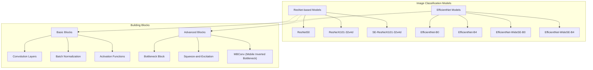
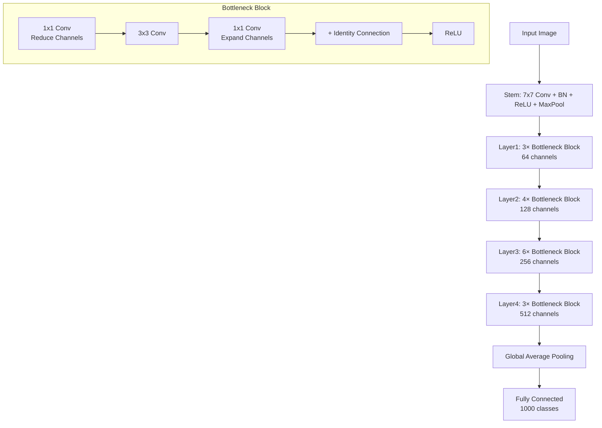
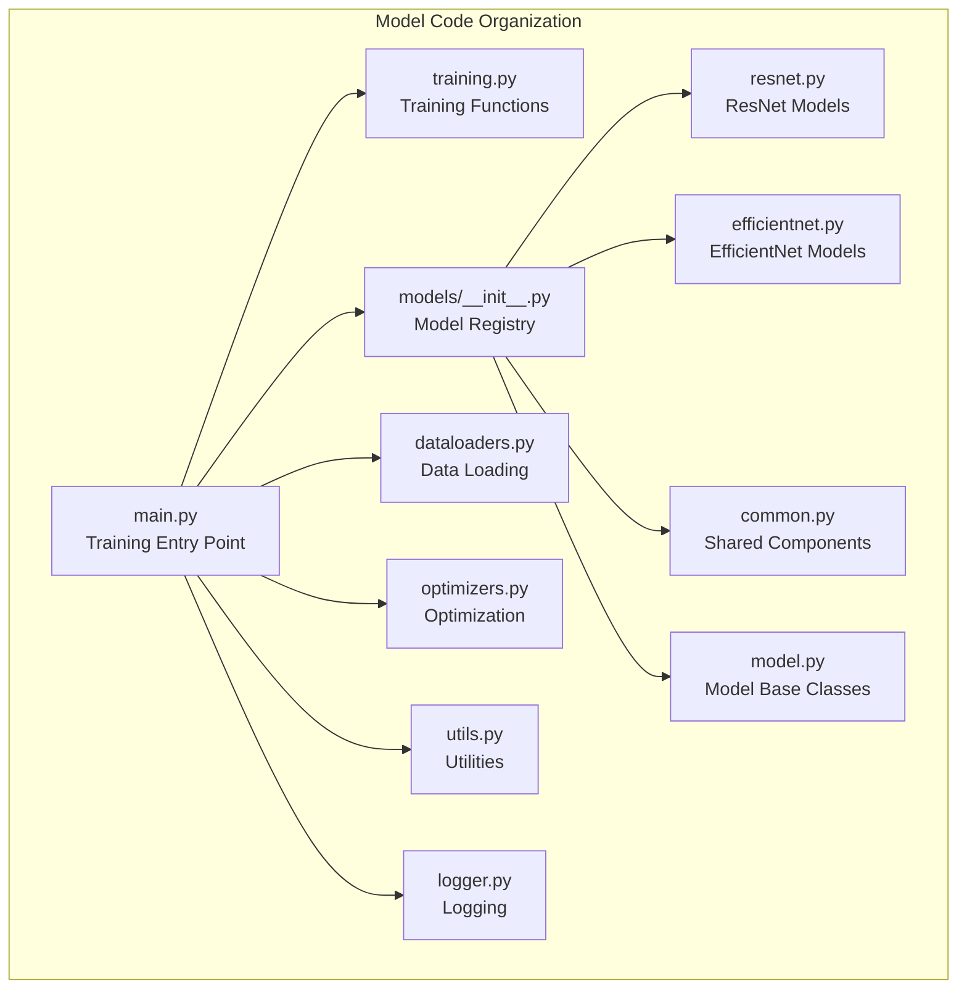
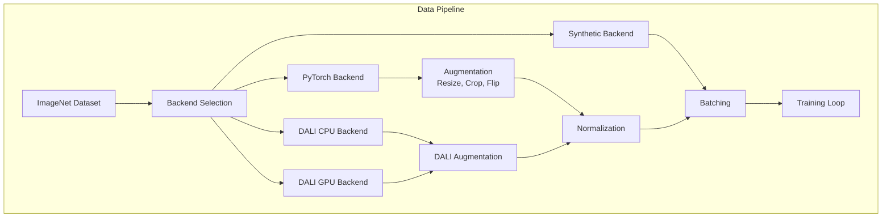
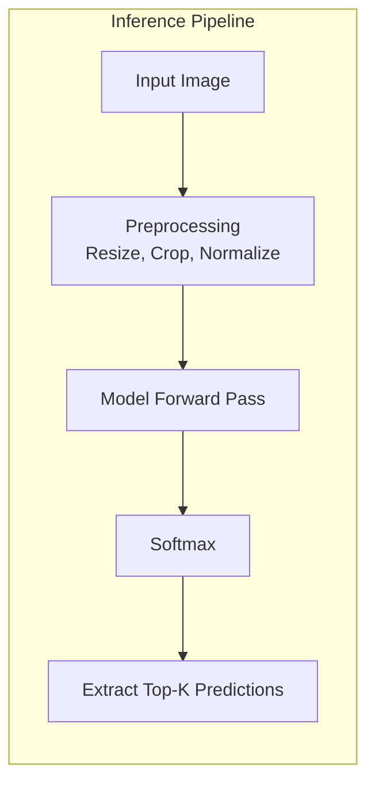

<!-- source: DeepWiki mcp.deepwiki.com · repo NVIDIA/DeepLearningExamples · extra page PyTorch Image Classification Models · fetched 2026-10-26 -->

# PyTorch Image Classification Models

<details>
<summary>Relevant source files</summary>

The following files were used as context for generating this wiki page:

- [PyTorch/Classification/ConvNets/Dockerfile](PyTorch/Classification/ConvNets/Dockerfile)
- [PyTorch/Classification/ConvNets/README.md](PyTorch/Classification/ConvNets/README.md)
- [PyTorch/Classification/ConvNets/checkpoint2model.py](PyTorch/Classification/ConvNets/checkpoint2model.py)
- [PyTorch/Classification/ConvNets/classify.py](PyTorch/Classification/ConvNets/classify.py)
- [PyTorch/Classification/ConvNets/configs.yml](PyTorch/Classification/ConvNets/configs.yml)
- [PyTorch/Classification/ConvNets/efficientnet/README.md](PyTorch/Classification/ConvNets/efficientnet/README.md)
- [PyTorch/Classification/ConvNets/image_classification/dataloaders.py](PyTorch/Classification/ConvNets/image_classification/dataloaders.py)
- [PyTorch/Classification/ConvNets/image_classification/gpu_affinity.py](PyTorch/Classification/ConvNets/image_classification/gpu_affinity.py)
- [PyTorch/Classification/ConvNets/image_classification/logger.py](PyTorch/Classification/ConvNets/image_classification/logger.py)
- [PyTorch/Classification/ConvNets/image_classification/models/__init__.py](PyTorch/Classification/ConvNets/image_classification/models/__init__.py)
- [PyTorch/Classification/ConvNets/image_classification/models/common.py](PyTorch/Classification/ConvNets/image_classification/models/common.py)
- [PyTorch/Classification/ConvNets/image_classification/models/efficientnet.py](PyTorch/Classification/ConvNets/image_classification/models/efficientnet.py)
- [PyTorch/Classification/ConvNets/image_classification/models/entrypoints.py](PyTorch/Classification/ConvNets/image_classification/models/entrypoints.py)
- [PyTorch/Classification/ConvNets/image_classification/models/model.py](PyTorch/Classification/ConvNets/image_classification/models/model.py)
- [PyTorch/Classification/ConvNets/image_classification/models/resnet.py](PyTorch/Classification/ConvNets/image_classification/models/resnet.py)
- [PyTorch/Classification/ConvNets/image_classification/optimizers.py](PyTorch/Classification/ConvNets/image_classification/optimizers.py)
- [PyTorch/Classification/ConvNets/image_classification/training.py](PyTorch/Classification/ConvNets/image_classification/training.py)
- [PyTorch/Classification/ConvNets/image_classification/utils.py](PyTorch/Classification/ConvNets/image_classification/utils.py)
- [PyTorch/Classification/ConvNets/main.py](PyTorch/Classification/ConvNets/main.py)
- [PyTorch/Classification/ConvNets/model2onnx.py](PyTorch/Classification/ConvNets/model2onnx.py)
- [PyTorch/Classification/ConvNets/quant_main.py](PyTorch/Classification/ConvNets/quant_main.py)
- [PyTorch/Classification/ConvNets/requirements.txt](PyTorch/Classification/ConvNets/requirements.txt)
- [PyTorch/Classification/ConvNets/resnet50v1.5/README.md](PyTorch/Classification/ConvNets/resnet50v1.5/README.md)
- [PyTorch/Classification/ConvNets/resnext101-32x4d/README.md](PyTorch/Classification/ConvNets/resnext101-32x4d/README.md)
- [PyTorch/Classification/ConvNets/se-resnext101-32x4d/README.md](PyTorch/Classification/ConvNets/se-resnext101-32x4d/README.md)
- [PyTorch/Classification/ConvNets/triton/deployer.py](PyTorch/Classification/ConvNets/triton/deployer.py)
- [hubconf.py](hubconf.py)

</details>


This document covers the implementation and usage of image classification models in PyTorch as part of NVIDIA's Deep Learning Examples repository. It focuses on the Convolutional Neural Network (CNN) implementations used for image classification tasks, including various ResNet derivatives and EfficientNet models. For information about PyTorch segmentation models, see [PyTorch Segmentation Models](#2.2.2).

## Model Family Overview

The repository provides implementations of several high-performance image classification architectures:

| Model                | Description                                                      | Default Image Size | Parameters |
|----------------------|------------------------------------------------------------------|-------------------|------------|
| ResNet50             | Standard ResNet with 50 layers                                   | 224×224           | 25.6M      |
| ResNeXt101-32×4d     | ResNet with grouped convolutions (32 groups, width 4d)           | 224×224           | 44.2M      |
| SE-ResNeXt101-32×4d  | ResNeXt with Squeeze-and-Excitation attention blocks             | 224×224           | 48.3M      |
| EfficientNet-B0      | Baseline EfficientNet model                                      | 224×224           | 5.3M       |
| EfficientNet-B4      | Larger EfficientNet variant with higher resolution               | 380×380           | 19.3M      |
| EfficientNet-WideSE-B0/B4 | EfficientNet with wider Squeeze-and-Excitation layers       | 224×224/380×380   | 5.4M/19.5M |

All models are highly optimized for NVIDIA GPUs, with support for mixed precision training, multi-GPU execution, and NVIDIA DALI for data loading.

Sources: [hubconf.py:7-13](), [PyTorch/Classification/ConvNets/README.md:19-29]()

## Model Architecture Overview



The implementations share common architecture patterns but with model-specific variations. All models follow a similar high-level structure with stem layers, main feature extraction blocks, and classification head.

Sources: [image_classification/models/resnet.py:53-54](), [image_classification/models/common.py:20-101](), [image_classification/models/efficientnet.py:51-77]()

## ResNet-based Models

ResNet and its variants use residual connections to enable training of deeper networks by addressing the vanishing gradient problem.

### ResNet50 Architecture



ResNet50 uses bottleneck blocks to reduce computation while maintaining model capacity. Each bottleneck block consists of 1×1 convolution to reduce channels, 3×3 convolution for feature extraction, and 1×1 convolution to restore channels, with a residual connection that preserves feature information.

Sources: [image_classification/models/resnet.py:107-176]()

### ResNeXt101-32×4d

ResNeXt extends ResNet by using grouped convolutions in the bottleneck blocks. The 32×4d configuration means 32 groups with a bottleneck width of 4d.

### SE-ResNeXt101-32×4d

SE-ResNeXt adds Squeeze-and-Excitation blocks to ResNeXt. These blocks adaptively recalibrate channel-wise feature responses by explicitly modeling interdependencies between channels.


The SE module captures channel-wise dependencies using global average pooling followed by two fully connected layers with a bottleneck design, producing channel-specific scaling factors.

Sources: [image_classification/models/common.py:146-165](), [image_classification/models/resnet.py:178-206]()

## EfficientNet Models

EfficientNet uses compound scaling to systematically scale network width, depth, and resolution. MBConv (Mobile Inverted Bottleneck) blocks form the core of the network.

```mermaid
graph TD
    subgraph "EfficientNet Architecture"
        Input["Input Image"] --> Stem["Stem: 3x3 Conv + BN + SiLU"]
        Stem --> MB["MBConv Blocks<br>Stages 1-7"]
        MB --> Conv1x1["1x1 Conv"]
        Conv1x1 --> Pool["Global Average Pooling"]
        Pool --> FC["Fully Connected<br>1000 classes"]
    end
    
    subgraph "MBConv Block"
        In["Input"] --> Expand["1x1 Conv<br>Expand Channels"]
        Expand --> DWConv["Depthwise 3x3 Conv"]
        DWConv --> SE["Squeeze-and-Excitation"]
        SE --> Project["1x1 Conv<br>Reduce Channels"]
        Project --> Skip["+ Skip Connection<br>If dimensions match"]
    end
```



EfficientNet-B0 is the baseline model, while B4 is scaled up in width, depth, and resolution. The WideSE variants use wider Squeeze-and-Excitation modules that are proportional to the width of depthwise separable convolutions instead of block width.

Sources: [efficientnet/README.md:52-58](), [image_classification/models/efficientnet.py:78-116]()

## Implementation Details

### Model Implementation Structure



The code follows an object-oriented design where model architectures are defined as classes inheriting from the base `nn.Module` class. The implementation uses dataclasses for configuration management and EntryPoint patterns for model instantiation.

Sources: [PyTorch/Classification/ConvNets/main.py:70-86](), [image_classification/models/model.py:34-48]()

### Common Building Blocks

The repository defines common building blocks used across different model architectures:

1. **LayerBuilder**: Factory class for creating standard layers with consistent initialization
2. **Bottleneck Block**: Main building block for ResNet models
3. **Squeeze-and-Excitation**: Attention mechanism for channel recalibration
4. **MBConv**: Mobile inverted bottleneck block for EfficientNet

Sample of the LayerBuilder implementation:

```python
# Simplified example of LayerBuilder
class LayerBuilder(object):
    def __init__(self, config):
        self.config = config

    def conv3x3(self, in_planes, out_planes, stride=1, groups=1, bn=False, act=False):
        """3x3 convolution with padding"""
        c = self.conv(3, in_planes, out_planes, groups=groups, stride=stride, bn=bn, act=act)
        return c

    def batchnorm(self, planes, zero_init=False):
        bn = nn.BatchNorm2d(planes)
        nn.init.constant_(bn.weight, 0 if zero_init else 1)
        nn.init.constant_(bn.bias, 0)
        return bn

    def activation(self):
        return {
            "silu": lambda: nn.SiLU(inplace=True),
            "relu": lambda: nn.ReLU(inplace=True),
        }[self.config.activation]()
```

Sources: [image_classification/models/common.py:20-129](), [image_classification/models/resnet.py:107-176]()

## Training Pipeline

The training pipeline consists of several key components:

### Data Loading and Augmentation

The repository supports multiple data backends:
- PyTorch native dataloader
- NVIDIA DALI CPU
- NVIDIA DALI GPU
- Synthetic data (for benchmarking)



The standard data augmentation includes:
- Random resized crop
- Random horizontal flip
- Normalization with ImageNet mean and std
- For validation: center crop

Sources: [image_classification/dataloaders.py:30-577](), [PyTorch/Classification/ConvNets/main.py:513-541]()

### Training Loop and Optimization

The training is managed by the `Trainer` class that handles:
- Forward and backward passes
- Gradient accumulation
- Optimizer updates
- Exponential Moving Average (EMA) of model weights (optional)
- Mixed precision training with AMP

The repository provides several optimization configurations:

| Model | Optimizer | Learning Rate | Weight Decay | Momentum | Epochs |
|-------|-----------|---------------|--------------|----------|--------|
| ResNet50 | SGD | 0.256 (256 BS) | 3.05e-5 | 0.875 | 90/250 |
| ResNeXt101-32×4d | SGD | 0.256 (256 BS) | 6.10e-5 | 0.875 | 90/250 |
| SE-ResNeXt101-32×4d | SGD | 0.256 (256 BS) | 6.10e-5 | 0.875 | 90/250 |
| EfficientNet-B0 | RMSprop | 0.08 (4096 BS) | 1e-5 | 0.9 | 400 |
| EfficientNet-B4 | RMSprop | 0.16 (4096 BS) | 5e-6 | 0.9 | 400 |

Sources: [image_classification/training.py:205-255](), [image_classification/training.py:313-435](), [configs.yml:64-126]()

### Training Configuration

The code supports various configurations through command-line arguments:

1. **Precision Options**:
   - FP32: Full precision training
   - AMP: Automatic mixed precision
   - TF32: TensorFloat-32 (on A100 GPUs)

2. **Distributed Training**:
   - Multi-GPU training using DistributedDataParallel
   - Gradient accumulation for large batch sizes

3. **Learning Rate Schedules**:
   - Step decay
   - Cosine annealing
   - Linear decay

4. **Regularization**:
   - Weight decay (with option to exclude BatchNorm parameters)
   - Label smoothing
   - MixUp augmentation
   - Stochastic depth (for EfficientNet)

Sources: [PyTorch/Classification/ConvNets/main.py:71-173](), [PyTorch/Classification/ConvNets/main.py:359-417]()

## Inference Process



The repository supports multiple inference modes:
1. **Batch inference** on validation datasets
2. **Single image inference** for classifying individual images
3. **ONNX export** for deployment to other platforms
4. **Triton Inference Server** deployment

The `classify.py` script provides a simple way to run inference on individual images:

```bash
python classify.py --arch resnet50 --pretrained --precision AMP --image <path to JPEG image>
```

Sources: [classify.py:1-166](), [PyTorch/Classification/ConvNets/main.py:257-310]()

## Performance Optimization Features

### Mixed Precision Training

The implementation supports automatic mixed precision (AMP) training, which:
- Uses FP16 storage for most operations
- Maintains FP32 precision for critical operations
- Uses dynamic loss scaling to prevent underflow
- Is enabled with `--amp` flag

```python
# Example of AMP usage in the code
with autocast(enabled=self.amp):
    loss = self.loss(self.model(input), target)
    loss /= self.divide_loss

self.scaler.scale(loss).backward()
```

Sources: [image_classification/training.py:86-96](), [resnet50v1.5/README.md:173-187]()

### Multi-GPU Training

The repository supports distributed training across multiple GPUs using:
- PyTorch DistributedDataParallel (DDP)
- NVIDIA NCCL for inter-GPU communication
- Optional GPU affinity settings for optimal performance

Sources: [PyTorch/Classification/ConvNets/main.py:583-584]()

### Data Loading Optimizations

Data loading is optimized using:
1. **DALI integration** for GPU-accelerated data loading and preprocessing
2. **Prefetching** to overlap data loading with computation
3. **Memory format optimization** (NHWC vs NCHW)
4. **Fast JPEG decoding** with custom collate functions

Sources: [image_classification/dataloaders.py:207-228](), [image_classification/dataloaders.py:354-406]()

## Usage Examples

### Training a model

```bash
# Train ResNet50 with mixed precision on 8 GPUs
python ./multiproc.py --nproc_per_node 8 ./main.py --arch resnet50 --label-smoothing 0.1 --amp --static-loss-scale 256 <path to imagenet>
```

### Evaluating a model

```bash
# Evaluate a pretrained model
python ./main.py --arch resnet50 --evaluate --epochs 1 --pretrained -b 256 <path to imagenet>
```

### Inference on a single image

```bash
# Run inference on a JPEG image
python classify.py --arch efficientnet-b0 --pretrained --precision AMP --image <path to JPEG image>
```

Sources: [PyTorch/Classification/ConvNets/main.py:653-678](), [classify.py:118-145]()

## Model Performance

The repository provides highly optimized implementations that achieve state-of-the-art accuracy and performance.

| Model | Mixed Precision Top-1 | Mixed Precision Top-5 | FP32 Top-1 | FP32 Top-5 |
|-------|------------------------|------------------------|------------|------------|
| ResNet50 | 78.60% | 94.19% | 78.69% | 94.16% |
| ResNeXt101-32x4d | 80.43% | 95.06% | 80.40% | 95.04% |
| SE-ResNeXt101-32x4d | 81.00% | 95.48% | 81.09% | 95.45% |
| EfficientNet-B0 | 77.63% | 93.82% | 77.31% | 93.76% |
| EfficientNet-B4 | 82.98% | 96.44% | 82.92% | 96.43% |
| EfficientNet-WideSE-B0 | 77.89% | 94.00% | 77.97% | 94.05% |
| EfficientNet-WideSE-B4 | 83.28% | 96.45% | 83.30% | 96.47% |

Sources: [PyTorch/Classification/ConvNets/README.md:42-51]()

## Summary

The PyTorch Image Classification Models in NVIDIA's Deep Learning Examples repository provide highly optimized implementations of popular CNN architectures. The code supports a range of features including mixed precision training, multi-GPU execution, and efficient data loading. The implementations are designed to achieve state-of-the-art accuracy while maximizing performance on NVIDIA GPUs.

---

