<!-- source: DeepWiki mcp.deepwiki.com · repo NVIDIA/DeepLearningExamples · extra page PyTorch Segmentation Models · fetched 2026-10-26 -->

# PyTorch Segmentation Models

<details>
<summary>Relevant source files</summary>

The following files were used as context for generating this wiki page:

- [PyTorch/Segmentation/MaskRCNN/Dockerfile](PyTorch/Segmentation/MaskRCNN/Dockerfile)
- [PyTorch/Segmentation/MaskRCNN/README.md](PyTorch/Segmentation/MaskRCNN/README.md)
- [PyTorch/Segmentation/MaskRCNN/download_dataset.sh](PyTorch/Segmentation/MaskRCNN/download_dataset.sh)
- [PyTorch/Segmentation/MaskRCNN/hashes.md5](PyTorch/Segmentation/MaskRCNN/hashes.md5)
- [PyTorch/Segmentation/MaskRCNN/pytorch/Dockerfile](PyTorch/Segmentation/MaskRCNN/pytorch/Dockerfile)
- [PyTorch/Segmentation/MaskRCNN/pytorch/configs/ci/e2e_mask_rcnn_R_50_FPN_1x.yaml](PyTorch/Segmentation/MaskRCNN/pytorch/configs/ci/e2e_mask_rcnn_R_50_FPN_1x.yaml)
- [PyTorch/Segmentation/MaskRCNN/pytorch/configs/e2e_mask_rcnn_R_50_FPN_1x_bs32.yaml](PyTorch/Segmentation/MaskRCNN/pytorch/configs/e2e_mask_rcnn_R_50_FPN_1x_bs32.yaml)
- [PyTorch/Segmentation/MaskRCNN/pytorch/configs/e2e_mask_rcnn_R_50_FPN_1x_bs64.yaml](PyTorch/Segmentation/MaskRCNN/pytorch/configs/e2e_mask_rcnn_R_50_FPN_1x_bs64.yaml)
- [PyTorch/Segmentation/MaskRCNN/pytorch/maskrcnn_benchmark/config/defaults.py](PyTorch/Segmentation/MaskRCNN/pytorch/maskrcnn_benchmark/config/defaults.py)
- [PyTorch/Segmentation/MaskRCNN/pytorch/maskrcnn_benchmark/engine/inference.py](PyTorch/Segmentation/MaskRCNN/pytorch/maskrcnn_benchmark/engine/inference.py)
- [PyTorch/Segmentation/MaskRCNN/pytorch/maskrcnn_benchmark/engine/trainer.py](PyTorch/Segmentation/MaskRCNN/pytorch/maskrcnn_benchmark/engine/trainer.py)
- [PyTorch/Segmentation/MaskRCNN/pytorch/maskrcnn_benchmark/layers/nms.py](PyTorch/Segmentation/MaskRCNN/pytorch/maskrcnn_benchmark/layers/nms.py)
- [PyTorch/Segmentation/MaskRCNN/pytorch/maskrcnn_benchmark/layers/roi_align.py](PyTorch/Segmentation/MaskRCNN/pytorch/maskrcnn_benchmark/layers/roi_align.py)
- [PyTorch/Segmentation/MaskRCNN/pytorch/maskrcnn_benchmark/layers/roi_pool.py](PyTorch/Segmentation/MaskRCNN/pytorch/maskrcnn_benchmark/layers/roi_pool.py)
- [PyTorch/Segmentation/MaskRCNN/pytorch/maskrcnn_benchmark/utils/comm.py](PyTorch/Segmentation/MaskRCNN/pytorch/maskrcnn_benchmark/utils/comm.py)
- [PyTorch/Segmentation/MaskRCNN/pytorch/requirements.txt](PyTorch/Segmentation/MaskRCNN/pytorch/requirements.txt)
- [PyTorch/Segmentation/MaskRCNN/pytorch/scripts/docker/interactive.sh](PyTorch/Segmentation/MaskRCNN/pytorch/scripts/docker/interactive.sh)
- [PyTorch/Segmentation/MaskRCNN/pytorch/scripts/inference.sh](PyTorch/Segmentation/MaskRCNN/pytorch/scripts/inference.sh)
- [PyTorch/Segmentation/MaskRCNN/pytorch/scripts/inference_benchmark.sh](PyTorch/Segmentation/MaskRCNN/pytorch/scripts/inference_benchmark.sh)
- [PyTorch/Segmentation/MaskRCNN/pytorch/tools/test_net.py](PyTorch/Segmentation/MaskRCNN/pytorch/tools/test_net.py)
- [PyTorch/Segmentation/MaskRCNN/pytorch/tools/train_net.py](PyTorch/Segmentation/MaskRCNN/pytorch/tools/train_net.py)
- [PyTorch/Segmentation/nnUNet/Dockerfile](PyTorch/Segmentation/nnUNet/Dockerfile)
- [PyTorch/Segmentation/nnUNet/README.md](PyTorch/Segmentation/nnUNet/README.md)
- [PyTorch/Segmentation/nnUNet/data_loading/dali_loader.py](PyTorch/Segmentation/nnUNet/data_loading/dali_loader.py)
- [PyTorch/Segmentation/nnUNet/data_loading/data_module.py](PyTorch/Segmentation/nnUNet/data_loading/data_module.py)
- [PyTorch/Segmentation/nnUNet/main.py](PyTorch/Segmentation/nnUNet/main.py)
- [PyTorch/Segmentation/nnUNet/nnunet/metrics.py](PyTorch/Segmentation/nnUNet/nnunet/metrics.py)
- [PyTorch/Segmentation/nnUNet/nnunet/nn_unet.py](PyTorch/Segmentation/nnUNet/nnunet/nn_unet.py)
- [PyTorch/Segmentation/nnUNet/requirements.txt](PyTorch/Segmentation/nnUNet/requirements.txt)
- [PyTorch/Segmentation/nnUNet/scripts/benchmark.py](PyTorch/Segmentation/nnUNet/scripts/benchmark.py)
- [PyTorch/Segmentation/nnUNet/scripts/train.py](PyTorch/Segmentation/nnUNet/scripts/train.py)
- [PyTorch/Segmentation/nnUNet/utils/args.py](PyTorch/Segmentation/nnUNet/utils/args.py)
- [PyTorch/Segmentation/nnUNet/utils/logger.py](PyTorch/Segmentation/nnUNet/utils/logger.py)
- [PyTorch/Segmentation/nnUNet/utils/utils.py](PyTorch/Segmentation/nnUNet/utils/utils.py)

</details>


This page provides documentation for the segmentation models implemented in PyTorch within the NVIDIA Deep Learning Examples repository. The repository contains two main PyTorch segmentation model implementations: nnU-Net for medical image segmentation and Mask R-CNN for instance segmentation. This document explains their architectures, key features, training and inference pipelines, and performance optimizations.

For information about PyTorch Classification Models, see [PyTorch Image Classification Models](#2.2.1). For information about deployment, see [Deployment](#5).

## Overview of PyTorch Segmentation Models

The NVIDIA Deep Learning Examples repository includes the following PyTorch segmentation models:

1. **nnU-Net** - A self-adapting framework for U-Net-based medical image segmentation
2. **Mask R-CNN** - An instance segmentation model that extends Faster R-CNN with a mask prediction branch

These implementations are optimized for performance on NVIDIA GPUs with support for mixed-precision training, multi-GPU execution, and optimized data loading.

### Segmentation Tasks and Approaches

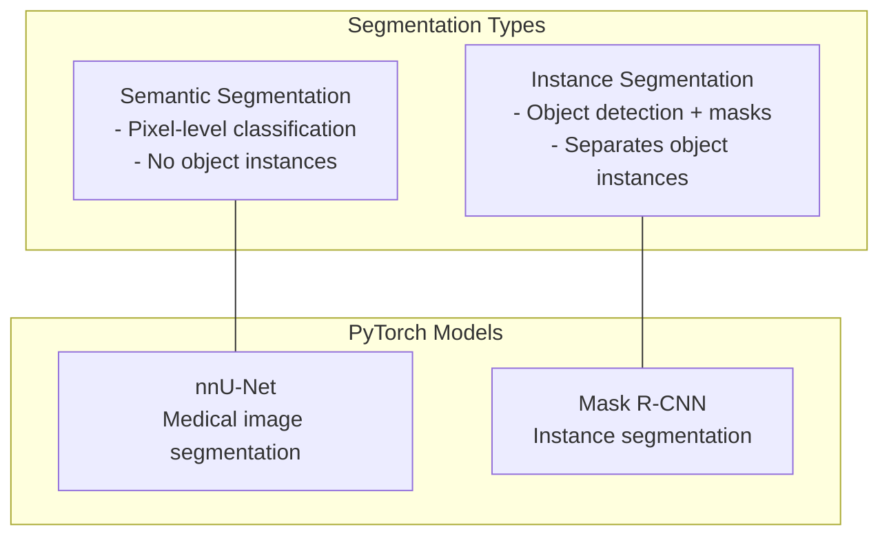

Sources: [PyTorch/Segmentation/nnUNet/README.md:46-67](). [PyTorch/Segmentation/MaskRCNN/README.md:45-56]().

## nnU-Net Implementation

nnU-Net ("no-new-Net") is a robust and self-adapting framework for U-Net-based medical image segmentation. It automatically configures all hyper-parameters based on dataset properties, eliminating the need for manual architecture engineering.

### Architecture and Components

```mermaid
graph TD
    subgraph "nnU-Net Architecture"
        input["Input Medical Image"] --> encoder["Encoder"]
        encoder --> d1["Downsampling 1"] --> d2["Downsampling 2"] --> d3["Downsampling 3"] --> bottleneck["Bottleneck"]
        bottleneck --> u1["Upsampling 1"] --> u2["Upsampling 2"] --> u3["Upsampling 3"] --> decoder["Decoder"]
        
        d1 -- "Skip Connection" --> u3
        d2 -- "Skip Connection" --> u2
        d3 -- "Skip Connection" --> u1
        
        decoder --> output["Segmentation Mask"]
    end
    
    subgraph "Convolution Block"
        conv1["Convolution 3×3"] --> norm1["Instance Normalization"] --> act1["LeakyReLU"]
        act1 --> conv2["Convolution 3×3"] --> norm2["Instance Normalization"] --> act2["LeakyReLU"]
    end
```

The nnU-Net architecture consists of an encoder-decoder structure with skip connections. All convolution blocks use two convolution layers followed by instance normalization and LeakyReLU. For downsampling, stride convolution is used, while transposed convolution is used for upsampling.

Sources: [PyTorch/Segmentation/nnUNet/README.md:58-71](). [PyTorch/Segmentation/nnUNet/nnunet/nn_unet.py:175-198]().

### Dynamic Network Configuration

nnU-Net dynamically adapts to the dataset characteristics. The model parameters and architecture are automatically determined based on:

1. Input image properties (dimensions, spacing, etc.)
2. Available GPU memory
3. Task-specific requirements

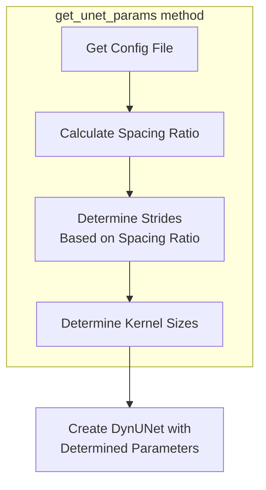

Sources: [PyTorch/Segmentation/nnUNet/nnunet/nn_unet.py:139-159]().

### Data Processing and Loading

The nnU-Net implementation uses NVIDIA Data Loading Library (DALI) for efficient data loading and preprocessing. The preprocessing pipeline includes:

1. Cropping to non-zero values
2. Resampling to median voxel spacing 
3. Normalization (CT: percentile clipping + z-score; MRI: z-score normalization)
4. Data augmentation (mirroring, rotation, zoom, noise, blur, brightness, contrast)

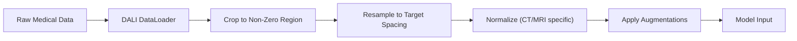

Sources: [PyTorch/Segmentation/nnUNet/data_loading/dali_loader.py:88-165](). [PyTorch/Segmentation/nnUNet/README.md:384-405]().

### Training Pipeline

The training pipeline is implemented using PyTorch Lightning, providing a structured approach for model training:

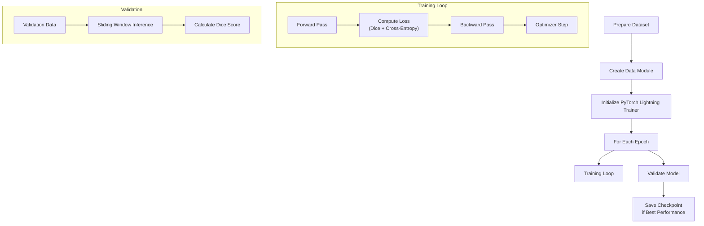

The training uses mixed-precision with automatic mixed precision (AMP) and a combination of dice and cross-entropy loss functions. Early stopping is triggered if the validation dice score doesn't improve for a set number of epochs.

Sources: [PyTorch/Segmentation/nnUNet/main.py:59-124](). [PyTorch/Segmentation/nnUNet/nnunet/nn_unet.py:87-93, 243-250]().

### Inference Process

Inference in nnU-Net uses a sliding window approach for processing 3D volumes or large 2D images:

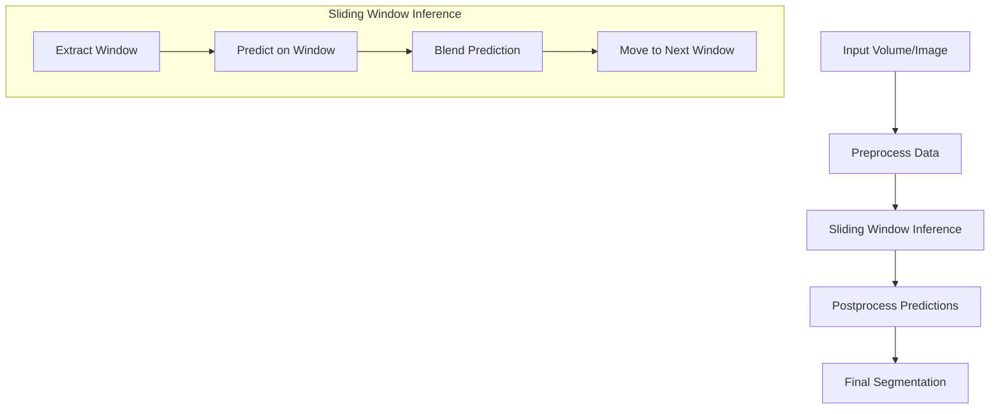

For test-time augmentation (TTA), predictions are made on various flipped versions of the input and then averaged to improve accuracy.

Sources: [PyTorch/Segmentation/nnUNet/nnunet/nn_unet.py:203-240](). [PyTorch/Segmentation/nnUNet/README.md:131-136]().

## Mask R-CNN Implementation

Mask R-CNN extends Faster R-CNN by adding a branch for predicting segmentation masks on each Region of Interest (RoI), in parallel with the existing branch for classification and bounding box regression.

### Architecture and Components

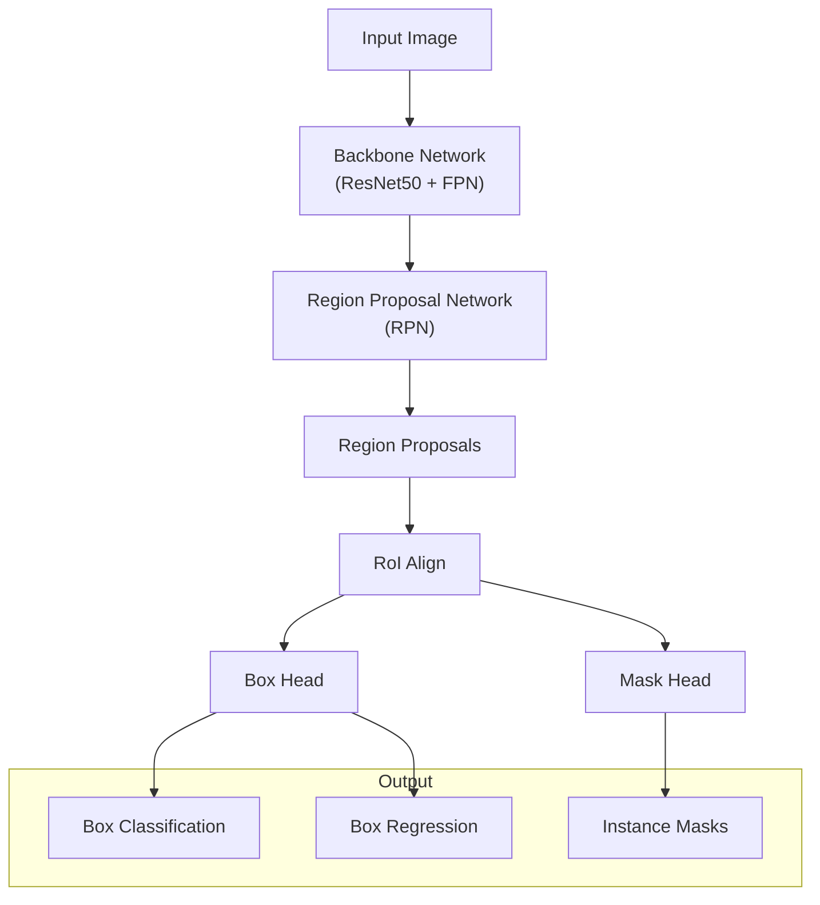

Sources: [PyTorch/Segmentation/MaskRCNN/README.md:64-73](). [PyTorch/Segmentation/MaskRCNN/pytorch/configs/e2e_mask_rcnn_R_50_FPN_1x.yaml:1-31]().

### Default Configuration and Optimization

The NVIDIA implementation of Mask R-CNN includes several performance optimizations:

1. **Custom CUDA kernels** for operations like:
   - Box IoU computation
   - Proposal matching
   - Anchor box generation
   - Pre-NMS box selection

2. **Performance optimizations**:
   - Fast data loading with prefetching
   - Hybrid CPU/GPU data loading
   - Mixed precision training
   - Memory format optimizations (NHWC)
   - FusedSGD optimizer

Default configuration parameters for training include:

| Parameter | Value |
|-----------|-------|
| Backbone | ResNet-50 with FPN |
| Learning rate | 0.12 |
| Training batch size | 96 |
| Test batch size | 8 |
| RPN batch size | 256 |
| ROI batch size | 512 |
| Max iterations | 16,667 |
| Warmup iterations | 800 |

Sources: [PyTorch/Segmentation/MaskRCNN/README.md:76-114, 187-197](). [PyTorch/Segmentation/MaskRCNN/pytorch/maskrcnn_benchmark/config/defaults.py:77-111, 418-446]().

### Training Process

The training pipeline for Mask R-CNN involves:

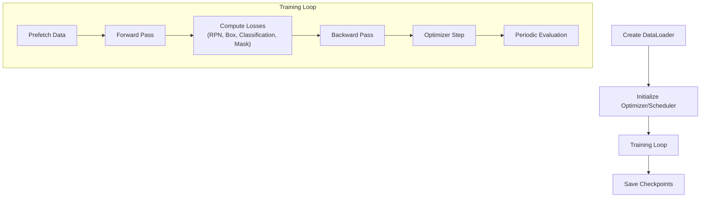

The implementation supports both single-GPU and multi-GPU training using PyTorch's DistributedDataParallel, with the ability to use automatic mixed precision for faster training.

Sources: [PyTorch/Segmentation/MaskRCNN/pytorch/maskrcnn_benchmark/engine/trainer.py:38-69, 72-182](). [PyTorch/Segmentation/MaskRCNN/pytorch/tools/train_net.py:90-165]().

### Inference Process

Inference for Mask R-CNN includes:

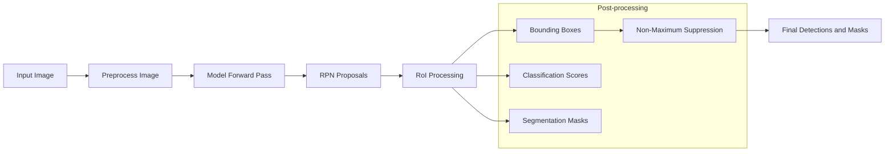

The inference pipeline is optimized with features like automatic mixed precision and memory format optimizations.

Sources: [PyTorch/Segmentation/MaskRCNN/pytorch/tools/test_net.py:25-174](). [PyTorch/Segmentation/MaskRCNN/pytorch/maskrcnn_benchmark/engine/inference.py:16-132]().

## Common Features and Optimization Techniques

Both segmentation models share several common features and optimization techniques:

### Mixed Precision Training

Both implementations support mixed precision training using PyTorch's AMP (Automatic Mixed Precision), which can significantly accelerate training:

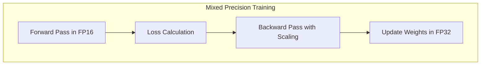

For Mask R-CNN, mixed precision is implemented as:
```
with torch.cuda.amp.autocast():
    loss_dict = model(images, targets)
scaler.scale(losses).backward()
scaler.step(optimizer)
scaler.update()
```

For nnU-Net, mixed precision is enabled with the `--amp` flag.

Sources: [PyTorch/Segmentation/MaskRCNN/README.md:151-170](). [PyTorch/Segmentation/nnUNet/README.md:103-120](). [PyTorch/Segmentation/MaskRCNN/pytorch/maskrcnn_benchmark/engine/trainer.py:108-127]().

### Multi-GPU Training

Both models support efficient multi-GPU training:

1. **nnU-Net** uses PyTorch Lightning's implementation of DistributedDataParallel
2. **Mask R-CNN** provides custom distributed training implementation with support for both PyTorch's and Apex's DistributedDataParallel

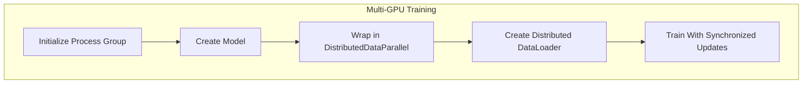

Sources: [PyTorch/Segmentation/nnUNet/main.py:42-56](). [PyTorch/Segmentation/MaskRCNN/pytorch/tools/train_net.py:104-112]().

### Benchmarking

Both implementations include benchmarking scripts to measure training and inference performance. For example, the nnU-Net repository includes the following benchmarking capabilities:

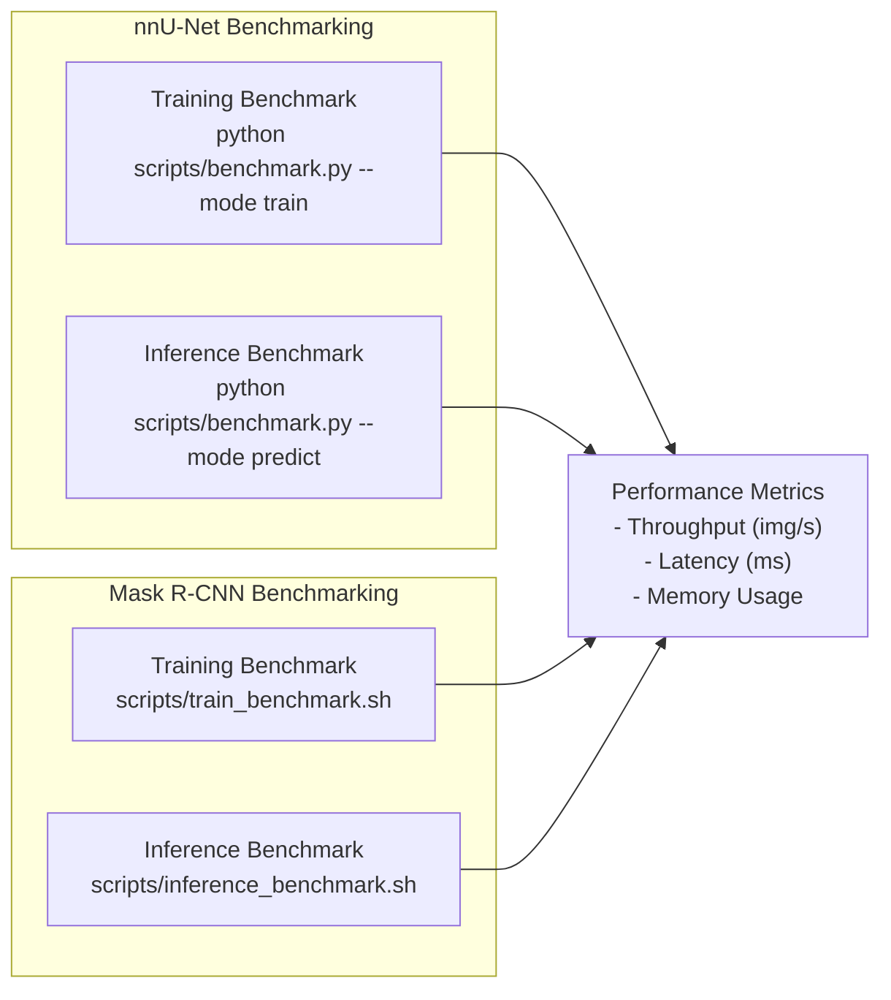

The benchmarking tools report key performance metrics like throughput (images/second), latency, and memory usage.

Sources: [PyTorch/Segmentation/nnUNet/scripts/benchmark.py:1-57](). [PyTorch/Segmentation/MaskRCNN/pytorch/scripts/inference_benchmark.sh:1-46]().

## Performance Optimizations Summary

Here are the key performance optimizations used in both segmentation models:

| Optimization Technique | nnU-Net | Mask R-CNN |
|------------------------|---------|------------|
| Mixed Precision (FP16) | ✓ | ✓ |
| TF32 on Ampere GPUs | ✓ | ✓ |
| Multi-GPU Training | ✓ | ✓ |
| NHWC Memory Format | ✓ | ✓ |
| DALI Data Loading | ✓ | - |
| Custom CUDA Kernels | - | ✓ |
| Prefetcher | - | ✓ |
| Gradient Accumulation | - | ✓ |
| Hybrid Data Loading | - | ✓ |

Sources: [PyTorch/Segmentation/nnUNet/README.md:82-136](). [PyTorch/Segmentation/MaskRCNN/README.md:182-197]().

---

