<!-- source: DeepWiki mcp.deepwiki.com · repo NVIDIA/DeepLearningExamples · extra page PyTorch Speech Recognition · fetched 2026-10-26 -->

# PyTorch Speech Recognition

<details>
<summary>Relevant source files</summary>

The following files were used as context for generating this wiki page:

- [PyTorch/SpeechRecognition/Jasper/Dockerfile](PyTorch/SpeechRecognition/Jasper/Dockerfile)
- [PyTorch/SpeechRecognition/Jasper/common/audio.py](PyTorch/SpeechRecognition/Jasper/common/audio.py)
- [PyTorch/SpeechRecognition/Jasper/common/features.py](PyTorch/SpeechRecognition/Jasper/common/features.py)
- [PyTorch/SpeechRecognition/Jasper/common/tb_dllogger.py](PyTorch/SpeechRecognition/Jasper/common/tb_dllogger.py)
- [PyTorch/SpeechRecognition/Jasper/requirements.txt](PyTorch/SpeechRecognition/Jasper/requirements.txt)
- [PyTorch/SpeechRecognition/Jasper/train.py](PyTorch/SpeechRecognition/Jasper/train.py)
- [PyTorch/SpeechRecognition/Jasper/utils/preprocessing_utils.py](PyTorch/SpeechRecognition/Jasper/utils/preprocessing_utils.py)
- [PyTorch/SpeechRecognition/QuartzNet/Dockerfile](PyTorch/SpeechRecognition/QuartzNet/Dockerfile)
- [PyTorch/SpeechRecognition/QuartzNet/common/tb_dllogger.py](PyTorch/SpeechRecognition/QuartzNet/common/tb_dllogger.py)
- [PyTorch/SpeechRecognition/QuartzNet/requirements.txt](PyTorch/SpeechRecognition/QuartzNet/requirements.txt)
- [PyTorch/SpeechRecognition/QuartzNet/train.py](PyTorch/SpeechRecognition/QuartzNet/train.py)
- [PyTorch/SpeechSynthesis/FastPitch/common/tb_dllogger.py](PyTorch/SpeechSynthesis/FastPitch/common/tb_dllogger.py)
- [PyTorch/SpeechSynthesis/FastPitch/requirements.txt](PyTorch/SpeechSynthesis/FastPitch/requirements.txt)

</details>


This document provides a comprehensive overview of the PyTorch-based automatic speech recognition (ASR) models available in the NVIDIA DeepLearningExamples repository. It focuses specifically on the Jasper and QuartzNet neural network architectures and their implementations. For information about text-to-speech models, see [PyTorch Text-to-Speech](#2.3.2).

## 1. Overview of Speech Recognition Models

The repository implements two state-of-the-art end-to-end speech recognition models:

1. **Jasper** - Joint Audio Speech and Encoder Recognition model
2. **QuartzNet** - A lightweight variant of Jasper with similar accuracy but fewer parameters

Both models are:
- End-to-end neural network architectures for ASR
- Based on convolutional neural networks (no recurrent layers)
- Trained with Connectionist Temporal Classification (CTC) loss
- Optimized for NVIDIA GPUs with mixed-precision training support

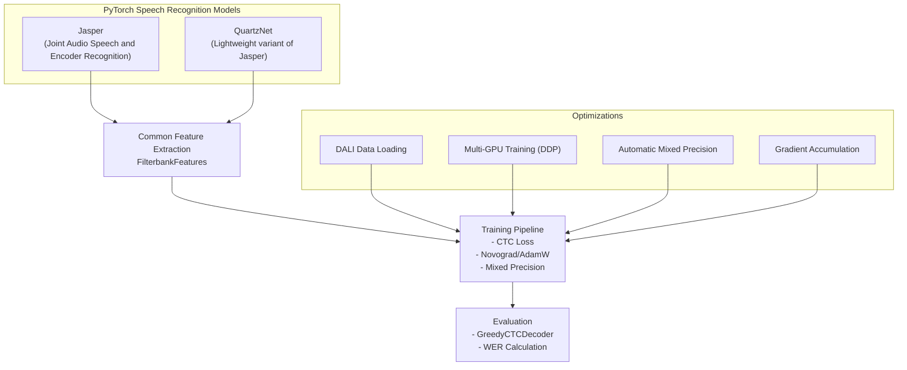

Sources: [PyTorch/SpeechRecognition/Jasper/train.py:305-311](), [PyTorch/SpeechRecognition/QuartzNet/train.py:326-330]()

## 2. Model Architectures

### 2.1 Common Architecture Elements

Both Jasper and QuartzNet follow a similar architectural pattern:

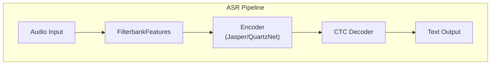

Sources: [PyTorch/SpeechRecognition/Jasper/train.py:305-311](), [PyTorch/SpeechRecognition/QuartzNet/train.py:326-330]()

### 2.2 Jasper Architecture

Jasper is a deep convolutional neural network for end-to-end speech recognition. The model architecture consists of blocks of 1D convolutions, batch normalization, ReLU, and dropout.

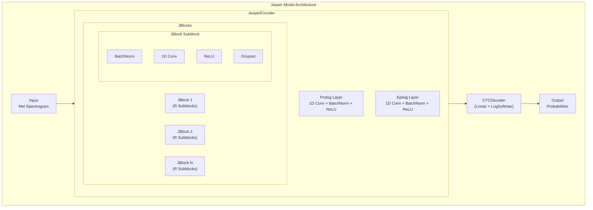

Sources: [PyTorch/SpeechRecognition/Jasper/train.py:305-308]()

### 2.3 QuartzNet Architecture

QuartzNet is an optimized variant of Jasper that uses depthwise separable convolutions to reduce the number of parameters while maintaining accuracy. This makes it more lightweight and efficient.

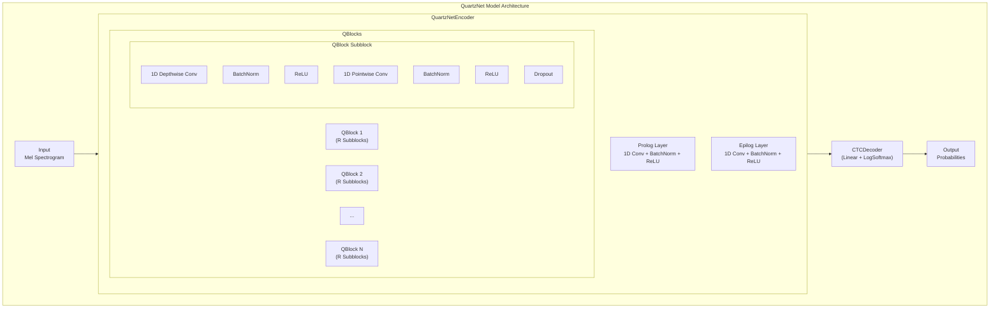

Sources: [PyTorch/SpeechRecognition/QuartzNet/train.py:326-330]()

## 3. Feature Extraction

Audio feature extraction is a critical pre-processing step for speech recognition models. Both models use the same feature extraction process.

### 3.1 Filterbank Features

The `FilterbankFeatures` class processes raw audio into mel-spectrogram features:

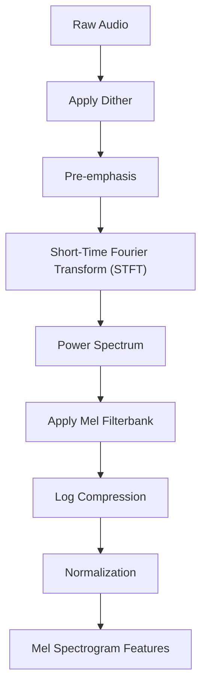

Key parameters for feature extraction:
- Sample rate (default: 16000 Hz)
- Window size (default: 20ms)
- Window stride (default: 10ms)
- Number of mel filters (default: 64)
- Optional augmentations: SpecAugment, Cutout

Sources: [PyTorch/SpeechRecognition/Jasper/common/features.py:196-298]()

## 4. Data Processing Pipeline

### 4.1 Dataset Structure

The data processing pipeline supports audio datasets in the following format:

```
dataset_dir/
├── file1.wav
├── file2.wav
└── ...
```

With a JSON manifest file containing:

```json
{"audio_filepath": "file1.wav", "duration": 3.45, "text": "transcript text"}
{"audio_filepath": "file2.wav", "duration": 2.18, "text": "another transcript"}
```

### 4.2 Data Processing Components

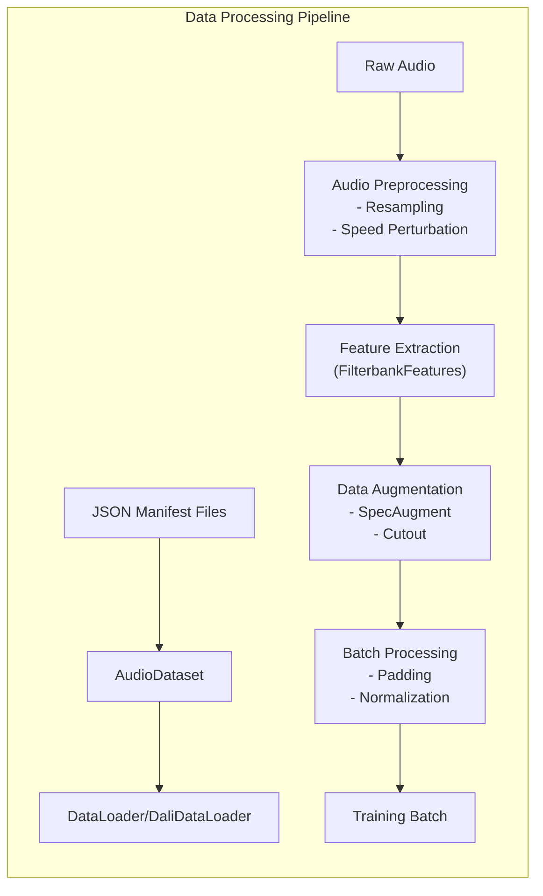

Sources: [PyTorch/SpeechRecognition/Jasper/train.py:211-301](), [PyTorch/SpeechRecognition/QuartzNet/train.py:232-321]()

### 4.3 Data Loading Options

The implementation provides two main options for data loading:

1. **Standard PyTorch DataLoader**:
   - `AudioDataset` for data loading
   - `FilterbankFeatures` for feature extraction on GPU

2. **DALI DataLoader**:
   - GPU-accelerated data loading pipeline
   - Optimized for performance with NVIDIA GPUs
   - Supports feature extraction within the pipeline

Sources: [PyTorch/SpeechRecognition/Jasper/train.py:215-290](), [PyTorch/SpeechRecognition/QuartzNet/train.py:236-310]()

## 5. Training Process

### 5.1 Training Pipeline

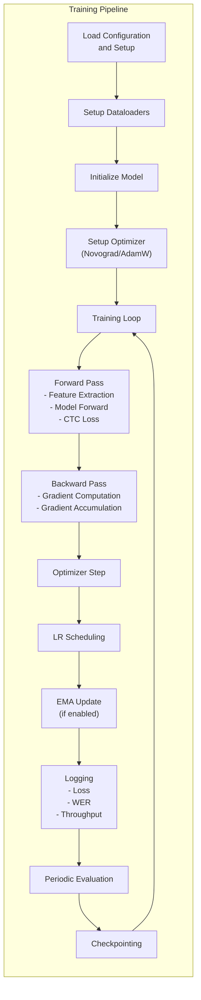

Sources: [PyTorch/SpeechRecognition/Jasper/train.py:354-494](), [PyTorch/SpeechRecognition/QuartzNet/train.py:383-531]()

### 5.2 Loss Function

Both models use the CTC (Connectionist Temporal Classification) loss, implemented as `CTCLossNM`:

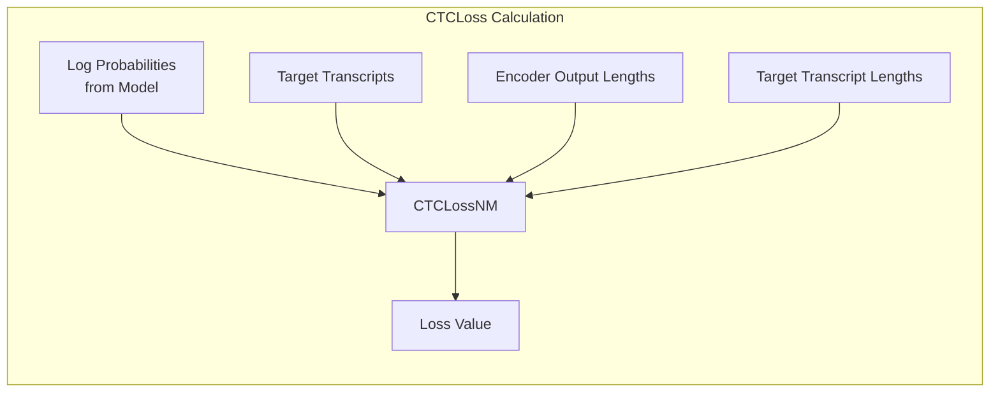

Sources: [PyTorch/SpeechRecognition/Jasper/train.py:308-417](), [PyTorch/SpeechRecognition/QuartzNet/train.py:329-448]()

### 5.3 Optimizers and Learning Rate Scheduling

The implementation supports multiple optimizers:
- **Novograd** (default): A variant of Adam with layer-wise normalization
- **AdamW**: Adam with decoupled weight decay
- **LAMB** (QuartzNet only): Layer-wise Adaptive Moments for Batch optimization
- **Fused Novograd** (QuartzNet only): Optimized implementation of Novograd

Learning rate scheduling options:
- **Exponential decay**: Learning rate decays exponentially
- **Legacy**: Custom learning rate schedule with warmup and hold phases

Sources: [PyTorch/SpeechRecognition/Jasper/train.py:313-328](), [PyTorch/SpeechRecognition/QuartzNet/train.py:334-356]()

## 6. Performance Optimization

### 6.1 Mixed Precision Training

Both models support mixed precision training using PyTorch's Automatic Mixed Precision (AMP):

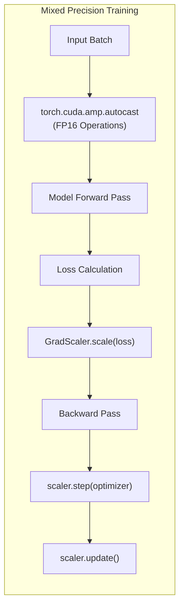

Sources: [PyTorch/SpeechRecognition/Jasper/train.py:322-446](), [PyTorch/SpeechRecognition/QuartzNet/train.py:350-470]()

### 6.2 Multi-GPU Training

Distributed training is implemented using PyTorch's DistributedDataParallel (DDP):

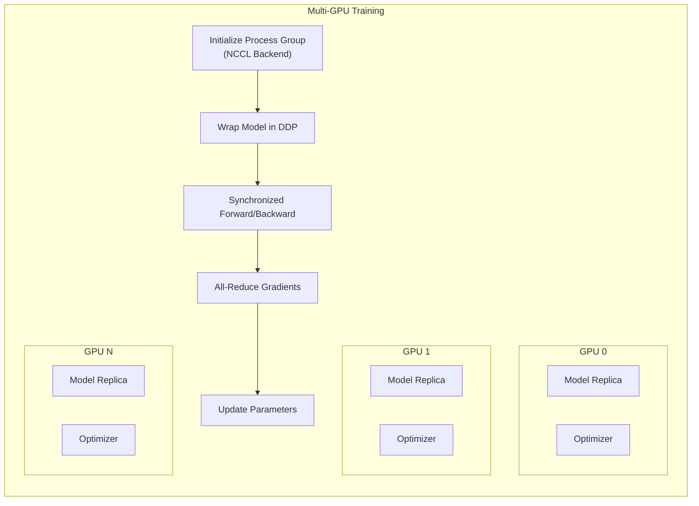

Sources: [PyTorch/SpeechRecognition/Jasper/train.py:335-337](), [PyTorch/SpeechRecognition/QuartzNet/train.py:363-365]()

### 6.3 DALI Data Loading

NVIDIA Data Loading Library (DALI) provides GPU-accelerated data loading:

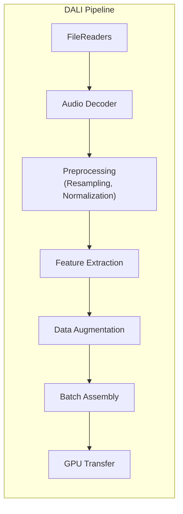

Sources: [PyTorch/SpeechRecognition/Jasper/train.py:236-265](), [PyTorch/SpeechRecognition/QuartzNet/train.py:266-285]()

### 6.4 Gradient Accumulation

Both implementations support gradient accumulation to simulate larger batch sizes:

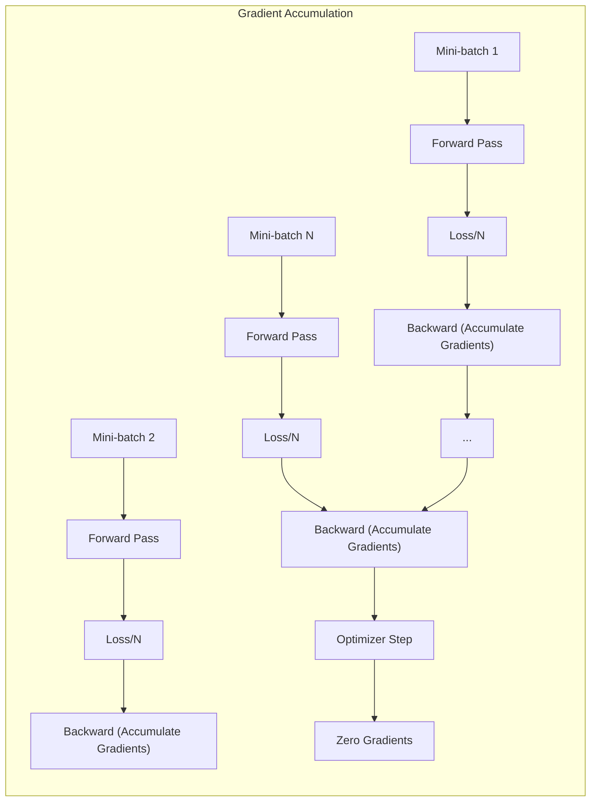

Sources: [PyTorch/SpeechRecognition/Jasper/train.py:436-442](), [PyTorch/SpeechRecognition/QuartzNet/train.py:467-473]()

## 7. Inference and Evaluation

### 7.1 Greedy CTC Decoding

For inference, both models use a simple greedy CTC decoder:

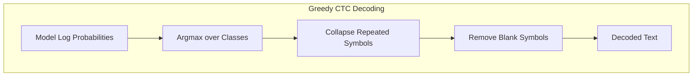

Sources: [PyTorch/SpeechRecognition/Jasper/train.py:308-447](), [PyTorch/SpeechRecognition/QuartzNet/train.py:330-479]()

### 7.2 Word Error Rate Calculation

Model performance is evaluated using Word Error Rate (WER):

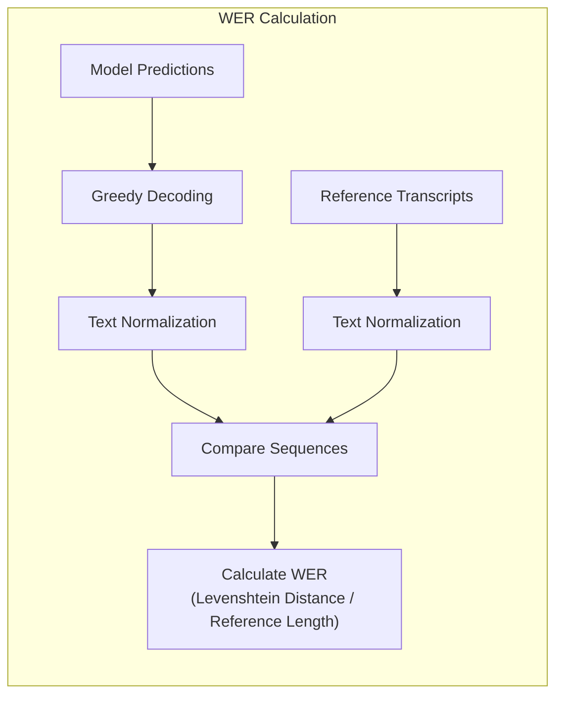

Sources: [PyTorch/SpeechRecognition/Jasper/train.py:137-175](), [PyTorch/SpeechRecognition/QuartzNet/train.py:157-196]()

## 8. Getting Started

### 8.1 Requirements

Both models have similar requirements:

| Requirement | Version |
|-------------|---------|
| Python      | 3.8+    |
| PyTorch     | 1.13+   |
| CUDA        | 11.0+   |
| NVIDIA Container | NGC PyTorch Container |
| Libraries   | inflect, librosa, pandas, pyyaml, soundfile, sox, tqdm, dllogger |

Sources: [PyTorch/SpeechRecognition/Jasper/requirements.txt:1-9](), [PyTorch/SpeechRecognition/QuartzNet/requirements.txt:1-9]()

### 8.2 Example Usage

To train Jasper on a dataset:

```bash
python train.py \
  --model_config=configs/jasper10x5dr.yaml \
  --train_manifests=/path/to/train_manifest.json \
  --val_manifests=/path/to/val_manifest.json \
  --dataset_dir=/path/to/dataset \
  --output_dir=/path/to/output \
  --amp \
  --batch_size=64 \
  --lr=0.015 \
  --epochs=400 \
  --weight_decay=0.001 \
  --optimizer=novograd \
  --ema=0.999 \
  --dali_device=gpu
```

For QuartzNet:

```bash
python train.py \
  --model_config=configs/quartznet15x5.yaml \
  --train_manifests=/path/to/train_manifest.json \
  --val_manifests=/path/to/val_manifest.json \
  --dataset_dir=/path/to/dataset \
  --output_dir=/path/to/output \
  --amp \
  --gpu_batch_size=16 \
  --grad_accumulation=8 \
  --lr=0.01 \
  --epochs=400 \
  --weight_decay=0.001 \
  --optimizer=novograd \
  --ema=0.999 \
  --dali_device=gpu
```

Sources: [PyTorch/SpeechRecognition/Jasper/train.py:39-117](), [PyTorch/SpeechRecognition/QuartzNet/train.py:41-125]()

### 8.3 Pre-processing Audio Data

The repository includes utilities for preprocessing audio data:

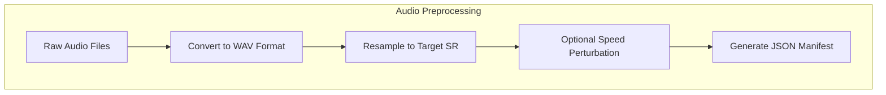

Sources: [PyTorch/SpeechRecognition/Jasper/utils/preprocessing_utils.py:25-74]()

## 9. Conclusion

The PyTorch Speech Recognition implementations in the NVIDIA DeepLearningExamples repository provide optimized and efficient end-to-end ASR models. Both Jasper and QuartzNet offer state-of-the-art performance with various optimizations for NVIDIA GPUs, including mixed precision training, multi-GPU support, and DALI data loading. The modular architecture allows for experimentation with different configurations and hyperparameters to achieve optimal performance on specific datasets.

---

