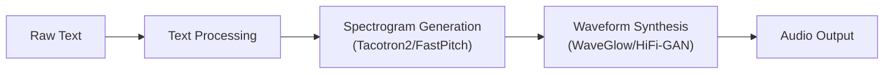
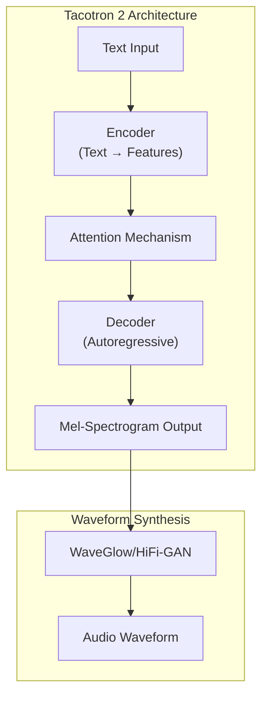
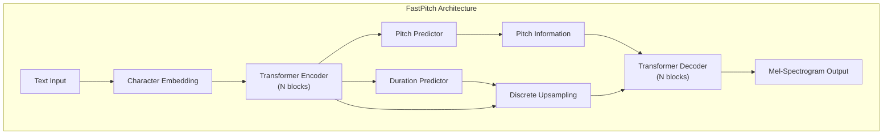
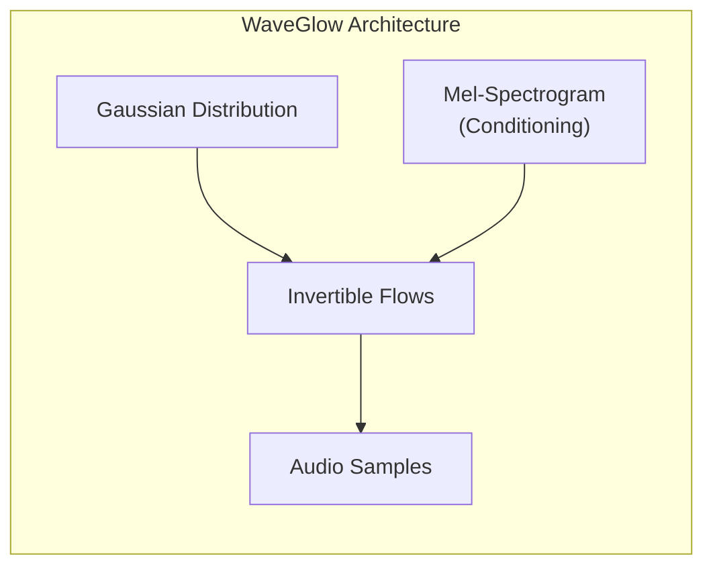
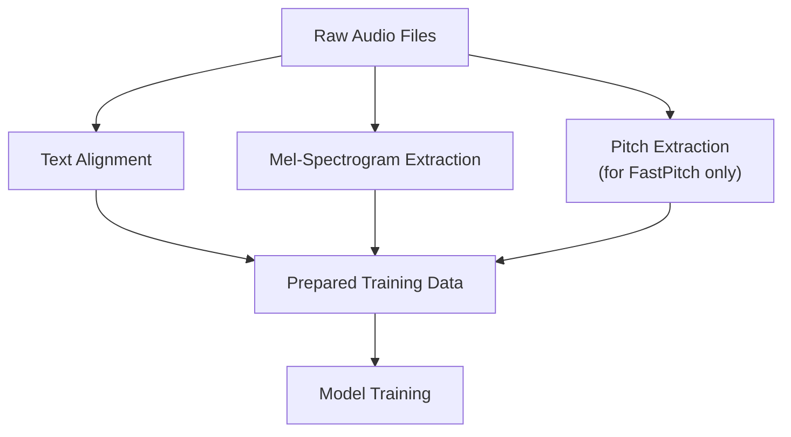
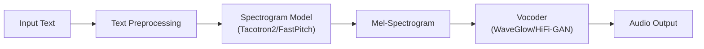

<!-- source: DeepWiki mcp.deepwiki.com · repo NVIDIA/DeepLearningExamples · extra page PyTorch Text-to-Speech · fetched 2026-10-26 -->

# PyTorch Text-to-Speech

<details>
<summary>Relevant source files</summary>

The following files were used as context for generating this wiki page:

- [PyTorch/SpeechSynthesis/FastPitch/Dockerfile](PyTorch/SpeechSynthesis/FastPitch/Dockerfile)
- [PyTorch/SpeechSynthesis/FastPitch/README.md](PyTorch/SpeechSynthesis/FastPitch/README.md)
- [PyTorch/SpeechSynthesis/FastPitch/inference.py](PyTorch/SpeechSynthesis/FastPitch/inference.py)
- [PyTorch/SpeechSynthesis/FastPitch/scripts/inference_benchmark.sh](PyTorch/SpeechSynthesis/FastPitch/scripts/inference_benchmark.sh)
- [PyTorch/SpeechSynthesis/FastPitch/scripts/inference_example.sh](PyTorch/SpeechSynthesis/FastPitch/scripts/inference_example.sh)
- [PyTorch/SpeechSynthesis/FastPitch/train.py](PyTorch/SpeechSynthesis/FastPitch/train.py)
- [PyTorch/SpeechSynthesis/FastPitch/triton/Dockerfile-model](PyTorch/SpeechSynthesis/FastPitch/triton/Dockerfile-model)
- [PyTorch/SpeechSynthesis/FastPitch/triton/calculate_metrics.py](PyTorch/SpeechSynthesis/FastPitch/triton/calculate_metrics.py)
- [PyTorch/SpeechSynthesis/FastPitch/triton/config_model_on_triton.py](PyTorch/SpeechSynthesis/FastPitch/triton/config_model_on_triton.py)
- [PyTorch/SpeechSynthesis/FastPitch/triton/deployment_toolkit/.version](PyTorch/SpeechSynthesis/FastPitch/triton/deployment_toolkit/.version)
- [PyTorch/SpeechSynthesis/FastPitch/triton/deployment_toolkit/args.py](PyTorch/SpeechSynthesis/FastPitch/triton/deployment_toolkit/args.py)
- [PyTorch/SpeechSynthesis/FastPitch/triton/deployment_toolkit/bermuda/tensorrt.py](PyTorch/SpeechSynthesis/FastPitch/triton/deployment_toolkit/bermuda/tensorrt.py)
- [PyTorch/SpeechSynthesis/FastPitch/triton/deployment_toolkit/core.py](PyTorch/SpeechSynthesis/FastPitch/triton/deployment_toolkit/core.py)
- [PyTorch/SpeechSynthesis/FastPitch/triton/deployment_toolkit/dump.py](PyTorch/SpeechSynthesis/FastPitch/triton/deployment_toolkit/dump.py)
- [PyTorch/SpeechSynthesis/FastPitch/triton/requirements.txt](PyTorch/SpeechSynthesis/FastPitch/triton/requirements.txt)
- [PyTorch/SpeechSynthesis/FastPitch/triton/run_inference_on_triton.py](PyTorch/SpeechSynthesis/FastPitch/triton/run_inference_on_triton.py)
- [PyTorch/SpeechSynthesis/Tacotron2/README.md](PyTorch/SpeechSynthesis/Tacotron2/README.md)
- [PyTorch/SpeechSynthesis/Tacotron2/scripts/train_tacotron2.sh](PyTorch/SpeechSynthesis/Tacotron2/scripts/train_tacotron2.sh)
- [PyTorch/SpeechSynthesis/Tacotron2/scripts/train_waveglow.sh](PyTorch/SpeechSynthesis/Tacotron2/scripts/train_waveglow.sh)

</details>


This document describes the Text-to-Speech (TTS) implementations available in the NVIDIA DeepLearningExamples repository. It covers the architectures, training and inference processes, and key features of the PyTorch-based TTS models. For information about speech recognition models, see [PyTorch Speech Recognition](#2.3.1).

## Overview

NVIDIA's PyTorch TTS implementations provide highly optimized neural network models for generating natural-sounding speech from text. These implementations focus on performance optimization for NVIDIA GPUs while maintaining state-of-the-art quality. The repository includes multiple models that can be combined to form complete end-to-end TTS systems.

The TTS process typically consists of two main stages:
1. Text-to-spectrogram conversion - transforms text into mel-spectrograms
2. Spectrogram-to-waveform synthesis - converts mel-spectrograms into audible waveforms



Sources: [PyTorch/SpeechSynthesis/Tacotron2/README.md:52-69](), [PyTorch/SpeechSynthesis/FastPitch/README.md:51-70]()

## Available Models

The repository includes the following key TTS models:

| Model | Purpose | Key Features |
|-------|---------|--------------|
| Tacotron 2 | Text-to-spectrogram | Attention-based, sequence-to-sequence model |
| FastPitch | Text-to-spectrogram | Transformer-based with explicit pitch modeling |
| WaveGlow | Spectrogram-to-waveform | Flow-based generative model |
| HiFi-GAN | Spectrogram-to-waveform | GAN-based vocoder (used with FastPitch) |

Sources: [PyTorch/SpeechSynthesis/Tacotron2/README.md:54-77](), [PyTorch/SpeechSynthesis/FastPitch/README.md:51-93]()

### Tacotron 2

Tacotron 2 is a neural network architecture for speech synthesis that directly converts text to mel-spectrograms. It's based on the paper "Natural TTS Synthesis by Conditioning WaveNet on Mel Spectrogram Predictions." The NVIDIA implementation differs slightly from the paper by using Dropout instead of Zoneout to regularize the LSTM layers.



#### Architecture Details

The Tacotron 2 model consists of:
1. **Encoder**: Transforms the whole text into a fixed-size hidden representation
2. **Attention Mechanism**: Aligns encoder outputs with decoder timesteps
3. **Decoder**: Autoregressive component that produces one spectrogram frame at a time
4. **Post-Processing Net**: Refines the generated mel-spectrograms

Sources: [PyTorch/SpeechSynthesis/Tacotron2/README.md:87-99]()

### FastPitch

FastPitch is an improved text-to-speech model that generates mel-spectrograms from raw input text. It's a transformer-based model that explicitly predicts pitch contours in addition to mel-spectrograms, providing greater control over the synthesized speech.



#### Key FastPitch Features

- Direct prediction of pitch contours, allowing for fine control over speech prosody
- Transformer-based architecture with bidirectional encoding
- No dependence on external aligners (version 1.1)
- Faster convergence compared to Tacotron 2
- Ability to modify speech rate, energy, and fundamental frequency
- Support for multi-speaker training

FastPitch offers improvements over both Tacotron 2 and FastSpeech models in terms of quality and control capabilities. It achieves a Mean Opinion Score (MOS) of 4.080 compared to Tacotron 2's 3.946.

Sources: [PyTorch/SpeechSynthesis/FastPitch/README.md:51-93](), [PyTorch/SpeechSynthesis/FastPitch/README.md:100-111]()

### Waveform Synthesis Models

#### WaveGlow

WaveGlow is a flow-based generative model used for synthesizing audio samples from mel-spectrograms. It transforms a Gaussian distribution into audio samples using a series of invertible flows conditioned on mel-spectrograms.



Each step in a flow consists of an invertible convolution followed by a modified WaveNet architecture serving as an affine coupling layer. During training, the model learns to transform the audio dataset distribution into a spherical Gaussian distribution. During inference, the network is inverted and audio samples are generated from the Gaussian distribution.

Sources: [PyTorch/SpeechSynthesis/Tacotron2/README.md:100-113]()

#### HiFi-GAN

HiFi-GAN is a GAN-based vocoder that transforms mel-spectrograms into high-fidelity audio waveforms. It's used as an alternative to WaveGlow, particularly in conjunction with the FastPitch model. HiFi-GAN offers efficient, high-quality audio synthesis.

Sources: [PyTorch/SpeechSynthesis/FastPitch/README.md:219-294]()

## Data Processing Pipeline

TTS models in the repository are trained on the LJSpeech-1.1 dataset, which contains approximately 24 hours of speech from a single female speaker. The data processing workflow includes several important steps:



### Dataset Preparation

For both Tacotron 2 and FastPitch, the dataset preparation process includes:

1. **Text normalization** - cleaning and standardizing text input
2. **Audio preprocessing** - extracting mel-spectrograms from raw audio
3. **Alignment** - for FastPitch v1.1, alignment is learned during training

For FastPitch, an additional step estimates fundamental frequency (F0) values for each mel-spectrogram frame.

Sources: [PyTorch/SpeechSynthesis/Tacotron2/README.md:453-477](), [PyTorch/SpeechSynthesis/FastPitch/README.md:354-379]()

## Training Process

### Tacotron 2 Training

Tacotron 2 is trained to predict mel-spectrograms from text input. The training uses a combination of loss components:
- Mel-spectrogram reconstruction loss
- Gate prediction loss (end-of-sequence detection)

```bash
python -m multiproc train.py -m Tacotron2 -o ./output/ -lr 1e-3 --epochs 1501 -bs 48 --weight-decay 1e-6 --grad-clip-thresh 1.0 --cudnn-enabled --log-file nvlog.json --anneal-steps 500 1000 1500 --anneal-factor 0.1
```

Sources: [PyTorch/SpeechSynthesis/Tacotron2/scripts/train_tacotron2.sh:1-2](), [PyTorch/SpeechSynthesis/Tacotron2/README.md:476-495]()

### FastPitch Training

FastPitch training involves predicting mel-spectrograms, pitch contours, and character durations. The training script handles several loss components:

- Mel-spectrogram loss
- Duration prediction loss
- Pitch prediction loss
- Attention binarization loss (for alignment learning)

```bash
python train.py -o <output_dir> -d <dataset_path> --amp --cuda --lr 0.1 --epochs 1000 --batch-size 16 --energy-conditioning --load-pitch-from-disk --pitch-online-dir <pitch_dir> --training-files <training_filelist> --validation-files <validation_filelist>
```

Sources: [PyTorch/SpeechSynthesis/FastPitch/train.py:287-566](), [PyTorch/SpeechSynthesis/FastPitch/README.md:426-446]()

### WaveGlow Training

WaveGlow is trained to transform mel-spectrograms into audio waveforms with a flow-based generative approach. It uses negative log-likelihood loss:

```bash
python -m multiproc train.py -m WaveGlow -o ./output/ -lr 1e-4 --epochs 1501 -bs 4 --segment-length 8000 --weight-decay 0 --grad-clip-thresh 3.4028234663852886e+38 --cudnn-enabled --cudnn-benchmark --log-file nvlog.json
```

Sources: [PyTorch/SpeechSynthesis/Tacotron2/scripts/train_waveglow.sh:1-2](), [PyTorch/SpeechSynthesis/Tacotron2/README.md:476-495]()

## Inference Process

The inference process combines text-to-spectrogram models (Tacotron 2 or FastPitch) with waveform synthesis models (WaveGlow or HiFi-GAN) to generate audio from text.



### Tacotron 2 + WaveGlow Inference

```bash
python inference.py --tacotron2 <Tacotron2_checkpoint> --waveglow <WaveGlow_checkpoint> --wn-channels 256 -o output/ -i phrases/phrase.txt --fp16
```

Sources: [PyTorch/SpeechSynthesis/Tacotron2/README.md:497-522]()

### FastPitch + HiFi-GAN Inference

FastPitch inference provides additional control parameters for speech synthesis:

```bash
python inference.py --cuda --fastpitch <FastPitch_checkpoint> --energy-conditioning --waveglow <WaveGlow_checkpoint> --wn-channels 256 -i phrases/devset10.tsv -o output/wavs_devset10
```

Control options include:
- `--pace` - Adjust speech rate (values above 1.0 increase speed, below 1.0 decrease)
- `--pitch-transform-amplify` - Amplify pitch variability
- `--pitch-transform-shift` - Raise or lower the pitch by Hz
- `--pitch-transform-invert` - Invert the pitch contour
- `--pitch-transform-flatten` - Create monotone speech

Sources: [PyTorch/SpeechSynthesis/FastPitch/inference.py:286-802](), [PyTorch/SpeechSynthesis/FastPitch/README.md:456-483](), [PyTorch/SpeechSynthesis/FastPitch/scripts/inference_example.sh:1-77]()

## Optimization Features

The TTS implementations include several optimization features designed for NVIDIA GPUs:

| Feature | Description |
|---------|-------------|
| Mixed Precision (AMP) | Support for FP16/TF32 training and inference |
| Multi-GPU Training | Data-parallel training across multiple GPUs |
| Dynamic Loss Scaling | For stable mixed precision training |
| CUDA Optimizations | cudnn-enabled and cudnn-benchmark options |
| TorchScript | Support for TorchScript compilation for faster inference |
| CPU Inference | Support for running on CPU with TorchScript |
| Triton Inference Server | Integration with NVIDIA Triton for deployment |

Sources: [PyTorch/SpeechSynthesis/Tacotron2/README.md:116-129](), [PyTorch/SpeechSynthesis/FastPitch/README.md:132-149](), [PyTorch/SpeechSynthesis/Tacotron2/README.md:151-177]()

### Mixed Precision Training

Mixed precision training combines both FP16 and FP32 formats to optimize performance while maintaining accuracy. The implementation uses NVIDIA's Automatic Mixed Precision (AMP) library.

To enable mixed precision:
- For Tacotron 2 and WaveGlow: Add the `--amp` flag to training scripts
- For FastPitch: Add the `--amp` flag to training script

Performance speedups with mixed precision:
- Up to 2.0x faster for Tacotron 2
- Up to 3.1x faster for WaveGlow
- Up to 2.7x faster for FastPitch

Sources: [PyTorch/SpeechSynthesis/Tacotron2/README.md:152-177](), [PyTorch/SpeechSynthesis/Tacotron2/README.md:178-202](), [PyTorch/SpeechSynthesis/FastPitch/README.md:151-177]()

## Performance Benchmarks

The TTS models have been benchmarked on various NVIDIA hardware platforms, including:
- NVIDIA DGX A100
- NVIDIA DGX-1 (V100)
- NVIDIA T4

### Training Performance

#### Tacotron 2 Training Performance (Output mel-spectrograms/sec)

| GPUs | Mixed Precision | FP32 | Speedup |
|------|-----------------|------|---------|
| 1x V100 | 15,891 | 9,174 | 1.73x |
| 8x V100 | 115,032 | 58,703 | 1.96x |
| 1x A100 | 26,484 | 31,499 | 0.84x |
| 8x A100 | 209,186 | 250,556 | 0.83x |

#### FastPitch Training Time to Convergence

| GPUs | Mixed Precision | FP32 | Speedup |
|------|-----------------|------|---------|
| 1x V100 | 181 hrs | 333 hrs | 1.84x |
| 8x V100 | 31 hrs | 48 hrs | 1.56x |

Sources: [PyTorch/SpeechSynthesis/Tacotron2/README.md:737-742](), [PyTorch/SpeechSynthesis/Tacotron2/README.md:757-762]()

### Inference Performance

#### End-to-End TTS Inference Performance (Tacotron 2 + WaveGlow)

| GPU | Precision | Mel-Gen (frames/sec) | Vocoder (samples/sec) | RTF* |
|-----|-----------|----------------------|------------------------|------|
| V100 | FP16 | 66.7 | 433,400 | 0.051 |
| V100 | FP32 | 63.4 | 136,500 | 0.161 |
| T4 | FP16 | 38.3 | 175,400 | 0.127 |
| A100 | FP16 | 175.5 | 650,600 | 0.034 |

*RTF = Real-Time Factor (seconds of compute per second of speech)

Sources: [PyTorch/SpeechSynthesis/Tacotron2/README.md:772-780]()

## Deployment with Triton Inference Server

The repository includes support for deploying TTS models with NVIDIA Triton Inference Server, which provides a standardized way to serve models for inference.

FastPitch includes scripts for Triton deployment:
- `config_model_on_triton.py` - Configures models for Triton
- `run_inference_on_triton.py` - Performs inference using Triton server

Sources: [PyTorch/SpeechSynthesis/FastPitch/triton/config_model_on_triton.py:1-204](), [PyTorch/SpeechSynthesis/FastPitch/triton/run_inference_on_triton.py:1-288]()

## Summary

The PyTorch Text-to-Speech implementations in the NVIDIA DeepLearningExamples repository provide:

1. Multiple state-of-the-art TTS models (Tacotron 2, FastPitch, WaveGlow, HiFi-GAN)
2. NVIDIA GPU optimizations for both training and inference
3. Support for advanced speech customization (pitch, rate, etc.)
4. Deployment capabilities via Triton Inference Server
5. Comprehensive benchmarks across NVIDIA GPU platforms

These implementations enable developers to build high-quality speech synthesis systems with optimized performance on NVIDIA hardware.

---

