<!-- source: DeepWiki mcp.deepwiki.com · repo NVIDIA/DeepLearningExamples · extra page Tacotron2 Deep Dive · fetched 2026-10-26 -->

# Tacotron2 Deep Dive

Relevant source files

The following files were used as context for generating this wiki page:

- [PyTorch/SpeechSynthesis/Tacotron2/Dockerfile](PyTorch/SpeechSynthesis/Tacotron2/Dockerfile)
- [PyTorch/SpeechSynthesis/Tacotron2/README.md](PyTorch/SpeechSynthesis/Tacotron2/README.md)
- [PyTorch/SpeechSynthesis/Tacotron2/data/mel.pt](PyTorch/SpeechSynthesis/Tacotron2/data/mel.pt)
- [PyTorch/SpeechSynthesis/Tacotron2/filelists/ljs_audio_text_train_subset_300_filelist.txt](PyTorch/SpeechSynthesis/Tacotron2/filelists/ljs_audio_text_train_subset_300_filelist.txt)
- [PyTorch/SpeechSynthesis/Tacotron2/filelists/ljs_audio_text_train_subset_64_filelist.txt](PyTorch/SpeechSynthesis/Tacotron2/filelists/ljs_audio_text_train_subset_64_filelist.txt)
- [PyTorch/SpeechSynthesis/Tacotron2/inference.py](PyTorch/SpeechSynthesis/Tacotron2/inference.py)
- [PyTorch/SpeechSynthesis/Tacotron2/inference_perf.py](PyTorch/SpeechSynthesis/Tacotron2/inference_perf.py)
- [PyTorch/SpeechSynthesis/Tacotron2/models.py](PyTorch/SpeechSynthesis/Tacotron2/models.py)
- [PyTorch/SpeechSynthesis/Tacotron2/phrases/phrase_1_128.txt](PyTorch/SpeechSynthesis/Tacotron2/phrases/phrase_1_128.txt)
- [PyTorch/SpeechSynthesis/Tacotron2/preprocess_audio2mel.py](PyTorch/SpeechSynthesis/Tacotron2/preprocess_audio2mel.py)
- [PyTorch/SpeechSynthesis/Tacotron2/requirements.txt](PyTorch/SpeechSynthesis/Tacotron2/requirements.txt)
- [PyTorch/SpeechSynthesis/Tacotron2/run_latency_tests.sh](PyTorch/SpeechSynthesis/Tacotron2/run_latency_tests.sh)
- [PyTorch/SpeechSynthesis/Tacotron2/run_latency_tests_cpu.sh](PyTorch/SpeechSynthesis/Tacotron2/run_latency_tests_cpu.sh)
- [PyTorch/SpeechSynthesis/Tacotron2/scripts/train_tacotron2.sh](PyTorch/SpeechSynthesis/Tacotron2/scripts/train_tacotron2.sh)
- [PyTorch/SpeechSynthesis/Tacotron2/scripts/train_waveglow.sh](PyTorch/SpeechSynthesis/Tacotron2/scripts/train_waveglow.sh)
- [PyTorch/SpeechSynthesis/Tacotron2/tacotron2/data_function.py](PyTorch/SpeechSynthesis/Tacotron2/tacotron2/data_function.py)
- [PyTorch/SpeechSynthesis/Tacotron2/tacotron2/model.py](PyTorch/SpeechSynthesis/Tacotron2/tacotron2/model.py)
- [PyTorch/SpeechSynthesis/Tacotron2/tacotron2_common/utils.py](PyTorch/SpeechSynthesis/Tacotron2/tacotron2_common/utils.py)
- [PyTorch/SpeechSynthesis/Tacotron2/tensorrt/convert_tacotron22onnx.py](PyTorch/SpeechSynthesis/Tacotron2/tensorrt/convert_tacotron22onnx.py)
- [PyTorch/SpeechSynthesis/Tacotron2/tensorrt/convert_waveglow2onnx.py](PyTorch/SpeechSynthesis/Tacotron2/tensorrt/convert_waveglow2onnx.py)
- [PyTorch/SpeechSynthesis/Tacotron2/tensorrt/inference_trt.py](PyTorch/SpeechSynthesis/Tacotron2/tensorrt/inference_trt.py)
- [PyTorch/SpeechSynthesis/Tacotron2/test_infer.py](PyTorch/SpeechSynthesis/Tacotron2/test_infer.py)
- [PyTorch/SpeechSynthesis/Tacotron2/test_infer.sh](PyTorch/SpeechSynthesis/Tacotron2/test_infer.sh)
- [PyTorch/SpeechSynthesis/Tacotron2/train.py](PyTorch/SpeechSynthesis/Tacotron2/train.py)
- [PyTorch/SpeechSynthesis/Tacotron2/waveglow/data_function.py](PyTorch/SpeechSynthesis/Tacotron2/waveglow/data_function.py)
- [PyTorch/SpeechSynthesis/Tacotron2/waveglow/denoiser.py](PyTorch/SpeechSynthesis/Tacotron2/waveglow/denoiser.py)
- [PyTorch/SpeechSynthesis/Tacotron2/waveglow/model.py](PyTorch/SpeechSynthesis/Tacotron2/waveglow/model.py)

This document provides a detailed technical analysis of the Tacotron2 text-to-speech model implementation in NVIDIA's Deep Learning Examples repository. It covers the architecture, training process, inference workflow, and key optimization techniques used in the implementation. For information about the complete text-to-speech pipeline including WaveGlow, see [PyTorch Text-to-Speech](#2.3.2).

## Architecture Overview

Tacotron2 is a sequence-to-sequence model with attention that predicts mel-spectrograms from text input. The model follows the architecture described in the [Natural TTS Synthesis by Conditioning WaveNet on Mel Spectrogram Predictions](https://arxiv.org/abs/1712.05884) paper, with some modifications such as using Dropout instead of Zoneout to regularize the LSTM layers.

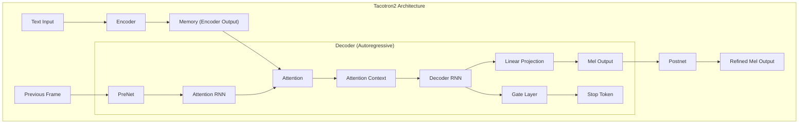

Sources: 
- [PyTorch/SpeechSynthesis/Tacotron2/README.md:86-99]()
- [PyTorch/SpeechSynthesis/Tacotron2/tacotron2/model.py:185-248]()
- [PyTorch/SpeechSynthesis/Tacotron2/tacotron2/model.py:250-399]()

## Detailed Component Analysis

### Encoder

The encoder transforms the input text into a fixed-size hidden feature representation through:

1. Text embedding layer
2. A series of convolutional layers (3 by default)
3. Bidirectional LSTM network

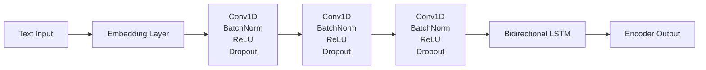

Sources:
- [PyTorch/SpeechSynthesis/Tacotron2/tacotron2/model.py:185-228]()

The encoder takes text sequences converted to one-hot encodings, processes them through embedding, convolution blocks and finally a bidirectional LSTM layer. The encoder outputs become the "memory" that is consumed by the attention mechanism.

### Attention Mechanism

Tacotron2 uses location-sensitive attention, which considers both content (encoder outputs) and location (previous attention weights) when computing attention scores.

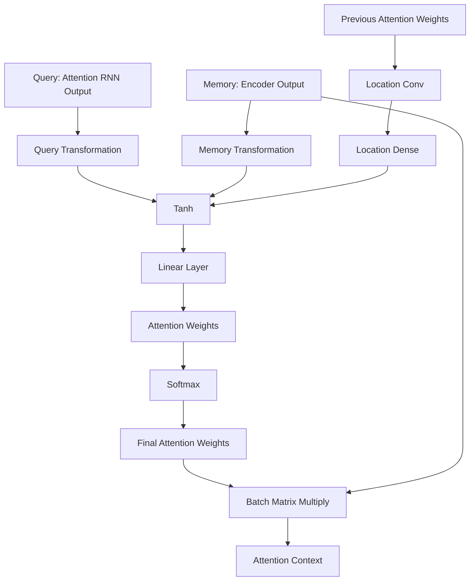

Sources:
- [PyTorch/SpeechSynthesis/Tacotron2/tacotron2/model.py:59-116]()

The attention mechanism produces a context vector by computing a weighted sum of encoder outputs, where the weights are determined by the alignment between encoder and decoder states.

### Decoder

The decoder is autoregressive, producing one mel-spectrogram frame at a time. It consists of:

1. PreNet: Dense layers with dropout applied during both training and inference
2. Attention RNN: Single LSTM cell that processes the prenet output and previous attention context
3. Decoder RNN: Single LSTM cell that processes the attention RNN output and attention context
4. Output layers: Linear projections to predict mel-spectrogram frames and stop tokens

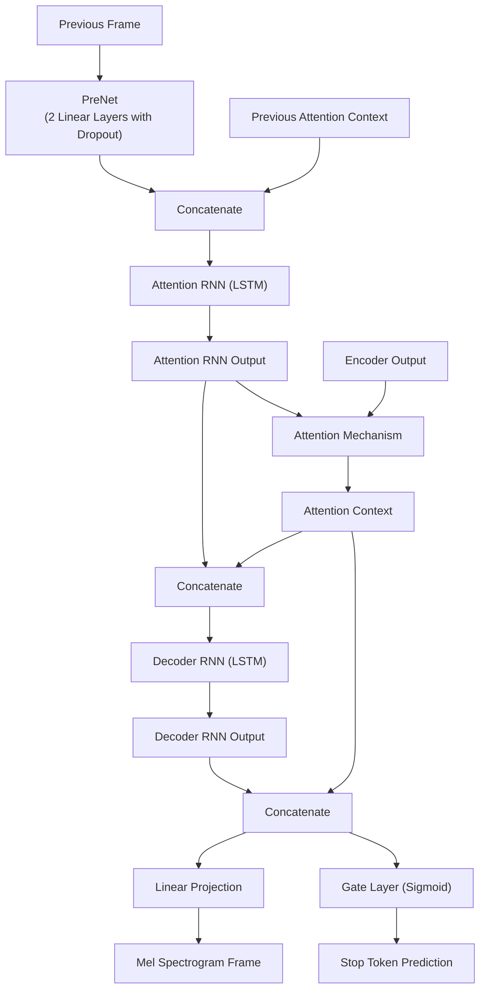

Sources:
- [PyTorch/SpeechSynthesis/Tacotron2/tacotron2/model.py:119-182]()
- [PyTorch/SpeechSynthesis/Tacotron2/tacotron2/model.py:250-448]()

### PostNet

The PostNet applies a series of 5 convolutional layers to refine the mel-spectrogram output from the decoder:

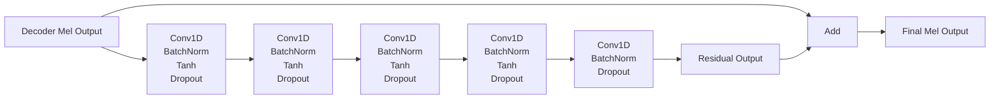

Sources:
- [PyTorch/SpeechSynthesis/Tacotron2/tacotron2/model.py:133-182]()

## Training Process

### Data Preparation

The training data pipeline consists of:

1. Loading audio files and transcripts
2. Preprocessing text using text cleaners
3. Computing mel-spectrograms from audio files
4. Batching and padding sequences to handle variable lengths

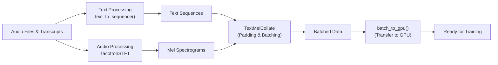

Sources:
- [PyTorch/SpeechSynthesis/Tacotron2/tacotron2/data_function.py:35-152]()
- [PyTorch/SpeechSynthesis/Tacotron2/train.py:429-449]()

The implementation provides options to either compute mel-spectrograms on the fly during training or precompute and load them from disk to speed up training.

### Training Loop

The training procedure:

1. Computes encoder output from text input
2. Performs teacher-forced training of the decoder using ground truth mel-spectrograms
3. Applies PostNet to refine the output
4. Computes loss based on predicted mel-spectrograms, gate outputs, and ground truth

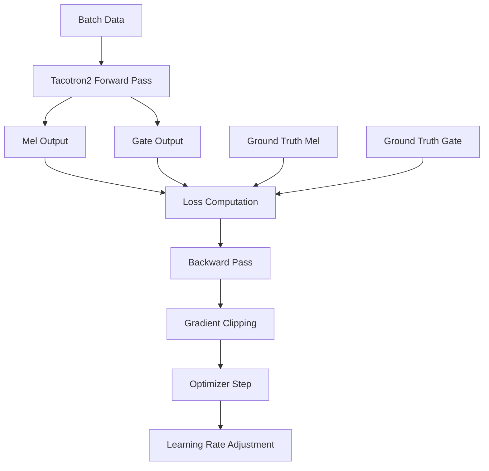

Sources:
- [PyTorch/SpeechSynthesis/Tacotron2/train.py:457-547]()
- [PyTorch/SpeechSynthesis/Tacotron2/tacotron2/model.py:450-508]()

The training script supports distributed training across multiple GPUs and includes features like checkpointing, validation, and dynamic learning rate adjustment.

## Inference Process

During inference, Tacotron2 generates mel-spectrograms autoregressively, which are then converted to audio by WaveGlow:

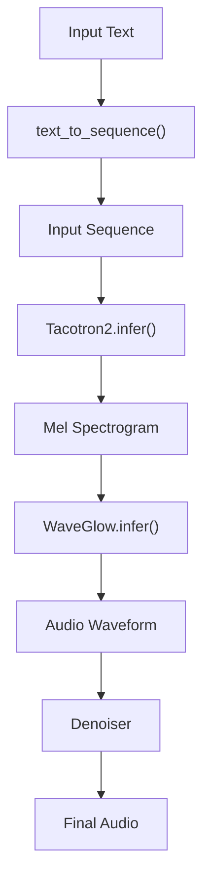

Sources:
- [PyTorch/SpeechSynthesis/Tacotron2/inference.py:192-276]()
- [PyTorch/SpeechSynthesis/Tacotron2/tacotron2/model.py:694-824]()

During inference, the decoder logic differs from training:

1. Starting with an all-zero frame, predict the first mel frame
2. Feed the predicted frame back through the prenet
3. Continue generating frames until the gate predictor signals to stop or maximum decoder steps is reached

## Implementation Details

### Model Parameters

Key configurable parameters for Tacotron2:

| Parameter | Default Value | Description |
|-----------|---------------|-------------|
| n_symbols | 148 | Number of symbols in the embedding table |
| symbols_embedding_dim | 512 | Dimension of embedding vectors |
| encoder_kernel_size | 5 | Size of encoder convolution kernels |
| encoder_n_convolutions | 3 | Number of encoder convolutions |
| encoder_embedding_dim | 512 | Dimension of encoder output |
| attention_rnn_dim | 1024 | Number of units in attention RNN |
| attention_dim | 128 | Dimension of attention hidden representation |
| decoder_rnn_dim | 1024 | Number of units in decoder RNN |
| prenet_dim | 256 | Number of ReLU units in prenet layers |
| max_decoder_steps | 1000 | Maximum number of output mel frames |
| gate_threshold | 0.5 | Threshold for gate output to stop decoding |
| p_attention_dropout | 0.1 | Dropout probability for attention LSTM |
| p_decoder_dropout | 0.1 | Dropout probability for decoder LSTM |

Sources:
- [PyTorch/SpeechSynthesis/Tacotron2/models.py:98-129]()

### Mixed Precision Training

The implementation supports mixed precision training using NVIDIA's Automatic Mixed Precision (AMP) library:

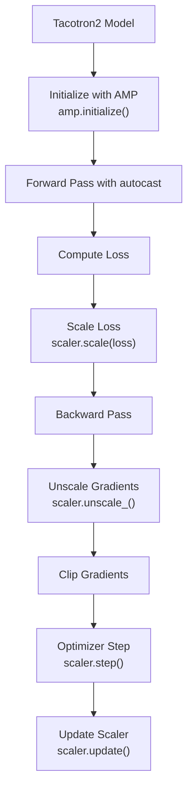

Sources:
- [PyTorch/SpeechSynthesis/Tacotron2/train.py:476-516]()
- [PyTorch/SpeechSynthesis/Tacotron2/README.md:178-227]()

Mixed precision training significantly improves performance on Tensor Core-equipped GPUs with minimal impact on model accuracy.

## Benchmarking and Performance

The repository includes scripts to measure training and inference performance:

| Metric | Description |
|--------|-------------|
| Items/sec | Number of output mel frames per second during training |
| Latency | Time to generate mel-spectrograms from text input (inference) |
| Throughput | Number of generated audio samples per second (inference) |

```mermaid
flowchart TB
    subgraph Training["Training Performance Metrics"]
        TrainBatch["Batch Processing"] --> TrainTime["Measure Time"]
        TrainTime --> TrainMetrics["Calculate Metrics\n- items/sec\n- loss"]
        TrainMetrics --> TrainLog["Log with DLLogger"]
    end
    
    subgraph Inference["Inference Performance Metrics"]
        InferText["Process Text Input"] --> InferTaco["Measure Tacotron2 Time"]
        InferTaco --> InferWave["Measure WaveGlow Time"]
        InferWave --> InferDenoise["Measure Denoiser Time"]
        InferDenoise --> InferMetrics["Calculate Metrics\n- latency\n- throughput"]
        InferMetrics --> InferLog["Log with DLLogger"]
    end
```

Sources:
- [PyTorch/SpeechSynthesis/Tacotron2/test_infer.py:81-116]()
- [PyTorch/SpeechSynthesis/Tacotron2/inference_perf.py:115-170]()
- [PyTorch/SpeechSynthesis/Tacotron2/README.md:782-803]()

Performance optimizations include:

1. Mixed precision training (FP16)
2. Multi-GPU distributed training
3. TorchScript for CPU/GPU inference
4. Optional TensorRT support for optimized inference

## Integration with WaveGlow

Tacotron2 is designed to work seamlessly with WaveGlow, a flow-based generative model that converts mel-spectrograms to audio:

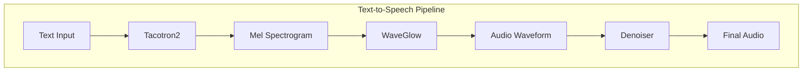

Sources:
- [PyTorch/SpeechSynthesis/Tacotron2/inference.py:245-256]()
- [PyTorch/SpeechSynthesis/Tacotron2/README.md:53-69]()

This pipeline allows for end-to-end text-to-speech synthesis with high-quality audio output.

## Conclusion

Tacotron2 is a state-of-the-art text-to-speech model that generates mel-spectrograms from text input. The NVIDIA implementation provides optimized training and inference for GPU acceleration, supporting features like mixed precision, multi-GPU training, and TorchScript. When combined with WaveGlow, it forms a complete end-to-end text-to-speech system capable of producing natural-sounding speech.

---

