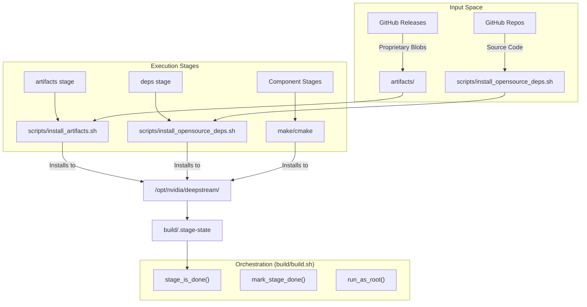
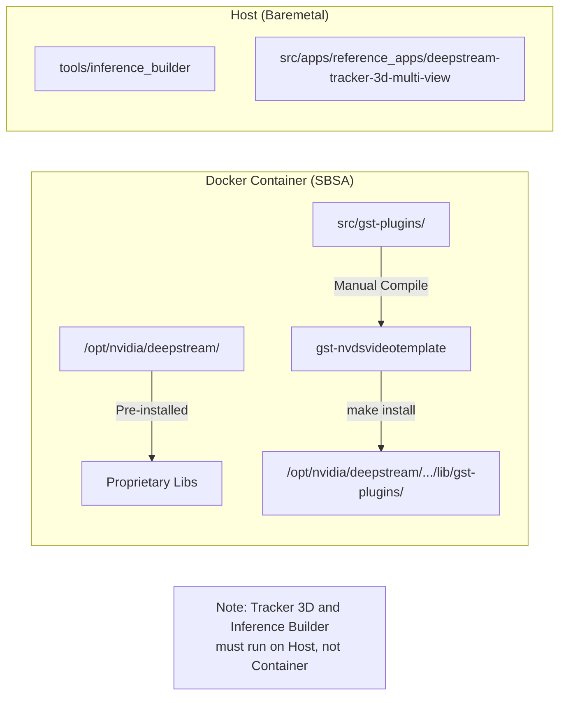

<!-- source: DeepWiki mcp.deepwiki.com · repo NVIDIA/DeepStream · page 1.1 Getting Started & Build System · fetched 2026-10-26 -->

# Getting Started & Build System

<details>
<summary>Relevant source files</summary>

The following files were used as context for generating this wiki page:

- [.gitignore](.gitignore)
- [README.md](README.md)
- [SECURITY.md](SECURITY.md)
- [THIRD_PARTY_LICENSES.txt](THIRD_PARTY_LICENSES.txt)
- [build/BUILD.md](build/BUILD.md)
- [build/build.sh](build/build.sh)
- [scripts/install_opensource_deps.sh](scripts/install_opensource_deps.sh)
- [src/apps/reference_apps/deepstream-tracker-3d-multi-view/README.md](src/apps/reference_apps/deepstream-tracker-3d-multi-view/README.md)
- [src/apps/reference_apps/deepstream-tracker-3d-multi-view/docs/manual-setup.md](src/apps/reference_apps/deepstream-tracker-3d-multi-view/docs/manual-setup.md)
- [src/apps/reference_apps/deepstream-tracker-3d-multi-view/scripts/setup_prerequisites.sh](src/apps/reference_apps/deepstream-tracker-3d-multi-view/scripts/setup_prerequisites.sh)
- [src/gst-plugins/gst-nvdsvideotemplate/customlib_impl/Makefile](src/gst-plugins/gst-nvdsvideotemplate/customlib_impl/Makefile)

</details>


DeepStream 9.1 provides a unified build system designed to handle the complexities of multi-platform support (x86, aarch64 Jetson, and SBSA) while integrating both open-source components and NVIDIA's proprietary runtime libraries [README.md:9-11](). The build process is orchestrated by a centralized script that manages platform detection, dependency retrieval, and stage-based compilation [build/build.sh:17-19]().

## Build Architecture Overview

The build system is designed as a multi-stage pipeline. It separates the retrieval of proprietary artifacts from the compilation of open-source plugins and applications.

### Platform Detection
The `build/build.sh` script automatically detects the host architecture using `uname -m` and identifies specific hardware variants [build/build.sh:182-193]():
*   **x86_64**: Standard dGPU platform (Ubuntu 24.04).
*   **aarch64 (Jetson)**: Detected via the presence of `/etc/nv_tegra_release`.
*   **aarch64 (SBSA)**: Server Base System Architecture (e.g., DGX Spark), which requires a Docker-based workflow as bare-metal installation is not supported [build/BUILD.md:101-106]().

### Build System Data Flow
The following diagram illustrates how `build/build.sh` coordinates various scripts and directories to produce a functional DeepStream installation.

**Build Pipeline and Artifact Flow**

**Sources:** [build/build.sh:24-29](), [build/build.sh:139-159](), [scripts/install_opensource_deps.sh:41-45]()

## Build Stages and State Tracking

DeepStream uses a state-tracking mechanism to allow for resumable builds. Progress is recorded in hidden files within the `build/` directory [build/build.sh:106-113]().

| State File | Description |
|---|---|
| `build/.stage-state` | Tracks high-level stages: `artifacts`, `deps`, `gst-plugins`, `sample_apps`, etc. |
| `build/.stage-state.deps` | Tracks sub-stages for open-source dependencies (e.g., `deps-opentelemetry`). |
| `build/.stage-state.artifacts` | Tracks individual proprietary artifact installations. |

### Key Functions
*   `stage_is_done()`: Checks if a specific stage string exists in the state file [build/build.sh:139-142]().
*   `mark_stage_done()`: Appends a "DONE <stage>" entry to the state file [build/build.sh:149-159]().
*   `reset_stage_state()`: Clears progress to force a clean build [build/build.sh:170-180]().

**Sources:** [build/build.sh:106-113](), [scripts/install_opensource_deps.sh:63-83]()

## Step-by-Step Installation

### 1. Prerequisites
Before running the build script, the host must have the **NVIDIA Compute Stack** installed, including Driver (595.58.03+), CUDA 13.2, and TensorRT 10.16.x [build/BUILD.md:26-30]().

### 2. Dependency Installation
The script `scripts/install_opensource_deps.sh` handles external libraries. It clones, builds, and installs the following to `/opt/nvidia/deepstream/deepstream-9.1/lib` [scripts/install_opensource_deps.sh:17-30]():
*   **OpenTelemetry-cpp v1.23.0**: For pipeline observability [scripts/install_opensource_deps.sh:93-137]().
*   **Civetweb v1.16**: Used by the REST server [scripts/install_opensource_deps.sh:140-165]().
*   **Prometheus-cpp v1.2.4**: For metrics collection [scripts/install_opensource_deps.sh:168-193]().
*   **Azure IoT SDK-c**: For cloud messaging [scripts/install_opensource_deps.sh:24]().

### 3. Running the Build
The primary entry point is `build/build.sh`.

```bash
# Standard build and install
bash build/build.sh

# Build only specific components with parallel jobs
bash build/build.sh --only=gst-plugins,sample_apps -j$(nproc)

# Resume a previously interrupted build
bash build/build.sh --resume
```
**Sources:** [build/build.sh:71-136](), [README.md:72-75]()

## Platform Specifics: SBSA / DGX Spark

For SBSA platforms, the build system operates differently. Bare-metal installation is unsupported [build/BUILD.md:103-104](). Users must use the NVIDIA SBSA Docker container where DeepStream is pre-installed. In this environment, `build/build.sh` is not used; instead, developers navigate to specific plugin directories and run `make && make install` to update components [build/BUILD.md:108-112]().

**Component Mapping for SBSA**

**Sources:** [build/BUILD.md:101-112](), [build/BUILD.md:138-145]()

## Install Lifecycle & Artifact Management

### Artifact Retrieval
On x86 and Jetson, the build system uses `wget` to download proprietary release assets from GitHub into an `artifacts/` directory [build/build.sh:97-104]().
*   **deb method (default)**: Downloads and installs `.deb` packages using `dpkg` [build/build.sh:116-117]().
*   **tar method**: Extracts tarballs directly into the `/opt` tree [build/build.sh:118-119]().

### Post-Build Cleanup
By default, the `artifacts/` directory is deleted after a successful build to save space. To retain these assets for manual inspection or redistribution, the `--keep-assets` flag must be used [build/build.sh:80-81]().

### System Integration
After the build completes, binaries are located in `/opt/nvidia/deepstream/deepstream-9.1/bin/` [README.md:79](). Users are encouraged to clear the GStreamer cache to ensure the newly built plugins are correctly indexed [README.md:85-87]().

**Sources:** [build/build.sh:77-84](), [README.md:79-87](), [build/BUILD.md:161-170]()

---

