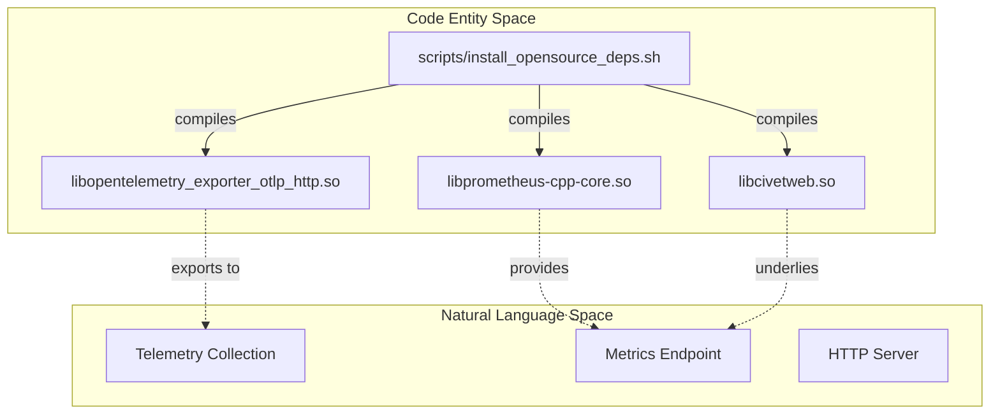
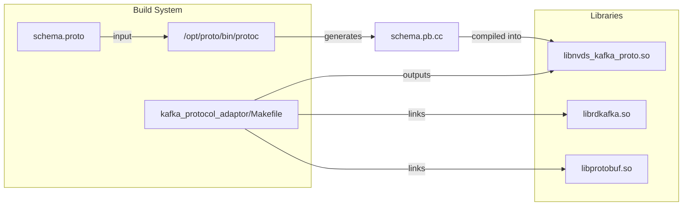

<!-- source: DeepWiki mcp.deepwiki.com · repo NVIDIA/DeepStream · page 1.3 Open-Source Dependencies · fetched 2026-10-26 -->

# Open-Source Dependencies

Relevant source files

The following files were used as context for generating this wiki page:

- [CHANGELOG.md](CHANGELOG.md)
- [scripts/install_opensource_deps.sh](scripts/install_opensource_deps.sh)
- [src/gst-plugins/gst-nvdsvideotemplate/customlib_impl/Makefile](src/gst-plugins/gst-nvdsvideotemplate/customlib_impl/Makefile)
- [src/utils/nvds_msgapi/amqp_protocol_adaptor/Makefile](src/utils/nvds_msgapi/amqp_protocol_adaptor/Makefile)
- [src/utils/nvds_msgapi/kafka_protocol_adaptor/Makefile](src/utils/nvds_msgapi/kafka_protocol_adaptor/Makefile)
- [src/utils/nvds_msgapi/mqtt_protocol_adaptor/Makefile](src/utils/nvds_msgapi/mqtt_protocol_adaptor/Makefile)
- [src/utils/nvds_msgapi/redis_protocol_adaptor/Makefile](src/utils/nvds_msgapi/redis_protocol_adaptor/Makefile)

This page provides technical details on the open-source libraries and SDKs that DeepStream 9.1 relies on for telemetry, web services, cloud connectivity, and inference. These dependencies are managed and installed via the `scripts/install_opensource_deps.sh` script, which automates the fetching, building, and installation of shared libraries into the DeepStream SDK path [scripts/install_opensource_deps.sh:17-18]().

## Dependency Management Overview

The installation script uses a stage-state tracking mechanism to ensure idempotency. It records successfully completed installations in a state file located at `build/.stage-state.deps` [scripts/install_opensource_deps.sh:45-46](). This allows the build system to skip already-installed components during subsequent runs [scripts/install_opensource_deps.sh:63-66]().

### Core Build and Installation Workflow
The script targets specific versions of libraries to ensure compatibility with the DeepStream GStreamer plugins and utility libraries.

| Library | Version / Commit | Purpose | Target Files |
| :--- | :--- | :--- | :--- |
| **OpenTelemetry C++** | v1.23.0 | Observability & Tracing | `libopentelemetry_*.so` |
| **Civetweb** | v1.16 | Embedded HTTP Server | `libcivetweb.so` |
| **Prometheus C++** | v1.2.4 | Metrics Collection | `libprometheus-cpp-core.so` |
| **Azure IoT SDK C** | dbeb521e | Cloud Messaging | `libiothub_client.so` |
| **Protobuf** | v3.21.12 | Serialization (Schema) | `/opt/proto/bin/protoc` |
| **Triton Client SDK** | v2.67.0+ | Inference Server Comms | `/opt/tritonclient` |

**Sources:** [scripts/install_opensource_deps.sh:21-29]()

---

## Observability & Web Stack

DeepStream integrates a modern observability stack for real-time monitoring of pipeline performance, including FPS and latency metrics.

### OpenTelemetry (OTLP)
The `opentelemetry-cpp` library is compiled with support for both **HTTP** and **gRPC** exporters [scripts/install_opensource_deps.sh:106-107](). This enables DeepStream to push telemetry data to collectors like `otel-collector`.

### Civetweb & Prometheus
`civetweb` provides the underlying HTTP server functionality required for REST APIs and metrics endpoints [scripts/install_opensource_deps.sh:140-141](). A critical implementation detail is the use of a **linker version script** (`civetweb.ver`) during the build to prevent symbol conflicts with the DeepStream SDK [scripts/install_opensource_deps.sh:152-161](). `prometheus-cpp` builds on top of this to expose a `/metrics` endpoint [scripts/install_opensource_deps.sh:168-171]().

**Dependency Mapping: Observability Stack**

**Sources:** [scripts/install_opensource_deps.sh:103-134](), [scripts/install_opensource_deps.sh:152-162](), [scripts/install_opensource_deps.sh:179-190]()

---

## Cloud Connectivity & Messaging

DeepStream uses various protocol adaptors to communicate with cloud providers. These adaptors are often implemented as shared libraries in `src/utils/nvds_msgapi/`.

### Azure IoT Hub
The script fetches the `azure-iot-sdk-c` (v1.11.0) and builds the `iothub_client` [scripts/install_opensource_deps.sh:24](). This is utilized by the messaging plugins to establish secure connections to Azure IoT Hub.

### Protobuf & Schema Serialization
The **Protobuf compiler (protoc)** is installed to `/opt/proto` [scripts/install_opensource_deps.sh:29](). It is used during the build process of protocol adaptors, such as Kafka, to generate C++ classes from `.proto` schema files [src/utils/nvds_msgapi/kafka_protocol_adaptor/Makefile:55-56]().

**Data Flow: Protocol Adaptor Compilation**

**Sources:** [scripts/install_opensource_deps.sh:29](), [src/utils/nvds_msgapi/kafka_protocol_adaptor/Makefile:22-26](), [src/utils/nvds_msgapi/kafka_protocol_adaptor/Makefile:55-56]()

---

## Triton Inference Server Integration

For complex inference workloads using the `nvinferserver` plugin, DeepStream requires the **Triton Client SDK**. 

*   **Installation Path:** `/opt/tritonclient` [scripts/install_opensource_deps.sh:28]().
*   **Components:** Includes headers and libraries for C-API and gRPC-based inference communication.
*   **Usage:** Protocol adaptors like Kafka include Triton client paths in their `INC_PATHS` to support advanced metadata features [src/utils/nvds_msgapi/kafka_protocol_adaptor/Makefile:38-41]().

---

## Infrastructure Dependencies

The `install_opensource_deps.sh` script also manages several system-level libraries via `apt` and external PPAs to support various DeepStream features:

*   **Messaging Drivers:** `librdkafka` (Kafka), `libmosquitto` (MQTT), `librabbitmq` (AMQP), and `hiredis` (Redis) [scripts/install_opensource_deps.sh:30-31]().
*   **Linking:** Adaptors link against these libraries (e.g., `-lmosquitto`, `-lrabbitmq`) and use `-Wl,-rpath` to ensure they are found in the DeepStream library directory at runtime [src/utils/nvds_msgapi/mqtt_protocol_adaptor/Makefile:41-42](), [src/utils/nvds_msgapi/amqp_protocol_adaptor/Makefile:37-38](), [src/utils/nvds_msgapi/redis_protocol_adaptor/Makefile:38-39]().
*   **Graphics/UI:** `libpango`, `libcairo`, and `libjson-glib` for OSD (On-Screen Display) and configuration parsing [scripts/install_opensource_deps.sh:30]().
*   **Math:** The `half` (v2.1.0) header-only library is installed to `/opt/half` for FP16 calculations [scripts/install_opensource_deps.sh:27]().

**Sources:** [scripts/install_opensource_deps.sh:27-31](), [src/utils/nvds_msgapi/mqtt_protocol_adaptor/Makefile:41-42](), [src/utils/nvds_msgapi/amqp_protocol_adaptor/Makefile:37-38](), [src/utils/nvds_msgapi/redis_protocol_adaptor/Makefile:38-39]()

---

