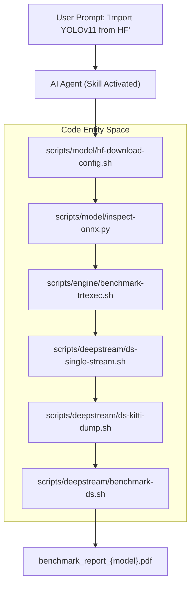

<!-- source: DeepWiki mcp.deepwiki.com · repo NVIDIA/DeepStream · page 10.1 Available Skills Reference · fetched 2026-10-26 -->

# Available Skills Reference

<details>
<summary>Relevant source files</summary>

The following files were used as context for generating this wiki page:

- [skills/README.md](skills/README.md)
- [skills/deepstream-dev/.claude-plugin/plugin.json](skills/deepstream-dev/.claude-plugin/plugin.json)
- [skills/deepstream-dev/BENCHMARK.md](skills/deepstream-dev/BENCHMARK.md)
- [skills/deepstream-dev/SKILL.md](skills/deepstream-dev/SKILL.md)
- [skills/deepstream-dev/evals/evals.json](skills/deepstream-dev/evals/evals.json)
- [skills/deepstream-dev/references/best_practices.md](skills/deepstream-dev/references/best_practices.md)
- [skills/deepstream-dev/references/buffer_apis.md](skills/deepstream-dev/references/buffer_apis.md)
- [skills/deepstream-dev/references/docker_containers.md](skills/deepstream-dev/references/docker_containers.md)
- [skills/deepstream-dev/references/gstreamer_plugins.md](skills/deepstream-dev/references/gstreamer_plugins.md)
- [skills/deepstream-dev/references/kafka_messaging.md](skills/deepstream-dev/references/kafka_messaging.md)
- [skills/deepstream-dev/references/media_extractor_advanced.md](skills/deepstream-dev/references/media_extractor_advanced.md)
- [skills/deepstream-dev/skill-card.md](skills/deepstream-dev/skill-card.md)
- [skills/deepstream-dev/skill.oms.sig](skills/deepstream-dev/skill.oms.sig)
- [skills/deepstream-import-vision-model/BENCHMARK.md](skills/deepstream-import-vision-model/BENCHMARK.md)
- [skills/deepstream-import-vision-model/evals/evals.json](skills/deepstream-import-vision-model/evals/evals.json)
- [skills/deepstream-import-vision-model/skill-card.md](skills/deepstream-import-vision-model/skill-card.md)
- [skills/deepstream-import-vision-model/skill.oms.sig](skills/deepstream-import-vision-model/skill.oms.sig)

</details>


This page provides a detailed technical reference for the agentic skills available in the DeepStream repository. These skills are structured knowledge packages designed for AI coding assistants (e.g., Cursor, Claude Code) to automate and accelerate DeepStream development workflows, from pipeline generation to autonomous model onboarding.

## Overview of Agentic Skills

An **agentic skill** is a collection of domain-specific rules, reference documentation, and scripts that guide an AI agent to produce accurate, idiomatic code without manual developer intervention for every API call [skills/README.md:71-73]().

| Skill | Primary Function | Key Code Entities |
|-------|------------------|-------------------|
| `deepstream-dev` | Reference-rich coding | `pyservicemaker`, `GStreamer` |
| `deepstream-generate-pipeline` | BM25 retrieval pipeline builder | `gst-launch-1.0` |
| `deepstream-profile-pipeline` | Nsight Systems profiling | `nsys`, `NVTX` |
| `deepstream-import-vision-model` | Autonomous model onboarding | `trtexec`, `nvinfer` |
| `deepstream-run-mv3dt` | MV3DT operations | `deepstream-3d-multi-view` |
| `deepstream-sop` | Microservice scaffolding | `GEBD`, `VLM`, `Cosmos` |
| `AutoMagicCalib` skills | Calibration stack management | `AMC REST API`, `Docker Compose` |

**Sources:** [skills/README.md:79-90]()

---

## 1. deepstream-dev (Reference-Rich Coding)

The `deepstream-dev` skill is the primary development companion for authoring DeepStream applications using the `pyservicemaker` Python API or C++ Service Maker SDK. It provides the agent with condensed references for GStreamer plugins, buffer APIs, and configuration schemas [skills/deepstream-dev/skill-card.md:1-2]().

### Data Flow & Implementation
The skill provides the agent with context on the DeepStream metadata hierarchy (e.g., `NvDsBatchMeta` -> `NvDsFrameMeta` -> `NvDsObjectMeta`). It ensures that when the agent generates probes, it correctly handles iterators such as `frame.object_items`, which do not support `len()` and must be iterated [skills/deepstream-dev/evals/evals.json:61-71]().

### Key Reference Areas
*   **GStreamer Plugins:** Detailed properties for `nvv4l2decoder`, `nvstreammux`, `nvinferserver`, and `nvmsgbroker` [skills/deepstream-dev/references/gstreamer_plugins.md:1-5]().
*   **Service Maker API:** Guidance on using the `Pipeline` and `Flow` classes for declarative construction [skills/deepstream-dev/references/service_maker_api.md:1-10]().
*   **Media Extraction:** Advanced usage of `MediaExtractor`, `MediaChunk`, and `FrameSampler` for precise frame retrieval [skills/deepstream-dev/references/media_extractor_advanced.md:1-12]().

**Sources:** [skills/deepstream-dev/skill-card.md:21-33](), [skills/deepstream-dev/evals/evals.json:4-15]()

---

## 2. deepstream-import-vision-model (Autonomous Onboarding)

This skill automates the end-to-end process of bringing a vision model from HuggingFace or NVIDIA NGC into a DeepStream pipeline. It handles model acquisition, TensorRT engine building, and benchmarking [skills/deepstream-import-vision-model/skill-card.md:2-4]().

### Workflow Implementation
The skill follows a strict 7-step autonomous workflow:
1.  **Model Acquire:** Download assets (ONNX, SafeTensors) and inspect shapes [skills/deepstream-import-vision-model/evals/evals.json:10-11]().
2.  **Engine Build:** Use `trtexec` to generate engines with naming patterns like `{model}_dynamic_b{MAX_BS}.engine` [skills/deepstream-import-vision-model/evals/evals.json:23-26]().
3.  **Parser Generation:** Create custom `nvinfer` bbox parsers or configure `cluster-mode: 2` for pre-NMS YOLO outputs [skills/deepstream-import-vision-model/evals/evals.json:28-29]().
4.  **Validation:** Run a single-stream validation with KITTI output to ensure detection accuracy > 90% [skills/deepstream-import-vision-model/evals/evals.json:34-40]().
5.  **Benchmarking:** Execute multi-stream performance runs [skills/deepstream-import-vision-model/evals/evals.json:13-14]().
6.  **Report Generation:** Produce Markdown, HTML, and PDF reports using `wkhtmltopdf` [skills/deepstream-import-vision-model/evals/evals.json:14-15]().

### Logic Diagram: Natural Language to Model Import
The following diagram bridges user requests to the specific code entities and scripts used by the `deepstream-import-vision-model` skill.

**Diagram: Model Import Data Flow**

**Sources:** [skills/deepstream-import-vision-model/evals/evals.json:4-15](), [skills/deepstream-import-vision-model/skill.oms.sig:1-100]()

---

## 3. deepstream-generate-pipeline

This skill utilizes a BM25 retrieval mechanism over a dataset of 270+ verified DeepStream pipelines to help users build complex `gst-launch-1.0` strings [skills/README.md:82]().

### Key Features
*   **Interactive Questionnaire:** The agent asks about source types, inference requirements, and sinks.
*   **Validation:** It validates the generated string against known plugin property constraints (e.g., ensuring `nvstreammux` properties match the DeepStream version) [skills/README.md:82]().

**Sources:** [skills/README.md:48](), [skills/README.md:82]()

---

## 4. deepstream-profile-pipeline

This skill focuses on performance tuning using NVIDIA Nsight Systems (`nsys`). It automates the "measure-then-derive" loop to find the hardware ceiling of a pipeline [skills/README.md:83]().

### Implementation Details
*   **Profiling:** Runs the pipeline under `nsys` with NVTX instrumentation.
*   **Derivation:** Analyzes the inference plateau to recommend optimal batch sizes and `nvstreammux` configurations [skills/README.md:83]().
*   **Reporting:** Provides per-plugin latency breakdowns based on NVTX timings.

**Sources:** [skills/README.md:49](), [skills/README.md:83]()

---

## 5. Multi-View 3D Tracking (MV3DT) & Calibration Skills

The repository includes specialized skills for operating the MV3DT reference application and the AutoMagicCalib (AMC) stack.

### deepstream-run-mv3dt
This skill manages the operation of the `deepstream-3d-multi-view` app. It handles the projection matrices, Bird's Eye View (BEV) configuration, and Kafka metadata output [skills/README.md:85]().

### AutoMagicCalib (AMC) Skills
A suite of four skills for the calibration lifecycle:
1.  **amc-setup-calibration-stack:** Launches the AMC microservice and UI via `Docker Compose` [skills/README.md:87]().
2.  **amc-run-sample-calibration:** Validates the stack with bundled synthetic data [skills/README.md:88]().
3.  **amc-run-video-calibration:** Calibrates using user MP4 files via the `AMC REST API` [skills/README.md:89]().
4.  **amc-run-rtsp-calibration:** Calibrates live streams using `VIOS` capture [skills/README.md:90]().

### Logic Diagram: Calibration Skill Association
**Diagram: AMC Skill to Code Entity Mapping**
```mermaid
graph LR
    subgraph "Natural Language Space"
    "Setup Stack"
    "Run Sample"
    "Calibrate RTSP"
    end

    subgraph "Code Entity Space"
    "Setup Stack" --> DC["docker-compose.yaml"]
    "Run Sample" --> VS["validation_script.sh"]
    "Calibrate RTSP" --> REST["AMC_REST_API"]
    "Calibrate RTSP" --> VIOS["vios_capture_service"]
    end
```
**Sources:** [skills/README.md:53-56](), [skills/README.md:87-90]()

---

## Skill Evaluation & Quality Gates

Every skill undergoes a 3-tier evaluation process using `NVSkills-Eval` before publication. This ensures safety, correctness, and discoverability [skills/deepstream-dev/BENCHMARK.md:5-15]().

### Metrics
*   **Security:** Checks for secret leakage or destructive commands [skills/deepstream-dev/skill-card.md:55]().
*   **Correctness:** Verifies the agent follows the prescribed workflow [skills/deepstream-dev/skill-card.md:56]().
*   **Effectiveness:** Measures the performance uplift compared to a no-skill baseline [skills/deepstream-dev/skill-card.md:58]().

**Sources:** [skills/deepstream-dev/BENCHMARK.md:25-31](), [skills/deepstream-import-vision-model/skill-card.md:65-71]()

---

