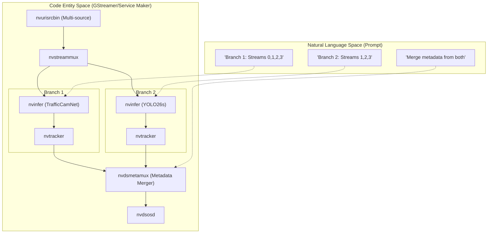
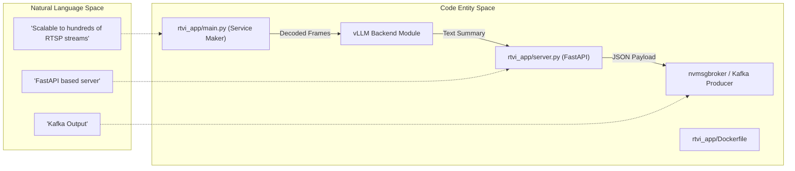

<!-- source: DeepWiki mcp.deepwiki.com · repo NVIDIA/DeepStream · page 10.2 Example Prompts Catalog · fetched 2026-10-26 -->

# Example Prompts Catalog

Relevant source files

The following files were used as context for generating this wiki page:

- [example_prompts/import_vision_model_detection_pipeline.md](example_prompts/import_vision_model_detection_pipeline.md)
- [example_prompts/msgconv_kafka.md](example_prompts/msgconv_kafka.md)
- [example_prompts/multi_stream_tracker.md](example_prompts/multi_stream_tracker.md)
- [example_prompts/nvdsanalytics_config_sample.md](example_prompts/nvdsanalytics_config_sample.md)
- [example_prompts/nvdsdynamicsrcbin_app.md](example_prompts/nvdsdynamicsrcbin_app.md)
- [example_prompts/rtvi_vlm_core_app.md](example_prompts/rtvi_vlm_core_app.md)
- [example_prompts/rtvi_vlm_openapi_spec.md](example_prompts/rtvi_vlm_openapi_spec.md)
- [example_prompts/rtvi_vlm_openapi_spec.png](example_prompts/rtvi_vlm_openapi_spec.png)
- [example_prompts/single_view_3d_tracker.md](example_prompts/single_view_3d_tracker.md)
- [example_prompts/video_infer_app.md](example_prompts/video_infer_app.md)
- [example_prompts/video_object_count.md](example_prompts/video_object_count.md)
- [example_prompts/video_parallel_infer_app.md](example_prompts/video_parallel_infer_app.md)
- [example_prompts/yolov26s_detection.md](example_prompts/yolov26s_detection.md)

The `example_prompts/` directory provides a collection of pre-built natural language prompts designed to be used with the DeepStream Agentic Skills framework. These prompts serve as blueprints for generating complex DeepStream applications using the **Service Maker SDK** (Python/C++), automating tasks such as pipeline construction, model onboarding, and cloud integration.

## 1. Overview of Prompt Categories

The catalog is organized into functional categories that demonstrate the breadth of the DeepStream SDK capabilities. Each prompt is designed to trigger specific "Agentic Skills" to produce production-ready code, configuration files, and documentation.

| Category | Key Prompts | Core Technologies |
| :--- | :--- | :--- |
| **Basic Inference** | `video_infer_app.md`, `video_object_count.md` | `nvurisrcbin`, `nvinfer`, `nvdsosd` |
| **Multi-Stream & Tracking** | `multi_stream_tracker.md`, `single_view_3d_tracker.md` | `nvstreammux`, `nvtracker`, 3D Projection |
| **Advanced Analytics** | `nvdsanalytics_config_sample.md` | `nvdsanalytics` (ROI, Line Crossing) |
| **Parallel Inference** | `video_parallel_infer_app.md` | `nvdsmetamux`, Branching Pipelines |
| **VLM & Microservices** | `rtvi_vlm_core_app.md`, `rtvi_vlm_openapi_spec.md` | vLLM, Kafka, FastAPI, Docker |
| **Model Onboarding** | `import_vision_model_detection_pipeline.md` | `deepstream-import-vision-model` skill |

**Sources:** [example_prompts/video_infer_app.md:1-9](), [example_prompts/multi_stream_tracker.md:1-10](), [example_prompts/nvdsanalytics_config_sample.md:1-15](), [example_prompts/rtvi_vlm_core_app.md:1-18]().

---

## 2. Core Vision Pipelines

These prompts generate applications focusing on standard detection and tracking workflows using the `pyservicemaker` API.

### 2.1 Multi-Stream Tracking
The `multi_stream_tracker.md` prompt generates a pipeline that handles four RTSP streams. It utilizes the `nvstreammux` plugin to batch frames for a ResNet18 TrafficCamNet model, followed by the `nvtracker` for temporal consistency.

**Implementation Details:**
- **Source:** `nvurisrcbin` for RTSP handling [example_prompts/multi_stream_tracker.md:3-3]().
- **Inference:** ResNet18-based object detection [example_prompts/multi_stream_tracker.md:3-3]().
- **Tiling:** 2x2 grid layout using `nvmultistreamtiler` [example_prompts/multi_stream_tracker.md:6-6]().

### 2.2 Single-View 3D Tracking
The `single_view_3d_tracker.md` prompt focuses on spatial intelligence. It configures `nvtracker` with a camera projection matrix to estimate object states in physical 3D coordinates.

**Key Configuration Requirements:**
- **Camera Matrix:** Loaded from a YAML camera info file [example_prompts/single_view_3d_tracker.md:4-4]().
- **Tracker Constraints:** Specific settings for `minPoseConfidence` (0.925) and `outputConvexHull` (0) [example_prompts/single_view_3d_tracker.md:11-11]().

**Sources:** [example_prompts/multi_stream_tracker.md:1-10](), [example_prompts/single_view_3d_tracker.md:1-11]().

---

## 3. Advanced Analytics & Parallel Inference

These prompts demonstrate complex metadata handling and spatial analysis.

### 3.1 NVDSAnalytics Integration
The `nvdsanalytics_config_sample.md` prompt utilizes the `nvdsanalytics` plugin for sophisticated spatial rules.

**Pipeline Flow:**
1. **Inference:** Detection using `nvinfer` [example_prompts/nvdsanalytics_config_sample.md:2-2]().
2. **Analytics:** ROI filtering, line-crossing (2 lines), overcrowding detection, and direction detection [example_prompts/nvdsanalytics_config_sample.md:4-4]().
3. **Telemetry:** Insertion of `measure_fps_probe` for performance monitoring [example_prompts/nvdsanalytics_config_sample.md:7-7]().

### 3.2 Parallel Inference and Metadata Muxing
The `video_parallel_infer_app.md` prompt describes a branched pipeline where two different models (TrafficCamNet and YOLO26s) process overlapping sets of streams.

### Metadata Flow Diagram: Parallel Branching
This diagram illustrates how the "Natural Language Space" of the prompt maps to the "Code Entity Space" of the GStreamer pipeline and metadata merging.

**Sources:** [example_prompts/video_parallel_infer_app.md:3-9](), [example_prompts/nvdsanalytics_config_sample.md:4-12]().

---

## 4. Vision-Language Model (VLM) & Cloud Integration

The `rtvi_vlm_core_app.md` and `rtvi_vlm_openapi_spec.md` prompts represent the "Real-Time Video Intelligence" (RTVI) architecture, bridging DeepStream with LLM/VLM backends.

### 4.1 RTVI Architecture Implementation
This workflow generates a Python application that samples frames and sends them to a VLM (like LLaVA or Qwen-VL) via a microservice.

**Data Flow:**
1. **Frame Sampling:** `MediaExtractor` samples 1 frame every 10 seconds [example_prompts/rtvi_vlm_core_app.md:7-7]().
2. **Batching:** Frames from the same stream are batched over a 1-minute duration [example_prompts/rtvi_vlm_core_app.md:7-7]().
3. **Inference:** The batch is sent to a `vLLM` backend for summarization [example_prompts/rtvi_vlm_core_app.md:9-9]().
4. **Messaging:** Summaries are published to a remote server via **Kafka** [example_prompts/rtvi_vlm_core_app.md:11-11]().

### 4.2 OpenAPI Microservice Generation
The `rtvi_vlm_openapi_spec.md` prompt instructs the agent to create a FastAPI-based microservice that implements endpoints defined in a visual specification (`rtvi_vlm_openapi_spec.png`).

### VLM Microservice Mapping
This diagram bridges the application requirements to the specific service entities.

**Sources:** [example_prompts/rtvi_vlm_core_app.md:1-18](), [example_prompts/rtvi_vlm_openapi_spec.md:1-8]().

---

## 5. Model Onboarding and Benchmarking

The `import_vision_model_detection_pipeline.md` prompt triggers the `deepstream-import-vision-model` skill for an automated, end-to-end model deployment.

**Automated Steps:**
1. **Acquisition:** Downloads models from NVIDIA NGC or local paths [example_prompts/import_vision_model_detection_pipeline.md:5-5]().
2. **Engine Build:** Generates dynamic TensorRT engines [example_prompts/import_vision_model_detection_pipeline.md:13-13]().
3. **Parser Generation:** Compiles custom `nvinfer` bounding box parsers [example_prompts/import_vision_model_detection_pipeline.md:14-14]().
4. **Validation:** Performs KITTI validation and multi-stream benchmark sweeps [example_prompts/import_vision_model_detection_pipeline.md:15-16]().
5. **Reporting:** Generates PDF performance reports and charts [example_prompts/import_vision_model_detection_pipeline.md:17-17]().

**Sources:** [example_prompts/import_vision_model_detection_pipeline.md:1-22]().

---

