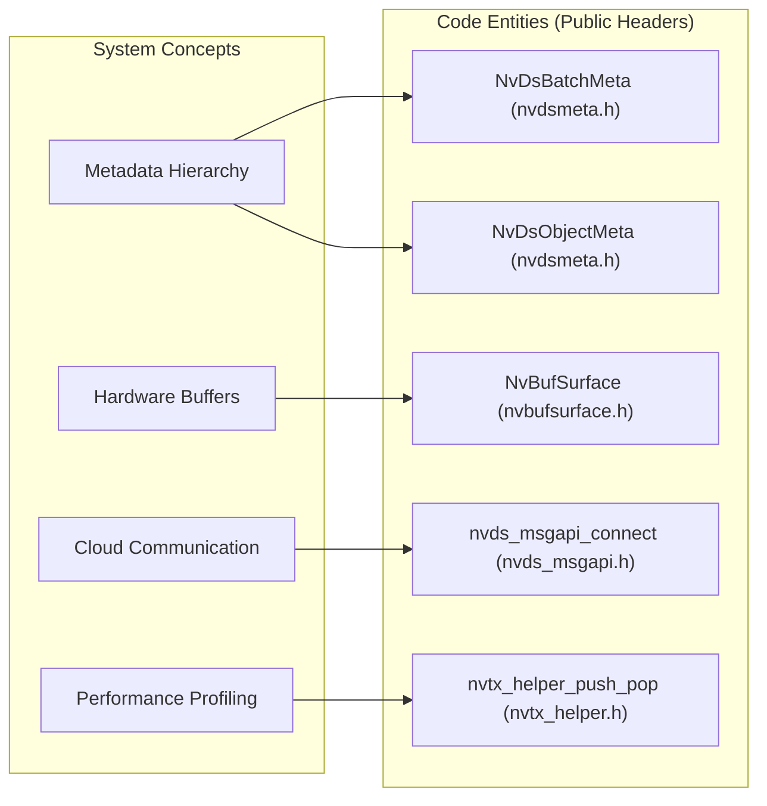

<!-- source: DeepWiki mcp.deepwiki.com · repo NVIDIA/DeepStream · page 11 Public Headers & API Reference · fetched 2026-10-26 -->

# Public Headers & API Reference

<details>
<summary>Relevant source files</summary>

The following files were used as context for generating this wiki page:

- [includes/.gitkeep](includes/.gitkeep)
- [includes/NVWarp360.h](includes/NVWarp360.h)
- [includes/gst-nvcommon.h](includes/gst-nvcommon.h)
- [includes/nv_aisle_csvparser.hpp](includes/nv_aisle_csvparser.hpp)
- [includes/nv_spot_csvparser.hpp](includes/nv_spot_csvparser.hpp)
- [includes/nvtx_helper.h](includes/nvtx_helper.h)
- [src/.gitkeep](src/.gitkeep)
- [src/apps/.gitkeep](src/apps/.gitkeep)
- [src/gst-plugins/.gitkeep](src/gst-plugins/.gitkeep)
- [src/gst-plugins/gst-nvinfer/gstnvinfer.cpp](src/gst-plugins/gst-nvinfer/gstnvinfer.cpp)
- [src/gst-plugins/gst-nvmsgbroker/gstnvmsgbroker.cpp](src/gst-plugins/gst-nvmsgbroker/gstnvmsgbroker.cpp)
- [src/gst-plugins/gst-nvmsgbroker/gstnvmsgbroker.h](src/gst-plugins/gst-nvmsgbroker/gstnvmsgbroker.h)
- [src/service-maker/.gitkeep](src/service-maker/.gitkeep)
- [src/utils/.gitkeep](src/utils/.gitkeep)
- [src/utils/nvdsinferserver/tritonserver_include/model_config.proto](src/utils/nvdsinferserver/tritonserver_include/model_config.proto)
- [tools/.gitkeep](tools/.gitkeep)

</details>


The `includes/` directory contains the public C/C++ headers and Protobuf schemas required to build custom plugins, applications, and extensions for the DeepStream SDK. These headers define the foundational data structures for metadata, buffer management, inference interfaces, and observability integration.

## Core DeepStream Metadata & Inference

The primary headers for DeepStream application development define how metadata is attached to GStreamer buffers and how the inference engine communicates with the rest of the pipeline.

### Metadata Management (`nvdsmeta.h`)
DeepStream uses a hierarchical metadata system. `nvdsmeta.h` (and its GStreamer wrapper `gstnvdsmeta.h`) provides the definitions for `NvDsBatchMeta`, `NvDsFrameMeta`, and `NvDsObjectMeta`. These structures allow plugins like `nvinfer` to attach detection results that subsequent plugins like `nvtracker` or `nvdsosd` can consume [src/gst-plugins/gst-nvinfer/gstnvinfer.cpp:32-32]().

### Inference Interfaces (`nvdsinfer.h`)
This header defines the C++ interfaces for the `nvinfer` plugin. It includes definitions for:
*   **Network Types**: Detector, Classifier, Segmentation, and Instance Segmentation [src/gst-plugins/gst-nvinfer/gstnvinfer.cpp:81-88]().
*   **Data Types**: Definitions for `FLOAT`, `HALF`, `INT8`, etc., used for tensor data [src/gst-plugins/gst-nvinfer/gstnvinfer.cpp:179-195]().
*   **Initialization Parameters**: Used by `nvdsinfer` to initialize the TensorRT context.

### GStreamer Common Properties (`gst-nvcommon.h`)
This header provides standardized GObject properties for DeepStream plugins, ensuring consistent behavior for memory allocation and GPU selection across the pipeline.

| Property Macro | Purpose | Implementation Detail |
| :--- | :--- | :--- |
| `PROP_NVDS_GPU_ID_INSTALL` | Installs `gpu-id` property | [includes/gst-nvcommon.h:98-106]() |
| `PROP_NVBUF_MEMORY_TYPE_INSTALL` | Installs `nvbuf-memory-type` | [includes/gst-nvcommon.h:108-117]() |
| `CHECK_DEFAULT_MEM` | Platform-specific memory check | [includes/gst-nvcommon.h:35-45]() |
| `GET_DEFAULT_MEM_TYPE` | Detects `NVBUF_MEM_SURFACE_ARRAY` vs `CUDA_DEVICE` | [includes/gst-nvcommon.h:46-64]() |

**Sources:** [includes/gst-nvcommon.h:1-143](), [src/gst-plugins/gst-nvinfer/gstnvinfer.cpp:1-201]()

---

## Buffer & Memory Management

DeepStream utilizes `NvBufSurface` for high-performance buffer handling, particularly for hardware-accelerated transformations and zero-copy memory sharing.

### NvBufSurface (`nvbufsurface.h`)
Defines the `NvBufSurface` structure, which represents a batch of frames in memory. It supports multiple memory types:
*   **`NVBUF_MEM_DEFAULT`**: Default memory based on platform.
*   **`NVBUF_MEM_CUDA_DEVICE`**: Device memory for discrete GPUs.
*   **`NVBUF_MEM_SURFACE_ARRAY`**: Specific to Jetson (aarch64) for hardware-accelerated VIC/ISP access.

### Coordinate Transformation (`NVWarp360.h`)
For 360-degree video processing and dewarping, `NVWarp360.h` provides the API for coordinate warping between different surface types.

| Warp Type | Source Surface | Destination Surface |
| :--- | :--- | :--- |
| `NVWARP_EQUIRECT_PERSPECTIVE` | Equirectangular | Perspective |
| `NVWARP_FISHEYE_CYLINDER` | Fisheye | Cylindrical |
| `NVWARP_PERSPECTIVE_PANINI` | Perspective | Panini |

**Sources:** [includes/gst-nvcommon.h:35-65](), [includes/NVWarp360.h:49-108]()

---

## Messaging & Cloud Integration

The messaging API allows DeepStream to interface with external brokers like Kafka, MQTT, and Azure IoT.

### Message API (`nvds_msgapi.h`)
This header defines the functional pointers required to implement a custom protocol adaptor. The `gst-nvmsgbroker` plugin uses these symbols to dynamically load protocol libraries [src/gst-plugins/gst-nvmsgbroker/gstnvmsgbroker.h:36-48]().

### Data Flow: Message Broker
The following diagram illustrates how the public headers define the interface between the GStreamer plugin and the underlying protocol library.

**Diagram: Messaging Interface Architecture**
```mermaid
graph TD
    subgraph "GStreamer Space"
        [gst-nvmsgbroker.cpp] -- "Uses" --> [NvDsMsgApiHandle]
        [gst-nvmsgbroker.cpp] -- "Calls" --> [nvds_msgapi_send_ptr]
    end

    subgraph "Public Header Space (nvds_msgapi.h)"
        [nvds_msgapi_send_ptr] -- "Defined as" --> func["typedef NvDsMsgApiErrorType (*nvds_msgapi_send_ptr)(...)"]
        [NvDsMsgApiHandle] -- "Opaque Handle" --> handle["typedef void* NvDsMsgApiHandle"]
    end

    subgraph "Protocol Adaptor Space (e.g., libnvds_kafka_proto.so)"
        func -- "Implemented by" --> [nvds_msgapi_send]
    end
```

**Sources:** [src/gst-plugins/gst-nvmsgbroker/gstnvmsgbroker.h:1-96](), [src/gst-plugins/gst-nvmsgbroker/gstnvmsgbroker.cpp:90-110]()

---

## Specialized CSV Parsers

DeepStream provides specialized headers for parsing configuration files related to retail and smart parking analytics.

### Aisle & Spot Parsers
*   **`nv_aisle_csvparser.hpp`**: Used for mapping camera views to retail aisles. Defines `NvAisleCsvFields` including dewarp angles (pitch, yaw, roll) and ROI coordinates [includes/nv_aisle_csvparser.hpp:39-74]().
*   **`nv_spot_csvparser.hpp`**: Used for smart parking applications to define parking spots. Defines `NvSpotCsvFields` including GPS coordinates (`lat`, `lng`) and horizon lines [includes/nv_spot_csvparser.hpp:38-66]().

**Sources:** [includes/nv_aisle_csvparser.hpp:1-137](), [includes/nv_spot_csvparser.hpp:1-123]()

---

## Observability & Profiling

DeepStream integrates with NVTX (NVIDIA Tools Extension) and OpenTelemetry for pipeline monitoring.

### NVTX Helpers (`nvtx_helper.h`)
Provides simple wrappers for instrumenting code to be viewed in NVIDIA Nsight Systems.
*   `nvtx_helper_push_pop(char * context)`: Calls `nvtxRangePushA()` or `nvtxRangePop()` [includes/nvtx_helper.h:36-36]().
*   `nvtx_helper_start_end(char * context, unsigned long *id)`: Calls `nvtxRangeStartA()` or `nvtxRangeEnd()` [includes/nvtx_helper.h:45-45]().

### Triton Protobuf Schemas
For `nvinferserver` (Triton), the SDK includes Protobuf definitions such as `model_config.proto` to define the configuration schema for inference models [src/utils/nvdsinferserver/tritonserver_include/model_config.proto:1-1]().

### API Entity Mapping
This diagram maps the natural language concepts to the specific code entities found in the public headers.

**Diagram: Entity Mapping for Developers**


**Sources:** [includes/nvtx_helper.h:1-50](), [src/gst-plugins/gst-nvmsgbroker/gstnvmsgbroker.h:36-48](), [includes/gst-nvcommon.h:67-83]()

---

