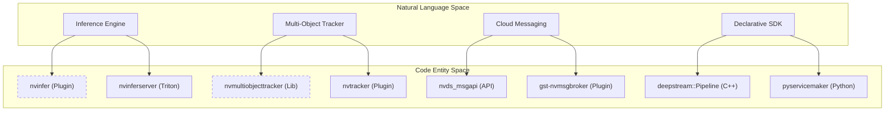
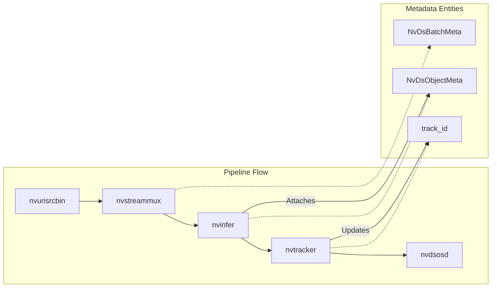

<!-- source: DeepWiki mcp.deepwiki.com · repo NVIDIA/DeepStream · page 12 Glossary · fetched 2026-10-26 -->

# Glossary

Relevant source files

The following files were used as context for generating this wiki page:

- [.claude/.gitkeep](.claude/.gitkeep)
- [.gitattributes](.gitattributes)
- [.github/.gitkeep](.github/.gitkeep)
- [.github/ISSUE_TEMPLATE/bug_report.md](.github/ISSUE_TEMPLATE/bug_report.md)
- [.gitignore](.gitignore)
- [.gitmodules](.gitmodules)
- [CHANGELOG.md](CHANGELOG.md)
- [CODE_OF_CONDUCT.md](CODE_OF_CONDUCT.md)
- [LICENSE](LICENSE)
- [README.md](README.md)
- [THIRD_PARTY_LICENSES.txt](THIRD_PARTY_LICENSES.txt)
- [build/BUILD.md](build/BUILD.md)
- [build/build.sh](build/build.sh)
- [scripts/print_env.sh](scripts/print_env.sh)
- [src/README.md](src/README.md)
- [src/apps/reference_apps/README.md](src/apps/reference_apps/README.md)
- [src/apps/reference_apps/deepstream-tracker-3d-multi-view/README.md](src/apps/reference_apps/deepstream-tracker-3d-multi-view/README.md)
- [src/apps/reference_apps/deepstream-tracker-3d-multi-view/docs/manual-setup.md](src/apps/reference_apps/deepstream-tracker-3d-multi-view/docs/manual-setup.md)
- [src/apps/reference_apps/deepstream-tracker-3d-multi-view/scripts/setup_prerequisites.sh](src/apps/reference_apps/deepstream-tracker-3d-multi-view/scripts/setup_prerequisites.sh)
- [src/apps/reference_apps/deepstream_parallel_inference_app/tritonclient/sample/configs/apps/bodypose_yolo/sources_4_rtsp.csv](src/apps/reference_apps/deepstream_parallel_inference_app/tritonclient/sample/configs/apps/bodypose_yolo/sources_4_rtsp.csv)
- [src/apps/reference_apps/deepstream_parallel_inference_app/tritonclient/sample/configs/apps/bodypose_yolo_lpr/sources_4_rtsp.csv](src/apps/reference_apps/deepstream_parallel_inference_app/tritonclient/sample/configs/apps/bodypose_yolo_lpr/sources_4_rtsp.csv)
- [src/apps/reference_apps/deepstream_parallel_inference_app/tritonclient/sample/configs/apps/bodypose_yolo_win1/sources_4_rtsp.csv](src/apps/reference_apps/deepstream_parallel_inference_app/tritonclient/sample/configs/apps/bodypose_yolo_win1/sources_4_rtsp.csv)
- [src/apps/reference_apps/deepstream_parallel_inference_app/tritonclient/sample/configs/apps/vehicle0_lpr_analytic/sources_4_rtsp.csv](src/apps/reference_apps/deepstream_parallel_inference_app/tritonclient/sample/configs/apps/vehicle0_lpr_analytic/sources_4_rtsp.csv)
- [src/apps/reference_apps/deepstream_parallel_inference_app/tritonclient/sample/configs/apps/vehicle_lpr_analytic/sources_4_rtsp.csv](src/apps/reference_apps/deepstream_parallel_inference_app/tritonclient/sample/configs/apps/vehicle_lpr_analytic/sources_4_rtsp.csv)
- [src/apps/sample_apps/README.md](src/apps/sample_apps/README.md)
- [src/apps/sample_apps/deepstream-3d-lidar-sensor-fusion/README](src/apps/sample_apps/deepstream-3d-lidar-sensor-fusion/README)
- [src/apps/sample_apps/deepstream-3d-lidar-sensor-fusion/README.v2xfusion](src/apps/sample_apps/deepstream-3d-lidar-sensor-fusion/README.v2xfusion)
- [src/apps/sample_apps/deepstream-3d-lidar-sensor-fusion/data/nuscene.tar.gz](src/apps/sample_apps/deepstream-3d-lidar-sensor-fusion/data/nuscene.tar.gz)
- [src/apps/sample_apps/deepstream-3d-lidar-sensor-fusion/ds3d_lidar_video_sensor_v2x_fusion.yml](src/apps/sample_apps/deepstream-3d-lidar-sensor-fusion/ds3d_lidar_video_sensor_v2x_fusion.yml)
- [src/apps/sample_apps/deepstream-3d-lidar-sensor-fusion/ds3d_lidar_video_sensor_v2x_fusion_single_batch.yml](src/apps/sample_apps/deepstream-3d-lidar-sensor-fusion/ds3d_lidar_video_sensor_v2x_fusion_single_batch.yml)
- [src/apps/sample_apps/deepstream-3d-lidar-sensor-fusion/lidar_nuscene_data_list.yaml](src/apps/sample_apps/deepstream-3d-lidar-sensor-fusion/lidar_nuscene_data_list.yaml)
- [src/apps/sample_apps/deepstream-infer-tensor-meta-test/README](src/apps/sample_apps/deepstream-infer-tensor-meta-test/README)
- [src/apps/sample_apps/deepstream-ucx-test/Makefile](src/apps/sample_apps/deepstream-ucx-test/Makefile)
- [src/apps/sample_apps/deepstream-ucx-test/README](src/apps/sample_apps/deepstream-ucx-test/README)
- [src/apps/sample_apps/deepstream-ucx-test/deepstream_ucx_test_app.c](src/apps/sample_apps/deepstream-ucx-test/deepstream_ucx_test_app.c)
- [src/apps/sample_apps/deepstream-ucx-test/deepstream_ucx_test_app.h](src/apps/sample_apps/deepstream-ucx-test/deepstream_ucx_test_app.h)
- [src/apps/tao_apps/README.md](src/apps/tao_apps/README.md)
- [src/apps/tao_apps/apps/tao_others/deepstream-mdx-perception-app/README.md](src/apps/tao_apps/apps/tao_others/deepstream-mdx-perception-app/README.md)
- [src/apps/tao_apps/apps/tao_others/deepstream-nvocdr-app/README.md](src/apps/tao_apps/apps/tao_others/deepstream-nvocdr-app/README.md)
- [src/apps/tao_apps/apps/tao_others/deepstream_custom_preprocessing_app/nvdspreprocess_lib/Makefile](src/apps/tao_apps/apps/tao_others/deepstream_custom_preprocessing_app/nvdspreprocess_lib/Makefile)
- [src/apps/tao_apps/apps/tao_others/deepstream_custom_preprocessing_app/nvdspreprocess_lib/roi_conversion.cu](src/apps/tao_apps/apps/tao_others/deepstream_custom_preprocessing_app/nvdspreprocess_lib/roi_conversion.cu)
- [src/apps/tao_apps/apps/tao_others/deepstream_custom_preprocessing_app/nvdspreprocess_lib/roi_conversion.hpp](src/apps/tao_apps/apps/tao_others/deepstream_custom_preprocessing_app/nvdspreprocess_lib/roi_conversion.hpp)
- [src/gst-plugins/README.md](src/gst-plugins/README.md)
- [src/gst-plugins/gst-nvdsmetamux/README](src/gst-plugins/gst-nvdsmetamux/README)
- [src/service-maker/README.md](src/service-maker/README.md)
- [src/utils/README.md](src/utils/README.md)
- [src/utils/nvds_logger/README](src/utils/nvds_logger/README)
- [src/utils/nvds_logger/setup_nvds_logger.sh](src/utils/nvds_logger/setup_nvds_logger.sh)
- [src/utils/nvds_msgapi/amqp_protocol_adaptor/Makefile](src/utils/nvds_msgapi/amqp_protocol_adaptor/Makefile)
- [src/utils/nvds_msgapi/kafka_protocol_adaptor/Makefile](src/utils/nvds_msgapi/kafka_protocol_adaptor/Makefile)
- [src/utils/nvds_msgapi/mqtt_protocol_adaptor/Makefile](src/utils/nvds_msgapi/mqtt_protocol_adaptor/Makefile)
- [src/utils/nvds_msgapi/redis_protocol_adaptor/Makefile](src/utils/nvds_msgapi/redis_protocol_adaptor/Makefile)
- [src/utils/nvmultiobjecttracker/model/tracker_ReID/README](src/utils/nvmultiobjecttracker/model/tracker_ReID/README)

This page provides definitions for DeepStream-specific terminology, abbreviations, and core concepts. It serves as a technical reference for onboarding engineers to navigate the codebase and understand the underlying GStreamer-based architecture.

## Core Concepts

### GStreamer Pipeline
DeepStream is built on the **GStreamer** framework. A pipeline consists of a series of "elements" (plugins) linked together. Data flows from a `source` to a `sink`.
*   **Source**: The input of the pipeline (e.g., `nvurisrcbin`, `appsrc`).
*   **Sink**: The output of the pipeline (e.g., `nveglglessink`, `nvmsgbroker`, `filesink`).
*   **Muxer**: Aggregates multiple input streams into a single batched buffer for processing (e.g., `nvstreammux`).

### Metadata (NvDsMeta)
The primary mechanism for passing AI results (bounding boxes, labels, tracks) between plugins without copying the underlying video frames.
*   **Batch Metadata**: `NvDsBatchMeta` holds metadata for a batch of frames.
*   **Frame Metadata**: `NvDsFrameMeta` contains information for a single frame within a batch.
*   **Object Metadata**: `NvDsObjectMeta` contains information about a detected object (class ID, confidence, tracker ID).
*   **Sources**: [README.md:3-5](), [src/service-maker/README.md:86-103]()

### Service Maker SDK
A high-level C++ and Python abstraction layer that simplifies DeepStream development by providing declarative pipeline construction.
*   **Pipeline Class**: The primary C++ entry point for building and managing the lifecycle of a Service Maker application.
*   **Flow API**: A Python-specific chainable API for connecting elements.
*   **Sources**: [src/service-maker/README.md:18-21](), [src/service-maker/README.md:82-111]()

## Natural Language to Code Mapping

### System Components to Code Entities
The following diagram maps high-level DeepStream concepts to their specific implementations in the source tree.

**Diagram: Component-to-Code Mapping**

*   **Sources**: [README.md:13-19](), [src/service-maker/README.md:87-89](), [src/utils/nvmultiobjecttracker/model/tracker_ReID/README:20-25]()

### Data Flow Mapping
Mapping the conceptual data flow to specific GStreamer elements and metadata structures.

**Diagram: Data Flow and Metadata Association**

*   **Sources**: [src/service-maker/README.md:93-102](), [src/utils/nvmultiobjecttracker/model/tracker_ReID/README:95-101]()

## Terminology & Abbreviations

| Term | Definition | Code Pointers / Configuration Keys |
| :--- | :--- | :--- |
| **DS3D** | DeepStream 3D Sensing framework for LiDAR and depth data. | `src/apps/sample_apps/deepstream-3d-lidar-sensor-fusion/` |
| **GIE** | General Inference Engine. Usually refers to a primary or secondary inference plugin. | `primary-gie` in `det_app_config.yml` |
| **IPC** | Inter-Process Communication. Sharing buffers between different DeepStream processes. | `src/apps/reference_apps/deepstream-ipc-test-sr/` |
| **NVDCF** | NVIDIA Discriminative Correlation Filter. A high-accuracy tracking algorithm. | `config_tracker_NvDCF_accuracy.yml` |
| **OSD** | On-Screen Display. The plugin responsible for drawing bounding boxes and text. | `nvdsosd` plugin |
| **ReID** | Re-Identification. Using deep learning features to track objects across occlusions or cameras. | `src/utils/nvmultiobjecttracker/model/tracker_ReID/` |
| **SAM2** | Segment Anything Model 2. Used in MaskTracker for instance segmentation. | `tools/sam2-onnx-tensorrt/` |
| **SBSA** | Server Base System Architecture. Refers to ARM-based server platforms (e.g., Grace Hopper). | [build/BUILD.md:101-106]() |
| **TAO** | Train Adapt Optimize. NVIDIA's toolkit for training AI models compatible with DeepStream. | `src/apps/tao_apps/` |
| **Triton** | NVIDIA Triton Inference Server. Used for multi-framework inference (ONNX, PyTorch, etc.). | `nvinferserver` plugin |

*   **Sources**: [README.md:25-26](), [build/BUILD.md:101-106](), [src/apps/reference_apps/README.md:33-40](), [src/apps/tao_apps/README.md:52-58](), [src/utils/nvmultiobjecttracker/model/tracker_ReID/README:35-37]()

## Build & Platform Terms

*   **Artifacts**: Prebuilt proprietary libraries and sample data downloaded during the build process.
    *   **Source**: [build/build.sh:24-28]()
*   **JetPack**: The SDK for NVIDIA Jetson platforms, including CUDA and TensorRT.
    *   **Source**: [build/BUILD.md:29]()
*   **dGPU**: Discrete GPU (x86_64 systems).
    *   **Source**: [build/BUILD.md:28]()
*   **Stage State**: Tracking files used by the build system to resume interrupted builds.
    *   **Source**: [build/build.sh:106-114]()

## Plugin Catalog (Partial)

| Plugin Name | Purpose | Implementation Location |
| :--- | :--- | :--- |
| `nvinfer` | TensorRT-based inference. | `src/gst-plugins/` |
| `nvstreammux` | Batches multiple input streams. | `src/gst-plugins/` |
| `nvdsanalytics` | ROI filtering, line crossing, and overcrowding detection. | `src/utils/` (Lib) |
| `nvmsgbroker` | Sends metadata to cloud services (Kafka, MQTT, Azure). | `src/utils/nvds_msgapi/` |
| `nvmultistreamtiler` | Composites multiple streams into a single 2D grid. | `src/apps/reference_apps/deepstream-custom-tile-config/` |

*   **Sources**: [README.md:14-17](), [src/apps/reference_apps/README.md:50-51](), [src/service-maker/README.md:185-203]()