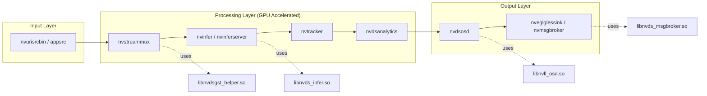
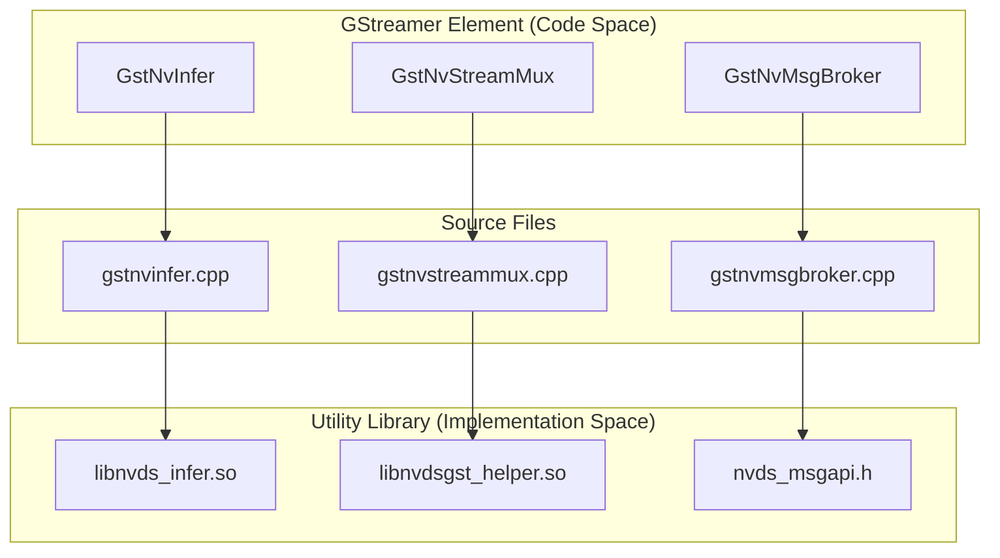

<!-- source: DeepWiki mcp.deepwiki.com · repo NVIDIA/DeepStream · page 2 Core Pipeline Architecture · fetched 2026-10-26 -->

# Core Pipeline Architecture

Relevant source files

The following files were used as context for generating this wiki page:

- [.github/ISSUE_TEMPLATE/bug_report.md](.github/ISSUE_TEMPLATE/bug_report.md)
- [includes/NVWarp360.h](includes/NVWarp360.h)
- [includes/gst-nvcommon.h](includes/gst-nvcommon.h)
- [includes/nv_aisle_csvparser.hpp](includes/nv_aisle_csvparser.hpp)
- [includes/nv_spot_csvparser.hpp](includes/nv_spot_csvparser.hpp)
- [includes/nvtx_helper.h](includes/nvtx_helper.h)
- [scripts/print_env.sh](scripts/print_env.sh)
- [src/README.md](src/README.md)
- [src/apps/sample_apps/README.md](src/apps/sample_apps/README.md)
- [src/apps/sample_apps/deepstream-infer-tensor-meta-test/README](src/apps/sample_apps/deepstream-infer-tensor-meta-test/README)
- [src/gst-plugins/README.md](src/gst-plugins/README.md)
- [src/gst-plugins/gst-nvinfer/gstnvinfer.cpp](src/gst-plugins/gst-nvinfer/gstnvinfer.cpp)
- [src/gst-plugins/gst-nvmsgbroker/gstnvmsgbroker.cpp](src/gst-plugins/gst-nvmsgbroker/gstnvmsgbroker.cpp)
- [src/gst-plugins/gst-nvmsgbroker/gstnvmsgbroker.h](src/gst-plugins/gst-nvmsgbroker/gstnvmsgbroker.h)
- [src/gst-plugins/gst-nvmultistream2/gstnvmultistream.cpp](src/gst-plugins/gst-nvmultistream2/gstnvmultistream.cpp)
- [src/utils/README.md](src/utils/README.md)

DeepStream is built on the **GStreamer** framework, providing a modular and scalable architecture for AI-powered multi-stream video and sensor processing. The core pipeline model follows a linear or branched flow where data originates from sources, is multiplexed into batches for efficient GPU processing, undergoes inference and tracking, and is finally rendered or sent to the cloud.

### Pipeline Data Flow

The typical DeepStream pipeline lifecycle involves several key stages, orchestrated by specialized GStreamer plugins and supported by low-level utility libraries.

1.  **Source & Decoding**: Input streams (RTSP, File, Camera) are ingested. Elements like `nvurisrcbin` handle the complexities of decoding and hardware acceleration.
2.  **Stream Muxing**: The `nvstreammux` element collects frames from multiple sources and creates a single batched buffer (`NvBufSurface`). This batching is critical for maximizing GPU utilization during inference [src/gst-plugins/gst-nvmultistream2/gstnvmultistream.cpp:26-31]().
3.  **Inference**: Batched frames are passed to inference plugins. `nvinfer` uses TensorRT for high-performance execution [src/gst-plugins/gst-nvinfer/gstnvinfer.cpp:32-40](), while `nvinferserver` leverages the Triton Inference Server for multi-framework support.
4.  **Tracking & Analytics**: The `nvtracker` plugin maintains object identities across frames using algorithms like NvDCF or DeepSORT. Additional analytics (line crossing, ROI) can be applied via `nvdsanalytics`.
5.  **OSD & Visualization**: Metadata generated by inference and tracking is used by `nvdsosd` to draw bounding boxes and text directly onto the video buffers using the `nvll_osd` library [src/utils/README.md:62]().
6.  **Sinks & Messaging**: Final output is sent to a display, file, or cloud broker. The `nvmsgbroker` plugin handles asynchronous transmission to Kafka, MQTT, or Azure IoT [src/gst-plugins/gst-nvmsgbroker/gstnvmsgbroker.cpp:136-157]().

#### Diagram: High-Level Pipeline Model
This diagram illustrates the flow from raw input to metadata-enriched output, showing the relationship between GStreamer elements and the underlying hardware-accelerated libraries.

**Sources:** [src/README.md:28-76](), [src/utils/README.md:26-76]()

---

### Core Subsystems

DeepStream's architecture is divided into distinct subsystems that handle specific parts of the AI lifecycle.

#### GStreamer Plugins
DeepStream provides a comprehensive suite of plugins located in `src/gst-plugins/`. These include `nvinfer` for TensorRT-based detection/classification and `nvstreammux` for frame batching.
For details, see [GStreamer Plugins](#2.1).

#### Inference Engine Layer
The inference layer is powered by two primary engines: `nvinfer` (TensorRT) and `nvinferserver` (Triton). These engines interact with the pipeline via the `NvDsInferContext` API [src/utils/README.md:32-33]().
For details, see [Inference Engine Layer](#2.2).

#### Multi-Object Tracking
The tracking subsystem, implemented in the `nvtracker` plugin, supports multiple state-of-the-art algorithms (NvDCF, DeepSORT, IOU) and integrates with Re-Identification (ReID) models for robust object persistence [src/utils/README.md:86]().
For details, see [Multi-Object Tracking](#2.3).

#### Metadata Management & Parallelism
DeepStream uses a unified metadata structure (`NvDsMeta`) to pass information between plugins. The `nvdsmetamux` element allows for parallel inference branches to be merged back into a single stream, synchronized by PTS [src/gst-plugins/gst-nvinfer/gstnvinfer.cpp:32]().
For details, see [Metadata Muxing & Parallel Inference](#2.4).

#### Serialization & Messaging
For edge-to-cloud scenarios, DeepStream provides utilities to serialize metadata into JSON or Protobuf formats. The `nvmsgbroker` plugin abstracts the underlying transport protocols (Kafka, MQTT, etc.) [src/gst-plugins/gst-nvmsgbroker/gstnvmsgbroker.h:36-48]().
For details, see [Metadata Serialization & Utilities](#2.5).

---

### Code Entity Mapping
The following diagram maps high-level pipeline concepts to the specific C++ classes and library files found in the source tree.

**Sources:** [src/gst-plugins/gst-nvinfer/gstnvinfer.cpp:131](), [src/gst-plugins/gst-nvmultistream2/gstnvmultistream.cpp:47](), [src/gst-plugins/gst-nvmsgbroker/gstnvmsgbroker.cpp:132](), [src/utils/README.md:30-56]()

### Memory Management
DeepStream utilizes `memory:NVMM` to keep video frames in hardware-accelerated memory (CUDA device memory on x86 or Surface Array on Jetson) throughout the pipeline, avoiding costly CPU-GPU copies [includes/gst-nvcommon.h:35-65](). The `NvBufSurface` structure is the primary container for these hardware buffers [includes/gst-nvcommon.h:111]().

**Sources:** [includes/gst-nvcommon.h:35-117](), [src/gst-plugins/gst-nvinfer/gstnvinfer.cpp:116-120]()

---

