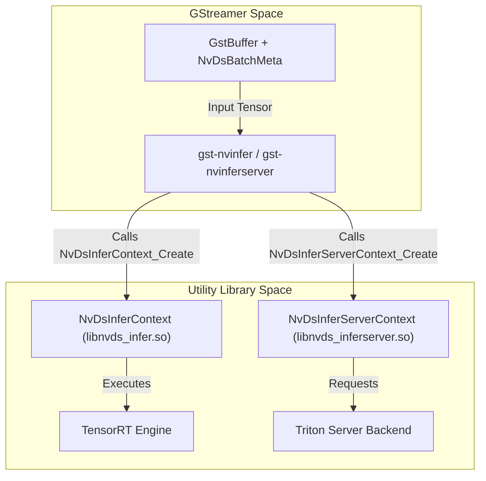
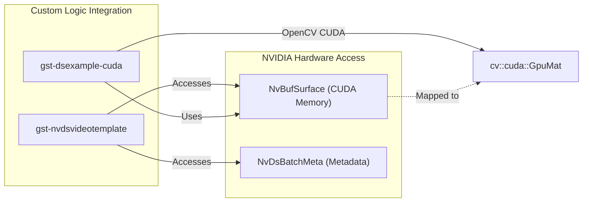

<!-- source: DeepWiki mcp.deepwiki.com · repo NVIDIA/DeepStream · page 2.1 GStreamer Plugins · fetched 2026-10-26 -->

# GStreamer Plugins

Relevant source files

The following files were used as context for generating this wiki page:

- [.github/ISSUE_TEMPLATE/bug_report.md](.github/ISSUE_TEMPLATE/bug_report.md)
- [scripts/print_env.sh](scripts/print_env.sh)
- [src/README.md](src/README.md)
- [src/apps/reference_apps/deepstream_parallel_inference_app/tritonclient/sample/configs/apps/bodypose_yolo/sources_4_rtsp.csv](src/apps/reference_apps/deepstream_parallel_inference_app/tritonclient/sample/configs/apps/bodypose_yolo/sources_4_rtsp.csv)
- [src/apps/reference_apps/deepstream_parallel_inference_app/tritonclient/sample/configs/apps/bodypose_yolo_lpr/sources_4_rtsp.csv](src/apps/reference_apps/deepstream_parallel_inference_app/tritonclient/sample/configs/apps/bodypose_yolo_lpr/sources_4_rtsp.csv)
- [src/apps/reference_apps/deepstream_parallel_inference_app/tritonclient/sample/configs/apps/bodypose_yolo_win1/sources_4_rtsp.csv](src/apps/reference_apps/deepstream_parallel_inference_app/tritonclient/sample/configs/apps/bodypose_yolo_win1/sources_4_rtsp.csv)
- [src/apps/reference_apps/deepstream_parallel_inference_app/tritonclient/sample/configs/apps/vehicle0_lpr_analytic/sources_4_rtsp.csv](src/apps/reference_apps/deepstream_parallel_inference_app/tritonclient/sample/configs/apps/vehicle0_lpr_analytic/sources_4_rtsp.csv)
- [src/apps/reference_apps/deepstream_parallel_inference_app/tritonclient/sample/configs/apps/vehicle_lpr_analytic/sources_4_rtsp.csv](src/apps/reference_apps/deepstream_parallel_inference_app/tritonclient/sample/configs/apps/vehicle_lpr_analytic/sources_4_rtsp.csv)
- [src/apps/sample_apps/README.md](src/apps/sample_apps/README.md)
- [src/apps/sample_apps/deepstream-infer-tensor-meta-test/README](src/apps/sample_apps/deepstream-infer-tensor-meta-test/README)
- [src/gst-plugins/README.md](src/gst-plugins/README.md)
- [src/gst-plugins/gst-dsexample-cuda/README](src/gst-plugins/gst-dsexample-cuda/README)
- [src/gst-plugins/gst-nvdsmetamux/README](src/gst-plugins/gst-nvdsmetamux/README)
- [src/gst-plugins/gst-nvdsosd/README](src/gst-plugins/gst-nvdsosd/README)
- [src/gst-plugins/gst-nvdspostprocess/README](src/gst-plugins/gst-nvdspostprocess/README)
- [src/gst-plugins/gst-nvdspreprocess/README](src/gst-plugins/gst-nvdspreprocess/README)
- [src/gst-plugins/gst-nvdsudp/README](src/gst-plugins/gst-nvdsudp/README)
- [src/gst-plugins/gst-nvdsudp/gstnvdsudp.c](src/gst-plugins/gst-nvdsudp/gstnvdsudp.c)
- [src/gst-plugins/gst-nvdsvideotemplate/README](src/gst-plugins/gst-nvdsvideotemplate/README)
- [src/gst-plugins/gst-nvdynamicsrcbin/README](src/gst-plugins/gst-nvdynamicsrcbin/README)
- [src/gst-plugins/gst-nvimage/README](src/gst-plugins/gst-nvimage/README)
- [src/gst-plugins/gst-nvmultistream2/Makefile](src/gst-plugins/gst-nvmultistream2/Makefile)
- [src/gst-plugins/gst-nvmultistream2/gstnvmultistream.cpp](src/gst-plugins/gst-nvmultistream2/gstnvmultistream.cpp)
- [src/gst-plugins/gst-nvreplay/README](src/gst-plugins/gst-nvreplay/README)
- [src/gst-plugins/gst-nvtracker/README](src/gst-plugins/gst-nvtracker/README)
- [src/utils/README.md](src/utils/README.md)

This page provides a technical catalog and architectural overview of the GStreamer plugins provided in the DeepStream SDK. These plugins are located in `src/gst-plugins/` and form the building blocks of DeepStream's accelerated video and sensor processing pipelines.

## Overview
DeepStream GStreamer plugins leverage NVIDIA hardware accelerators (NVDEC, NVENC, GPU, DLA) to perform tasks such as stream multiplexing, deep learning inference, multi-object tracking, and on-screen display (OSD). These plugins communicate via standardized NvDsMetadata structures attached to GstBuffers.

**Sources:** [src/gst-plugins/README.md](), [src/README.md:58-62]()

---

## Stream Multiplexing and Source Management

### nvstreammux
The `nvstreammux` plugin is the backbone of multi-stream processing. It batches frames from multiple input sources into a single batched buffer for downstream inference.

*   **Implementation:** The current SDK supports a new version of the muxer, often referred to as `nvstreammux2`. It can be toggled via the `USE_NEW_NVSTREAMMUX=yes` environment variable [src/gst-plugins/gst-nvmultistream2/gstnvmultistream.cpp:38-40]().
*   **Key Logic:** It performs batching based on a configured `batch-size` and `batched-push-timeout`.
*   **Registration:** The plugin registers both `nvstreammux` and `nvstreamdemux` [src/gst-plugins/gst-nvmultistream2/gstnvmultistream.cpp:47-53]().

### nvdsmetamux
Used for parallel inference branches, this plugin merges metadata from multiple sources for the "same" frame based on PTS (Presentation Time Stamp) [src/gst-plugins/gst-nvdsmetamux/README:32-34]().

| Property | Description |
| :--- | :--- |
| `active-pad` | The sink pad whose video frame is passed to the source pad [src/gst-plugins/gst-nvdsmetamux/README:43-45](). |
| `pts-tolerance` | Time difference tolerance (in microseconds) when matching frames from different branches [src/gst-plugins/gst-nvdsmetamux/README:61-63](). |
| `config-file` | Path to the configuration file defining `src-ids-model` groups [src/gst-plugins/gst-nvdsmetamux/README:46-48](). |

### nvurisrcbin & nvdynamicsrcbin
These bins simplify source management by internally instantiating the necessary elements (depayloaders, decoders) for a given URI. `nvdynamicsrcbin` allows for runtime addition and deletion of sources.

**Sources:** [src/gst-plugins/gst-nvmultistream2/gstnvmultistream.cpp:1-85](), [src/gst-plugins/gst-nvdsmetamux/README:1-87](), [src/gst-plugins/gst-nvdynamicsrcbin/README]()

---

## Inference Plugins

DeepStream provides two primary inference plugins depending on the backend requirements.

### nvinfer
The `nvinfer` plugin uses NVIDIA TensorRT for high-performance inference. It handles preprocessing (scaling, mean subtraction, color conversion) and post-processing (bounding box parsing).
*   **Library Dependency:** Consumes `libnvds_infer.so` [src/utils/README.md:32]().

### nvinferserver
The `nvinferserver` plugin acts as a client to the NVIDIA Triton Inference Server. This allows for multi-framework support (TensorFlow, PyTorch, ONNX, TensorRT) and remote inference.
*   **Library Dependency:** Consumes `libnvds_inferserver.so` [src/utils/README.md:33]().
*   **External Requirement:** Requires Triton Inference Server libraries/backends [src/README.md:96]().

### Metadata and Data Flow
The following diagram illustrates the relationship between the GStreamer element and the underlying utility libraries.

**Inference Architecture: GStreamer to Core Library**

**Sources:** [src/utils/README.md:28-35](), [src/README.md:96-103]()

---

## Analytics and Tracking

### nvtracker
The `nvtracker` plugin performs multi-object tracking. It is a shim that loads low-level tracker libraries (e.g., NvDCF, DeepSORT, IOU).
*   **Extensibility:** It supports custom ReID models for feature extraction [src/utils/README.md:86]().

### nvdsanalytics
Provides spatial intelligence such as line crossing, ROI intrusion detection, and overcrowding analysis.
*   **Implementation:** It uses the `libnvds_analytics.so` backend [src/utils/README.md:46]().

**Sources:** [src/gst-plugins/gst-nvtracker/README](), [src/utils/README.md:44-47]()

---

## Visualization and Image Utilities

### nvdsosd
The On-Screen Display plugin draws bounding boxes, text, and lines on the video frames.
*   **Backend:** It uses the low-level `libnvll_osd.so` library for hardware-accelerated rendering [src/utils/README.md:62]().

### nvimage
A utility plugin for image-specific operations, including JPEG encoding/decoding and transformations.

**Sources:** [src/gst-plugins/gst-nvdsosd/README](), [src/gst-plugins/gst-nvimage/README](), [src/utils/README.md:60-63]()

---

## Messaging and Networking

### nvmsgbroker
This plugin provides cloud connectivity by abstracting various transport protocols.
*   **Protocols:** Supports Kafka, MQTT, Azure IoT Hub, AMQP, and Redis [src/utils/README.md:52]().
*   **Data Flow:** It typically follows `nvmsgconv`, which converts metadata into the desired schema (e.g., MEGA) [src/utils/README.md:53-55]().

### nvdsudp
High-performance UDP transport using the NVIDIA Rivermax SDK for optimized network throughput.
*   **Prerequisites:** Requires the Rivermax SDK and `rivermax_api.h` [src/README.md:95](), [src/gst-plugins/gst-nvdsudp/README:24-39]().

**Sources:** [src/utils/README.md:48-57](), [src/gst-plugins/gst-nvdsudp/README:1-40]()

---

## Extensibility and Templates

DeepStream provides template plugins to allow developers to implement custom logic while maintaining hardware acceleration.

### nvdsvidtemplate
A template for custom video processing logic. It provides a hook for developers to access the `NvBufSurface` (GPU memory) and `NvDsBatchMeta` [src/gst-plugins/gst-nvdsvideotemplate/README]().

### gst-dsexample-cuda
A reference implementation demonstrating how to perform in-place CUDA operations using OpenCV.
*   **Features:** Demonstrates channel swapping and Gaussian blurring on detected objects [src/gst-plugins/gst-dsexample-cuda/README:131-134]().
*   **Build Requirement:** Requires OpenCV 4.x built with CUDA support [src/gst-plugins/gst-dsexample-cuda/README:26-31]().

**Plugin Extensibility Map**

**Sources:** [src/gst-plugins/gst-nvdsvideotemplate/README](), [src/gst-plugins/gst-dsexample-cuda/README:122-134]()

---

## Summary Table of Plugins

| Plugin Name | Role | Core Library / Dependency |
| :--- | :--- | :--- |
| `nvstreammux` | Batching multiple streams | `libnvdsgst_helper.so` [src/utils/README.md:40]() |
| `nvinfer` | TensorRT Inference | `libnvds_infer.so` [src/utils/README.md:32]() |
| `nvinferserver` | Triton Inference | `libnvds_inferserver.so` [src/utils/README.md:33]() |
| `nvtracker` | Object Tracking | `nvmultiobjecttracker` [src/utils/README.md:86]() |
| `nvdsanalytics` | Spatial Analytics | `libnvds_analytics.so` [src/utils/README.md:46]() |
| `nvdsosd` | On-Screen Display | `libnvll_osd.so` [src/utils/README.md:62]() |
| `nvmsgbroker` | Cloud Messaging | `libnvds_msgbroker.so` [src/utils/README.md:52]() |
| `nvdsudp` | Rivermax UDP | Rivermax SDK [src/README.md:95]() |

**Sources:** [src/utils/README.md:26-75](), [src/README.md:92-97]()

---

