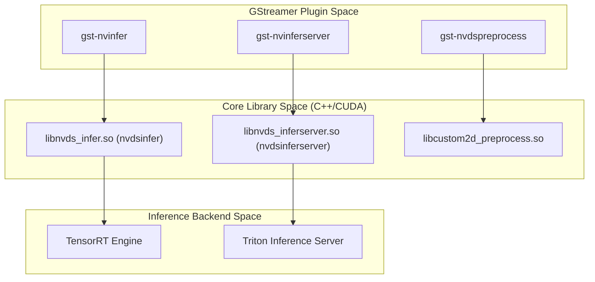
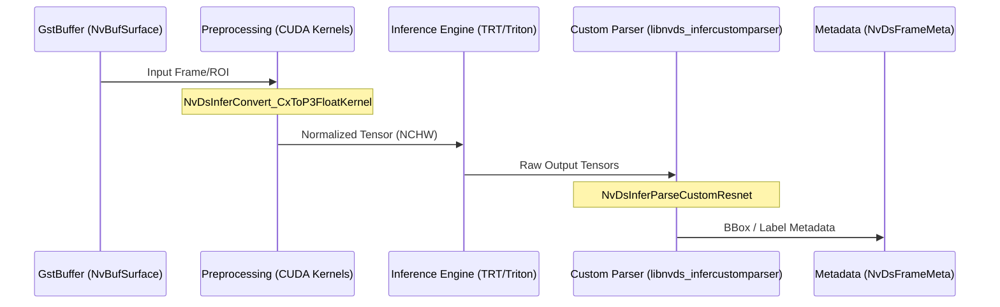

<!-- source: DeepWiki mcp.deepwiki.com · repo NVIDIA/DeepStream · page 2.2 Inference Engine Layer · fetched 2026-10-26 -->

# Inference Engine Layer

Relevant source files

The following files were used as context for generating this wiki page:

- [.gitmodules](.gitmodules)
- [src/apps/tao_apps/apps/tao_others/deepstream_custom_preprocessing_app/nvdspreprocess_lib/Makefile](src/apps/tao_apps/apps/tao_others/deepstream_custom_preprocessing_app/nvdspreprocess_lib/Makefile)
- [src/apps/tao_apps/apps/tao_others/deepstream_custom_preprocessing_app/nvdspreprocess_lib/roi_conversion.cu](src/apps/tao_apps/apps/tao_others/deepstream_custom_preprocessing_app/nvdspreprocess_lib/roi_conversion.cu)
- [src/apps/tao_apps/apps/tao_others/deepstream_custom_preprocessing_app/nvdspreprocess_lib/roi_conversion.hpp](src/apps/tao_apps/apps/tao_others/deepstream_custom_preprocessing_app/nvdspreprocess_lib/roi_conversion.hpp)
- [src/gst-plugins/gst-nvdspostprocess/README](src/gst-plugins/gst-nvdspostprocess/README)
- [src/gst-plugins/gst-nvdspreprocess/README](src/gst-plugins/gst-nvdspreprocess/README)
- [src/utils/nvdsinfer/README](src/utils/nvdsinfer/README)
- [src/utils/nvdsinfer/nvdsinfer_conversion.cu](src/utils/nvdsinfer/nvdsinfer_conversion.cu)
- [src/utils/nvdsinfer_customparser/README](src/utils/nvdsinfer_customparser/README)
- [src/utils/nvdsinferserver/README](src/utils/nvdsinferserver/README)
- [src/utils/nvdsinferserver/infer_preprocess_kernel.cu](src/utils/nvdsinferserver/infer_preprocess_kernel.cu)
- [src/utils/nvdsinferserver/tritonserver_include/model_config.proto](src/utils/nvdsinferserver/tritonserver_include/model_config.proto)

The Inference Engine Layer is the heart of the DeepStream SDK, providing high-performance AI inference capabilities. It abstracts the complexities of hardware-accelerated inference using two primary plugins: `nvinfer`, which leverages **NVIDIA TensorRT**, and `nvinferserver`, which integrates the **NVIDIA Triton Inference Server**. These plugins are supported by low-level utility libraries (`nvdsinfer` and `nvdsinferserver`) that handle model loading, memory management, and GPU-accelerated pre/post-processing.

## System Architecture

The inference layer is designed as a modular system where GStreamer plugins interface with core C++ libraries. This architecture allows developers to swap inference backends (TensorRT vs. Triton) while maintaining consistent metadata output.

### Core Components and Libraries
*   **nvinfer**: A GStreamer plugin that uses the `nvdsinfer` library to run inference locally using TensorRT [src/utils/nvdsinfer/README:16-17]().
*   **nvinferserver**: A GStreamer plugin that uses the `nvdsinferserver` library to run inference via Triton, supporting multiple frameworks like ONNX, TensorFlow, and PyTorch [src/utils/nvdsinferserver/README:16-17]().
*   **nvdspreprocess**: A plugin for custom ROI-based preprocessing that bypasses standard scaling/conversion in the inference plugins [src/gst-plugins/gst-nvdspreprocess/README:31-37]().
*   **nvdspostprocess**: A plugin for standalone parsing of detection and classification tensors, decoupled from the inference execution [src/gst-plugins/gst-nvdspostprocess/README:16-18]().

### Code Entity Mapping
The following diagram maps high-level functional blocks to their corresponding implementation entities in the codebase.

**Inference Subsystem Entity Map**

**Sources:** [src/utils/nvdsinfer/README:16-17](), [src/utils/nvdsinferserver/README:16-17](), [src/gst-plugins/gst-nvdspreprocess/README:31-37](), [src/apps/tao_apps/apps/tao_others/deepstream_custom_preprocessing_app/nvdspreprocess_lib/Makefile:36-40]()

---

## Data Flow: From Buffer to Metadata

The inference process follows a strict pipeline: Preprocessing -> Inference -> Postprocessing.

### 1. Preprocessing & Custom ROI Conversion
Before inference, frames must be scaled and converted to the model's expected format (e.g., NCHW or NHWC). While `nvinfer` has built-in kernels, `nvdspreprocess` allows for specialized ROI handling using the `ROIConversion` API [src/apps/tao_apps/apps/tao_others/deepstream_custom_preprocessing_app/nvdspreprocess_lib/roi_conversion.hpp:83-87]().

Key kernels in `nvdsinfer` handle color space conversion and mean subtraction:
*   `NvDsInferConvert_CxToP3FloatKernel`: Converts packed pixels to planar float (CHW) [src/utils/nvdsinfer/nvdsinfer_conversion.cu:25-32]().
*   `NvDsInferConvert_CxToL3FloatKernel`: Converts to interleaved float (HWC) [src/utils/nvdsinfer/nvdsinfer_conversion.cu:48-55]().
*   `NvDsInferConvert_NHWCToDestKernel`: A generalized Triton-compatible kernel for layout conversion [src/utils/nvdsinferserver/infer_preprocess_kernel.cu:120-129]().

### 2. Inference Execution
*   **nvinfer**: Directly manages TensorRT `ICudaEngine` and `IExecutionContext` via the `NvDsInferContext` API [src/utils/nvdsinfer/README:16-17]().
*   **nvinferserver**: Communicates with Triton using the gRPC client or C-API. It relies on Protobuf definitions for model configuration [src/utils/nvdsinferserver/tritonserver_include/model_config.proto:46-48]().

### 3. Postprocessing & Custom Parsing
Once the engine returns raw tensors, they must be parsed into bounding boxes or classification labels. DeepStream provides a "Custom Parser" interface for user-defined logic.

**Inference Data Flow Diagram**

**Sources:** [src/utils/nvdsinfer/nvdsinfer_conversion.cu:25-32](), [src/utils/nvdsinfer_customparser/README:34-36](), [src/gst-plugins/gst-nvdspreprocess/README:31-37]()

---

## The NvDsInferContext API

`NvDsInferContext` is the primary interface used by `nvinfer` to manage the inference lifecycle. It encapsulates:
1.  **Model Initialization**: Building engines from ONNX/Caffe or loading existing `.engine` files.
2.  **Queue Management**: Handling asynchronous execution across multiple streams.
3.  **Memory Mapping**: Mapping GStreamer buffers to CUDA device memory for zero-copy inference.

### Custom Parsing Interface
For non-standard models, developers implement custom functions in a shared library and reference them in the configuration file [src/utils/nvdsinfer_customparser/README:34-41]().

| Function Type | Configuration Key | Example Function |
| :--- | :--- | :--- |
| **BBox Parsing** | `parse-bbox-func-name` | `NvDsInferParseCustomResnet` |
| **Classification** | `parse-classifier-func-name` | `NvDsInferClassiferParseCustomSoftmax` |
| **Triton Parsing** | `custom_parse_bbox_func` | `NvDsInferParseCustomTfSSD` |

**Sources:** [src/utils/nvdsinfer_customparser/README:34-52]()

---

## Specialized Inference Plugins

### nvdspreprocess
This plugin is used when the inference batch is not a simple 1:1 mapping of input frames. It supports:
*   **Multiple ROIs per frame**: Defining different regions of interest for the same image [src/gst-plugins/gst-nvdspreprocess/README:31-33]().
*   **Custom Tensor Preparation**: Using a custom library to prepare tensors, which `nvinfer` then consumes by setting `input-tensor-meta=1` [src/gst-plugins/gst-nvdspreprocess/README:51-54]().

### nvdspostprocess
This plugin decouples parsing from the inference plugin. It is useful in complex pipelines where inference is done by one component (e.g., a hardware accelerator) and parsing needs to happen later.
*   **Requirement**: `nvinfer` must be set to `output-tensor-meta=1` and `network-type=100` (Other) [src/gst-plugins/gst-nvdspostprocess/README:18-20]().
*   **Configuration**: Uses YAML files to define parsing logic via `postprocesslib-config-file` [src/gst-plugins/gst-nvdspostprocess/README:62-64]().

---

## Summary of Utility Libraries

| Library | Path | Purpose |
| :--- | :--- | :--- |
| `nvdsinfer` | `src/utils/nvdsinfer/` | TensorRT backend logic and standard CUDA kernels [src/utils/nvdsinfer/README:16-17](). |
| `nvdsinferserver` | `src/utils/nvdsinferserver/` | Triton client integration and Protobuf management [src/utils/nvdsinferserver/README:16-17](). |
| `nvdsinfer_customparser` | `src/utils/nvdsinfer_customparser/` | Reference implementations for ResNet, SSD, and Softmax parsing [src/utils/nvdsinfer_customparser/README:27-30](). |
| `custom2d_preprocess` | `src/apps/tao_apps/.../nvdspreprocess_lib/` | Example ROI conversion library using CUDA [src/apps/tao_apps/apps/tao_others/deepstream_custom_preprocessing_app/nvdspreprocess_lib/Makefile:36-40](). |

**Sources:** [src/utils/nvdsinfer/README:1-26](), [src/utils/nvdsinferserver/README:1-49](), [src/utils/nvdsinfer_customparser/README:1-53](), [src/apps/tao_apps/apps/tao_others/deepstream_custom_preprocessing_app/nvdspreprocess_lib/Makefile:1-80]()

---

