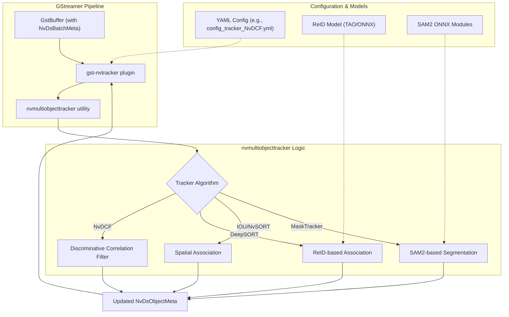
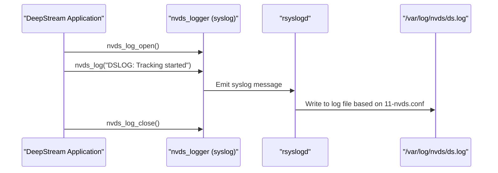

<!-- source: DeepWiki mcp.deepwiki.com · repo NVIDIA/DeepStream · page 2.3 Multi-Object Tracking · fetched 2026-10-26 -->

# Multi-Object Tracking

Relevant source files

The following files were used as context for generating this wiki page:

- [src/gst-plugins/gst-nvtracker/README](src/gst-plugins/gst-nvtracker/README)
- [src/utils/nvds_logger/README](src/utils/nvds_logger/README)
- [src/utils/nvds_logger/setup_nvds_logger.sh](src/utils/nvds_logger/setup_nvds_logger.sh)
- [src/utils/nvmultiobjecttracker/model/tracker_ReID/README](src/utils/nvmultiobjecttracker/model/tracker_ReID/README)
- [tools/sam2-onnx-tensorrt/checkpoints/download_ckpts.sh](tools/sam2-onnx-tensorrt/checkpoints/download_ckpts.sh)

The DeepStream Multi-Object Tracking (MOT) subsystem provides a highly optimized framework for associating object detections across video frames. It is implemented as a GStreamer plugin, `nvtracker`, which interfaces with the low-level `NvMultiObjectTracker` library to execute various tracking algorithms and deep learning-based re-identification models.

## Architecture Overview

The tracking system is divided into two main layers: the GStreamer plugin layer (`gst-nvtracker`) and the low-level utility library (`libnvds_nvmultiobjecttracker.so`). This separation allows the tracking logic to remain independent of the GStreamer pipeline state management.

### Data Flow and Component Interaction

The following diagram illustrates how the `nvtracker` plugin interacts with the low-level tracker library and the configuration system.

**Tracking System Component Interaction**

**Sources:** [src/gst-plugins/gst-nvtracker/README:16-17](), [src/utils/nvmultiobjecttracker/model/tracker_ReID/README:18-26]()

## Supported Algorithms

The `nvtracker` plugin supports several tracking algorithms tailored for different performance and accuracy requirements:

| Algorithm | Description | Key Features |
| :--- | :--- | :--- |
| **NvDCF** | Discriminative Correlation Filter | High accuracy; supports visual tracking even during detector misses; supports ReID. |
| **DeepSORT** | Deep Learning SORT | Uses ReID features for association; robust to occlusions. |
| **NvSORT** | Optimized SORT | High-speed spatial tracking using Kalman Filters. |
| **IOU** | Intersection over Union | Minimal compute; relies purely on bbox overlap. |
| **MaskTracker** | SAM2-based Tracking | Multi-object tracking and segmentation using Segment Anything Model 2. |

**Sources:** [src/utils/nvmultiobjecttracker/model/tracker_ReID/README:34-37](), [src/utils/nvmultiobjecttracker/model/tracker_ReID/README:74-76]()

## Deep Learning Model Integration

The tracker can be enhanced with deep learning models for re-identification (ReID) and segmentation. These models are accelerated using TensorRT.

### Re-Identification (ReID)
ReID models allow the tracker to maintain object identity even when objects exit and re-enter the frame or undergo significant occlusion.
*   **NVIDIA TAO ReID**: Recommended model is `ReidentificationNet` (e.g., `resnet50_market1501.etlt`) [src/utils/nvmultiobjecttracker/model/tracker_ReID/README:80-93]().
*   **Custom ONNX**: Users can provide custom ONNX models by specifying parameters such as `reidFeatureSize`, `inferDims`, and `inputOrder` in the tracker YAML config [src/utils/nvmultiobjecttracker/model/tracker_ReID/README:108-126]().

### SAM2-based Segmentation (MaskTracker)
The `MaskTracker` utilizes Meta's SAM2 to provide pixel-level tracking. This requires four specific ONNX modules generated from SAM2 checkpoints [src/utils/nvmultiobjecttracker/model/tracker_ReID/README:34-59]():
1.  `image_encoder.onnx`
2.  `mask_decoder.onnx`
3.  `memory_attention.onnx`
4.  `memory_encoder.onnx`

**Sources:** [src/utils/nvmultiobjecttracker/model/tracker_ReID/README:20-26](), [src/utils/nvmultiobjecttracker/model/tracker_ReID/README:34-59](), [src/utils/nvmultiobjecttracker/model/tracker_ReID/README:80-126]()

## Configuration Management

Tracking behavior is governed by a YAML configuration file specified in the `ll-config-file` property of the `nvtracker` plugin.

### Key YAML Configuration Parameters
The tracker configuration defines how features are extracted and how association logic is applied.

| Parameter | Description |
| :--- | :--- |
| `reidFeatureSize` | Dimension of the ReID feature vector (e.g., 128). |
| `inferDims` | Input dimensions for the ReID model `[C, H, W]`. |
| `networkMode` | TensorRT precision mode (0: FP32, 1: INT8, 2: FP16). |
| `addFeatureNormalization` | Whether to L2-normalize features before association. |

**Sources:** [src/utils/nvmultiobjecttracker/model/tracker_ReID/README:113-126](), [src/utils/nvmultiobjecttracker/model/tracker_ReID/README:62-68]()

## System Logging

The tracker and other utility libraries use `nvds_logger` for system-level logging via `rsyslog`. This allows for centralized logging across multiple DeepStream instances.

### Logger Setup and Usage
The logger must be initialized before use and supports various severity levels (0-7).

**Logging Flow**

**Sources:** [src/utils/nvds_logger/README:16-23](), [src/utils/nvds_logger/README:34-44](), [src/utils/nvds_logger/setup_nvds_logger.sh:57-60]()

## Implementation Details

### Plugin Compilation
The `nvtracker` plugin is open-source and can be compiled against specific CUDA versions. It requires GStreamer 1.0 development packages [src/gst-plugins/gst-nvtracker/README:20-32]().

### Input Tensor Metadata
When `input-tensor-meta=1` is used, the tracker's internal width and height must match the preprocessing dimensions of the upstream `nvdspreprocess` plugin to ensure correct spatial mapping [src/gst-plugins/gst-nvtracker/README:34-35]().

**Sources:** [src/gst-plugins/gst-nvtracker/README:20-35]()

---

