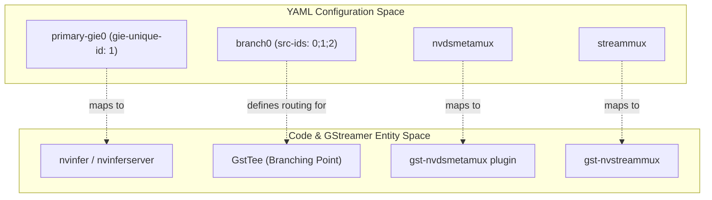
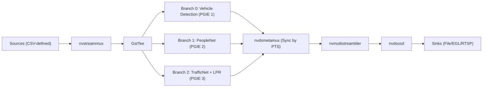

<!-- source: DeepWiki mcp.deepwiki.com · repo NVIDIA/DeepStream · page 2.4 Metadata Muxing & Parallel Inference · fetched 2026-10-26 -->

# Metadata Muxing & Parallel Inference

Relevant source files

The following files were used as context for generating this wiki page:

- [src/apps/reference_apps/.gitattributes](src/apps/reference_apps/.gitattributes)
- [src/apps/reference_apps/deepstream-vllm-plugin/install.sh](src/apps/reference_apps/deepstream-vllm-plugin/install.sh)
- [src/apps/reference_apps/deepstream_parallel_inference_app/tritonclient/sample/build.sh](src/apps/reference_apps/deepstream_parallel_inference_app/tritonclient/sample/build.sh)
- [src/apps/reference_apps/deepstream_parallel_inference_app/tritonclient/sample/configs/apps/bodypose_yolo/source4_1080p_dec_parallel_infer.yml](src/apps/reference_apps/deepstream_parallel_inference_app/tritonclient/sample/configs/apps/bodypose_yolo/source4_1080p_dec_parallel_infer.yml)
- [src/apps/reference_apps/deepstream_parallel_inference_app/tritonclient/sample/configs/apps/bodypose_yolo/sources_4_rtsp.csv](src/apps/reference_apps/deepstream_parallel_inference_app/tritonclient/sample/configs/apps/bodypose_yolo/sources_4_rtsp.csv)
- [src/apps/reference_apps/deepstream_parallel_inference_app/tritonclient/sample/configs/apps/bodypose_yolo_lpr/source4_1080p_dec_parallel_infer.yml](src/apps/reference_apps/deepstream_parallel_inference_app/tritonclient/sample/configs/apps/bodypose_yolo_lpr/source4_1080p_dec_parallel_infer.yml)
- [src/apps/reference_apps/deepstream_parallel_inference_app/tritonclient/sample/configs/apps/bodypose_yolo_lpr/sources_4_rtsp.csv](src/apps/reference_apps/deepstream_parallel_inference_app/tritonclient/sample/configs/apps/bodypose_yolo_lpr/sources_4_rtsp.csv)
- [src/apps/reference_apps/deepstream_parallel_inference_app/tritonclient/sample/configs/apps/bodypose_yolo_win1/source4_1080p_dec_parallel_infer.yml](src/apps/reference_apps/deepstream_parallel_inference_app/tritonclient/sample/configs/apps/bodypose_yolo_win1/source4_1080p_dec_parallel_infer.yml)
- [src/apps/reference_apps/deepstream_parallel_inference_app/tritonclient/sample/configs/apps/bodypose_yolo_win1/sources_4_rtsp.csv](src/apps/reference_apps/deepstream_parallel_inference_app/tritonclient/sample/configs/apps/bodypose_yolo_win1/sources_4_rtsp.csv)
- [src/apps/reference_apps/deepstream_parallel_inference_app/tritonclient/sample/configs/apps/vehicle0_lpr_analytic/source4_1080p_dec_parallel_infer.yml](src/apps/reference_apps/deepstream_parallel_inference_app/tritonclient/sample/configs/apps/vehicle0_lpr_analytic/source4_1080p_dec_parallel_infer.yml)
- [src/apps/reference_apps/deepstream_parallel_inference_app/tritonclient/sample/configs/apps/vehicle0_lpr_analytic/sources_4_rtsp.csv](src/apps/reference_apps/deepstream_parallel_inference_app/tritonclient/sample/configs/apps/vehicle0_lpr_analytic/sources_4_rtsp.csv)
- [src/apps/reference_apps/deepstream_parallel_inference_app/tritonclient/sample/configs/apps/vehicle_lpr_analytic/source4_1080p_dec_parallel_infer.yml](src/apps/reference_apps/deepstream_parallel_inference_app/tritonclient/sample/configs/apps/vehicle_lpr_analytic/source4_1080p_dec_parallel_infer.yml)
- [src/apps/reference_apps/deepstream_parallel_inference_app/tritonclient/sample/configs/apps/vehicle_lpr_analytic/sources_4_rtsp.csv](src/apps/reference_apps/deepstream_parallel_inference_app/tritonclient/sample/configs/apps/vehicle_lpr_analytic/sources_4_rtsp.csv)
- [src/apps/reference_apps/deepstream_parallel_inference_app/tritonserver/build_engine.sh](src/apps/reference_apps/deepstream_parallel_inference_app/tritonserver/build_engine.sh)
- [src/apps/sample_apps/deepstream-3d-lidar-sensor-fusion/bevfusion/build_bevfusion_model.sh](src/apps/sample_apps/deepstream-3d-lidar-sensor-fusion/bevfusion/build_bevfusion_model.sh)
- [src/apps/sample_apps/deepstream-3d-lidar-sensor-fusion/v2xfusion/scripts/clocks.sh](src/apps/sample_apps/deepstream-3d-lidar-sensor-fusion/v2xfusion/scripts/clocks.sh)
- [src/gst-plugins/gst-nvdsmetamux/README](src/gst-plugins/gst-nvdsmetamux/README)
- [src/gst-plugins/gst-nvdsmetamux/gstnvdsmetamux.h](src/gst-plugins/gst-nvdsmetamux/gstnvdsmetamux.h)
- [src/gst-plugins/gst-nvdsmetamux/libnvdsgst_metamux.export](src/gst-plugins/gst-nvdsmetamux/libnvdsgst_metamux.export)

The `nvdsmetamux` plugin and the `deepstream_parallel_inference_app` provide a framework for running multiple inference models concurrently on the same or different video streams within a single DeepStream pipeline. This architecture enables complex multi-model workloads, such as running a vehicle detector in one branch and a human pose estimator in another, then merging their metadata into a single unified stream for downstream processing (e.g., OSD or message brokers).

## Metadata Muxing (nvdsmetamux)

The `nvdsmetamux` plugin performs batch metadata muxing for the same source and the same frame across multiple parallel branches [src/gst-plugins/gst-nvdsmetamux/README:32-32](). It is designed to handle the synchronization of metadata that may arrive at different times due to varying inference latencies in parallel branches.

### PTS-Based Synchronization

Synchronization is achieved using the Presentation Time Stamp (PTS) of the frames. The plugin attempts to find the nearest frame PTS for the same source across all sink pads [src/gst-plugins/gst-nvdsmetamux/README:33-34]().

Key synchronization parameters include:
*   **`pts-tolerance`**: The time difference tolerance (in microseconds) when searching for the same frame of the same source ID [src/gst-plugins/gst-nvdsmetamux/README:61-63](). If the difference between a branch frame and the base frame exceeds this value, the metadata is not merged into the current output [src/gst-plugins/gst-nvdsmetamux/README:81-83]().
*   **`active-pad`**: The specific sink pad whose video buffers are transferred to the source pad. This pad acts as the master for synchronization [src/gst-plugins/gst-nvdsmetamux/README:43-45](), [src/gst-plugins/gst-nvdsmetamux/README:80-80]().

### Data Flow & Metadata Merging

The muxer collects metadata from multiple sink pads and merges them into a single `NvDsBatchMeta` structure.

| Property | Description |
| :--- | :--- |
| `config-file` | Path to the configuration file defining muxing behavior [src/gst-plugins/gst-nvdsmetamux/README:46-48](). |
| `latency` | Additional latency in live mode to allow upstream branches more time to produce buffers [src/gst-plugins/gst-nvdsmetamux/README:49-51](). |
| `src-ids-model-<gie-id>` | Configures which source IDs' metadata should be output for a specific GIE (Inference Engine) [src/gst-plugins/gst-nvdsmetamux/README:83-85](). |

**Sources:**
*   [src/gst-plugins/gst-nvdsmetamux/README:31-85]()

## Parallel Inference Application

The `deepstream_parallel_inference_app` demonstrates how to construct branched pipelines for concurrent multi-model workloads. It uses YAML configuration files to define complex topologies where different sources are routed to different inference branches.

### Branched Pipeline Architecture

The application supports multiple branches (e.g., `branch0`, `branch1`, `branch2`) where each branch can contain its own Primary GIE (PGIE), Tracker, Analytics, and Secondary GIEs (SGIE) [src/apps/reference_apps/deepstream_parallel_inference_app/tritonclient/sample/configs/apps/vehicle_lpr_analytic/source4_1080p_dec_parallel_infer.yml:16-18]().

#### System Entity Mapping

The following diagram bridges the high-level application configuration to the underlying GStreamer and DeepStream entities.

**Diagram: Parallel Inference Component Mapping**

**Sources:**
*   [src/apps/reference_apps/deepstream_parallel_inference_app/tritonclient/sample/configs/apps/vehicle_lpr_analytic/source4_1080p_dec_parallel_infer.yml:177-198]()
*   [src/gst-plugins/gst-nvdsmetamux/README:32-39]()

### Configuration Example: Vehicle & LPR Analytics

In a typical multi-branch configuration, sources are partitioned:
*   **Branch 0**: Performs vehicle detection and color/make/type checking using PGIE ID 1 on sources 0, 1, and 2 [src/apps/reference_apps/deepstream_parallel_inference_app/tritonclient/sample/configs/apps/vehicle_lpr_analytic/source4_1080p_dec_parallel_infer.yml:194-198]().
*   **Branch 1**: Performs PeopleNet detection, tracking, and analytics using PGIE ID 2 on sources 1, 2, and 3 [src/apps/reference_apps/deepstream_parallel_inference_app/tritonclient/sample/configs/apps/vehicle_lpr_analytic/source4_1080p_dec_parallel_infer.yml:230-234]().

**Diagram: Data Flow in Parallel Inference App**

**Sources:**
*   [src/apps/reference_apps/deepstream_parallel_inference_app/tritonclient/sample/configs/apps/vehicle_lpr_analytic/source4_1080p_dec_parallel_infer.yml:16-180]()
*   [src/gst-plugins/gst-nvdsmetamux/README:95-95]()

### Config File Format (YAML)

The application uses a specific YAML structure to define parallel branches:

| Section | Key | Description |
| :--- | :--- | :--- |
| `primary-gieX` | `plugin-type` | 0 for `nvinfer`, 1 for `nvinferserver` [src/apps/reference_apps/deepstream_parallel_inference_app/tritonclient/sample/configs/apps/vehicle_lpr_analytic/source4_1080p_dec_parallel_infer.yml:179-180](). |
| `primary-gieX` | `gie-unique-id` | Unique ID used by `nvdsmetamux` to identify metadata origin [src/apps/reference_apps/deepstream_parallel_inference_app/tritonclient/sample/configs/apps/vehicle_lpr_analytic/source4_1080p_dec_parallel_infer.yml:190-190](). |
| `branchX` | `pgie-id` | Links the branch to a specific `primary-gie` unique ID [src/apps/reference_apps/deepstream_parallel_inference_app/tritonclient/sample/configs/apps/vehicle_lpr_analytic/source4_1080p_dec_parallel_infer.yml:196-196](). |
| `branchX` | `src-ids` | Semicolon-separated list of source IDs processed by this branch [src/apps/reference_apps/deepstream_parallel_inference_app/tritonclient/sample/configs/apps/vehicle_lpr_analytic/source4_1080p_dec_parallel_infer.yml:198-198](). |

**Sources:**
*   [src/apps/reference_apps/deepstream_parallel_inference_app/tritonclient/sample/configs/apps/vehicle_lpr_analytic/source4_1080p_dec_parallel_infer.yml:177-234]()
*   [src/apps/reference_apps/deepstream_parallel_inference_app/tritonclient/sample/configs/apps/bodypose_yolo/source4_1080p_dec_parallel_infer.yml:177-236]()

---

