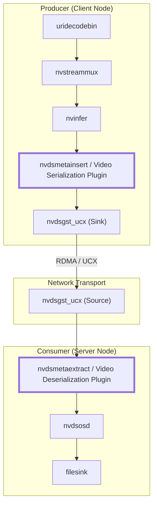
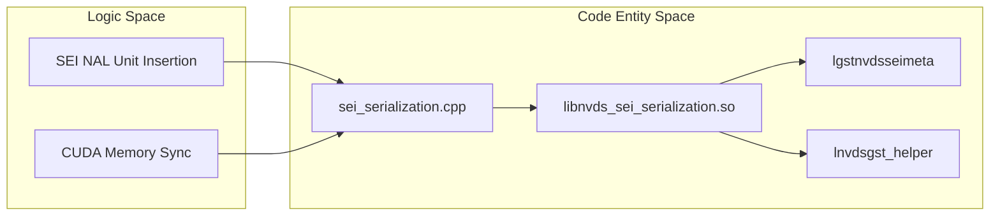

<!-- source: DeepWiki mcp.deepwiki.com · repo NVIDIA/DeepStream · page 2.5 Metadata Serialization & Utilities · fetched 2026-10-26 -->

# Metadata Serialization & Utilities

Relevant source files

The following files were used as context for generating this wiki page:

- [.claude/.gitkeep](.claude/.gitkeep)
- [.github/.gitkeep](.github/.gitkeep)
- [CODE_OF_CONDUCT.md](CODE_OF_CONDUCT.md)
- [LICENSE](LICENSE)
- [src/apps/sample_apps/deepstream-ucx-test/Makefile](src/apps/sample_apps/deepstream-ucx-test/Makefile)
- [src/apps/sample_apps/deepstream-ucx-test/README](src/apps/sample_apps/deepstream-ucx-test/README)
- [src/apps/sample_apps/deepstream-ucx-test/deepstream_ucx_test_app.c](src/apps/sample_apps/deepstream-ucx-test/deepstream_ucx_test_app.c)
- [src/apps/sample_apps/deepstream-ucx-test/deepstream_ucx_test_app.h](src/apps/sample_apps/deepstream-ucx-test/deepstream_ucx_test_app.h)
- [src/gst-plugins/gst-nvdsmetautils/audio_metadata_serialization/Makefile](src/gst-plugins/gst-nvdsmetautils/audio_metadata_serialization/Makefile)
- [src/gst-plugins/gst-nvdsmetautils/sei_serialization/Makefile](src/gst-plugins/gst-nvdsmetautils/sei_serialization/Makefile)
- [src/gst-plugins/gst-nvdsmetautils/video_metadata_serialization/Makefile](src/gst-plugins/gst-nvdsmetautils/video_metadata_serialization/Makefile)

The `gst-nvdsmetautils` library provides a suite of tools for serializing and deserializing DeepStream metadata. This is critical for high-performance transport scenarios where metadata must be preserved across process boundaries (IPC), network hops (UCX/RDMA), or embedded directly into video bitstreams (SEI). The library facilitates the conversion of complex `NvDsBatchMeta` structures into flat binary buffers that can be reconstructed at a remote endpoint.

### Architecture Overview

The serialization framework is primarily utilized by the `nvdsmetainsert` and `nvdsmetaextract` plugins to enable seamless metadata transport in distributed pipelines. It supports three primary data types: Video Metadata, Audio Metadata, and Supplemental Enhancement Information (SEI) for H.264/H.265 streams.

#### Metadata Serialization Data Flow
The following diagram illustrates how metadata is serialized for transport via the `nvdsgst_ucx` plugin, as seen in the `deepstream-ucx-test` application.

**Metadata Transport via UCX**

**Sources:** [src/apps/sample_apps/deepstream-ucx-test/README:87-108](), [src/apps/sample_apps/deepstream-ucx-test/README:109-127]()

---

### Key Components & Libraries

The serialization logic is divided into specialized libraries targeting different media types and transport requirements.

| Library | Purpose | Key Dependencies |
| :--- | :--- | :--- |
| `libnvds_video_metadata_serialization.so` | Serializes video `NvDsBatchMeta` using Protobuf. | `libprotobuf`, `json-glib`, `uuid` |
| `libnvds_audio_metadata_serialization.so` | Serializes audio-specific metadata for UCX transport. | `libprotobuf`, `json-glib` |
| `libnvds_sei_serialization.so` | Embeds metadata into H.264/H.265 SEI NAL units. | `lgstnvdsseimeta`, `cuda` |

**Sources:** [src/gst-plugins/gst-nvdsmetautils/video_metadata_serialization/Makefile:45-46](), [src/gst-plugins/gst-nvdsmetautils/audio_metadata_serialization/Makefile:45-46](), [src/gst-plugins/gst-nvdsmetautils/sei_serialization/Makefile:27-46]()

---

### Video and Audio Serialization

The video and audio serialization utilities use Google Protocol Buffers (Protobuf) to define a structured schema for metadata. This ensures version compatibility and efficient binary representation.

#### Implementation Details
1.  **Schema Definition**: Metadata structures are defined in `.proto` files (e.g., `ds_meta.proto`), which are compiled into C++ classes during the build process [src/gst-plugins/gst-nvdsmetautils/video_metadata_serialization/Makefile:59-62]().
2.  **Serialization**: The plugin iterates through the `NvDsBatchMeta` attached to a `GstBuffer`, populates the Protobuf objects, and serializes them into a binary blob [src/apps/sample_apps/deepstream-ucx-test/README:96-97]().
3.  **Attachment**: The resulting binary blob is attached to the buffer as a `NvDsMeta` structure of type `NVDS_METADATA_SERIALIZED` or embedded directly for transport.

**Sources:** [src/gst-plugins/gst-nvdsmetautils/video_metadata_serialization/Makefile:43-46](), [src/apps/sample_apps/deepstream-ucx-test/README:115-119]()

---

### SEI Serialization

Supplemental Enhancement Information (SEI) serialization allows metadata to be embedded directly into the video bitstream. This is particularly useful for recording or streaming scenarios where the metadata must stay synchronized with specific frames in a standard-compliant way.

#### Technical Mapping: SEI Logic
The following diagram maps the logical SEI serialization process to the underlying build and library entities.

**SEI Serialization Entity Mapping**

**Sources:** [src/gst-plugins/gst-nvdsmetautils/sei_serialization/Makefile:24-27](), [src/gst-plugins/gst-nvdsmetautils/sei_serialization/Makefile:43-46]()

---

### UCX and IPC Transport Utilities

The `nvdsgst_ucx` plugin relies on these utilities to handle metadata across RDMA-enabled networks. The `deepstream-ucx-test-app` demonstrates three primary test cases for these utilities:

1.  **Basic Video Transmission**: Raw frame transport without explicit metadata serialization [src/apps/sample_apps/deepstream-ucx-test/README:69-86]().
2.  **Video with Metadata**: Uses `libnvds_video_metadata_serialization.so` to convert `nvinfer` detections into a binary format for transmission [src/apps/sample_apps/deepstream-ucx-test/README:87-108]().
3.  **Audio with Metadata**: Uses `libnvds_audio_metadata_serialization.so` to transmit audio buffers along with their associated metadata [src/apps/sample_apps/deepstream-ucx-test/README:109-127]().

#### Configuration and Environment
To use these utilities in a UCX environment, the `USE_NEW_NVSTREAMMUX` environment variable must be set to `yes` [src/apps/sample_apps/deepstream-ucx-test/README:174-174](). The plugins are compiled with specific flags to include DeepStream headers and CUDA paths [src/gst-plugins/gst-nvdsmetautils/video_metadata_serialization/Makefile:26-28]().

**Sources:** [src/apps/sample_apps/deepstream-ucx-test/deepstream_ucx_test_app.h:92-107](), [src/apps/sample_apps/deepstream-ucx-test/Makefile:43-51]()

---

