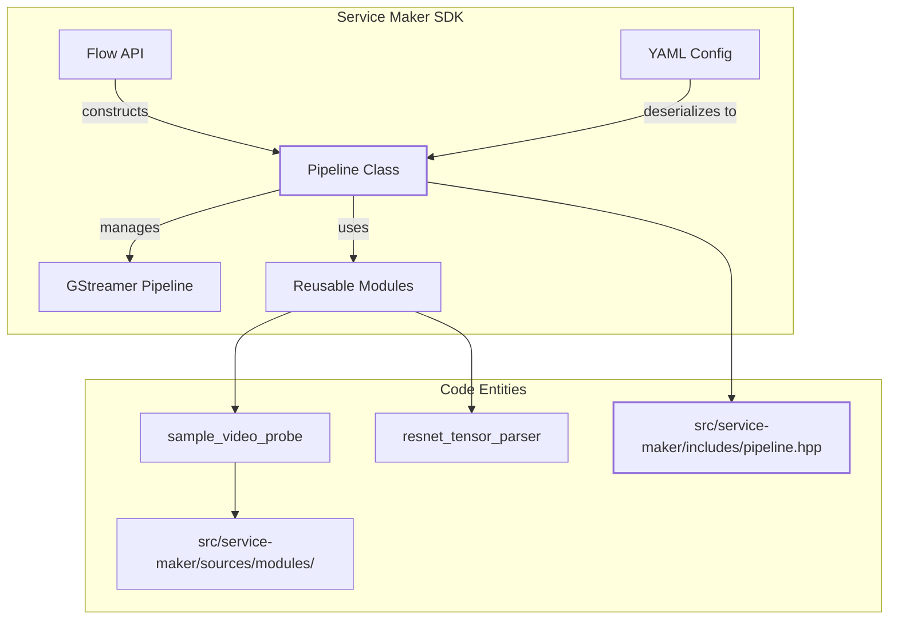
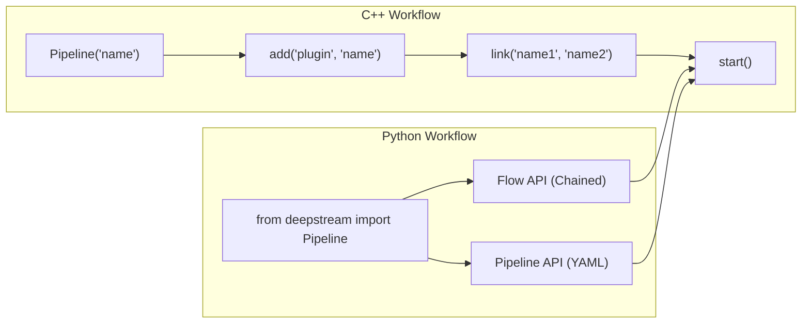

<!-- source: DeepWiki mcp.deepwiki.com · repo NVIDIA/DeepStream · page 3 Service Maker SDK · fetched 2026-10-26 -->

# Service Maker SDK

Relevant source files

The following files were used as context for generating this wiki page:

- [src/apps/sample_apps/deepstream-server/README](src/apps/sample_apps/deepstream-server/README)
- [src/apps/sample_apps/deepstream-test4/README](src/apps/sample_apps/deepstream-test4/README)
- [src/gst-plugins/gst-dsexample/README](src/gst-plugins/gst-dsexample/README)
- [src/gst-plugins/gst-nvinfer/README](src/gst-plugins/gst-nvinfer/README)
- [src/service-maker/README.md](src/service-maker/README.md)
- [src/service-maker/sources/apps/cpp/deepstream_3d_action_recognition_app/README](src/service-maker/sources/apps/cpp/deepstream_3d_action_recognition_app/README)
- [src/service-maker/sources/apps/cpp/deepstream_sr_test_app/README](src/service-maker/sources/apps/cpp/deepstream_sr_test_app/README)
- [src/service-maker/sources/apps/cpp/deepstream_test4_app/README](src/service-maker/sources/apps/cpp/deepstream_test4_app/README)
- [src/service-maker/sources/apps/cpp/deepstream_test5_app/README](src/service-maker/sources/apps/cpp/deepstream_test5_app/README)
- [src/service-maker/sources/apps/python/flow_api/deepstream_3d_action_recognition_app/README](src/service-maker/sources/apps/python/flow_api/deepstream_3d_action_recognition_app/README)

The Service Maker SDK is a high-level C++ and Python framework designed to simplify the construction of DeepStream pipelines. It provides a declarative abstraction over the complex GStreamer and GLib APIs, allowing developers to focus on application logic rather than boilerplate pipeline management [src/service-maker/README.md:18-20]().

Service Maker supports both programmatic construction via a fluent "Flow" API and graph-based construction using YAML configuration files [src/service-maker/README.md:82-119]().

### SDK Architecture and Layout

The SDK is organized into public headers, reusable modules, and sample applications for both C++ and Python.

| Component | Path | Description |
|---|---|---|
| **Public Headers** | `includes/` | C++ headers for the `Pipeline` class and supporting types [src/service-maker/README.md:29](). |
| **Modules** | `sources/modules/` | Reusable shared libraries (probes, sinks, sources) that plug into pipelines [src/service-maker/README.md:36](). |
| **C++ Apps** | `sources/apps/cpp/` | Sample applications implementing core DeepStream patterns [src/service-maker/README.md:32](). |
| **Python Apps** | `sources/apps/python/` | Samples for both the Flow API and the Pipeline API [src/service-maker/README.md:33-35](). |

**Sources:** [src/service-maker/README.md:24-37]()

### Declarative Pipeline Construction

Service Maker introduces the `Pipeline` class, which serves as the primary entry point for managing the lifecycle of a DeepStream application. Developers can add elements using string-based factory names and link them together in a chainable fashion [src/service-maker/README.md:84-102]().

#### Service Maker Entity Mapping
The following diagram illustrates how high-level Service Maker concepts map to the underlying SDK components.

**Service Maker Component Mapping**

**Sources:** [src/service-maker/README.md:84-119](), [src/service-maker/README.md:189-204]()

### Reusable Modules

The SDK includes a library of pre-built modules in `sources/modules/` that provide common functionality such as FPS measurement, latency tracking, and custom parsing. These modules are loaded as shared libraries and attached to the pipeline [src/service-maker/README.md:185-188]().

| Module | Role |
|---|---|
| `measure_fps_probe` | Logs real-time pipeline performance [src/service-maker/README.md:195](). |
| `resnet_tensor_parser` | Converts raw inference tensors into DeepStream object metadata [src/service-maker/README.md:194](). |
| `smart_recording_action` | Triggers file recording based on specific detection events [src/service-maker/README.md:199](). |
| `lidar_feeder` | Injects LiDAR point-cloud data into DS3D-capable pipelines [src/service-maker/README.md:203](). |

**Sources:** [src/service-maker/README.md:189-204]()

### API Overview

Service Maker provides distinct interfaces for different development workflows:

*   **C++ Pipeline API**: A chainable C++ interface. It supports manual element linking or loading entire graphs from YAML files [src/service-maker/README.md:82-119](). For details, see [C++ Pipeline API](#3.1).
*   **Python Flow API**: A pythonic, fluent interface that abstracts GStreamer details for rapid prototyping [src/service-maker/README.md:141-160](). For details, see [Python Flow & Pipeline APIs](#3.2).
*   **Python Pipeline API**: A higher-level declarative approach using YAML-driven pipeline descriptions [src/service-maker/README.md:162-164](). For details, see [Python Flow & Pipeline APIs](#3.2).

#### Programming Model Comparison

**Sources:** [src/service-maker/README.md:82-164]()

### Sample Applications

Service Maker includes a comprehensive suite of sample applications that mirror the standard DeepStream tutorials but utilize the Service Maker SDK for construction.

*   **Standard Tests**: `deepstream_test1_app` through `test5_app` cover basic inference, multi-stream handling, and cloud messaging [src/service-maker/README.md:170-176]().
*   **Specialized Apps**:
    *   `deepstream_3d_action_recognition_app`: Demonstrates 3D/2D temporal sequence batching for action recognition [src/service-maker/sources/apps/cpp/deepstream_3d_action_recognition_app/README:48-60]().
    *   `deepstream_sr_test_app`: Showcases smart recording for RTSP streams triggered locally or via Kafka [src/service-maker/sources/apps/cpp/deepstream_sr_test_app/README:32-41]().
    *   `deepstream_appsrc_test_app`: Demonstrates feeding raw buffers into a pipeline [src/service-maker/README.md:177]().

**Sources:** [src/service-maker/README.md:168-180](), [src/service-maker/sources/apps/cpp/deepstream_3d_action_recognition_app/README:48-60]()

---

