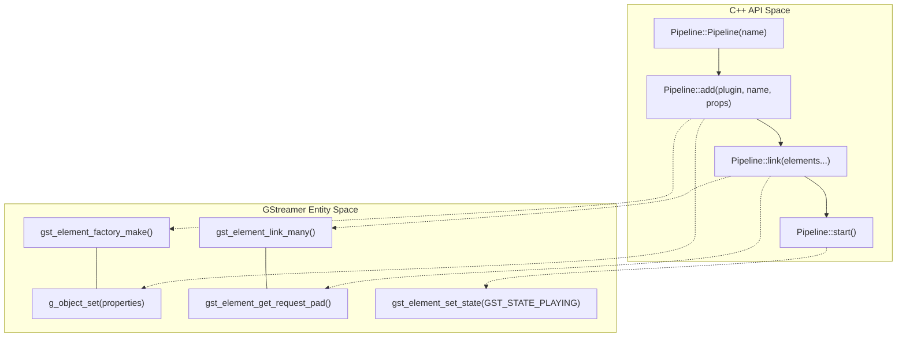
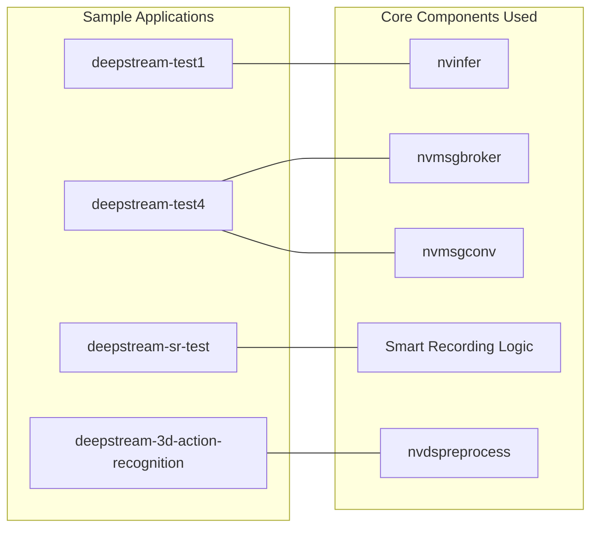

<!-- source: DeepWiki mcp.deepwiki.com · repo NVIDIA/DeepStream · page 3.1 C++ Pipeline API · fetched 2026-10-26 -->

# C++ Pipeline API

<details>
<summary>Relevant source files</summary>

The following files were used as context for generating this wiki page:

- [src/apps/sample_apps/deepstream-server/README](src/apps/sample_apps/deepstream-server/README)
- [src/apps/sample_apps/deepstream-test4/README](src/apps/sample_apps/deepstream-test4/README)
- [src/gst-plugins/gst-dsexample/README](src/gst-plugins/gst-dsexample/README)
- [src/gst-plugins/gst-nvinfer/README](src/gst-plugins/gst-nvinfer/README)
- [src/service-maker/README.md](src/service-maker/README.md)
- [src/service-maker/sources/apps/cpp/deepstream_3d_action_recognition_app/README](src/service-maker/sources/apps/cpp/deepstream_3d_action_recognition_app/README)
- [src/service-maker/sources/apps/cpp/deepstream_sr_test_app/README](src/service-maker/sources/apps/cpp/deepstream_sr_test_app/README)
- [src/service-maker/sources/apps/cpp/deepstream_test4_app/README](src/service-maker/sources/apps/cpp/deepstream_test4_app/README)
- [src/service-maker/sources/apps/cpp/deepstream_test5_app/README](src/service-maker/sources/apps/cpp/deepstream_test5_app/README)
- [src/service-maker/sources/apps/python/flow_api/deepstream_3d_action_recognition_app/README](src/service-maker/sources/apps/python/flow_api/deepstream_3d_action_recognition_app/README)
- [src/service-maker/sources/apps/python/pipeline_api/deepstream_test4_app/README](src/service-maker/sources/apps/python/pipeline_api/deepstream_test4_app/README)
- [src/service-maker/sources/apps/python/pipeline_api/deepstream_test5_app/README](src/service-maker/sources/apps/python/pipeline_api/deepstream_test5_app/README)

</details>


The DeepStream Service Maker C++ API provides a high-level, fluent abstraction over GStreamer and GLib for constructing DeepStream pipelines. It allows developers to define complex vision AI workflows through declarative code or YAML configurations, significantly reducing the boilerplate required for manual GStreamer element management [src/service-maker/README.md:18-20]().

## Pipeline Class Implementation

The core of the C++ Service Maker is the `deepstream::Pipeline` class. It manages the lifecycle of the underlying GStreamer `GstPipeline` and provides methods for element addition, linking, and execution control [src/service-maker/README.md:84-110]().

### Key Functions

| Function | Description |
|---|---|
| `add(plugin, name, ...properties)` | Instantiates a GStreamer element or bin and sets its properties. Supports variadic arguments for property key-value pairs [src/service-maker/README.md:95-99](). |
| `link(names...)` | Establishes a linear sequential link between the named elements [src/service-maker/README.md:102](). |
| `link({srcs}, {sinks})` | Establishes complex or request-pad links (e.g., linking a source to a specific request pad on a muxer) [src/service-maker/README.md:101](). |
| `start()` | Sets the pipeline state to `GST_STATE_PLAYING` [src/service-maker/README.md:103](). |
| `wait()` | Blocks the calling thread until the pipeline receives an EOS (End of Stream) or Error message [src/service-maker/README.md:104](). |

### YAML Graph Loading
Pipelines can be externalized into YAML files, allowing the C++ application to act as a generic runner for different graph definitions [src/service-maker/README.md:113-119]().

```cpp
// Loading a pipeline from a YAML graph
Pipeline pipeline("MyGraph", "MyGraph.yaml");
pipeline.start();
pipeline.wait();
```

### Data Flow and Code Entity Mapping

The following diagram maps the high-level C++ API calls to the internal pipeline construction logic.

**Pipeline Construction Flow**

**Sources:** [src/service-maker/README.md:84-119]()

## CMake Integration

To build a Service Maker C++ application, developers must link against `nvds_service_maker` and include the DeepStream public headers [src/service-maker/README.md:123-133]().

**Standard CMake Configuration**
```cmake
find_library(nvds_service_maker NAMES nvds_service_maker
    HINTS /opt/nvidia/deepstream/deepstream/service-maker)
include_directories(/opt/nvidia/deepstream/deepstream/sources/includes)

add_executable(my-app my_app.cpp)
target_link_libraries(my-app PRIVATE nvds_service_maker)
```
**Sources:** [src/service-maker/README.md:123-133]()

## Sample Applications

Service Maker includes a suite of C++ samples demonstrating various pipeline patterns, located in `src/service-maker/sources/apps/cpp/` [src/service-maker/README.md:31-32]().

### Core Test Applications (test1–test5)
These applications mirror the standard DeepStream SDK tests but use the Service Maker API.

*   **deepstream-test1**: Basic single-stream pipeline using `nvurisrcbin`, `nvinfer`, and `nvdsosd` [src/service-maker/README.md:172]().
*   **deepstream-test2**: Extends test1 with secondary classifiers (SGIE) and a tracker plugin [src/service-maker/README.md:173]().
*   **deepstream-test3**: Demonstrates multi-stream handling using `nvstreammux` [src/service-maker/README.md:174]().
*   **deepstream-test4**: Integrates cloud messaging using `nvmsgconv` and `nvmsgbroker` to send object metadata to Kafka, Azure, or MQTT [src/service-maker/sources/apps/cpp/deepstream_test4_app/README:69-73]().
*   **deepstream-test5**: A highly configurable reference app supporting dynamic source management via `nvmultiurisrcbin` and multiple simultaneous pipelines [src/service-maker/sources/apps/cpp/deepstream_test5_app/README:38-44]().

### Specialized Samples
*   **deepstream-appsrc-test**: Shows how to feed raw buffers from C++ memory into the pipeline using the `appsrc` element [src/service-maker/README.md:177]().
*   **deepstream-sr-test**: Implements Smart Recording for RTSP streams, allowing event-triggered recording to local storage or controlled via Kafka [src/service-maker/sources/apps/cpp/deepstream_sr_test_app/README:37-41]().
*   **deepstream-3d-action-recognition**: Uses `nvdspreprocess` for temporal sequence batching and 3D ConvNets for recognizing actions like walking or falling [src/service-maker/sources/apps/cpp/deepstream_3d_action_recognition_app/README:56-66]().

**C++ Sample Entity Mapping**

**Sources:** [src/service-maker/README.md:168-179](), [src/service-maker/sources/apps/cpp/deepstream_test4_app/README:69-73](), [src/service-maker/sources/apps/cpp/deepstream_sr_test_app/README:37-41](), [src/service-maker/sources/apps/cpp/deepstream_3d_action_recognition_app/README:56-66]()

## Reusable Modules

Service Maker utilizes loadable shared-library modules (located in `sources/modules/`) that can be plugged into pipelines to extend functionality without modifying the core `Pipeline` class [src/service-maker/README.md:185-187]().

| Module | Purpose |
|---|---|
| `sample_video_probe` | Attaches a frame-level probe callback for metadata inspection [src/service-maker/README.md:192](). |
| `measure_fps_probe` | Calculates and logs throughput metrics [src/service-maker/README.md:195](). |
| `resnet_tensor_parser` | Custom post-processing for ResNet-based models [src/service-maker/README.md:194](). |
| `smart_recording_action` | Logic to trigger recording based on specific detection events [src/service-maker/README.md:199](). |

**Sources:** [src/service-maker/README.md:185-205]()

---

