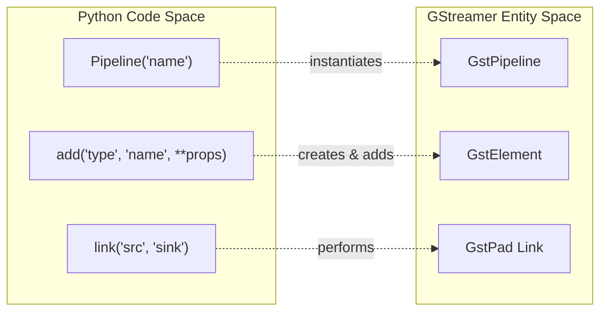
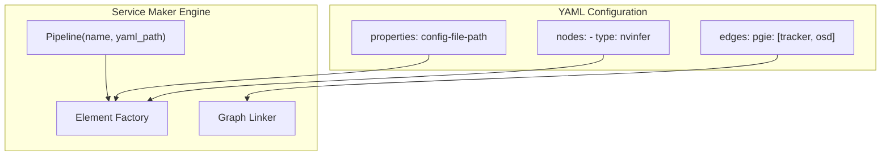

<!-- source: DeepWiki mcp.deepwiki.com · repo NVIDIA/DeepStream · page 3.2 Python Flow & Pipeline APIs · fetched 2026-10-26 -->

# Python Flow & Pipeline APIs

<details>
<summary>Relevant source files</summary>

The following files were used as context for generating this wiki page:

- [src/apps/reference_apps/deepstream-bodypose-3d/README.md](src/apps/reference_apps/deepstream-bodypose-3d/README.md)
- [src/apps/reference_apps/deepstream-custom-tile-config/README.md](src/apps/reference_apps/deepstream-custom-tile-config/README.md)
- [src/apps/reference_apps/deepstream-ipc-test-sr/README.md](src/apps/reference_apps/deepstream-ipc-test-sr/README.md)
- [src/apps/reference_apps/deepstream-masktracker/README.md](src/apps/reference_apps/deepstream-masktracker/README.md)
- [src/apps/reference_apps/pyservicemaker_sample_apps/README.md](src/apps/reference_apps/pyservicemaker_sample_apps/README.md)
- [src/apps/reference_apps/pyservicemaker_sample_apps/pipeline_api/deepstream_nvdsanalytics_test_app/README.md](src/apps/reference_apps/pyservicemaker_sample_apps/pipeline_api/deepstream_nvdsanalytics_test_app/README.md)
- [src/apps/tao_apps/apps/tao_others/deepstream-pose-classification/README.md](src/apps/tao_apps/apps/tao_others/deepstream-pose-classification/README.md)
- [src/apps/tao_apps/pysm-apps/common/utils.py](src/apps/tao_apps/pysm-apps/common/utils.py)
- [src/service-maker/README.md](src/service-maker/README.md)
- [src/service-maker/sources/apps/python/flow_api/deepstream_sr_test_app/README](src/service-maker/sources/apps/python/flow_api/deepstream_sr_test_app/README)
- [src/service-maker/sources/apps/python/flow_api/deepstream_test5_app/README](src/service-maker/sources/apps/python/flow_api/deepstream_test5_app/README)
- [src/service-maker/sources/apps/python/pipeline_api/deepstream_3d_action_recognition_app/README](src/service-maker/sources/apps/python/pipeline_api/deepstream_3d_action_recognition_app/README)
- [src/service-maker/sources/apps/python/pipeline_api/deepstream_sr_test_app/README](src/service-maker/sources/apps/python/pipeline_api/deepstream_sr_test_app/README)
- [src/service-maker/sources/apps/python/pipeline_api/deepstream_test1_app/dstest1_config_tegra.yaml](src/service-maker/sources/apps/python/pipeline_api/deepstream_test1_app/dstest1_config_tegra.yaml)
- [src/service-maker/sources/apps/python/pipeline_api/deepstream_test2_app/dstest2_config_tegra.yaml](src/service-maker/sources/apps/python/pipeline_api/deepstream_test2_app/dstest2_config_tegra.yaml)
- [src/service-maker/sources/apps/python/pipeline_api/deepstream_test3_app/dstest3_config_tegra.yaml](src/service-maker/sources/apps/python/pipeline_api/deepstream_test3_app/dstest3_config_tegra.yaml)
- [src/service-maker/sources/apps/python/pipeline_api/deepstream_test4_app/dstest4_config_tegra.yaml](src/service-maker/sources/apps/python/pipeline_api/deepstream_test4_app/dstest4_config_tegra.yaml)
- [src/service-maker/sources/apps/python/pipeline_api/deepstream_test5_app/test5_b16_dynamic_source_tegra.yaml](src/service-maker/sources/apps/python/pipeline_api/deepstream_test5_app/test5_b16_dynamic_source_tegra.yaml)
- [src/service-maker/sources/apps/python/pipeline_api/deepstream_test5_app/test5_b16_dynamic_source_with_enable_property_tegra.yaml](src/service-maker/sources/apps/python/pipeline_api/deepstream_test5_app/test5_b16_dynamic_source_with_enable_property_tegra.yaml)
- [src/service-maker/sources/apps/python/pipeline_api/deepstream_test5_app/test5_b2_tegra.yaml](src/service-maker/sources/apps/python/pipeline_api/deepstream_test5_app/test5_b2_tegra.yaml)

</details>


DeepStream Service Maker provides two Python APIs that offer high-level abstractions over GStreamer and GLib for building vision AI applications [src/service-maker/README.md:18-20](). These APIs allow developers to construct complex pipelines either through a fluent, chained "Flow API" or a declarative, YAML-driven "Pipeline API" [src/service-maker/README.md:137-164]().

## Overview of Python Service Maker

The Python SDK is designed to eliminate GStreamer boilerplate code while maintaining the performance of the underlying C++ Service Maker implementation [src/service-maker/README.md:18-20](). It supports reusable modules such as custom probes, sinks, and parsers that can be dynamically loaded into the pipeline [src/service-maker/README.md:185-204]().

### Flow API vs. Pipeline API

| Feature | Flow API | Pipeline API |
| :--- | :--- | :--- |
| **Construction** | Imperative, method chaining | Declarative, YAML-driven |
| **Best Use Case** | Dynamic pipeline building in code | Production configuration management |
| **Source** | `from deepstream import Pipeline` | `from pyservicemaker import Flow` |
| **Linking** | Manual `.link()` calls | Automatic via `edges` in YAML |

**Sources:** [src/service-maker/README.md:141-164](), [src/apps/tao_apps/pysm-apps/common/utils.py:22]()

---

## The Flow API

The Flow API allows for programmatic construction of pipelines by chaining element additions and links [src/service-maker/README.md:141-158]().

### Code-to-Entity Mapping: Flow Construction
This diagram maps the Python `Pipeline` class methods to the resulting pipeline structure.

"Flow API Pipeline Mapping"

**Sources:** [src/service-maker/README.md:145-158]()

### Implementation Example
A typical Flow API implementation involves initializing the `Pipeline` object, adding elements with keyword arguments for properties, and defining the data flow via `.link()` [src/service-maker/README.md:145-158]().

```python
from deepstream import Pipeline

pipeline = Pipeline("deepstream-test")
pipeline \
    .add("nvurisrcbin", "src", uri="file:///path/to/video.mp4") \
    .add("nvstreammux", "mux", batch_size=1, width=1280, height=720) \
    .add("nvinferbin", "infer", config_file_path="/path/to/config.txt") \
    .add("nvdsosdbin", "osd") \
    .add("nveglglessink", "sink")

pipeline.link("src", "mux").link("mux", "infer", "osd", "sink")
pipeline.start()
pipeline.wait()
```
**Sources:** [src/service-maker/README.md:148-158]()

---

## The Pipeline API (YAML-Driven)

The Pipeline API uses a declarative YAML format to define nodes (elements) and edges (links) [src/service-maker/sources/apps/python/pipeline_api/deepstream_test2_app/dstest2_config_tegra.yaml:16-90]().

### YAML Configuration Structure
The YAML file is organized under a `deepstream` root key, containing two primary sections:
1.  **nodes**: A list of elements defining their `type`, `name`, and `properties` [src/service-maker/sources/apps/python/pipeline_api/deepstream_test2_app/dstest2_config_tegra.yaml:17-76]().
2.  **edges**: A mapping defining how nodes are connected. Support includes simple 1-to-1 links and 1-to-many branching (e.g., using a `tee`) [src/service-maker/sources/apps/python/pipeline_api/deepstream_test5_app/test5_b2_tegra.yaml:101-120]().

### Declarative-to-Code Mapping
This diagram shows how YAML definitions are translated into the Service Maker execution environment.

"YAML to Service Maker Execution"

**Sources:** [src/service-maker/README.md:113-119](), [src/service-maker/sources/apps/python/pipeline_api/deepstream_test5_app/test5_b2_tegra.yaml:17-121]()

### Advanced YAML Features
*   **Branching**: Using a `tee` element, a single source can be linked to multiple downstream queues (e.g., one for OSD/Sink and one for Cloud Messaging) [src/service-maker/sources/apps/python/pipeline_api/deepstream_test5_app/test5_b2_tegra.yaml:108-110]().
*   **Dynamic Properties**: The `enable` property can be used to conditionally disable elements in the graph without removing their definitions [src/service-maker/sources/apps/python/pipeline_api/deepstream_test5_app/test5_b16_dynamic_source_with_enable_property_tegra.yaml:54-59]().
*   **Custom Probes**: Reusable Python or C++ modules (like `measure_latency_probe`) can be added as nodes and linked into the edge map [src/service-maker/sources/apps/python/pipeline_api/deepstream_test5_app/test5_b2_tegra.yaml:93-94]().

---

## Python Sample Applications

The repository provides several reference applications demonstrating specialized use cases.

### 1. Analytics & Metadata (nvdsanalytics)
Located in `deepstream_nvdsanalytics_test_app`, this sample demonstrates multi-source handling via `uridecodebin` and the use of the `nvdsanalytics` plugin to perform ROI filtering, overcrowding detection, and line crossing [src/apps/reference_apps/pyservicemaker_sample_apps/pipeline_api/deepstream_nvdsanalytics_test_app/README.md:20-33]().

### 2. Smart Recording
The `deepstream_sr_test_app` (available in both Flow and Pipeline API versions) demonstrates how to trigger recording events based on detection signals using the `smart_recording_action` module [src/service-maker/README.md:178-199]().

### 3. 3D Action Recognition
This application uses a temporal model to recognize actions in 3D space, utilizing the declarative Pipeline API for complex element chaining [src/service-maker/README.md:179]().

### 4. MaskTracker (SAM2)
While primarily a reference app, the MaskTracker demonstrates SAM2-based segmentation and tracking. It requires converting SAM2 models to TensorRT using the `sam2-onnx-tensorrt` tool [src/apps/reference_apps/deepstream-masktracker/README.md:21-36]().

**Sources:** [src/apps/reference_apps/pyservicemaker_sample_apps/pipeline_api/deepstream_nvdsanalytics_test_app/README.md](), [src/service-maker/README.md](), [src/apps/reference_apps/deepstream-masktracker/README.md]()

---

## Installation & Prerequisites

To use `pyservicemaker`, ensure the following dependencies are installed:

1.  **DeepStream 9.1**: Installed via `build/build.sh` or Debian package [src/service-maker/README.md:43]().
2.  **Python Libraries**:
    *   `pip3 install torchvision` [src/apps/reference_apps/pyservicemaker_sample_apps/README.md:24-27]()
    *   `pip3 install pyyaml` [src/apps/reference_apps/pyservicemaker_sample_apps/README.md:28-31]()
3.  **Service Maker Modules**: Built automatically during the top-level build and installed to `/opt/nvidia/deepstream/deepstream-9.1/service-maker/modules/` [src/service-maker/README.md:53-65]().

**Sources:** [src/service-maker/README.md:41-65](), [src/apps/reference_apps/pyservicemaker_sample_apps/README.md:23-31]()

---

