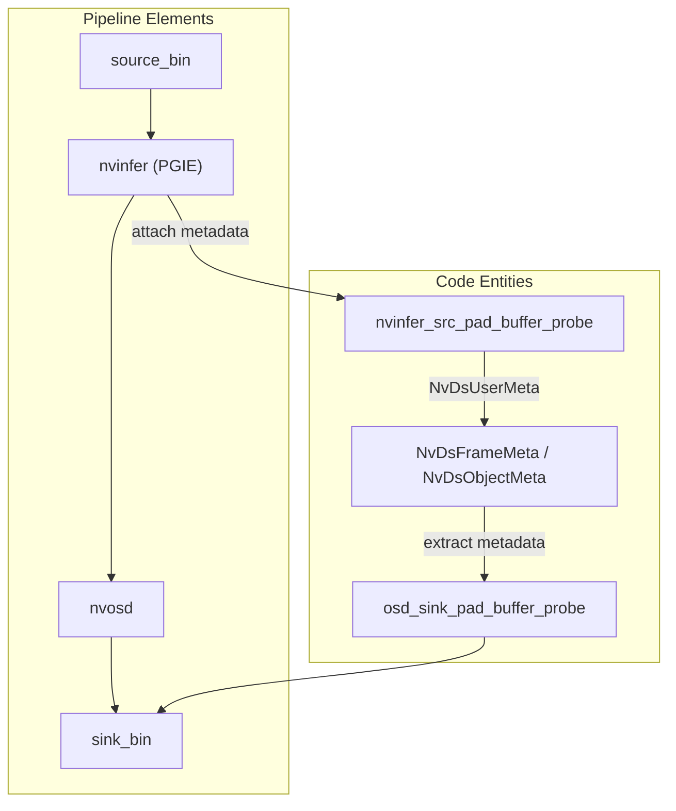
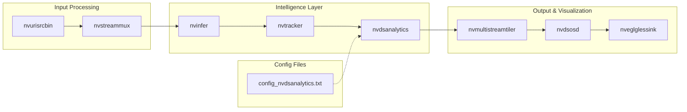

<!-- source: DeepWiki mcp.deepwiki.com · repo NVIDIA/DeepStream · page 4.1 Core Tutorial Sample Apps · fetched 2026-10-26 -->

# Core Tutorial Sample Apps

Relevant source files

The following files were used as context for generating this wiki page:

- [includes/nvdsinferserver_common.proto](includes/nvdsinferserver_common.proto)
- [src/apps/sample_apps/deepstream-appsrc-test/README](src/apps/sample_apps/deepstream-appsrc-test/README)
- [src/apps/sample_apps/deepstream-multigpu-nvlink-test/README](src/apps/sample_apps/deepstream-multigpu-nvlink-test/README)
- [src/apps/sample_apps/deepstream-nvdsanalytics-test/Makefile.ds](src/apps/sample_apps/deepstream-nvdsanalytics-test/Makefile.ds)
- [src/apps/sample_apps/deepstream-nvdsanalytics-test/README](src/apps/sample_apps/deepstream-nvdsanalytics-test/README)
- [src/apps/sample_apps/deepstream-opencv-test/README](src/apps/sample_apps/deepstream-opencv-test/README)
- [src/apps/sample_apps/deepstream-preprocess-test/README](src/apps/sample_apps/deepstream-preprocess-test/README)
- [src/apps/sample_apps/deepstream-server/README](src/apps/sample_apps/deepstream-server/README)
- [src/apps/sample_apps/deepstream-test4/README](src/apps/sample_apps/deepstream-test4/README)
- [src/apps/sample_apps/deepstream-test5/README](src/apps/sample_apps/deepstream-test5/README)
- [src/apps/sample_apps/deepstream-user-metadata-test/README](src/apps/sample_apps/deepstream-user-metadata-test/README)
- [src/apps/tao_apps/configs/app/config_nvdsanalytics.txt](src/apps/tao_apps/configs/app/config_nvdsanalytics.txt)
- [src/gst-plugins/gst-dsexample/README](src/gst-plugins/gst-dsexample/README)
- [src/gst-plugins/gst-nvinfer/README](src/gst-plugins/gst-nvinfer/README)
- [src/service-maker/sources/apps/cpp/deepstream_3d_action_recognition_app/README](src/service-maker/sources/apps/cpp/deepstream_3d_action_recognition_app/README)
- [src/service-maker/sources/apps/cpp/deepstream_sr_test_app/README](src/service-maker/sources/apps/cpp/deepstream_sr_test_app/README)
- [src/service-maker/sources/apps/cpp/deepstream_test4_app/README](src/service-maker/sources/apps/cpp/deepstream_test4_app/README)
- [src/service-maker/sources/apps/cpp/deepstream_test5_app/README](src/service-maker/sources/apps/cpp/deepstream_test5_app/README)
- [src/service-maker/sources/apps/python/flow_api/deepstream_3d_action_recognition_app/README](src/service-maker/sources/apps/python/flow_api/deepstream_3d_action_recognition_app/README)

The DeepStream SDK provides a suite of tutorial applications designed to guide developers from basic single-stream inference to complex multi-stream, cloud-connected analytics pipelines. These applications demonstrate the standard GStreamer pipeline patterns, metadata handling, and configuration paradigms used in DeepStream.

## Tutorial Application Progression

The `deepstream-test1` through `deepstream-test5` applications form a progressive learning path for the SDK.

| Application | Key Concepts | Core Elements |
| :--- | :--- | :--- |
| **Test 1** | Basic Pipeline | `filesrc`, `nvinfer`, `nvosd`, `nveglglessink` |
| **Test 2** | Secondary Inference | `nvtracker`, Secondary `nvinfer` (SGIE) |
| **Test 3** | Multi-stream Handling | `nvstreammux`, `nvurisrcbin`, `nvmultistreamtiler` |
| **Test 4** | Cloud Messaging | `nvmsgconv`, `nvmsgbroker` |
| **Test 5** | Reference Architecture | Full feature set, `deepstream-app` base, YAML/TXT config |

### deepstream-test1: The Basic Pipeline
This app demonstrates a simple H.264 elementary stream processing pipeline. It introduces the `nvinfer` element for object detection and `nvdsosd` for drawing bounding boxes and text on video frames.

### deepstream-test2: Tracking and Secondary Inference
Builds upon Test 1 by adding an `nvtracker` for object ID persistence and a secondary inference engine (SGIE). The SGIE performs classification (e.g., vehicle color or make) only on the objects detected by the Primary Inference Engine (PGIE).

### deepstream-test3: Multi-stream and Tiling
Demonstrates how to handle multiple input sources using `nvstreammux`. It introduces `nvmultistreamtiler` to composite multiple streams into a single 2D grid for visualization [src/service-maker/sources/apps/python/flow_api/deepstream_3d_action_recognition_app/README:62-62]().

### deepstream-test4: Cloud Connectivity
Test 4 introduces the telemetry branch. It uses `nvmsgconv` to transform DeepStream metadata into JSON or Protobuf payloads and `nvmsgbroker` to send these payloads to cloud endpoints like Kafka, Azure IoT, or MQTT [src/apps/sample_apps/deepstream-test4/README:47-48]().

### deepstream-test5: The Reference Application
Test 5 is built on the same core logic as the `deepstream-app`. It supports complex configurations via `.txt` or `.yml` files, dynamic source addition/deletion via `nvmultiurisrcbin`, and advanced smart recording features [src/apps/sample_apps/deepstream-test5/README:51-56]().

**Sources:** [src/apps/sample_apps/deepstream-test4/README:47-48](), [src/apps/sample_apps/deepstream-test5/README:51-56](), [src/service-maker/sources/apps/cpp/deepstream_test4_app/README:69-73]().

---

## Metadata Access and Customization

DeepStream uses a hierarchical metadata system. Applications access this data via GStreamer buffer probes.

### Data Flow: Metadata Probes
The following diagram illustrates how `deepstream-user-metadata-test` attaches and retrieves custom data.

**Metadata Lifecycle Diagram**

In `deepstream-user-metadata-test`, `nvinfer` attaches 16 random integers as `NvDsUserMeta` to the frame metadata [src/apps/sample_apps/deepstream-user-metadata-test/README:90-93](). These are later extracted at the OSD sink pad probe to verify data integrity [src/apps/sample_apps/deepstream-user-metadata-test/README:94-99]().

**Sources:** [src/apps/sample_apps/deepstream-user-metadata-test/README:90-99]().

---

## Cloud Messaging and Smart Recording

DeepStream enables edge-to-cloud communication through protocol adaptors.

### Cloud Protocol Adaptors
The `nvmsgbroker` plugin supports several backends, configured via the `--proto-lib` or `-p` flag:
*   **Kafka:** `libnvds_kafka_proto.so` [src/apps/sample_apps/deepstream-test4/README:86-86]()
*   **Azure IoT:** `libnvds_azure_proto.so` [src/apps/sample_apps/deepstream-test4/README:87-87]()
*   **AMQP (RabbitMQ):** `libnvds_amqp_proto.so` [src/apps/sample_apps/deepstream-test4/README:88-88]()
*   **Redis:** `libnvds_redis_proto.so` [src/apps/sample_apps/deepstream-test4/README:89-89]()

### Smart Recording (`deepstream-sr-test-app`)
This application demonstrates recording RTSP streams based on external events.
1.  **Local Mode:** Automatically triggers a recording session to showcase the API [src/service-maker/sources/apps/cpp/deepstream_sr_test_app/README:95-97]().
2.  **Cloud/Kafka Mode:** Listens for a JSON command (e.g., `start-recording`) on a Kafka topic to trigger video capture [src/service-maker/sources/apps/cpp/deepstream_sr_test_app/README:142-155]().

**Sources:** [src/apps/sample_apps/deepstream-test4/README:86-89](), [src/service-maker/sources/apps/cpp/deepstream_sr_test_app/README:95-97](), [src/service-maker/sources/apps/cpp/deepstream_sr_test_app/README:142-155]().

---

## Specialized Analytics: nvdsanalytics

The `deepstream-nvdsanalytics-test` app demonstrates spatial intelligence features such as line crossing, ROI filtering, and overcrowding detection.

**Analytics Pipeline Architecture**

The `nvdsanalytics` plugin requires an `nvtracker` upstream to maintain object identity across frames. It uses a per-stream configuration file to define ROI polygons and crossing lines [src/apps/sample_apps/deepstream-nvdsanalytics-test/Makefile.ds:53-53]().

**Sources:** [src/apps/sample_apps/deepstream-nvdsanalytics-test/Makefile.ds:53-53](), [src/service-maker/sources/apps/cpp/deepstream_3d_action_recognition_app/README:60-60]().

---

## Reference Application: deepstream-app

The `deepstream-app` (and `deepstream-test5`) represents the most feature-complete reference. It is driven by a configuration file that defines every aspect of the pipeline.

### Key Features
*   **Multi-GPU Support:** Can be configured to run inference on specific GPUs [src/apps/sample_apps/deepstream-test5/README:85-86]().
*   **REST API Integration:** `deepstream-server-app` uses `nvmultiurisrcbin` to provide a REST interface for dynamic stream management (add/remove) [src/apps/sample_apps/deepstream-server/README:46-53]().
*   **3D Action Recognition:** Demonstrates temporal sequence batching using `nvdspreprocess` before passing data to `nvinfer` for 3D convolution-based action classification [src/service-maker/sources/apps/cpp/deepstream_3d_action_recognition_app/README:56-68]().

**Sources:** [src/apps/sample_apps/deepstream-test5/README:85-86](), [src/apps/sample_apps/deepstream-server/README:46-53](), [src/service-maker/sources/apps/cpp/deepstream_3d_action_recognition_app/README:56-68]().

---

