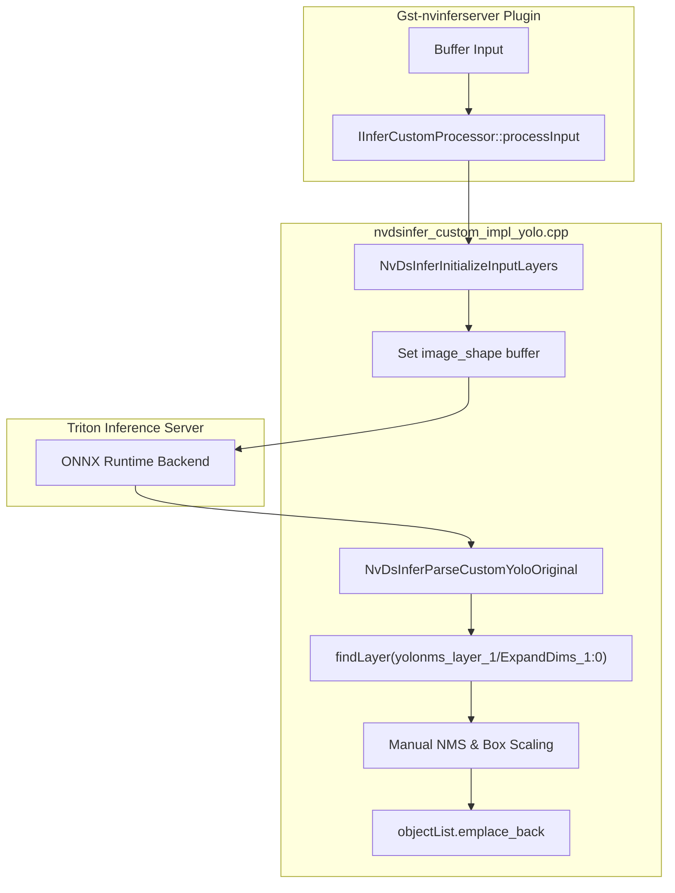
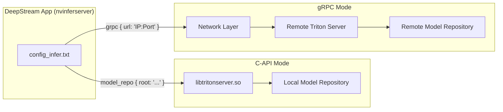

<!-- source: DeepWiki mcp.deepwiki.com · repo NVIDIA/DeepStream · page 4.2 Triton Inference Server Sample Apps · fetched 2026-10-26 -->

# Triton Inference Server Sample Apps

Relevant source files

The following files were used as context for generating this wiki page:

- [includes/gstnvdsbufferpool.h](includes/gstnvdsbufferpool.h)
- [includes/nvdsinferserver_config.proto](includes/nvdsinferserver_config.proto)
- [includes/nvdsinferserver_plugin.proto](includes/nvdsinferserver_plugin.proto)
- [src/apps/sample_apps/TritonBackendEnsemble/Makefile](src/apps/sample_apps/TritonBackendEnsemble/Makefile)
- [src/apps/sample_apps/TritonBackendEnsemble/README](src/apps/sample_apps/TritonBackendEnsemble/README)
- [src/apps/sample_apps/TritonBackendEnsemble/config_infer_primary.txt](src/apps/sample_apps/TritonBackendEnsemble/config_infer_primary.txt)
- [src/apps/sample_apps/TritonBackendEnsemble/config_infer_secondary_ensemble.txt](src/apps/sample_apps/TritonBackendEnsemble/config_infer_secondary_ensemble.txt)
- [src/apps/sample_apps/TritonBackendEnsemble/deepstream_app_config_triton_backend_ensemble.txt](src/apps/sample_apps/TritonBackendEnsemble/deepstream_app_config_triton_backend_ensemble.txt)
- [src/apps/sample_apps/TritonBackendEnsemble/nvds_triton_cpp_custom_backend/CMakeLists.txt](src/apps/sample_apps/TritonBackendEnsemble/nvds_triton_cpp_custom_backend/CMakeLists.txt)
- [src/apps/sample_apps/TritonBackendEnsemble/nvds_triton_cpp_custom_backend/cmake/TutorialRecommendedBackendConfig.cmake.in](src/apps/sample_apps/TritonBackendEnsemble/nvds_triton_cpp_custom_backend/cmake/TutorialRecommendedBackendConfig.cmake.in)
- [src/apps/sample_apps/TritonBackendEnsemble/nvds_triton_cpp_custom_backend/src/libtriton_recommended.ldscript](src/apps/sample_apps/TritonBackendEnsemble/nvds_triton_cpp_custom_backend/src/libtriton_recommended.ldscript)
- [src/apps/sample_apps/TritonBackendEnsemble/nvds_triton_cpp_custom_backend/src/recommended.cc](src/apps/sample_apps/TritonBackendEnsemble/nvds_triton_cpp_custom_backend/src/recommended.cc)
- [src/apps/sample_apps/TritonBackendEnsemble/nvdsinferserver_custom_impl_ensemble/Makefile](src/apps/sample_apps/TritonBackendEnsemble/nvdsinferserver_custom_impl_ensemble/Makefile)
- [src/apps/sample_apps/TritonOnnxYolo/Makefile](src/apps/sample_apps/TritonOnnxYolo/Makefile)
- [src/apps/sample_apps/TritonOnnxYolo/README](src/apps/sample_apps/TritonOnnxYolo/README)
- [src/apps/sample_apps/TritonOnnxYolo/config_nvinfer.txt](src/apps/sample_apps/TritonOnnxYolo/config_nvinfer.txt)
- [src/apps/sample_apps/TritonOnnxYolo/nvdsinfer_custom_impl_yolo/Makefile](src/apps/sample_apps/TritonOnnxYolo/nvdsinfer_custom_impl_yolo/Makefile)
- [src/apps/sample_apps/TritonOnnxYolo/nvdsinfer_custom_impl_yolo/nvdsinfer_custom_impl_yolo.cpp](src/apps/sample_apps/TritonOnnxYolo/nvdsinfer_custom_impl_yolo/nvdsinfer_custom_impl_yolo.cpp)
- [src/apps/sample_apps/TritonOnnxYolo/triton_model_repo/yolov3-10_onnx/config.pbtxt](src/apps/sample_apps/TritonOnnxYolo/triton_model_repo/yolov3-10_onnx/config.pbtxt)
- [src/apps/sample_apps/deepstream-3d-action-recognition/triton_model_repo/resnet18_2d_rgb/config.pbtxt](src/apps/sample_apps/deepstream-3d-action-recognition/triton_model_repo/resnet18_2d_rgb/config.pbtxt)
- [src/apps/tao_apps/triton_server_grpc.md](src/apps/tao_apps/triton_server_grpc.md)
- [src/utils/nvdsinferserver/libnvds_infer_server.export](src/utils/nvdsinferserver/libnvds_infer_server.export)

The DeepStream SDK provides specialized sample applications to demonstrate integration with the **NVIDIA Triton Inference Server**. These samples utilize the `nvinferserver` GStreamer plugin, which acts as a Triton client, allowing DeepStream to execute inference on various frameworks (TensorRT, ONNX Runtime, PyTorch, TensorFlow) using either a local C-API or a remote gRPC connection.

## TritonOnnxYolo: Dynamic Tensors and Custom Parsing

The `TritonOnnxYolo` sample demonstrates how to deploy an ONNX-based YOLOv3 model using Triton within a DeepStream pipeline. It specifically addresses models with **dynamic-sized output tensors** and multi-input requirements [src/apps/sample_apps/TritonOnnxYolo/README:20-24]().

### Key Components
*   **Custom Processor**: Implements `nvdsinferserver::IInferCustomProcessor` to handle manual parsing of ONNX output tensors and attachment of bounding box metadata [src/apps/sample_apps/TritonOnnxYolo/README:32-39]().
*   **Memory Management**: Demonstrates the use of `max_buffer_bytes` in the Triton config to optimize memory allocation for dynamic tensors, while allowing DeepStream to auto-grow buffers if needed [src/apps/sample_apps/TritonOnnxYolo/README:90-98]().
*   **Input Initialization**: The custom implementation includes `NvDsInferInitializeInputLayers`, which sets the `image_shape` input tensor required by the YOLOv3 ONNX model based on the configured network dimensions [src/apps/sample_apps/TritonOnnxYolo/nvdsinfer_custom_impl_yolo/nvdsinfer_custom_impl_yolo.cpp:53-68]().

### Data Flow: Triton YOLO Implementation
The following diagram maps the logical inference flow to the specific C++ entities in the custom implementation.

**Triton Custom Processing Flow**

**Sources:** [src/apps/sample_apps/TritonOnnxYolo/nvdsinfer_custom_impl_yolo/nvdsinfer_custom_impl_yolo.cpp:53-167](), [src/apps/sample_apps/TritonOnnxYolo/README:32-39]()

---

## TritonBackendEnsemble: Custom C++ Backends

The `TritonBackendEnsemble` sample demonstrates a sophisticated pipeline where a Triton **Ensemble Model** is used as a Secondary GIE (SGIE). This ensemble combines standard classifier models with a **Custom Triton C++ Backend** [src/apps/sample_apps/TritonBackendEnsemble/README:16-19]().

### System Architecture
The pipeline follows a `source -> pgie -> tracker -> sgie -> tiler -> sink` pattern [src/apps/sample_apps/TritonBackendEnsemble/README:21-22](). The SGIE ensemble takes vehicle objects from the tracker and performs multi-task classification while simultaneously tracking request counts via the custom backend.

| Component | Role | Entity / File |
| :--- | :--- | :--- |
| **Primary GIE** | 4-class Detector (Vehicle, Sign, etc.) | `Primary_Detector` [src/apps/sample_apps/TritonBackendEnsemble/README:23-24]() |
| **Secondary GIE** | Triton Ensemble Model | `triton_custom_backend_ensemble` [src/apps/sample_apps/TritonBackendEnsemble/README:59-62]() |
| **Custom Backend** | Request Counter / Metadata Processor | `deepstream_triton_custom_cpp_backend` [src/apps/sample_apps/TritonBackendEnsemble/README:63-65]() |
| **Custom Lib** | Metadata to Tensor conversion | `nvdsinferserver_custom_process_ensemble.cpp` [src/apps/sample_apps/TritonBackendEnsemble/README:55-58]() |

### Custom Backend Implementation
The custom backend is built using the Triton Backend API, fetching dependencies like `triton-core-serverapi` and `triton-backend-utils` via CMake [src/apps/sample_apps/TritonBackendEnsemble/nvds_triton_cpp_custom_backend/CMakeLists.txt:97-104](). It uses an ldscript to export only `TRITONBACKEND_*` symbols [src/apps/sample_apps/TritonBackendEnsemble/nvds_triton_cpp_custom_backend/src/libtriton_recommended.ldscript:16-20]().

**Sources:** [src/apps/sample_apps/TritonBackendEnsemble/README:16-71](), [src/apps/sample_apps/TritonBackendEnsemble/nvds_triton_cpp_custom_backend/CMakeLists.txt:1-120]()

---

## Inference Modes: C-API vs. gRPC

DeepStream supports two primary communication modes with Triton, configured via the `nvinferserver` configuration file.

### 1. Native C-API (Local)
In this mode, Triton is loaded as a shared library within the DeepStream process. This provides the lowest latency as it avoids network overhead and utilizes shared memory for buffer passing.
*   **Configuration**: Requires a `model_repo` block defining the `root` path [src/apps/sample_apps/TritonBackendEnsemble/config_infer_primary.txt:34-37]().

### 2. gRPC (Remote)
DeepStream acts as a gRPC client, sending inference requests to a standalone `tritonserver` instance. This is ideal for distributed architectures or when offloading inference to a separate GPU node.
*   **Configuration**: Requires a `grpc` block defining the `url` (e.g., `localhost:8001`) [src/apps/sample_apps/TritonBackendEnsemble/config_infer_primary.txt:43-45]().
*   **Deployment**: The server must be started independently using the `tritonserver` command with the appropriate model repository [src/apps/tao_apps/triton_server_grpc.md:56-58]().

**C-API vs gRPC Configuration Comparison**

**Sources:** [src/apps/sample_apps/TritonBackendEnsemble/config_infer_primary.txt:28-46](), [src/apps/tao_apps/triton_server_grpc.md:47-58]()

---

## Model Repository Structure

Triton requires a specific directory structure for its model repository. The samples provide scripts and configurations to organize these assets.

*   **Model Config**: Each model folder must contain a `config.pbtxt` defining inputs, outputs, and the backend (e.g., `tensorrt`, `onnxruntime`) [src/apps/sample_apps/TritonOnnxYolo/triton_model_repo/yolov3-10_onnx/config.pbtxt:1-20]().
*   **Versioning**: Models are stored in numeric subdirectories (e.g., `1/model.onnx`) representing the version [src/apps/sample_apps/TritonOnnxYolo/README:66-69]().
*   **DeepStream Integration**: Samples often use softlinks to standard models installed in `/opt/nvidia/deepstream/deepstream/samples/triton_model_repo/` to minimize disk footprint [src/apps/sample_apps/TritonBackendEnsemble/README:94-100]().

**Sources:** [src/apps/sample_apps/TritonOnnxYolo/README:40-42](), [src/apps/sample_apps/TritonBackendEnsemble/README:66-71]()

---

