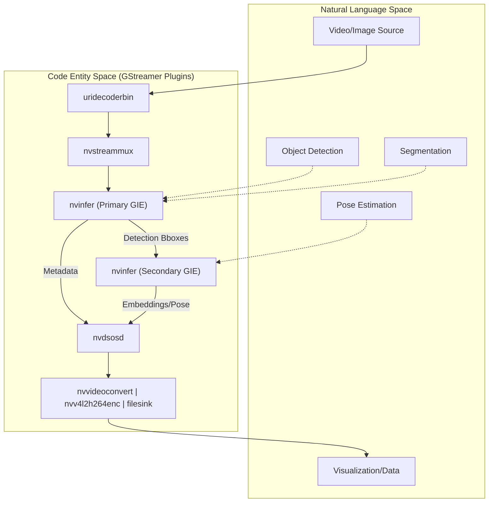
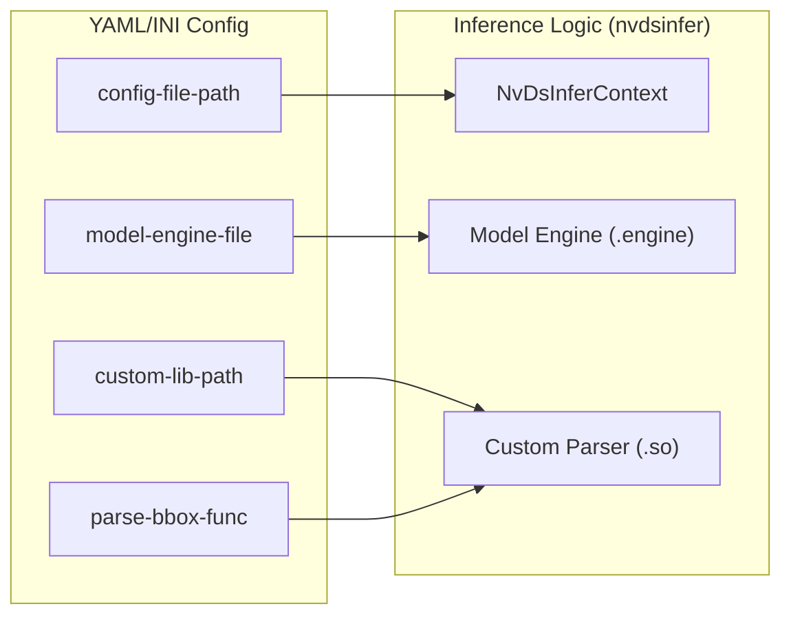

<!-- source: DeepWiki mcp.deepwiki.com · repo NVIDIA/DeepStream · page 4.3 TAO Toolkit Model Apps · fetched 2026-10-26 -->

# TAO Toolkit Model Apps

<details>
<summary>Relevant source files</summary>

The following files were used as context for generating this wiki page:

- [src/apps/reference_apps/README.md](src/apps/reference_apps/README.md)
- [src/apps/reference_apps/deepstream-bodypose-3d/README.md](src/apps/reference_apps/deepstream-bodypose-3d/README.md)
- [src/apps/reference_apps/deepstream-custom-tile-config/README.md](src/apps/reference_apps/deepstream-custom-tile-config/README.md)
- [src/apps/reference_apps/deepstream-ipc-test-sr/README.md](src/apps/reference_apps/deepstream-ipc-test-sr/README.md)
- [src/apps/reference_apps/deepstream-masktracker/README.md](src/apps/reference_apps/deepstream-masktracker/README.md)
- [src/apps/reference_apps/pyservicemaker_sample_apps/README.md](src/apps/reference_apps/pyservicemaker_sample_apps/README.md)
- [src/apps/reference_apps/pyservicemaker_sample_apps/pipeline_api/deepstream_nvdsanalytics_test_app/README.md](src/apps/reference_apps/pyservicemaker_sample_apps/pipeline_api/deepstream_nvdsanalytics_test_app/README.md)
- [src/apps/tao_apps/README.md](src/apps/tao_apps/README.md)
- [src/apps/tao_apps/apps/tao_others/README.md](src/apps/tao_apps/apps/tao_others/README.md)
- [src/apps/tao_apps/apps/tao_others/deepstream-mdx-perception-app/README.md](src/apps/tao_apps/apps/tao_others/deepstream-mdx-perception-app/README.md)
- [src/apps/tao_apps/apps/tao_others/deepstream-nvocdr-app/README.md](src/apps/tao_apps/apps/tao_others/deepstream-nvocdr-app/README.md)
- [src/apps/tao_apps/apps/tao_others/deepstream-pose-classification/README.md](src/apps/tao_apps/apps/tao_others/deepstream-pose-classification/README.md)
- [src/apps/tao_apps/deepstream_app_tao_configs/README.md](src/apps/tao_apps/deepstream_app_tao_configs/README.md)
- [src/apps/tao_apps/deepstream_app_tao_configs/download_models.sh](src/apps/tao_apps/deepstream_app_tao_configs/download_models.sh)
- [src/apps/tao_apps/deepstream_app_tao_configs/peoplenet_test.sh](src/apps/tao_apps/deepstream_app_tao_configs/peoplenet_test.sh)
- [src/apps/tao_apps/deepstream_app_tao_configs/peoplenet_triton_test.sh](src/apps/tao_apps/deepstream_app_tao_configs/peoplenet_triton_test.sh)
- [src/apps/tao_apps/deepstream_app_tao_configs/prepare_triton_models.sh](src/apps/tao_apps/deepstream_app_tao_configs/prepare_triton_models.sh)
- [src/apps/tao_apps/download_models.sh](src/apps/tao_apps/download_models.sh)
- [src/apps/tao_apps/models/poseclassificationnet/config.pbtxt](src/apps/tao_apps/models/poseclassificationnet/config.pbtxt)
- [src/apps/tao_apps/pysm-apps/common/utils.py](src/apps/tao_apps/pysm-apps/common/utils.py)

</details>


The NVIDIA TAO (Trainable AI Algorithms) Toolkit provides a collection of pretrained, purpose-built models for various computer vision tasks. DeepStream SDK includes a suite of reference applications specifically designed to deploy these models efficiently using either `nvinfer` (TensorRT) or `nvinferserver` (Triton). These applications cover a broad spectrum of AI tasks including object detection, semantic segmentation, body pose estimation, and optical character recognition (OCR).

## Overview of Supported Models

The TAO sample applications support twelve primary model types [src/apps/tao_apps/README.md:50-58]():

| Category | Model Name | Description |
| :--- | :--- | :--- |
| **Detection** | PeopleNet Transformer, TrafficCamNet, Retail Detector | High-accuracy object detection for people, vehicles, and retail items. |
| **Segmentation** | CitySemSegFormer, Mask2Former | Pixel-level classification for urban scenes and instance segmentation. |
| **Human Pose** | BodyPose3DNet, Pose Classification | 3D keypoint estimation and action classification from pose sequences. |
| **Perception** | Re-Identification (ReID), Retail Recognition | Embedding extraction for matching objects across frames or databases. |
| **OCR** | OCDNet, OCRNet | Optical character detection and recognition for text extraction. |
| **Specialized** | LPDNet, LPRNet | License Plate Detection and Recognition. |

## Application Architecture

The TAO applications follow a standardized pipeline architecture designed for high-performance video analytics. Data flows from a source (URI/File) through a stream muxer, into the inference engines, and finally to a sink for visualization or storage [src/apps/tao_apps/README.md:59-67]().

### Data Flow Diagram

The following diagram illustrates the flow from the Natural Language "Model Tasks" to the specific Code Entities and GStreamer elements used in the TAO apps.

**TAO Model Pipeline Mapping**


Sources: [src/apps/tao_apps/README.md:59-67](), [src/apps/tao_apps/apps/tao_others/deepstream-mdx-perception-app/README.md:48-51]()

## Key Reference Applications

### MDX Perception (ReID & Retail)
The MDX perception application implements two distinct pipelines: **Retail Item Recognition** and **People Re-Identification (ReID)** [src/apps/tao_apps/apps/tao_others/deepstream-mdx-perception-app/README.md:18-27]().
* **Retail Pipeline**: Detects items using a primary GIE and extracts embedding vectors via a secondary GIE for database matching [src/apps/tao_apps/apps/tao_others/deepstream-mdx-perception-app/README.md:19-23]().
* **People ReID**: Uses PeopleNet Transformer to detect individuals followed by a ReID model to generate unique embeddings [src/apps/tao_apps/apps/tao_others/deepstream-mdx-perception-app/README.md:24-27]().

### 3D Body Pose Estimation
The `deepstream-pose-estimation-app` implements the KAMA (3D Keypoint Aware Body Mesh Articulation) algorithm [src/apps/reference_apps/deepstream-bodypose-3d/README.md:18-24]().
* **Models**: Integrates PeopleNet (Detection) and BodyPose3DNet (3D Keypoints) [src/apps/reference_apps/deepstream-bodypose-3d/README.md:30-30]().
* **Custom Post-processing**: Includes `libnvdsinfer_custom_impl_BodyPose3DNet.so` to parse 34 keypoints in both 2.5D (image relative) and 3D (world coordinates) [src/apps/reference_apps/deepstream-bodypose-3d/README.md:55-55](), [src/apps/reference_apps/deepstream-bodypose-3d/README.md:121-128]().

### Optical Character Recognition (nvOCDR)
The `deepstream-nvocdr-app` provides an end-to-end solution for detecting and recognizing text [src/apps/tao_apps/apps/tao_others/deepstream-nvocdr-app/README.md:18-19]().
* **Pipeline**: Utilizes **OCDNet** for character detection and **OCRNet** for recognition [src/apps/tao_apps/apps/tao_others/deepstream-nvocdr-app/README.md:21-23]().
* **Dependencies**: Requires the `libnvocdr.so` and `libnvocdr_impl.so` libraries [src/apps/tao_apps/apps/tao_others/deepstream-nvocdr-app/README.md:33-48]().

## Model Integration & Configuration

Integrating a TAO model into DeepStream involves downloading the pretrained `.onnx` or `.etlt` files, generating TensorRT engines, and configuring the `nvinfer` plugin.

### Model Download and Engine Generation
NVIDIA provides a `download_models.sh` script to automate the retrieval of models from NGC [src/apps/tao_apps/README.md:99-105](). For certain models like OCDNet, engines must be generated manually using `trtexec` to specify dynamic shapes [src/apps/tao_apps/apps/tao_others/deepstream-nvocdr-app/README.md:90-97]().

### Nvinfer Configuration Mapping
The `nvinfer` config file (typically `pgie_config.txt`) links the GStreamer element to the physical model files.

**Code Entity Mapping: Config to Implementation**


Sources: [src/apps/tao_apps/README.md:117-129](), [src/apps/tao_apps/deepstream_app_tao_configs/README.md:81-101]()

### Configuration Example (`pgie` section)
```ini
[primary-gie]
enable=1
plugin-type=0 # 0: nvinfer, 1: nvinferserver
gie-unique-id=1
config-file=nvinfer/config_infer_primary_peoplenet.txt
```
Source: [src/apps/tao_apps/deepstream_app_tao_configs/README.md:81-95]()

## Advanced Deployment: Triton Inference Server
TAO models can also be deployed using the Triton Inference Server. This is enabled by changing the `plugin-type` to `1` in the application configuration [src/apps/tao_apps/README.md:120-123]().
* **Native Triton**: The server runs within the same process as DeepStream [src/apps/tao_apps/README.md:112-112]().
* **gRPC Triton**: DeepStream acts as a client to a remote Triton server [src/apps/tao_apps/README.md:113-113]().

## Summary Table of TAO Apps

| Application Directory | Key Models | Primary Features |
| :--- | :--- | :--- |
| `tao_detection` | PeopleNet, TrafficCamNet | Standard object detection with YAML/INI config support [src/apps/tao_apps/README.md:54-55](). |
| `deepstream-bodypose-3d` | BodyPose3DNet | 3D human model reconstruction under occlusion [src/apps/reference_apps/deepstream-bodypose-3d/README.md:37-38](). |
| `deepstream-nvocdr-app` | OCDNet, OCRNet | End-to-end text detection and recognition [src/apps/tao_apps/apps/tao_others/deepstream-nvocdr-app/README.md:18-23](). |
| `deepstream-mdx-perception-app` | ReID, Retail Recognition | Feature embedding extraction and Kafka metadata publishing [src/apps/tao_apps/apps/tao_others/deepstream-mdx-perception-app/README.md:18-27](), [69-70](). |
| `deepstream-pose-classification` | PoseClassificationNet | Classifies actions (e.g., walking, falling) from pose sequences [src/apps/tao_apps/apps/tao_others/deepstream-pose-classification/README.md:21-25](). |

Sources: [src/apps/tao_apps/README.md:50-58](), [src/apps/tao_apps/apps/tao_others/README.md:18-29](), [src/apps/reference_apps/README.md:45-47]()

---

