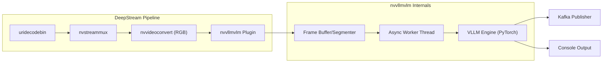
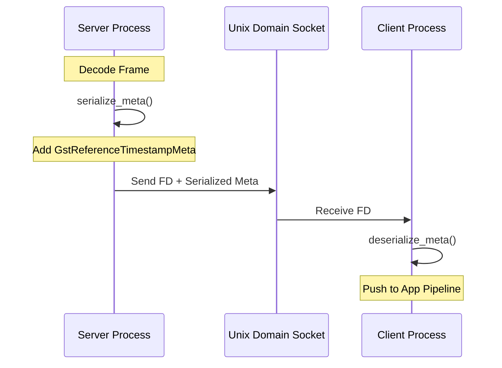

<!-- source: DeepWiki mcp.deepwiki.com · repo NVIDIA/DeepStream · page 4.4 Advanced Reference Applications · fetched 2026-10-26 -->

# Advanced Reference Applications

Relevant source files

The following files were used as context for generating this wiki page:

- [src/apps/reference_apps/.gitattributes](src/apps/reference_apps/.gitattributes)
- [src/apps/reference_apps/anomaly/README.md](src/apps/reference_apps/anomaly/README.md)
- [src/apps/reference_apps/deepstream-bodypose-3d/README.md](src/apps/reference_apps/deepstream-bodypose-3d/README.md)
- [src/apps/reference_apps/deepstream-custom-tile-config/README.md](src/apps/reference_apps/deepstream-custom-tile-config/README.md)
- [src/apps/reference_apps/deepstream-ipc-test-sr/README.md](src/apps/reference_apps/deepstream-ipc-test-sr/README.md)
- [src/apps/reference_apps/deepstream-masktracker/README.md](src/apps/reference_apps/deepstream-masktracker/README.md)
- [src/apps/reference_apps/deepstream-tracker-3d/README.md](src/apps/reference_apps/deepstream-tracker-3d/README.md)
- [src/apps/reference_apps/deepstream-vllm-plugin/README.md](src/apps/reference_apps/deepstream-vllm-plugin/README.md)
- [src/apps/reference_apps/deepstream-vllm-plugin/install.sh](src/apps/reference_apps/deepstream-vllm-plugin/install.sh)
- [src/apps/reference_apps/deepstream-vllm-plugin/requirements.txt](src/apps/reference_apps/deepstream-vllm-plugin/requirements.txt)
- [src/apps/reference_apps/deepstream_parallel_inference_app/tritonclient/sample/apps/deepstream-parallel-infer/README.md](src/apps/reference_apps/deepstream_parallel_inference_app/tritonclient/sample/apps/deepstream-parallel-infer/README.md)
- [src/apps/reference_apps/deepstream_parallel_inference_app/tritonclient/sample/build.sh](src/apps/reference_apps/deepstream_parallel_inference_app/tritonclient/sample/build.sh)
- [src/apps/reference_apps/deepstream_parallel_inference_app/tritonserver/build_engine.sh](src/apps/reference_apps/deepstream_parallel_inference_app/tritonserver/build_engine.sh)
- [src/apps/reference_apps/pyservicemaker_sample_apps/README.md](src/apps/reference_apps/pyservicemaker_sample_apps/README.md)
- [src/apps/reference_apps/pyservicemaker_sample_apps/pipeline_api/deepstream_nvdsanalytics_test_app/README.md](src/apps/reference_apps/pyservicemaker_sample_apps/pipeline_api/deepstream_nvdsanalytics_test_app/README.md)
- [src/apps/reference_apps/runtime_source_add_delete/README.md](src/apps/reference_apps/runtime_source_add_delete/README.md)
- [src/apps/sample_apps/deepstream-3d-lidar-sensor-fusion/bevfusion/build_bevfusion_model.sh](src/apps/sample_apps/deepstream-3d-lidar-sensor-fusion/bevfusion/build_bevfusion_model.sh)
- [src/apps/sample_apps/deepstream-3d-lidar-sensor-fusion/v2xfusion/scripts/clocks.sh](src/apps/sample_apps/deepstream-3d-lidar-sensor-fusion/v2xfusion/scripts/clocks.sh)
- [src/apps/tao_apps/apps/tao_others/deepstream-pose-classification/README.md](src/apps/tao_apps/apps/tao_others/deepstream-pose-classification/README.md)
- [src/apps/tao_apps/pysm-apps/common/utils.py](src/apps/tao_apps/pysm-apps/common/utils.py)

This section covers specialized reference applications within the DeepStream SDK that demonstrate advanced capabilities, including 3D pose estimation, foundation model integration (SAM2, VLMs), inter-process communication (IPC), and dynamic pipeline management.

## 1. Vision-Language Model (VLM) Integration
The `nvvllmvlm` plugin enables the integration of Vision-Language Models (such as Cosmos-Reason2) into DeepStream pipelines for real-time video understanding [src/apps/reference_apps/deepstream-vllm-plugin/README.md:31-33](). It uses a segment-based processing approach, collecting frames into time windows for asynchronous batch inference [src/apps/reference_apps/deepstream-vllm-plugin/README.md:35-44]().

### Data Flow and Components
The application converts batched DeepStream frames to `video/x-raw(memory:NVMM), format=RGB` before passing them to the plugin [src/apps/reference_apps/deepstream-vllm-plugin/README.md:102-104]().

| Feature | Description |
| :--- | :--- |
| **Segment Processing** | Collects frames into windows (e.g., 30s) for inference [src/apps/reference_apps/deepstream-vllm-plugin/README.md:161-165](). |
| **Async Inference** | Uses a background worker thread to prevent pipeline blocking [src/apps/reference_apps/deepstream-vllm-plugin/README.md:39-39](). |
| **Multi-Stream** | A single plugin instance efficiently handles multiple streams with per-stream prompts [src/apps/reference_apps/deepstream-vllm-plugin/README.md:40-41](). |
| **Platform Awareness** | Automatically selects RGB conversion paths for dGPU/SBSA vs Jetson/Thor [src/apps/reference_apps/deepstream-vllm-plugin/README.md:45-45](). |

**Vision-Language Pipeline Architecture**

**Sources:** [src/apps/reference_apps/deepstream-vllm-plugin/README.md:31-180](), [src/apps/reference_apps/deepstream-vllm-plugin/requirements.txt:1-6]()

---

## 2. MaskTracker (SAM2-based Segmentation)
The `deepstream-masktracker` application demonstrates multi-object tracking and segmentation using the Segment Anything Model 2 (SAM2) [src/apps/reference_apps/deepstream-masktracker/README.md:20-22](). It utilizes a memory bank to store visual features from previous frames to localize and segment targets in new frames [src/apps/reference_apps/deepstream-masktracker/README.md:21-22]().

### Implementation Details
*   **Model Preparation**: SAM2 modules (image encoder, mask decoder, etc.) are converted to TensorRT engines using the `sam2-onnx-tensorrt` tool [src/apps/reference_apps/deepstream-masktracker/README.md:31-32]().
*   **Detection Integration**: Typically paired with `PeopleNet` for initial target detection [src/apps/reference_apps/deepstream-masktracker/README.md:38-38]().
*   **Output**: Generates KITTI-format metadata for boxes and IDs, along with visual segmentation masks [src/apps/reference_apps/deepstream-masktracker/README.md:102-114]().

**Sources:** [src/apps/reference_apps/deepstream-masktracker/README.md:18-117]()

---

## 3. 3D Body Pose Estimation
The `deepstream-pose-estimation-app` recovers 3D skeletal joints using the KAMA (3D Keypoint Aware Body Mesh Articulation) method [src/apps/reference_apps/deepstream-bodypose-3d/README.md:20-23]().

### Metadata Structure
The application outputs two types of pose data [src/apps/reference_apps/deepstream-bodypose-3d/README.md:102-128]():
1.  **Pose25D**: `34 x [x, y, zRel, conf]`. `zRel` is relative depth from the pelvis in millimeters.
2.  **Pose3D**: `34 x [x, y, z, conf]`. Absolute 3D coordinates in the camera world coordinate system.

### Key Components
*   **Models**: Uses `PeopleNet` for person detection and `BodyPose3DNet` for joint estimation [src/apps/reference_apps/deepstream-bodypose-3d/README.md:30-30]().
*   **Custom Parser**: Implements `nvdsinfer_custom_impl_BodyPose3DNet` to handle the specific output tensors of the pose model [src/apps/reference_apps/deepstream-bodypose-3d/README.md:48-50]().
*   **Dependencies**: Requires `libeigen3-dev` for coordinate transformations [src/apps/reference_apps/deepstream-bodypose-3d/README.md:37-41]().

**Sources:** [src/apps/reference_apps/deepstream-bodypose-3d/README.md:18-128]()

---

## 4. IPC Buffer Sharing & Super-Resolution
The `deepstream-ipc-test-app` demonstrates zero-copy sharing of decoded buffers between different processes using Unix Domain Sockets [src/apps/reference_apps/deepstream-ipc-test-sr/README.md:19-21]().

### Architecture
*   **Server**: Decodes H.264/H.265 streams and sends `nvbufsurface` file descriptors over IPC using `nvunixfdsink` [src/apps/reference_apps/deepstream-ipc-test-sr/README.md:99-102]().
*   **Client**: Receives descriptors via `nvunixfdsrc` and pushes them into a DeepStream pipeline for inference and Super-Resolution (SR) processing [src/apps/reference_apps/deepstream-ipc-test-sr/README.md:103-106]().
*   **Super-Resolution**: Integrates a PyTorch-based SR model via `nvinfer` to upscale the received buffers [src/apps/reference_apps/deepstream-ipc-test-sr/README.md:52-60]().

**IPC Metadata Serialization**

**Sources:** [src/apps/reference_apps/deepstream-ipc-test-sr/README.md:19-141]()

---

## 5. Specialized Configuration Samples

### Custom Tile Configuration
The `deepstream-custom-tile-config` app demonstrates how to use the `custom-tile-config` property of the `nvmultistreamtiler` plugin [src/apps/reference_apps/deepstream-custom-tile-config/README.md:20-22](). This allows developers to define arbitrary rectangle positions and sizes for each stream in the composite output, rather than relying on the default grid layout [src/apps/reference_apps/deepstream-custom-tile-config/README.md:21-22]().

### Parallel Inference
The `deepstream_parallel_inference_app` utilizes branched pipelines to run multiple models (e.g., `YOLOv4`, `TrafficCamNet`, `LPDNet`) concurrently on the same stream [src/apps/reference_apps/deepstream_parallel_inference_app/tritonserver/build_engine.sh:24-56](). It uses `nvdsmetamux` to merge metadata from these parallel branches back into a single stream for downstream components like OSD or message brokers.

### Anomaly Detection
The `anomaly` reference app (found in `src/apps/reference_apps/anomaly/`) provides a template for identifying irregular patterns in video streams, often used in industrial or security contexts.

**Sources:** [src/apps/reference_apps/deepstream-custom-tile-config/README.md:18-54](), [src/apps/reference_apps/deepstream_parallel_inference_app/tritonserver/build_engine.sh:1-78]()

---

