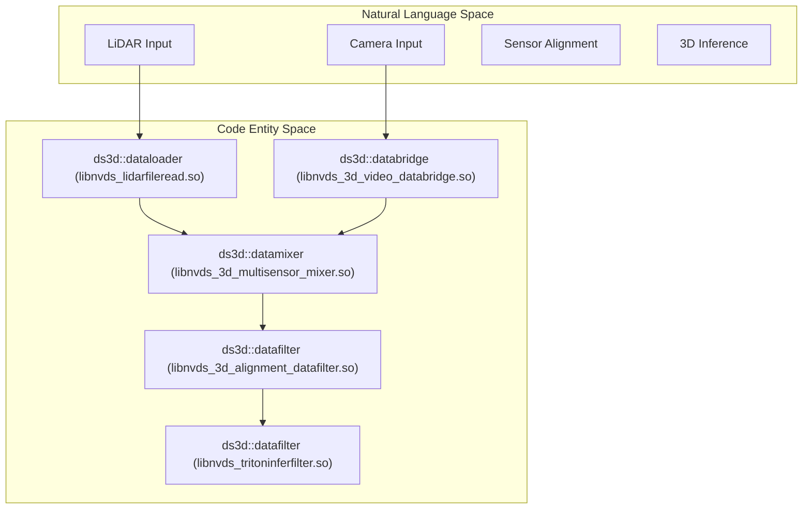
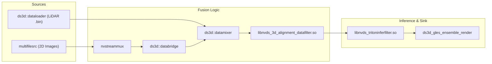

<!-- source: DeepWiki mcp.deepwiki.com · repo NVIDIA/DeepStream · page 5 3D Sensing & Sensor Fusion · fetched 2026-10-26 -->

# 3D Sensing & Sensor Fusion

Relevant source files

The following files were used as context for generating this wiki page:

- [.gitattributes](.gitattributes)
- [src/apps/sample_apps/deepstream-3d-lidar-sensor-fusion/README](src/apps/sample_apps/deepstream-3d-lidar-sensor-fusion/README)
- [src/apps/sample_apps/deepstream-3d-lidar-sensor-fusion/README.v2xfusion](src/apps/sample_apps/deepstream-3d-lidar-sensor-fusion/README.v2xfusion)
- [src/apps/sample_apps/deepstream-3d-lidar-sensor-fusion/data/nuscene.tar.gz](src/apps/sample_apps/deepstream-3d-lidar-sensor-fusion/data/nuscene.tar.gz)
- [src/apps/sample_apps/deepstream-3d-lidar-sensor-fusion/ds3d_lidar_video_sensor_v2x_fusion.yml](src/apps/sample_apps/deepstream-3d-lidar-sensor-fusion/ds3d_lidar_video_sensor_v2x_fusion.yml)
- [src/apps/sample_apps/deepstream-3d-lidar-sensor-fusion/ds3d_lidar_video_sensor_v2x_fusion_single_batch.yml](src/apps/sample_apps/deepstream-3d-lidar-sensor-fusion/ds3d_lidar_video_sensor_v2x_fusion_single_batch.yml)
- [src/apps/sample_apps/deepstream-3d-lidar-sensor-fusion/lidar_nuscene_data_list.yaml](src/apps/sample_apps/deepstream-3d-lidar-sensor-fusion/lidar_nuscene_data_list.yaml)
- [src/utils/ds3d/README.md](src/utils/ds3d/README.md)

This section provides an overview of DeepStream's capabilities for processing 3D sensor data, including LiDAR point clouds, depth cameras, and multi-modal sensor fusion. The core of these capabilities is the **DS3D framework**, a specialized utility library and plugin set designed to handle non-video data types within the GStreamer pipeline.

DeepStream supports advanced 3D use cases such as BEVFusion (Bird's Eye View fusion of 6 cameras and LiDAR), V2X (Vehicle-to-Everything) fusion, and multi-view 3D tracking for large-area spatial intelligence.

## DS3D Framework Architecture

The DS3D framework provides a flexible architecture for building pipelines that process 3D data. It abstracts data handling through a unified `ds3d::datamap` structure, allowing different sensor modalities to be merged and processed by common filters and inference engines [src/apps/sample_apps/deepstream-3d-lidar-sensor-fusion/README:23-30]().

### Core DS3D Components

| Component | Code Entity | Description |
| :--- | :--- | :--- |
| **Dataloader** | `ds3d::dataloader` | Captures or reads 3D data (e.g., LiDAR files via `libnvds_lidarfileread.so`) [src/apps/sample_apps/deepstream-3d-lidar-sensor-fusion/ds3d_lidar_video_sensor_v2x_fusion.yml:49-54](). |
| **Databridge** | `ds3d::databridge` | Bridges standard 2D video buffers (`NvBufSurface`) into the `ds3d::datamap` format [src/apps/sample_apps/deepstream-3d-lidar-sensor-fusion/ds3d_lidar_video_sensor_v2x_fusion.yml:33-40](). |
| **Datamixer** | `ds3d::datamixer` | Merges multiple `ds3d::datamap` streams (e.g., LiDAR + Camera) into a single synchronized map [src/apps/sample_apps/deepstream-3d-lidar-sensor-fusion/ds3d_lidar_video_sensor_v2x_fusion.yml:111-118](). |
| **Datafilter** | `ds3d::datafilter` | Performs 3D preprocessing, alignment (calibration), or inference via Triton [src/apps/sample_apps/deepstream-3d-lidar-sensor-fusion/ds3d_lidar_video_sensor_v2x_fusion.yml:80-86](). |
| **Datasink** | `ds3d::datasink` | Renders 3D results or sends them to external sinks like Kafka [src/apps/sample_apps/deepstream-3d-lidar-sensor-fusion/README:29-30](). |

**DS3D Logic to Code Mapping**

Sources: [src/apps/sample_apps/deepstream-3d-lidar-sensor-fusion/ds3d_lidar_video_sensor_v2x_fusion.yml:33-188](), [src/utils/ds3d/README.md:29-40]()

## LiDAR & Sensor Fusion (BEVFusion & V2X)

DeepStream supports high-performance sensor fusion architectures that combine 3D LiDAR point clouds with 2D camera images to improve detection accuracy and spatial awareness.

*   **CUDA-BEVFusion**: Integrates data from 6 cameras and 1 LiDAR. It uses a chunked TensorRT-optimized model and a Python-based Triton inference module (`triton-lmm`) for multi-modal processing [src/apps/sample_apps/deepstream-3d-lidar-sensor-fusion/README:34-40]().
*   **V2XFusion**: A "Vehicle-to-Everything" reference pipeline that fuses 1 camera and 1 LiDAR with support for batching (up to batch-size 4) [src/apps/sample_apps/deepstream-3d-lidar-sensor-fusion/README:48-49]().
*   **Calibration & Alignment**: Pipelines include an alignment filter (`libnvds_3d_alignment_datafilter.so`) that uses intrinsic and extrinsic matrices to project 3D LiDAR data onto 2D image planes for rendering and fused inference [src/apps/sample_apps/deepstream-3d-lidar-sensor-fusion/ds3d_lidar_video_sensor_v2x_fusion.yml:127-148]().

For implementation details, model preparation scripts, and calibration configuration, see **[LiDAR Sensor Fusion (BEVFusion & V2XFusion)](#5.1)**.

Sources: [src/apps/sample_apps/deepstream-3d-lidar-sensor-fusion/README:32-52](), [src/apps/sample_apps/deepstream-3d-lidar-sensor-fusion/ds3d_lidar_video_sensor_v2x_fusion.yml:127-148]()

## Multi-View 3D Tracking (MV3DT)

The Multi-View 3D Tracking (MV3DT) system enables tracking objects across multiple non-overlapping or overlapping camera views by projecting 2D detections into a unified 3D world coordinate system.

*   **Coordinate Projection**: Uses projection matrices to map camera-space detections to a Bird's Eye View (BEV).
*   **Inter-Camera Communication**: Utilizes MQTT for low-latency metadata sharing between camera nodes to maintain consistent object IDs across views.
*   **Visualization**: Provides a BEV rendering of the tracked area, often outputting consolidated metadata via Kafka for downstream analytics.

For details on the MV3DT reference app and the auto-configurator tool, see **[Multi-View 3D Tracking (MV3DT)](#5.2)**.

## 3D Pipeline Data Flow

The following diagram illustrates how DS3D components interact to form a fused sensing pipeline.

**Sensor Fusion Data Flow (Code View)**

Sources: [src/apps/sample_apps/deepstream-3d-lidar-sensor-fusion/ds3d_lidar_video_sensor_v2x_fusion.yml:20-185](), [src/apps/sample_apps/deepstream-3d-lidar-sensor-fusion/README:23-30]()

---

