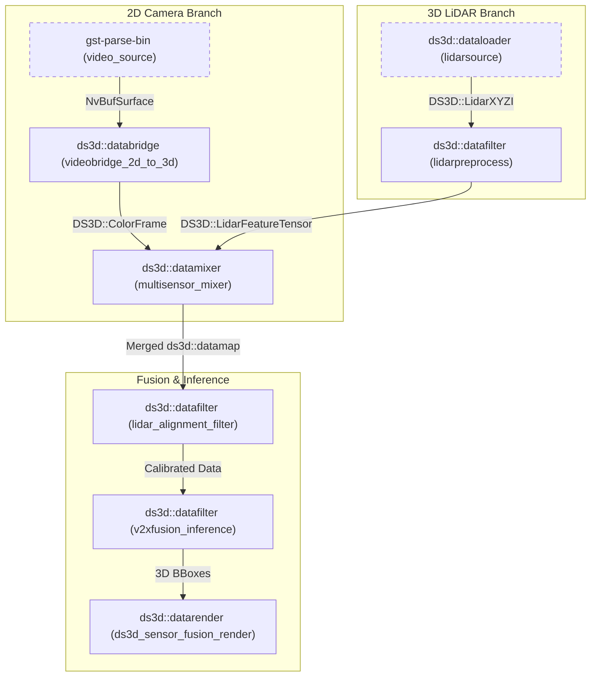
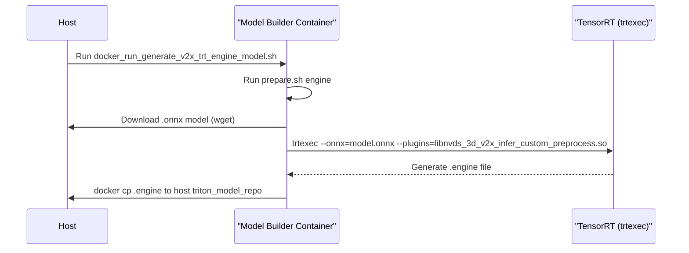

<!-- source: DeepWiki mcp.deepwiki.com · repo NVIDIA/DeepStream · page 5.1 LiDAR Sensor Fusion (BEVFusion & V2XFusion) · fetched 2026-10-26 -->

# LiDAR Sensor Fusion (BEVFusion & V2XFusion)

Relevant source files

The following files were used as context for generating this wiki page:

- [.gitattributes](.gitattributes)
- [src/apps/sample_apps/deepstream-3d-action-recognition/triton_model_repo/resnet18_3d_rgb/config.pbtxt](src/apps/sample_apps/deepstream-3d-action-recognition/triton_model_repo/resnet18_3d_rgb/config.pbtxt)
- [src/apps/sample_apps/deepstream-3d-lidar-sensor-fusion/README](src/apps/sample_apps/deepstream-3d-lidar-sensor-fusion/README)
- [src/apps/sample_apps/deepstream-3d-lidar-sensor-fusion/README.v2xfusion](src/apps/sample_apps/deepstream-3d-lidar-sensor-fusion/README.v2xfusion)
- [src/apps/sample_apps/deepstream-3d-lidar-sensor-fusion/bevfusion/bevfusion.Dockerfile](src/apps/sample_apps/deepstream-3d-lidar-sensor-fusion/bevfusion/bevfusion.Dockerfile)
- [src/apps/sample_apps/deepstream-3d-lidar-sensor-fusion/bevfusion/docker_build_bevfusion_image.sh](src/apps/sample_apps/deepstream-3d-lidar-sensor-fusion/bevfusion/docker_build_bevfusion_image.sh)
- [src/apps/sample_apps/deepstream-3d-lidar-sensor-fusion/bevfusion/docker_run_ds3d_sensor_fusion_bevfusion_pipeline.sh](src/apps/sample_apps/deepstream-3d-lidar-sensor-fusion/bevfusion/docker_run_ds3d_sensor_fusion_bevfusion_pipeline.sh)
- [src/apps/sample_apps/deepstream-3d-lidar-sensor-fusion/bevfusion/docker_run_generate_trt_engine_models.sh](src/apps/sample_apps/deepstream-3d-lidar-sensor-fusion/bevfusion/docker_run_generate_trt_engine_models.sh)
- [src/apps/sample_apps/deepstream-3d-lidar-sensor-fusion/bevfusion/docker_run_triton_server_bevfusion.sh](src/apps/sample_apps/deepstream-3d-lidar-sensor-fusion/bevfusion/docker_run_triton_server_bevfusion.sh)
- [src/apps/sample_apps/deepstream-3d-lidar-sensor-fusion/data/nuscene.tar.gz](src/apps/sample_apps/deepstream-3d-lidar-sensor-fusion/data/nuscene.tar.gz)
- [src/apps/sample_apps/deepstream-3d-lidar-sensor-fusion/ds3d_lidar_video_sensor_v2x_fusion.yml](src/apps/sample_apps/deepstream-3d-lidar-sensor-fusion/ds3d_lidar_video_sensor_v2x_fusion.yml)
- [src/apps/sample_apps/deepstream-3d-lidar-sensor-fusion/ds3d_lidar_video_sensor_v2x_fusion_single_batch.yml](src/apps/sample_apps/deepstream-3d-lidar-sensor-fusion/ds3d_lidar_video_sensor_v2x_fusion_single_batch.yml)
- [src/apps/sample_apps/deepstream-3d-lidar-sensor-fusion/lidar_nuscene_data_list.yaml](src/apps/sample_apps/deepstream-3d-lidar-sensor-fusion/lidar_nuscene_data_list.yaml)
- [src/apps/sample_apps/deepstream-3d-lidar-sensor-fusion/model_config_files/config_triton_bev_fusion_infer_grpc.pbtxt](src/apps/sample_apps/deepstream-3d-lidar-sensor-fusion/model_config_files/config_triton_bev_fusion_infer_grpc.pbtxt)
- [src/apps/sample_apps/deepstream-3d-lidar-sensor-fusion/python/triton_lmm/triton_model_repo/bevfusion/config.pbtxt](src/apps/sample_apps/deepstream-3d-lidar-sensor-fusion/python/triton_lmm/triton_model_repo/bevfusion/config.pbtxt)
- [src/apps/sample_apps/deepstream-3d-lidar-sensor-fusion/v2xfusion/models/v2xfusion/config.pbtxt](src/apps/sample_apps/deepstream-3d-lidar-sensor-fusion/v2xfusion/models/v2xfusion/config.pbtxt)
- [src/apps/sample_apps/deepstream-3d-lidar-sensor-fusion/v2xfusion/scripts/docker_run_ds3d_sensor_fusion_v2x_pipeline.sh](src/apps/sample_apps/deepstream-3d-lidar-sensor-fusion/v2xfusion/scripts/docker_run_ds3d_sensor_fusion_v2x_pipeline.sh)
- [src/apps/sample_apps/deepstream-3d-lidar-sensor-fusion/v2xfusion/scripts/docker_run_generate_v2x_trt_engine_model.sh](src/apps/sample_apps/deepstream-3d-lidar-sensor-fusion/v2xfusion/scripts/docker_run_generate_v2x_trt_engine_model.sh)
- [src/apps/sample_apps/deepstream-3d-lidar-sensor-fusion/v2xfusion/scripts/prepare.sh](src/apps/sample_apps/deepstream-3d-lidar-sensor-fusion/v2xfusion/scripts/prepare.sh)
- [src/apps/sample_apps/deepstream-lidar-inference-app/tritonserver/build_engine.sh](src/apps/sample_apps/deepstream-lidar-inference-app/tritonserver/build_engine.sh)
- [src/apps/sample_apps/deepstream-lidar-inference-app/tritonserver/models/pointpillars/config.pbtxt](src/apps/sample_apps/deepstream-lidar-inference-app/tritonserver/models/pointpillars/config.pbtxt)
- [src/apps/tao_apps/models/peoplenet/config.pbtxt](src/apps/tao_apps/models/peoplenet/config.pbtxt)
- [src/utils/ds3d/datafilter/lidar_preprocess/Makefile](src/utils/ds3d/datafilter/lidar_preprocess/Makefile)
- [src/utils/ds3d/dataloader/lidarsource/Makefile](src/utils/ds3d/dataloader/lidarsource/Makefile)
- [src/utils/nvds_msgapi/azure_protocol_adaptor/device_client/Makefile](src/utils/nvds_msgapi/azure_protocol_adaptor/device_client/Makefile)
- [src/utils/nvds_msgapi/azure_protocol_adaptor/module_client/Makefile](src/utils/nvds_msgapi/azure_protocol_adaptor/module_client/Makefile)

The `deepstream-3d-lidar-sensor-fusion` application demonstrates multi-modal sensor fusion using the DeepStream 3D (DS3D) framework. It integrates LiDAR and camera data for 3D object detection, supporting complex architectures like **CUDA-BEVFusion** (6-camera + 1-LiDAR) and **V2XFusion** (Vehicle-to-Everything). The application leverages `ds3d::datamap` to bridge traditional 2D media pipelines with 3D point cloud processing, utilizing Triton Inference Server for model execution and GLES for ensemble rendering of multi-view outputs.

## System Architecture & Data Flow

The application bridges a standard DeepStream 2D pipeline (handling camera streams) with a DS3D 3D pipeline (handling LiDAR). Data from both domains are merged into a unified `ds3d::datamap` for synchronized inference.

### High-Level Data Flow
1.  **Camera Pipeline**: Decodes video via `nvv4l2decoder`, muxes streams, and applies preprocessing. A `ds3d::databridge` converts the `NvBufSurface` into a `ds3d::datamap` [src/apps/sample_apps/deepstream-3d-lidar-sensor-fusion/ds3d_lidar_video_sensor_v2x_fusion.yml:20-46]().
2.  **LiDAR Pipeline**: A `ds3d::dataloader` reads point cloud data (e.g., `.bin` files from NuScenes or V2X datasets). A `ds3d::datafilter` performs LiDAR-specific preprocessing (e.g., voxelization or feature extraction) [src/apps/sample_apps/deepstream-3d-lidar-sensor-fusion/ds3d_lidar_video_sensor_v2x_fusion.yml:49-108]().
3.  **Fusion (Mixer)**: The `ds3d::datamixer` synchronizes the camera and LiDAR data maps based on timestamps [src/apps/sample_apps/deepstream-3d-lidar-sensor-fusion/ds3d_lidar_video_sensor_v2x_fusion.yml:111-123]().
4.  **Inference**: The combined data is passed to `ds3d::datatfiler->tritoninferfilter` for 3D detection [src/apps/sample_apps/deepstream-3d-lidar-sensor-fusion/README:28-30]().
5.  **Rendering**: Results are visualized using `ds3d_gles_ensemble_render` for Bird's Eye View (BEV) and camera-projection overlays [src/apps/sample_apps/deepstream-3d-lidar-sensor-fusion/README:29-30]().

### DS3D Component Mapping
The following diagram maps the logical fusion steps to specific DS3D code entities and plugins defined in the configuration.

**Sources:** [src/apps/sample_apps/deepstream-3d-lidar-sensor-fusion/ds3d_lidar_video_sensor_v2x_fusion.yml:20-189](), [src/apps/sample_apps/deepstream-3d-lidar-sensor-fusion/README.v2xfusion:155-165]()

## CUDA-BEVFusion Implementation

CUDA-BEVFusion integrates data from 6 cameras and 1 LiDAR sensor. The model is optimized by chunking it into multiple TensorRT engines [src/apps/sample_apps/deepstream-3d-lidar-sensor-fusion/README:34-36]().

*   **Triton-LMM**: A Python-based multi-modal inference module (`triton-lmm`) is used to integrate the Python-based BEVFusion model with the Triton Inference Server [src/apps/sample_apps/deepstream-3d-lidar-sensor-fusion/README:37-40]().
*   **Model Preparation**: A dedicated script `bevfusion/build_bevfusion_model.sh` downloads model chunks and converts them to TensorRT engines with INT8 precision [src/apps/sample_apps/deepstream-3d-lidar-sensor-fusion/README:101-104]().
*   **Deployment**: The Triton server must run on x86 with GPU Compute Capability 8.0+, while the DS3D pipeline can run on both x86 and Jetson [src/apps/sample_apps/deepstream-3d-lidar-sensor-fusion/README:45-46]().

**Sources:** [src/apps/sample_apps/deepstream-3d-lidar-sensor-fusion/README:34-46](), [src/apps/sample_apps/deepstream-3d-lidar-sensor-fusion/bevfusion/docker_run_triton_server_bevfusion.sh:74-84]()

## V2XFusion Implementation

V2XFusion focuses on Vehicle-to-Everything scenarios, typically processing 1 camera and 1 LiDAR stream with a batch size of 4 [src/apps/sample_apps/deepstream-3d-lidar-sensor-fusion/README:48-49]().

### Configuration and Calibration
The `lidar_alignment_filter` uses calibration matrices to align LiDAR points with camera frames.
*   **Intrinsics**: Defined via `cam_intrinsic` matrix [src/apps/sample_apps/deepstream-3d-lidar-sensor-fusion/ds3d_lidar_video_sensor_v2x_fusion.yml:149-161]().
*   **Extrinsics**: Defined via `lidar_to_cam_extrisic` matrix (transformation from LiDAR coordinate system to Camera coordinate system) [src/apps/sample_apps/deepstream-3d-lidar-sensor-fusion/ds3d_lidar_video_sensor_v2x_fusion.yml:162-174]().

### Model Execution
The inference is handled by `libnvds_tritoninferfilter.so` using the `createLidarInferenceFilter` function [src/apps/sample_apps/deepstream-3d-lidar-sensor-fusion/ds3d_lidar_video_sensor_v2x_fusion.yml:188-189](). It requires a custom preprocessing library `libnvds_3d_v2x_infer_custom_preprocess.so` to handle the multi-modal tensor inputs [src/apps/sample_apps/deepstream-3d-lidar-sensor-fusion/v2xfusion/scripts/prepare.sh:22-24]().

**Sources:** [src/apps/sample_apps/deepstream-3d-lidar-sensor-fusion/ds3d_lidar_video_sensor_v2x_fusion.yml:127-189](), [src/apps/sample_apps/deepstream-3d-lidar-sensor-fusion/v2xfusion/scripts/prepare.sh:22-56]()

## Docker-Based Model & Environment Preparation

The application provides a comprehensive suite of scripts for building environments and preparing models.

| Script | Purpose |
| :--- | :--- |
| `docker_build_bevfusion_image.sh` | Builds the `deepstream-triton-bevfusion` image containing necessary dependencies like `libspconv` [src/apps/sample_apps/deepstream-3d-lidar-sensor-fusion/bevfusion/docker_build_bevfusion_image.sh:40-95](). |
| `docker_run_generate_trt_engine_models.sh` | Mounts a host directory to build BEVFusion TensorRT engines within the container [src/apps/sample_apps/deepstream-3d-lidar-sensor-fusion/bevfusion/docker_run_generate_trt_engine_models.sh:71-78](). |
| `docker_run_triton_server_bevfusion.sh` | Launches the Triton Inference Server with the `triton_lmm` Python backend [src/apps/sample_apps/deepstream-3d-lidar-sensor-fusion/bevfusion/docker_run_triton_server_bevfusion.sh:74-84](). |
| `docker_run_generate_v2x_trt_engine_model.sh` | Generates V2XFusion engines using `trtexec` with sparsity enabled [src/apps/sample_apps/deepstream-3d-lidar-sensor-fusion/v2xfusion/scripts/docker_run_generate_v2x_trt_engine_model.sh:54-63](). |

### Model Preparation Workflow
The following diagram illustrates the workflow for generating the optimized TensorRT engines required for fusion inference.

**Sources:** [src/apps/sample_apps/deepstream-3d-lidar-sensor-fusion/v2xfusion/scripts/docker_run_generate_v2x_trt_engine_model.sh:54-66](), [src/apps/sample_apps/deepstream-3d-lidar-sensor-fusion/v2xfusion/scripts/prepare.sh:36-63]()

## Key Configuration Parameters

### LiDAR Data Loader (`ds3d::dataloader`)
*   **data_config_file**: YAML list of point cloud file paths and their timestamps [src/apps/sample_apps/deepstream-3d-lidar-sensor-fusion/ds3d_lidar_video_sensor_v2x_fusion.yml:58-62]().
*   **points_num**: Number of points per frame (e.g., 70,000) [src/apps/sample_apps/deepstream-3d-lidar-sensor-fusion/ds3d_lidar_video_sensor_v2x_fusion.yml:63]().
*   **output_datamap_key**: The key used to store the LiDAR data in the `ds3d::datamap` (e.g., `DS3D::LidarXYZI_0`) [src/apps/sample_apps/deepstream-3d-lidar-sensor-fusion/ds3d_lidar_video_sensor_v2x_fusion.yml:71-75]().

### LiDAR Preprocess Filter (`ds3d::datafilter`)
*   **model_inputs**: Defines the tensor shapes expected by the fusion model, such as `feats` `[4, 8000, 10, 9]` and `coords` `[4, 8000, 4]` [src/apps/sample_apps/deepstream-3d-lidar-sensor-fusion/ds3d_lidar_video_sensor_v2x_fusion.yml:91-100]().
*   **input_tensor_mem_type**: Memory location for the resulting tensors (e.g., `GpuCuda`) [src/apps/sample_apps/deepstream-3d-lidar-sensor-fusion/ds3d_lidar_video_sensor_v2x_fusion.yml:103]().

**Sources:** [src/apps/sample_apps/deepstream-3d-lidar-sensor-fusion/ds3d_lidar_video_sensor_v2x_fusion.yml:49-108]()

---

