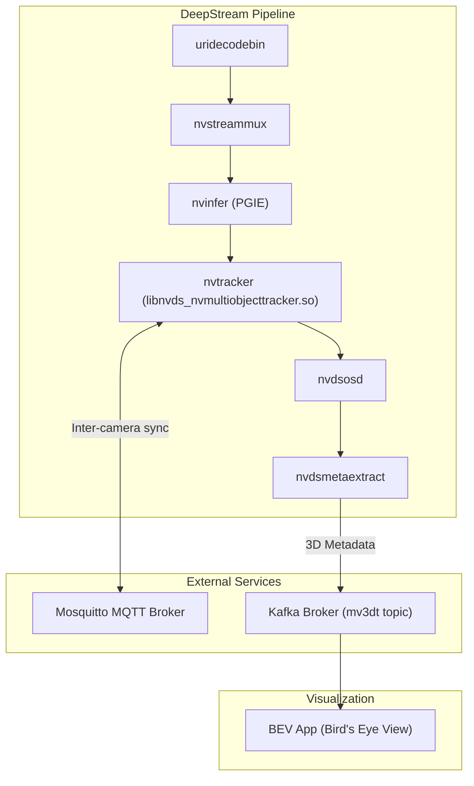
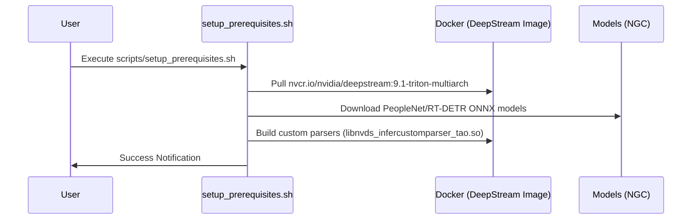

<!-- source: DeepWiki mcp.deepwiki.com · repo NVIDIA/DeepStream · page 5.2 Multi-View 3D Tracking (MV3DT) · fetched 2026-10-26 -->

# Multi-View 3D Tracking (MV3DT)

Relevant source files

The following files were used as context for generating this wiki page:

- [.gitignore](.gitignore)
- [README.md](README.md)
- [THIRD_PARTY_LICENSES.txt](THIRD_PARTY_LICENSES.txt)
- [build/BUILD.md](build/BUILD.md)
- [build/build.sh](build/build.sh)
- [src/apps/reference_apps/anomaly/README.md](src/apps/reference_apps/anomaly/README.md)
- [src/apps/reference_apps/deepstream-tracker-3d-multi-view/README.md](src/apps/reference_apps/deepstream-tracker-3d-multi-view/README.md)
- [src/apps/reference_apps/deepstream-tracker-3d-multi-view/assets/datasets.zip](src/apps/reference_apps/deepstream-tracker-3d-multi-view/assets/datasets.zip)
- [src/apps/reference_apps/deepstream-tracker-3d-multi-view/docs/manual-setup.md](src/apps/reference_apps/deepstream-tracker-3d-multi-view/docs/manual-setup.md)
- [src/apps/reference_apps/deepstream-tracker-3d-multi-view/scripts/setup_prerequisites.sh](src/apps/reference_apps/deepstream-tracker-3d-multi-view/scripts/setup_prerequisites.sh)
- [src/apps/reference_apps/deepstream-tracker-3d/README.md](src/apps/reference_apps/deepstream-tracker-3d/README.md)
- [src/apps/reference_apps/deepstream_parallel_inference_app/tritonclient/sample/apps/deepstream-parallel-infer/README.md](src/apps/reference_apps/deepstream_parallel_inference_app/tritonclient/sample/apps/deepstream-parallel-infer/README.md)
- [src/apps/reference_apps/runtime_source_add_delete/README.md](src/apps/reference_apps/runtime_source_add_delete/README.md)

Multi-View 3D Tracking (MV3DT) is a distributed, real-time framework within the DeepStream SDK designed for large-scale, calibrated camera networks. It delivers robust object tracking and identity consistency across complex environments by leveraging camera projection matrices for accurate geometric reasoning in 3D space [src/apps/reference_apps/deepstream-tracker-3d-multi-view/README.md:22-24]().

## System Architecture and Data Flow

The MV3DT application operates by synchronizing multiple camera streams and performing 3D state estimation. It utilizes MQTT for inter-camera communication to maintain global identity consistency and Kafka for exporting unified 3D tracking metadata [src/apps/reference_apps/deepstream-tracker-3d-multi-view/README.md:22-32]().

### High-Level Component Interaction
This diagram maps the natural language concepts of the MV3DT system to the specific code entities and external services used in the implementation.

"MV3DT Component Mapping"

Sources: [src/apps/reference_apps/deepstream-tracker-3d-multi-view/README.md:22-32](), [src/apps/reference_apps/deepstream-tracker-3d-multi-view/docs/manual-setup.md:72-108](), [src/apps/reference_apps/runtime_source_add_delete/README.md:50-50]()

## Key Features

### 1. Supported AI Models
The reference application is pre-configured to support three primary detector models via TensorRT inference:
*   **PeopleNet Transformer**: A general-purpose detection transformer for high-accuracy person tracking [src/apps/reference_apps/deepstream-tracker-3d-multi-view/README.md:24-24]().
*   **PeopleNet v2.6.3**: A high-performance model based on DetectNet_v2 [src/apps/reference_apps/deepstream-tracker-3d-multi-view/README.md:24-24]().
*   **RT-DETR 2D Warehouse**: Optimized for warehouse environments with multiple object classes [src/apps/reference_apps/deepstream-tracker-3d-multi-view/README.md:24-24]().

### 2. Communication Infrastructure
*   **MQTT (Mosquitto)**: Used for low-latency communication between tracking instances to resolve cross-camera identities. It is recommended to enable `set_tcp_nodelay true` for optimal performance [src/apps/reference_apps/deepstream-tracker-3d-multi-view/docs/manual-setup.md:81-83]().
*   **Kafka**: Acts as the egress point for 3D tracking metadata. The default topic is `mv3dt`, typically running on `localhost:9092` [src/apps/reference_apps/deepstream-tracker-3d-multi-view/docs/manual-setup.md:130-137]().

### 3. Calibration and 3D Geometry
MV3DT requires camera calibration data (projection matrices) as a prerequisite. This data allows the tracker to map 2D image coordinates to 3D world coordinates on a ground plane [src/apps/reference_apps/deepstream-tracker-3d-multi-view/README.md:22-24]().

## Implementation Details

### Configuration and Setup
The application provides an automated configurator tool to generate the necessary DeepStream pipeline configurations based on the camera network topology.

"MV3DT Setup Workflow"

Sources: [src/apps/reference_apps/deepstream-tracker-3d-multi-view/scripts/setup_prerequisites.sh:52-187](), [src/apps/reference_apps/deepstream-tracker-3d-multi-view/docs/manual-setup.md:42-70]()

### Execution Modes
MV3DT can be deployed in two primary ways:
1.  **DeepStream Container**: Using the pre-installed SDK inside an NVIDIA Docker container [src/apps/reference_apps/deepstream-tracker-3d-multi-view/README.md:28-28]().
2.  **Inference Builder**: An open-source tool that automates pipeline generation and packages them as deployable microservices [src/apps/reference_apps/deepstream-tracker-3d-multi-view/README.md:29-29]().

### Platform Specifics
*   **Jetson Thor**: A known limitation exists in `libmosquitto` regarding file descriptor limits for 12-camera datasets [src/apps/reference_apps/deepstream-tracker-3d-multi-view/README.md:41-41]().
*   **Blackwell GPUs**: The RT-DETR model requires `strongly-typed=1` in the `nvinfer` config to produce valid inference outputs [src/apps/reference_apps/deepstream-tracker-3d-multi-view/README.md:43-43]().
*   **B200**: Users should add `-e MALLOC_CHECK_=3` to the Docker run command to prevent potential segmentation faults with Transformer models [src/apps/reference_apps/deepstream-tracker-3d-multi-view/README.md:45-45]().

## Metadata and Visualization
The application outputs 3D metadata including:
*   **Foot World Position**: (X, Y) coordinates on the 3D ground plane [src/apps/reference_apps/deepstream-tracker-3d/README.md:98-100]().
*   **Convex Hulls**: Projected cylindrical human models used for occlusion handling [src/apps/reference_apps/deepstream-tracker-3d/README.md:98-100]().
*   **BEV Visualization**: A real-time Bird's Eye View application consumes Kafka metadata to render object trajectories from a top-down perspective [src/apps/reference_apps/deepstream-tracker-3d-multi-view/README.md:30-31]().

Sources:
* `src/apps/reference_apps/deepstream-tracker-3d-multi-view/README.md`
* `src/apps/reference_apps/deepstream-tracker-3d-multi-view/docs/manual-setup.md`
* `src/apps/reference_apps/deepstream-tracker-3d-multi-view/scripts/setup_prerequisites.sh`
* `src/apps/reference_apps/deepstream-tracker-3d/README.md`
* `src/apps/reference_apps/runtime_source_add_delete/README.md`

---

