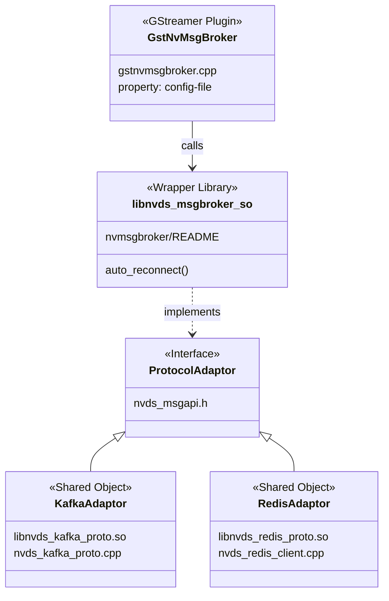

<!-- source: DeepWiki mcp.deepwiki.com · repo NVIDIA/DeepStream · page 6 Cloud Messaging & Analytics · fetched 2026-10-26 -->

# Cloud Messaging & Analytics

<details>
<summary>Relevant source files</summary>

The following files were used as context for generating this wiki page:

- [CHANGELOG.md](CHANGELOG.md)
- [src/utils/nvds_msgapi/README.md](src/utils/nvds_msgapi/README.md)
- [src/utils/nvds_msgapi/amqp_protocol_adaptor/Makefile](src/utils/nvds_msgapi/amqp_protocol_adaptor/Makefile)
- [src/utils/nvds_msgapi/kafka_protocol_adaptor/Makefile](src/utils/nvds_msgapi/kafka_protocol_adaptor/Makefile)
- [src/utils/nvds_msgapi/mqtt_protocol_adaptor/Makefile](src/utils/nvds_msgapi/mqtt_protocol_adaptor/Makefile)
- [src/utils/nvds_msgapi/redis_protocol_adaptor/Makefile](src/utils/nvds_msgapi/redis_protocol_adaptor/Makefile)
- [src/utils/nvmsgbroker/README](src/utils/nvmsgbroker/README)

</details>


DeepStream provides a robust framework for transforming raw inference metadata into actionable insights and transmitting them to cloud or on-premises infrastructure. This subsystem is divided into two primary functional areas: **Analytics & Spatial Intelligence**, which generates high-level events (e.g., line crossing, occupancy) from object tracking data, and **Cloud Messaging**, which serializes this data and handles the transport to various message brokers.

## System Overview

The integration between analytics and messaging allows for a seamless flow from pixel to cloud. The `nvdsanalytics` plugin processes metadata from the tracker to identify spatial events, which are then converted into standardized JSON or Protobuf schemas by `nvmsgconv` and dispatched via the `nvds_msgapi` framework.

### Component Relationship
The following diagram illustrates how metadata flows from the vision pipeline into the analytics and messaging subsystems.

**Vision to Cloud Metadata Flow**
```mermaid
graph TD
    subgraph "Vision Pipeline"
        [nvtracker] --> |"Object Metadata"| [nvdsanalytics]
        [nvdsanalytics] --> |"Event Metadata"| [nvmsgconv]
    end

    subgraph "Messaging Subsystem (nvds_msgapi)"
        [nvmsgconv] --> |"Serialized Payload"| [gst-nvmsgbroker]
        [gst-nvmsgbroker] --> [libnvds_msgbroker.so]
        [libnvds_msgbroker.so] --> [Protocol_Adaptors]
    end

    subgraph "External Brokers"
        [Protocol_Adaptors] -.-> |"Kafka/MQTT/AMQP/Redis"| Broker["Cloud/Edge Broker"]
    end

    style [nvdsanalytics] stroke-width:2px
    style [libnvds_msgbroker.so] stroke-width:2px
```
**Sources:** [src/utils/nvds_msgapi/README.md:18-20](), [src/utils/nvmsgbroker/README:16-20]()

---

## Message Broker & Protocol Adaptors

The messaging subsystem is built around the **DeepStream Messaging Interface (DSMI)**, a protocol-agnostic API defined in `nvds_msgapi` [src/utils/nvds_msgapi/README.md:18-20](). This architecture allows developers to swap transport layers (e.g., switching from Kafka to MQTT) without modifying the core pipeline logic.

### Supported Adaptors
DeepStream includes several pre-built protocol adaptors implemented as shared libraries:

| Adaptor | Shared Library | Underlying Technology |
| :--- | :--- | :--- |
| **Kafka** | `libnvds_kafka_proto.so` | `librdkafka`, `Protobuf` [src/utils/nvds_msgapi/kafka_protocol_adaptor/Makefile:25-41]() |
| **MQTT** | `libnvds_mqtt_proto.so` | `libmosquitto` [src/utils/nvds_msgapi/mqtt_protocol_adaptor/Makefile:22-41]() |
| **Azure IoT** | `libnvds_azure_proto.so` | Azure IoT Hub SDK [src/utils/nvds_msgapi/README.md:32-32]() |
| **AMQP** | `libnvds_amqp_proto.so` | `librabbitmq` [src/utils/nvds_msgapi/amqp_protocol_adaptor/Makefile:22-37]() |
| **Redis** | `libnvds_redis_proto.so` | `hiredis` [src/utils/nvds_msgapi/redis_protocol_adaptor/Makefile:22-38]() |

### Key Features
*   **Auto-Reconnection**: The `nvmsgbroker` library provides built-in logic for `auto-reconnect`, `retry-interval`, and `max-retry-limit` [src/utils/nvmsgbroker/README:30-38]().
*   **Connection Sharing**: Multiple components within the same process can share a single broker connection by enabling `share-connection=1` in the configuration [src/utils/nvmsgbroker/README:101-107]().

For detailed information on configuring schemas, payload variants, and specific broker settings, see **[Message Broker & Protocol Adaptors](#6.1)**.

---

## Analytics & Spatial Intelligence

The `nvdsanalytics` plugin provides high-level spatial perception by analyzing the trajectories and positions of tracked objects. It operates on the `NvDsFrameMeta` and `NvDsObjectMeta` structures generated by preceding inference and tracking stages.

### Capabilities
*   **Line Crossing Detection**: Triggers events when objects cross user-defined virtual lines in a specific direction.
*   **ROI Filtering**: Filters or counts objects within specific Regions of Interest.
*   **Overcrowding Detection**: Monitors object density within defined zones and triggers alerts when thresholds are exceeded.
*   **Direction Detection**: Identifies the movement vector of objects to determine if they are moving in prohibited or expected directions.

### Runtime Control
DeepStream supports the `nvds_rest_server`, which allows for live pipeline control and querying of analytics metadata via a RESTful API.

For implementation details, configuration file syntax, and spatial intelligence algorithms, see **[Analytics & Spatial Intelligence](#6.2)**.

---

## Code Entity Map

The following diagram maps the logical messaging components to their specific source implementations and build artifacts.

**Messaging Entity Mapping**

**Sources:** [src/utils/nvds_msgapi/README.md:20-35](), [src/utils/nvmsgbroker/README:16-19](), [src/utils/nvds_msgapi/kafka_protocol_adaptor/Makefile:25-26](), [src/utils/nvds_msgapi/redis_protocol_adaptor/Makefile:22-23]()

---

