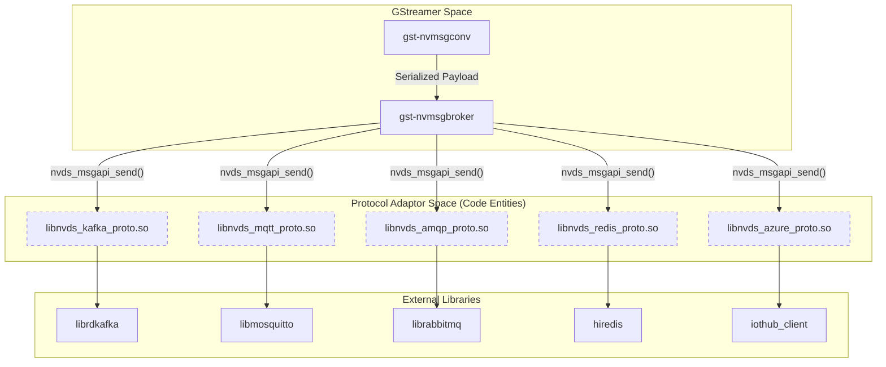
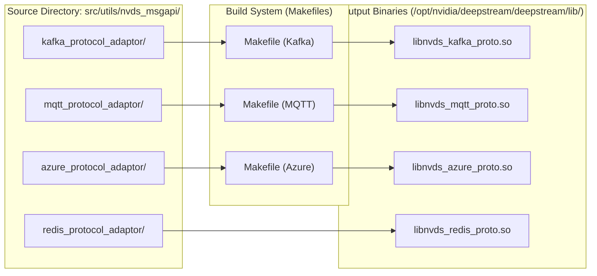

<!-- source: DeepWiki mcp.deepwiki.com · repo NVIDIA/DeepStream · page 6.1 Message Broker & Protocol Adaptors · fetched 2026-10-26 -->

# Message Broker & Protocol Adaptors

Relevant source files

The following files were used as context for generating this wiki page:

- [CHANGELOG.md](CHANGELOG.md)
- [src/utils/ds3d/datafilter/lidar_preprocess/Makefile](src/utils/ds3d/datafilter/lidar_preprocess/Makefile)
- [src/utils/ds3d/dataloader/lidarsource/Makefile](src/utils/ds3d/dataloader/lidarsource/Makefile)
- [src/utils/nvds_msgapi/README.md](src/utils/nvds_msgapi/README.md)
- [src/utils/nvds_msgapi/amqp_protocol_adaptor/Makefile](src/utils/nvds_msgapi/amqp_protocol_adaptor/Makefile)
- [src/utils/nvds_msgapi/amqp_protocol_adaptor/Makefile.test](src/utils/nvds_msgapi/amqp_protocol_adaptor/Makefile.test)
- [src/utils/nvds_msgapi/azure_protocol_adaptor/device_client/Makefile](src/utils/nvds_msgapi/azure_protocol_adaptor/device_client/Makefile)
- [src/utils/nvds_msgapi/azure_protocol_adaptor/device_client/Makefile.test](src/utils/nvds_msgapi/azure_protocol_adaptor/device_client/Makefile.test)
- [src/utils/nvds_msgapi/azure_protocol_adaptor/module_client/Makefile](src/utils/nvds_msgapi/azure_protocol_adaptor/module_client/Makefile)
- [src/utils/nvds_msgapi/azure_protocol_adaptor/module_client/Makefile.test](src/utils/nvds_msgapi/azure_protocol_adaptor/module_client/Makefile.test)
- [src/utils/nvds_msgapi/kafka_protocol_adaptor/Makefile](src/utils/nvds_msgapi/kafka_protocol_adaptor/Makefile)
- [src/utils/nvds_msgapi/kafka_protocol_adaptor/Makefile.test](src/utils/nvds_msgapi/kafka_protocol_adaptor/Makefile.test)
- [src/utils/nvds_msgapi/kafka_protocol_adaptor/README](src/utils/nvds_msgapi/kafka_protocol_adaptor/README)
- [src/utils/nvds_msgapi/mqtt_protocol_adaptor/Makefile](src/utils/nvds_msgapi/mqtt_protocol_adaptor/Makefile)
- [src/utils/nvds_msgapi/mqtt_protocol_adaptor/Makefile.test](src/utils/nvds_msgapi/mqtt_protocol_adaptor/Makefile.test)
- [src/utils/nvds_msgapi/mqtt_protocol_adaptor/README](src/utils/nvds_msgapi/mqtt_protocol_adaptor/README)
- [src/utils/nvds_msgapi/redis_protocol_adaptor/Makefile](src/utils/nvds_msgapi/redis_protocol_adaptor/Makefile)
- [src/utils/nvds_msgapi/redis_protocol_adaptor/Makefile.test](src/utils/nvds_msgapi/redis_protocol_adaptor/Makefile.test)
- [src/utils/nvds_msgapi/redis_protocol_adaptor/README](src/utils/nvds_msgapi/redis_protocol_adaptor/README)
- [src/utils/nvmsgbroker/Makefile.test](src/utils/nvmsgbroker/Makefile.test)
- [src/utils/nvmsgbroker/README](src/utils/nvmsgbroker/README)
- [src/utils/nvmsgconv/Makefile](src/utils/nvmsgconv/Makefile)
- [src/utils/nvmsgconv/deepstream_schema/lidar_schema.proto](src/utils/nvmsgconv/deepstream_schema/lidar_schema.proto)
- [src/utils/nvmsgconv/deepstream_schema/schema.proto](src/utils/nvmsgconv/deepstream_schema/schema.proto)
- [src/utils/nvmsgconv_mega/Makefile](src/utils/nvmsgconv_mega/Makefile)
- [src/utils/nvmsgconv_mega/deepstream_schema/schema.proto](src/utils/nvmsgconv_mega/deepstream_schema/schema.proto)
- [src/utils/nvmsgconv_mega2d/Makefile](src/utils/nvmsgconv_mega2d/Makefile)

The DeepStream Message Broker and Protocol Adaptor framework enables the transmission of generated metadata (events, objects, and sensor data) to cloud and edge-based messaging systems. This subsystem provides a standardized interface, `nvds_msgapi`, which decouples the GStreamer pipeline logic from specific messaging protocols.

DeepStream supports several industry-standard protocols through dedicated adaptors:
*   **Kafka**: Using `librdkafka` and Google Protobuf.
*   **MQTT**: Using `libmosquitto`.
*   **AMQP**: Using `librabbitmq` (RabbitMQ).
*   **Redis**: Using `hiredis`.
*   **Azure IoT Hub**: Supporting both Device and Module (Edge) client modes.

## Architecture & Data Flow

The messaging subsystem operates as a two-stage process: conversion and transmission. Metadata generated by inference and tracking plugins is first converted into a serialized format (JSON or Protobuf) and then handed off to a protocol-specific adaptor for delivery.

### System Interaction Diagram

This diagram bridges the high-level functional blocks to the specific shared libraries and source entities implemented in the codebase.

"DeepStream Messaging Component Mapping"

**Sources:** [src/utils/nvds_msgapi/kafka_protocol_adaptor/Makefile:25-26](), [src/utils/nvds_msgapi/mqtt_protocol_adaptor/Makefile:22-26](), [src/utils/nvds_msgapi/amqp_protocol_adaptor/Makefile:22-23](), [src/utils/nvds_msgapi/redis_protocol_adaptor/Makefile:22-23](), [src/utils/nvds_msgapi/azure_protocol_adaptor/device_client/Makefile:22-23]().

---

## nvds_msgapi Framework

The `nvds_msgapi` is a C-based abstraction layer. Each protocol adaptor implements a set of common functions that `gst-nvmsgbroker` calls dynamically at runtime.

### Key Protocol Adaptors

#### 1. Kafka Adaptor
The Kafka adaptor uses `librdkafka` and is unique in its heavy integration with Protobuf for structured schema delivery.
*   **Core Files:** `nvds_kafka_proto.cpp`, `kafka_client.cpp`, `json_helper.cpp`.
*   **Dependencies:** `lrdkafka`, `lprotobuf`, `ljansson` [src/utils/nvds_msgapi/kafka_protocol_adaptor/Makefile:41]().
*   **Schema:** Compiles `schema.proto` into `schema.pb.cc` during build [src/utils/nvds_msgapi/kafka_protocol_adaptor/Makefile:55-56]().

#### 2. MQTT Adaptor
A lightweight adaptor based on `libmosquitto`.
*   **Core Files:** `nvds_mqtt_proto.cpp`, `nvds_utils.cpp`.
*   **Dependencies:** `lmosquitto` [src/utils/nvds_msgapi/mqtt_protocol_adaptor/Makefile:41]().

#### 3. Azure IoT Hub Adaptor
Supports two distinct modes of operation:
*   **Device Client:** `libnvds_azure_proto.so` for direct device-to-cloud communication [src/utils/nvds_msgapi/azure_protocol_adaptor/device_client/Makefile:23]().
*   **Module Client:** `libnvds_azure_edge_proto.so` for running as an Azure IoT Edge module [src/utils/nvds_msgapi/azure_protocol_adaptor/module_client/Makefile:23-29]().

#### 4. Redis & AMQP Adaptors
*   **Redis:** Uses `hiredis` to push metadata to Redis instances [src/utils/nvds_msgapi/redis_protocol_adaptor/Makefile:38]().
*   **AMQP:** Uses `librabbitmq` for integration with RabbitMQ brokers [src/utils/nvds_msgapi/amqp_protocol_adaptor/Makefile:37]().

---

## Metadata Serialization (nvmsgconv)

The `nvmsgconv` library is responsible for transforming DeepStream's internal metadata structures into standardized payloads. DeepStream 9.1 provides several variants of this converter to handle different schema requirements.

### Schema Variants
DeepStream supports multiple "MEGA" schema variants, which are optimized for different metadata densities and types.

| Library | Primary Use Case | Key Source Files |
| :--- | :--- | :--- |
| `libnvds_msgconv.so` | Standard DeepStream schema (JSON/Protobuf) | `nvmsgconv.cpp`, `deepstream_schema.cpp` |
| `libnvds_msgconv_mega.so` | Optimized "Mega" schema for high-throughput | `nvmsgconv_mega.cpp` |
| `libnvds_msgconv_mega2d.so` | Enhanced 2D metadata support | `nvmsgconv.cpp` (mega2d variant) |

**Sources:** [src/utils/nvmsgconv/Makefile:44](), [src/utils/nvmsgconv_mega/Makefile:44](), [src/utils/nvmsgconv_mega2d/Makefile:44]().

### Protobuf Schema Definition
For both standard and LiDAR-based metadata, the converter utilizes Google Protobuf definitions found in `deepstream_schema/*.proto`. These are compiled into C++ classes during the build process:
*   `schema.proto`: Standard object detection and event metadata [src/utils/nvmsgconv/Makefile:57-59]().
*   `lidar_schema.proto`: Specialized metadata for 3D point cloud and LiDAR processing [src/utils/nvmsgconv/Makefile:42]().

---

## Code-to-Logic Mapping

The following diagram illustrates how the build system and source files map to the resulting functional libraries used by the `gst-nvmsgbroker` plugin.

"Build Artifact and Protocol Mapping"

**Sources:** [src/utils/nvds_msgapi/kafka_protocol_adaptor/Makefile:20-26](), [src/utils/nvds_msgapi/mqtt_protocol_adaptor/Makefile:20-27](), [src/utils/nvds_msgapi/azure_protocol_adaptor/device_client/Makefile:20-23](), [src/utils/nvds_msgapi/redis_protocol_adaptor/Makefile:20-23]().

---

## Implementation Details

### Build Configuration
Adaptors are built as position-independent code (`-fPIC`) and linked against `glib-2.0` and `nvds_logger` for standardized logging [src/utils/nvds_msgapi/kafka_protocol_adaptor/Makefile:28-41]().

### LiDAR Support
The messaging system includes specific support for LiDAR data through the `ds3d` utilities. This involves specialized datafilters and dataloaders that prepare point cloud metadata for serialization via `lidar_schema.pb.cc` [src/utils/ds3d/datafilter/lidar_preprocess/Makefile:41-45](), [src/utils/nvmsgconv/Makefile:42]().

**Sources:**
*   `src/utils/nvds_msgapi/kafka_protocol_adaptor/Makefile`
*   `src/utils/nvds_msgapi/mqtt_protocol_adaptor/Makefile`
*   `src/utils/nvds_msgapi/amqp_protocol_adaptor/Makefile`
*   `src/utils/nvds_msgapi/redis_protocol_adaptor/Makefile`
*   `src/utils/nvds_msgapi/azure_protocol_adaptor/device_client/Makefile`
*   `src/utils/nvds_msgapi/azure_protocol_adaptor/module_client/Makefile`
*   `src/utils/nvmsgconv/Makefile`
*   `src/utils/nvmsgconv_mega/Makefile`
*   `src/utils/nvmsgconv_mega2d/Makefile`
*   `src/utils/ds3d/datafilter/lidar_preprocess/Makefile`
*   `src/utils/ds3d/dataloader/lidarsource/Makefile`
*   `CHANGELOG.md`

---

