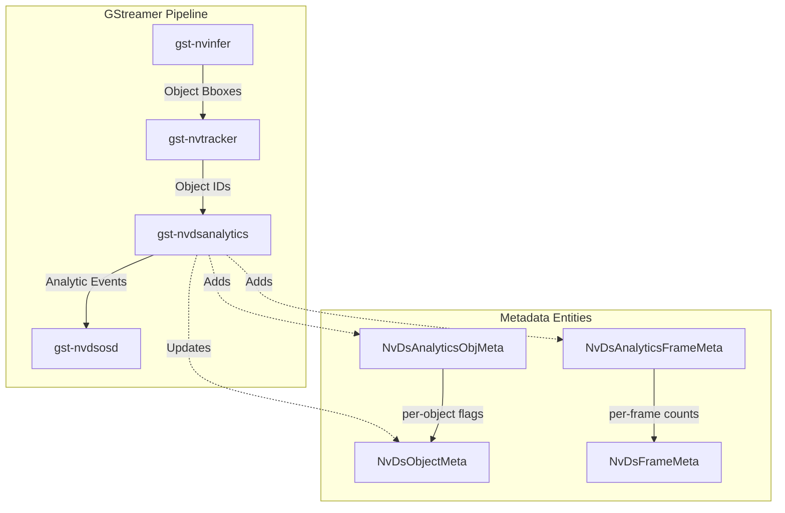
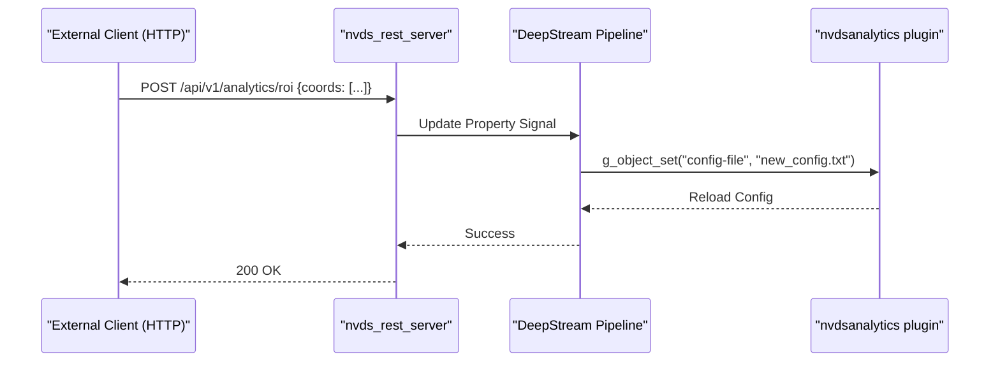

<!-- source: DeepWiki mcp.deepwiki.com · repo NVIDIA/DeepStream · page 6.2 Analytics & Spatial Intelligence · fetched 2026-10-26 -->

# Analytics & Spatial Intelligence

<details>
<summary>Relevant source files</summary>

The following files were used as context for generating this wiki page:

- [src/apps/reference_apps/deepstream-bodypose-3d/README.md](src/apps/reference_apps/deepstream-bodypose-3d/README.md)
- [src/apps/reference_apps/deepstream-custom-tile-config/README.md](src/apps/reference_apps/deepstream-custom-tile-config/README.md)
- [src/apps/reference_apps/deepstream-ipc-test-sr/README.md](src/apps/reference_apps/deepstream-ipc-test-sr/README.md)
- [src/apps/reference_apps/deepstream-masktracker/README.md](src/apps/reference_apps/deepstream-masktracker/README.md)
- [src/apps/reference_apps/pyservicemaker_sample_apps/README.md](src/apps/reference_apps/pyservicemaker_sample_apps/README.md)
- [src/apps/reference_apps/pyservicemaker_sample_apps/pipeline_api/deepstream_nvdsanalytics_test_app/README.md](src/apps/reference_apps/pyservicemaker_sample_apps/pipeline_api/deepstream_nvdsanalytics_test_app/README.md)
- [src/apps/sample_apps/deepstream-nvdsanalytics-test/Makefile.ds](src/apps/sample_apps/deepstream-nvdsanalytics-test/Makefile.ds)
- [src/apps/tao_apps/apps/tao_others/deepstream-pose-classification/README.md](src/apps/tao_apps/apps/tao_others/deepstream-pose-classification/README.md)
- [src/apps/tao_apps/pysm-apps/common/utils.py](src/apps/tao_apps/pysm-apps/common/utils.py)

</details>


The `nvdsanalytics` plugin and its underlying library `libnvds_analytics.so` provide DeepStream with spatial intelligence capabilities. This subsystem enables high-level semantic analysis of video streams by transforming raw object detection and tracking data into actionable events such as line-crossing, region-of-interest (ROI) filtering, overcrowding detection, and movement direction analysis.

## 1. Plugin Architecture & Data Flow

The `nvdsanalytics` plugin is typically placed in the pipeline after the tracker (`nvtracker`) to ensure each object has a unique ID across frames. It processes metadata attached by previous components and adds its own analytic metadata to the frame.

### Metadata Flow
1.  **Input**: The plugin receives `NvDsBatchMeta` containing `NvDsFrameMeta` and `NvDsObjectMeta` from detection and tracking stages [src/apps/sample_apps/deepstream-nvdsanalytics-test/deepstream_nvdsanalytics_meta.cpp:79-80]().
2.  **Processing**: It evaluates each object's trajectory against user-defined zones and lines configured in a text file.
3.  **Output**: It attaches `NvDsAnalyticsFrameMeta` and `NvDsAnalyticsObjMeta` to the metadata pool. These structures contain boolean flags and counters for analytics events [src/apps/sample_apps/deepstream-nvdsanalytics-test/deepstream_nvdsanalytics_meta.cpp:53-54]().

### System Architecture Diagram
This diagram illustrates how the `nvdsanalytics` plugin interacts with the GStreamer pipeline and the metadata structures defined in the codebase.

**Analytics Pipeline Integration**

Sources: [src/apps/sample_apps/deepstream-nvdsanalytics-test/deepstream_nvdsanalytics_meta.cpp:53-54](), [src/apps/sample_apps/pyservicemaker_sample_apps/pipeline_api/deepstream_nvdsanalytics_test_app/README.md:29-33]()

## 2. Key Analytic Features

The plugin supports four primary spatial intelligence features, configured via a specialized configuration file.

| Feature | Description | Use Case |
| :--- | :--- | :--- |
| **Line Crossing** | Detects when an object's foot position crosses a defined line in a specific direction. | Entry/Exit counting. |
| **ROI Filtering** | Filters objects based on whether they are inside or outside a defined polygon. | Restricted area monitoring. |
| **Overcrowding** | Triggers an event when the number of objects in an ROI exceeds a threshold. | Queue management, safety. |
| **Direction Detection** | Detects if an object is moving in a prohibited or predefined direction. | Wrong-way detection in traffic. |

Sources: [src/apps/sample_apps/pyservicemaker_sample_apps/pipeline_api/deepstream_nvdsanalytics_test_app/README.md:31-33]()

## 3. Configuration & Metadata Extraction

The `nvdsanalytics` plugin is configured via a text file (often `config_nvdsanalytics.txt`) that defines lines and polygons using pixel coordinates.

### Metadata Access in C++
In reference applications, metadata is extracted by traversing the `NvDsBatchMeta`. The sample `deepstream-nvdsanalytics-test` demonstrates how to parse these analytics results.

```cpp
/* Accessing Analytics Metadata */
// Path: src/apps/sample_apps/deepstream-nvdsanalytics-test/deepstream_nvdsanalytics_meta.cpp
for (l_user = frame_meta->frame_user_meta_list; l_user != NULL; l_user = l_user->next) {
    user_meta = (NvDsUserMeta *) l_user->data;
    if (user_meta->base_meta.meta_type == NVDS_USER_FRAME_META_NVDSANALYTICS) {
        NvDsAnalyticsFrameMeta *meta = (NvDsAnalyticsFrameMeta *) user_meta->user_meta_data;
        // Access meta->objInROIcnt, meta->objLCCumCnt, etc.
    }
}
```
Sources: [src/apps/sample_apps/deepstream-nvdsanalytics-test/deepstream_nvdsanalytics_meta.cpp:53-54](), [src/apps/sample_apps/deepstream-nvdsanalytics-test/Makefile.ds:79-80]()

## 4. Live Control via REST Server

DeepStream provides the `nvds_rest_server` to allow runtime modification of the pipeline, including analytics parameters. This allows developers to update ROI boundaries or line-crossing thresholds without restarting the application.

### REST API Integration
The REST server typically runs on a separate thread and communicates with the GStreamer pipeline via bus messages or direct object property updates.

**REST Server Data Flow**

Sources: [src/apps/sample_apps/deepstream-nvdsanalytics-test/Makefile.ds:58-62](), [src/apps/sample_apps/pyservicemaker_sample_apps/pipeline_api/deepstream_nvdsanalytics_test_app/README.md:22-29]()

## 5. Reference Implementation: deepstream-nvdsanalytics-test

The reference application provides a template for integrating spatial intelligence into production workflows. It handles multiple sources and demonstrates batched inference with analytics.

### Build and Execution
The application is built using a standard Makefile that links against `lnvds_meta` and `lnvds_utils` [src/apps/sample_apps/deepstream-nvdsanalytics-test/Makefile.ds:58-59]().

Key source files:
- `deepstream_app_main.c`: Main pipeline loop and GStreamer initialization [src/apps/sample_apps/deepstream-nvdsanalytics-test/Makefile.ds:76-77]().
- `deepstream_nvdsanalytics_meta.cpp`: Logic for parsing and displaying analytics-specific metadata [src/apps/sample_apps/deepstream-nvdsanalytics-test/Makefile.ds:79-80]().

### Usage in Python (Service Maker)
Using the Service Maker SDK, the analytics plugin can be instantiated and linked within a `Flow` or `Pipeline` object [src/apps/reference_apps/pyservicemaker_sample_apps/pipeline_api/deepstream_nvdsanalytics_test_app/README.md:43-45]().

```python
# Example logic from deepstream_nvdsanalytics.py
# 1. Create pipeline with uridecodebin
# 2. Add nvinfer and nvtracker
# 3. Add nvdsanalytics with config-file property
# 4. Attach probe to extract NvDsAnalyticsFrameMeta
```
Sources: [src/apps/reference_apps/pyservicemaker_sample_apps/pipeline_api/deepstream_nvdsanalytics_test_app/README.md:22-33]()

## 6. Advanced Analytics Integration

Spatial intelligence is often combined with other specialized trackers or 3D models. For instance, the `MaskTracker` (SAM2-based) can provide precise segmentation masks that improve ROI filtering accuracy by using the exact object contour instead of a bounding box [src/apps/reference_apps/deepstream-masktracker/README.md:20-22]().

Similarly, in 3D Body Pose applications, analytics can be extended to 3D space (Spatial Intelligence) by utilizing keypoints from `BodyPose3DNet` to detect interactions with 3D volumes [src/apps/reference_apps/deepstream-bodypose-3d/README.md:20-23]().

Sources: [src/apps/reference_apps/deepstream-masktracker/README.md:20-22](), [src/apps/reference_apps/deepstream-bodypose-3d/README.md:20-23]()

---

