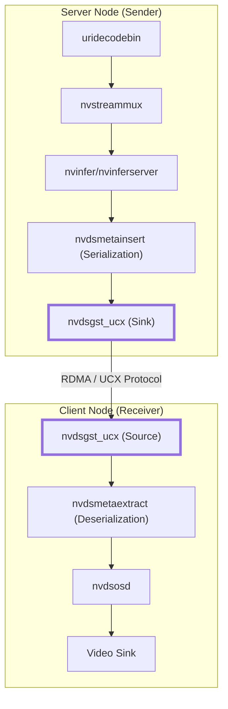
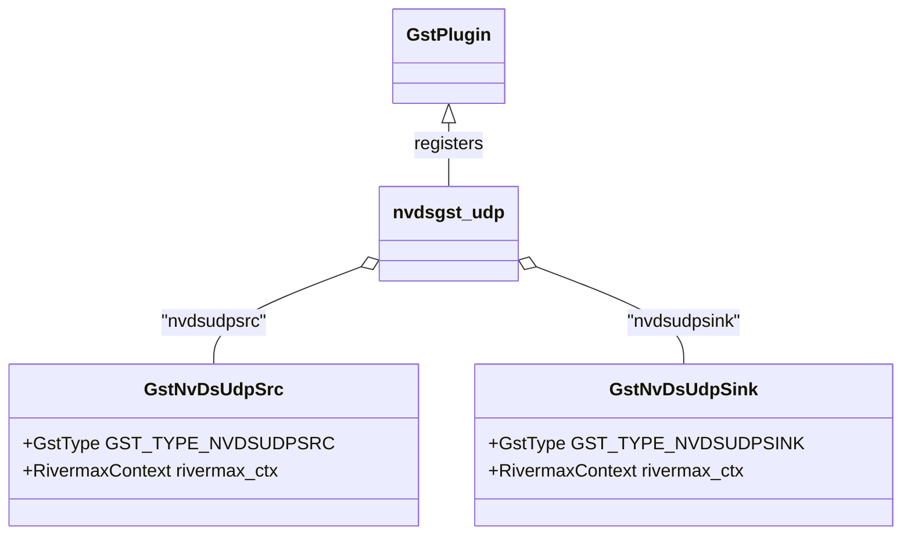

<!-- source: DeepWiki mcp.deepwiki.com · repo NVIDIA/DeepStream · page 7 Networking & Transport · fetched 2026-10-26 -->

# Networking & Transport

Relevant source files

The following files were used as context for generating this wiki page:

- [.claude/.gitkeep](.claude/.gitkeep)
- [.github/.gitkeep](.github/.gitkeep)
- [CODE_OF_CONDUCT.md](CODE_OF_CONDUCT.md)
- [LICENSE](LICENSE)
- [src/apps/sample_apps/deepstream-ucx-test/Makefile](src/apps/sample_apps/deepstream-ucx-test/Makefile)
- [src/apps/sample_apps/deepstream-ucx-test/README](src/apps/sample_apps/deepstream-ucx-test/README)
- [src/apps/sample_apps/deepstream-ucx-test/deepstream_ucx_test_app.c](src/apps/sample_apps/deepstream-ucx-test/deepstream_ucx_test_app.c)
- [src/apps/sample_apps/deepstream-ucx-test/deepstream_ucx_test_app.h](src/apps/sample_apps/deepstream-ucx-test/deepstream_ucx_test_app.h)
- [src/gst-plugins/gst-dsexample-cuda/README](src/gst-plugins/gst-dsexample-cuda/README)
- [src/gst-plugins/gst-nvdsudp/README](src/gst-plugins/gst-nvdsudp/README)
- [src/gst-plugins/gst-nvdsudp/gstnvdsudp.c](src/gst-plugins/gst-nvdsudp/gstnvdsudp.c)

DeepStream provides high-performance networking capabilities designed for low-latency video and metadata transport across distributed nodes. This includes RDMA-accelerated communication via UCX, hardware-offloaded UDP transport using NVIDIA Rivermax, and SMPTE ST 2110 / NMOS compatibility for professional media networking.

## UCX & RDMA Buffer Sharing

The `nvdsgst_ucx` plugin leverages the **Unified Communication-X (UCX)** library to enable high-throughput, low-latency data transfer between DeepStream instances using Remote Direct Memory Access (RDMA) `[src/apps/sample_apps/deepstream-ucx-test/README:66-67]()`. This allows distributed pipelines to share `NVMM` (CUDA) buffers across a network with minimal CPU intervention, provided NVIDIA ConnectX-6 DX or later NICs are used `[src/apps/sample_apps/deepstream-ucx-test/README:30-32]()`.

### Data Flow and Implementation
The UCX transport is implemented as a GStreamer source/sink pair. The `nvdsgst_ucx` plugin acts as either a sink (sender) or a source (receiver) `[src/apps/sample_apps/deepstream-ucx-test/README:76-79]()`.

**UCX Distributed Pipeline Architecture**

| Component | Role | Code Entity |
| :--- | :--- | :--- |
| **UCX Sink** | Serializes metadata and transmits CUDA buffers via RDMA. | `nvdsgst_ucx` (Server role in Test 1) `[src/apps/sample_apps/deepstream-ucx-test/README:76-77]()` |
| **UCX Source** | Receives network packets and reconstructs `NVMM` buffers. | `nvdsgst_ucx` (Client role in Test 1) `[src/apps/sample_apps/deepstream-ucx-test/README:79]()` |
| **Metadata Serializer** | Converts DeepStream metadata to binary for network transport. | `gst-nvdsmetautils` `[src/apps/sample_apps/deepstream-ucx-test/README:88-89]()` |

### UCX Reference Application
The `deepstream-ucx-test-app` demonstrates three primary networking scenarios:
1.  **Basic Video Transmission**: Raw video frames sent over RDMA `[src/apps/sample_apps/deepstream-ucx-test/README:69-71]()`.
2.  **Video with Metadata**: Transmission of frames along with inference metadata serialized by `libnvds_videometadatatransform.so` `[src/apps/sample_apps/deepstream-ucx-test/README:87-90]()`.
3.  **Audio with Metadata**: RDMA transport of audio buffers and serialized audio metadata `[src/apps/sample_apps/deepstream-ucx-test/README:109-112]()`.

**Logic Flow: UCX Client/Server Setup**

*Sources: `[src/apps/sample_apps/deepstream-ucx-test/README:87-107]()`, `[src/apps/sample_apps/deepstream-ucx-test/deepstream_ucx_test_app.c:149-195]()`*

## UDP Transport via Rivermax (gst-nvdsudp)

The `nvdsgst_udp` plugin provides `nvdsudpsrc` and `nvdsudpsink` elements `[src/gst-plugins/gst-nvdsudp/gstnvdsudp.c:24-30]()`. These elements utilize the **NVIDIA Rivermax SDK** to perform high-speed UDP transfers that are optimized for media streaming, specifically targeting SMPTE ST 2110 environments.

### Key Features
*   **Hardware Acceleration**: Leverages Rivermax to offload the network stack, reducing jitter and CPU utilization `[src/gst-plugins/gst-nvdsudp/gstnvdsudp.c:37]()`.
*   **Professional Media Support**: Integration with NMOS (Networked Media Open Specifications) IS-04 and IS-05 for discovery and connection management in broadcast workflows.
*   **Requirements**: Requires CUDA Runtime 12.0+ and the Rivermax SDK `[src/gst-plugins/gst-nvdsudp/README:23-24]()`.

**Code Entity Mapping: UDP Plugin**

*Sources: `[src/gst-plugins/gst-nvdsudp/gstnvdsudp.c:21-42]()`*

## Metadata Serialization for Transport

Standard GStreamer buffers do not inherently transport DeepStream's complex metadata (e.g., `NvDsBatchMeta`) over network sockets. To facilitate this, the `gst-nvdsmetautils` library is used to transform metadata into a serializable binary payload.

### Components
*   **nvdsmetainsert**: A plugin that takes DeepStream metadata and attaches it as a serialized payload to the GstBuffer `[src/apps/sample_apps/deepstream-ucx-test/README:96-97]()`.
*   **nvdsmetaextract**: The corresponding receiver-side plugin that reconstructs the `NvDsBatchMeta` from the serialized payload `[src/apps/sample_apps/deepstream-ucx-test/README:102]()`.

This mechanism is critical for the `deepstream-ucx-test` application when running distributed inference, where one node performs detection and another node performs secondary inference or visualization `[src/apps/sample_apps/deepstream-ucx-test/README:87-108]()`.

## Technical Configuration

### UCX Build Requirements
To enable RDMA support, UCX must be compiled with CUDA support using the `--with-cuda` flag `[src/apps/sample_apps/deepstream-ucx-test/README:44-49]()`. The `deepstream-ucx-test-app` is currently supported on x86 platforms only `[src/apps/sample_apps/deepstream-ucx-test/README:132-137]()`.

### Plugin Initialization
The UDP plugins are defined in `src/gst-plugins/gst-nvdsudp/gstnvdsudp.c` using the `GST_PLUGIN_DEFINE` macro, identifying the package as `nvdsgst_udp` `[src/gst-plugins/gst-nvdsudp/gstnvdsudp.c:40-42]()`.

| Feature | Plugin Name | Target Use Case |
| :--- | :--- | :--- |
| **RDMA Transport** | `nvdsgst_ucx` | Low-latency node-to-node buffer sharing. |
| **UDP/Rivermax** | `nvdsgst_udp` | Professional media (ST 2110) and NMOS networking. |
| **Metadata Utils** | `nvdsgst_metautils` | Serialization of `NvDsMeta` for any network transport. |

*Sources: `[src/gst-plugins/gst-nvdsudp/gstnvdsudp.c:35-42]()`, `[src/apps/sample_apps/deepstream-ucx-test/README:64-68]()`*

---

