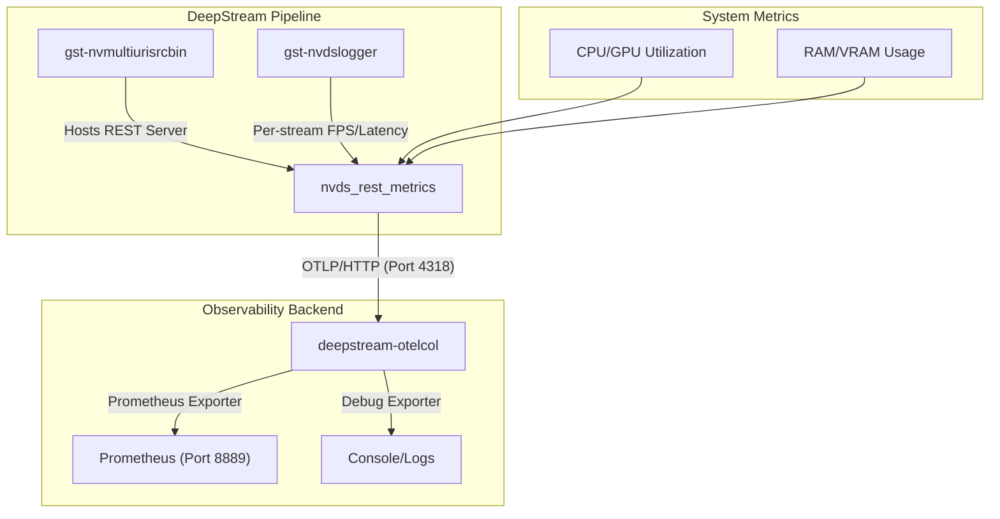
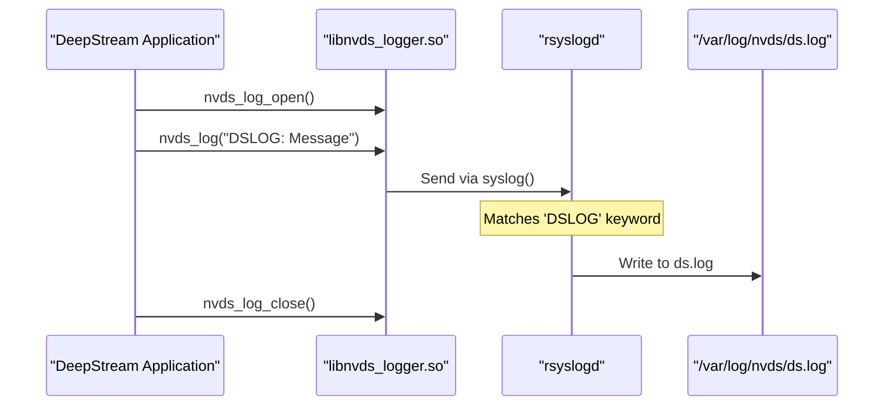

<!-- source: DeepWiki mcp.deepwiki.com · repo NVIDIA/DeepStream · page 8 Observability & Telemetry · fetched 2026-10-26 -->

# Observability & Telemetry

Relevant source files

The following files were used as context for generating this wiki page:

- [AGENTS.md](AGENTS.md)
- [CLAUDE.md](CLAUDE.md)
- [scripts/install_opensource_deps.sh](scripts/install_opensource_deps.sh)
- [src/gst-plugins/gst-nvdsvideotemplate/customlib_impl/Makefile](src/gst-plugins/gst-nvdsvideotemplate/customlib_impl/Makefile)
- [src/utils/nvds_logger/README](src/utils/nvds_logger/README)
- [src/utils/nvds_logger/setup_nvds_logger.sh](src/utils/nvds_logger/setup_nvds_logger.sh)
- [src/utils/nvmultiobjecttracker/model/tracker_ReID/README](src/utils/nvmultiobjecttracker/model/tracker_ReID/README)
- [tools/deepstream-otelcol/README.md](tools/deepstream-otelcol/README.md)

DeepStream 9.1 provides a comprehensive observability stack designed for production-grade monitoring of computer vision pipelines. This stack includes native **OpenTelemetry (OTEL)** integration for metrics and traces, a dedicated **Prometheus** exporter via an OTEL collector, and a system-level logging framework based on **rsyslog**. These tools enable real-time tracking of stream health, pipeline latency, hardware utilization, and application events.

## OpenTelemetry Integration

DeepStream utilizes the `opentelemetry-cpp` library to export telemetry data using the OpenTelemetry Protocol (OTLP). The integration supports both **HTTP** and **gRPC** exporters, allowing DeepStream to push metrics to the `deepstream-otelcol` collector or any OTLP-compliant backend.

### Data Flow Architecture

The telemetry pipeline is activated when `nvmultiurisrcbin` is present in the GStreamer pipeline. It aggregates data from internal components and system sensors.

Title: DeepStream OpenTelemetry Data Flow

**Sources:** [tools/deepstream-otelcol/README.md:62-69](), [tools/deepstream-otelcol/README.md:137-151]()

### Key Metrics
DeepStream exports the following metrics for monitoring pipeline performance:

| Metric | Description | Source Component |
| :--- | :--- | :--- |
| `stream_fps` | Frames per second processed per individual stream. | `gst-nvdslogger` |
| `stream_latency` | End-to-end pipeline latency in milliseconds. | `gst-nvdslogger` |
| `stream_frame_number` | Current frame sequence number per stream. | `gst-nvdslogger` |
| `gpu_utilization` | Percentage of GPU compute resources in use. | System Sensors |
| `gpu_memory_gb` | GPU memory usage in Gigabytes. | System Sensors |

**Sources:** [tools/deepstream-otelcol/README.md:137-151]()

## OTEL Collector Setup (`deepstream-otelcol`)

The `deepstream-otelcol` tool provides a pre-configured OpenTelemetry Collector binary and configuration tailored for DeepStream metrics.

### Installation and Configuration
The collector is installed via `setup-collector.sh` and managed by `start-collector.sh`. It listens on the following default endpoints:
*   **gRPC Receiver**: `127.0.0.1:4317` [tools/deepstream-otelcol/README.md:54-54]()
*   **HTTP Receiver**: `127.0.0.1:4318` [tools/deepstream-otelcol/README.md:55-55]()
*   **Prometheus Exporter**: `127.0.0.1:8889/metrics` [tools/deepstream-otelcol/README.md:56-56]()

### Environment Configuration
To enable telemetry in a DeepStream application, specific environment variables must be set:
*   `OTEL_SDK_DISABLED=false`: Enables the internal OTEL SDK [tools/deepstream-otelcol/README.md:100-100]().
*   `OTEL_EXPORTER_OTLP_ENDPOINT`: The URL of the collector (e.g., `http://127.0.0.1:4318`) [tools/deepstream-otelcol/README.md:102-102]().
*   `OTEL_METRIC_EXPORT_INTERVAL`: Frequency of metric pushes in milliseconds [tools/deepstream-otelcol/README.md:104-104]().

**Sources:** [tools/deepstream-otelcol/README.md:18-58](), [tools/deepstream-otelcol/README.md:95-115]()

## System Logging (`nvds_logger`)

The `nvds_logger` library provides a centralized logging mechanism based on `rsyslog`. It allows multiple DeepStream instances to log to a shared system file with standardized severity levels.

### Implementation Details
The logger is configured via `setup_nvds_logger.sh`, which creates a custom rsyslog configuration file `11-nvds.conf` in `/etc/rsyslog.d/` [src/utils/nvds_logger/setup_nvds_logger.sh:61-63]().

Title: nvds_logger System Integration

**Sources:** [src/utils/nvds_logger/README:34-45](), [src/utils/nvds_logger/setup_nvds_logger.sh:58-60]()

### Configuration & Usage
1.  **Setup**: Run `sudo ./setup_nvds_logger.sh` to initialize the `/var/log/nvds/` directory and restart the `rsyslog` service [src/utils/nvds_logger/setup_nvds_logger.sh:17-68]().
2.  **Filtering**: The default configuration filters for the keyword `DSLOG` and a severity level of `INFO (6)` or lower [src/utils/nvds_logger/setup_nvds_logger.sh:57-58]().
3.  **API**: Applications use `nvds_log_open()`, `nvds_log()`, and `nvds_log_close()` to interface with the library [src/utils/nvds_logger/README:34-44]().

**Sources:** [src/utils/nvds_logger/README:16-47](), [src/utils/nvds_logger/setup_nvds_logger.sh:1-70]()

## Dependency Management

The observability stack relies on several open-source libraries compiled during the DeepStream build process via `scripts/install_opensource_deps.sh`.

| Dependency | Version | Purpose |
| :--- | :--- | :--- |
| `opentelemetry-cpp` | v1.23.0 | Core OTEL SDK and exporters [scripts/install_opensource_deps.sh:21-21]() |
| `prometheus-cpp` | v1.2.4 | Prometheus client for metrics collection [scripts/install_opensource_deps.sh:23-23]() |
| `civetweb` | v1.16 | Embedded web server for the Prometheus endpoint [scripts/install_opensource_deps.sh:22-22]() |

**Sources:** [scripts/install_opensource_deps.sh:20-31](), [scripts/install_opensource_deps.sh:93-193]()

---

