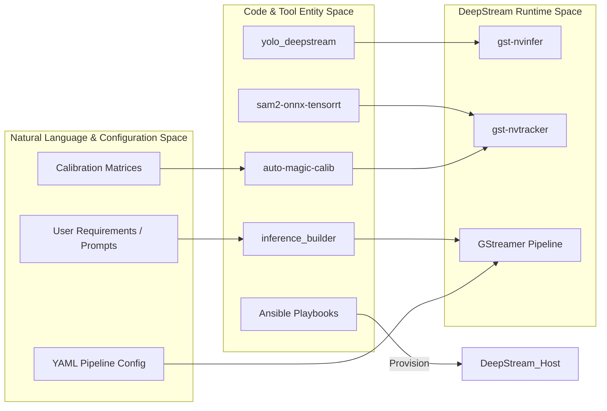

<!-- source: DeepWiki mcp.deepwiki.com · repo NVIDIA/DeepStream · page 9 Tools & Developer Utilities · fetched 2026-10-26 -->

# Tools & Developer Utilities

<details>
<summary>Relevant source files</summary>

The following files were used as context for generating this wiki page:

- [.gitmodules](.gitmodules)
- [src/apps/tao_apps/apps/tao_others/deepstream_custom_preprocessing_app/nvdspreprocess_lib/Makefile](src/apps/tao_apps/apps/tao_others/deepstream_custom_preprocessing_app/nvdspreprocess_lib/Makefile)
- [src/apps/tao_apps/apps/tao_others/deepstream_custom_preprocessing_app/nvdspreprocess_lib/roi_conversion.cu](src/apps/tao_apps/apps/tao_others/deepstream_custom_preprocessing_app/nvdspreprocess_lib/roi_conversion.cu)
- [src/apps/tao_apps/apps/tao_others/deepstream_custom_preprocessing_app/nvdspreprocess_lib/roi_conversion.hpp](src/apps/tao_apps/apps/tao_others/deepstream_custom_preprocessing_app/nvdspreprocess_lib/roi_conversion.hpp)
- [tools/sam2-onnx-tensorrt/checkpoints/download_ckpts.sh](tools/sam2-onnx-tensorrt/checkpoints/download_ckpts.sh)
- [tools/yolo_deepstream/README.md](tools/yolo_deepstream/README.md)
- [tools/yolo_deepstream/yolov7_qat/README.md](tools/yolo_deepstream/yolov7_qat/README.md)

</details>


The `tools/` directory contains a collection of specialized utilities designed to streamline the DeepStream development lifecycle. These tools range from visual pipeline configurators and model-specific export scripts to automated host provisioning and calibration toolchains. This page provides a high-level overview of these utilities and how they integrate with the broader DeepStream ecosystem.

### Toolchain Overview

The following diagram illustrates the relationship between the developer utilities and the DeepStream runtime components.

**Developer Toolchain Mapping**

Sources: [.gitmodules:8-14](), [tools/yolo_deepstream/README.md:10-15]()

---

### YOLO Integration Tools
The `tools/yolo_deepstream/` directory provides a comprehensive suite for deploying various YOLO architectures (v4 through v11) within DeepStream. It addresses the gap between raw PyTorch models and optimized TensorRT engines.

*   **deepstream_yolo**: Contains custom output layer parsers for YOLO models and scripts like `build_DLA_engine.sh` for Deep Learning Accelerator (DLA) optimization [tools/yolo_deepstream/README.md:13-14](), [tools/yolo_deepstream/README.md:106]().
*   **yolov7_qat**: A specialized tool for Quantization-Aware Training. It uses the `pytorch-quantization` library to insert Q/DQ nodes, ensuring optimal INT8 performance and accuracy under TensorRT [tools/yolo_deepstream/yolov7_qat/README.md:42-52]().
*   **tensorrt_yolo**: A standalone C++ application for validating YOLO engines on COCO datasets or processing local video files outside of a full GStreamer pipeline [tools/yolo_deepstream/README.md:10-11]().

For details, see [YOLO Integration Tools](#9.1).

---

### SAM2 ONNX/TensorRT Export
The `tools/sam2-onnx-tensorrt/` utility is critical for users implementing the **MaskTracker** reference application. Segment Anything Model 2 (SAM2) consists of several complex sub-modules that must be exported individually to ONNX for TensorRT acceleration.

The tool handles the export of:
*   Image Encoder
*   Mask Decoder
*   Memory Attention & Memory Encoder

It includes helper scripts like `download_ckpts.sh` to retrieve the necessary Meta AI checkpoints (e.g., `sam2.1_hiera_tiny.pt`) before conversion [tools/sam2-onnx-tensorrt/checkpoints/download_ckpts.sh:40-44]().

For details, see [SAM2 ONNX/TensorRT Export](#9.2).

---

### Auto-Magic Calibration
The `tools/auto-magic-calib` utility is a submodule designed for multi-camera setups, specifically for the Multi-View 3D Tracking (MV3DT) application. It automates the generation of projection and calibration matrices required to map 2D image coordinates to a 3D Bird's Eye View (BEV) space.

**Calibration Flow**
```mermaid
graph TD
    "Input Video/Images" --> "Feature Detection"
    "Feature Detection" --> "Extrinsic Estimation"
    "Extrinsic Estimation" --> "Intrinsic Refinement"
    "Intrinsic Refinement" --> CALIB_FILE["calibration.yml"]
    CALIB_FILE --> "MV3DT Runtime"
```
Sources: [.gitmodules:11-14]()

---

### Host Provisioning & Inference Builder
DeepStream provides utilities to simplify the environment setup and pipeline design:

*   **Ansible Playbooks**: Located within the provisioning tools, these playbooks automate the installation of NVIDIA drivers, CUDA, TensorRT, and DeepStream dependencies on x86 and Jetson hosts.
*   **Inference Builder**: A visual tool (integrated via submodule) that allows developers to configure inference parameters and generate the necessary configuration files for `nvinfer` and `nvinferserver` [tools/inference_builder:8-10]().

---

### Custom Preprocessing Utilities
While often used within specific apps, the `nvdspreprocess_lib` provides a template for custom CUDA-accelerated preprocessing. This includes the `ROIConversion` class which supports various input formats (NV12, RGBA, RGB) and output layouts (CHW, HWC) with affine transformations [src/apps/tao_apps/apps/tao_others/deepstream_custom_preprocessing_app/nvdspreprocess_lib/roi_conversion.hpp:25-64]().

| Component | Class/Struct | Purpose |
| :--- | :--- | :--- |
| **ROI Task** | `struct Task` | Defines source coordinates, input/output dimensions, and affine matrices [src/apps/tao_apps/apps/tao_others/deepstream_custom_preprocessing_app/nvdspreprocess_lib/roi_conversion.hpp:66-81](). |
| **Conversion Engine** | `class ROIConversion` | Interface for adding tasks and executing them on a CUDA stream [src/apps/tao_apps/apps/tao_others/deepstream_custom_preprocessing_app/nvdspreprocess_lib/roi_conversion.hpp:83-87](). |
| **Data Writer** | `struct DataWriter` | Device-side templates for writing pixels in specific layouts like `HWC_RGB` or `CHW_BGR` [src/apps/tao_apps/apps/tao_others/deepstream_custom_preprocessing_app/nvdspreprocess_lib/roi_conversion.cu:118-154](). |

Sources: [src/apps/tao_apps/apps/tao_others/deepstream_custom_preprocessing_app/nvdspreprocess_lib/roi_conversion.hpp:23-96](), [src/apps/tao_apps/apps/tao_others/deepstream_custom_preprocessing_app/nvdspreprocess_lib/roi_conversion.cu:28-154]()

---

