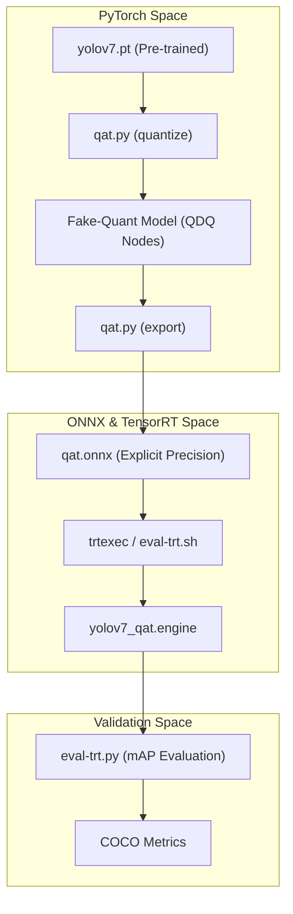
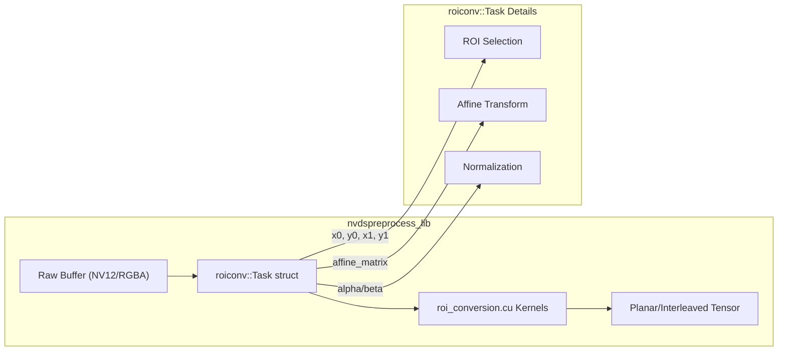

<!-- source: DeepWiki mcp.deepwiki.com · repo NVIDIA/DeepStream · page 9.1 YOLO Integration Tools · fetched 2026-10-26 -->

# YOLO Integration Tools

Relevant source files

The following files were used as context for generating this wiki page:

- [.gitmodules](.gitmodules)
- [src/apps/tao_apps/apps/tao_others/deepstream_custom_preprocessing_app/nvdspreprocess_lib/Makefile](src/apps/tao_apps/apps/tao_others/deepstream_custom_preprocessing_app/nvdspreprocess_lib/Makefile)
- [src/apps/tao_apps/apps/tao_others/deepstream_custom_preprocessing_app/nvdspreprocess_lib/roi_conversion.cu](src/apps/tao_apps/apps/tao_others/deepstream_custom_preprocessing_app/nvdspreprocess_lib/roi_conversion.cu)
- [src/apps/tao_apps/apps/tao_others/deepstream_custom_preprocessing_app/nvdspreprocess_lib/roi_conversion.hpp](src/apps/tao_apps/apps/tao_others/deepstream_custom_preprocessing_app/nvdspreprocess_lib/roi_conversion.hpp)
- [tools/yolo_deepstream/README.md](tools/yolo_deepstream/README.md)
- [tools/yolo_deepstream/deepstream_yolo/build_DLA_engine.sh](tools/yolo_deepstream/deepstream_yolo/build_DLA_engine.sh)
- [tools/yolo_deepstream/tensorrt_yolo/samples/validate_coco.cpp](tools/yolo_deepstream/tensorrt_yolo/samples/validate_coco.cpp)
- [tools/yolo_deepstream/yolov7_qat/README.md](tools/yolo_deepstream/yolov7_qat/README.md)
- [tools/yolo_deepstream/yolov7_qat/scripts/eval-trt.sh](tools/yolo_deepstream/yolov7_qat/scripts/eval-trt.sh)

The DeepStream SDK provides a comprehensive suite of tools for deploying YOLO (You Only Look Once) models, ranging from training-time quantization to high-performance inference on NVIDIA Jetson and Tesla platforms. These tools are primarily located in `tools/yolo_deepstream/` and the `tools/inference_builder` submodule.

## Overview of YOLO Integration Components

The integration is divided into three functional areas:
1.  **Quantization-Aware Training (QAT):** Tools for fine-tuning YOLOv7/v8 models with INT8 precision nodes using the TensorRT PyTorch quantization library.
2.  **Standalone Validation:** C++ tools for verifying TensorRT engine accuracy on standard datasets like COCO.
3.  **DeepStream Deployment:** Configuration templates and scripts for DLA (Deep Learning Accelerator) engine building and custom output parsing.

| Component | Directory Path | Key Functionality |
| :--- | :--- | :--- |
| **yolov7_qat** | `tools/yolo_deepstream/yolov7_qat/` | Q&DQ node insertion, PTQ calibration, and ONNX export `[tools/yolo_deepstream/README.md:6-9]()`. |
| **tensorrt_yolo** | `tools/yolo_deepstream/tensorrt_yolo/` | Standalone C++ app for COCO mAP testing and image/video detection `[tools/yolo_deepstream/README.md:10-12]()`. |
| **deepstream_yolo** | `tools/yolo_deepstream/deepstream_yolo/` | Integration with `nvinfer` via custom parsers and DLA scripts `[tools/yolo_deepstream/README.md:13-14]()`. |
| **inference_builder** | `tools/inference_builder/` | Visual pipeline configurator (Submodule) `[.gitmodules:8-10]()`. |

Sources: `[tools/yolo_deepstream/README.md:1-15]()`, `[.gitmodules:8-10]()`.

## YOLOv7 Quantization-Aware Training (QAT)

The `yolov7_qat` toolset utilizes the `pytorch-quantization` library to insert Quantize and De-Quantize (QDQ) nodes into the YOLOv7 architecture. This ensures optimal fusion during TensorRT engine generation.

### QAT Workflow
The workflow involves three primary stages executed via `scripts/qat.py`:
1.  **Quantization Mapping:** Automatic analysis of the model to insert QDQ nodes based on rules defined in `quantization/rules.py` `[tools/yolo_deepstream/yolov7_qat/README.md:48-48]()`.
2.  **Calibration:** Using `Histogram(MSE)` to determine optimal scales for INT8 quantization `[tools/yolo_deepstream/yolov7_qat/README.md:51-51]()`.
3.  **Export:** Converting the fake-quantized PyTorch model to an ONNX format that TensorRT recognizes as an Explicit Precision model `[tools/yolo_deepstream/yolov7_qat/README.md:59-59]()`.

### Data Flow: From PyTorch to TensorRT Engine
The following diagram illustrates the transformation of a YOLO model through the QAT pipeline.

**YOLO QAT Model Transformation**

Sources: `[tools/yolo_deepstream/yolov7_qat/README.md:16-72]()`, `[tools/yolo_deepstream/yolov7_qat/scripts/eval-trt.sh:4-19]()`.

## Standalone Validation (tensorrt_yolo)

The `tensorrt_yolo` tool provides a high-performance C++ implementation for validating YOLO engines independently of the full DeepStream pipeline. This is critical for isolating model accuracy issues from pipeline configuration issues.

### COCO Validation Tool
The `validate_coco.cpp` application performs the following:
-   **Preprocessing:** Implements `yolo.preProcess` and `yolo.preProcess4Validate` for resolution-specific scaling (e.g., 640x640 or 672x672) `[tools/yolo_deepstream/tensorrt_yolo/samples/validate_coco.cpp:146-155]()`.
-   **Class Mapping:** Converts 80-index COCO classes to the 91-index paper standard using `coco80_to_coco91_class` `[tools/yolo_deepstream/tensorrt_yolo/samples/validate_coco.cpp:61-72]()`.
-   **Post-processing:** Executes NMS (Non-Maximum Suppression) via `yolo.PostProcess` and converts coordinates using `xyxy2xywh` for JSON export `[tools/yolo_deepstream/tensorrt_yolo/samples/validate_coco.cpp:164-182]()`.

Sources: `[tools/yolo_deepstream/tensorrt_yolo/samples/validate_coco.cpp:1-182]()`.

## DeepStream Integration & DLA Engine Building

The `deepstream_yolo` directory contains configurations for deploying YOLOv4, v7, v8, v9, and v11 within DeepStream.

### DLA Engine Construction
For Jetson platforms, utilizing the DLA (Deep Learning Accelerator) is essential for offloading the GPU. The script `build_DLA_engine.sh` demonstrates how to force specific layer precisions to maintain accuracy while running on DLA:
-   **Command:** `trtexec` is used with `--useDLACore=0` and `--allowGPUFallback` `[tools/yolo_deepstream/deepstream_yolo/build_DLA_engine.sh:4-4]()`.
-   **Precision Constraints:** Specific layers (e.g., `Softmax`, `Transpose`, `Sigmoid`) are constrained to `fp16` to avoid the accuracy degradation that occurs if they were forced into INT8 on DLA `[tools/yolo_deepstream/deepstream_yolo/build_DLA_engine.sh:4-4]()`.

### Custom Preprocessing Library
For advanced YOLO deployments, a custom 2D preprocessing library is provided in `src/apps/tao_apps/apps/tao_others/deepstream_custom_preprocessing_app/nvdspreprocess_lib/`.

**Key Components:**
-   **ROI Conversion:** The `ROIConversion` class `[src/apps/tao_apps/apps/tao_others/deepstream_custom_preprocessing_app/nvdspreprocess_lib/roi_conversion.hpp:83-87]()` handles affine transformations and color space conversions.
-   **CUDA Kernels:** `roi_conversion.cu` implements optimized kernels for `NV12`, `RGBA`, and `RGB` input formats `[src/apps/tao_apps/apps/tao_others/deepstream_custom_preprocessing_app/nvdspreprocess_lib/roi_conversion.hpp:25-33]()`.
-   **Data Layouts:** Supports `CHW_RGB`, `HWC_BGR`, and specialized layouts like `CHW32_RGB` for TensorRT optimized formats `[src/apps/tao_apps/apps/tao_others/deepstream_custom_preprocessing_app/nvdspreprocess_lib/roi_conversion.hpp:51-64]()`.

**Preprocessing Logic Flow**

Sources: `[src/apps/tao_apps/apps/tao_others/deepstream_custom_preprocessing_app/nvdspreprocess_lib/roi_conversion.hpp:66-87]()`, `[src/apps/tao_apps/apps/tao_others/deepstream_custom_preprocessing_app/nvdspreprocess_lib/Makefile:36-40]()`.

## Inference Builder

The `inference_builder` tool is integrated as a submodule `[.gitmodules:8-10]()`. It provides a visual interface for configuring `nvinfer` and `nvinferserver` settings, simplifying the creation of the `config_infer_primary_yolo*.txt` files required by DeepStream applications `[tools/yolo_deepstream/deepstream_yolo/README.md:107-110]()`.

Sources: `[.gitmodules:8-10]()`, `[tools/yolo_deepstream/README.md:107-110]()`.

---

