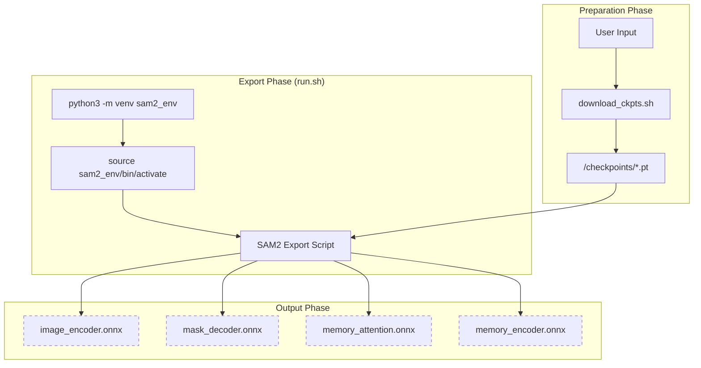
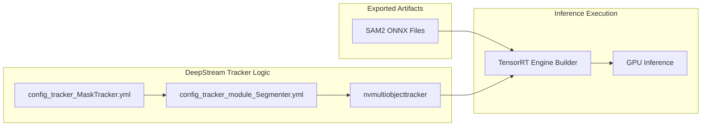

<!-- source: DeepWiki mcp.deepwiki.com · repo NVIDIA/DeepStream · page 9.2 SAM2 ONNX/TensorRT Export · fetched 2026-10-26 -->

# SAM2 ONNX/TensorRT Export

Relevant source files

The following files were used as context for generating this wiki page:

- [src/utils/nvds_logger/README](src/utils/nvds_logger/README)
- [src/utils/nvds_logger/setup_nvds_logger.sh](src/utils/nvds_logger/setup_nvds_logger.sh)
- [src/utils/nvmultiobjecttracker/model/tracker_ReID/README](src/utils/nvmultiobjecttracker/model/tracker_ReID/README)
- [tools/sam2-onnx-tensorrt/checkpoints/download_ckpts.sh](tools/sam2-onnx-tensorrt/checkpoints/download_ckpts.sh)

The `sam2-onnx-tensorrt` tool is a specialized utility designed to export the Meta Segment Anything Model 2 (SAM2) into a format compatible with NVIDIA TensorRT. SAM2 is utilized within the DeepStream SDK by the **MaskTracker** reference application to provide high-accuracy multi-object tracking and segmentation [src/utils/nvmultiobjecttracker/model/tracker_ReID/README:34-36]().

Because SAM2 is a complex architecture consisting of multiple interacting components, the export process decomposes the model into four distinct ONNX modules. These modules are subsequently used by the `nvmultiobjecttracker` library to perform accelerated inference on dGPU and Jetson platforms [src/utils/nvmultiobjecttracker/model/tracker_ReID/README:20-26]().

## Export Architecture

The SAM2 model is not exported as a single monolithic file. Instead, it is partitioned into four functional blocks to allow for the sophisticated memory-bank logic required for video segmentation tracking [src/utils/nvmultiobjecttracker/model/tracker_ReID/README:54-59]().

### SAM2 Module Decomposition

| Module Name | ONNX Filename | Role in MaskTracker |
| :--- | :--- | :--- |
| **Image Encoder** | `image_encoder.onnx` | Extracts high-level features from input video frames. |
| **Mask Decoder** | `mask_decoder.onnx` | Generates the final segmentation mask based on prompts and features. |
| **Memory Attention** | `memory_attention.onnx` | Processes temporal information from previous frames in the memory bank. |
| **Memory Encoder** | `memory_encoder.onnx` | Encodes current mask and features into the memory bank for future frames. |

**Sources:**
- [src/utils/nvmultiobjecttracker/model/tracker_ReID/README:54-59]()

## Export Workflow

The export process involves setting up a dedicated Python environment, downloading the official Meta SAM2 checkpoints, and running the export script to generate the ONNX files.

### 1. Checkpoint Retrieval
The tool includes a utility script `download_ckpts.sh` to fetch the Segment Anything Model 2.1 weights. It supports various model scales including Tiny, Small, Base Plus, and Large [tools/sam2-onnx-tensorrt/checkpoints/download_ckpts.sh:39-57]().

### 2. Export Execution
The primary entry point for the export is `run.sh`. This script automates the environment setup and the conversion of PyTorch weights to ONNX [src/utils/nvmultiobjecttracker/model/tracker_ReID/README:45-52]().

### Bridge: Natural Language to Code Entity Space (Export Process)

The following diagram maps the high-level export steps to the specific scripts and directories involved in the `tools/sam2-onnx-tensorrt` utility.

**SAM2 Export Execution Flow**

**Sources:**
- [tools/sam2-onnx-tensorrt/checkpoints/download_ckpts.sh:1-60]()
- [src/utils/nvmultiobjecttracker/model/tracker_ReID/README:45-52]()

## Integration with MaskTracker

Once the ONNX files are generated, they must be placed in the standard DeepStream model directory: `/opt/nvidia/deepstream/deepstream/samples/models/Tracker/` [src/utils/nvmultiobjecttracker/model/tracker_ReID/README:47-48]().

### DeepStream Configuration
The `nvmultiobjecttracker` plugin consumes these models when configured via `config_tracker_MaskTracker.yml`. This YAML file references a secondary module configuration, `config_tracker_module_Segmenter.yml`, which defines how the four SAM2 modules interact [src/utils/nvmultiobjecttracker/model/tracker_ReID/README:34-36]().

### TensorRT Engine Generation
DeepStream does not require manual conversion from ONNX to TensorRT `.engine` files. When the `deepstream-app` is launched with the tracker enabled, the `nvinfer` or internal tracker inference logic automatically triggers the TensorRT builder to generate optimized engines from the exported ONNX files [src/utils/nvmultiobjecttracker/model/tracker_ReID/README:60-61]().

### Bridge: Natural Language to Code Entity Space (DeepStream Integration)

This diagram shows how the exported files are consumed by the DeepStream pipeline components.

**SAM2 Deployment Mapping**

**Sources:**
- [src/utils/nvmultiobjecttracker/model/tracker_ReID/README:34-43]()
- [src/utils/nvmultiobjecttracker/model/tracker_ReID/README:60-72]()

## Logging and Troubleshooting

During the export or subsequent inference, logging is handled by the `nvds_logger` library. This library is based on `syslog` and allows for shared logging across multiple DeepStream instances [src/utils/nvds_logger/README:16-22]().

If the SAM2 modules fail to load or the engine generation fails, logs can be found at `/var/log/nvds/ds.log` by default [src/utils/nvds_logger/README:46-47](). The logger must be initialized via `setup_nvds_logger.sh` to ensure the correct `rsyslog` filters are applied for the `DSLOG` keyword [src/utils/nvds_logger/setup_nvds_logger.sh:58-60]().

**Sources:**
- [src/utils/nvds_logger/README:16-47]()
- [src/utils/nvds_logger/setup_nvds_logger.sh:1-70]()

---

