# Page: DeepStream SDK Overview

# DeepStream SDK Overview

<details>
<summary>Relevant source files</summary>

The following files were used as context for generating this wiki page:

- [.github/ISSUE_TEMPLATE/bug_report.md](.github/ISSUE_TEMPLATE/bug_report.md)
- [.gitignore](.gitignore)
- [CHANGELOG.md](CHANGELOG.md)
- [README.md](README.md)
- [THIRD_PARTY_LICENSES.txt](THIRD_PARTY_LICENSES.txt)
- [build/BUILD.md](build/BUILD.md)
- [build/build.sh](build/build.sh)
- [includes/.gitkeep](includes/.gitkeep)
- [scripts/print_env.sh](scripts/print_env.sh)
- [src/.gitkeep](src/.gitkeep)
- [src/README.md](src/README.md)
- [src/apps/.gitkeep](src/apps/.gitkeep)
- [src/apps/reference_apps/deepstream-tracker-3d-multi-view/README.md](src/apps/reference_apps/deepstream-tracker-3d-multi-view/README.md)
- [src/apps/reference_apps/deepstream-tracker-3d-multi-view/docs/manual-setup.md](src/apps/reference_apps/deepstream-tracker-3d-multi-view/docs/manual-setup.md)
- [src/apps/reference_apps/deepstream-tracker-3d-multi-view/scripts/setup_prerequisites.sh](src/apps/reference_apps/deepstream-tracker-3d-multi-view/scripts/setup_prerequisites.sh)
- [src/apps/sample_apps/README.md](src/apps/sample_apps/README.md)
- [src/apps/sample_apps/deepstream-infer-tensor-meta-test/README](src/apps/sample_apps/deepstream-infer-tensor-meta-test/README)
- [src/gst-plugins/.gitkeep](src/gst-plugins/.gitkeep)
- [src/gst-plugins/README.md](src/gst-plugins/README.md)
- [src/service-maker/.gitkeep](src/service-maker/.gitkeep)
- [src/utils/.gitkeep](src/utils/.gitkeep)
- [src/utils/README.md](src/utils/README.md)
- [src/utils/nvds_msgapi/amqp_protocol_adaptor/Makefile](src/utils/nvds_msgapi/amqp_protocol_adaptor/Makefile)
- [src/utils/nvds_msgapi/kafka_protocol_adaptor/Makefile](src/utils/nvds_msgapi/kafka_protocol_adaptor/Makefile)
- [src/utils/nvds_msgapi/mqtt_protocol_adaptor/Makefile](src/utils/nvds_msgapi/mqtt_protocol_adaptor/Makefile)
- [src/utils/nvds_msgapi/redis_protocol_adaptor/Makefile](src/utils/nvds_msgapi/redis_protocol_adaptor/Makefile)
- [tools/.gitkeep](tools/.gitkeep)

</details>


The [NVIDIA DeepStream SDK](https://developer.nvidia.com/deepstream-sdk) is a high-performance streaming analytics toolkit for AI-based video and image understanding [README.md:3-3](). It provides a GStreamer-based framework to build multi-stream, multi-model inference pipelines on NVIDIA GPUs, supporting both discrete GPUs (dGPU) and Jetson platforms [README.md:3-5]().

DeepStream 9.1 integrates hardware-accelerated video decoding/encoding, TensorRT-based inference, multi-object tracking, and message-broker connectivity into a unified architecture for real-time video analytics [README.md:5-5]().

## System Architecture

DeepStream applications are built on top of the GStreamer multimedia framework. The repository provides a collection of specialized plugins and utility libraries that interface with NVIDIA's compute stack (CUDA, TensorRT, and Video Codec SDK).

### Component Stack
The SDK is organized into several functional layers:

*   **GStreamer Plugins**: Core building blocks for inference (`nvinfer`), muxing (`nvstreammux`), and visualization (`nvdsosd`) [src/README.md:60-62]().
*   **Utility Libraries**: Low-level libraries for metadata management, messaging protocols, and sensor fusion [src/README.md:72-76]().
*   **Service Maker SDK**: A declarative C++/Python SDK that simplifies pipeline construction [src/README.md:48-52]().
*   **Reference Applications**: End-to-end examples for complex use cases like 3D tracking and LiDAR fusion [src/README.md:34-38]().

### Code-to-System Mapping
The following diagram illustrates how repository entities map to the runtime system architecture.

**System Entity to Code Path Mapping**
```mermaid
graph TD
    subgraph "GStreamer Space"
        GstPlugin["Gst-Plugins"]
        GstUtils["Gst-Utilities"]
    end

    subgraph "NVIDIA Compute Space"
        TRT["TensorRT Inference"]
        CUDA["CUDA Processing"]
    end

    subgraph "Application Space"
        AppBin["Reference Apps"]
        SM["Service Maker SDK"]
    end

    %% Mapping relationships
    GstPlugin -->|"src/gst-plugins/"| [src/README.md:14-14]
    GstUtils -->|"src/gst-utils/"| [src/README.md:64-70]
    AppBin -->|"src/apps/"| [src/README.md:28-46]
    SM -->|"src/service-maker/"| [src/README.md:48-57]
    
    %% Functional links
    GstPlugin --> TRT
    AppBin --> GstPlugin
    SM --> GstPlugin
```
Sources: [README.md:13-19](), [src/README.md:26-77]()

## Key Capabilities

*   **Inference Integration**: Supports TensorRT via `nvinfer` and Triton Inference Server via `nvinferserver` [src/README.md:96-96]().
*   **3D Sensing**: Advanced support for LiDAR and multi-camera 3D tracking (MV3DT) [src/apps/reference_apps/deepstream-tracker-3d-multi-view/README.md:18-24]().
*   **Cloud Connectivity**: Protocol adaptors for Kafka, MQTT, AMQP, and Redis [src/utils/nvds_msgapi/kafka_protocol_adaptor/Makefile:25-26](), [src/utils/nvds_msgapi/redis_protocol_adaptor/Makefile:22-23]().
*   **Observability**: Integrated OpenTelemetry (OTEL) and Prometheus metrics for pipeline monitoring [README.md:27-27]().
*   **Vision-Language Models**: Native VLM support (e.g., Cosmos Reason 2) via the `vLLM` plugin [CHANGELOG.md:6-6]().

## Supported Platforms

DeepStream 9.1 supports three primary architectural targets:

| Platform | Architecture | OS / Requirements |
| :--- | :--- | :--- |
| **x86 dGPU** | `x86_64` | Ubuntu 24.04, CUDA 13.2, TensorRT 10.16.x [README.md:68-68]() |
| **Jetson** | `aarch64` | JetPack 7.2 GA, CUDA 13.2, TensorRT 10.16.x [README.md:69-69]() |
| **SBSA / DGX Spark** | `aarch64` | Bare-metal not supported; run via SBSA Docker container [README.md:70-70]() |

Sources: [README.md:64-71](), [build/BUILD.md:26-30]()

## Repository Organization

The repository is structured to separate core logic, application templates, and developer tooling.

**Repository Structure Overview**
```mermaid
graph TD
    Root["/ (Repo Root)"]
    Root --> BuildDir["build/ (Build Scripts)"]
    Root --> SrcDir["src/ (Core Source Code)"]
    Root --> ToolsDir["tools/ (Dev Utilities)"]
    Root --> SkillsDir["skills/ (AI Agent Skills)"]

    SrcDir --> Apps["apps/ (Sample/Ref Apps)"]
    SrcDir --> Plugins["gst-plugins/ (GStreamer)"]
    SrcDir --> Utils["utils/ (Shared Libs)"]
    SrcDir --> SM["service-maker/ (SDK)"]

    BuildDir --> BuildSH["build.sh"]
    
    %% Precise Code Entities
    BuildSH -->|"Orchestrates"| [build/build.sh:17-18]
    Apps -->|"Contains"| [src/README.md:28-46]
    SkillsDir -->|"Contains"| [README.md:29-39]
```
Sources: [README.md:13-39](), [src/README.md:26-77]()

## Detailed Documentation Sections

For deeper technical details, please refer to the following child pages:

*   **[Getting Started & Build System](#1.1)**: Guide to building from source using `build/build.sh`, platform detection, and the install/uninstall lifecycle.
*   **[Docker Containers & Host Provisioning](#1.2)**: Instructions for building Docker images and using Ansible for host setup.
*   **[Open-Source Dependencies](#1.3)**: Details on the libraries compiled by `install_opensource_deps.sh`, including OpenTelemetry and Triton Client.

For runtime usage, the primary entry point is the `deepstream-app` reference application [README.md:79-83]().

Sources: [README.md:52-62](), [build/BUILD.md:161-170]()

---

# Page: Getting Started & Build System

# Getting Started & Build System

<details>
<summary>Relevant source files</summary>

The following files were used as context for generating this wiki page:

- [.gitignore](.gitignore)
- [README.md](README.md)
- [SECURITY.md](SECURITY.md)
- [THIRD_PARTY_LICENSES.txt](THIRD_PARTY_LICENSES.txt)
- [build/BUILD.md](build/BUILD.md)
- [build/build.sh](build/build.sh)
- [scripts/install_opensource_deps.sh](scripts/install_opensource_deps.sh)
- [src/apps/reference_apps/deepstream-tracker-3d-multi-view/README.md](src/apps/reference_apps/deepstream-tracker-3d-multi-view/README.md)
- [src/apps/reference_apps/deepstream-tracker-3d-multi-view/docs/manual-setup.md](src/apps/reference_apps/deepstream-tracker-3d-multi-view/docs/manual-setup.md)
- [src/apps/reference_apps/deepstream-tracker-3d-multi-view/scripts/setup_prerequisites.sh](src/apps/reference_apps/deepstream-tracker-3d-multi-view/scripts/setup_prerequisites.sh)
- [src/gst-plugins/gst-nvdsvideotemplate/customlib_impl/Makefile](src/gst-plugins/gst-nvdsvideotemplate/customlib_impl/Makefile)

</details>


DeepStream 9.1 provides a unified build system designed to handle the complexities of multi-platform support (x86, aarch64 Jetson, and SBSA) while integrating both open-source components and NVIDIA's proprietary runtime libraries [README.md:9-11](). The build process is orchestrated by a centralized script that manages platform detection, dependency retrieval, and stage-based compilation [build/build.sh:17-19]().

## Build Architecture Overview

The build system is designed as a multi-stage pipeline. It separates the retrieval of proprietary artifacts from the compilation of open-source plugins and applications.

### Platform Detection
The `build/build.sh` script automatically detects the host architecture using `uname -m` and identifies specific hardware variants [build/build.sh:182-193]():
*   **x86_64**: Standard dGPU platform (Ubuntu 24.04).
*   **aarch64 (Jetson)**: Detected via the presence of `/etc/nv_tegra_release`.
*   **aarch64 (SBSA)**: Server Base System Architecture (e.g., DGX Spark), which requires a Docker-based workflow as bare-metal installation is not supported [build/BUILD.md:101-106]().

### Build System Data Flow
The following diagram illustrates how `build/build.sh` coordinates various scripts and directories to produce a functional DeepStream installation.

**Build Pipeline and Artifact Flow**
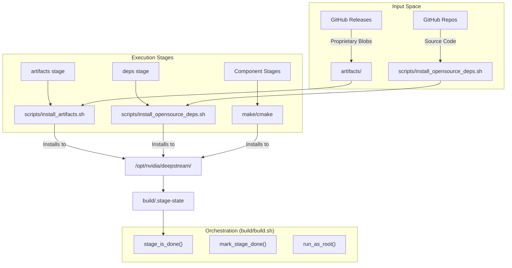
**Sources:** [build/build.sh:24-29](), [build/build.sh:139-159](), [scripts/install_opensource_deps.sh:41-45]()

## Build Stages and State Tracking

DeepStream uses a state-tracking mechanism to allow for resumable builds. Progress is recorded in hidden files within the `build/` directory [build/build.sh:106-113]().

| State File | Description |
|---|---|
| `build/.stage-state` | Tracks high-level stages: `artifacts`, `deps`, `gst-plugins`, `sample_apps`, etc. |
| `build/.stage-state.deps` | Tracks sub-stages for open-source dependencies (e.g., `deps-opentelemetry`). |
| `build/.stage-state.artifacts` | Tracks individual proprietary artifact installations. |

### Key Functions
*   `stage_is_done()`: Checks if a specific stage string exists in the state file [build/build.sh:139-142]().
*   `mark_stage_done()`: Appends a "DONE <stage>" entry to the state file [build/build.sh:149-159]().
*   `reset_stage_state()`: Clears progress to force a clean build [build/build.sh:170-180]().

**Sources:** [build/build.sh:106-113](), [scripts/install_opensource_deps.sh:63-83]()

## Step-by-Step Installation

### 1. Prerequisites
Before running the build script, the host must have the **NVIDIA Compute Stack** installed, including Driver (595.58.03+), CUDA 13.2, and TensorRT 10.16.x [build/BUILD.md:26-30]().

### 2. Dependency Installation
The script `scripts/install_opensource_deps.sh` handles external libraries. It clones, builds, and installs the following to `/opt/nvidia/deepstream/deepstream-9.1/lib` [scripts/install_opensource_deps.sh:17-30]():
*   **OpenTelemetry-cpp v1.23.0**: For pipeline observability [scripts/install_opensource_deps.sh:93-137]().
*   **Civetweb v1.16**: Used by the REST server [scripts/install_opensource_deps.sh:140-165]().
*   **Prometheus-cpp v1.2.4**: For metrics collection [scripts/install_opensource_deps.sh:168-193]().
*   **Azure IoT SDK-c**: For cloud messaging [scripts/install_opensource_deps.sh:24]().

### 3. Running the Build
The primary entry point is `build/build.sh`.

```bash
# Standard build and install
bash build/build.sh

# Build only specific components with parallel jobs
bash build/build.sh --only=gst-plugins,sample_apps -j$(nproc)

# Resume a previously interrupted build
bash build/build.sh --resume
```
**Sources:** [build/build.sh:71-136](), [README.md:72-75]()

## Platform Specifics: SBSA / DGX Spark

For SBSA platforms, the build system operates differently. Bare-metal installation is unsupported [build/BUILD.md:103-104](). Users must use the NVIDIA SBSA Docker container where DeepStream is pre-installed. In this environment, `build/build.sh` is not used; instead, developers navigate to specific plugin directories and run `make && make install` to update components [build/BUILD.md:108-112]().

**Component Mapping for SBSA**
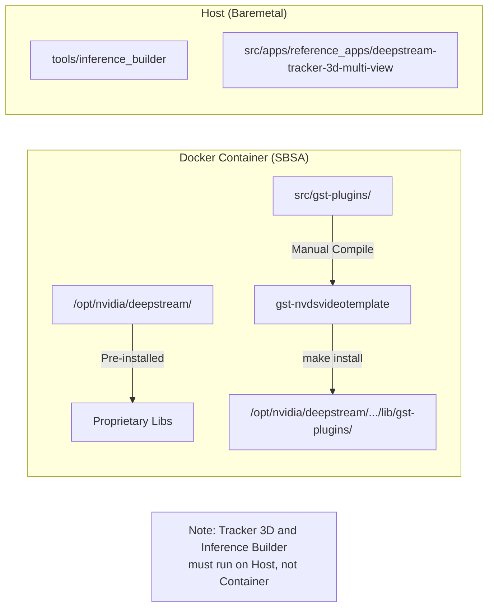
**Sources:** [build/BUILD.md:101-112](), [build/BUILD.md:138-145]()

## Install Lifecycle & Artifact Management

### Artifact Retrieval
On x86 and Jetson, the build system uses `wget` to download proprietary release assets from GitHub into an `artifacts/` directory [build/build.sh:97-104]().
*   **deb method (default)**: Downloads and installs `.deb` packages using `dpkg` [build/build.sh:116-117]().
*   **tar method**: Extracts tarballs directly into the `/opt` tree [build/build.sh:118-119]().

### Post-Build Cleanup
By default, the `artifacts/` directory is deleted after a successful build to save space. To retain these assets for manual inspection or redistribution, the `--keep-assets` flag must be used [build/build.sh:80-81]().

### System Integration
After the build completes, binaries are located in `/opt/nvidia/deepstream/deepstream-9.1/bin/` [README.md:79](). Users are encouraged to clear the GStreamer cache to ensure the newly built plugins are correctly indexed [README.md:85-87]().

**Sources:** [build/build.sh:77-84](), [README.md:79-87](), [build/BUILD.md:161-170]()

---

# Page: Docker Containers & Host Provisioning

# Docker Containers & Host Provisioning

<details>
<summary>Relevant source files</summary>

The following files were used as context for generating this wiki page:

- [.gitignore](.gitignore)
- [README.md](README.md)
- [THIRD_PARTY_LICENSES.txt](THIRD_PARTY_LICENSES.txt)
- [build/BUILD.md](build/BUILD.md)
- [build/build.sh](build/build.sh)
- [scripts/install_opensource_deps.sh](scripts/install_opensource_deps.sh)
- [src/apps/reference_apps/deepstream-tracker-3d-multi-view/README.md](src/apps/reference_apps/deepstream-tracker-3d-multi-view/README.md)
- [src/apps/reference_apps/deepstream-tracker-3d-multi-view/docs/manual-setup.md](src/apps/reference_apps/deepstream-tracker-3d-multi-view/docs/manual-setup.md)
- [src/apps/reference_apps/deepstream-tracker-3d-multi-view/scripts/setup_prerequisites.sh](src/apps/reference_apps/deepstream-tracker-3d-multi-view/scripts/setup_prerequisites.sh)
- [src/gst-plugins/gst-nvdsvideotemplate/customlib_impl/Makefile](src/gst-plugins/gst-nvdsvideotemplate/customlib_impl/Makefile)

</details>


This page details the mechanisms for deploying DeepStream using Docker containers across x86 and Jetson platforms, the specialized environment for SBSA (Server Base System Architecture), and the Ansible-based host provisioning system for preparing the underlying NVIDIA compute stack.

## Docker Deployment Strategy

DeepStream is distributed via the NVIDIA GPU Cloud (NGC) as pre-configured Docker images. These images contain the complete NVIDIA compute stack (CUDA, TensorRT, cuDNN) and the DeepStream proprietary runtime [README.md:98-102]().

### Image Variants
DeepStream provides several container variants tailored for different workloads:
*   **Base/Development**: Contains the SDK, headers, and build tools for compiling custom plugins and applications.
*   **Triton**: Includes the NVIDIA Triton Inference Server for multi-framework inference (ONNX, TensorFlow, PyTorch) [README.md:94-98]().
*   **Multi-arch**: Unified images supporting both x86_64 and aarch64 (Jetson) platforms [src/apps/reference_apps/deepstream-tracker-3d-multi-view/README.md:80-81]().

### Platform-Specific Execution
The repository provides guidance on running these containers with hardware acceleration:

| Platform | Runtime Flag | Capability Requirements |
| :--- | :--- | :--- |
| **x86 (dGPU)** | `--runtime=nvidia` | `compute,utility,video,graphics` |
| **Jetson** | `--runtime=nvidia` | (Hardware access is mapped via the NVIDIA Container Runtime) |
| **SBSA** | `--runtime=nvidia` | Requires `--privileged` for low-level driver operations [build/BUILD.md:113-125]() |

### Code-to-Container Relationship
The following diagram illustrates how the build system interacts with Docker environments.

**DeepStream Docker Build & Run Flow**
```mermaid
graph TD
    subgraph "Host_Environment"
        [build/build.sh] -- "Detects" --> [PLATFORM_TYPE]
        [PLATFORM_TYPE] -- "x86/Jetson" --> [Bare_Metal_Install]
        [PLATFORM_TYPE] -- "SBSA" --> [Docker_Only_Flow]
    end

    subgraph "Docker_Space"
        [SBSA_Container] --> [Preinstalled_DS_9.1]
        [SBSA_Container] -- "Manual Build" --> [make_install]
        [Triton_Container] --> [nvinferserver_plugin]
    end

    [Bare_Metal_Install] -- "scripts/install_artifacts.sh" --> [/opt/nvidia/deepstream/]
    [Docker_Only_Flow] -- "docker run --runtime=nvidia" --> [SBSA_Container]
    [make_install] -- "Updates" --> [/opt/nvidia/deepstream/deepstream-9.1/lib/]
```
Sources: [README.md:50-52](), [build/BUILD.md:101-112](), [build/build.sh:182-192]()

## Host Provisioning with Ansible

The repository includes a host provisioning toolset located in `tools/deepstream-host-provisioning/` [README.md:26-27](). This system uses Ansible playbooks to automate the installation of the NVIDIA driver, CUDA, cuDNN, TensorRT, and Docker on Ubuntu 24.04 hosts (x86_64 and ARM SBSA).

### Provisioning Components
1.  **Driver Installation**: Configures the NVIDIA package repositories and installs the required 595.58.03+ driver [build/BUILD.md:28-30]().
2.  **Compute Stack**: Installs CUDA 13.2, cuDNN 9.20.0.48, and TensorRT 10.16.x [build/BUILD.md:26-30]().
3.  **Docker & Container Toolkit**: Sets up the Docker engine and the `nvidia-container-toolkit` to allow containers to access GPU hardware.
4.  **DeepStream Dependencies**: Installs system-level libraries like `libssl-dev`, `libgstreamer1.0-dev`, and `libjsoncpp-dev` [build/BUILD.md:52-69]().

Sources: [README.md:26-27](), [build/BUILD.md:26-30](), [build/BUILD.md:52-69]()

## SBSA & DGX Spark Environment

SBSA (Server Base System Architecture) platforms, such as DGX Spark, have a unique deployment model. Unlike x86 or Jetson, **bare-metal DeepStream installation is not supported on SBSA** [README.md:50-51](), [build/BUILD.md:101-106]().

### Implementation Details
*   **Pre-installed Runtime**: The SBSA Docker container ships with the DeepStream proprietary runtime pre-installed.
*   **Build Logic**: The `build/build.sh` script detects the `sbsa` platform and skips the `artifacts` stage, as no standalone tar/deb packages exist for this architecture [build/build.sh:97-104](), [build/build.sh:189-190]().
*   **Development Workflow**: Developers must clone the repository inside the container and use `make && make install` within specific plugin or utility directories to update the pre-installed binaries [build/BUILD.md:108-111]().

**SBSA Component Mapping**
```mermaid
graph LR
    subgraph "SBSA_Container_Image"
        [Prebuilt_Binaries] -- "Path" --> [/opt/nvidia/deepstream/deepstream-9.1/]
        [Gst_Plugins] -- "Location" --> [/opt/nvidia/deepstream/deepstream-9.1/lib/gst-plugins/]
    end

    subgraph "Source_Tree_Mapping"
        [src/gst-plugins/] -- "make install" --> [Gst_Plugins]
        [src/utils/] -- "make install" --> [Prebuilt_Binaries]
    end

    [SBSA_Container_Image] -- "Required_Flags" --> [privileged_mode]
    [privileged_mode] -- "Enables" --> [GPU_Driver_Ops]
```
Sources: [build/BUILD.md:101-125](), [build/build.sh:189-190](), [src/gst-plugins/gst-nvdsvideotemplate/customlib_impl/Makefile:35-37]()

## Cross-Platform Considerations

The build system and provisioning scripts handle architecture-specific dependencies through platform detection in `build/build.sh` [build/build.sh:182-192]() and `scripts/install_opensource_deps.sh` [scripts/install_opensource_deps.sh:48-61]().

### Platform Detection Logic
The system distinguishes between Jetson and SBSA (both `aarch64`) by checking for the existence of `/etc/nv_tegra_release` [build/build.sh:186-190]().

### Dependency Management
Open-source dependencies are compiled and installed into the DeepStream directory structure using `scripts/install_opensource_deps.sh`. This script manages:
*   **Triton Client SDK**: Downloads different versions for x86 (v2.67.0) vs aarch64 (v2.68.0) [scripts/install_opensource_deps.sh:28-29]().
*   **Shared Libraries**: Installs `libopentelemetry_*.so`, `libcivetweb.so`, and `libprometheus-cpp-core.so` directly into `/opt/nvidia/deepstream/deepstream-9.1/lib/` [scripts/install_opensource_deps.sh:41-42](), [scripts/install_opensource_deps.sh:133-134]().

Sources: [build/build.sh:182-192](), [scripts/install_opensource_deps.sh:28-29](), [scripts/install_opensource_deps.sh:41-42](), [scripts/install_opensource_deps.sh:48-61]()

---

# Page: Open-Source Dependencies

# Open-Source Dependencies

<details>
<summary>Relevant source files</summary>

The following files were used as context for generating this wiki page:

- [CHANGELOG.md](CHANGELOG.md)
- [scripts/install_opensource_deps.sh](scripts/install_opensource_deps.sh)
- [src/gst-plugins/gst-nvdsvideotemplate/customlib_impl/Makefile](src/gst-plugins/gst-nvdsvideotemplate/customlib_impl/Makefile)
- [src/utils/nvds_msgapi/amqp_protocol_adaptor/Makefile](src/utils/nvds_msgapi/amqp_protocol_adaptor/Makefile)
- [src/utils/nvds_msgapi/kafka_protocol_adaptor/Makefile](src/utils/nvds_msgapi/kafka_protocol_adaptor/Makefile)
- [src/utils/nvds_msgapi/mqtt_protocol_adaptor/Makefile](src/utils/nvds_msgapi/mqtt_protocol_adaptor/Makefile)
- [src/utils/nvds_msgapi/redis_protocol_adaptor/Makefile](src/utils/nvds_msgapi/redis_protocol_adaptor/Makefile)

</details>


This page provides technical details on the open-source libraries and SDKs that DeepStream 9.1 relies on for telemetry, web services, cloud connectivity, and inference. These dependencies are managed and installed via the `scripts/install_opensource_deps.sh` script, which automates the fetching, building, and installation of shared libraries into the DeepStream SDK path [scripts/install_opensource_deps.sh:17-18]().

## Dependency Management Overview

The installation script uses a stage-state tracking mechanism to ensure idempotency. It records successfully completed installations in a state file located at `build/.stage-state.deps` [scripts/install_opensource_deps.sh:45-46](). This allows the build system to skip already-installed components during subsequent runs [scripts/install_opensource_deps.sh:63-66]().

### Core Build and Installation Workflow
The script targets specific versions of libraries to ensure compatibility with the DeepStream GStreamer plugins and utility libraries.

| Library | Version / Commit | Purpose | Target Files |
| :--- | :--- | :--- | :--- |
| **OpenTelemetry C++** | v1.23.0 | Observability & Tracing | `libopentelemetry_*.so` |
| **Civetweb** | v1.16 | Embedded HTTP Server | `libcivetweb.so` |
| **Prometheus C++** | v1.2.4 | Metrics Collection | `libprometheus-cpp-core.so` |
| **Azure IoT SDK C** | dbeb521e | Cloud Messaging | `libiothub_client.so` |
| **Protobuf** | v3.21.12 | Serialization (Schema) | `/opt/proto/bin/protoc` |
| **Triton Client SDK** | v2.67.0+ | Inference Server Comms | `/opt/tritonclient` |

**Sources:** [scripts/install_opensource_deps.sh:21-29]()

---

## Observability & Web Stack

DeepStream integrates a modern observability stack for real-time monitoring of pipeline performance, including FPS and latency metrics.

### OpenTelemetry (OTLP)
The `opentelemetry-cpp` library is compiled with support for both **HTTP** and **gRPC** exporters [scripts/install_opensource_deps.sh:106-107](). This enables DeepStream to push telemetry data to collectors like `otel-collector`.

### Civetweb & Prometheus
`civetweb` provides the underlying HTTP server functionality required for REST APIs and metrics endpoints [scripts/install_opensource_deps.sh:140-141](). A critical implementation detail is the use of a **linker version script** (`civetweb.ver`) during the build to prevent symbol conflicts with the DeepStream SDK [scripts/install_opensource_deps.sh:152-161](). `prometheus-cpp` builds on top of this to expose a `/metrics` endpoint [scripts/install_opensource_deps.sh:168-171]().

**Dependency Mapping: Observability Stack**
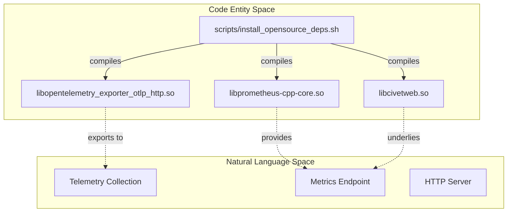
**Sources:** [scripts/install_opensource_deps.sh:103-134](), [scripts/install_opensource_deps.sh:152-162](), [scripts/install_opensource_deps.sh:179-190]()

---

## Cloud Connectivity & Messaging

DeepStream uses various protocol adaptors to communicate with cloud providers. These adaptors are often implemented as shared libraries in `src/utils/nvds_msgapi/`.

### Azure IoT Hub
The script fetches the `azure-iot-sdk-c` (v1.11.0) and builds the `iothub_client` [scripts/install_opensource_deps.sh:24](). This is utilized by the messaging plugins to establish secure connections to Azure IoT Hub.

### Protobuf & Schema Serialization
The **Protobuf compiler (protoc)** is installed to `/opt/proto` [scripts/install_opensource_deps.sh:29](). It is used during the build process of protocol adaptors, such as Kafka, to generate C++ classes from `.proto` schema files [src/utils/nvds_msgapi/kafka_protocol_adaptor/Makefile:55-56]().

**Data Flow: Protocol Adaptor Compilation**
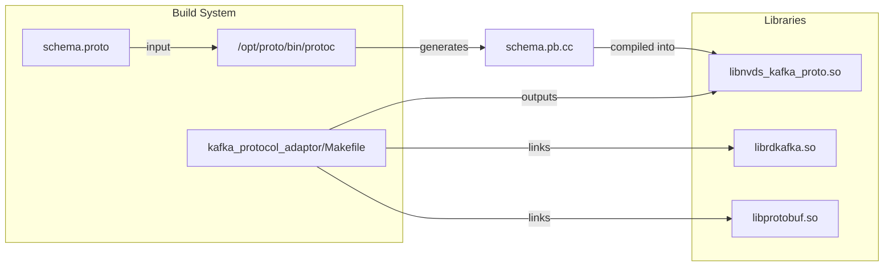
**Sources:** [scripts/install_opensource_deps.sh:29](), [src/utils/nvds_msgapi/kafka_protocol_adaptor/Makefile:22-26](), [src/utils/nvds_msgapi/kafka_protocol_adaptor/Makefile:55-56]()

---

## Triton Inference Server Integration

For complex inference workloads using the `nvinferserver` plugin, DeepStream requires the **Triton Client SDK**. 

*   **Installation Path:** `/opt/tritonclient` [scripts/install_opensource_deps.sh:28]().
*   **Components:** Includes headers and libraries for C-API and gRPC-based inference communication.
*   **Usage:** Protocol adaptors like Kafka include Triton client paths in their `INC_PATHS` to support advanced metadata features [src/utils/nvds_msgapi/kafka_protocol_adaptor/Makefile:38-41]().

---

## Infrastructure Dependencies

The `install_opensource_deps.sh` script also manages several system-level libraries via `apt` and external PPAs to support various DeepStream features:

*   **Messaging Drivers:** `librdkafka` (Kafka), `libmosquitto` (MQTT), `librabbitmq` (AMQP), and `hiredis` (Redis) [scripts/install_opensource_deps.sh:30-31]().
*   **Linking:** Adaptors link against these libraries (e.g., `-lmosquitto`, `-lrabbitmq`) and use `-Wl,-rpath` to ensure they are found in the DeepStream library directory at runtime [src/utils/nvds_msgapi/mqtt_protocol_adaptor/Makefile:41-42](), [src/utils/nvds_msgapi/amqp_protocol_adaptor/Makefile:37-38](), [src/utils/nvds_msgapi/redis_protocol_adaptor/Makefile:38-39]().
*   **Graphics/UI:** `libpango`, `libcairo`, and `libjson-glib` for OSD (On-Screen Display) and configuration parsing [scripts/install_opensource_deps.sh:30]().
*   **Math:** The `half` (v2.1.0) header-only library is installed to `/opt/half` for FP16 calculations [scripts/install_opensource_deps.sh:27]().

**Sources:** [scripts/install_opensource_deps.sh:27-31](), [src/utils/nvds_msgapi/mqtt_protocol_adaptor/Makefile:41-42](), [src/utils/nvds_msgapi/amqp_protocol_adaptor/Makefile:37-38](), [src/utils/nvds_msgapi/redis_protocol_adaptor/Makefile:38-39]()

---

# Page: Core Pipeline Architecture

# Core Pipeline Architecture

<details>
<summary>Relevant source files</summary>

The following files were used as context for generating this wiki page:

- [.github/ISSUE_TEMPLATE/bug_report.md](.github/ISSUE_TEMPLATE/bug_report.md)
- [includes/NVWarp360.h](includes/NVWarp360.h)
- [includes/gst-nvcommon.h](includes/gst-nvcommon.h)
- [includes/nv_aisle_csvparser.hpp](includes/nv_aisle_csvparser.hpp)
- [includes/nv_spot_csvparser.hpp](includes/nv_spot_csvparser.hpp)
- [includes/nvtx_helper.h](includes/nvtx_helper.h)
- [scripts/print_env.sh](scripts/print_env.sh)
- [src/README.md](src/README.md)
- [src/apps/sample_apps/README.md](src/apps/sample_apps/README.md)
- [src/apps/sample_apps/deepstream-infer-tensor-meta-test/README](src/apps/sample_apps/deepstream-infer-tensor-meta-test/README)
- [src/gst-plugins/README.md](src/gst-plugins/README.md)
- [src/gst-plugins/gst-nvinfer/gstnvinfer.cpp](src/gst-plugins/gst-nvinfer/gstnvinfer.cpp)
- [src/gst-plugins/gst-nvmsgbroker/gstnvmsgbroker.cpp](src/gst-plugins/gst-nvmsgbroker/gstnvmsgbroker.cpp)
- [src/gst-plugins/gst-nvmsgbroker/gstnvmsgbroker.h](src/gst-plugins/gst-nvmsgbroker/gstnvmsgbroker.h)
- [src/gst-plugins/gst-nvmultistream2/gstnvmultistream.cpp](src/gst-plugins/gst-nvmultistream2/gstnvmultistream.cpp)
- [src/utils/README.md](src/utils/README.md)

</details>


DeepStream is built on the **GStreamer** framework, providing a modular and scalable architecture for AI-powered multi-stream video and sensor processing. The core pipeline model follows a linear or branched flow where data originates from sources, is multiplexed into batches for efficient GPU processing, undergoes inference and tracking, and is finally rendered or sent to the cloud.

### Pipeline Data Flow

The typical DeepStream pipeline lifecycle involves several key stages, orchestrated by specialized GStreamer plugins and supported by low-level utility libraries.

1.  **Source & Decoding**: Input streams (RTSP, File, Camera) are ingested. Elements like `nvurisrcbin` handle the complexities of decoding and hardware acceleration.
2.  **Stream Muxing**: The `nvstreammux` element collects frames from multiple sources and creates a single batched buffer (`NvBufSurface`). This batching is critical for maximizing GPU utilization during inference [src/gst-plugins/gst-nvmultistream2/gstnvmultistream.cpp:26-31]().
3.  **Inference**: Batched frames are passed to inference plugins. `nvinfer` uses TensorRT for high-performance execution [src/gst-plugins/gst-nvinfer/gstnvinfer.cpp:32-40](), while `nvinferserver` leverages the Triton Inference Server for multi-framework support.
4.  **Tracking & Analytics**: The `nvtracker` plugin maintains object identities across frames using algorithms like NvDCF or DeepSORT. Additional analytics (line crossing, ROI) can be applied via `nvdsanalytics`.
5.  **OSD & Visualization**: Metadata generated by inference and tracking is used by `nvdsosd` to draw bounding boxes and text directly onto the video buffers using the `nvll_osd` library [src/utils/README.md:62]().
6.  **Sinks & Messaging**: Final output is sent to a display, file, or cloud broker. The `nvmsgbroker` plugin handles asynchronous transmission to Kafka, MQTT, or Azure IoT [src/gst-plugins/gst-nvmsgbroker/gstnvmsgbroker.cpp:136-157]().

#### Diagram: High-Level Pipeline Model
This diagram illustrates the flow from raw input to metadata-enriched output, showing the relationship between GStreamer elements and the underlying hardware-accelerated libraries.

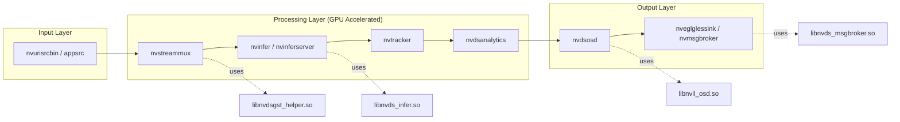
**Sources:** [src/README.md:28-76](), [src/utils/README.md:26-76]()

---

### Core Subsystems

DeepStream's architecture is divided into distinct subsystems that handle specific parts of the AI lifecycle.

#### GStreamer Plugins
DeepStream provides a comprehensive suite of plugins located in `src/gst-plugins/`. These include `nvinfer` for TensorRT-based detection/classification and `nvstreammux` for frame batching.
For details, see [GStreamer Plugins](#2.1).

#### Inference Engine Layer
The inference layer is powered by two primary engines: `nvinfer` (TensorRT) and `nvinferserver` (Triton). These engines interact with the pipeline via the `NvDsInferContext` API [src/utils/README.md:32-33]().
For details, see [Inference Engine Layer](#2.2).

#### Multi-Object Tracking
The tracking subsystem, implemented in the `nvtracker` plugin, supports multiple state-of-the-art algorithms (NvDCF, DeepSORT, IOU) and integrates with Re-Identification (ReID) models for robust object persistence [src/utils/README.md:86]().
For details, see [Multi-Object Tracking](#2.3).

#### Metadata Management & Parallelism
DeepStream uses a unified metadata structure (`NvDsMeta`) to pass information between plugins. The `nvdsmetamux` element allows for parallel inference branches to be merged back into a single stream, synchronized by PTS [src/gst-plugins/gst-nvinfer/gstnvinfer.cpp:32]().
For details, see [Metadata Muxing & Parallel Inference](#2.4).

#### Serialization & Messaging
For edge-to-cloud scenarios, DeepStream provides utilities to serialize metadata into JSON or Protobuf formats. The `nvmsgbroker` plugin abstracts the underlying transport protocols (Kafka, MQTT, etc.) [src/gst-plugins/gst-nvmsgbroker/gstnvmsgbroker.h:36-48]().
For details, see [Metadata Serialization & Utilities](#2.5).

---

### Code Entity Mapping
The following diagram maps high-level pipeline concepts to the specific C++ classes and library files found in the source tree.

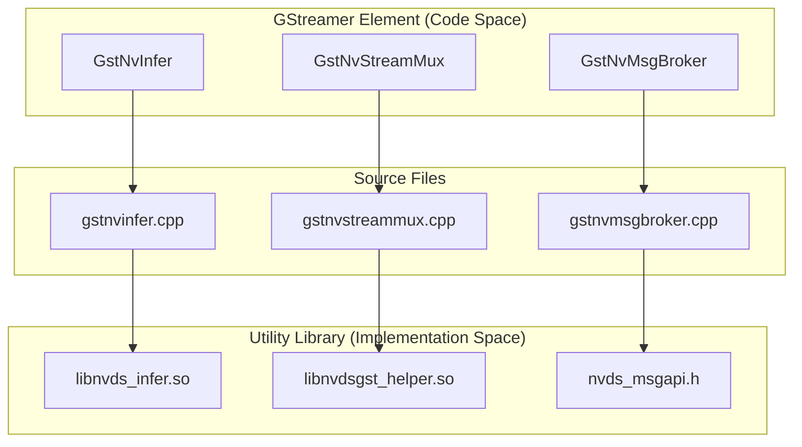
**Sources:** [src/gst-plugins/gst-nvinfer/gstnvinfer.cpp:131](), [src/gst-plugins/gst-nvmultistream2/gstnvmultistream.cpp:47](), [src/gst-plugins/gst-nvmsgbroker/gstnvmsgbroker.cpp:132](), [src/utils/README.md:30-56]()

### Memory Management
DeepStream utilizes `memory:NVMM` to keep video frames in hardware-accelerated memory (CUDA device memory on x86 or Surface Array on Jetson) throughout the pipeline, avoiding costly CPU-GPU copies [includes/gst-nvcommon.h:35-65](). The `NvBufSurface` structure is the primary container for these hardware buffers [includes/gst-nvcommon.h:111]().

**Sources:** [includes/gst-nvcommon.h:35-117](), [src/gst-plugins/gst-nvinfer/gstnvinfer.cpp:116-120]()

---

# Page: GStreamer Plugins

# GStreamer Plugins

<details>
<summary>Relevant source files</summary>

The following files were used as context for generating this wiki page:

- [.github/ISSUE_TEMPLATE/bug_report.md](.github/ISSUE_TEMPLATE/bug_report.md)
- [scripts/print_env.sh](scripts/print_env.sh)
- [src/README.md](src/README.md)
- [src/apps/reference_apps/deepstream_parallel_inference_app/tritonclient/sample/configs/apps/bodypose_yolo/sources_4_rtsp.csv](src/apps/reference_apps/deepstream_parallel_inference_app/tritonclient/sample/configs/apps/bodypose_yolo/sources_4_rtsp.csv)
- [src/apps/reference_apps/deepstream_parallel_inference_app/tritonclient/sample/configs/apps/bodypose_yolo_lpr/sources_4_rtsp.csv](src/apps/reference_apps/deepstream_parallel_inference_app/tritonclient/sample/configs/apps/bodypose_yolo_lpr/sources_4_rtsp.csv)
- [src/apps/reference_apps/deepstream_parallel_inference_app/tritonclient/sample/configs/apps/bodypose_yolo_win1/sources_4_rtsp.csv](src/apps/reference_apps/deepstream_parallel_inference_app/tritonclient/sample/configs/apps/bodypose_yolo_win1/sources_4_rtsp.csv)
- [src/apps/reference_apps/deepstream_parallel_inference_app/tritonclient/sample/configs/apps/vehicle0_lpr_analytic/sources_4_rtsp.csv](src/apps/reference_apps/deepstream_parallel_inference_app/tritonclient/sample/configs/apps/vehicle0_lpr_analytic/sources_4_rtsp.csv)
- [src/apps/reference_apps/deepstream_parallel_inference_app/tritonclient/sample/configs/apps/vehicle_lpr_analytic/sources_4_rtsp.csv](src/apps/reference_apps/deepstream_parallel_inference_app/tritonclient/sample/configs/apps/vehicle_lpr_analytic/sources_4_rtsp.csv)
- [src/apps/sample_apps/README.md](src/apps/sample_apps/README.md)
- [src/apps/sample_apps/deepstream-infer-tensor-meta-test/README](src/apps/sample_apps/deepstream-infer-tensor-meta-test/README)
- [src/gst-plugins/README.md](src/gst-plugins/README.md)
- [src/gst-plugins/gst-dsexample-cuda/README](src/gst-plugins/gst-dsexample-cuda/README)
- [src/gst-plugins/gst-nvdsmetamux/README](src/gst-plugins/gst-nvdsmetamux/README)
- [src/gst-plugins/gst-nvdsosd/README](src/gst-plugins/gst-nvdsosd/README)
- [src/gst-plugins/gst-nvdspostprocess/README](src/gst-plugins/gst-nvdspostprocess/README)
- [src/gst-plugins/gst-nvdspreprocess/README](src/gst-plugins/gst-nvdspreprocess/README)
- [src/gst-plugins/gst-nvdsudp/README](src/gst-plugins/gst-nvdsudp/README)
- [src/gst-plugins/gst-nvdsudp/gstnvdsudp.c](src/gst-plugins/gst-nvdsudp/gstnvdsudp.c)
- [src/gst-plugins/gst-nvdsvideotemplate/README](src/gst-plugins/gst-nvdsvideotemplate/README)
- [src/gst-plugins/gst-nvdynamicsrcbin/README](src/gst-plugins/gst-nvdynamicsrcbin/README)
- [src/gst-plugins/gst-nvimage/README](src/gst-plugins/gst-nvimage/README)
- [src/gst-plugins/gst-nvmultistream2/Makefile](src/gst-plugins/gst-nvmultistream2/Makefile)
- [src/gst-plugins/gst-nvmultistream2/gstnvmultistream.cpp](src/gst-plugins/gst-nvmultistream2/gstnvmultistream.cpp)
- [src/gst-plugins/gst-nvreplay/README](src/gst-plugins/gst-nvreplay/README)
- [src/gst-plugins/gst-nvtracker/README](src/gst-plugins/gst-nvtracker/README)
- [src/utils/README.md](src/utils/README.md)

</details>


This page provides a technical catalog and architectural overview of the GStreamer plugins provided in the DeepStream SDK. These plugins are located in `src/gst-plugins/` and form the building blocks of DeepStream's accelerated video and sensor processing pipelines.

## Overview
DeepStream GStreamer plugins leverage NVIDIA hardware accelerators (NVDEC, NVENC, GPU, DLA) to perform tasks such as stream multiplexing, deep learning inference, multi-object tracking, and on-screen display (OSD). These plugins communicate via standardized NvDsMetadata structures attached to GstBuffers.

**Sources:** [src/gst-plugins/README.md](), [src/README.md:58-62]()

---

## Stream Multiplexing and Source Management

### nvstreammux
The `nvstreammux` plugin is the backbone of multi-stream processing. It batches frames from multiple input sources into a single batched buffer for downstream inference.

*   **Implementation:** The current SDK supports a new version of the muxer, often referred to as `nvstreammux2`. It can be toggled via the `USE_NEW_NVSTREAMMUX=yes` environment variable [src/gst-plugins/gst-nvmultistream2/gstnvmultistream.cpp:38-40]().
*   **Key Logic:** It performs batching based on a configured `batch-size` and `batched-push-timeout`.
*   **Registration:** The plugin registers both `nvstreammux` and `nvstreamdemux` [src/gst-plugins/gst-nvmultistream2/gstnvmultistream.cpp:47-53]().

### nvdsmetamux
Used for parallel inference branches, this plugin merges metadata from multiple sources for the "same" frame based on PTS (Presentation Time Stamp) [src/gst-plugins/gst-nvdsmetamux/README:32-34]().

| Property | Description |
| :--- | :--- |
| `active-pad` | The sink pad whose video frame is passed to the source pad [src/gst-plugins/gst-nvdsmetamux/README:43-45](). |
| `pts-tolerance` | Time difference tolerance (in microseconds) when matching frames from different branches [src/gst-plugins/gst-nvdsmetamux/README:61-63](). |
| `config-file` | Path to the configuration file defining `src-ids-model` groups [src/gst-plugins/gst-nvdsmetamux/README:46-48](). |

### nvurisrcbin & nvdynamicsrcbin
These bins simplify source management by internally instantiating the necessary elements (depayloaders, decoders) for a given URI. `nvdynamicsrcbin` allows for runtime addition and deletion of sources.

**Sources:** [src/gst-plugins/gst-nvmultistream2/gstnvmultistream.cpp:1-85](), [src/gst-plugins/gst-nvdsmetamux/README:1-87](), [src/gst-plugins/gst-nvdynamicsrcbin/README]()

---

## Inference Plugins

DeepStream provides two primary inference plugins depending on the backend requirements.

### nvinfer
The `nvinfer` plugin uses NVIDIA TensorRT for high-performance inference. It handles preprocessing (scaling, mean subtraction, color conversion) and post-processing (bounding box parsing).
*   **Library Dependency:** Consumes `libnvds_infer.so` [src/utils/README.md:32]().

### nvinferserver
The `nvinferserver` plugin acts as a client to the NVIDIA Triton Inference Server. This allows for multi-framework support (TensorFlow, PyTorch, ONNX, TensorRT) and remote inference.
*   **Library Dependency:** Consumes `libnvds_inferserver.so` [src/utils/README.md:33]().
*   **External Requirement:** Requires Triton Inference Server libraries/backends [src/README.md:96]().

### Metadata and Data Flow
The following diagram illustrates the relationship between the GStreamer element and the underlying utility libraries.

**Inference Architecture: GStreamer to Core Library**
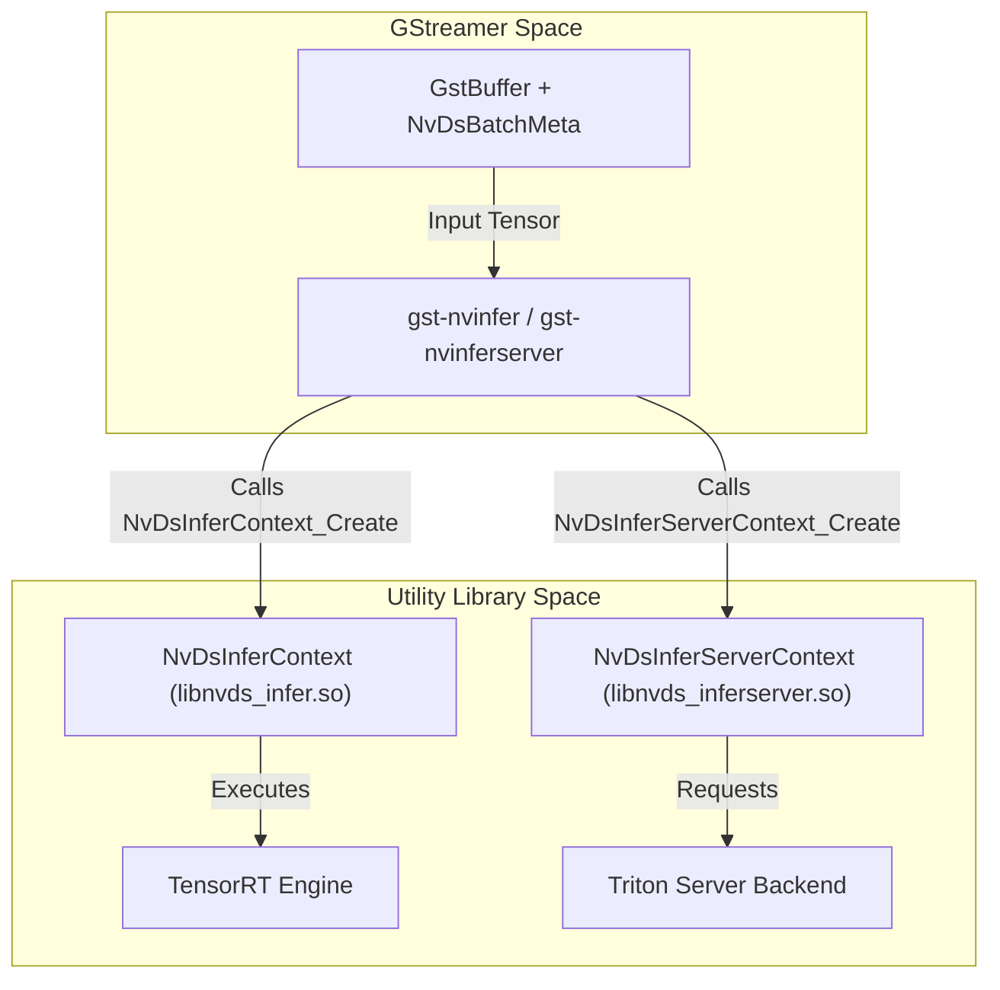
**Sources:** [src/utils/README.md:28-35](), [src/README.md:96-103]()

---

## Analytics and Tracking

### nvtracker
The `nvtracker` plugin performs multi-object tracking. It is a shim that loads low-level tracker libraries (e.g., NvDCF, DeepSORT, IOU).
*   **Extensibility:** It supports custom ReID models for feature extraction [src/utils/README.md:86]().

### nvdsanalytics
Provides spatial intelligence such as line crossing, ROI intrusion detection, and overcrowding analysis.
*   **Implementation:** It uses the `libnvds_analytics.so` backend [src/utils/README.md:46]().

**Sources:** [src/gst-plugins/gst-nvtracker/README](), [src/utils/README.md:44-47]()

---

## Visualization and Image Utilities

### nvdsosd
The On-Screen Display plugin draws bounding boxes, text, and lines on the video frames.
*   **Backend:** It uses the low-level `libnvll_osd.so` library for hardware-accelerated rendering [src/utils/README.md:62]().

### nvimage
A utility plugin for image-specific operations, including JPEG encoding/decoding and transformations.

**Sources:** [src/gst-plugins/gst-nvdsosd/README](), [src/gst-plugins/gst-nvimage/README](), [src/utils/README.md:60-63]()

---

## Messaging and Networking

### nvmsgbroker
This plugin provides cloud connectivity by abstracting various transport protocols.
*   **Protocols:** Supports Kafka, MQTT, Azure IoT Hub, AMQP, and Redis [src/utils/README.md:52]().
*   **Data Flow:** It typically follows `nvmsgconv`, which converts metadata into the desired schema (e.g., MEGA) [src/utils/README.md:53-55]().

### nvdsudp
High-performance UDP transport using the NVIDIA Rivermax SDK for optimized network throughput.
*   **Prerequisites:** Requires the Rivermax SDK and `rivermax_api.h` [src/README.md:95](), [src/gst-plugins/gst-nvdsudp/README:24-39]().

**Sources:** [src/utils/README.md:48-57](), [src/gst-plugins/gst-nvdsudp/README:1-40]()

---

## Extensibility and Templates

DeepStream provides template plugins to allow developers to implement custom logic while maintaining hardware acceleration.

### nvdsvidtemplate
A template for custom video processing logic. It provides a hook for developers to access the `NvBufSurface` (GPU memory) and `NvDsBatchMeta` [src/gst-plugins/gst-nvdsvideotemplate/README]().

### gst-dsexample-cuda
A reference implementation demonstrating how to perform in-place CUDA operations using OpenCV.
*   **Features:** Demonstrates channel swapping and Gaussian blurring on detected objects [src/gst-plugins/gst-dsexample-cuda/README:131-134]().
*   **Build Requirement:** Requires OpenCV 4.x built with CUDA support [src/gst-plugins/gst-dsexample-cuda/README:26-31]().

**Plugin Extensibility Map**
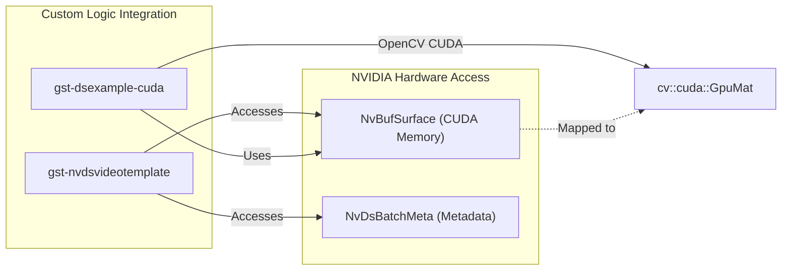
**Sources:** [src/gst-plugins/gst-nvdsvideotemplate/README](), [src/gst-plugins/gst-dsexample-cuda/README:122-134]()

---

## Summary Table of Plugins

| Plugin Name | Role | Core Library / Dependency |
| :--- | :--- | :--- |
| `nvstreammux` | Batching multiple streams | `libnvdsgst_helper.so` [src/utils/README.md:40]() |
| `nvinfer` | TensorRT Inference | `libnvds_infer.so` [src/utils/README.md:32]() |
| `nvinferserver` | Triton Inference | `libnvds_inferserver.so` [src/utils/README.md:33]() |
| `nvtracker` | Object Tracking | `nvmultiobjecttracker` [src/utils/README.md:86]() |
| `nvdsanalytics` | Spatial Analytics | `libnvds_analytics.so` [src/utils/README.md:46]() |
| `nvdsosd` | On-Screen Display | `libnvll_osd.so` [src/utils/README.md:62]() |
| `nvmsgbroker` | Cloud Messaging | `libnvds_msgbroker.so` [src/utils/README.md:52]() |
| `nvdsudp` | Rivermax UDP | Rivermax SDK [src/README.md:95]() |

**Sources:** [src/utils/README.md:26-75](), [src/README.md:92-97]()

---

# Page: Inference Engine Layer

# Inference Engine Layer

<details>
<summary>Relevant source files</summary>

The following files were used as context for generating this wiki page:

- [.gitmodules](.gitmodules)
- [src/apps/tao_apps/apps/tao_others/deepstream_custom_preprocessing_app/nvdspreprocess_lib/Makefile](src/apps/tao_apps/apps/tao_others/deepstream_custom_preprocessing_app/nvdspreprocess_lib/Makefile)
- [src/apps/tao_apps/apps/tao_others/deepstream_custom_preprocessing_app/nvdspreprocess_lib/roi_conversion.cu](src/apps/tao_apps/apps/tao_others/deepstream_custom_preprocessing_app/nvdspreprocess_lib/roi_conversion.cu)
- [src/apps/tao_apps/apps/tao_others/deepstream_custom_preprocessing_app/nvdspreprocess_lib/roi_conversion.hpp](src/apps/tao_apps/apps/tao_others/deepstream_custom_preprocessing_app/nvdspreprocess_lib/roi_conversion.hpp)
- [src/gst-plugins/gst-nvdspostprocess/README](src/gst-plugins/gst-nvdspostprocess/README)
- [src/gst-plugins/gst-nvdspreprocess/README](src/gst-plugins/gst-nvdspreprocess/README)
- [src/utils/nvdsinfer/README](src/utils/nvdsinfer/README)
- [src/utils/nvdsinfer/nvdsinfer_conversion.cu](src/utils/nvdsinfer/nvdsinfer_conversion.cu)
- [src/utils/nvdsinfer_customparser/README](src/utils/nvdsinfer_customparser/README)
- [src/utils/nvdsinferserver/README](src/utils/nvdsinferserver/README)
- [src/utils/nvdsinferserver/infer_preprocess_kernel.cu](src/utils/nvdsinferserver/infer_preprocess_kernel.cu)
- [src/utils/nvdsinferserver/tritonserver_include/model_config.proto](src/utils/nvdsinferserver/tritonserver_include/model_config.proto)

</details>


The Inference Engine Layer is the heart of the DeepStream SDK, providing high-performance AI inference capabilities. It abstracts the complexities of hardware-accelerated inference using two primary plugins: `nvinfer`, which leverages **NVIDIA TensorRT**, and `nvinferserver`, which integrates the **NVIDIA Triton Inference Server**. These plugins are supported by low-level utility libraries (`nvdsinfer` and `nvdsinferserver`) that handle model loading, memory management, and GPU-accelerated pre/post-processing.

## System Architecture

The inference layer is designed as a modular system where GStreamer plugins interface with core C++ libraries. This architecture allows developers to swap inference backends (TensorRT vs. Triton) while maintaining consistent metadata output.

### Core Components and Libraries
*   **nvinfer**: A GStreamer plugin that uses the `nvdsinfer` library to run inference locally using TensorRT [src/utils/nvdsinfer/README:16-17]().
*   **nvinferserver**: A GStreamer plugin that uses the `nvdsinferserver` library to run inference via Triton, supporting multiple frameworks like ONNX, TensorFlow, and PyTorch [src/utils/nvdsinferserver/README:16-17]().
*   **nvdspreprocess**: A plugin for custom ROI-based preprocessing that bypasses standard scaling/conversion in the inference plugins [src/gst-plugins/gst-nvdspreprocess/README:31-37]().
*   **nvdspostprocess**: A plugin for standalone parsing of detection and classification tensors, decoupled from the inference execution [src/gst-plugins/gst-nvdspostprocess/README:16-18]().

### Code Entity Mapping
The following diagram maps high-level functional blocks to their corresponding implementation entities in the codebase.

**Inference Subsystem Entity Map**
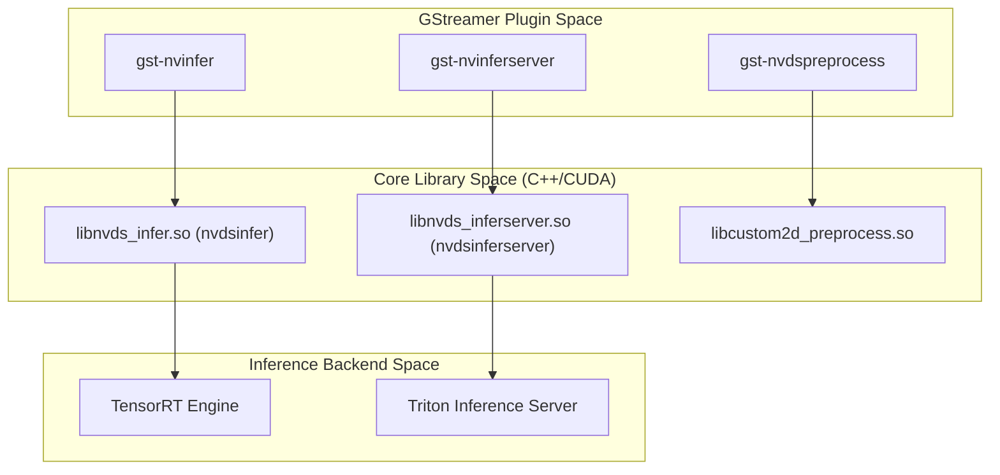
**Sources:** [src/utils/nvdsinfer/README:16-17](), [src/utils/nvdsinferserver/README:16-17](), [src/gst-plugins/gst-nvdspreprocess/README:31-37](), [src/apps/tao_apps/apps/tao_others/deepstream_custom_preprocessing_app/nvdspreprocess_lib/Makefile:36-40]()

---

## Data Flow: From Buffer to Metadata

The inference process follows a strict pipeline: Preprocessing -> Inference -> Postprocessing.

### 1. Preprocessing & Custom ROI Conversion
Before inference, frames must be scaled and converted to the model's expected format (e.g., NCHW or NHWC). While `nvinfer` has built-in kernels, `nvdspreprocess` allows for specialized ROI handling using the `ROIConversion` API [src/apps/tao_apps/apps/tao_others/deepstream_custom_preprocessing_app/nvdspreprocess_lib/roi_conversion.hpp:83-87]().

Key kernels in `nvdsinfer` handle color space conversion and mean subtraction:
*   `NvDsInferConvert_CxToP3FloatKernel`: Converts packed pixels to planar float (CHW) [src/utils/nvdsinfer/nvdsinfer_conversion.cu:25-32]().
*   `NvDsInferConvert_CxToL3FloatKernel`: Converts to interleaved float (HWC) [src/utils/nvdsinfer/nvdsinfer_conversion.cu:48-55]().
*   `NvDsInferConvert_NHWCToDestKernel`: A generalized Triton-compatible kernel for layout conversion [src/utils/nvdsinferserver/infer_preprocess_kernel.cu:120-129]().

### 2. Inference Execution
*   **nvinfer**: Directly manages TensorRT `ICudaEngine` and `IExecutionContext` via the `NvDsInferContext` API [src/utils/nvdsinfer/README:16-17]().
*   **nvinferserver**: Communicates with Triton using the gRPC client or C-API. It relies on Protobuf definitions for model configuration [src/utils/nvdsinferserver/tritonserver_include/model_config.proto:46-48]().

### 3. Postprocessing & Custom Parsing
Once the engine returns raw tensors, they must be parsed into bounding boxes or classification labels. DeepStream provides a "Custom Parser" interface for user-defined logic.

**Inference Data Flow Diagram**
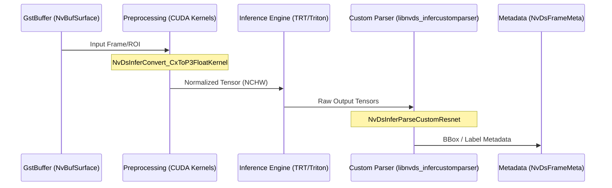
**Sources:** [src/utils/nvdsinfer/nvdsinfer_conversion.cu:25-32](), [src/utils/nvdsinfer_customparser/README:34-36](), [src/gst-plugins/gst-nvdspreprocess/README:31-37]()

---

## The NvDsInferContext API

`NvDsInferContext` is the primary interface used by `nvinfer` to manage the inference lifecycle. It encapsulates:
1.  **Model Initialization**: Building engines from ONNX/Caffe or loading existing `.engine` files.
2.  **Queue Management**: Handling asynchronous execution across multiple streams.
3.  **Memory Mapping**: Mapping GStreamer buffers to CUDA device memory for zero-copy inference.

### Custom Parsing Interface
For non-standard models, developers implement custom functions in a shared library and reference them in the configuration file [src/utils/nvdsinfer_customparser/README:34-41]().

| Function Type | Configuration Key | Example Function |
| :--- | :--- | :--- |
| **BBox Parsing** | `parse-bbox-func-name` | `NvDsInferParseCustomResnet` |
| **Classification** | `parse-classifier-func-name` | `NvDsInferClassiferParseCustomSoftmax` |
| **Triton Parsing** | `custom_parse_bbox_func` | `NvDsInferParseCustomTfSSD` |

**Sources:** [src/utils/nvdsinfer_customparser/README:34-52]()

---

## Specialized Inference Plugins

### nvdspreprocess
This plugin is used when the inference batch is not a simple 1:1 mapping of input frames. It supports:
*   **Multiple ROIs per frame**: Defining different regions of interest for the same image [src/gst-plugins/gst-nvdspreprocess/README:31-33]().
*   **Custom Tensor Preparation**: Using a custom library to prepare tensors, which `nvinfer` then consumes by setting `input-tensor-meta=1` [src/gst-plugins/gst-nvdspreprocess/README:51-54]().

### nvdspostprocess
This plugin decouples parsing from the inference plugin. It is useful in complex pipelines where inference is done by one component (e.g., a hardware accelerator) and parsing needs to happen later.
*   **Requirement**: `nvinfer` must be set to `output-tensor-meta=1` and `network-type=100` (Other) [src/gst-plugins/gst-nvdspostprocess/README:18-20]().
*   **Configuration**: Uses YAML files to define parsing logic via `postprocesslib-config-file` [src/gst-plugins/gst-nvdspostprocess/README:62-64]().

---

## Summary of Utility Libraries

| Library | Path | Purpose |
| :--- | :--- | :--- |
| `nvdsinfer` | `src/utils/nvdsinfer/` | TensorRT backend logic and standard CUDA kernels [src/utils/nvdsinfer/README:16-17](). |
| `nvdsinferserver` | `src/utils/nvdsinferserver/` | Triton client integration and Protobuf management [src/utils/nvdsinferserver/README:16-17](). |
| `nvdsinfer_customparser` | `src/utils/nvdsinfer_customparser/` | Reference implementations for ResNet, SSD, and Softmax parsing [src/utils/nvdsinfer_customparser/README:27-30](). |
| `custom2d_preprocess` | `src/apps/tao_apps/.../nvdspreprocess_lib/` | Example ROI conversion library using CUDA [src/apps/tao_apps/apps/tao_others/deepstream_custom_preprocessing_app/nvdspreprocess_lib/Makefile:36-40](). |

**Sources:** [src/utils/nvdsinfer/README:1-26](), [src/utils/nvdsinferserver/README:1-49](), [src/utils/nvdsinfer_customparser/README:1-53](), [src/apps/tao_apps/apps/tao_others/deepstream_custom_preprocessing_app/nvdspreprocess_lib/Makefile:1-80]()

---

# Page: Multi-Object Tracking

# Multi-Object Tracking

<details>
<summary>Relevant source files</summary>

The following files were used as context for generating this wiki page:

- [src/gst-plugins/gst-nvtracker/README](src/gst-plugins/gst-nvtracker/README)
- [src/utils/nvds_logger/README](src/utils/nvds_logger/README)
- [src/utils/nvds_logger/setup_nvds_logger.sh](src/utils/nvds_logger/setup_nvds_logger.sh)
- [src/utils/nvmultiobjecttracker/model/tracker_ReID/README](src/utils/nvmultiobjecttracker/model/tracker_ReID/README)
- [tools/sam2-onnx-tensorrt/checkpoints/download_ckpts.sh](tools/sam2-onnx-tensorrt/checkpoints/download_ckpts.sh)

</details>


The DeepStream Multi-Object Tracking (MOT) subsystem provides a highly optimized framework for associating object detections across video frames. It is implemented as a GStreamer plugin, `nvtracker`, which interfaces with the low-level `NvMultiObjectTracker` library to execute various tracking algorithms and deep learning-based re-identification models.

## Architecture Overview

The tracking system is divided into two main layers: the GStreamer plugin layer (`gst-nvtracker`) and the low-level utility library (`libnvds_nvmultiobjecttracker.so`). This separation allows the tracking logic to remain independent of the GStreamer pipeline state management.

### Data Flow and Component Interaction

The following diagram illustrates how the `nvtracker` plugin interacts with the low-level tracker library and the configuration system.

**Tracking System Component Interaction**
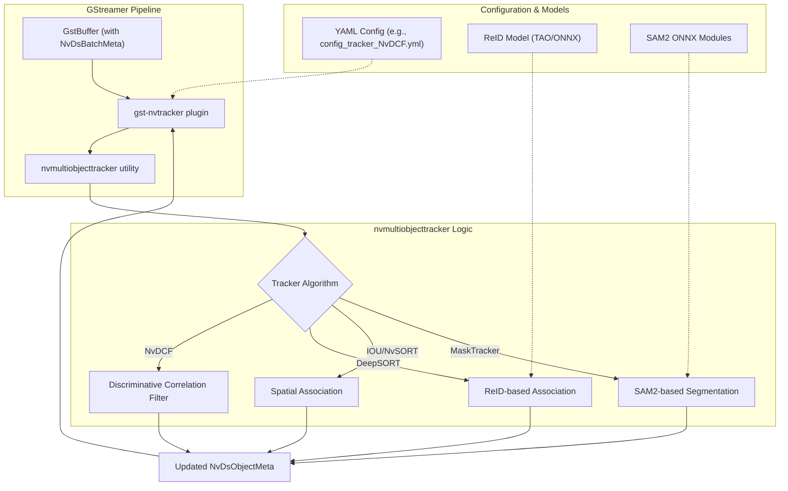
**Sources:** [src/gst-plugins/gst-nvtracker/README:16-17](), [src/utils/nvmultiobjecttracker/model/tracker_ReID/README:18-26]()

## Supported Algorithms

The `nvtracker` plugin supports several tracking algorithms tailored for different performance and accuracy requirements:

| Algorithm | Description | Key Features |
| :--- | :--- | :--- |
| **NvDCF** | Discriminative Correlation Filter | High accuracy; supports visual tracking even during detector misses; supports ReID. |
| **DeepSORT** | Deep Learning SORT | Uses ReID features for association; robust to occlusions. |
| **NvSORT** | Optimized SORT | High-speed spatial tracking using Kalman Filters. |
| **IOU** | Intersection over Union | Minimal compute; relies purely on bbox overlap. |
| **MaskTracker** | SAM2-based Tracking | Multi-object tracking and segmentation using Segment Anything Model 2. |

**Sources:** [src/utils/nvmultiobjecttracker/model/tracker_ReID/README:34-37](), [src/utils/nvmultiobjecttracker/model/tracker_ReID/README:74-76]()

## Deep Learning Model Integration

The tracker can be enhanced with deep learning models for re-identification (ReID) and segmentation. These models are accelerated using TensorRT.

### Re-Identification (ReID)
ReID models allow the tracker to maintain object identity even when objects exit and re-enter the frame or undergo significant occlusion.
*   **NVIDIA TAO ReID**: Recommended model is `ReidentificationNet` (e.g., `resnet50_market1501.etlt`) [src/utils/nvmultiobjecttracker/model/tracker_ReID/README:80-93]().
*   **Custom ONNX**: Users can provide custom ONNX models by specifying parameters such as `reidFeatureSize`, `inferDims`, and `inputOrder` in the tracker YAML config [src/utils/nvmultiobjecttracker/model/tracker_ReID/README:108-126]().

### SAM2-based Segmentation (MaskTracker)
The `MaskTracker` utilizes Meta's SAM2 to provide pixel-level tracking. This requires four specific ONNX modules generated from SAM2 checkpoints [src/utils/nvmultiobjecttracker/model/tracker_ReID/README:34-59]():
1.  `image_encoder.onnx`
2.  `mask_decoder.onnx`
3.  `memory_attention.onnx`
4.  `memory_encoder.onnx`

**Sources:** [src/utils/nvmultiobjecttracker/model/tracker_ReID/README:20-26](), [src/utils/nvmultiobjecttracker/model/tracker_ReID/README:34-59](), [src/utils/nvmultiobjecttracker/model/tracker_ReID/README:80-126]()

## Configuration Management

Tracking behavior is governed by a YAML configuration file specified in the `ll-config-file` property of the `nvtracker` plugin.

### Key YAML Configuration Parameters
The tracker configuration defines how features are extracted and how association logic is applied.

| Parameter | Description |
| :--- | :--- |
| `reidFeatureSize` | Dimension of the ReID feature vector (e.g., 128). |
| `inferDims` | Input dimensions for the ReID model `[C, H, W]`. |
| `networkMode` | TensorRT precision mode (0: FP32, 1: INT8, 2: FP16). |
| `addFeatureNormalization` | Whether to L2-normalize features before association. |

**Sources:** [src/utils/nvmultiobjecttracker/model/tracker_ReID/README:113-126](), [src/utils/nvmultiobjecttracker/model/tracker_ReID/README:62-68]()

## System Logging

The tracker and other utility libraries use `nvds_logger` for system-level logging via `rsyslog`. This allows for centralized logging across multiple DeepStream instances.

### Logger Setup and Usage
The logger must be initialized before use and supports various severity levels (0-7).

**Logging Flow**
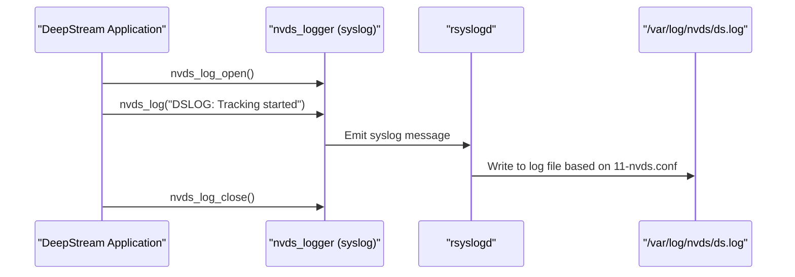

**Sources:** [src/utils/nvds_logger/README:16-23](), [src/utils/nvds_logger/README:34-44](), [src/utils/nvds_logger/setup_nvds_logger.sh:57-60]()

## Implementation Details

### Plugin Compilation
The `nvtracker` plugin is open-source and can be compiled against specific CUDA versions. It requires GStreamer 1.0 development packages [src/gst-plugins/gst-nvtracker/README:20-32]().

### Input Tensor Metadata
When `input-tensor-meta=1` is used, the tracker's internal width and height must match the preprocessing dimensions of the upstream `nvdspreprocess` plugin to ensure correct spatial mapping [src/gst-plugins/gst-nvtracker/README:34-35]().

**Sources:** [src/gst-plugins/gst-nvtracker/README:20-35]()

---

# Page: Metadata Muxing & Parallel Inference

# Metadata Muxing & Parallel Inference

<details>
<summary>Relevant source files</summary>

The following files were used as context for generating this wiki page:

- [src/apps/reference_apps/.gitattributes](src/apps/reference_apps/.gitattributes)
- [src/apps/reference_apps/deepstream-vllm-plugin/install.sh](src/apps/reference_apps/deepstream-vllm-plugin/install.sh)
- [src/apps/reference_apps/deepstream_parallel_inference_app/tritonclient/sample/build.sh](src/apps/reference_apps/deepstream_parallel_inference_app/tritonclient/sample/build.sh)
- [src/apps/reference_apps/deepstream_parallel_inference_app/tritonclient/sample/configs/apps/bodypose_yolo/source4_1080p_dec_parallel_infer.yml](src/apps/reference_apps/deepstream_parallel_inference_app/tritonclient/sample/configs/apps/bodypose_yolo/source4_1080p_dec_parallel_infer.yml)
- [src/apps/reference_apps/deepstream_parallel_inference_app/tritonclient/sample/configs/apps/bodypose_yolo/sources_4_rtsp.csv](src/apps/reference_apps/deepstream_parallel_inference_app/tritonclient/sample/configs/apps/bodypose_yolo/sources_4_rtsp.csv)
- [src/apps/reference_apps/deepstream_parallel_inference_app/tritonclient/sample/configs/apps/bodypose_yolo_lpr/source4_1080p_dec_parallel_infer.yml](src/apps/reference_apps/deepstream_parallel_inference_app/tritonclient/sample/configs/apps/bodypose_yolo_lpr/source4_1080p_dec_parallel_infer.yml)
- [src/apps/reference_apps/deepstream_parallel_inference_app/tritonclient/sample/configs/apps/bodypose_yolo_lpr/sources_4_rtsp.csv](src/apps/reference_apps/deepstream_parallel_inference_app/tritonclient/sample/configs/apps/bodypose_yolo_lpr/sources_4_rtsp.csv)
- [src/apps/reference_apps/deepstream_parallel_inference_app/tritonclient/sample/configs/apps/bodypose_yolo_win1/source4_1080p_dec_parallel_infer.yml](src/apps/reference_apps/deepstream_parallel_inference_app/tritonclient/sample/configs/apps/bodypose_yolo_win1/source4_1080p_dec_parallel_infer.yml)
- [src/apps/reference_apps/deepstream_parallel_inference_app/tritonclient/sample/configs/apps/bodypose_yolo_win1/sources_4_rtsp.csv](src/apps/reference_apps/deepstream_parallel_inference_app/tritonclient/sample/configs/apps/bodypose_yolo_win1/sources_4_rtsp.csv)
- [src/apps/reference_apps/deepstream_parallel_inference_app/tritonclient/sample/configs/apps/vehicle0_lpr_analytic/source4_1080p_dec_parallel_infer.yml](src/apps/reference_apps/deepstream_parallel_inference_app/tritonclient/sample/configs/apps/vehicle0_lpr_analytic/source4_1080p_dec_parallel_infer.yml)
- [src/apps/reference_apps/deepstream_parallel_inference_app/tritonclient/sample/configs/apps/vehicle0_lpr_analytic/sources_4_rtsp.csv](src/apps/reference_apps/deepstream_parallel_inference_app/tritonclient/sample/configs/apps/vehicle0_lpr_analytic/sources_4_rtsp.csv)
- [src/apps/reference_apps/deepstream_parallel_inference_app/tritonclient/sample/configs/apps/vehicle_lpr_analytic/source4_1080p_dec_parallel_infer.yml](src/apps/reference_apps/deepstream_parallel_inference_app/tritonclient/sample/configs/apps/vehicle_lpr_analytic/source4_1080p_dec_parallel_infer.yml)
- [src/apps/reference_apps/deepstream_parallel_inference_app/tritonclient/sample/configs/apps/vehicle_lpr_analytic/sources_4_rtsp.csv](src/apps/reference_apps/deepstream_parallel_inference_app/tritonclient/sample/configs/apps/vehicle_lpr_analytic/sources_4_rtsp.csv)
- [src/apps/reference_apps/deepstream_parallel_inference_app/tritonserver/build_engine.sh](src/apps/reference_apps/deepstream_parallel_inference_app/tritonserver/build_engine.sh)
- [src/apps/sample_apps/deepstream-3d-lidar-sensor-fusion/bevfusion/build_bevfusion_model.sh](src/apps/sample_apps/deepstream-3d-lidar-sensor-fusion/bevfusion/build_bevfusion_model.sh)
- [src/apps/sample_apps/deepstream-3d-lidar-sensor-fusion/v2xfusion/scripts/clocks.sh](src/apps/sample_apps/deepstream-3d-lidar-sensor-fusion/v2xfusion/scripts/clocks.sh)
- [src/gst-plugins/gst-nvdsmetamux/README](src/gst-plugins/gst-nvdsmetamux/README)
- [src/gst-plugins/gst-nvdsmetamux/gstnvdsmetamux.h](src/gst-plugins/gst-nvdsmetamux/gstnvdsmetamux.h)
- [src/gst-plugins/gst-nvdsmetamux/libnvdsgst_metamux.export](src/gst-plugins/gst-nvdsmetamux/libnvdsgst_metamux.export)

</details>


The `nvdsmetamux` plugin and the `deepstream_parallel_inference_app` provide a framework for running multiple inference models concurrently on the same or different video streams within a single DeepStream pipeline. This architecture enables complex multi-model workloads, such as running a vehicle detector in one branch and a human pose estimator in another, then merging their metadata into a single unified stream for downstream processing (e.g., OSD or message brokers).

## Metadata Muxing (nvdsmetamux)

The `nvdsmetamux` plugin performs batch metadata muxing for the same source and the same frame across multiple parallel branches [src/gst-plugins/gst-nvdsmetamux/README:32-32](). It is designed to handle the synchronization of metadata that may arrive at different times due to varying inference latencies in parallel branches.

### PTS-Based Synchronization

Synchronization is achieved using the Presentation Time Stamp (PTS) of the frames. The plugin attempts to find the nearest frame PTS for the same source across all sink pads [src/gst-plugins/gst-nvdsmetamux/README:33-34]().

Key synchronization parameters include:
*   **`pts-tolerance`**: The time difference tolerance (in microseconds) when searching for the same frame of the same source ID [src/gst-plugins/gst-nvdsmetamux/README:61-63](). If the difference between a branch frame and the base frame exceeds this value, the metadata is not merged into the current output [src/gst-plugins/gst-nvdsmetamux/README:81-83]().
*   **`active-pad`**: The specific sink pad whose video buffers are transferred to the source pad. This pad acts as the master for synchronization [src/gst-plugins/gst-nvdsmetamux/README:43-45](), [src/gst-plugins/gst-nvdsmetamux/README:80-80]().

### Data Flow & Metadata Merging

The muxer collects metadata from multiple sink pads and merges them into a single `NvDsBatchMeta` structure.

| Property | Description |
| :--- | :--- |
| `config-file` | Path to the configuration file defining muxing behavior [src/gst-plugins/gst-nvdsmetamux/README:46-48](). |
| `latency` | Additional latency in live mode to allow upstream branches more time to produce buffers [src/gst-plugins/gst-nvdsmetamux/README:49-51](). |
| `src-ids-model-<gie-id>` | Configures which source IDs' metadata should be output for a specific GIE (Inference Engine) [src/gst-plugins/gst-nvdsmetamux/README:83-85](). |

**Sources:**
*   [src/gst-plugins/gst-nvdsmetamux/README:31-85]()

## Parallel Inference Application

The `deepstream_parallel_inference_app` demonstrates how to construct branched pipelines for concurrent multi-model workloads. It uses YAML configuration files to define complex topologies where different sources are routed to different inference branches.

### Branched Pipeline Architecture

The application supports multiple branches (e.g., `branch0`, `branch1`, `branch2`) where each branch can contain its own Primary GIE (PGIE), Tracker, Analytics, and Secondary GIEs (SGIE) [src/apps/reference_apps/deepstream_parallel_inference_app/tritonclient/sample/configs/apps/vehicle_lpr_analytic/source4_1080p_dec_parallel_infer.yml:16-18]().

#### System Entity Mapping

The following diagram bridges the high-level application configuration to the underlying GStreamer and DeepStream entities.

**Diagram: Parallel Inference Component Mapping**
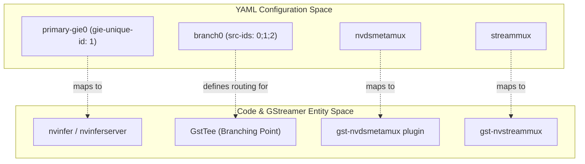
**Sources:**
*   [src/apps/reference_apps/deepstream_parallel_inference_app/tritonclient/sample/configs/apps/vehicle_lpr_analytic/source4_1080p_dec_parallel_infer.yml:177-198]()
*   [src/gst-plugins/gst-nvdsmetamux/README:32-39]()

### Configuration Example: Vehicle & LPR Analytics

In a typical multi-branch configuration, sources are partitioned:
*   **Branch 0**: Performs vehicle detection and color/make/type checking using PGIE ID 1 on sources 0, 1, and 2 [src/apps/reference_apps/deepstream_parallel_inference_app/tritonclient/sample/configs/apps/vehicle_lpr_analytic/source4_1080p_dec_parallel_infer.yml:194-198]().
*   **Branch 1**: Performs PeopleNet detection, tracking, and analytics using PGIE ID 2 on sources 1, 2, and 3 [src/apps/reference_apps/deepstream_parallel_inference_app/tritonclient/sample/configs/apps/vehicle_lpr_analytic/source4_1080p_dec_parallel_infer.yml:230-234]().

**Diagram: Data Flow in Parallel Inference App**
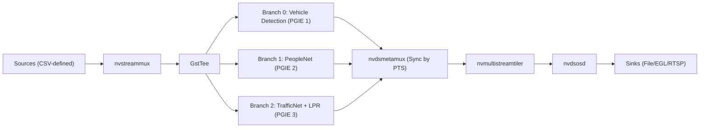
**Sources:**
*   [src/apps/reference_apps/deepstream_parallel_inference_app/tritonclient/sample/configs/apps/vehicle_lpr_analytic/source4_1080p_dec_parallel_infer.yml:16-180]()
*   [src/gst-plugins/gst-nvdsmetamux/README:95-95]()

### Config File Format (YAML)

The application uses a specific YAML structure to define parallel branches:

| Section | Key | Description |
| :--- | :--- | :--- |
| `primary-gieX` | `plugin-type` | 0 for `nvinfer`, 1 for `nvinferserver` [src/apps/reference_apps/deepstream_parallel_inference_app/tritonclient/sample/configs/apps/vehicle_lpr_analytic/source4_1080p_dec_parallel_infer.yml:179-180](). |
| `primary-gieX` | `gie-unique-id` | Unique ID used by `nvdsmetamux` to identify metadata origin [src/apps/reference_apps/deepstream_parallel_inference_app/tritonclient/sample/configs/apps/vehicle_lpr_analytic/source4_1080p_dec_parallel_infer.yml:190-190](). |
| `branchX` | `pgie-id` | Links the branch to a specific `primary-gie` unique ID [src/apps/reference_apps/deepstream_parallel_inference_app/tritonclient/sample/configs/apps/vehicle_lpr_analytic/source4_1080p_dec_parallel_infer.yml:196-196](). |
| `branchX` | `src-ids` | Semicolon-separated list of source IDs processed by this branch [src/apps/reference_apps/deepstream_parallel_inference_app/tritonclient/sample/configs/apps/vehicle_lpr_analytic/source4_1080p_dec_parallel_infer.yml:198-198](). |

**Sources:**
*   [src/apps/reference_apps/deepstream_parallel_inference_app/tritonclient/sample/configs/apps/vehicle_lpr_analytic/source4_1080p_dec_parallel_infer.yml:177-234]()
*   [src/apps/reference_apps/deepstream_parallel_inference_app/tritonclient/sample/configs/apps/bodypose_yolo/source4_1080p_dec_parallel_infer.yml:177-236]()

---

# Page: Metadata Serialization & Utilities

# Metadata Serialization & Utilities

<details>
<summary>Relevant source files</summary>

The following files were used as context for generating this wiki page:

- [.claude/.gitkeep](.claude/.gitkeep)
- [.github/.gitkeep](.github/.gitkeep)
- [CODE_OF_CONDUCT.md](CODE_OF_CONDUCT.md)
- [LICENSE](LICENSE)
- [src/apps/sample_apps/deepstream-ucx-test/Makefile](src/apps/sample_apps/deepstream-ucx-test/Makefile)
- [src/apps/sample_apps/deepstream-ucx-test/README](src/apps/sample_apps/deepstream-ucx-test/README)
- [src/apps/sample_apps/deepstream-ucx-test/deepstream_ucx_test_app.c](src/apps/sample_apps/deepstream-ucx-test/deepstream_ucx_test_app.c)
- [src/apps/sample_apps/deepstream-ucx-test/deepstream_ucx_test_app.h](src/apps/sample_apps/deepstream-ucx-test/deepstream_ucx_test_app.h)
- [src/gst-plugins/gst-nvdsmetautils/audio_metadata_serialization/Makefile](src/gst-plugins/gst-nvdsmetautils/audio_metadata_serialization/Makefile)
- [src/gst-plugins/gst-nvdsmetautils/sei_serialization/Makefile](src/gst-plugins/gst-nvdsmetautils/sei_serialization/Makefile)
- [src/gst-plugins/gst-nvdsmetautils/video_metadata_serialization/Makefile](src/gst-plugins/gst-nvdsmetautils/video_metadata_serialization/Makefile)

</details>


The `gst-nvdsmetautils` library provides a suite of tools for serializing and deserializing DeepStream metadata. This is critical for high-performance transport scenarios where metadata must be preserved across process boundaries (IPC), network hops (UCX/RDMA), or embedded directly into video bitstreams (SEI). The library facilitates the conversion of complex `NvDsBatchMeta` structures into flat binary buffers that can be reconstructed at a remote endpoint.

### Architecture Overview

The serialization framework is primarily utilized by the `nvdsmetainsert` and `nvdsmetaextract` plugins to enable seamless metadata transport in distributed pipelines. It supports three primary data types: Video Metadata, Audio Metadata, and Supplemental Enhancement Information (SEI) for H.264/H.265 streams.

#### Metadata Serialization Data Flow
The following diagram illustrates how metadata is serialized for transport via the `nvdsgst_ucx` plugin, as seen in the `deepstream-ucx-test` application.

**Metadata Transport via UCX**
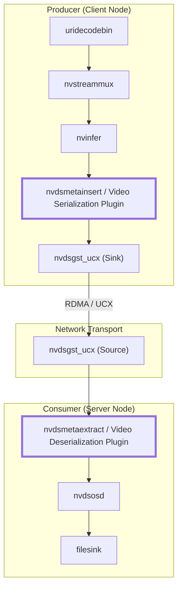
**Sources:** [src/apps/sample_apps/deepstream-ucx-test/README:87-108](), [src/apps/sample_apps/deepstream-ucx-test/README:109-127]()

---

### Key Components & Libraries

The serialization logic is divided into specialized libraries targeting different media types and transport requirements.

| Library | Purpose | Key Dependencies |
| :--- | :--- | :--- |
| `libnvds_video_metadata_serialization.so` | Serializes video `NvDsBatchMeta` using Protobuf. | `libprotobuf`, `json-glib`, `uuid` |
| `libnvds_audio_metadata_serialization.so` | Serializes audio-specific metadata for UCX transport. | `libprotobuf`, `json-glib` |
| `libnvds_sei_serialization.so` | Embeds metadata into H.264/H.265 SEI NAL units. | `lgstnvdsseimeta`, `cuda` |

**Sources:** [src/gst-plugins/gst-nvdsmetautils/video_metadata_serialization/Makefile:45-46](), [src/gst-plugins/gst-nvdsmetautils/audio_metadata_serialization/Makefile:45-46](), [src/gst-plugins/gst-nvdsmetautils/sei_serialization/Makefile:27-46]()

---

### Video and Audio Serialization

The video and audio serialization utilities use Google Protocol Buffers (Protobuf) to define a structured schema for metadata. This ensures version compatibility and efficient binary representation.

#### Implementation Details
1.  **Schema Definition**: Metadata structures are defined in `.proto` files (e.g., `ds_meta.proto`), which are compiled into C++ classes during the build process [src/gst-plugins/gst-nvdsmetautils/video_metadata_serialization/Makefile:59-62]().
2.  **Serialization**: The plugin iterates through the `NvDsBatchMeta` attached to a `GstBuffer`, populates the Protobuf objects, and serializes them into a binary blob [src/apps/sample_apps/deepstream-ucx-test/README:96-97]().
3.  **Attachment**: The resulting binary blob is attached to the buffer as a `NvDsMeta` structure of type `NVDS_METADATA_SERIALIZED` or embedded directly for transport.

**Sources:** [src/gst-plugins/gst-nvdsmetautils/video_metadata_serialization/Makefile:43-46](), [src/apps/sample_apps/deepstream-ucx-test/README:115-119]()

---

### SEI Serialization

Supplemental Enhancement Information (SEI) serialization allows metadata to be embedded directly into the video bitstream. This is particularly useful for recording or streaming scenarios where the metadata must stay synchronized with specific frames in a standard-compliant way.

#### Technical Mapping: SEI Logic
The following diagram maps the logical SEI serialization process to the underlying build and library entities.

**SEI Serialization Entity Mapping**
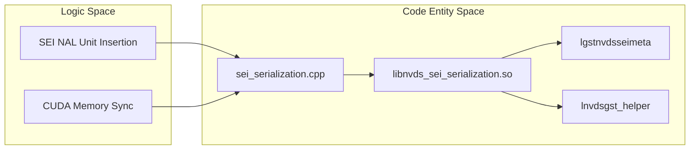
**Sources:** [src/gst-plugins/gst-nvdsmetautils/sei_serialization/Makefile:24-27](), [src/gst-plugins/gst-nvdsmetautils/sei_serialization/Makefile:43-46]()

---

### UCX and IPC Transport Utilities

The `nvdsgst_ucx` plugin relies on these utilities to handle metadata across RDMA-enabled networks. The `deepstream-ucx-test-app` demonstrates three primary test cases for these utilities:

1.  **Basic Video Transmission**: Raw frame transport without explicit metadata serialization [src/apps/sample_apps/deepstream-ucx-test/README:69-86]().
2.  **Video with Metadata**: Uses `libnvds_video_metadata_serialization.so` to convert `nvinfer` detections into a binary format for transmission [src/apps/sample_apps/deepstream-ucx-test/README:87-108]().
3.  **Audio with Metadata**: Uses `libnvds_audio_metadata_serialization.so` to transmit audio buffers along with their associated metadata [src/apps/sample_apps/deepstream-ucx-test/README:109-127]().

#### Configuration and Environment
To use these utilities in a UCX environment, the `USE_NEW_NVSTREAMMUX` environment variable must be set to `yes` [src/apps/sample_apps/deepstream-ucx-test/README:174-174](). The plugins are compiled with specific flags to include DeepStream headers and CUDA paths [src/gst-plugins/gst-nvdsmetautils/video_metadata_serialization/Makefile:26-28]().

**Sources:** [src/apps/sample_apps/deepstream-ucx-test/deepstream_ucx_test_app.h:92-107](), [src/apps/sample_apps/deepstream-ucx-test/Makefile:43-51]()

---

# Page: Service Maker SDK

# Service Maker SDK

<details>
<summary>Relevant source files</summary>

The following files were used as context for generating this wiki page:

- [src/apps/sample_apps/deepstream-server/README](src/apps/sample_apps/deepstream-server/README)
- [src/apps/sample_apps/deepstream-test4/README](src/apps/sample_apps/deepstream-test4/README)
- [src/gst-plugins/gst-dsexample/README](src/gst-plugins/gst-dsexample/README)
- [src/gst-plugins/gst-nvinfer/README](src/gst-plugins/gst-nvinfer/README)
- [src/service-maker/README.md](src/service-maker/README.md)
- [src/service-maker/sources/apps/cpp/deepstream_3d_action_recognition_app/README](src/service-maker/sources/apps/cpp/deepstream_3d_action_recognition_app/README)
- [src/service-maker/sources/apps/cpp/deepstream_sr_test_app/README](src/service-maker/sources/apps/cpp/deepstream_sr_test_app/README)
- [src/service-maker/sources/apps/cpp/deepstream_test4_app/README](src/service-maker/sources/apps/cpp/deepstream_test4_app/README)
- [src/service-maker/sources/apps/cpp/deepstream_test5_app/README](src/service-maker/sources/apps/cpp/deepstream_test5_app/README)
- [src/service-maker/sources/apps/python/flow_api/deepstream_3d_action_recognition_app/README](src/service-maker/sources/apps/python/flow_api/deepstream_3d_action_recognition_app/README)

</details>


The Service Maker SDK is a high-level C++ and Python framework designed to simplify the construction of DeepStream pipelines. It provides a declarative abstraction over the complex GStreamer and GLib APIs, allowing developers to focus on application logic rather than boilerplate pipeline management [src/service-maker/README.md:18-20]().

Service Maker supports both programmatic construction via a fluent "Flow" API and graph-based construction using YAML configuration files [src/service-maker/README.md:82-119]().

### SDK Architecture and Layout

The SDK is organized into public headers, reusable modules, and sample applications for both C++ and Python.

| Component | Path | Description |
|---|---|---|
| **Public Headers** | `includes/` | C++ headers for the `Pipeline` class and supporting types [src/service-maker/README.md:29](). |
| **Modules** | `sources/modules/` | Reusable shared libraries (probes, sinks, sources) that plug into pipelines [src/service-maker/README.md:36](). |
| **C++ Apps** | `sources/apps/cpp/` | Sample applications implementing core DeepStream patterns [src/service-maker/README.md:32](). |
| **Python Apps** | `sources/apps/python/` | Samples for both the Flow API and the Pipeline API [src/service-maker/README.md:33-35](). |

**Sources:** [src/service-maker/README.md:24-37]()

### Declarative Pipeline Construction

Service Maker introduces the `Pipeline` class, which serves as the primary entry point for managing the lifecycle of a DeepStream application. Developers can add elements using string-based factory names and link them together in a chainable fashion [src/service-maker/README.md:84-102]().

#### Service Maker Entity Mapping
The following diagram illustrates how high-level Service Maker concepts map to the underlying SDK components.

**Service Maker Component Mapping**
```mermaid
graph TD
    subgraph "Service Maker SDK"
        A["Pipeline Class"] -->|manages| B["GStreamer Pipeline"]
        C["Flow API"] -->|constructs| A
        D["YAML Config"] -->|deserializes to| A
        A -->|uses| E["Reusable Modules"]
    end

    subgraph "Code Entities"
        E --> F["sample_video_probe"]
        E --> G["resnet_tensor_parser"]
        A --> H["src/service-maker/includes/pipeline.hpp"]
        F --> I["src/service-maker/sources/modules/"]
    end
    
    style A stroke-width:2px
    style H stroke-width:2px
```
**Sources:** [src/service-maker/README.md:84-119](), [src/service-maker/README.md:189-204]()

### Reusable Modules

The SDK includes a library of pre-built modules in `sources/modules/` that provide common functionality such as FPS measurement, latency tracking, and custom parsing. These modules are loaded as shared libraries and attached to the pipeline [src/service-maker/README.md:185-188]().

| Module | Role |
|---|---|
| `measure_fps_probe` | Logs real-time pipeline performance [src/service-maker/README.md:195](). |
| `resnet_tensor_parser` | Converts raw inference tensors into DeepStream object metadata [src/service-maker/README.md:194](). |
| `smart_recording_action` | Triggers file recording based on specific detection events [src/service-maker/README.md:199](). |
| `lidar_feeder` | Injects LiDAR point-cloud data into DS3D-capable pipelines [src/service-maker/README.md:203](). |

**Sources:** [src/service-maker/README.md:189-204]()

### API Overview

Service Maker provides distinct interfaces for different development workflows:

*   **C++ Pipeline API**: A chainable C++ interface. It supports manual element linking or loading entire graphs from YAML files [src/service-maker/README.md:82-119](). For details, see [C++ Pipeline API](#3.1).
*   **Python Flow API**: A pythonic, fluent interface that abstracts GStreamer details for rapid prototyping [src/service-maker/README.md:141-160](). For details, see [Python Flow & Pipeline APIs](#3.2).
*   **Python Pipeline API**: A higher-level declarative approach using YAML-driven pipeline descriptions [src/service-maker/README.md:162-164](). For details, see [Python Flow & Pipeline APIs](#3.2).

#### Programming Model Comparison
```mermaid
graph LR
    subgraph "C++ Workflow"
        CPP["Pipeline('name')"] --> ADD["add('plugin', 'name')"]
        ADD --> LNK["link('name1', 'name2')"]
        LNK --> RUN["start()"]
    end

    subgraph "Python Workflow"
        PY["from deepstream import Pipeline"] --> FLOW["Flow API (Chained)"]
        PY --> YAML["Pipeline API (YAML)"]
    end

    FLOW --> RUN
    YAML --> RUN
```
**Sources:** [src/service-maker/README.md:82-164]()

### Sample Applications

Service Maker includes a comprehensive suite of sample applications that mirror the standard DeepStream tutorials but utilize the Service Maker SDK for construction.

*   **Standard Tests**: `deepstream_test1_app` through `test5_app` cover basic inference, multi-stream handling, and cloud messaging [src/service-maker/README.md:170-176]().
*   **Specialized Apps**:
    *   `deepstream_3d_action_recognition_app`: Demonstrates 3D/2D temporal sequence batching for action recognition [src/service-maker/sources/apps/cpp/deepstream_3d_action_recognition_app/README:48-60]().
    *   `deepstream_sr_test_app`: Showcases smart recording for RTSP streams triggered locally or via Kafka [src/service-maker/sources/apps/cpp/deepstream_sr_test_app/README:32-41]().
    *   `deepstream_appsrc_test_app`: Demonstrates feeding raw buffers into a pipeline [src/service-maker/README.md:177]().

**Sources:** [src/service-maker/README.md:168-180](), [src/service-maker/sources/apps/cpp/deepstream_3d_action_recognition_app/README:48-60]()

---

# Page: C++ Pipeline API

# C++ Pipeline API

<details>
<summary>Relevant source files</summary>

The following files were used as context for generating this wiki page:

- [src/apps/sample_apps/deepstream-server/README](src/apps/sample_apps/deepstream-server/README)
- [src/apps/sample_apps/deepstream-test4/README](src/apps/sample_apps/deepstream-test4/README)
- [src/gst-plugins/gst-dsexample/README](src/gst-plugins/gst-dsexample/README)
- [src/gst-plugins/gst-nvinfer/README](src/gst-plugins/gst-nvinfer/README)
- [src/service-maker/README.md](src/service-maker/README.md)
- [src/service-maker/sources/apps/cpp/deepstream_3d_action_recognition_app/README](src/service-maker/sources/apps/cpp/deepstream_3d_action_recognition_app/README)
- [src/service-maker/sources/apps/cpp/deepstream_sr_test_app/README](src/service-maker/sources/apps/cpp/deepstream_sr_test_app/README)
- [src/service-maker/sources/apps/cpp/deepstream_test4_app/README](src/service-maker/sources/apps/cpp/deepstream_test4_app/README)
- [src/service-maker/sources/apps/cpp/deepstream_test5_app/README](src/service-maker/sources/apps/cpp/deepstream_test5_app/README)
- [src/service-maker/sources/apps/python/flow_api/deepstream_3d_action_recognition_app/README](src/service-maker/sources/apps/python/flow_api/deepstream_3d_action_recognition_app/README)
- [src/service-maker/sources/apps/python/pipeline_api/deepstream_test4_app/README](src/service-maker/sources/apps/python/pipeline_api/deepstream_test4_app/README)
- [src/service-maker/sources/apps/python/pipeline_api/deepstream_test5_app/README](src/service-maker/sources/apps/python/pipeline_api/deepstream_test5_app/README)

</details>


The DeepStream Service Maker C++ API provides a high-level, fluent abstraction over GStreamer and GLib for constructing DeepStream pipelines. It allows developers to define complex vision AI workflows through declarative code or YAML configurations, significantly reducing the boilerplate required for manual GStreamer element management [src/service-maker/README.md:18-20]().

## Pipeline Class Implementation

The core of the C++ Service Maker is the `deepstream::Pipeline` class. It manages the lifecycle of the underlying GStreamer `GstPipeline` and provides methods for element addition, linking, and execution control [src/service-maker/README.md:84-110]().

### Key Functions

| Function | Description |
|---|---|
| `add(plugin, name, ...properties)` | Instantiates a GStreamer element or bin and sets its properties. Supports variadic arguments for property key-value pairs [src/service-maker/README.md:95-99](). |
| `link(names...)` | Establishes a linear sequential link between the named elements [src/service-maker/README.md:102](). |
| `link({srcs}, {sinks})` | Establishes complex or request-pad links (e.g., linking a source to a specific request pad on a muxer) [src/service-maker/README.md:101](). |
| `start()` | Sets the pipeline state to `GST_STATE_PLAYING` [src/service-maker/README.md:103](). |
| `wait()` | Blocks the calling thread until the pipeline receives an EOS (End of Stream) or Error message [src/service-maker/README.md:104](). |

### YAML Graph Loading
Pipelines can be externalized into YAML files, allowing the C++ application to act as a generic runner for different graph definitions [src/service-maker/README.md:113-119]().

```cpp
// Loading a pipeline from a YAML graph
Pipeline pipeline("MyGraph", "MyGraph.yaml");
pipeline.start();
pipeline.wait();
```

### Data Flow and Code Entity Mapping

The following diagram maps the high-level C++ API calls to the internal pipeline construction logic.

**Pipeline Construction Flow**
```mermaid
graph TD
    subgraph "C++ API Space"
        A["Pipeline::Pipeline(name)"] --> B["Pipeline::add(plugin, name, props)"]
        B --> C["Pipeline::link(elements...)"]
        C --> D["Pipeline::start()"]
    end

    subgraph "GStreamer Entity Space"
        B -.-> B1["gst_element_factory_make()"]
        B -.-> B2["g_object_set(properties)"]
        C -.-> C1["gst_element_link_many()"]
        C -.-> C2["gst_element_get_request_pad()"]
        D -.-> D1["gst_element_set_state(GST_STATE_PLAYING)"]
    end

    B1 --- B2
    C1 --- C2
```
**Sources:** [src/service-maker/README.md:84-119]()

## CMake Integration

To build a Service Maker C++ application, developers must link against `nvds_service_maker` and include the DeepStream public headers [src/service-maker/README.md:123-133]().

**Standard CMake Configuration**
```cmake
find_library(nvds_service_maker NAMES nvds_service_maker
    HINTS /opt/nvidia/deepstream/deepstream/service-maker)
include_directories(/opt/nvidia/deepstream/deepstream/sources/includes)

add_executable(my-app my_app.cpp)
target_link_libraries(my-app PRIVATE nvds_service_maker)
```
**Sources:** [src/service-maker/README.md:123-133]()

## Sample Applications

Service Maker includes a suite of C++ samples demonstrating various pipeline patterns, located in `src/service-maker/sources/apps/cpp/` [src/service-maker/README.md:31-32]().

### Core Test Applications (test1–test5)
These applications mirror the standard DeepStream SDK tests but use the Service Maker API.

*   **deepstream-test1**: Basic single-stream pipeline using `nvurisrcbin`, `nvinfer`, and `nvdsosd` [src/service-maker/README.md:172]().
*   **deepstream-test2**: Extends test1 with secondary classifiers (SGIE) and a tracker plugin [src/service-maker/README.md:173]().
*   **deepstream-test3**: Demonstrates multi-stream handling using `nvstreammux` [src/service-maker/README.md:174]().
*   **deepstream-test4**: Integrates cloud messaging using `nvmsgconv` and `nvmsgbroker` to send object metadata to Kafka, Azure, or MQTT [src/service-maker/sources/apps/cpp/deepstream_test4_app/README:69-73]().
*   **deepstream-test5**: A highly configurable reference app supporting dynamic source management via `nvmultiurisrcbin` and multiple simultaneous pipelines [src/service-maker/sources/apps/cpp/deepstream_test5_app/README:38-44]().

### Specialized Samples
*   **deepstream-appsrc-test**: Shows how to feed raw buffers from C++ memory into the pipeline using the `appsrc` element [src/service-maker/README.md:177]().
*   **deepstream-sr-test**: Implements Smart Recording for RTSP streams, allowing event-triggered recording to local storage or controlled via Kafka [src/service-maker/sources/apps/cpp/deepstream_sr_test_app/README:37-41]().
*   **deepstream-3d-action-recognition**: Uses `nvdspreprocess` for temporal sequence batching and 3D ConvNets for recognizing actions like walking or falling [src/service-maker/sources/apps/cpp/deepstream_3d_action_recognition_app/README:56-66]().

**C++ Sample Entity Mapping**
```mermaid
graph LR
    subgraph "Sample Applications"
        T1["deepstream-test1"]
        T4["deepstream-test4"]
        SR["deepstream-sr-test"]
        AR["deepstream-3d-action-recognition"]
    end

    subgraph "Core Components Used"
        T1 --- P["nvinfer"]
        T4 --- MB["nvmsgbroker"]
        T4 --- MC["nvmsgconv"]
        SR --- SRE["Smart Recording Logic"]
        AR --- PP["nvdspreprocess"]
    end
```
**Sources:** [src/service-maker/README.md:168-179](), [src/service-maker/sources/apps/cpp/deepstream_test4_app/README:69-73](), [src/service-maker/sources/apps/cpp/deepstream_sr_test_app/README:37-41](), [src/service-maker/sources/apps/cpp/deepstream_3d_action_recognition_app/README:56-66]()

## Reusable Modules

Service Maker utilizes loadable shared-library modules (located in `sources/modules/`) that can be plugged into pipelines to extend functionality without modifying the core `Pipeline` class [src/service-maker/README.md:185-187]().

| Module | Purpose |
|---|---|
| `sample_video_probe` | Attaches a frame-level probe callback for metadata inspection [src/service-maker/README.md:192](). |
| `measure_fps_probe` | Calculates and logs throughput metrics [src/service-maker/README.md:195](). |
| `resnet_tensor_parser` | Custom post-processing for ResNet-based models [src/service-maker/README.md:194](). |
| `smart_recording_action` | Logic to trigger recording based on specific detection events [src/service-maker/README.md:199](). |

**Sources:** [src/service-maker/README.md:185-205]()

---

# Page: Python Flow & Pipeline APIs

# Python Flow & Pipeline APIs

<details>
<summary>Relevant source files</summary>

The following files were used as context for generating this wiki page:

- [src/apps/reference_apps/deepstream-bodypose-3d/README.md](src/apps/reference_apps/deepstream-bodypose-3d/README.md)
- [src/apps/reference_apps/deepstream-custom-tile-config/README.md](src/apps/reference_apps/deepstream-custom-tile-config/README.md)
- [src/apps/reference_apps/deepstream-ipc-test-sr/README.md](src/apps/reference_apps/deepstream-ipc-test-sr/README.md)
- [src/apps/reference_apps/deepstream-masktracker/README.md](src/apps/reference_apps/deepstream-masktracker/README.md)
- [src/apps/reference_apps/pyservicemaker_sample_apps/README.md](src/apps/reference_apps/pyservicemaker_sample_apps/README.md)
- [src/apps/reference_apps/pyservicemaker_sample_apps/pipeline_api/deepstream_nvdsanalytics_test_app/README.md](src/apps/reference_apps/pyservicemaker_sample_apps/pipeline_api/deepstream_nvdsanalytics_test_app/README.md)
- [src/apps/tao_apps/apps/tao_others/deepstream-pose-classification/README.md](src/apps/tao_apps/apps/tao_others/deepstream-pose-classification/README.md)
- [src/apps/tao_apps/pysm-apps/common/utils.py](src/apps/tao_apps/pysm-apps/common/utils.py)
- [src/service-maker/README.md](src/service-maker/README.md)
- [src/service-maker/sources/apps/python/flow_api/deepstream_sr_test_app/README](src/service-maker/sources/apps/python/flow_api/deepstream_sr_test_app/README)
- [src/service-maker/sources/apps/python/flow_api/deepstream_test5_app/README](src/service-maker/sources/apps/python/flow_api/deepstream_test5_app/README)
- [src/service-maker/sources/apps/python/pipeline_api/deepstream_3d_action_recognition_app/README](src/service-maker/sources/apps/python/pipeline_api/deepstream_3d_action_recognition_app/README)
- [src/service-maker/sources/apps/python/pipeline_api/deepstream_sr_test_app/README](src/service-maker/sources/apps/python/pipeline_api/deepstream_sr_test_app/README)
- [src/service-maker/sources/apps/python/pipeline_api/deepstream_test1_app/dstest1_config_tegra.yaml](src/service-maker/sources/apps/python/pipeline_api/deepstream_test1_app/dstest1_config_tegra.yaml)
- [src/service-maker/sources/apps/python/pipeline_api/deepstream_test2_app/dstest2_config_tegra.yaml](src/service-maker/sources/apps/python/pipeline_api/deepstream_test2_app/dstest2_config_tegra.yaml)
- [src/service-maker/sources/apps/python/pipeline_api/deepstream_test3_app/dstest3_config_tegra.yaml](src/service-maker/sources/apps/python/pipeline_api/deepstream_test3_app/dstest3_config_tegra.yaml)
- [src/service-maker/sources/apps/python/pipeline_api/deepstream_test4_app/dstest4_config_tegra.yaml](src/service-maker/sources/apps/python/pipeline_api/deepstream_test4_app/dstest4_config_tegra.yaml)
- [src/service-maker/sources/apps/python/pipeline_api/deepstream_test5_app/test5_b16_dynamic_source_tegra.yaml](src/service-maker/sources/apps/python/pipeline_api/deepstream_test5_app/test5_b16_dynamic_source_tegra.yaml)
- [src/service-maker/sources/apps/python/pipeline_api/deepstream_test5_app/test5_b16_dynamic_source_with_enable_property_tegra.yaml](src/service-maker/sources/apps/python/pipeline_api/deepstream_test5_app/test5_b16_dynamic_source_with_enable_property_tegra.yaml)
- [src/service-maker/sources/apps/python/pipeline_api/deepstream_test5_app/test5_b2_tegra.yaml](src/service-maker/sources/apps/python/pipeline_api/deepstream_test5_app/test5_b2_tegra.yaml)

</details>


DeepStream Service Maker provides two Python APIs that offer high-level abstractions over GStreamer and GLib for building vision AI applications [src/service-maker/README.md:18-20](). These APIs allow developers to construct complex pipelines either through a fluent, chained "Flow API" or a declarative, YAML-driven "Pipeline API" [src/service-maker/README.md:137-164]().

## Overview of Python Service Maker

The Python SDK is designed to eliminate GStreamer boilerplate code while maintaining the performance of the underlying C++ Service Maker implementation [src/service-maker/README.md:18-20](). It supports reusable modules such as custom probes, sinks, and parsers that can be dynamically loaded into the pipeline [src/service-maker/README.md:185-204]().

### Flow API vs. Pipeline API

| Feature | Flow API | Pipeline API |
| :--- | :--- | :--- |
| **Construction** | Imperative, method chaining | Declarative, YAML-driven |
| **Best Use Case** | Dynamic pipeline building in code | Production configuration management |
| **Source** | `from deepstream import Pipeline` | `from pyservicemaker import Flow` |
| **Linking** | Manual `.link()` calls | Automatic via `edges` in YAML |

**Sources:** [src/service-maker/README.md:141-164](), [src/apps/tao_apps/pysm-apps/common/utils.py:22]()

---

## The Flow API

The Flow API allows for programmatic construction of pipelines by chaining element additions and links [src/service-maker/README.md:141-158]().

### Code-to-Entity Mapping: Flow Construction
This diagram maps the Python `Pipeline` class methods to the resulting pipeline structure.

"Flow API Pipeline Mapping"
```mermaid
graph LR
    subgraph "Python Code Space"
        P["Pipeline('name')"]
        ADD["add('type', 'name', **props)"]
        LINK["link('src', 'sink')"]
    end

    subgraph "GStreamer Entity Space"
        G_PIPE["GstPipeline"]
        G_ELEM["GstElement"]
        G_PAD["GstPad Link"]
    end

    P -.->|"instantiates"| G_PIPE
    ADD -.->|"creates & adds"| G_ELEM
    LINK -.->|"performs"| G_PAD
```
**Sources:** [src/service-maker/README.md:145-158]()

### Implementation Example
A typical Flow API implementation involves initializing the `Pipeline` object, adding elements with keyword arguments for properties, and defining the data flow via `.link()` [src/service-maker/README.md:145-158]().

```python
from deepstream import Pipeline

pipeline = Pipeline("deepstream-test")
pipeline \
    .add("nvurisrcbin", "src", uri="file:///path/to/video.mp4") \
    .add("nvstreammux", "mux", batch_size=1, width=1280, height=720) \
    .add("nvinferbin", "infer", config_file_path="/path/to/config.txt") \
    .add("nvdsosdbin", "osd") \
    .add("nveglglessink", "sink")

pipeline.link("src", "mux").link("mux", "infer", "osd", "sink")
pipeline.start()
pipeline.wait()
```
**Sources:** [src/service-maker/README.md:148-158]()

---

## The Pipeline API (YAML-Driven)

The Pipeline API uses a declarative YAML format to define nodes (elements) and edges (links) [src/service-maker/sources/apps/python/pipeline_api/deepstream_test2_app/dstest2_config_tegra.yaml:16-90]().

### YAML Configuration Structure
The YAML file is organized under a `deepstream` root key, containing two primary sections:
1.  **nodes**: A list of elements defining their `type`, `name`, and `properties` [src/service-maker/sources/apps/python/pipeline_api/deepstream_test2_app/dstest2_config_tegra.yaml:17-76]().
2.  **edges**: A mapping defining how nodes are connected. Support includes simple 1-to-1 links and 1-to-many branching (e.g., using a `tee`) [src/service-maker/sources/apps/python/pipeline_api/deepstream_test5_app/test5_b2_tegra.yaml:101-120]().

### Declarative-to-Code Mapping
This diagram shows how YAML definitions are translated into the Service Maker execution environment.

"YAML to Service Maker Execution"
```mermaid
graph TD
    subgraph "YAML Configuration"
        Y_NODE["nodes: - type: nvinfer"]
        Y_PROP["properties: config-file-path"]
        Y_EDGE["edges: pgie: [tracker, osd]"]
    end

    subgraph "Service Maker Engine"
        SM_LOAD["Pipeline(name, yaml_path)"]
        SM_FACTORY["Element Factory"]
        SM_LINKER["Graph Linker"]
    end

    Y_NODE --> SM_FACTORY
    Y_PROP --> SM_FACTORY
    Y_EDGE --> SM_LINKER
    SM_LOAD --> SM_FACTORY
```
**Sources:** [src/service-maker/README.md:113-119](), [src/service-maker/sources/apps/python/pipeline_api/deepstream_test5_app/test5_b2_tegra.yaml:17-121]()

### Advanced YAML Features
*   **Branching**: Using a `tee` element, a single source can be linked to multiple downstream queues (e.g., one for OSD/Sink and one for Cloud Messaging) [src/service-maker/sources/apps/python/pipeline_api/deepstream_test5_app/test5_b2_tegra.yaml:108-110]().
*   **Dynamic Properties**: The `enable` property can be used to conditionally disable elements in the graph without removing their definitions [src/service-maker/sources/apps/python/pipeline_api/deepstream_test5_app/test5_b16_dynamic_source_with_enable_property_tegra.yaml:54-59]().
*   **Custom Probes**: Reusable Python or C++ modules (like `measure_latency_probe`) can be added as nodes and linked into the edge map [src/service-maker/sources/apps/python/pipeline_api/deepstream_test5_app/test5_b2_tegra.yaml:93-94]().

---

## Python Sample Applications

The repository provides several reference applications demonstrating specialized use cases.

### 1. Analytics & Metadata (nvdsanalytics)
Located in `deepstream_nvdsanalytics_test_app`, this sample demonstrates multi-source handling via `uridecodebin` and the use of the `nvdsanalytics` plugin to perform ROI filtering, overcrowding detection, and line crossing [src/apps/reference_apps/pyservicemaker_sample_apps/pipeline_api/deepstream_nvdsanalytics_test_app/README.md:20-33]().

### 2. Smart Recording
The `deepstream_sr_test_app` (available in both Flow and Pipeline API versions) demonstrates how to trigger recording events based on detection signals using the `smart_recording_action` module [src/service-maker/README.md:178-199]().

### 3. 3D Action Recognition
This application uses a temporal model to recognize actions in 3D space, utilizing the declarative Pipeline API for complex element chaining [src/service-maker/README.md:179]().

### 4. MaskTracker (SAM2)
While primarily a reference app, the MaskTracker demonstrates SAM2-based segmentation and tracking. It requires converting SAM2 models to TensorRT using the `sam2-onnx-tensorrt` tool [src/apps/reference_apps/deepstream-masktracker/README.md:21-36]().

**Sources:** [src/apps/reference_apps/pyservicemaker_sample_apps/pipeline_api/deepstream_nvdsanalytics_test_app/README.md](), [src/service-maker/README.md](), [src/apps/reference_apps/deepstream-masktracker/README.md]()

---

## Installation & Prerequisites

To use `pyservicemaker`, ensure the following dependencies are installed:

1.  **DeepStream 9.1**: Installed via `build/build.sh` or Debian package [src/service-maker/README.md:43]().
2.  **Python Libraries**:
    *   `pip3 install torchvision` [src/apps/reference_apps/pyservicemaker_sample_apps/README.md:24-27]()
    *   `pip3 install pyyaml` [src/apps/reference_apps/pyservicemaker_sample_apps/README.md:28-31]()
3.  **Service Maker Modules**: Built automatically during the top-level build and installed to `/opt/nvidia/deepstream/deepstream-9.1/service-maker/modules/` [src/service-maker/README.md:53-65]().

**Sources:** [src/service-maker/README.md:41-65](), [src/apps/reference_apps/pyservicemaker_sample_apps/README.md:23-31]()

---

# Page: Sample & Reference Applications

# Sample & Reference Applications

<details>
<summary>Relevant source files</summary>

The following files were used as context for generating this wiki page:

- [.github/ISSUE_TEMPLATE/bug_report.md](.github/ISSUE_TEMPLATE/bug_report.md)
- [includes/nvdsinferserver_common.proto](includes/nvdsinferserver_common.proto)
- [scripts/print_env.sh](scripts/print_env.sh)
- [src/README.md](src/README.md)
- [src/apps/reference_apps/README.md](src/apps/reference_apps/README.md)
- [src/apps/sample_apps/README.md](src/apps/sample_apps/README.md)
- [src/apps/sample_apps/deepstream-appsrc-test/README](src/apps/sample_apps/deepstream-appsrc-test/README)
- [src/apps/sample_apps/deepstream-infer-tensor-meta-test/README](src/apps/sample_apps/deepstream-infer-tensor-meta-test/README)
- [src/apps/sample_apps/deepstream-multigpu-nvlink-test/README](src/apps/sample_apps/deepstream-multigpu-nvlink-test/README)
- [src/apps/sample_apps/deepstream-nvdsanalytics-test/README](src/apps/sample_apps/deepstream-nvdsanalytics-test/README)
- [src/apps/sample_apps/deepstream-opencv-test/README](src/apps/sample_apps/deepstream-opencv-test/README)
- [src/apps/sample_apps/deepstream-preprocess-test/README](src/apps/sample_apps/deepstream-preprocess-test/README)
- [src/apps/sample_apps/deepstream-test5/README](src/apps/sample_apps/deepstream-test5/README)
- [src/apps/sample_apps/deepstream-user-metadata-test/README](src/apps/sample_apps/deepstream-user-metadata-test/README)
- [src/apps/tao_apps/README.md](src/apps/tao_apps/README.md)
- [src/apps/tao_apps/apps/tao_others/deepstream-mdx-perception-app/README.md](src/apps/tao_apps/apps/tao_others/deepstream-mdx-perception-app/README.md)
- [src/apps/tao_apps/apps/tao_others/deepstream-nvocdr-app/README.md](src/apps/tao_apps/apps/tao_others/deepstream-nvocdr-app/README.md)
- [src/apps/tao_apps/configs/app/config_nvdsanalytics.txt](src/apps/tao_apps/configs/app/config_nvdsanalytics.txt)
- [src/gst-plugins/README.md](src/gst-plugins/README.md)
- [src/utils/README.md](src/utils/README.md)

</details>


This section provides a high-level overview of the sample and reference applications included in the DeepStream SDK 9.1. These applications serve as the primary entry points for developers to understand pipeline construction, metadata handling, and the integration of advanced AI models.

DeepStream applications are broadly categorized into core tutorials for foundational learning, specialized reference apps for advanced use cases (such as 3D sensing and IPC), and TAO-specific applications for deploying pre-trained NVIDIA models.

### Application Categories Overview

The codebase organizes applications based on their complexity and target technology stack:

| Category | Location | Purpose |
|---|---|---|
| **Core Tutorial Apps** | `src/apps/sample_apps/` | Foundational GStreamer-based pipelines (Test1-Test5). |
| **Triton Sample Apps** | `src/apps/sample_apps/` | Applications leveraging `nvinferserver` for multi-framework inference. |
| **TAO Model Apps** | `src/apps/tao_apps/` | Integration of TAO Toolkit models (e.g., PeopleNet, BodyPose3D). |
| **Advanced Reference Apps** | `src/apps/reference_apps/` | Complex features like 3D tracking, VLM integration, and Anomaly Detection. |

**Sources:** [src/README.md:28-52](), [src/apps/sample_apps/README.md:47-128]()

---

### Core Tutorial Sample Apps

The core tutorial applications provide a progressive learning path, starting from a simple single-stream detector to a production-grade multi-stream application with cloud connectivity.

*   **Test 1-3:** Covers basic decoding, primary inference (`nvinfer`), secondary classification, and multi-stream handling via `uridecodebin` [src/apps/sample_apps/README.md:51-56]().
*   **Test 4-5:** Introduces cloud messaging via `nvmsgbroker` (Kafka/MQTT) and advanced configurations including RTSP output [src/apps/sample_apps/README.md:57-58]().
*   **Metadata & Analytics:** Specialized tests for accessing raw tensor metadata (`deepstream-infer-tensor-meta-test`) and spatial analytics (`deepstream-nvdsanalytics-test`) [src/apps/sample_apps/README.md:64-87]().

For implementation details and configuration patterns, see **[Core Tutorial Sample Apps](#4.1)**.

**Sources:** [src/apps/sample_apps/README.md:49-59](), [src/apps/sample_apps/deepstream-infer-tensor-meta-test/README:59-64]()

---

### Triton Inference Server Sample Apps

These applications demonstrate how to use the `gst-nvinferserver` plugin to perform inference using the NVIDIA Triton Inference Server. This allows for the use of models from multiple frameworks (TensorRT, ONNX, TensorFlow, PyTorch) within a DeepStream pipeline.

*   **TritonOnnxYolo:** Demonstrates a custom library (`libnvdstriton_custom_impl_yolo.so`) for parsing dynamic-sized output tensors from ONNX YOLOv3 models [src/apps/sample_apps/README.md:127]().
*   **TritonBackendEnsemble:** Shows a custom Triton C++ backend that interacts with DeepStream stream IDs for ensemble model execution [src/apps/sample_apps/README.md:126]().

For details on Triton container setup and gRPC vs C-API modes, see **[Triton Inference Server Sample Apps](#4.2)**.

**Sources:** [src/apps/sample_apps/README.md:117-128](), [src/apps/sample_apps/deepstream-infer-tensor-meta-test/README:46-54]()

---

### TAO Toolkit Model Apps

The TAO applications are optimized for deploying high-accuracy pre-trained models from the NVIDIA TAO Toolkit. These apps include specialized post-processing for various model architectures.

*   **Detection & Segmentation:** Support for `PeopleNet Transformer`, `CitySemSegFormer`, and `Mask2Former` [src/apps/tao_apps/README.md:52]().
*   **Specialized Perception:** Includes `BodyPose3DNet`, `OCRNet` for text recognition, and `ReIdentificationNet` for person/retail item re-identification [src/apps/tao_apps/README.md:35-42]().

For model download scripts and `nvinfer` configuration files, see **[TAO Toolkit Model Apps](#4.3)**.

**Sources:** [src/apps/tao_apps/README.md:18-57](), [src/apps/tao_apps/apps/tao_others/deepstream-mdx-perception-app/README.md:19-35]()

---

### Advanced Reference Applications

Reference applications demonstrate complex system-level features and cutting-edge AI integrations that go beyond standard object detection.

*   **3D Tracking:** Single-view and multi-view 3D tracking for human model reconstruction and calibrated camera networks [src/apps/reference_apps/README.md:36-40]().
*   **MaskTracker:** Multi-object tracking and segmentation using the Segment Anything Model 2 (SAM2) [src/apps/reference_apps/README.md:33-35]().
*   **VLM Integration:** A dedicated plugin for Vision-Language Models (VLM) using `vLLM` for real-time video understanding [src/apps/reference_apps/README.md:52-53]().
*   **System Utilities:** Runtime source addition/deletion and IPC-based buffer sharing between independent pipelines [src/apps/reference_apps/README.md:31-32](), [src/apps/reference_apps/README.md:48-49]().

For architecture diagrams and advanced configuration, see **[Advanced Reference Applications](#4.4)**.

**Sources:** [src/apps/reference_apps/README.md:28-53]()

---

### Application to Code Mapping

The following diagrams illustrate the relationship between the high-level application categories and the underlying code entities in the SDK.

#### Mapping: Core and Reference App Structure
```mermaid
graph TD
    subgraph "Application Layer"
        [deepstream-app] --> |"Uses"| [libnvdsgst_helper.so]
        [deepstream-test5] --> |"Uses"| [nvmsgbroker]
        [deepstream-masktracker] --> |"Uses"| [nvmultiobjecttracker]
    end

    subgraph "Code Entity Space"
        [libnvdsgst_helper.so] --- [src/utils/nvstreammux/]()
        [nvmsgbroker] --- [src/utils/nvmsgbroker/]()
        [nvmultiobjecttracker] --- [src/utils/nvmultiobjecttracker/]()
    end
```
**Sources:** [src/utils/README.md:40-52](), [src/apps/sample_apps/README.md:53-58](), [src/apps/reference_apps/README.md:33-35]()

#### Mapping: TAO and Triton Integration
```mermaid
graph LR
    subgraph "TAO Apps"
        [ds-tao-detection] --> |"Configures"| [nvinfer]
        [ds-tao-segmentation] --> |"Parses"| [nvdsinfer_custombboxparser_tao.cpp]
    end

    subgraph "Triton Samples"
        [TritonOnnxYolo] --> |"Implements"| [libnvdstriton_custom_impl_yolo.so]
        [TritonBackendEnsemble] --> |"Implements"| [libnvdstriton_custom_impl_ensemble.so]
    end

    subgraph "Inference Libraries"
        [nvinfer] --- [src/utils/nvdsinfer/]()
        [nvinferserver] --- [src/utils/nvdsinferserver/]()
    end
```
**Sources:** [src/apps/tao_apps/README.md:52-57](), [src/apps/sample_apps/README.md:117-128](), [src/utils/README.md:30-35]()

---

# Page: Core Tutorial Sample Apps

# Core Tutorial Sample Apps

<details>
<summary>Relevant source files</summary>

The following files were used as context for generating this wiki page:

- [includes/nvdsinferserver_common.proto](includes/nvdsinferserver_common.proto)
- [src/apps/sample_apps/deepstream-appsrc-test/README](src/apps/sample_apps/deepstream-appsrc-test/README)
- [src/apps/sample_apps/deepstream-multigpu-nvlink-test/README](src/apps/sample_apps/deepstream-multigpu-nvlink-test/README)
- [src/apps/sample_apps/deepstream-nvdsanalytics-test/Makefile.ds](src/apps/sample_apps/deepstream-nvdsanalytics-test/Makefile.ds)
- [src/apps/sample_apps/deepstream-nvdsanalytics-test/README](src/apps/sample_apps/deepstream-nvdsanalytics-test/README)
- [src/apps/sample_apps/deepstream-opencv-test/README](src/apps/sample_apps/deepstream-opencv-test/README)
- [src/apps/sample_apps/deepstream-preprocess-test/README](src/apps/sample_apps/deepstream-preprocess-test/README)
- [src/apps/sample_apps/deepstream-server/README](src/apps/sample_apps/deepstream-server/README)
- [src/apps/sample_apps/deepstream-test4/README](src/apps/sample_apps/deepstream-test4/README)
- [src/apps/sample_apps/deepstream-test5/README](src/apps/sample_apps/deepstream-test5/README)
- [src/apps/sample_apps/deepstream-user-metadata-test/README](src/apps/sample_apps/deepstream-user-metadata-test/README)
- [src/apps/tao_apps/configs/app/config_nvdsanalytics.txt](src/apps/tao_apps/configs/app/config_nvdsanalytics.txt)
- [src/gst-plugins/gst-dsexample/README](src/gst-plugins/gst-dsexample/README)
- [src/gst-plugins/gst-nvinfer/README](src/gst-plugins/gst-nvinfer/README)
- [src/service-maker/sources/apps/cpp/deepstream_3d_action_recognition_app/README](src/service-maker/sources/apps/cpp/deepstream_3d_action_recognition_app/README)
- [src/service-maker/sources/apps/cpp/deepstream_sr_test_app/README](src/service-maker/sources/apps/cpp/deepstream_sr_test_app/README)
- [src/service-maker/sources/apps/cpp/deepstream_test4_app/README](src/service-maker/sources/apps/cpp/deepstream_test4_app/README)
- [src/service-maker/sources/apps/cpp/deepstream_test5_app/README](src/service-maker/sources/apps/cpp/deepstream_test5_app/README)
- [src/service-maker/sources/apps/python/flow_api/deepstream_3d_action_recognition_app/README](src/service-maker/sources/apps/python/flow_api/deepstream_3d_action_recognition_app/README)

</details>


The DeepStream SDK provides a suite of tutorial applications designed to guide developers from basic single-stream inference to complex multi-stream, cloud-connected analytics pipelines. These applications demonstrate the standard GStreamer pipeline patterns, metadata handling, and configuration paradigms used in DeepStream.

## Tutorial Application Progression

The `deepstream-test1` through `deepstream-test5` applications form a progressive learning path for the SDK.

| Application | Key Concepts | Core Elements |
| :--- | :--- | :--- |
| **Test 1** | Basic Pipeline | `filesrc`, `nvinfer`, `nvosd`, `nveglglessink` |
| **Test 2** | Secondary Inference | `nvtracker`, Secondary `nvinfer` (SGIE) |
| **Test 3** | Multi-stream Handling | `nvstreammux`, `nvurisrcbin`, `nvmultistreamtiler` |
| **Test 4** | Cloud Messaging | `nvmsgconv`, `nvmsgbroker` |
| **Test 5** | Reference Architecture | Full feature set, `deepstream-app` base, YAML/TXT config |

### deepstream-test1: The Basic Pipeline
This app demonstrates a simple H.264 elementary stream processing pipeline. It introduces the `nvinfer` element for object detection and `nvdsosd` for drawing bounding boxes and text on video frames.

### deepstream-test2: Tracking and Secondary Inference
Builds upon Test 1 by adding an `nvtracker` for object ID persistence and a secondary inference engine (SGIE). The SGIE performs classification (e.g., vehicle color or make) only on the objects detected by the Primary Inference Engine (PGIE).

### deepstream-test3: Multi-stream and Tiling
Demonstrates how to handle multiple input sources using `nvstreammux`. It introduces `nvmultistreamtiler` to composite multiple streams into a single 2D grid for visualization [src/service-maker/sources/apps/python/flow_api/deepstream_3d_action_recognition_app/README:62-62]().

### deepstream-test4: Cloud Connectivity
Test 4 introduces the telemetry branch. It uses `nvmsgconv` to transform DeepStream metadata into JSON or Protobuf payloads and `nvmsgbroker` to send these payloads to cloud endpoints like Kafka, Azure IoT, or MQTT [src/apps/sample_apps/deepstream-test4/README:47-48]().

### deepstream-test5: The Reference Application
Test 5 is built on the same core logic as the `deepstream-app`. It supports complex configurations via `.txt` or `.yml` files, dynamic source addition/deletion via `nvmultiurisrcbin`, and advanced smart recording features [src/apps/sample_apps/deepstream-test5/README:51-56]().

**Sources:** [src/apps/sample_apps/deepstream-test4/README:47-48](), [src/apps/sample_apps/deepstream-test5/README:51-56](), [src/service-maker/sources/apps/cpp/deepstream_test4_app/README:69-73]().

---

## Metadata Access and Customization

DeepStream uses a hierarchical metadata system. Applications access this data via GStreamer buffer probes.

### Data Flow: Metadata Probes
The following diagram illustrates how `deepstream-user-metadata-test` attaches and retrieves custom data.

**Metadata Lifecycle Diagram**
```mermaid
graph TD
    subgraph "Pipeline Elements"
        SOURCE["source_bin"] --> PGIE["nvinfer (PGIE)"]
        PGIE --> OSD["nvosd"]
        OSD --> SINK["sink_bin"]
    end

    subgraph "Code Entities"
        PROBE_ADD["nvinfer_src_pad_buffer_probe"]
        PROBE_READ["osd_sink_pad_buffer_probe"]
        META_STRUCT["NvDsFrameMeta / NvDsObjectMeta"]
    end

    PGIE -- "attach metadata" --> PROBE_ADD
    PROBE_ADD -- "NvDsUserMeta" --> META_STRUCT
    META_STRUCT -- "extract metadata" --> PROBE_READ
    PROBE_READ --> SINK
```
In `deepstream-user-metadata-test`, `nvinfer` attaches 16 random integers as `NvDsUserMeta` to the frame metadata [src/apps/sample_apps/deepstream-user-metadata-test/README:90-93](). These are later extracted at the OSD sink pad probe to verify data integrity [src/apps/sample_apps/deepstream-user-metadata-test/README:94-99]().

**Sources:** [src/apps/sample_apps/deepstream-user-metadata-test/README:90-99]().

---

## Cloud Messaging and Smart Recording

DeepStream enables edge-to-cloud communication through protocol adaptors.

### Cloud Protocol Adaptors
The `nvmsgbroker` plugin supports several backends, configured via the `--proto-lib` or `-p` flag:
*   **Kafka:** `libnvds_kafka_proto.so` [src/apps/sample_apps/deepstream-test4/README:86-86]()
*   **Azure IoT:** `libnvds_azure_proto.so` [src/apps/sample_apps/deepstream-test4/README:87-87]()
*   **AMQP (RabbitMQ):** `libnvds_amqp_proto.so` [src/apps/sample_apps/deepstream-test4/README:88-88]()
*   **Redis:** `libnvds_redis_proto.so` [src/apps/sample_apps/deepstream-test4/README:89-89]()

### Smart Recording (`deepstream-sr-test-app`)
This application demonstrates recording RTSP streams based on external events.
1.  **Local Mode:** Automatically triggers a recording session to showcase the API [src/service-maker/sources/apps/cpp/deepstream_sr_test_app/README:95-97]().
2.  **Cloud/Kafka Mode:** Listens for a JSON command (e.g., `start-recording`) on a Kafka topic to trigger video capture [src/service-maker/sources/apps/cpp/deepstream_sr_test_app/README:142-155]().

**Sources:** [src/apps/sample_apps/deepstream-test4/README:86-89](), [src/service-maker/sources/apps/cpp/deepstream_sr_test_app/README:95-97](), [src/service-maker/sources/apps/cpp/deepstream_sr_test_app/README:142-155]().

---

## Specialized Analytics: nvdsanalytics

The `deepstream-nvdsanalytics-test` app demonstrates spatial intelligence features such as line crossing, ROI filtering, and overcrowding detection.

**Analytics Pipeline Architecture**
```mermaid
graph LR
    subgraph "Input Processing"
        SRCBIN["nvurisrcbin"] --> MUX["nvstreammux"]
    end

    subgraph "Intelligence Layer"
        MUX --> PGIE["nvinfer"]
        PGIE --> TRACKER["nvtracker"]
        TRACKER --> ANALYTICS["nvdsanalytics"]
    end

    subgraph "Output & Visualization"
        ANALYTICS --> TILER["nvmultistreamtiler"]
        TILER --> OSD["nvdsosd"]
        OSD --> SINK["nveglglessink"]
    end

    subgraph "Config Files"
        CFG_ANALYTICS["config_nvdsanalytics.txt"] -.-> ANALYTICS
    end
```
The `nvdsanalytics` plugin requires an `nvtracker` upstream to maintain object identity across frames. It uses a per-stream configuration file to define ROI polygons and crossing lines [src/apps/sample_apps/deepstream-nvdsanalytics-test/Makefile.ds:53-53]().

**Sources:** [src/apps/sample_apps/deepstream-nvdsanalytics-test/Makefile.ds:53-53](), [src/service-maker/sources/apps/cpp/deepstream_3d_action_recognition_app/README:60-60]().

---

## Reference Application: deepstream-app

The `deepstream-app` (and `deepstream-test5`) represents the most feature-complete reference. It is driven by a configuration file that defines every aspect of the pipeline.

### Key Features
*   **Multi-GPU Support:** Can be configured to run inference on specific GPUs [src/apps/sample_apps/deepstream-test5/README:85-86]().
*   **REST API Integration:** `deepstream-server-app` uses `nvmultiurisrcbin` to provide a REST interface for dynamic stream management (add/remove) [src/apps/sample_apps/deepstream-server/README:46-53]().
*   **3D Action Recognition:** Demonstrates temporal sequence batching using `nvdspreprocess` before passing data to `nvinfer` for 3D convolution-based action classification [src/service-maker/sources/apps/cpp/deepstream_3d_action_recognition_app/README:56-68]().

**Sources:** [src/apps/sample_apps/deepstream-test5/README:85-86](), [src/apps/sample_apps/deepstream-server/README:46-53](), [src/service-maker/sources/apps/cpp/deepstream_3d_action_recognition_app/README:56-68]().

---

# Page: Triton Inference Server Sample Apps

# Triton Inference Server Sample Apps

<details>
<summary>Relevant source files</summary>

The following files were used as context for generating this wiki page:

- [includes/gstnvdsbufferpool.h](includes/gstnvdsbufferpool.h)
- [includes/nvdsinferserver_config.proto](includes/nvdsinferserver_config.proto)
- [includes/nvdsinferserver_plugin.proto](includes/nvdsinferserver_plugin.proto)
- [src/apps/sample_apps/TritonBackendEnsemble/Makefile](src/apps/sample_apps/TritonBackendEnsemble/Makefile)
- [src/apps/sample_apps/TritonBackendEnsemble/README](src/apps/sample_apps/TritonBackendEnsemble/README)
- [src/apps/sample_apps/TritonBackendEnsemble/config_infer_primary.txt](src/apps/sample_apps/TritonBackendEnsemble/config_infer_primary.txt)
- [src/apps/sample_apps/TritonBackendEnsemble/config_infer_secondary_ensemble.txt](src/apps/sample_apps/TritonBackendEnsemble/config_infer_secondary_ensemble.txt)
- [src/apps/sample_apps/TritonBackendEnsemble/deepstream_app_config_triton_backend_ensemble.txt](src/apps/sample_apps/TritonBackendEnsemble/deepstream_app_config_triton_backend_ensemble.txt)
- [src/apps/sample_apps/TritonBackendEnsemble/nvds_triton_cpp_custom_backend/CMakeLists.txt](src/apps/sample_apps/TritonBackendEnsemble/nvds_triton_cpp_custom_backend/CMakeLists.txt)
- [src/apps/sample_apps/TritonBackendEnsemble/nvds_triton_cpp_custom_backend/cmake/TutorialRecommendedBackendConfig.cmake.in](src/apps/sample_apps/TritonBackendEnsemble/nvds_triton_cpp_custom_backend/cmake/TutorialRecommendedBackendConfig.cmake.in)
- [src/apps/sample_apps/TritonBackendEnsemble/nvds_triton_cpp_custom_backend/src/libtriton_recommended.ldscript](src/apps/sample_apps/TritonBackendEnsemble/nvds_triton_cpp_custom_backend/src/libtriton_recommended.ldscript)
- [src/apps/sample_apps/TritonBackendEnsemble/nvds_triton_cpp_custom_backend/src/recommended.cc](src/apps/sample_apps/TritonBackendEnsemble/nvds_triton_cpp_custom_backend/src/recommended.cc)
- [src/apps/sample_apps/TritonBackendEnsemble/nvdsinferserver_custom_impl_ensemble/Makefile](src/apps/sample_apps/TritonBackendEnsemble/nvdsinferserver_custom_impl_ensemble/Makefile)
- [src/apps/sample_apps/TritonOnnxYolo/Makefile](src/apps/sample_apps/TritonOnnxYolo/Makefile)
- [src/apps/sample_apps/TritonOnnxYolo/README](src/apps/sample_apps/TritonOnnxYolo/README)
- [src/apps/sample_apps/TritonOnnxYolo/config_nvinfer.txt](src/apps/sample_apps/TritonOnnxYolo/config_nvinfer.txt)
- [src/apps/sample_apps/TritonOnnxYolo/nvdsinfer_custom_impl_yolo/Makefile](src/apps/sample_apps/TritonOnnxYolo/nvdsinfer_custom_impl_yolo/Makefile)
- [src/apps/sample_apps/TritonOnnxYolo/nvdsinfer_custom_impl_yolo/nvdsinfer_custom_impl_yolo.cpp](src/apps/sample_apps/TritonOnnxYolo/nvdsinfer_custom_impl_yolo/nvdsinfer_custom_impl_yolo.cpp)
- [src/apps/sample_apps/TritonOnnxYolo/triton_model_repo/yolov3-10_onnx/config.pbtxt](src/apps/sample_apps/TritonOnnxYolo/triton_model_repo/yolov3-10_onnx/config.pbtxt)
- [src/apps/sample_apps/deepstream-3d-action-recognition/triton_model_repo/resnet18_2d_rgb/config.pbtxt](src/apps/sample_apps/deepstream-3d-action-recognition/triton_model_repo/resnet18_2d_rgb/config.pbtxt)
- [src/apps/tao_apps/triton_server_grpc.md](src/apps/tao_apps/triton_server_grpc.md)
- [src/utils/nvdsinferserver/libnvds_infer_server.export](src/utils/nvdsinferserver/libnvds_infer_server.export)

</details>


The DeepStream SDK provides specialized sample applications to demonstrate integration with the **NVIDIA Triton Inference Server**. These samples utilize the `nvinferserver` GStreamer plugin, which acts as a Triton client, allowing DeepStream to execute inference on various frameworks (TensorRT, ONNX Runtime, PyTorch, TensorFlow) using either a local C-API or a remote gRPC connection.

## TritonOnnxYolo: Dynamic Tensors and Custom Parsing

The `TritonOnnxYolo` sample demonstrates how to deploy an ONNX-based YOLOv3 model using Triton within a DeepStream pipeline. It specifically addresses models with **dynamic-sized output tensors** and multi-input requirements [src/apps/sample_apps/TritonOnnxYolo/README:20-24]().

### Key Components
*   **Custom Processor**: Implements `nvdsinferserver::IInferCustomProcessor` to handle manual parsing of ONNX output tensors and attachment of bounding box metadata [src/apps/sample_apps/TritonOnnxYolo/README:32-39]().
*   **Memory Management**: Demonstrates the use of `max_buffer_bytes` in the Triton config to optimize memory allocation for dynamic tensors, while allowing DeepStream to auto-grow buffers if needed [src/apps/sample_apps/TritonOnnxYolo/README:90-98]().
*   **Input Initialization**: The custom implementation includes `NvDsInferInitializeInputLayers`, which sets the `image_shape` input tensor required by the YOLOv3 ONNX model based on the configured network dimensions [src/apps/sample_apps/TritonOnnxYolo/nvdsinfer_custom_impl_yolo/nvdsinfer_custom_impl_yolo.cpp:53-68]().

### Data Flow: Triton YOLO Implementation
The following diagram maps the logical inference flow to the specific C++ entities in the custom implementation.

**Triton Custom Processing Flow**
```mermaid
graph TD
    subgraph "Gst-nvinferserver Plugin"
        A["Buffer Input"] --> B["IInferCustomProcessor::processInput"]
    end

    subgraph "nvdsinfer_custom_impl_yolo.cpp"
        B --> C["NvDsInferInitializeInputLayers"]
        C --> D["Set image_shape buffer"]
        E["NvDsInferParseCustomYoloOriginal"] --> F["findLayer(yolonms_layer_1/ExpandDims_1:0)"]
        F --> G["Manual NMS & Box Scaling"]
        G --> H["objectList.emplace_back"]
    end

    subgraph "Triton Inference Server"
        D --> I["ONNX Runtime Backend"]
        I --> E
    end
```
**Sources:** [src/apps/sample_apps/TritonOnnxYolo/nvdsinfer_custom_impl_yolo/nvdsinfer_custom_impl_yolo.cpp:53-167](), [src/apps/sample_apps/TritonOnnxYolo/README:32-39]()

---

## TritonBackendEnsemble: Custom C++ Backends

The `TritonBackendEnsemble` sample demonstrates a sophisticated pipeline where a Triton **Ensemble Model** is used as a Secondary GIE (SGIE). This ensemble combines standard classifier models with a **Custom Triton C++ Backend** [src/apps/sample_apps/TritonBackendEnsemble/README:16-19]().

### System Architecture
The pipeline follows a `source -> pgie -> tracker -> sgie -> tiler -> sink` pattern [src/apps/sample_apps/TritonBackendEnsemble/README:21-22](). The SGIE ensemble takes vehicle objects from the tracker and performs multi-task classification while simultaneously tracking request counts via the custom backend.

| Component | Role | Entity / File |
| :--- | :--- | :--- |
| **Primary GIE** | 4-class Detector (Vehicle, Sign, etc.) | `Primary_Detector` [src/apps/sample_apps/TritonBackendEnsemble/README:23-24]() |
| **Secondary GIE** | Triton Ensemble Model | `triton_custom_backend_ensemble` [src/apps/sample_apps/TritonBackendEnsemble/README:59-62]() |
| **Custom Backend** | Request Counter / Metadata Processor | `deepstream_triton_custom_cpp_backend` [src/apps/sample_apps/TritonBackendEnsemble/README:63-65]() |
| **Custom Lib** | Metadata to Tensor conversion | `nvdsinferserver_custom_process_ensemble.cpp` [src/apps/sample_apps/TritonBackendEnsemble/README:55-58]() |

### Custom Backend Implementation
The custom backend is built using the Triton Backend API, fetching dependencies like `triton-core-serverapi` and `triton-backend-utils` via CMake [src/apps/sample_apps/TritonBackendEnsemble/nvds_triton_cpp_custom_backend/CMakeLists.txt:97-104](). It uses an ldscript to export only `TRITONBACKEND_*` symbols [src/apps/sample_apps/TritonBackendEnsemble/nvds_triton_cpp_custom_backend/src/libtriton_recommended.ldscript:16-20]().

**Sources:** [src/apps/sample_apps/TritonBackendEnsemble/README:16-71](), [src/apps/sample_apps/TritonBackendEnsemble/nvds_triton_cpp_custom_backend/CMakeLists.txt:1-120]()

---

## Inference Modes: C-API vs. gRPC

DeepStream supports two primary communication modes with Triton, configured via the `nvinferserver` configuration file.

### 1. Native C-API (Local)
In this mode, Triton is loaded as a shared library within the DeepStream process. This provides the lowest latency as it avoids network overhead and utilizes shared memory for buffer passing.
*   **Configuration**: Requires a `model_repo` block defining the `root` path [src/apps/sample_apps/TritonBackendEnsemble/config_infer_primary.txt:34-37]().

### 2. gRPC (Remote)
DeepStream acts as a gRPC client, sending inference requests to a standalone `tritonserver` instance. This is ideal for distributed architectures or when offloading inference to a separate GPU node.
*   **Configuration**: Requires a `grpc` block defining the `url` (e.g., `localhost:8001`) [src/apps/sample_apps/TritonBackendEnsemble/config_infer_primary.txt:43-45]().
*   **Deployment**: The server must be started independently using the `tritonserver` command with the appropriate model repository [src/apps/tao_apps/triton_server_grpc.md:56-58]().

**C-API vs gRPC Configuration Comparison**
```mermaid
graph LR
    subgraph "DeepStream App (nvinferserver)"
        CFG["config_infer.txt"]
    end

    subgraph "C-API Mode"
        CFG -- "model_repo { root: '...' }" --> LIB["libtritonserver.so"]
        LIB --> REPO["Local Model Repository"]
    end

    subgraph "gRPC Mode"
        CFG -- "grpc { url: 'IP:Port' }" --> NET["Network Layer"]
        NET --> SRV["Remote Triton Server"]
        SRV --> RREPO["Remote Model Repository"]
    end
```
**Sources:** [src/apps/sample_apps/TritonBackendEnsemble/config_infer_primary.txt:28-46](), [src/apps/tao_apps/triton_server_grpc.md:47-58]()

---

## Model Repository Structure

Triton requires a specific directory structure for its model repository. The samples provide scripts and configurations to organize these assets.

*   **Model Config**: Each model folder must contain a `config.pbtxt` defining inputs, outputs, and the backend (e.g., `tensorrt`, `onnxruntime`) [src/apps/sample_apps/TritonOnnxYolo/triton_model_repo/yolov3-10_onnx/config.pbtxt:1-20]().
*   **Versioning**: Models are stored in numeric subdirectories (e.g., `1/model.onnx`) representing the version [src/apps/sample_apps/TritonOnnxYolo/README:66-69]().
*   **DeepStream Integration**: Samples often use softlinks to standard models installed in `/opt/nvidia/deepstream/deepstream/samples/triton_model_repo/` to minimize disk footprint [src/apps/sample_apps/TritonBackendEnsemble/README:94-100]().

**Sources:** [src/apps/sample_apps/TritonOnnxYolo/README:40-42](), [src/apps/sample_apps/TritonBackendEnsemble/README:66-71]()

---

# Page: TAO Toolkit Model Apps

# TAO Toolkit Model Apps

<details>
<summary>Relevant source files</summary>

The following files were used as context for generating this wiki page:

- [src/apps/reference_apps/README.md](src/apps/reference_apps/README.md)
- [src/apps/reference_apps/deepstream-bodypose-3d/README.md](src/apps/reference_apps/deepstream-bodypose-3d/README.md)
- [src/apps/reference_apps/deepstream-custom-tile-config/README.md](src/apps/reference_apps/deepstream-custom-tile-config/README.md)
- [src/apps/reference_apps/deepstream-ipc-test-sr/README.md](src/apps/reference_apps/deepstream-ipc-test-sr/README.md)
- [src/apps/reference_apps/deepstream-masktracker/README.md](src/apps/reference_apps/deepstream-masktracker/README.md)
- [src/apps/reference_apps/pyservicemaker_sample_apps/README.md](src/apps/reference_apps/pyservicemaker_sample_apps/README.md)
- [src/apps/reference_apps/pyservicemaker_sample_apps/pipeline_api/deepstream_nvdsanalytics_test_app/README.md](src/apps/reference_apps/pyservicemaker_sample_apps/pipeline_api/deepstream_nvdsanalytics_test_app/README.md)
- [src/apps/tao_apps/README.md](src/apps/tao_apps/README.md)
- [src/apps/tao_apps/apps/tao_others/README.md](src/apps/tao_apps/apps/tao_others/README.md)
- [src/apps/tao_apps/apps/tao_others/deepstream-mdx-perception-app/README.md](src/apps/tao_apps/apps/tao_others/deepstream-mdx-perception-app/README.md)
- [src/apps/tao_apps/apps/tao_others/deepstream-nvocdr-app/README.md](src/apps/tao_apps/apps/tao_others/deepstream-nvocdr-app/README.md)
- [src/apps/tao_apps/apps/tao_others/deepstream-pose-classification/README.md](src/apps/tao_apps/apps/tao_others/deepstream-pose-classification/README.md)
- [src/apps/tao_apps/deepstream_app_tao_configs/README.md](src/apps/tao_apps/deepstream_app_tao_configs/README.md)
- [src/apps/tao_apps/deepstream_app_tao_configs/download_models.sh](src/apps/tao_apps/deepstream_app_tao_configs/download_models.sh)
- [src/apps/tao_apps/deepstream_app_tao_configs/peoplenet_test.sh](src/apps/tao_apps/deepstream_app_tao_configs/peoplenet_test.sh)
- [src/apps/tao_apps/deepstream_app_tao_configs/peoplenet_triton_test.sh](src/apps/tao_apps/deepstream_app_tao_configs/peoplenet_triton_test.sh)
- [src/apps/tao_apps/deepstream_app_tao_configs/prepare_triton_models.sh](src/apps/tao_apps/deepstream_app_tao_configs/prepare_triton_models.sh)
- [src/apps/tao_apps/download_models.sh](src/apps/tao_apps/download_models.sh)
- [src/apps/tao_apps/models/poseclassificationnet/config.pbtxt](src/apps/tao_apps/models/poseclassificationnet/config.pbtxt)
- [src/apps/tao_apps/pysm-apps/common/utils.py](src/apps/tao_apps/pysm-apps/common/utils.py)

</details>


The NVIDIA TAO (Trainable AI Algorithms) Toolkit provides a collection of pretrained, purpose-built models for various computer vision tasks. DeepStream SDK includes a suite of reference applications specifically designed to deploy these models efficiently using either `nvinfer` (TensorRT) or `nvinferserver` (Triton). These applications cover a broad spectrum of AI tasks including object detection, semantic segmentation, body pose estimation, and optical character recognition (OCR).

## Overview of Supported Models

The TAO sample applications support twelve primary model types [src/apps/tao_apps/README.md:50-58]():

| Category | Model Name | Description |
| :--- | :--- | :--- |
| **Detection** | PeopleNet Transformer, TrafficCamNet, Retail Detector | High-accuracy object detection for people, vehicles, and retail items. |
| **Segmentation** | CitySemSegFormer, Mask2Former | Pixel-level classification for urban scenes and instance segmentation. |
| **Human Pose** | BodyPose3DNet, Pose Classification | 3D keypoint estimation and action classification from pose sequences. |
| **Perception** | Re-Identification (ReID), Retail Recognition | Embedding extraction for matching objects across frames or databases. |
| **OCR** | OCDNet, OCRNet | Optical character detection and recognition for text extraction. |
| **Specialized** | LPDNet, LPRNet | License Plate Detection and Recognition. |

## Application Architecture

The TAO applications follow a standardized pipeline architecture designed for high-performance video analytics. Data flows from a source (URI/File) through a stream muxer, into the inference engines, and finally to a sink for visualization or storage [src/apps/tao_apps/README.md:59-67]().

### Data Flow Diagram

The following diagram illustrates the flow from the Natural Language "Model Tasks" to the specific Code Entities and GStreamer elements used in the TAO apps.

**TAO Model Pipeline Mapping**

```mermaid
graph TD
    subgraph "Natural Language Space"
        Input["Video/Image Source"]
        TaskDet["Object Detection"]
        TaskSeg["Segmentation"]
        TaskPose["Pose Estimation"]
        Output["Visualization/Data"]
    end

    subgraph "Code Entity Space (GStreamer Plugins)"
        Src["uridecoderbin"]
        Mux["nvstreammux"]
        GIE_Det["nvinfer (Primary GIE)"]
        GIE_Sec["nvinfer (Secondary GIE)"]
        OSD["nvdsosd"]
        Sink["nvvideoconvert | nvv4l2h264enc | filesink"]
    end

    Input --> Src
    Src --> Mux
    Mux --> GIE_Det
    
    %% Conditional logic for different models
    GIE_Det -- "Detection Bboxes" --> GIE_Sec
    GIE_Det -- "Metadata" --> OSD
    GIE_Sec -- "Embeddings/Pose" --> OSD
    
    OSD --> Sink
    Sink --> Output

    %% Model-specific associations
    TaskDet -.-> GIE_Det
    TaskSeg -.-> GIE_Det
    TaskPose -.-> GIE_Sec
```
Sources: [src/apps/tao_apps/README.md:59-67](), [src/apps/tao_apps/apps/tao_others/deepstream-mdx-perception-app/README.md:48-51]()

## Key Reference Applications

### MDX Perception (ReID & Retail)
The MDX perception application implements two distinct pipelines: **Retail Item Recognition** and **People Re-Identification (ReID)** [src/apps/tao_apps/apps/tao_others/deepstream-mdx-perception-app/README.md:18-27]().
* **Retail Pipeline**: Detects items using a primary GIE and extracts embedding vectors via a secondary GIE for database matching [src/apps/tao_apps/apps/tao_others/deepstream-mdx-perception-app/README.md:19-23]().
* **People ReID**: Uses PeopleNet Transformer to detect individuals followed by a ReID model to generate unique embeddings [src/apps/tao_apps/apps/tao_others/deepstream-mdx-perception-app/README.md:24-27]().

### 3D Body Pose Estimation
The `deepstream-pose-estimation-app` implements the KAMA (3D Keypoint Aware Body Mesh Articulation) algorithm [src/apps/reference_apps/deepstream-bodypose-3d/README.md:18-24]().
* **Models**: Integrates PeopleNet (Detection) and BodyPose3DNet (3D Keypoints) [src/apps/reference_apps/deepstream-bodypose-3d/README.md:30-30]().
* **Custom Post-processing**: Includes `libnvdsinfer_custom_impl_BodyPose3DNet.so` to parse 34 keypoints in both 2.5D (image relative) and 3D (world coordinates) [src/apps/reference_apps/deepstream-bodypose-3d/README.md:55-55](), [src/apps/reference_apps/deepstream-bodypose-3d/README.md:121-128]().

### Optical Character Recognition (nvOCDR)
The `deepstream-nvocdr-app` provides an end-to-end solution for detecting and recognizing text [src/apps/tao_apps/apps/tao_others/deepstream-nvocdr-app/README.md:18-19]().
* **Pipeline**: Utilizes **OCDNet** for character detection and **OCRNet** for recognition [src/apps/tao_apps/apps/tao_others/deepstream-nvocdr-app/README.md:21-23]().
* **Dependencies**: Requires the `libnvocdr.so` and `libnvocdr_impl.so` libraries [src/apps/tao_apps/apps/tao_others/deepstream-nvocdr-app/README.md:33-48]().

## Model Integration & Configuration

Integrating a TAO model into DeepStream involves downloading the pretrained `.onnx` or `.etlt` files, generating TensorRT engines, and configuring the `nvinfer` plugin.

### Model Download and Engine Generation
NVIDIA provides a `download_models.sh` script to automate the retrieval of models from NGC [src/apps/tao_apps/README.md:99-105](). For certain models like OCDNet, engines must be generated manually using `trtexec` to specify dynamic shapes [src/apps/tao_apps/apps/tao_others/deepstream-nvocdr-app/README.md:90-97]().

### Nvinfer Configuration Mapping
The `nvinfer` config file (typically `pgie_config.txt`) links the GStreamer element to the physical model files.

**Code Entity Mapping: Config to Implementation**

```mermaid
graph LR
    subgraph "YAML/INI Config"
        C1["config-file-path"]
        C2["model-engine-file"]
        C3["custom-lib-path"]
        C4["parse-bbox-func"]
    end

    subgraph "Inference Logic (nvdsinfer)"
        L1["NvDsInferContext"]
        L2["Model Engine (.engine)"]
        L3["Custom Parser (.so)"]
    end

    C1 --> L1
    C2 --> L2
    C3 --> L3
    C4 --> L3
```
Sources: [src/apps/tao_apps/README.md:117-129](), [src/apps/tao_apps/deepstream_app_tao_configs/README.md:81-101]()

### Configuration Example (`pgie` section)
```ini
[primary-gie]
enable=1
plugin-type=0 # 0: nvinfer, 1: nvinferserver
gie-unique-id=1
config-file=nvinfer/config_infer_primary_peoplenet.txt
```
Source: [src/apps/tao_apps/deepstream_app_tao_configs/README.md:81-95]()

## Advanced Deployment: Triton Inference Server
TAO models can also be deployed using the Triton Inference Server. This is enabled by changing the `plugin-type` to `1` in the application configuration [src/apps/tao_apps/README.md:120-123]().
* **Native Triton**: The server runs within the same process as DeepStream [src/apps/tao_apps/README.md:112-112]().
* **gRPC Triton**: DeepStream acts as a client to a remote Triton server [src/apps/tao_apps/README.md:113-113]().

## Summary Table of TAO Apps

| Application Directory | Key Models | Primary Features |
| :--- | :--- | :--- |
| `tao_detection` | PeopleNet, TrafficCamNet | Standard object detection with YAML/INI config support [src/apps/tao_apps/README.md:54-55](). |
| `deepstream-bodypose-3d` | BodyPose3DNet | 3D human model reconstruction under occlusion [src/apps/reference_apps/deepstream-bodypose-3d/README.md:37-38](). |
| `deepstream-nvocdr-app` | OCDNet, OCRNet | End-to-end text detection and recognition [src/apps/tao_apps/apps/tao_others/deepstream-nvocdr-app/README.md:18-23](). |
| `deepstream-mdx-perception-app` | ReID, Retail Recognition | Feature embedding extraction and Kafka metadata publishing [src/apps/tao_apps/apps/tao_others/deepstream-mdx-perception-app/README.md:18-27](), [69-70](). |
| `deepstream-pose-classification` | PoseClassificationNet | Classifies actions (e.g., walking, falling) from pose sequences [src/apps/tao_apps/apps/tao_others/deepstream-pose-classification/README.md:21-25](). |

Sources: [src/apps/tao_apps/README.md:50-58](), [src/apps/tao_apps/apps/tao_others/README.md:18-29](), [src/apps/reference_apps/README.md:45-47]()

---

# Page: Advanced Reference Applications

# Advanced Reference Applications

<details>
<summary>Relevant source files</summary>

The following files were used as context for generating this wiki page:

- [src/apps/reference_apps/.gitattributes](src/apps/reference_apps/.gitattributes)
- [src/apps/reference_apps/anomaly/README.md](src/apps/reference_apps/anomaly/README.md)
- [src/apps/reference_apps/deepstream-bodypose-3d/README.md](src/apps/reference_apps/deepstream-bodypose-3d/README.md)
- [src/apps/reference_apps/deepstream-custom-tile-config/README.md](src/apps/reference_apps/deepstream-custom-tile-config/README.md)
- [src/apps/reference_apps/deepstream-ipc-test-sr/README.md](src/apps/reference_apps/deepstream-ipc-test-sr/README.md)
- [src/apps/reference_apps/deepstream-masktracker/README.md](src/apps/reference_apps/deepstream-masktracker/README.md)
- [src/apps/reference_apps/deepstream-tracker-3d/README.md](src/apps/reference_apps/deepstream-tracker-3d/README.md)
- [src/apps/reference_apps/deepstream-vllm-plugin/README.md](src/apps/reference_apps/deepstream-vllm-plugin/README.md)
- [src/apps/reference_apps/deepstream-vllm-plugin/install.sh](src/apps/reference_apps/deepstream-vllm-plugin/install.sh)
- [src/apps/reference_apps/deepstream-vllm-plugin/requirements.txt](src/apps/reference_apps/deepstream-vllm-plugin/requirements.txt)
- [src/apps/reference_apps/deepstream_parallel_inference_app/tritonclient/sample/apps/deepstream-parallel-infer/README.md](src/apps/reference_apps/deepstream_parallel_inference_app/tritonclient/sample/apps/deepstream-parallel-infer/README.md)
- [src/apps/reference_apps/deepstream_parallel_inference_app/tritonclient/sample/build.sh](src/apps/reference_apps/deepstream_parallel_inference_app/tritonclient/sample/build.sh)
- [src/apps/reference_apps/deepstream_parallel_inference_app/tritonserver/build_engine.sh](src/apps/reference_apps/deepstream_parallel_inference_app/tritonserver/build_engine.sh)
- [src/apps/reference_apps/pyservicemaker_sample_apps/README.md](src/apps/reference_apps/pyservicemaker_sample_apps/README.md)
- [src/apps/reference_apps/pyservicemaker_sample_apps/pipeline_api/deepstream_nvdsanalytics_test_app/README.md](src/apps/reference_apps/pyservicemaker_sample_apps/pipeline_api/deepstream_nvdsanalytics_test_app/README.md)
- [src/apps/reference_apps/runtime_source_add_delete/README.md](src/apps/reference_apps/runtime_source_add_delete/README.md)
- [src/apps/sample_apps/deepstream-3d-lidar-sensor-fusion/bevfusion/build_bevfusion_model.sh](src/apps/sample_apps/deepstream-3d-lidar-sensor-fusion/bevfusion/build_bevfusion_model.sh)
- [src/apps/sample_apps/deepstream-3d-lidar-sensor-fusion/v2xfusion/scripts/clocks.sh](src/apps/sample_apps/deepstream-3d-lidar-sensor-fusion/v2xfusion/scripts/clocks.sh)
- [src/apps/tao_apps/apps/tao_others/deepstream-pose-classification/README.md](src/apps/tao_apps/apps/tao_others/deepstream-pose-classification/README.md)
- [src/apps/tao_apps/pysm-apps/common/utils.py](src/apps/tao_apps/pysm-apps/common/utils.py)

</details>


This section covers specialized reference applications within the DeepStream SDK that demonstrate advanced capabilities, including 3D pose estimation, foundation model integration (SAM2, VLMs), inter-process communication (IPC), and dynamic pipeline management.

## 1. Vision-Language Model (VLM) Integration
The `nvvllmvlm` plugin enables the integration of Vision-Language Models (such as Cosmos-Reason2) into DeepStream pipelines for real-time video understanding [src/apps/reference_apps/deepstream-vllm-plugin/README.md:31-33](). It uses a segment-based processing approach, collecting frames into time windows for asynchronous batch inference [src/apps/reference_apps/deepstream-vllm-plugin/README.md:35-44]().

### Data Flow and Components
The application converts batched DeepStream frames to `video/x-raw(memory:NVMM), format=RGB` before passing them to the plugin [src/apps/reference_apps/deepstream-vllm-plugin/README.md:102-104]().

| Feature | Description |
| :--- | :--- |
| **Segment Processing** | Collects frames into windows (e.g., 30s) for inference [src/apps/reference_apps/deepstream-vllm-plugin/README.md:161-165](). |
| **Async Inference** | Uses a background worker thread to prevent pipeline blocking [src/apps/reference_apps/deepstream-vllm-plugin/README.md:39-39](). |
| **Multi-Stream** | A single plugin instance efficiently handles multiple streams with per-stream prompts [src/apps/reference_apps/deepstream-vllm-plugin/README.md:40-41](). |
| **Platform Awareness** | Automatically selects RGB conversion paths for dGPU/SBSA vs Jetson/Thor [src/apps/reference_apps/deepstream-vllm-plugin/README.md:45-45](). |

**Vision-Language Pipeline Architecture**
```mermaid
graph LR
    subgraph "DeepStream Pipeline"
        A["uridecodebin"] --> B["nvstreammux"]
        B --> C["nvvideoconvert (RGB)"]
        C --> D["nvvllmvlm Plugin"]
    end

    subgraph "nvvllmvlm Internals"
        D --> E["Frame Buffer/Segmenter"]
        E --> F["Async Worker Thread"]
        F --> G["VLLM Engine (PyTorch)"]
    end

    G --> H["Kafka Publisher"]
    G --> I["Console Output"]
```
**Sources:** [src/apps/reference_apps/deepstream-vllm-plugin/README.md:31-180](), [src/apps/reference_apps/deepstream-vllm-plugin/requirements.txt:1-6]()

---

## 2. MaskTracker (SAM2-based Segmentation)
The `deepstream-masktracker` application demonstrates multi-object tracking and segmentation using the Segment Anything Model 2 (SAM2) [src/apps/reference_apps/deepstream-masktracker/README.md:20-22](). It utilizes a memory bank to store visual features from previous frames to localize and segment targets in new frames [src/apps/reference_apps/deepstream-masktracker/README.md:21-22]().

### Implementation Details
*   **Model Preparation**: SAM2 modules (image encoder, mask decoder, etc.) are converted to TensorRT engines using the `sam2-onnx-tensorrt` tool [src/apps/reference_apps/deepstream-masktracker/README.md:31-32]().
*   **Detection Integration**: Typically paired with `PeopleNet` for initial target detection [src/apps/reference_apps/deepstream-masktracker/README.md:38-38]().
*   **Output**: Generates KITTI-format metadata for boxes and IDs, along with visual segmentation masks [src/apps/reference_apps/deepstream-masktracker/README.md:102-114]().

**Sources:** [src/apps/reference_apps/deepstream-masktracker/README.md:18-117]()

---

## 3. 3D Body Pose Estimation
The `deepstream-pose-estimation-app` recovers 3D skeletal joints using the KAMA (3D Keypoint Aware Body Mesh Articulation) method [src/apps/reference_apps/deepstream-bodypose-3d/README.md:20-23]().

### Metadata Structure
The application outputs two types of pose data [src/apps/reference_apps/deepstream-bodypose-3d/README.md:102-128]():
1.  **Pose25D**: `34 x [x, y, zRel, conf]`. `zRel` is relative depth from the pelvis in millimeters.
2.  **Pose3D**: `34 x [x, y, z, conf]`. Absolute 3D coordinates in the camera world coordinate system.

### Key Components
*   **Models**: Uses `PeopleNet` for person detection and `BodyPose3DNet` for joint estimation [src/apps/reference_apps/deepstream-bodypose-3d/README.md:30-30]().
*   **Custom Parser**: Implements `nvdsinfer_custom_impl_BodyPose3DNet` to handle the specific output tensors of the pose model [src/apps/reference_apps/deepstream-bodypose-3d/README.md:48-50]().
*   **Dependencies**: Requires `libeigen3-dev` for coordinate transformations [src/apps/reference_apps/deepstream-bodypose-3d/README.md:37-41]().

**Sources:** [src/apps/reference_apps/deepstream-bodypose-3d/README.md:18-128]()

---

## 4. IPC Buffer Sharing & Super-Resolution
The `deepstream-ipc-test-app` demonstrates zero-copy sharing of decoded buffers between different processes using Unix Domain Sockets [src/apps/reference_apps/deepstream-ipc-test-sr/README.md:19-21]().

### Architecture
*   **Server**: Decodes H.264/H.265 streams and sends `nvbufsurface` file descriptors over IPC using `nvunixfdsink` [src/apps/reference_apps/deepstream-ipc-test-sr/README.md:99-102]().
*   **Client**: Receives descriptors via `nvunixfdsrc` and pushes them into a DeepStream pipeline for inference and Super-Resolution (SR) processing [src/apps/reference_apps/deepstream-ipc-test-sr/README.md:103-106]().
*   **Super-Resolution**: Integrates a PyTorch-based SR model via `nvinfer` to upscale the received buffers [src/apps/reference_apps/deepstream-ipc-test-sr/README.md:52-60]().

**IPC Metadata Serialization**
```mermaid
sequenceDiagram
    participant S as Server Process
    participant U as Unix Domain Socket
    participant C as Client Process

    Note over S: Decode Frame
    S->>S: serialize_meta()
    Note over S: Add GstReferenceTimestampMeta
    S->>U: Send FD + Serialized Meta
    U->>C: Receive FD
    C->>C: deserialize_meta()
    Note over C: Push to App Pipeline
```
**Sources:** [src/apps/reference_apps/deepstream-ipc-test-sr/README.md:19-141]()

---

## 5. Specialized Configuration Samples

### Custom Tile Configuration
The `deepstream-custom-tile-config` app demonstrates how to use the `custom-tile-config` property of the `nvmultistreamtiler` plugin [src/apps/reference_apps/deepstream-custom-tile-config/README.md:20-22](). This allows developers to define arbitrary rectangle positions and sizes for each stream in the composite output, rather than relying on the default grid layout [src/apps/reference_apps/deepstream-custom-tile-config/README.md:21-22]().

### Parallel Inference
The `deepstream_parallel_inference_app` utilizes branched pipelines to run multiple models (e.g., `YOLOv4`, `TrafficCamNet`, `LPDNet`) concurrently on the same stream [src/apps/reference_apps/deepstream_parallel_inference_app/tritonserver/build_engine.sh:24-56](). It uses `nvdsmetamux` to merge metadata from these parallel branches back into a single stream for downstream components like OSD or message brokers.

### Anomaly Detection
The `anomaly` reference app (found in `src/apps/reference_apps/anomaly/`) provides a template for identifying irregular patterns in video streams, often used in industrial or security contexts.

**Sources:** [src/apps/reference_apps/deepstream-custom-tile-config/README.md:18-54](), [src/apps/reference_apps/deepstream_parallel_inference_app/tritonserver/build_engine.sh:1-78]()

---

# Page: 3D Sensing & Sensor Fusion

# 3D Sensing & Sensor Fusion

<details>
<summary>Relevant source files</summary>

The following files were used as context for generating this wiki page:

- [.gitattributes](.gitattributes)
- [src/apps/sample_apps/deepstream-3d-lidar-sensor-fusion/README](src/apps/sample_apps/deepstream-3d-lidar-sensor-fusion/README)
- [src/apps/sample_apps/deepstream-3d-lidar-sensor-fusion/README.v2xfusion](src/apps/sample_apps/deepstream-3d-lidar-sensor-fusion/README.v2xfusion)
- [src/apps/sample_apps/deepstream-3d-lidar-sensor-fusion/data/nuscene.tar.gz](src/apps/sample_apps/deepstream-3d-lidar-sensor-fusion/data/nuscene.tar.gz)
- [src/apps/sample_apps/deepstream-3d-lidar-sensor-fusion/ds3d_lidar_video_sensor_v2x_fusion.yml](src/apps/sample_apps/deepstream-3d-lidar-sensor-fusion/ds3d_lidar_video_sensor_v2x_fusion.yml)
- [src/apps/sample_apps/deepstream-3d-lidar-sensor-fusion/ds3d_lidar_video_sensor_v2x_fusion_single_batch.yml](src/apps/sample_apps/deepstream-3d-lidar-sensor-fusion/ds3d_lidar_video_sensor_v2x_fusion_single_batch.yml)
- [src/apps/sample_apps/deepstream-3d-lidar-sensor-fusion/lidar_nuscene_data_list.yaml](src/apps/sample_apps/deepstream-3d-lidar-sensor-fusion/lidar_nuscene_data_list.yaml)
- [src/utils/ds3d/README.md](src/utils/ds3d/README.md)

</details>


This section provides an overview of DeepStream's capabilities for processing 3D sensor data, including LiDAR point clouds, depth cameras, and multi-modal sensor fusion. The core of these capabilities is the **DS3D framework**, a specialized utility library and plugin set designed to handle non-video data types within the GStreamer pipeline.

DeepStream supports advanced 3D use cases such as BEVFusion (Bird's Eye View fusion of 6 cameras and LiDAR), V2X (Vehicle-to-Everything) fusion, and multi-view 3D tracking for large-area spatial intelligence.

## DS3D Framework Architecture

The DS3D framework provides a flexible architecture for building pipelines that process 3D data. It abstracts data handling through a unified `ds3d::datamap` structure, allowing different sensor modalities to be merged and processed by common filters and inference engines [src/apps/sample_apps/deepstream-3d-lidar-sensor-fusion/README:23-30]().

### Core DS3D Components

| Component | Code Entity | Description |
| :--- | :--- | :--- |
| **Dataloader** | `ds3d::dataloader` | Captures or reads 3D data (e.g., LiDAR files via `libnvds_lidarfileread.so`) [src/apps/sample_apps/deepstream-3d-lidar-sensor-fusion/ds3d_lidar_video_sensor_v2x_fusion.yml:49-54](). |
| **Databridge** | `ds3d::databridge` | Bridges standard 2D video buffers (`NvBufSurface`) into the `ds3d::datamap` format [src/apps/sample_apps/deepstream-3d-lidar-sensor-fusion/ds3d_lidar_video_sensor_v2x_fusion.yml:33-40](). |
| **Datamixer** | `ds3d::datamixer` | Merges multiple `ds3d::datamap` streams (e.g., LiDAR + Camera) into a single synchronized map [src/apps/sample_apps/deepstream-3d-lidar-sensor-fusion/ds3d_lidar_video_sensor_v2x_fusion.yml:111-118](). |
| **Datafilter** | `ds3d::datafilter` | Performs 3D preprocessing, alignment (calibration), or inference via Triton [src/apps/sample_apps/deepstream-3d-lidar-sensor-fusion/ds3d_lidar_video_sensor_v2x_fusion.yml:80-86](). |
| **Datasink** | `ds3d::datasink` | Renders 3D results or sends them to external sinks like Kafka [src/apps/sample_apps/deepstream-3d-lidar-sensor-fusion/README:29-30](). |

**DS3D Logic to Code Mapping**
```mermaid
graph TD
    subgraph "Natural Language Space"
        A["LiDAR Input"]
        B["Camera Input"]
        C["Sensor Alignment"]
        D["3D Inference"]
    end

    subgraph "Code Entity Space"
        A --> E["ds3d::dataloader (libnvds_lidarfileread.so)"]
        B --> F["ds3d::databridge (libnvds_3d_video_databridge.so)"]
        E & F --> G["ds3d::datamixer (libnvds_3d_multisensor_mixer.so)"]
        G --> H["ds3d::datafilter (libnvds_3d_alignment_datafilter.so)"]
        H --> I["ds3d::datafilter (libnvds_tritoninferfilter.so)"]
    end
```
Sources: [src/apps/sample_apps/deepstream-3d-lidar-sensor-fusion/ds3d_lidar_video_sensor_v2x_fusion.yml:33-188](), [src/utils/ds3d/README.md:29-40]()

## LiDAR & Sensor Fusion (BEVFusion & V2X)

DeepStream supports high-performance sensor fusion architectures that combine 3D LiDAR point clouds with 2D camera images to improve detection accuracy and spatial awareness.

*   **CUDA-BEVFusion**: Integrates data from 6 cameras and 1 LiDAR. It uses a chunked TensorRT-optimized model and a Python-based Triton inference module (`triton-lmm`) for multi-modal processing [src/apps/sample_apps/deepstream-3d-lidar-sensor-fusion/README:34-40]().
*   **V2XFusion**: A "Vehicle-to-Everything" reference pipeline that fuses 1 camera and 1 LiDAR with support for batching (up to batch-size 4) [src/apps/sample_apps/deepstream-3d-lidar-sensor-fusion/README:48-49]().
*   **Calibration & Alignment**: Pipelines include an alignment filter (`libnvds_3d_alignment_datafilter.so`) that uses intrinsic and extrinsic matrices to project 3D LiDAR data onto 2D image planes for rendering and fused inference [src/apps/sample_apps/deepstream-3d-lidar-sensor-fusion/ds3d_lidar_video_sensor_v2x_fusion.yml:127-148]().

For implementation details, model preparation scripts, and calibration configuration, see **[LiDAR Sensor Fusion (BEVFusion & V2XFusion)](#5.1)**.

Sources: [src/apps/sample_apps/deepstream-3d-lidar-sensor-fusion/README:32-52](), [src/apps/sample_apps/deepstream-3d-lidar-sensor-fusion/ds3d_lidar_video_sensor_v2x_fusion.yml:127-148]()

## Multi-View 3D Tracking (MV3DT)

The Multi-View 3D Tracking (MV3DT) system enables tracking objects across multiple non-overlapping or overlapping camera views by projecting 2D detections into a unified 3D world coordinate system.

*   **Coordinate Projection**: Uses projection matrices to map camera-space detections to a Bird's Eye View (BEV).
*   **Inter-Camera Communication**: Utilizes MQTT for low-latency metadata sharing between camera nodes to maintain consistent object IDs across views.
*   **Visualization**: Provides a BEV rendering of the tracked area, often outputting consolidated metadata via Kafka for downstream analytics.

For details on the MV3DT reference app and the auto-configurator tool, see **[Multi-View 3D Tracking (MV3DT)](#5.2)**.

## 3D Pipeline Data Flow

The following diagram illustrates how DS3D components interact to form a fused sensing pipeline.

**Sensor Fusion Data Flow (Code View)**
```mermaid
graph LR
    subgraph "Sources"
        SRC1["multifilesrc (2D Images)"]
        SRC2["ds3d::dataloader (LiDAR .bin)"]
    end

    subgraph "Fusion Logic"
        MUX["nvstreammux"]
        BRIDGE["ds3d::databridge"]
        MIXER["ds3d::datamixer"]
        ALIGN["libnvds_3d_alignment_datafilter.so"]
    end

    subgraph "Inference & Sink"
        INF["libnvds_tritoninferfilter.so"]
        REND["ds3d_gles_ensemble_render"]
    end

    SRC1 --> MUX --> BRIDGE
    SRC2 --> MIXER
    BRIDGE --> MIXER
    MIXER --> ALIGN
    ALIGN --> INF
    INF --> REND
```
Sources: [src/apps/sample_apps/deepstream-3d-lidar-sensor-fusion/ds3d_lidar_video_sensor_v2x_fusion.yml:20-185](), [src/apps/sample_apps/deepstream-3d-lidar-sensor-fusion/README:23-30]()

---

# Page: LiDAR Sensor Fusion (BEVFusion & V2XFusion)

# LiDAR Sensor Fusion (BEVFusion & V2XFusion)

<details>
<summary>Relevant source files</summary>

The following files were used as context for generating this wiki page:

- [.gitattributes](.gitattributes)
- [src/apps/sample_apps/deepstream-3d-action-recognition/triton_model_repo/resnet18_3d_rgb/config.pbtxt](src/apps/sample_apps/deepstream-3d-action-recognition/triton_model_repo/resnet18_3d_rgb/config.pbtxt)
- [src/apps/sample_apps/deepstream-3d-lidar-sensor-fusion/README](src/apps/sample_apps/deepstream-3d-lidar-sensor-fusion/README)
- [src/apps/sample_apps/deepstream-3d-lidar-sensor-fusion/README.v2xfusion](src/apps/sample_apps/deepstream-3d-lidar-sensor-fusion/README.v2xfusion)
- [src/apps/sample_apps/deepstream-3d-lidar-sensor-fusion/bevfusion/bevfusion.Dockerfile](src/apps/sample_apps/deepstream-3d-lidar-sensor-fusion/bevfusion/bevfusion.Dockerfile)
- [src/apps/sample_apps/deepstream-3d-lidar-sensor-fusion/bevfusion/docker_build_bevfusion_image.sh](src/apps/sample_apps/deepstream-3d-lidar-sensor-fusion/bevfusion/docker_build_bevfusion_image.sh)
- [src/apps/sample_apps/deepstream-3d-lidar-sensor-fusion/bevfusion/docker_run_ds3d_sensor_fusion_bevfusion_pipeline.sh](src/apps/sample_apps/deepstream-3d-lidar-sensor-fusion/bevfusion/docker_run_ds3d_sensor_fusion_bevfusion_pipeline.sh)
- [src/apps/sample_apps/deepstream-3d-lidar-sensor-fusion/bevfusion/docker_run_generate_trt_engine_models.sh](src/apps/sample_apps/deepstream-3d-lidar-sensor-fusion/bevfusion/docker_run_generate_trt_engine_models.sh)
- [src/apps/sample_apps/deepstream-3d-lidar-sensor-fusion/bevfusion/docker_run_triton_server_bevfusion.sh](src/apps/sample_apps/deepstream-3d-lidar-sensor-fusion/bevfusion/docker_run_triton_server_bevfusion.sh)
- [src/apps/sample_apps/deepstream-3d-lidar-sensor-fusion/data/nuscene.tar.gz](src/apps/sample_apps/deepstream-3d-lidar-sensor-fusion/data/nuscene.tar.gz)
- [src/apps/sample_apps/deepstream-3d-lidar-sensor-fusion/ds3d_lidar_video_sensor_v2x_fusion.yml](src/apps/sample_apps/deepstream-3d-lidar-sensor-fusion/ds3d_lidar_video_sensor_v2x_fusion.yml)
- [src/apps/sample_apps/deepstream-3d-lidar-sensor-fusion/ds3d_lidar_video_sensor_v2x_fusion_single_batch.yml](src/apps/sample_apps/deepstream-3d-lidar-sensor-fusion/ds3d_lidar_video_sensor_v2x_fusion_single_batch.yml)
- [src/apps/sample_apps/deepstream-3d-lidar-sensor-fusion/lidar_nuscene_data_list.yaml](src/apps/sample_apps/deepstream-3d-lidar-sensor-fusion/lidar_nuscene_data_list.yaml)
- [src/apps/sample_apps/deepstream-3d-lidar-sensor-fusion/model_config_files/config_triton_bev_fusion_infer_grpc.pbtxt](src/apps/sample_apps/deepstream-3d-lidar-sensor-fusion/model_config_files/config_triton_bev_fusion_infer_grpc.pbtxt)
- [src/apps/sample_apps/deepstream-3d-lidar-sensor-fusion/python/triton_lmm/triton_model_repo/bevfusion/config.pbtxt](src/apps/sample_apps/deepstream-3d-lidar-sensor-fusion/python/triton_lmm/triton_model_repo/bevfusion/config.pbtxt)
- [src/apps/sample_apps/deepstream-3d-lidar-sensor-fusion/v2xfusion/models/v2xfusion/config.pbtxt](src/apps/sample_apps/deepstream-3d-lidar-sensor-fusion/v2xfusion/models/v2xfusion/config.pbtxt)
- [src/apps/sample_apps/deepstream-3d-lidar-sensor-fusion/v2xfusion/scripts/docker_run_ds3d_sensor_fusion_v2x_pipeline.sh](src/apps/sample_apps/deepstream-3d-lidar-sensor-fusion/v2xfusion/scripts/docker_run_ds3d_sensor_fusion_v2x_pipeline.sh)
- [src/apps/sample_apps/deepstream-3d-lidar-sensor-fusion/v2xfusion/scripts/docker_run_generate_v2x_trt_engine_model.sh](src/apps/sample_apps/deepstream-3d-lidar-sensor-fusion/v2xfusion/scripts/docker_run_generate_v2x_trt_engine_model.sh)
- [src/apps/sample_apps/deepstream-3d-lidar-sensor-fusion/v2xfusion/scripts/prepare.sh](src/apps/sample_apps/deepstream-3d-lidar-sensor-fusion/v2xfusion/scripts/prepare.sh)
- [src/apps/sample_apps/deepstream-lidar-inference-app/tritonserver/build_engine.sh](src/apps/sample_apps/deepstream-lidar-inference-app/tritonserver/build_engine.sh)
- [src/apps/sample_apps/deepstream-lidar-inference-app/tritonserver/models/pointpillars/config.pbtxt](src/apps/sample_apps/deepstream-lidar-inference-app/tritonserver/models/pointpillars/config.pbtxt)
- [src/apps/tao_apps/models/peoplenet/config.pbtxt](src/apps/tao_apps/models/peoplenet/config.pbtxt)
- [src/utils/ds3d/datafilter/lidar_preprocess/Makefile](src/utils/ds3d/datafilter/lidar_preprocess/Makefile)
- [src/utils/ds3d/dataloader/lidarsource/Makefile](src/utils/ds3d/dataloader/lidarsource/Makefile)
- [src/utils/nvds_msgapi/azure_protocol_adaptor/device_client/Makefile](src/utils/nvds_msgapi/azure_protocol_adaptor/device_client/Makefile)
- [src/utils/nvds_msgapi/azure_protocol_adaptor/module_client/Makefile](src/utils/nvds_msgapi/azure_protocol_adaptor/module_client/Makefile)

</details>


The `deepstream-3d-lidar-sensor-fusion` application demonstrates multi-modal sensor fusion using the DeepStream 3D (DS3D) framework. It integrates LiDAR and camera data for 3D object detection, supporting complex architectures like **CUDA-BEVFusion** (6-camera + 1-LiDAR) and **V2XFusion** (Vehicle-to-Everything). The application leverages `ds3d::datamap` to bridge traditional 2D media pipelines with 3D point cloud processing, utilizing Triton Inference Server for model execution and GLES for ensemble rendering of multi-view outputs.

## System Architecture & Data Flow

The application bridges a standard DeepStream 2D pipeline (handling camera streams) with a DS3D 3D pipeline (handling LiDAR). Data from both domains are merged into a unified `ds3d::datamap` for synchronized inference.

### High-Level Data Flow
1.  **Camera Pipeline**: Decodes video via `nvv4l2decoder`, muxes streams, and applies preprocessing. A `ds3d::databridge` converts the `NvBufSurface` into a `ds3d::datamap` [src/apps/sample_apps/deepstream-3d-lidar-sensor-fusion/ds3d_lidar_video_sensor_v2x_fusion.yml:20-46]().
2.  **LiDAR Pipeline**: A `ds3d::dataloader` reads point cloud data (e.g., `.bin` files from NuScenes or V2X datasets). A `ds3d::datafilter` performs LiDAR-specific preprocessing (e.g., voxelization or feature extraction) [src/apps/sample_apps/deepstream-3d-lidar-sensor-fusion/ds3d_lidar_video_sensor_v2x_fusion.yml:49-108]().
3.  **Fusion (Mixer)**: The `ds3d::datamixer` synchronizes the camera and LiDAR data maps based on timestamps [src/apps/sample_apps/deepstream-3d-lidar-sensor-fusion/ds3d_lidar_video_sensor_v2x_fusion.yml:111-123]().
4.  **Inference**: The combined data is passed to `ds3d::datatfiler->tritoninferfilter` for 3D detection [src/apps/sample_apps/deepstream-3d-lidar-sensor-fusion/README:28-30]().
5.  **Rendering**: Results are visualized using `ds3d_gles_ensemble_render` for Bird's Eye View (BEV) and camera-projection overlays [src/apps/sample_apps/deepstream-3d-lidar-sensor-fusion/README:29-30]().

### DS3D Component Mapping
The following diagram maps the logical fusion steps to specific DS3D code entities and plugins defined in the configuration.

```mermaid
graph TD
    subgraph "2D Camera Branch"
        A["gst-parse-bin (video_source)"] -- "NvBufSurface" --> B["ds3d::databridge (videobridge_2d_to_3d)"]
        B -- "DS3D::ColorFrame" --> C["ds3d::datamixer (multisensor_mixer)"]
    end

    subgraph "3D LiDAR Branch"
        D["ds3d::dataloader (lidarsource)"] -- "DS3D::LidarXYZI" --> E["ds3d::datafilter (lidarpreprocess)"]
        E -- "DS3D::LidarFeatureTensor" --> C
    end

    subgraph "Fusion & Inference"
        C -- "Merged ds3d::datamap" --> F["ds3d::datafilter (lidar_alignment_filter)"]
        F -- "Calibrated Data" --> G["ds3d::datafilter (v2xfusion_inference)"]
        G -- "3D BBoxes" --> H["ds3d::datarender (ds3d_sensor_fusion_render)"]
    end

    style A stroke-dasharray: 5 5
    style D stroke-dasharray: 5 5
```
**Sources:** [src/apps/sample_apps/deepstream-3d-lidar-sensor-fusion/ds3d_lidar_video_sensor_v2x_fusion.yml:20-189](), [src/apps/sample_apps/deepstream-3d-lidar-sensor-fusion/README.v2xfusion:155-165]()

## CUDA-BEVFusion Implementation

CUDA-BEVFusion integrates data from 6 cameras and 1 LiDAR sensor. The model is optimized by chunking it into multiple TensorRT engines [src/apps/sample_apps/deepstream-3d-lidar-sensor-fusion/README:34-36]().

*   **Triton-LMM**: A Python-based multi-modal inference module (`triton-lmm`) is used to integrate the Python-based BEVFusion model with the Triton Inference Server [src/apps/sample_apps/deepstream-3d-lidar-sensor-fusion/README:37-40]().
*   **Model Preparation**: A dedicated script `bevfusion/build_bevfusion_model.sh` downloads model chunks and converts them to TensorRT engines with INT8 precision [src/apps/sample_apps/deepstream-3d-lidar-sensor-fusion/README:101-104]().
*   **Deployment**: The Triton server must run on x86 with GPU Compute Capability 8.0+, while the DS3D pipeline can run on both x86 and Jetson [src/apps/sample_apps/deepstream-3d-lidar-sensor-fusion/README:45-46]().

**Sources:** [src/apps/sample_apps/deepstream-3d-lidar-sensor-fusion/README:34-46](), [src/apps/sample_apps/deepstream-3d-lidar-sensor-fusion/bevfusion/docker_run_triton_server_bevfusion.sh:74-84]()

## V2XFusion Implementation

V2XFusion focuses on Vehicle-to-Everything scenarios, typically processing 1 camera and 1 LiDAR stream with a batch size of 4 [src/apps/sample_apps/deepstream-3d-lidar-sensor-fusion/README:48-49]().

### Configuration and Calibration
The `lidar_alignment_filter` uses calibration matrices to align LiDAR points with camera frames.
*   **Intrinsics**: Defined via `cam_intrinsic` matrix [src/apps/sample_apps/deepstream-3d-lidar-sensor-fusion/ds3d_lidar_video_sensor_v2x_fusion.yml:149-161]().
*   **Extrinsics**: Defined via `lidar_to_cam_extrisic` matrix (transformation from LiDAR coordinate system to Camera coordinate system) [src/apps/sample_apps/deepstream-3d-lidar-sensor-fusion/ds3d_lidar_video_sensor_v2x_fusion.yml:162-174]().

### Model Execution
The inference is handled by `libnvds_tritoninferfilter.so` using the `createLidarInferenceFilter` function [src/apps/sample_apps/deepstream-3d-lidar-sensor-fusion/ds3d_lidar_video_sensor_v2x_fusion.yml:188-189](). It requires a custom preprocessing library `libnvds_3d_v2x_infer_custom_preprocess.so` to handle the multi-modal tensor inputs [src/apps/sample_apps/deepstream-3d-lidar-sensor-fusion/v2xfusion/scripts/prepare.sh:22-24]().

**Sources:** [src/apps/sample_apps/deepstream-3d-lidar-sensor-fusion/ds3d_lidar_video_sensor_v2x_fusion.yml:127-189](), [src/apps/sample_apps/deepstream-3d-lidar-sensor-fusion/v2xfusion/scripts/prepare.sh:22-56]()

## Docker-Based Model & Environment Preparation

The application provides a comprehensive suite of scripts for building environments and preparing models.

| Script | Purpose |
| :--- | :--- |
| `docker_build_bevfusion_image.sh` | Builds the `deepstream-triton-bevfusion` image containing necessary dependencies like `libspconv` [src/apps/sample_apps/deepstream-3d-lidar-sensor-fusion/bevfusion/docker_build_bevfusion_image.sh:40-95](). |
| `docker_run_generate_trt_engine_models.sh` | Mounts a host directory to build BEVFusion TensorRT engines within the container [src/apps/sample_apps/deepstream-3d-lidar-sensor-fusion/bevfusion/docker_run_generate_trt_engine_models.sh:71-78](). |
| `docker_run_triton_server_bevfusion.sh` | Launches the Triton Inference Server with the `triton_lmm` Python backend [src/apps/sample_apps/deepstream-3d-lidar-sensor-fusion/bevfusion/docker_run_triton_server_bevfusion.sh:74-84](). |
| `docker_run_generate_v2x_trt_engine_model.sh` | Generates V2XFusion engines using `trtexec` with sparsity enabled [src/apps/sample_apps/deepstream-3d-lidar-sensor-fusion/v2xfusion/scripts/docker_run_generate_v2x_trt_engine_model.sh:54-63](). |

### Model Preparation Workflow
The following diagram illustrates the workflow for generating the optimized TensorRT engines required for fusion inference.

```mermaid
sequenceDiagram
    participant Host
    participant Docker as "Model Builder Container"
    participant TRT as "TensorRT (trtexec)"
    
    Host->>Docker: Run docker_run_generate_v2x_trt_engine_model.sh
    Docker->>Docker: Run prepare.sh engine
    Docker->>Host: Download .onnx model (wget)
    Docker->>TRT: trtexec --onnx=model.onnx --plugins=libnvds_3d_v2x_infer_custom_preprocess.so
    TRT-->>Docker: Generate .engine file
    Docker->>Host: docker cp .engine to host triton_model_repo
```
**Sources:** [src/apps/sample_apps/deepstream-3d-lidar-sensor-fusion/v2xfusion/scripts/docker_run_generate_v2x_trt_engine_model.sh:54-66](), [src/apps/sample_apps/deepstream-3d-lidar-sensor-fusion/v2xfusion/scripts/prepare.sh:36-63]()

## Key Configuration Parameters

### LiDAR Data Loader (`ds3d::dataloader`)
*   **data_config_file**: YAML list of point cloud file paths and their timestamps [src/apps/sample_apps/deepstream-3d-lidar-sensor-fusion/ds3d_lidar_video_sensor_v2x_fusion.yml:58-62]().
*   **points_num**: Number of points per frame (e.g., 70,000) [src/apps/sample_apps/deepstream-3d-lidar-sensor-fusion/ds3d_lidar_video_sensor_v2x_fusion.yml:63]().
*   **output_datamap_key**: The key used to store the LiDAR data in the `ds3d::datamap` (e.g., `DS3D::LidarXYZI_0`) [src/apps/sample_apps/deepstream-3d-lidar-sensor-fusion/ds3d_lidar_video_sensor_v2x_fusion.yml:71-75]().

### LiDAR Preprocess Filter (`ds3d::datafilter`)
*   **model_inputs**: Defines the tensor shapes expected by the fusion model, such as `feats` `[4, 8000, 10, 9]` and `coords` `[4, 8000, 4]` [src/apps/sample_apps/deepstream-3d-lidar-sensor-fusion/ds3d_lidar_video_sensor_v2x_fusion.yml:91-100]().
*   **input_tensor_mem_type**: Memory location for the resulting tensors (e.g., `GpuCuda`) [src/apps/sample_apps/deepstream-3d-lidar-sensor-fusion/ds3d_lidar_video_sensor_v2x_fusion.yml:103]().

**Sources:** [src/apps/sample_apps/deepstream-3d-lidar-sensor-fusion/ds3d_lidar_video_sensor_v2x_fusion.yml:49-108]()

---

# Page: Multi-View 3D Tracking (MV3DT)

# Multi-View 3D Tracking (MV3DT)

<details>
<summary>Relevant source files</summary>

The following files were used as context for generating this wiki page:

- [.gitignore](.gitignore)
- [README.md](README.md)
- [THIRD_PARTY_LICENSES.txt](THIRD_PARTY_LICENSES.txt)
- [build/BUILD.md](build/BUILD.md)
- [build/build.sh](build/build.sh)
- [src/apps/reference_apps/anomaly/README.md](src/apps/reference_apps/anomaly/README.md)
- [src/apps/reference_apps/deepstream-tracker-3d-multi-view/README.md](src/apps/reference_apps/deepstream-tracker-3d-multi-view/README.md)
- [src/apps/reference_apps/deepstream-tracker-3d-multi-view/assets/datasets.zip](src/apps/reference_apps/deepstream-tracker-3d-multi-view/assets/datasets.zip)
- [src/apps/reference_apps/deepstream-tracker-3d-multi-view/docs/manual-setup.md](src/apps/reference_apps/deepstream-tracker-3d-multi-view/docs/manual-setup.md)
- [src/apps/reference_apps/deepstream-tracker-3d-multi-view/scripts/setup_prerequisites.sh](src/apps/reference_apps/deepstream-tracker-3d-multi-view/scripts/setup_prerequisites.sh)
- [src/apps/reference_apps/deepstream-tracker-3d/README.md](src/apps/reference_apps/deepstream-tracker-3d/README.md)
- [src/apps/reference_apps/deepstream_parallel_inference_app/tritonclient/sample/apps/deepstream-parallel-infer/README.md](src/apps/reference_apps/deepstream_parallel_inference_app/tritonclient/sample/apps/deepstream-parallel-infer/README.md)
- [src/apps/reference_apps/runtime_source_add_delete/README.md](src/apps/reference_apps/runtime_source_add_delete/README.md)

</details>


Multi-View 3D Tracking (MV3DT) is a distributed, real-time framework within the DeepStream SDK designed for large-scale, calibrated camera networks. It delivers robust object tracking and identity consistency across complex environments by leveraging camera projection matrices for accurate geometric reasoning in 3D space [src/apps/reference_apps/deepstream-tracker-3d-multi-view/README.md:22-24]().

## System Architecture and Data Flow

The MV3DT application operates by synchronizing multiple camera streams and performing 3D state estimation. It utilizes MQTT for inter-camera communication to maintain global identity consistency and Kafka for exporting unified 3D tracking metadata [src/apps/reference_apps/deepstream-tracker-3d-multi-view/README.md:22-32]().

### High-Level Component Interaction
This diagram maps the natural language concepts of the MV3DT system to the specific code entities and external services used in the implementation.

"MV3DT Component Mapping"
```mermaid
graph TD
    subgraph "DeepStream Pipeline"
        A["uridecodebin"] --> B["nvstreammux"]
        B --> C["nvinfer (PGIE)"]
        C --> D["nvtracker (libnvds_nvmultiobjecttracker.so)"]
        D --> E["nvdsosd"]
        E --> F["nvdsmetaextract"]
    end

    subgraph "External Services"
        G["Mosquitto MQTT Broker"]
        H["Kafka Broker (mv3dt topic)"]
    end

    subgraph "Visualization"
        I["BEV App (Bird's Eye View)"]
    end

    D <-->|"Inter-camera sync"| G
    F -->|"3D Metadata"| H
    H --> I
```
Sources: [src/apps/reference_apps/deepstream-tracker-3d-multi-view/README.md:22-32](), [src/apps/reference_apps/deepstream-tracker-3d-multi-view/docs/manual-setup.md:72-108](), [src/apps/reference_apps/runtime_source_add_delete/README.md:50-50]()

## Key Features

### 1. Supported AI Models
The reference application is pre-configured to support three primary detector models via TensorRT inference:
*   **PeopleNet Transformer**: A general-purpose detection transformer for high-accuracy person tracking [src/apps/reference_apps/deepstream-tracker-3d-multi-view/README.md:24-24]().
*   **PeopleNet v2.6.3**: A high-performance model based on DetectNet_v2 [src/apps/reference_apps/deepstream-tracker-3d-multi-view/README.md:24-24]().
*   **RT-DETR 2D Warehouse**: Optimized for warehouse environments with multiple object classes [src/apps/reference_apps/deepstream-tracker-3d-multi-view/README.md:24-24]().

### 2. Communication Infrastructure
*   **MQTT (Mosquitto)**: Used for low-latency communication between tracking instances to resolve cross-camera identities. It is recommended to enable `set_tcp_nodelay true` for optimal performance [src/apps/reference_apps/deepstream-tracker-3d-multi-view/docs/manual-setup.md:81-83]().
*   **Kafka**: Acts as the egress point for 3D tracking metadata. The default topic is `mv3dt`, typically running on `localhost:9092` [src/apps/reference_apps/deepstream-tracker-3d-multi-view/docs/manual-setup.md:130-137]().

### 3. Calibration and 3D Geometry
MV3DT requires camera calibration data (projection matrices) as a prerequisite. This data allows the tracker to map 2D image coordinates to 3D world coordinates on a ground plane [src/apps/reference_apps/deepstream-tracker-3d-multi-view/README.md:22-24]().

## Implementation Details

### Configuration and Setup
The application provides an automated configurator tool to generate the necessary DeepStream pipeline configurations based on the camera network topology.

"MV3DT Setup Workflow"
```mermaid
sequenceDiagram
    participant U as User
    participant S as setup_prerequisites.sh
    participant D as Docker (DeepStream Image)
    participant M as Models (NGC)

    U->>S: Execute scripts/setup_prerequisites.sh
    S->>D: Pull nvcr.io/nvidia/deepstream:9.1-triton-multiarch
    S->>M: Download PeopleNet/RT-DETR ONNX models
    S->>D: Build custom parsers (libnvds_infercustomparser_tao.so)
    S->>U: Success Notification
```
Sources: [src/apps/reference_apps/deepstream-tracker-3d-multi-view/scripts/setup_prerequisites.sh:52-187](), [src/apps/reference_apps/deepstream-tracker-3d-multi-view/docs/manual-setup.md:42-70]()

### Execution Modes
MV3DT can be deployed in two primary ways:
1.  **DeepStream Container**: Using the pre-installed SDK inside an NVIDIA Docker container [src/apps/reference_apps/deepstream-tracker-3d-multi-view/README.md:28-28]().
2.  **Inference Builder**: An open-source tool that automates pipeline generation and packages them as deployable microservices [src/apps/reference_apps/deepstream-tracker-3d-multi-view/README.md:29-29]().

### Platform Specifics
*   **Jetson Thor**: A known limitation exists in `libmosquitto` regarding file descriptor limits for 12-camera datasets [src/apps/reference_apps/deepstream-tracker-3d-multi-view/README.md:41-41]().
*   **Blackwell GPUs**: The RT-DETR model requires `strongly-typed=1` in the `nvinfer` config to produce valid inference outputs [src/apps/reference_apps/deepstream-tracker-3d-multi-view/README.md:43-43]().
*   **B200**: Users should add `-e MALLOC_CHECK_=3` to the Docker run command to prevent potential segmentation faults with Transformer models [src/apps/reference_apps/deepstream-tracker-3d-multi-view/README.md:45-45]().

## Metadata and Visualization
The application outputs 3D metadata including:
*   **Foot World Position**: (X, Y) coordinates on the 3D ground plane [src/apps/reference_apps/deepstream-tracker-3d/README.md:98-100]().
*   **Convex Hulls**: Projected cylindrical human models used for occlusion handling [src/apps/reference_apps/deepstream-tracker-3d/README.md:98-100]().
*   **BEV Visualization**: A real-time Bird's Eye View application consumes Kafka metadata to render object trajectories from a top-down perspective [src/apps/reference_apps/deepstream-tracker-3d-multi-view/README.md:30-31]().

Sources:
* `src/apps/reference_apps/deepstream-tracker-3d-multi-view/README.md`
* `src/apps/reference_apps/deepstream-tracker-3d-multi-view/docs/manual-setup.md`
* `src/apps/reference_apps/deepstream-tracker-3d-multi-view/scripts/setup_prerequisites.sh`
* `src/apps/reference_apps/deepstream-tracker-3d/README.md`
* `src/apps/reference_apps/runtime_source_add_delete/README.md`

---

# Page: Cloud Messaging & Analytics

# Cloud Messaging & Analytics

<details>
<summary>Relevant source files</summary>

The following files were used as context for generating this wiki page:

- [CHANGELOG.md](CHANGELOG.md)
- [src/utils/nvds_msgapi/README.md](src/utils/nvds_msgapi/README.md)
- [src/utils/nvds_msgapi/amqp_protocol_adaptor/Makefile](src/utils/nvds_msgapi/amqp_protocol_adaptor/Makefile)
- [src/utils/nvds_msgapi/kafka_protocol_adaptor/Makefile](src/utils/nvds_msgapi/kafka_protocol_adaptor/Makefile)
- [src/utils/nvds_msgapi/mqtt_protocol_adaptor/Makefile](src/utils/nvds_msgapi/mqtt_protocol_adaptor/Makefile)
- [src/utils/nvds_msgapi/redis_protocol_adaptor/Makefile](src/utils/nvds_msgapi/redis_protocol_adaptor/Makefile)
- [src/utils/nvmsgbroker/README](src/utils/nvmsgbroker/README)

</details>


DeepStream provides a robust framework for transforming raw inference metadata into actionable insights and transmitting them to cloud or on-premises infrastructure. This subsystem is divided into two primary functional areas: **Analytics & Spatial Intelligence**, which generates high-level events (e.g., line crossing, occupancy) from object tracking data, and **Cloud Messaging**, which serializes this data and handles the transport to various message brokers.

## System Overview

The integration between analytics and messaging allows for a seamless flow from pixel to cloud. The `nvdsanalytics` plugin processes metadata from the tracker to identify spatial events, which are then converted into standardized JSON or Protobuf schemas by `nvmsgconv` and dispatched via the `nvds_msgapi` framework.

### Component Relationship
The following diagram illustrates how metadata flows from the vision pipeline into the analytics and messaging subsystems.

**Vision to Cloud Metadata Flow**
```mermaid
graph TD
    subgraph "Vision Pipeline"
        [nvtracker] --> |"Object Metadata"| [nvdsanalytics]
        [nvdsanalytics] --> |"Event Metadata"| [nvmsgconv]
    end

    subgraph "Messaging Subsystem (nvds_msgapi)"
        [nvmsgconv] --> |"Serialized Payload"| [gst-nvmsgbroker]
        [gst-nvmsgbroker] --> [libnvds_msgbroker.so]
        [libnvds_msgbroker.so] --> [Protocol_Adaptors]
    end

    subgraph "External Brokers"
        [Protocol_Adaptors] -.-> |"Kafka/MQTT/AMQP/Redis"| Broker["Cloud/Edge Broker"]
    end

    style [nvdsanalytics] stroke-width:2px
    style [libnvds_msgbroker.so] stroke-width:2px
```
**Sources:** [src/utils/nvds_msgapi/README.md:18-20](), [src/utils/nvmsgbroker/README:16-20]()

---

## Message Broker & Protocol Adaptors

The messaging subsystem is built around the **DeepStream Messaging Interface (DSMI)**, a protocol-agnostic API defined in `nvds_msgapi` [src/utils/nvds_msgapi/README.md:18-20](). This architecture allows developers to swap transport layers (e.g., switching from Kafka to MQTT) without modifying the core pipeline logic.

### Supported Adaptors
DeepStream includes several pre-built protocol adaptors implemented as shared libraries:

| Adaptor | Shared Library | Underlying Technology |
| :--- | :--- | :--- |
| **Kafka** | `libnvds_kafka_proto.so` | `librdkafka`, `Protobuf` [src/utils/nvds_msgapi/kafka_protocol_adaptor/Makefile:25-41]() |
| **MQTT** | `libnvds_mqtt_proto.so` | `libmosquitto` [src/utils/nvds_msgapi/mqtt_protocol_adaptor/Makefile:22-41]() |
| **Azure IoT** | `libnvds_azure_proto.so` | Azure IoT Hub SDK [src/utils/nvds_msgapi/README.md:32-32]() |
| **AMQP** | `libnvds_amqp_proto.so` | `librabbitmq` [src/utils/nvds_msgapi/amqp_protocol_adaptor/Makefile:22-37]() |
| **Redis** | `libnvds_redis_proto.so` | `hiredis` [src/utils/nvds_msgapi/redis_protocol_adaptor/Makefile:22-38]() |

### Key Features
*   **Auto-Reconnection**: The `nvmsgbroker` library provides built-in logic for `auto-reconnect`, `retry-interval`, and `max-retry-limit` [src/utils/nvmsgbroker/README:30-38]().
*   **Connection Sharing**: Multiple components within the same process can share a single broker connection by enabling `share-connection=1` in the configuration [src/utils/nvmsgbroker/README:101-107]().

For detailed information on configuring schemas, payload variants, and specific broker settings, see **[Message Broker & Protocol Adaptors](#6.1)**.

---

## Analytics & Spatial Intelligence

The `nvdsanalytics` plugin provides high-level spatial perception by analyzing the trajectories and positions of tracked objects. It operates on the `NvDsFrameMeta` and `NvDsObjectMeta` structures generated by preceding inference and tracking stages.

### Capabilities
*   **Line Crossing Detection**: Triggers events when objects cross user-defined virtual lines in a specific direction.
*   **ROI Filtering**: Filters or counts objects within specific Regions of Interest.
*   **Overcrowding Detection**: Monitors object density within defined zones and triggers alerts when thresholds are exceeded.
*   **Direction Detection**: Identifies the movement vector of objects to determine if they are moving in prohibited or expected directions.

### Runtime Control
DeepStream supports the `nvds_rest_server`, which allows for live pipeline control and querying of analytics metadata via a RESTful API.

For implementation details, configuration file syntax, and spatial intelligence algorithms, see **[Analytics & Spatial Intelligence](#6.2)**.

---

## Code Entity Map

The following diagram maps the logical messaging components to their specific source implementations and build artifacts.

**Messaging Entity Mapping**
```mermaid
classDiagram
    class GstNvMsgBroker {
        <<GStreamer Plugin>>
        gstnvmsgbroker.cpp
        property: config-file
    }
    class libnvds_msgbroker_so {
        <<Wrapper Library>>
        nvmsgbroker/README
        auto_reconnect()
    }
    class ProtocolAdaptor {
        <<Interface>>
        nvds_msgapi.h
    }
    class KafkaAdaptor {
        <<Shared Object>>
        libnvds_kafka_proto.so
        nvds_kafka_proto.cpp
    }
    class RedisAdaptor {
        <<Shared Object>>
        libnvds_redis_proto.so
        nvds_redis_client.cpp
    }

    GstNvMsgBroker --> libnvds_msgbroker_so : calls
    libnvds_msgbroker_so ..> ProtocolAdaptor : implements
    ProtocolAdaptor <|-- KafkaAdaptor
    ProtocolAdaptor <|-- RedisAdaptor
```
**Sources:** [src/utils/nvds_msgapi/README.md:20-35](), [src/utils/nvmsgbroker/README:16-19](), [src/utils/nvds_msgapi/kafka_protocol_adaptor/Makefile:25-26](), [src/utils/nvds_msgapi/redis_protocol_adaptor/Makefile:22-23]()

---

# Page: Message Broker & Protocol Adaptors

# Message Broker & Protocol Adaptors

<details>
<summary>Relevant source files</summary>

The following files were used as context for generating this wiki page:

- [CHANGELOG.md](CHANGELOG.md)
- [src/utils/ds3d/datafilter/lidar_preprocess/Makefile](src/utils/ds3d/datafilter/lidar_preprocess/Makefile)
- [src/utils/ds3d/dataloader/lidarsource/Makefile](src/utils/ds3d/dataloader/lidarsource/Makefile)
- [src/utils/nvds_msgapi/README.md](src/utils/nvds_msgapi/README.md)
- [src/utils/nvds_msgapi/amqp_protocol_adaptor/Makefile](src/utils/nvds_msgapi/amqp_protocol_adaptor/Makefile)
- [src/utils/nvds_msgapi/amqp_protocol_adaptor/Makefile.test](src/utils/nvds_msgapi/amqp_protocol_adaptor/Makefile.test)
- [src/utils/nvds_msgapi/azure_protocol_adaptor/device_client/Makefile](src/utils/nvds_msgapi/azure_protocol_adaptor/device_client/Makefile)
- [src/utils/nvds_msgapi/azure_protocol_adaptor/device_client/Makefile.test](src/utils/nvds_msgapi/azure_protocol_adaptor/device_client/Makefile.test)
- [src/utils/nvds_msgapi/azure_protocol_adaptor/module_client/Makefile](src/utils/nvds_msgapi/azure_protocol_adaptor/module_client/Makefile)
- [src/utils/nvds_msgapi/azure_protocol_adaptor/module_client/Makefile.test](src/utils/nvds_msgapi/azure_protocol_adaptor/module_client/Makefile.test)
- [src/utils/nvds_msgapi/kafka_protocol_adaptor/Makefile](src/utils/nvds_msgapi/kafka_protocol_adaptor/Makefile)
- [src/utils/nvds_msgapi/kafka_protocol_adaptor/Makefile.test](src/utils/nvds_msgapi/kafka_protocol_adaptor/Makefile.test)
- [src/utils/nvds_msgapi/kafka_protocol_adaptor/README](src/utils/nvds_msgapi/kafka_protocol_adaptor/README)
- [src/utils/nvds_msgapi/mqtt_protocol_adaptor/Makefile](src/utils/nvds_msgapi/mqtt_protocol_adaptor/Makefile)
- [src/utils/nvds_msgapi/mqtt_protocol_adaptor/Makefile.test](src/utils/nvds_msgapi/mqtt_protocol_adaptor/Makefile.test)
- [src/utils/nvds_msgapi/mqtt_protocol_adaptor/README](src/utils/nvds_msgapi/mqtt_protocol_adaptor/README)
- [src/utils/nvds_msgapi/redis_protocol_adaptor/Makefile](src/utils/nvds_msgapi/redis_protocol_adaptor/Makefile)
- [src/utils/nvds_msgapi/redis_protocol_adaptor/Makefile.test](src/utils/nvds_msgapi/redis_protocol_adaptor/Makefile.test)
- [src/utils/nvds_msgapi/redis_protocol_adaptor/README](src/utils/nvds_msgapi/redis_protocol_adaptor/README)
- [src/utils/nvmsgbroker/Makefile.test](src/utils/nvmsgbroker/Makefile.test)
- [src/utils/nvmsgbroker/README](src/utils/nvmsgbroker/README)
- [src/utils/nvmsgconv/Makefile](src/utils/nvmsgconv/Makefile)
- [src/utils/nvmsgconv/deepstream_schema/lidar_schema.proto](src/utils/nvmsgconv/deepstream_schema/lidar_schema.proto)
- [src/utils/nvmsgconv/deepstream_schema/schema.proto](src/utils/nvmsgconv/deepstream_schema/schema.proto)
- [src/utils/nvmsgconv_mega/Makefile](src/utils/nvmsgconv_mega/Makefile)
- [src/utils/nvmsgconv_mega/deepstream_schema/schema.proto](src/utils/nvmsgconv_mega/deepstream_schema/schema.proto)
- [src/utils/nvmsgconv_mega2d/Makefile](src/utils/nvmsgconv_mega2d/Makefile)

</details>


The DeepStream Message Broker and Protocol Adaptor framework enables the transmission of generated metadata (events, objects, and sensor data) to cloud and edge-based messaging systems. This subsystem provides a standardized interface, `nvds_msgapi`, which decouples the GStreamer pipeline logic from specific messaging protocols.

DeepStream supports several industry-standard protocols through dedicated adaptors:
*   **Kafka**: Using `librdkafka` and Google Protobuf.
*   **MQTT**: Using `libmosquitto`.
*   **AMQP**: Using `librabbitmq` (RabbitMQ).
*   **Redis**: Using `hiredis`.
*   **Azure IoT Hub**: Supporting both Device and Module (Edge) client modes.

## Architecture & Data Flow

The messaging subsystem operates as a two-stage process: conversion and transmission. Metadata generated by inference and tracking plugins is first converted into a serialized format (JSON or Protobuf) and then handed off to a protocol-specific adaptor for delivery.

### System Interaction Diagram

This diagram bridges the high-level functional blocks to the specific shared libraries and source entities implemented in the codebase.

"DeepStream Messaging Component Mapping"
```mermaid
graph TD
    subgraph "GStreamer Space"
        A["gst-nvmsgconv"] -- "Serialized Payload" --> B["gst-nvmsgbroker"]
    end

    subgraph "Protocol Adaptor Space (Code Entities)"
        B -- "nvds_msgapi_send()" --> C["libnvds_kafka_proto.so"]
        B -- "nvds_msgapi_send()" --> D["libnvds_mqtt_proto.so"]
        B -- "nvds_msgapi_send()" --> E["libnvds_amqp_proto.so"]
        B -- "nvds_msgapi_send()" --> F["libnvds_redis_proto.so"]
        B -- "nvds_msgapi_send()" --> G["libnvds_azure_proto.so"]
    end

    subgraph "External Libraries"
        C --> H["librdkafka"]
        D --> I["libmosquitto"]
        E --> J["librabbitmq"]
        F --> K["hiredis"]
        G --> L["iothub_client"]
    end
    
    style C stroke-dasharray: 5 5
    style D stroke-dasharray: 5 5
    style E stroke-dasharray: 5 5
    style F stroke-dasharray: 5 5
    style G stroke-dasharray: 5 5
```
**Sources:** [src/utils/nvds_msgapi/kafka_protocol_adaptor/Makefile:25-26](), [src/utils/nvds_msgapi/mqtt_protocol_adaptor/Makefile:22-26](), [src/utils/nvds_msgapi/amqp_protocol_adaptor/Makefile:22-23](), [src/utils/nvds_msgapi/redis_protocol_adaptor/Makefile:22-23](), [src/utils/nvds_msgapi/azure_protocol_adaptor/device_client/Makefile:22-23]().

---

## nvds_msgapi Framework

The `nvds_msgapi` is a C-based abstraction layer. Each protocol adaptor implements a set of common functions that `gst-nvmsgbroker` calls dynamically at runtime.

### Key Protocol Adaptors

#### 1. Kafka Adaptor
The Kafka adaptor uses `librdkafka` and is unique in its heavy integration with Protobuf for structured schema delivery.
*   **Core Files:** `nvds_kafka_proto.cpp`, `kafka_client.cpp`, `json_helper.cpp`.
*   **Dependencies:** `lrdkafka`, `lprotobuf`, `ljansson` [src/utils/nvds_msgapi/kafka_protocol_adaptor/Makefile:41]().
*   **Schema:** Compiles `schema.proto` into `schema.pb.cc` during build [src/utils/nvds_msgapi/kafka_protocol_adaptor/Makefile:55-56]().

#### 2. MQTT Adaptor
A lightweight adaptor based on `libmosquitto`.
*   **Core Files:** `nvds_mqtt_proto.cpp`, `nvds_utils.cpp`.
*   **Dependencies:** `lmosquitto` [src/utils/nvds_msgapi/mqtt_protocol_adaptor/Makefile:41]().

#### 3. Azure IoT Hub Adaptor
Supports two distinct modes of operation:
*   **Device Client:** `libnvds_azure_proto.so` for direct device-to-cloud communication [src/utils/nvds_msgapi/azure_protocol_adaptor/device_client/Makefile:23]().
*   **Module Client:** `libnvds_azure_edge_proto.so` for running as an Azure IoT Edge module [src/utils/nvds_msgapi/azure_protocol_adaptor/module_client/Makefile:23-29]().

#### 4. Redis & AMQP Adaptors
*   **Redis:** Uses `hiredis` to push metadata to Redis instances [src/utils/nvds_msgapi/redis_protocol_adaptor/Makefile:38]().
*   **AMQP:** Uses `librabbitmq` for integration with RabbitMQ brokers [src/utils/nvds_msgapi/amqp_protocol_adaptor/Makefile:37]().

---

## Metadata Serialization (nvmsgconv)

The `nvmsgconv` library is responsible for transforming DeepStream's internal metadata structures into standardized payloads. DeepStream 9.1 provides several variants of this converter to handle different schema requirements.

### Schema Variants
DeepStream supports multiple "MEGA" schema variants, which are optimized for different metadata densities and types.

| Library | Primary Use Case | Key Source Files |
| :--- | :--- | :--- |
| `libnvds_msgconv.so` | Standard DeepStream schema (JSON/Protobuf) | `nvmsgconv.cpp`, `deepstream_schema.cpp` |
| `libnvds_msgconv_mega.so` | Optimized "Mega" schema for high-throughput | `nvmsgconv_mega.cpp` |
| `libnvds_msgconv_mega2d.so` | Enhanced 2D metadata support | `nvmsgconv.cpp` (mega2d variant) |

**Sources:** [src/utils/nvmsgconv/Makefile:44](), [src/utils/nvmsgconv_mega/Makefile:44](), [src/utils/nvmsgconv_mega2d/Makefile:44]().

### Protobuf Schema Definition
For both standard and LiDAR-based metadata, the converter utilizes Google Protobuf definitions found in `deepstream_schema/*.proto`. These are compiled into C++ classes during the build process:
*   `schema.proto`: Standard object detection and event metadata [src/utils/nvmsgconv/Makefile:57-59]().
*   `lidar_schema.proto`: Specialized metadata for 3D point cloud and LiDAR processing [src/utils/nvmsgconv/Makefile:42]().

---

## Code-to-Logic Mapping

The following diagram illustrates how the build system and source files map to the resulting functional libraries used by the `gst-nvmsgbroker` plugin.

"Build Artifact and Protocol Mapping"
```mermaid
graph LR
    subgraph "Source Directory: src/utils/nvds_msgapi/"
        K_SRC["kafka_protocol_adaptor/"]
        M_SRC["mqtt_protocol_adaptor/"]
        A_SRC["azure_protocol_adaptor/"]
        R_SRC["redis_protocol_adaptor/"]
    end

    subgraph "Build System (Makefiles)"
        MK_K["Makefile (Kafka)"]
        MK_M["Makefile (MQTT)"]
        MK_A["Makefile (Azure)"]
    end

    subgraph "Output Binaries (/opt/nvidia/deepstream/deepstream/lib/)"
        LIB_K["libnvds_kafka_proto.so"]
        LIB_M["libnvds_mqtt_proto.so"]
        LIB_AZ["libnvds_azure_proto.so"]
        LIB_RED["libnvds_redis_proto.so"]
    end

    K_SRC --> MK_K --> LIB_K
    M_SRC --> MK_M --> LIB_M
    A_SRC --> MK_A --> LIB_AZ
    R_SRC --> LIB_RED
```
**Sources:** [src/utils/nvds_msgapi/kafka_protocol_adaptor/Makefile:20-26](), [src/utils/nvds_msgapi/mqtt_protocol_adaptor/Makefile:20-27](), [src/utils/nvds_msgapi/azure_protocol_adaptor/device_client/Makefile:20-23](), [src/utils/nvds_msgapi/redis_protocol_adaptor/Makefile:20-23]().

---

## Implementation Details

### Build Configuration
Adaptors are built as position-independent code (`-fPIC`) and linked against `glib-2.0` and `nvds_logger` for standardized logging [src/utils/nvds_msgapi/kafka_protocol_adaptor/Makefile:28-41]().

### LiDAR Support
The messaging system includes specific support for LiDAR data through the `ds3d` utilities. This involves specialized datafilters and dataloaders that prepare point cloud metadata for serialization via `lidar_schema.pb.cc` [src/utils/ds3d/datafilter/lidar_preprocess/Makefile:41-45](), [src/utils/nvmsgconv/Makefile:42]().

**Sources:**
*   `src/utils/nvds_msgapi/kafka_protocol_adaptor/Makefile`
*   `src/utils/nvds_msgapi/mqtt_protocol_adaptor/Makefile`
*   `src/utils/nvds_msgapi/amqp_protocol_adaptor/Makefile`
*   `src/utils/nvds_msgapi/redis_protocol_adaptor/Makefile`
*   `src/utils/nvds_msgapi/azure_protocol_adaptor/device_client/Makefile`
*   `src/utils/nvds_msgapi/azure_protocol_adaptor/module_client/Makefile`
*   `src/utils/nvmsgconv/Makefile`
*   `src/utils/nvmsgconv_mega/Makefile`
*   `src/utils/nvmsgconv_mega2d/Makefile`
*   `src/utils/ds3d/datafilter/lidar_preprocess/Makefile`
*   `src/utils/ds3d/dataloader/lidarsource/Makefile`
*   `CHANGELOG.md`

---

# Page: Analytics & Spatial Intelligence

# Analytics & Spatial Intelligence

<details>
<summary>Relevant source files</summary>

The following files were used as context for generating this wiki page:

- [src/apps/reference_apps/deepstream-bodypose-3d/README.md](src/apps/reference_apps/deepstream-bodypose-3d/README.md)
- [src/apps/reference_apps/deepstream-custom-tile-config/README.md](src/apps/reference_apps/deepstream-custom-tile-config/README.md)
- [src/apps/reference_apps/deepstream-ipc-test-sr/README.md](src/apps/reference_apps/deepstream-ipc-test-sr/README.md)
- [src/apps/reference_apps/deepstream-masktracker/README.md](src/apps/reference_apps/deepstream-masktracker/README.md)
- [src/apps/reference_apps/pyservicemaker_sample_apps/README.md](src/apps/reference_apps/pyservicemaker_sample_apps/README.md)
- [src/apps/reference_apps/pyservicemaker_sample_apps/pipeline_api/deepstream_nvdsanalytics_test_app/README.md](src/apps/reference_apps/pyservicemaker_sample_apps/pipeline_api/deepstream_nvdsanalytics_test_app/README.md)
- [src/apps/sample_apps/deepstream-nvdsanalytics-test/Makefile.ds](src/apps/sample_apps/deepstream-nvdsanalytics-test/Makefile.ds)
- [src/apps/tao_apps/apps/tao_others/deepstream-pose-classification/README.md](src/apps/tao_apps/apps/tao_others/deepstream-pose-classification/README.md)
- [src/apps/tao_apps/pysm-apps/common/utils.py](src/apps/tao_apps/pysm-apps/common/utils.py)

</details>


The `nvdsanalytics` plugin and its underlying library `libnvds_analytics.so` provide DeepStream with spatial intelligence capabilities. This subsystem enables high-level semantic analysis of video streams by transforming raw object detection and tracking data into actionable events such as line-crossing, region-of-interest (ROI) filtering, overcrowding detection, and movement direction analysis.

## 1. Plugin Architecture & Data Flow

The `nvdsanalytics` plugin is typically placed in the pipeline after the tracker (`nvtracker`) to ensure each object has a unique ID across frames. It processes metadata attached by previous components and adds its own analytic metadata to the frame.

### Metadata Flow
1.  **Input**: The plugin receives `NvDsBatchMeta` containing `NvDsFrameMeta` and `NvDsObjectMeta` from detection and tracking stages [src/apps/sample_apps/deepstream-nvdsanalytics-test/deepstream_nvdsanalytics_meta.cpp:79-80]().
2.  **Processing**: It evaluates each object's trajectory against user-defined zones and lines configured in a text file.
3.  **Output**: It attaches `NvDsAnalyticsFrameMeta` and `NvDsAnalyticsObjMeta` to the metadata pool. These structures contain boolean flags and counters for analytics events [src/apps/sample_apps/deepstream-nvdsanalytics-test/deepstream_nvdsanalytics_meta.cpp:53-54]().

### System Architecture Diagram
This diagram illustrates how the `nvdsanalytics` plugin interacts with the GStreamer pipeline and the metadata structures defined in the codebase.

**Analytics Pipeline Integration**
```mermaid
graph TD
    subgraph "GStreamer Pipeline"
        NVINFER["gst-nvinfer"] -- "Object Bboxes" --> NVTRACKER["gst-nvtracker"]
        NVTRACKER -- "Object IDs" --> NVANALYTICS["gst-nvdsanalytics"]
        NVANALYTICS -- "Analytic Events" --> NVOSD["gst-nvdsosd"]
    end

    subgraph "Metadata Entities"
        OBJMETA["NvDsObjectMeta"]
        FRAMEMETA["NvDsFrameMeta"]
        AN_OBJMETA["NvDsAnalyticsObjMeta"]
        AN_FRAMEMETA["NvDsAnalyticsFrameMeta"]
    end

    NVANALYTICS -.->|Updates| OBJMETA
    NVANALYTICS -.->|Adds| AN_OBJMETA
    NVANALYTICS -.->|Adds| AN_FRAMEMETA
    
    AN_OBJMETA -- "per-object flags" --> OBJMETA
    AN_FRAMEMETA -- "per-frame counts" --> FRAMEMETA
```
Sources: [src/apps/sample_apps/deepstream-nvdsanalytics-test/deepstream_nvdsanalytics_meta.cpp:53-54](), [src/apps/sample_apps/pyservicemaker_sample_apps/pipeline_api/deepstream_nvdsanalytics_test_app/README.md:29-33]()

## 2. Key Analytic Features

The plugin supports four primary spatial intelligence features, configured via a specialized configuration file.

| Feature | Description | Use Case |
| :--- | :--- | :--- |
| **Line Crossing** | Detects when an object's foot position crosses a defined line in a specific direction. | Entry/Exit counting. |
| **ROI Filtering** | Filters objects based on whether they are inside or outside a defined polygon. | Restricted area monitoring. |
| **Overcrowding** | Triggers an event when the number of objects in an ROI exceeds a threshold. | Queue management, safety. |
| **Direction Detection** | Detects if an object is moving in a prohibited or predefined direction. | Wrong-way detection in traffic. |

Sources: [src/apps/sample_apps/pyservicemaker_sample_apps/pipeline_api/deepstream_nvdsanalytics_test_app/README.md:31-33]()

## 3. Configuration & Metadata Extraction

The `nvdsanalytics` plugin is configured via a text file (often `config_nvdsanalytics.txt`) that defines lines and polygons using pixel coordinates.

### Metadata Access in C++
In reference applications, metadata is extracted by traversing the `NvDsBatchMeta`. The sample `deepstream-nvdsanalytics-test` demonstrates how to parse these analytics results.

```cpp
/* Accessing Analytics Metadata */
// Path: src/apps/sample_apps/deepstream-nvdsanalytics-test/deepstream_nvdsanalytics_meta.cpp
for (l_user = frame_meta->frame_user_meta_list; l_user != NULL; l_user = l_user->next) {
    user_meta = (NvDsUserMeta *) l_user->data;
    if (user_meta->base_meta.meta_type == NVDS_USER_FRAME_META_NVDSANALYTICS) {
        NvDsAnalyticsFrameMeta *meta = (NvDsAnalyticsFrameMeta *) user_meta->user_meta_data;
        // Access meta->objInROIcnt, meta->objLCCumCnt, etc.
    }
}
```
Sources: [src/apps/sample_apps/deepstream-nvdsanalytics-test/deepstream_nvdsanalytics_meta.cpp:53-54](), [src/apps/sample_apps/deepstream-nvdsanalytics-test/Makefile.ds:79-80]()

## 4. Live Control via REST Server

DeepStream provides the `nvds_rest_server` to allow runtime modification of the pipeline, including analytics parameters. This allows developers to update ROI boundaries or line-crossing thresholds without restarting the application.

### REST API Integration
The REST server typically runs on a separate thread and communicates with the GStreamer pipeline via bus messages or direct object property updates.

**REST Server Data Flow**
```mermaid
sequenceDiagram
    participant Client as "External Client (HTTP)"
    participant REST as "nvds_rest_server"
    participant Pipe as "DeepStream Pipeline"
    participant AN as "nvdsanalytics plugin"

    Client->>REST: POST /api/v1/analytics/roi {coords: [...]}
    REST->>Pipe: Update Property Signal
    Pipe->>AN: g_object_set("config-file", "new_config.txt")
    AN-->>Pipe: Reload Config
    Pipe-->>REST: Success
    REST-->>Client: 200 OK
```
Sources: [src/apps/sample_apps/deepstream-nvdsanalytics-test/Makefile.ds:58-62](), [src/apps/sample_apps/pyservicemaker_sample_apps/pipeline_api/deepstream_nvdsanalytics_test_app/README.md:22-29]()

## 5. Reference Implementation: deepstream-nvdsanalytics-test

The reference application provides a template for integrating spatial intelligence into production workflows. It handles multiple sources and demonstrates batched inference with analytics.

### Build and Execution
The application is built using a standard Makefile that links against `lnvds_meta` and `lnvds_utils` [src/apps/sample_apps/deepstream-nvdsanalytics-test/Makefile.ds:58-59]().

Key source files:
- `deepstream_app_main.c`: Main pipeline loop and GStreamer initialization [src/apps/sample_apps/deepstream-nvdsanalytics-test/Makefile.ds:76-77]().
- `deepstream_nvdsanalytics_meta.cpp`: Logic for parsing and displaying analytics-specific metadata [src/apps/sample_apps/deepstream-nvdsanalytics-test/Makefile.ds:79-80]().

### Usage in Python (Service Maker)
Using the Service Maker SDK, the analytics plugin can be instantiated and linked within a `Flow` or `Pipeline` object [src/apps/reference_apps/pyservicemaker_sample_apps/pipeline_api/deepstream_nvdsanalytics_test_app/README.md:43-45]().

```python
# Example logic from deepstream_nvdsanalytics.py
# 1. Create pipeline with uridecodebin
# 2. Add nvinfer and nvtracker
# 3. Add nvdsanalytics with config-file property
# 4. Attach probe to extract NvDsAnalyticsFrameMeta
```
Sources: [src/apps/reference_apps/pyservicemaker_sample_apps/pipeline_api/deepstream_nvdsanalytics_test_app/README.md:22-33]()

## 6. Advanced Analytics Integration

Spatial intelligence is often combined with other specialized trackers or 3D models. For instance, the `MaskTracker` (SAM2-based) can provide precise segmentation masks that improve ROI filtering accuracy by using the exact object contour instead of a bounding box [src/apps/reference_apps/deepstream-masktracker/README.md:20-22]().

Similarly, in 3D Body Pose applications, analytics can be extended to 3D space (Spatial Intelligence) by utilizing keypoints from `BodyPose3DNet` to detect interactions with 3D volumes [src/apps/reference_apps/deepstream-bodypose-3d/README.md:20-23]().

Sources: [src/apps/reference_apps/deepstream-masktracker/README.md:20-22](), [src/apps/reference_apps/deepstream-bodypose-3d/README.md:20-23]()

---

# Page: Networking & Transport

# Networking & Transport

<details>
<summary>Relevant source files</summary>

The following files were used as context for generating this wiki page:

- [.claude/.gitkeep](.claude/.gitkeep)
- [.github/.gitkeep](.github/.gitkeep)
- [CODE_OF_CONDUCT.md](CODE_OF_CONDUCT.md)
- [LICENSE](LICENSE)
- [src/apps/sample_apps/deepstream-ucx-test/Makefile](src/apps/sample_apps/deepstream-ucx-test/Makefile)
- [src/apps/sample_apps/deepstream-ucx-test/README](src/apps/sample_apps/deepstream-ucx-test/README)
- [src/apps/sample_apps/deepstream-ucx-test/deepstream_ucx_test_app.c](src/apps/sample_apps/deepstream-ucx-test/deepstream_ucx_test_app.c)
- [src/apps/sample_apps/deepstream-ucx-test/deepstream_ucx_test_app.h](src/apps/sample_apps/deepstream-ucx-test/deepstream_ucx_test_app.h)
- [src/gst-plugins/gst-dsexample-cuda/README](src/gst-plugins/gst-dsexample-cuda/README)
- [src/gst-plugins/gst-nvdsudp/README](src/gst-plugins/gst-nvdsudp/README)
- [src/gst-plugins/gst-nvdsudp/gstnvdsudp.c](src/gst-plugins/gst-nvdsudp/gstnvdsudp.c)

</details>


DeepStream provides high-performance networking capabilities designed for low-latency video and metadata transport across distributed nodes. This includes RDMA-accelerated communication via UCX, hardware-offloaded UDP transport using NVIDIA Rivermax, and SMPTE ST 2110 / NMOS compatibility for professional media networking.

## UCX & RDMA Buffer Sharing

The `nvdsgst_ucx` plugin leverages the **Unified Communication-X (UCX)** library to enable high-throughput, low-latency data transfer between DeepStream instances using Remote Direct Memory Access (RDMA) `[src/apps/sample_apps/deepstream-ucx-test/README:66-67]()`. This allows distributed pipelines to share `NVMM` (CUDA) buffers across a network with minimal CPU intervention, provided NVIDIA ConnectX-6 DX or later NICs are used `[src/apps/sample_apps/deepstream-ucx-test/README:30-32]()`.

### Data Flow and Implementation
The UCX transport is implemented as a GStreamer source/sink pair. The `nvdsgst_ucx` plugin acts as either a sink (sender) or a source (receiver) `[src/apps/sample_apps/deepstream-ucx-test/README:76-79]()`.

**UCX Distributed Pipeline Architecture**

| Component | Role | Code Entity |
| :--- | :--- | :--- |
| **UCX Sink** | Serializes metadata and transmits CUDA buffers via RDMA. | `nvdsgst_ucx` (Server role in Test 1) `[src/apps/sample_apps/deepstream-ucx-test/README:76-77]()` |
| **UCX Source** | Receives network packets and reconstructs `NVMM` buffers. | `nvdsgst_ucx` (Client role in Test 1) `[src/apps/sample_apps/deepstream-ucx-test/README:79]()` |
| **Metadata Serializer** | Converts DeepStream metadata to binary for network transport. | `gst-nvdsmetautils` `[src/apps/sample_apps/deepstream-ucx-test/README:88-89]()` |

### UCX Reference Application
The `deepstream-ucx-test-app` demonstrates three primary networking scenarios:
1.  **Basic Video Transmission**: Raw video frames sent over RDMA `[src/apps/sample_apps/deepstream-ucx-test/README:69-71]()`.
2.  **Video with Metadata**: Transmission of frames along with inference metadata serialized by `libnvds_videometadatatransform.so` `[src/apps/sample_apps/deepstream-ucx-test/README:87-90]()`.
3.  **Audio with Metadata**: RDMA transport of audio buffers and serialized audio metadata `[src/apps/sample_apps/deepstream-ucx-test/README:109-112]()`.

**Logic Flow: UCX Client/Server Setup**
```mermaid
graph TD
    subgraph "Server Node (Sender)"
        A["uridecodebin"] --> B["nvstreammux"]
        B --> C["nvinfer/nvinferserver"]
        C --> D["nvdsmetainsert (Serialization)"]
        D --> E["nvdsgst_ucx (Sink)"]
    end

    E -- "RDMA / UCX Protocol" --> F

    subgraph "Client Node (Receiver)"
        F["nvdsgst_ucx (Source)"] --> G["nvdsmetaextract (Deserialization)"]
        G --> H["nvdsosd"]
        H --> I["Video Sink"]
    end

    style E stroke-width:4px
    style F stroke-width:4px
```
*Sources: `[src/apps/sample_apps/deepstream-ucx-test/README:87-107]()`, `[src/apps/sample_apps/deepstream-ucx-test/deepstream_ucx_test_app.c:149-195]()`*

## UDP Transport via Rivermax (gst-nvdsudp)

The `nvdsgst_udp` plugin provides `nvdsudpsrc` and `nvdsudpsink` elements `[src/gst-plugins/gst-nvdsudp/gstnvdsudp.c:24-30]()`. These elements utilize the **NVIDIA Rivermax SDK** to perform high-speed UDP transfers that are optimized for media streaming, specifically targeting SMPTE ST 2110 environments.

### Key Features
*   **Hardware Acceleration**: Leverages Rivermax to offload the network stack, reducing jitter and CPU utilization `[src/gst-plugins/gst-nvdsudp/gstnvdsudp.c:37]()`.
*   **Professional Media Support**: Integration with NMOS (Networked Media Open Specifications) IS-04 and IS-05 for discovery and connection management in broadcast workflows.
*   **Requirements**: Requires CUDA Runtime 12.0+ and the Rivermax SDK `[src/gst-plugins/gst-nvdsudp/README:23-24]()`.

**Code Entity Mapping: UDP Plugin**
```mermaid
classDiagram
    class GstNvDsUdpSrc {
        +GstType GST_TYPE_NVDSUDPSRC
        +RivermaxContext rivermax_ctx
    }
    class GstNvDsUdpSink {
        +GstType GST_TYPE_NVDSUDPSINK
        +RivermaxContext rivermax_ctx
    }
    GstPlugin <|-- nvdsgst_udp : registers
    nvdsgst_udp o-- GstNvDsUdpSrc : "nvdsudpsrc"
    nvdsgst_udp o-- GstNvDsUdpSink : "nvdsudpsink"
```
*Sources: `[src/gst-plugins/gst-nvdsudp/gstnvdsudp.c:21-42]()`*

## Metadata Serialization for Transport

Standard GStreamer buffers do not inherently transport DeepStream's complex metadata (e.g., `NvDsBatchMeta`) over network sockets. To facilitate this, the `gst-nvdsmetautils` library is used to transform metadata into a serializable binary payload.

### Components
*   **nvdsmetainsert**: A plugin that takes DeepStream metadata and attaches it as a serialized payload to the GstBuffer `[src/apps/sample_apps/deepstream-ucx-test/README:96-97]()`.
*   **nvdsmetaextract**: The corresponding receiver-side plugin that reconstructs the `NvDsBatchMeta` from the serialized payload `[src/apps/sample_apps/deepstream-ucx-test/README:102]()`.

This mechanism is critical for the `deepstream-ucx-test` application when running distributed inference, where one node performs detection and another node performs secondary inference or visualization `[src/apps/sample_apps/deepstream-ucx-test/README:87-108]()`.

## Technical Configuration

### UCX Build Requirements
To enable RDMA support, UCX must be compiled with CUDA support using the `--with-cuda` flag `[src/apps/sample_apps/deepstream-ucx-test/README:44-49]()`. The `deepstream-ucx-test-app` is currently supported on x86 platforms only `[src/apps/sample_apps/deepstream-ucx-test/README:132-137]()`.

### Plugin Initialization
The UDP plugins are defined in `src/gst-plugins/gst-nvdsudp/gstnvdsudp.c` using the `GST_PLUGIN_DEFINE` macro, identifying the package as `nvdsgst_udp` `[src/gst-plugins/gst-nvdsudp/gstnvdsudp.c:40-42]()`.

| Feature | Plugin Name | Target Use Case |
| :--- | :--- | :--- |
| **RDMA Transport** | `nvdsgst_ucx` | Low-latency node-to-node buffer sharing. |
| **UDP/Rivermax** | `nvdsgst_udp` | Professional media (ST 2110) and NMOS networking. |
| **Metadata Utils** | `nvdsgst_metautils` | Serialization of `NvDsMeta` for any network transport. |

*Sources: `[src/gst-plugins/gst-nvdsudp/gstnvdsudp.c:35-42]()`, `[src/apps/sample_apps/deepstream-ucx-test/README:64-68]()`*

---

# Page: Observability & Telemetry

# Observability & Telemetry

<details>
<summary>Relevant source files</summary>

The following files were used as context for generating this wiki page:

- [AGENTS.md](AGENTS.md)
- [CLAUDE.md](CLAUDE.md)
- [scripts/install_opensource_deps.sh](scripts/install_opensource_deps.sh)
- [src/gst-plugins/gst-nvdsvideotemplate/customlib_impl/Makefile](src/gst-plugins/gst-nvdsvideotemplate/customlib_impl/Makefile)
- [src/utils/nvds_logger/README](src/utils/nvds_logger/README)
- [src/utils/nvds_logger/setup_nvds_logger.sh](src/utils/nvds_logger/setup_nvds_logger.sh)
- [src/utils/nvmultiobjecttracker/model/tracker_ReID/README](src/utils/nvmultiobjecttracker/model/tracker_ReID/README)
- [tools/deepstream-otelcol/README.md](tools/deepstream-otelcol/README.md)

</details>


DeepStream 9.1 provides a comprehensive observability stack designed for production-grade monitoring of computer vision pipelines. This stack includes native **OpenTelemetry (OTEL)** integration for metrics and traces, a dedicated **Prometheus** exporter via an OTEL collector, and a system-level logging framework based on **rsyslog**. These tools enable real-time tracking of stream health, pipeline latency, hardware utilization, and application events.

## OpenTelemetry Integration

DeepStream utilizes the `opentelemetry-cpp` library to export telemetry data using the OpenTelemetry Protocol (OTLP). The integration supports both **HTTP** and **gRPC** exporters, allowing DeepStream to push metrics to the `deepstream-otelcol` collector or any OTLP-compliant backend.

### Data Flow Architecture

The telemetry pipeline is activated when `nvmultiurisrcbin` is present in the GStreamer pipeline. It aggregates data from internal components and system sensors.

Title: DeepStream OpenTelemetry Data Flow
```mermaid
graph TD
    subgraph "DeepStream Pipeline"
        A["gst-nvmultiurisrcbin"] -- "Hosts REST Server" --> B["nvds_rest_metrics"]
        C["gst-nvdslogger"] -- "Per-stream FPS/Latency" --> B
    end

    subgraph "System Metrics"
        D["CPU/GPU Utilization"] --> B
        E["RAM/VRAM Usage"] --> B
    end

    B -- "OTLP/HTTP (Port 4318)" --> F["deepstream-otelcol"]
    
    subgraph "Observability Backend"
        F -- "Prometheus Exporter" --> G["Prometheus (Port 8889)"]
        F -- "Debug Exporter" --> H["Console/Logs"]
    end
```
**Sources:** [tools/deepstream-otelcol/README.md:62-69](), [tools/deepstream-otelcol/README.md:137-151]()

### Key Metrics
DeepStream exports the following metrics for monitoring pipeline performance:

| Metric | Description | Source Component |
| :--- | :--- | :--- |
| `stream_fps` | Frames per second processed per individual stream. | `gst-nvdslogger` |
| `stream_latency` | End-to-end pipeline latency in milliseconds. | `gst-nvdslogger` |
| `stream_frame_number` | Current frame sequence number per stream. | `gst-nvdslogger` |
| `gpu_utilization` | Percentage of GPU compute resources in use. | System Sensors |
| `gpu_memory_gb` | GPU memory usage in Gigabytes. | System Sensors |

**Sources:** [tools/deepstream-otelcol/README.md:137-151]()

## OTEL Collector Setup (`deepstream-otelcol`)

The `deepstream-otelcol` tool provides a pre-configured OpenTelemetry Collector binary and configuration tailored for DeepStream metrics.

### Installation and Configuration
The collector is installed via `setup-collector.sh` and managed by `start-collector.sh`. It listens on the following default endpoints:
*   **gRPC Receiver**: `127.0.0.1:4317` [tools/deepstream-otelcol/README.md:54-54]()
*   **HTTP Receiver**: `127.0.0.1:4318` [tools/deepstream-otelcol/README.md:55-55]()
*   **Prometheus Exporter**: `127.0.0.1:8889/metrics` [tools/deepstream-otelcol/README.md:56-56]()

### Environment Configuration
To enable telemetry in a DeepStream application, specific environment variables must be set:
*   `OTEL_SDK_DISABLED=false`: Enables the internal OTEL SDK [tools/deepstream-otelcol/README.md:100-100]().
*   `OTEL_EXPORTER_OTLP_ENDPOINT`: The URL of the collector (e.g., `http://127.0.0.1:4318`) [tools/deepstream-otelcol/README.md:102-102]().
*   `OTEL_METRIC_EXPORT_INTERVAL`: Frequency of metric pushes in milliseconds [tools/deepstream-otelcol/README.md:104-104]().

**Sources:** [tools/deepstream-otelcol/README.md:18-58](), [tools/deepstream-otelcol/README.md:95-115]()

## System Logging (`nvds_logger`)

The `nvds_logger` library provides a centralized logging mechanism based on `rsyslog`. It allows multiple DeepStream instances to log to a shared system file with standardized severity levels.

### Implementation Details
The logger is configured via `setup_nvds_logger.sh`, which creates a custom rsyslog configuration file `11-nvds.conf` in `/etc/rsyslog.d/` [src/utils/nvds_logger/setup_nvds_logger.sh:61-63]().

Title: nvds_logger System Integration
```mermaid
sequenceDiagram
    participant App as "DeepStream Application"
    participant Lib as "libnvds_logger.so"
    participant Syslog as "rsyslogd"
    participant File as "/var/log/nvds/ds.log"

    App->>Lib: nvds_log_open()
    App->>Lib: nvds_log("DSLOG: Message")
    Lib->>Syslog: Send via syslog()
    Note over Syslog: Matches 'DSLOG' keyword
    Syslog->>File: Write to ds.log
    App->>Lib: nvds_log_close()
```
**Sources:** [src/utils/nvds_logger/README:34-45](), [src/utils/nvds_logger/setup_nvds_logger.sh:58-60]()

### Configuration & Usage
1.  **Setup**: Run `sudo ./setup_nvds_logger.sh` to initialize the `/var/log/nvds/` directory and restart the `rsyslog` service [src/utils/nvds_logger/setup_nvds_logger.sh:17-68]().
2.  **Filtering**: The default configuration filters for the keyword `DSLOG` and a severity level of `INFO (6)` or lower [src/utils/nvds_logger/setup_nvds_logger.sh:57-58]().
3.  **API**: Applications use `nvds_log_open()`, `nvds_log()`, and `nvds_log_close()` to interface with the library [src/utils/nvds_logger/README:34-44]().

**Sources:** [src/utils/nvds_logger/README:16-47](), [src/utils/nvds_logger/setup_nvds_logger.sh:1-70]()

## Dependency Management

The observability stack relies on several open-source libraries compiled during the DeepStream build process via `scripts/install_opensource_deps.sh`.

| Dependency | Version | Purpose |
| :--- | :--- | :--- |
| `opentelemetry-cpp` | v1.23.0 | Core OTEL SDK and exporters [scripts/install_opensource_deps.sh:21-21]() |
| `prometheus-cpp` | v1.2.4 | Prometheus client for metrics collection [scripts/install_opensource_deps.sh:23-23]() |
| `civetweb` | v1.16 | Embedded web server for the Prometheus endpoint [scripts/install_opensource_deps.sh:22-22]() |

**Sources:** [scripts/install_opensource_deps.sh:20-31](), [scripts/install_opensource_deps.sh:93-193]()

---

# Page: Tools & Developer Utilities

# Tools & Developer Utilities

<details>
<summary>Relevant source files</summary>

The following files were used as context for generating this wiki page:

- [.gitmodules](.gitmodules)
- [src/apps/tao_apps/apps/tao_others/deepstream_custom_preprocessing_app/nvdspreprocess_lib/Makefile](src/apps/tao_apps/apps/tao_others/deepstream_custom_preprocessing_app/nvdspreprocess_lib/Makefile)
- [src/apps/tao_apps/apps/tao_others/deepstream_custom_preprocessing_app/nvdspreprocess_lib/roi_conversion.cu](src/apps/tao_apps/apps/tao_others/deepstream_custom_preprocessing_app/nvdspreprocess_lib/roi_conversion.cu)
- [src/apps/tao_apps/apps/tao_others/deepstream_custom_preprocessing_app/nvdspreprocess_lib/roi_conversion.hpp](src/apps/tao_apps/apps/tao_others/deepstream_custom_preprocessing_app/nvdspreprocess_lib/roi_conversion.hpp)
- [tools/sam2-onnx-tensorrt/checkpoints/download_ckpts.sh](tools/sam2-onnx-tensorrt/checkpoints/download_ckpts.sh)
- [tools/yolo_deepstream/README.md](tools/yolo_deepstream/README.md)
- [tools/yolo_deepstream/yolov7_qat/README.md](tools/yolo_deepstream/yolov7_qat/README.md)

</details>


The `tools/` directory contains a collection of specialized utilities designed to streamline the DeepStream development lifecycle. These tools range from visual pipeline configurators and model-specific export scripts to automated host provisioning and calibration toolchains. This page provides a high-level overview of these utilities and how they integrate with the broader DeepStream ecosystem.

### Toolchain Overview

The following diagram illustrates the relationship between the developer utilities and the DeepStream runtime components.

**Developer Toolchain Mapping**
```mermaid
graph LR
    subgraph "Natural Language & Configuration Space"
        PROMPT["User Requirements / Prompts"]
        YAML_CONFIG["YAML Pipeline Config"]
        CALIB_DATA["Calibration Matrices"]
    end

    subgraph "Code & Tool Entity Space"
        INF_BUILDER["inference_builder"]
        YOLO_TOOLS["yolo_deepstream"]
        SAM2_EXPORT["sam2-onnx-tensorrt"]
        MAGIC_CALIB["auto-magic-calib"]
        ANSIBLE["Ansible Playbooks"]
    end

    subgraph "DeepStream Runtime Space"
        NVINFER["gst-nvinfer"]
        NVTRACKER["gst-nvtracker"]
        PIPELINE["GStreamer Pipeline"]
    end

    PROMPT --> INF_BUILDER
    INF_BUILDER --> PIPELINE
    YAML_CONFIG --> PIPELINE
    YOLO_TOOLS --> NVINFER
    SAM2_EXPORT --> NVTRACKER
    CALIB_DATA --> MAGIC_CALIB
    MAGIC_CALIB --> NVTRACKER
    ANSIBLE -->|Provision| DeepStream_Host
```
Sources: [.gitmodules:8-14](), [tools/yolo_deepstream/README.md:10-15]()

---

### YOLO Integration Tools
The `tools/yolo_deepstream/` directory provides a comprehensive suite for deploying various YOLO architectures (v4 through v11) within DeepStream. It addresses the gap between raw PyTorch models and optimized TensorRT engines.

*   **deepstream_yolo**: Contains custom output layer parsers for YOLO models and scripts like `build_DLA_engine.sh` for Deep Learning Accelerator (DLA) optimization [tools/yolo_deepstream/README.md:13-14](), [tools/yolo_deepstream/README.md:106]().
*   **yolov7_qat**: A specialized tool for Quantization-Aware Training. It uses the `pytorch-quantization` library to insert Q/DQ nodes, ensuring optimal INT8 performance and accuracy under TensorRT [tools/yolo_deepstream/yolov7_qat/README.md:42-52]().
*   **tensorrt_yolo**: A standalone C++ application for validating YOLO engines on COCO datasets or processing local video files outside of a full GStreamer pipeline [tools/yolo_deepstream/README.md:10-11]().

For details, see [YOLO Integration Tools](#9.1).

---

### SAM2 ONNX/TensorRT Export
The `tools/sam2-onnx-tensorrt/` utility is critical for users implementing the **MaskTracker** reference application. Segment Anything Model 2 (SAM2) consists of several complex sub-modules that must be exported individually to ONNX for TensorRT acceleration.

The tool handles the export of:
*   Image Encoder
*   Mask Decoder
*   Memory Attention & Memory Encoder

It includes helper scripts like `download_ckpts.sh` to retrieve the necessary Meta AI checkpoints (e.g., `sam2.1_hiera_tiny.pt`) before conversion [tools/sam2-onnx-tensorrt/checkpoints/download_ckpts.sh:40-44]().

For details, see [SAM2 ONNX/TensorRT Export](#9.2).

---

### Auto-Magic Calibration
The `tools/auto-magic-calib` utility is a submodule designed for multi-camera setups, specifically for the Multi-View 3D Tracking (MV3DT) application. It automates the generation of projection and calibration matrices required to map 2D image coordinates to a 3D Bird's Eye View (BEV) space.

**Calibration Flow**
```mermaid
graph TD
    "Input Video/Images" --> "Feature Detection"
    "Feature Detection" --> "Extrinsic Estimation"
    "Extrinsic Estimation" --> "Intrinsic Refinement"
    "Intrinsic Refinement" --> CALIB_FILE["calibration.yml"]
    CALIB_FILE --> "MV3DT Runtime"
```
Sources: [.gitmodules:11-14]()

---

### Host Provisioning & Inference Builder
DeepStream provides utilities to simplify the environment setup and pipeline design:

*   **Ansible Playbooks**: Located within the provisioning tools, these playbooks automate the installation of NVIDIA drivers, CUDA, TensorRT, and DeepStream dependencies on x86 and Jetson hosts.
*   **Inference Builder**: A visual tool (integrated via submodule) that allows developers to configure inference parameters and generate the necessary configuration files for `nvinfer` and `nvinferserver` [tools/inference_builder:8-10]().

---

### Custom Preprocessing Utilities
While often used within specific apps, the `nvdspreprocess_lib` provides a template for custom CUDA-accelerated preprocessing. This includes the `ROIConversion` class which supports various input formats (NV12, RGBA, RGB) and output layouts (CHW, HWC) with affine transformations [src/apps/tao_apps/apps/tao_others/deepstream_custom_preprocessing_app/nvdspreprocess_lib/roi_conversion.hpp:25-64]().

| Component | Class/Struct | Purpose |
| :--- | :--- | :--- |
| **ROI Task** | `struct Task` | Defines source coordinates, input/output dimensions, and affine matrices [src/apps/tao_apps/apps/tao_others/deepstream_custom_preprocessing_app/nvdspreprocess_lib/roi_conversion.hpp:66-81](). |
| **Conversion Engine** | `class ROIConversion` | Interface for adding tasks and executing them on a CUDA stream [src/apps/tao_apps/apps/tao_others/deepstream_custom_preprocessing_app/nvdspreprocess_lib/roi_conversion.hpp:83-87](). |
| **Data Writer** | `struct DataWriter` | Device-side templates for writing pixels in specific layouts like `HWC_RGB` or `CHW_BGR` [src/apps/tao_apps/apps/tao_others/deepstream_custom_preprocessing_app/nvdspreprocess_lib/roi_conversion.cu:118-154](). |

Sources: [src/apps/tao_apps/apps/tao_others/deepstream_custom_preprocessing_app/nvdspreprocess_lib/roi_conversion.hpp:23-96](), [src/apps/tao_apps/apps/tao_others/deepstream_custom_preprocessing_app/nvdspreprocess_lib/roi_conversion.cu:28-154]()

---

# Page: YOLO Integration Tools

# YOLO Integration Tools

<details>
<summary>Relevant source files</summary>

The following files were used as context for generating this wiki page:

- [.gitmodules](.gitmodules)
- [src/apps/tao_apps/apps/tao_others/deepstream_custom_preprocessing_app/nvdspreprocess_lib/Makefile](src/apps/tao_apps/apps/tao_others/deepstream_custom_preprocessing_app/nvdspreprocess_lib/Makefile)
- [src/apps/tao_apps/apps/tao_others/deepstream_custom_preprocessing_app/nvdspreprocess_lib/roi_conversion.cu](src/apps/tao_apps/apps/tao_others/deepstream_custom_preprocessing_app/nvdspreprocess_lib/roi_conversion.cu)
- [src/apps/tao_apps/apps/tao_others/deepstream_custom_preprocessing_app/nvdspreprocess_lib/roi_conversion.hpp](src/apps/tao_apps/apps/tao_others/deepstream_custom_preprocessing_app/nvdspreprocess_lib/roi_conversion.hpp)
- [tools/yolo_deepstream/README.md](tools/yolo_deepstream/README.md)
- [tools/yolo_deepstream/deepstream_yolo/build_DLA_engine.sh](tools/yolo_deepstream/deepstream_yolo/build_DLA_engine.sh)
- [tools/yolo_deepstream/tensorrt_yolo/samples/validate_coco.cpp](tools/yolo_deepstream/tensorrt_yolo/samples/validate_coco.cpp)
- [tools/yolo_deepstream/yolov7_qat/README.md](tools/yolo_deepstream/yolov7_qat/README.md)
- [tools/yolo_deepstream/yolov7_qat/scripts/eval-trt.sh](tools/yolo_deepstream/yolov7_qat/scripts/eval-trt.sh)

</details>


The DeepStream SDK provides a comprehensive suite of tools for deploying YOLO (You Only Look Once) models, ranging from training-time quantization to high-performance inference on NVIDIA Jetson and Tesla platforms. These tools are primarily located in `tools/yolo_deepstream/` and the `tools/inference_builder` submodule.

## Overview of YOLO Integration Components

The integration is divided into three functional areas:
1.  **Quantization-Aware Training (QAT):** Tools for fine-tuning YOLOv7/v8 models with INT8 precision nodes using the TensorRT PyTorch quantization library.
2.  **Standalone Validation:** C++ tools for verifying TensorRT engine accuracy on standard datasets like COCO.
3.  **DeepStream Deployment:** Configuration templates and scripts for DLA (Deep Learning Accelerator) engine building and custom output parsing.

| Component | Directory Path | Key Functionality |
| :--- | :--- | :--- |
| **yolov7_qat** | `tools/yolo_deepstream/yolov7_qat/` | Q&DQ node insertion, PTQ calibration, and ONNX export `[tools/yolo_deepstream/README.md:6-9]()`. |
| **tensorrt_yolo** | `tools/yolo_deepstream/tensorrt_yolo/` | Standalone C++ app for COCO mAP testing and image/video detection `[tools/yolo_deepstream/README.md:10-12]()`. |
| **deepstream_yolo** | `tools/yolo_deepstream/deepstream_yolo/` | Integration with `nvinfer` via custom parsers and DLA scripts `[tools/yolo_deepstream/README.md:13-14]()`. |
| **inference_builder** | `tools/inference_builder/` | Visual pipeline configurator (Submodule) `[.gitmodules:8-10]()`. |

Sources: `[tools/yolo_deepstream/README.md:1-15]()`, `[.gitmodules:8-10]()`.

## YOLOv7 Quantization-Aware Training (QAT)

The `yolov7_qat` toolset utilizes the `pytorch-quantization` library to insert Quantize and De-Quantize (QDQ) nodes into the YOLOv7 architecture. This ensures optimal fusion during TensorRT engine generation.

### QAT Workflow
The workflow involves three primary stages executed via `scripts/qat.py`:
1.  **Quantization Mapping:** Automatic analysis of the model to insert QDQ nodes based on rules defined in `quantization/rules.py` `[tools/yolo_deepstream/yolov7_qat/README.md:48-48]()`.
2.  **Calibration:** Using `Histogram(MSE)` to determine optimal scales for INT8 quantization `[tools/yolo_deepstream/yolov7_qat/README.md:51-51]()`.
3.  **Export:** Converting the fake-quantized PyTorch model to an ONNX format that TensorRT recognizes as an Explicit Precision model `[tools/yolo_deepstream/yolov7_qat/README.md:59-59]()`.

### Data Flow: From PyTorch to TensorRT Engine
The following diagram illustrates the transformation of a YOLO model through the QAT pipeline.

**YOLO QAT Model Transformation**
```mermaid
graph TD
    subgraph "PyTorch Space"
        A["yolov7.pt (Pre-trained)"] --> B["qat.py (quantize)"]
        B --> C["Fake-Quant Model (QDQ Nodes)"]
        C --> D["qat.py (export)"]
    end

    subgraph "ONNX & TensorRT Space"
        D --> E["qat.onnx (Explicit Precision)"]
        E --> F["trtexec / eval-trt.sh"]
        F --> G["yolov7_qat.engine"]
    end

    subgraph "Validation Space"
        G --> H["eval-trt.py (mAP Evaluation)"]
        H --> I["COCO Metrics"]
    end
```
Sources: `[tools/yolo_deepstream/yolov7_qat/README.md:16-72]()`, `[tools/yolo_deepstream/yolov7_qat/scripts/eval-trt.sh:4-19]()`.

## Standalone Validation (tensorrt_yolo)

The `tensorrt_yolo` tool provides a high-performance C++ implementation for validating YOLO engines independently of the full DeepStream pipeline. This is critical for isolating model accuracy issues from pipeline configuration issues.

### COCO Validation Tool
The `validate_coco.cpp` application performs the following:
-   **Preprocessing:** Implements `yolo.preProcess` and `yolo.preProcess4Validate` for resolution-specific scaling (e.g., 640x640 or 672x672) `[tools/yolo_deepstream/tensorrt_yolo/samples/validate_coco.cpp:146-155]()`.
-   **Class Mapping:** Converts 80-index COCO classes to the 91-index paper standard using `coco80_to_coco91_class` `[tools/yolo_deepstream/tensorrt_yolo/samples/validate_coco.cpp:61-72]()`.
-   **Post-processing:** Executes NMS (Non-Maximum Suppression) via `yolo.PostProcess` and converts coordinates using `xyxy2xywh` for JSON export `[tools/yolo_deepstream/tensorrt_yolo/samples/validate_coco.cpp:164-182]()`.

Sources: `[tools/yolo_deepstream/tensorrt_yolo/samples/validate_coco.cpp:1-182]()`.

## DeepStream Integration & DLA Engine Building

The `deepstream_yolo` directory contains configurations for deploying YOLOv4, v7, v8, v9, and v11 within DeepStream.

### DLA Engine Construction
For Jetson platforms, utilizing the DLA (Deep Learning Accelerator) is essential for offloading the GPU. The script `build_DLA_engine.sh` demonstrates how to force specific layer precisions to maintain accuracy while running on DLA:
-   **Command:** `trtexec` is used with `--useDLACore=0` and `--allowGPUFallback` `[tools/yolo_deepstream/deepstream_yolo/build_DLA_engine.sh:4-4]()`.
-   **Precision Constraints:** Specific layers (e.g., `Softmax`, `Transpose`, `Sigmoid`) are constrained to `fp16` to avoid the accuracy degradation that occurs if they were forced into INT8 on DLA `[tools/yolo_deepstream/deepstream_yolo/build_DLA_engine.sh:4-4]()`.

### Custom Preprocessing Library
For advanced YOLO deployments, a custom 2D preprocessing library is provided in `src/apps/tao_apps/apps/tao_others/deepstream_custom_preprocessing_app/nvdspreprocess_lib/`.

**Key Components:**
-   **ROI Conversion:** The `ROIConversion` class `[src/apps/tao_apps/apps/tao_others/deepstream_custom_preprocessing_app/nvdspreprocess_lib/roi_conversion.hpp:83-87]()` handles affine transformations and color space conversions.
-   **CUDA Kernels:** `roi_conversion.cu` implements optimized kernels for `NV12`, `RGBA`, and `RGB` input formats `[src/apps/tao_apps/apps/tao_others/deepstream_custom_preprocessing_app/nvdspreprocess_lib/roi_conversion.hpp:25-33]()`.
-   **Data Layouts:** Supports `CHW_RGB`, `HWC_BGR`, and specialized layouts like `CHW32_RGB` for TensorRT optimized formats `[src/apps/tao_apps/apps/tao_others/deepstream_custom_preprocessing_app/nvdspreprocess_lib/roi_conversion.hpp:51-64]()`.

**Preprocessing Logic Flow**
```mermaid
graph LR
    subgraph "nvdspreprocess_lib"
        Input["Raw Buffer (NV12/RGBA)"] --> Task["roiconv::Task struct"]
        Task --> Kernel["roi_conversion.cu Kernels"]
        Kernel --> Output["Planar/Interleaved Tensor"]
    end

    subgraph "roiconv::Task Details"
        Task -- "x0, y0, x1, y1" --> ROI["ROI Selection"]
        Task -- "affine_matrix" --> Affine["Affine Transform"]
        Task -- "alpha/beta" --> Norm["Normalization"]
    end
```
Sources: `[src/apps/tao_apps/apps/tao_others/deepstream_custom_preprocessing_app/nvdspreprocess_lib/roi_conversion.hpp:66-87]()`, `[src/apps/tao_apps/apps/tao_others/deepstream_custom_preprocessing_app/nvdspreprocess_lib/Makefile:36-40]()`.

## Inference Builder

The `inference_builder` tool is integrated as a submodule `[.gitmodules:8-10]()`. It provides a visual interface for configuring `nvinfer` and `nvinferserver` settings, simplifying the creation of the `config_infer_primary_yolo*.txt` files required by DeepStream applications `[tools/yolo_deepstream/deepstream_yolo/README.md:107-110]()`.

Sources: `[.gitmodules:8-10]()`, `[tools/yolo_deepstream/README.md:107-110]()`.

---

# Page: SAM2 ONNX/TensorRT Export

# SAM2 ONNX/TensorRT Export

<details>
<summary>Relevant source files</summary>

The following files were used as context for generating this wiki page:

- [src/utils/nvds_logger/README](src/utils/nvds_logger/README)
- [src/utils/nvds_logger/setup_nvds_logger.sh](src/utils/nvds_logger/setup_nvds_logger.sh)
- [src/utils/nvmultiobjecttracker/model/tracker_ReID/README](src/utils/nvmultiobjecttracker/model/tracker_ReID/README)
- [tools/sam2-onnx-tensorrt/checkpoints/download_ckpts.sh](tools/sam2-onnx-tensorrt/checkpoints/download_ckpts.sh)

</details>


The `sam2-onnx-tensorrt` tool is a specialized utility designed to export the Meta Segment Anything Model 2 (SAM2) into a format compatible with NVIDIA TensorRT. SAM2 is utilized within the DeepStream SDK by the **MaskTracker** reference application to provide high-accuracy multi-object tracking and segmentation [src/utils/nvmultiobjecttracker/model/tracker_ReID/README:34-36]().

Because SAM2 is a complex architecture consisting of multiple interacting components, the export process decomposes the model into four distinct ONNX modules. These modules are subsequently used by the `nvmultiobjecttracker` library to perform accelerated inference on dGPU and Jetson platforms [src/utils/nvmultiobjecttracker/model/tracker_ReID/README:20-26]().

## Export Architecture

The SAM2 model is not exported as a single monolithic file. Instead, it is partitioned into four functional blocks to allow for the sophisticated memory-bank logic required for video segmentation tracking [src/utils/nvmultiobjecttracker/model/tracker_ReID/README:54-59]().

### SAM2 Module Decomposition

| Module Name | ONNX Filename | Role in MaskTracker |
| :--- | :--- | :--- |
| **Image Encoder** | `image_encoder.onnx` | Extracts high-level features from input video frames. |
| **Mask Decoder** | `mask_decoder.onnx` | Generates the final segmentation mask based on prompts and features. |
| **Memory Attention** | `memory_attention.onnx` | Processes temporal information from previous frames in the memory bank. |
| **Memory Encoder** | `memory_encoder.onnx` | Encodes current mask and features into the memory bank for future frames. |

**Sources:**
- [src/utils/nvmultiobjecttracker/model/tracker_ReID/README:54-59]()

## Export Workflow

The export process involves setting up a dedicated Python environment, downloading the official Meta SAM2 checkpoints, and running the export script to generate the ONNX files.

### 1. Checkpoint Retrieval
The tool includes a utility script `download_ckpts.sh` to fetch the Segment Anything Model 2.1 weights. It supports various model scales including Tiny, Small, Base Plus, and Large [tools/sam2-onnx-tensorrt/checkpoints/download_ckpts.sh:39-57]().

### 2. Export Execution
The primary entry point for the export is `run.sh`. This script automates the environment setup and the conversion of PyTorch weights to ONNX [src/utils/nvmultiobjecttracker/model/tracker_ReID/README:45-52]().

### Bridge: Natural Language to Code Entity Space (Export Process)

The following diagram maps the high-level export steps to the specific scripts and directories involved in the `tools/sam2-onnx-tensorrt` utility.

**SAM2 Export Execution Flow**
```mermaid
graph TD
    subgraph "Preparation Phase"
        A["User Input"] --> B["download_ckpts.sh"]
        B --> C["/checkpoints/*.pt"]
    end

    subgraph "Export Phase (run.sh)"
        D["python3 -m venv sam2_env"] --> E["source sam2_env/bin/activate"]
        E --> F["SAM2 Export Script"]
        C --> F
    end

    subgraph "Output Phase"
        F --> G["image_encoder.onnx"]
        F --> H["mask_decoder.onnx"]
        F --> I["memory_attention.onnx"]
        F --> J["memory_encoder.onnx"]
    end

    style G stroke-dasharray: 5 5
    style H stroke-dasharray: 5 5
    style I stroke-dasharray: 5 5
    style J stroke-dasharray: 5 5
```

**Sources:**
- [tools/sam2-onnx-tensorrt/checkpoints/download_ckpts.sh:1-60]()
- [src/utils/nvmultiobjecttracker/model/tracker_ReID/README:45-52]()

## Integration with MaskTracker

Once the ONNX files are generated, they must be placed in the standard DeepStream model directory: `/opt/nvidia/deepstream/deepstream/samples/models/Tracker/` [src/utils/nvmultiobjecttracker/model/tracker_ReID/README:47-48]().

### DeepStream Configuration
The `nvmultiobjecttracker` plugin consumes these models when configured via `config_tracker_MaskTracker.yml`. This YAML file references a secondary module configuration, `config_tracker_module_Segmenter.yml`, which defines how the four SAM2 modules interact [src/utils/nvmultiobjecttracker/model/tracker_ReID/README:34-36]().

### TensorRT Engine Generation
DeepStream does not require manual conversion from ONNX to TensorRT `.engine` files. When the `deepstream-app` is launched with the tracker enabled, the `nvinfer` or internal tracker inference logic automatically triggers the TensorRT builder to generate optimized engines from the exported ONNX files [src/utils/nvmultiobjecttracker/model/tracker_ReID/README:60-61]().

### Bridge: Natural Language to Code Entity Space (DeepStream Integration)

This diagram shows how the exported files are consumed by the DeepStream pipeline components.

**SAM2 Deployment Mapping**
```mermaid
graph LR
    subgraph "Exported Artifacts"
        ONNX["SAM2 ONNX Files"]
    end

    subgraph "DeepStream Tracker Logic"
        CFG["config_tracker_MaskTracker.yml"]
        MOD["config_tracker_module_Segmenter.yml"]
        TRK["nvmultiobjecttracker"]
    end

    subgraph "Inference Execution"
        TRT["TensorRT Engine Builder"]
        GPU["GPU Inference"]
    end

    ONNX --> TRT
    CFG --> MOD
    MOD --> TRK
    TRK --> TRT
    TRT --> GPU
```

**Sources:**
- [src/utils/nvmultiobjecttracker/model/tracker_ReID/README:34-43]()
- [src/utils/nvmultiobjecttracker/model/tracker_ReID/README:60-72]()

## Logging and Troubleshooting

During the export or subsequent inference, logging is handled by the `nvds_logger` library. This library is based on `syslog` and allows for shared logging across multiple DeepStream instances [src/utils/nvds_logger/README:16-22]().

If the SAM2 modules fail to load or the engine generation fails, logs can be found at `/var/log/nvds/ds.log` by default [src/utils/nvds_logger/README:46-47](). The logger must be initialized via `setup_nvds_logger.sh` to ensure the correct `rsyslog` filters are applied for the `DSLOG` keyword [src/utils/nvds_logger/setup_nvds_logger.sh:58-60]().

**Sources:**
- [src/utils/nvds_logger/README:16-47]()
- [src/utils/nvds_logger/setup_nvds_logger.sh:1-70]()

---

# Page: AI Coding Agent Skills & Example Prompts

# 10. AI Coding Agent Skills & Example Prompts

<details>
<summary>Relevant source files</summary>

The following files were used as context for generating this wiki page:

- [example_prompts/import_vision_model_detection_pipeline.md](example_prompts/import_vision_model_detection_pipeline.md)
- [example_prompts/msgconv_kafka.md](example_prompts/msgconv_kafka.md)
- [example_prompts/multi_stream_tracker.md](example_prompts/multi_stream_tracker.md)
- [example_prompts/nvdsanalytics_config_sample.md](example_prompts/nvdsanalytics_config_sample.md)
- [example_prompts/nvdsdynamicsrcbin_app.md](example_prompts/nvdsdynamicsrcbin_app.md)
- [example_prompts/rtvi_vlm_core_app.md](example_prompts/rtvi_vlm_core_app.md)
- [example_prompts/rtvi_vlm_openapi_spec.md](example_prompts/rtvi_vlm_openapi_spec.md)
- [example_prompts/rtvi_vlm_openapi_spec.png](example_prompts/rtvi_vlm_openapi_spec.png)
- [example_prompts/single_view_3d_tracker.md](example_prompts/single_view_3d_tracker.md)
- [example_prompts/video_infer_app.md](example_prompts/video_infer_app.md)
- [example_prompts/video_object_count.md](example_prompts/video_object_count.md)
- [example_prompts/video_parallel_infer_app.md](example_prompts/video_parallel_infer_app.md)
- [example_prompts/yolov26s_detection.md](example_prompts/yolov26s_detection.md)
- [skills/README.md](skills/README.md)
- [skills/deepstream-dev/.claude-plugin/plugin.json](skills/deepstream-dev/.claude-plugin/plugin.json)
- [skills/deepstream-dev/BENCHMARK.md](skills/deepstream-dev/BENCHMARK.md)
- [skills/deepstream-dev/SKILL.md](skills/deepstream-dev/SKILL.md)
- [skills/deepstream-dev/evals/evals.json](skills/deepstream-dev/evals/evals.json)
- [skills/deepstream-dev/references/best_practices.md](skills/deepstream-dev/references/best_practices.md)
- [skills/deepstream-dev/references/buffer_apis.md](skills/deepstream-dev/references/buffer_apis.md)
- [skills/deepstream-dev/references/docker_containers.md](skills/deepstream-dev/references/docker_containers.md)
- [skills/deepstream-dev/references/gstreamer_plugins.md](skills/deepstream-dev/references/gstreamer_plugins.md)
- [skills/deepstream-dev/references/kafka_messaging.md](skills/deepstream-dev/references/kafka_messaging.md)
- [skills/deepstream-dev/references/media_extractor_advanced.md](skills/deepstream-dev/references/media_extractor_advanced.md)
- [skills/deepstream-dev/skill-card.md](skills/deepstream-dev/skill-card.md)
- [skills/deepstream-dev/skill.oms.sig](skills/deepstream-dev/skill.oms.sig)
- [skills/deepstream-import-vision-model/BENCHMARK.md](skills/deepstream-import-vision-model/BENCHMARK.md)
- [skills/deepstream-import-vision-model/evals/evals.json](skills/deepstream-import-vision-model/evals/evals.json)
- [skills/deepstream-import-vision-model/skill-card.md](skills/deepstream-import-vision-model/skill-card.md)
- [skills/deepstream-import-vision-model/skill.oms.sig](skills/deepstream-import-vision-model/skill.oms.sig)

</details>


DeepStream provides a comprehensive framework for accelerating development through **AI coding assistants** (e.g., Cursor, Claude Code). This framework consists of **Agentic Skills**—structured knowledge packages that provide domain-specific context and rules to AI agents—and an **Example Prompts Catalog** for common video analytics workflows [skills/README.md:1-15]().

## 10.1. Agentic Skills Framework

An agentic skill is a collection of reference documentation, guardrails, and scripts that an AI assistant can activate to produce idiomatic DeepStream code [skills/README.md:71-75](). These skills are located in the `skills/` directory and cover the full lifecycle from model onboarding to production profiling [skills/README.md:43-56]().

### Available Skills Reference
The repository includes nine primary skills categorized by their operational mode:

| Skill | Mode | Primary Role |
| :--- | :--- | :--- |
| `deepstream-dev` | Reference-rich | Hand-authoring `pyservicemaker` pipelines with API docs. |
| `deepstream-generate-pipeline` | Retrieval | Building `gst-launch` strings from 270+ verified samples. |
| `deepstream-profile-pipeline` | Measure-then-derive | Nsight Systems profiling and HW ceiling measurement. |
| `deepstream-import-vision-model` | Autonomous | End-to-end model onboarding (ONNX to PDF report). |
| `deepstream-run-mv3dt` | Operations | Running the Multi-View 3D Tracking reference app. |
| `deepstream-sop` | Microservice | Scaffold for GEBD + VLM industrial compliance apps. |
| `amc-setup-*` | Runbook | Deployment and validation of AutoMagicCalib stacks. |

Sources: [skills/README.md:79-90](), [skills/deepstream-dev/skill-card.md:1-15]()

### Mapping Natural Language to Code Entities
The following diagram illustrates how the `deepstream-dev` skill bridges user intent to the DeepStream SDK's underlying C/Python libraries.

**Natural Language to Code Mapping**
```mermaid
graph TD
    subgraph "Natural Language Space (User Intent)"
        A["'Create a multi-stream tracker'"]
        B["'Optimize pipeline latency'"]
        C["'Import YOLO model'"]
    end

    subgraph "Agentic Skill Layer (skills/)"
        D["deepstream-dev (references/service_maker_api.md)"]
        E["deepstream-profile-pipeline (scripts/nsys_profile.sh)"]
        F["deepstream-import-vision-model (scripts/engine/build.sh)"]
    end

    subgraph "Code Entity Space (DeepStream SDK)"
        G["pyservicemaker.Pipeline"]
        H["nvds_logger / NvTX"]
        I["nvinfer / nvdsinfer.h"]
    end

    A --> D --> G
    B --> E --> H
    C --> F --> I
```
Sources: [skills/README.md:79-86](), [skills/deepstream-dev/skill-card.md:21-35]()

For a detailed breakdown of each skill's reference documents and scripts, see **[Available Skills Reference](#10.1)**.

---

## 10.2. Example Prompts Catalog

The `example_prompts/` directory contains pre-structured prompts designed to work with the `deepstream-dev` and `deepstream-import-vision-model` skills. These prompts provide the necessary constraints to generate production-ready application scaffolds [skills/README.md:57-67]().

### Common Workflow Examples
*   **Model Onboarding**: Automates model acquisition, TensorRT engine building, and benchmarking [example_prompts/import_vision_model_detection_pipeline.md:1-10]().
*   **VLM Integration**: Implements multi-modal Vision-Language Model pipelines for video summarization using Kafka for output [example_prompts/rtvi_vlm_core_app.md:1-11]().
*   **3D Tracking**: Configures `nvtracker` with camera projection matrices for physical world state estimation [example_prompts/single_view_3d_tracker.md:1-6]().

### Prompt-to-Artifact Flow
This diagram shows how the `example_prompts/` are processed by the agent to generate specific DeepStream artifacts.

**Prompt Execution Workflow**
```mermaid
graph LR
    subgraph "Prompt Input"
        P1["rtvi_vlm_core_app.md"]
        P2["import_vision_model_detection_pipeline.md"]
    end

    subgraph "Agent Processing"
        Agent["AI Agent (Skill Activated)"]
    end

    subgraph "Generated Artifacts"
        A1["rtvi_app/main.py"]
        A2["models/{model}/benchmark_report.pdf"]
        A3["nvinfer_config.txt"]
    end

    P1 --> Agent
    P2 --> Agent
    Agent --> A1
    Agent --> A2
    Agent --> A3
```
Sources: [example_prompts/rtvi_vlm_core_app.md:17-18](), [example_prompts/import_vision_model_detection_pipeline.md:17-21](), [skills/deepstream-import-vision-model/evals/evals.json:7-15]()

For a full list of prompts including parallel inference, object counting, and Kafka messaging, see **[Example Prompts Catalog](#10.2)**.

---

## 10.3. Installation & Prerequisites

While code generation does not require specialized hardware, running the generated DeepStream applications requires a specific environment [skills/README.md:15-19]():

*   **OS**: Ubuntu 24.04 (x86_64 or Jetson) [skills/README.md:25]().
*   **Python**: Version 3.12+ with the `pyservicemaker` package [skills/README.md:22]().
*   **Hardware**: NVIDIA GPU with driver 595+ [skills/README.md:23]().
*   **SDK**: DeepStream 9.1 with CUDA 13.2 and TensorRT 10.16 [skills/README.md:24]().

**Note on Model Import**: The `deepstream-import-vision-model` skill requires additional tools such as `trtexec`, `mediainfo`, and an `optimum`-capable Python virtual environment [skills/README.md:27]().

Sources: [skills/README.md:9-36]()

---

# Page: Available Skills Reference

# Available Skills Reference

<details>
<summary>Relevant source files</summary>

The following files were used as context for generating this wiki page:

- [skills/README.md](skills/README.md)
- [skills/deepstream-dev/.claude-plugin/plugin.json](skills/deepstream-dev/.claude-plugin/plugin.json)
- [skills/deepstream-dev/BENCHMARK.md](skills/deepstream-dev/BENCHMARK.md)
- [skills/deepstream-dev/SKILL.md](skills/deepstream-dev/SKILL.md)
- [skills/deepstream-dev/evals/evals.json](skills/deepstream-dev/evals/evals.json)
- [skills/deepstream-dev/references/best_practices.md](skills/deepstream-dev/references/best_practices.md)
- [skills/deepstream-dev/references/buffer_apis.md](skills/deepstream-dev/references/buffer_apis.md)
- [skills/deepstream-dev/references/docker_containers.md](skills/deepstream-dev/references/docker_containers.md)
- [skills/deepstream-dev/references/gstreamer_plugins.md](skills/deepstream-dev/references/gstreamer_plugins.md)
- [skills/deepstream-dev/references/kafka_messaging.md](skills/deepstream-dev/references/kafka_messaging.md)
- [skills/deepstream-dev/references/media_extractor_advanced.md](skills/deepstream-dev/references/media_extractor_advanced.md)
- [skills/deepstream-dev/skill-card.md](skills/deepstream-dev/skill-card.md)
- [skills/deepstream-dev/skill.oms.sig](skills/deepstream-dev/skill.oms.sig)
- [skills/deepstream-import-vision-model/BENCHMARK.md](skills/deepstream-import-vision-model/BENCHMARK.md)
- [skills/deepstream-import-vision-model/evals/evals.json](skills/deepstream-import-vision-model/evals/evals.json)
- [skills/deepstream-import-vision-model/skill-card.md](skills/deepstream-import-vision-model/skill-card.md)
- [skills/deepstream-import-vision-model/skill.oms.sig](skills/deepstream-import-vision-model/skill.oms.sig)

</details>


This page provides a detailed technical reference for the agentic skills available in the DeepStream repository. These skills are structured knowledge packages designed for AI coding assistants (e.g., Cursor, Claude Code) to automate and accelerate DeepStream development workflows, from pipeline generation to autonomous model onboarding.

## Overview of Agentic Skills

An **agentic skill** is a collection of domain-specific rules, reference documentation, and scripts that guide an AI agent to produce accurate, idiomatic code without manual developer intervention for every API call [skills/README.md:71-73]().

| Skill | Primary Function | Key Code Entities |
|-------|------------------|-------------------|
| `deepstream-dev` | Reference-rich coding | `pyservicemaker`, `GStreamer` |
| `deepstream-generate-pipeline` | BM25 retrieval pipeline builder | `gst-launch-1.0` |
| `deepstream-profile-pipeline` | Nsight Systems profiling | `nsys`, `NVTX` |
| `deepstream-import-vision-model` | Autonomous model onboarding | `trtexec`, `nvinfer` |
| `deepstream-run-mv3dt` | MV3DT operations | `deepstream-3d-multi-view` |
| `deepstream-sop` | Microservice scaffolding | `GEBD`, `VLM`, `Cosmos` |
| `AutoMagicCalib` skills | Calibration stack management | `AMC REST API`, `Docker Compose` |

**Sources:** [skills/README.md:79-90]()

---

## 1. deepstream-dev (Reference-Rich Coding)

The `deepstream-dev` skill is the primary development companion for authoring DeepStream applications using the `pyservicemaker` Python API or C++ Service Maker SDK. It provides the agent with condensed references for GStreamer plugins, buffer APIs, and configuration schemas [skills/deepstream-dev/skill-card.md:1-2]().

### Data Flow & Implementation
The skill provides the agent with context on the DeepStream metadata hierarchy (e.g., `NvDsBatchMeta` -> `NvDsFrameMeta` -> `NvDsObjectMeta`). It ensures that when the agent generates probes, it correctly handles iterators such as `frame.object_items`, which do not support `len()` and must be iterated [skills/deepstream-dev/evals/evals.json:61-71]().

### Key Reference Areas
*   **GStreamer Plugins:** Detailed properties for `nvv4l2decoder`, `nvstreammux`, `nvinferserver`, and `nvmsgbroker` [skills/deepstream-dev/references/gstreamer_plugins.md:1-5]().
*   **Service Maker API:** Guidance on using the `Pipeline` and `Flow` classes for declarative construction [skills/deepstream-dev/references/service_maker_api.md:1-10]().
*   **Media Extraction:** Advanced usage of `MediaExtractor`, `MediaChunk`, and `FrameSampler` for precise frame retrieval [skills/deepstream-dev/references/media_extractor_advanced.md:1-12]().

**Sources:** [skills/deepstream-dev/skill-card.md:21-33](), [skills/deepstream-dev/evals/evals.json:4-15]()

---

## 2. deepstream-import-vision-model (Autonomous Onboarding)

This skill automates the end-to-end process of bringing a vision model from HuggingFace or NVIDIA NGC into a DeepStream pipeline. It handles model acquisition, TensorRT engine building, and benchmarking [skills/deepstream-import-vision-model/skill-card.md:2-4]().

### Workflow Implementation
The skill follows a strict 7-step autonomous workflow:
1.  **Model Acquire:** Download assets (ONNX, SafeTensors) and inspect shapes [skills/deepstream-import-vision-model/evals/evals.json:10-11]().
2.  **Engine Build:** Use `trtexec` to generate engines with naming patterns like `{model}_dynamic_b{MAX_BS}.engine` [skills/deepstream-import-vision-model/evals/evals.json:23-26]().
3.  **Parser Generation:** Create custom `nvinfer` bbox parsers or configure `cluster-mode: 2` for pre-NMS YOLO outputs [skills/deepstream-import-vision-model/evals/evals.json:28-29]().
4.  **Validation:** Run a single-stream validation with KITTI output to ensure detection accuracy > 90% [skills/deepstream-import-vision-model/evals/evals.json:34-40]().
5.  **Benchmarking:** Execute multi-stream performance runs [skills/deepstream-import-vision-model/evals/evals.json:13-14]().
6.  **Report Generation:** Produce Markdown, HTML, and PDF reports using `wkhtmltopdf` [skills/deepstream-import-vision-model/evals/evals.json:14-15]().

### Logic Diagram: Natural Language to Model Import
The following diagram bridges user requests to the specific code entities and scripts used by the `deepstream-import-vision-model` skill.

**Diagram: Model Import Data Flow**
```mermaid
graph TD
    User["User Prompt: 'Import YOLOv11 from HF'"] --> Agent["AI Agent (Skill Activated)"]
    Agent --> Acquire["scripts/model/hf-download-config.sh"]
    Acquire --> Inspect["scripts/model/inspect-onnx.py"]
    Inspect --> Build["scripts/engine/benchmark-trtexec.sh"]
    Build --> Validate["scripts/deepstream/ds-single-stream.sh"]
    Validate --> KITTI["scripts/deepstream/ds-kitti-dump.sh"]
    KITTI --> Report["scripts/deepstream/benchmark-ds.sh"]
    Report --> PDF["benchmark_report_{model}.pdf"]

    subgraph "Code Entity Space"
    Acquire
    Inspect
    Build
    Validate
    KITTI
    Report
    end
```
**Sources:** [skills/deepstream-import-vision-model/evals/evals.json:4-15](), [skills/deepstream-import-vision-model/skill.oms.sig:1-100]()

---

## 3. deepstream-generate-pipeline

This skill utilizes a BM25 retrieval mechanism over a dataset of 270+ verified DeepStream pipelines to help users build complex `gst-launch-1.0` strings [skills/README.md:82]().

### Key Features
*   **Interactive Questionnaire:** The agent asks about source types, inference requirements, and sinks.
*   **Validation:** It validates the generated string against known plugin property constraints (e.g., ensuring `nvstreammux` properties match the DeepStream version) [skills/README.md:82]().

**Sources:** [skills/README.md:48](), [skills/README.md:82]()

---

## 4. deepstream-profile-pipeline

This skill focuses on performance tuning using NVIDIA Nsight Systems (`nsys`). It automates the "measure-then-derive" loop to find the hardware ceiling of a pipeline [skills/README.md:83]().

### Implementation Details
*   **Profiling:** Runs the pipeline under `nsys` with NVTX instrumentation.
*   **Derivation:** Analyzes the inference plateau to recommend optimal batch sizes and `nvstreammux` configurations [skills/README.md:83]().
*   **Reporting:** Provides per-plugin latency breakdowns based on NVTX timings.

**Sources:** [skills/README.md:49](), [skills/README.md:83]()

---

## 5. Multi-View 3D Tracking (MV3DT) & Calibration Skills

The repository includes specialized skills for operating the MV3DT reference application and the AutoMagicCalib (AMC) stack.

### deepstream-run-mv3dt
This skill manages the operation of the `deepstream-3d-multi-view` app. It handles the projection matrices, Bird's Eye View (BEV) configuration, and Kafka metadata output [skills/README.md:85]().

### AutoMagicCalib (AMC) Skills
A suite of four skills for the calibration lifecycle:
1.  **amc-setup-calibration-stack:** Launches the AMC microservice and UI via `Docker Compose` [skills/README.md:87]().
2.  **amc-run-sample-calibration:** Validates the stack with bundled synthetic data [skills/README.md:88]().
3.  **amc-run-video-calibration:** Calibrates using user MP4 files via the `AMC REST API` [skills/README.md:89]().
4.  **amc-run-rtsp-calibration:** Calibrates live streams using `VIOS` capture [skills/README.md:90]().

### Logic Diagram: Calibration Skill Association
**Diagram: AMC Skill to Code Entity Mapping**
```mermaid
graph LR
    subgraph "Natural Language Space"
    "Setup Stack"
    "Run Sample"
    "Calibrate RTSP"
    end

    subgraph "Code Entity Space"
    "Setup Stack" --> DC["docker-compose.yaml"]
    "Run Sample" --> VS["validation_script.sh"]
    "Calibrate RTSP" --> REST["AMC_REST_API"]
    "Calibrate RTSP" --> VIOS["vios_capture_service"]
    end
```
**Sources:** [skills/README.md:53-56](), [skills/README.md:87-90]()

---

## Skill Evaluation & Quality Gates

Every skill undergoes a 3-tier evaluation process using `NVSkills-Eval` before publication. This ensures safety, correctness, and discoverability [skills/deepstream-dev/BENCHMARK.md:5-15]().

### Metrics
*   **Security:** Checks for secret leakage or destructive commands [skills/deepstream-dev/skill-card.md:55]().
*   **Correctness:** Verifies the agent follows the prescribed workflow [skills/deepstream-dev/skill-card.md:56]().
*   **Effectiveness:** Measures the performance uplift compared to a no-skill baseline [skills/deepstream-dev/skill-card.md:58]().

**Sources:** [skills/deepstream-dev/BENCHMARK.md:25-31](), [skills/deepstream-import-vision-model/skill-card.md:65-71]()

---

# Page: Example Prompts Catalog

# Example Prompts Catalog

<details>
<summary>Relevant source files</summary>

The following files were used as context for generating this wiki page:

- [example_prompts/import_vision_model_detection_pipeline.md](example_prompts/import_vision_model_detection_pipeline.md)
- [example_prompts/msgconv_kafka.md](example_prompts/msgconv_kafka.md)
- [example_prompts/multi_stream_tracker.md](example_prompts/multi_stream_tracker.md)
- [example_prompts/nvdsanalytics_config_sample.md](example_prompts/nvdsanalytics_config_sample.md)
- [example_prompts/nvdsdynamicsrcbin_app.md](example_prompts/nvdsdynamicsrcbin_app.md)
- [example_prompts/rtvi_vlm_core_app.md](example_prompts/rtvi_vlm_core_app.md)
- [example_prompts/rtvi_vlm_openapi_spec.md](example_prompts/rtvi_vlm_openapi_spec.md)
- [example_prompts/rtvi_vlm_openapi_spec.png](example_prompts/rtvi_vlm_openapi_spec.png)
- [example_prompts/single_view_3d_tracker.md](example_prompts/single_view_3d_tracker.md)
- [example_prompts/video_infer_app.md](example_prompts/video_infer_app.md)
- [example_prompts/video_object_count.md](example_prompts/video_object_count.md)
- [example_prompts/video_parallel_infer_app.md](example_prompts/video_parallel_infer_app.md)
- [example_prompts/yolov26s_detection.md](example_prompts/yolov26s_detection.md)

</details>


The `example_prompts/` directory provides a collection of pre-built natural language prompts designed to be used with the DeepStream Agentic Skills framework. These prompts serve as blueprints for generating complex DeepStream applications using the **Service Maker SDK** (Python/C++), automating tasks such as pipeline construction, model onboarding, and cloud integration.

## 1. Overview of Prompt Categories

The catalog is organized into functional categories that demonstrate the breadth of the DeepStream SDK capabilities. Each prompt is designed to trigger specific "Agentic Skills" to produce production-ready code, configuration files, and documentation.

| Category | Key Prompts | Core Technologies |
| :--- | :--- | :--- |
| **Basic Inference** | `video_infer_app.md`, `video_object_count.md` | `nvurisrcbin`, `nvinfer`, `nvdsosd` |
| **Multi-Stream & Tracking** | `multi_stream_tracker.md`, `single_view_3d_tracker.md` | `nvstreammux`, `nvtracker`, 3D Projection |
| **Advanced Analytics** | `nvdsanalytics_config_sample.md` | `nvdsanalytics` (ROI, Line Crossing) |
| **Parallel Inference** | `video_parallel_infer_app.md` | `nvdsmetamux`, Branching Pipelines |
| **VLM & Microservices** | `rtvi_vlm_core_app.md`, `rtvi_vlm_openapi_spec.md` | vLLM, Kafka, FastAPI, Docker |
| **Model Onboarding** | `import_vision_model_detection_pipeline.md` | `deepstream-import-vision-model` skill |

**Sources:** [example_prompts/video_infer_app.md:1-9](), [example_prompts/multi_stream_tracker.md:1-10](), [example_prompts/nvdsanalytics_config_sample.md:1-15](), [example_prompts/rtvi_vlm_core_app.md:1-18]().

---

## 2. Core Vision Pipelines

These prompts generate applications focusing on standard detection and tracking workflows using the `pyservicemaker` API.

### 2.1 Multi-Stream Tracking
The `multi_stream_tracker.md` prompt generates a pipeline that handles four RTSP streams. It utilizes the `nvstreammux` plugin to batch frames for a ResNet18 TrafficCamNet model, followed by the `nvtracker` for temporal consistency.

**Implementation Details:**
- **Source:** `nvurisrcbin` for RTSP handling [example_prompts/multi_stream_tracker.md:3-3]().
- **Inference:** ResNet18-based object detection [example_prompts/multi_stream_tracker.md:3-3]().
- **Tiling:** 2x2 grid layout using `nvmultistreamtiler` [example_prompts/multi_stream_tracker.md:6-6]().

### 2.2 Single-View 3D Tracking
The `single_view_3d_tracker.md` prompt focuses on spatial intelligence. It configures `nvtracker` with a camera projection matrix to estimate object states in physical 3D coordinates.

**Key Configuration Requirements:**
- **Camera Matrix:** Loaded from a YAML camera info file [example_prompts/single_view_3d_tracker.md:4-4]().
- **Tracker Constraints:** Specific settings for `minPoseConfidence` (0.925) and `outputConvexHull` (0) [example_prompts/single_view_3d_tracker.md:11-11]().

**Sources:** [example_prompts/multi_stream_tracker.md:1-10](), [example_prompts/single_view_3d_tracker.md:1-11]().

---

## 3. Advanced Analytics & Parallel Inference

These prompts demonstrate complex metadata handling and spatial analysis.

### 3.1 NVDSAnalytics Integration
The `nvdsanalytics_config_sample.md` prompt utilizes the `nvdsanalytics` plugin for sophisticated spatial rules.

**Pipeline Flow:**
1. **Inference:** Detection using `nvinfer` [example_prompts/nvdsanalytics_config_sample.md:2-2]().
2. **Analytics:** ROI filtering, line-crossing (2 lines), overcrowding detection, and direction detection [example_prompts/nvdsanalytics_config_sample.md:4-4]().
3. **Telemetry:** Insertion of `measure_fps_probe` for performance monitoring [example_prompts/nvdsanalytics_config_sample.md:7-7]().

### 3.2 Parallel Inference and Metadata Muxing
The `video_parallel_infer_app.md` prompt describes a branched pipeline where two different models (TrafficCamNet and YOLO26s) process overlapping sets of streams.

### Metadata Flow Diagram: Parallel Branching
This diagram illustrates how the "Natural Language Space" of the prompt maps to the "Code Entity Space" of the GStreamer pipeline and metadata merging.

```mermaid
graph TD
    subgraph "Natural Language Space (Prompt)"
        P1["'Branch 1: Streams 0,1,2,3'"]
        P2["'Branch 2: Streams 1,2,3'"]
        P3["'Merge metadata from both'"]
    end

    subgraph "Code Entity Space (GStreamer/Service Maker)"
        SRC["nvurisrcbin (Multi-source)"]
        MUX["nvstreammux"]
        
        subgraph "Branch 1"
            INF1["nvinfer (TrafficCamNet)"]
            TRK1["nvtracker"]
        end
        
        subgraph "Branch 2"
            INF2["nvinfer (YOLO26s)"]
            TRK2["nvtracker"]
        end
        
        METAMUX["nvdsmetamux (Metadata Merger)"]
        OSD["nvdsosd"]
    end

    SRC --> MUX
    MUX --> INF1
    MUX --> INF2
    INF1 --> TRK1
    INF2 --> TRK2
    TRK1 --> METAMUX
    TRK2 --> METAMUX
    METAMUX --> OSD
    
    P1 -.-> INF1
    P2 -.-> INF2
    P3 -.-> METAMUX
```
**Sources:** [example_prompts/video_parallel_infer_app.md:3-9](), [example_prompts/nvdsanalytics_config_sample.md:4-12]().

---

## 4. Vision-Language Model (VLM) & Cloud Integration

The `rtvi_vlm_core_app.md` and `rtvi_vlm_openapi_spec.md` prompts represent the "Real-Time Video Intelligence" (RTVI) architecture, bridging DeepStream with LLM/VLM backends.

### 4.1 RTVI Architecture Implementation
This workflow generates a Python application that samples frames and sends them to a VLM (like LLaVA or Qwen-VL) via a microservice.

**Data Flow:**
1. **Frame Sampling:** `MediaExtractor` samples 1 frame every 10 seconds [example_prompts/rtvi_vlm_core_app.md:7-7]().
2. **Batching:** Frames from the same stream are batched over a 1-minute duration [example_prompts/rtvi_vlm_core_app.md:7-7]().
3. **Inference:** The batch is sent to a `vLLM` backend for summarization [example_prompts/rtvi_vlm_core_app.md:9-9]().
4. **Messaging:** Summaries are published to a remote server via **Kafka** [example_prompts/rtvi_vlm_core_app.md:11-11]().

### 4.2 OpenAPI Microservice Generation
The `rtvi_vlm_openapi_spec.md` prompt instructs the agent to create a FastAPI-based microservice that implements endpoints defined in a visual specification (`rtvi_vlm_openapi_spec.png`).

### VLM Microservice Mapping
This diagram bridges the application requirements to the specific service entities.

```mermaid
graph LR
    subgraph "Natural Language Space"
        Req1["'Scalable to hundreds of RTSP streams'"]
        Req2["'FastAPI based server'"]
        Req3["'Kafka Output'"]
    end

    subgraph "Code Entity Space"
        DS_APP["rtvi_app/main.py (Service Maker)"]
        FASTAPI["rtvi_app/server.py (FastAPI)"]
        VLLM["vLLM Backend Module"]
        KAFKA["nvmsgbroker / Kafka Producer"]
        DOCKER["rtvi_app/Dockerfile"]
    end

    DS_APP -- "Decoded Frames" --> VLLM
    VLLM -- "Text Summary" --> FASTAPI
    FASTAPI -- "JSON Payload" --> KAFKA
    Req1 -.-> DS_APP
    Req2 -.-> FASTAPI
    Req3 -.-> KAFKA
```
**Sources:** [example_prompts/rtvi_vlm_core_app.md:1-18](), [example_prompts/rtvi_vlm_openapi_spec.md:1-8]().

---

## 5. Model Onboarding and Benchmarking

The `import_vision_model_detection_pipeline.md` prompt triggers the `deepstream-import-vision-model` skill for an automated, end-to-end model deployment.

**Automated Steps:**
1. **Acquisition:** Downloads models from NVIDIA NGC or local paths [example_prompts/import_vision_model_detection_pipeline.md:5-5]().
2. **Engine Build:** Generates dynamic TensorRT engines [example_prompts/import_vision_model_detection_pipeline.md:13-13]().
3. **Parser Generation:** Compiles custom `nvinfer` bounding box parsers [example_prompts/import_vision_model_detection_pipeline.md:14-14]().
4. **Validation:** Performs KITTI validation and multi-stream benchmark sweeps [example_prompts/import_vision_model_detection_pipeline.md:15-16]().
5. **Reporting:** Generates PDF performance reports and charts [example_prompts/import_vision_model_detection_pipeline.md:17-17]().

**Sources:** [example_prompts/import_vision_model_detection_pipeline.md:1-22]().

---

# Page: Public Headers & API Reference

# Public Headers & API Reference

<details>
<summary>Relevant source files</summary>

The following files were used as context for generating this wiki page:

- [includes/.gitkeep](includes/.gitkeep)
- [includes/NVWarp360.h](includes/NVWarp360.h)
- [includes/gst-nvcommon.h](includes/gst-nvcommon.h)
- [includes/nv_aisle_csvparser.hpp](includes/nv_aisle_csvparser.hpp)
- [includes/nv_spot_csvparser.hpp](includes/nv_spot_csvparser.hpp)
- [includes/nvtx_helper.h](includes/nvtx_helper.h)
- [src/.gitkeep](src/.gitkeep)
- [src/apps/.gitkeep](src/apps/.gitkeep)
- [src/gst-plugins/.gitkeep](src/gst-plugins/.gitkeep)
- [src/gst-plugins/gst-nvinfer/gstnvinfer.cpp](src/gst-plugins/gst-nvinfer/gstnvinfer.cpp)
- [src/gst-plugins/gst-nvmsgbroker/gstnvmsgbroker.cpp](src/gst-plugins/gst-nvmsgbroker/gstnvmsgbroker.cpp)
- [src/gst-plugins/gst-nvmsgbroker/gstnvmsgbroker.h](src/gst-plugins/gst-nvmsgbroker/gstnvmsgbroker.h)
- [src/service-maker/.gitkeep](src/service-maker/.gitkeep)
- [src/utils/.gitkeep](src/utils/.gitkeep)
- [src/utils/nvdsinferserver/tritonserver_include/model_config.proto](src/utils/nvdsinferserver/tritonserver_include/model_config.proto)
- [tools/.gitkeep](tools/.gitkeep)

</details>


The `includes/` directory contains the public C/C++ headers and Protobuf schemas required to build custom plugins, applications, and extensions for the DeepStream SDK. These headers define the foundational data structures for metadata, buffer management, inference interfaces, and observability integration.

## Core DeepStream Metadata & Inference

The primary headers for DeepStream application development define how metadata is attached to GStreamer buffers and how the inference engine communicates with the rest of the pipeline.

### Metadata Management (`nvdsmeta.h`)
DeepStream uses a hierarchical metadata system. `nvdsmeta.h` (and its GStreamer wrapper `gstnvdsmeta.h`) provides the definitions for `NvDsBatchMeta`, `NvDsFrameMeta`, and `NvDsObjectMeta`. These structures allow plugins like `nvinfer` to attach detection results that subsequent plugins like `nvtracker` or `nvdsosd` can consume [src/gst-plugins/gst-nvinfer/gstnvinfer.cpp:32-32]().

### Inference Interfaces (`nvdsinfer.h`)
This header defines the C++ interfaces for the `nvinfer` plugin. It includes definitions for:
*   **Network Types**: Detector, Classifier, Segmentation, and Instance Segmentation [src/gst-plugins/gst-nvinfer/gstnvinfer.cpp:81-88]().
*   **Data Types**: Definitions for `FLOAT`, `HALF`, `INT8`, etc., used for tensor data [src/gst-plugins/gst-nvinfer/gstnvinfer.cpp:179-195]().
*   **Initialization Parameters**: Used by `nvdsinfer` to initialize the TensorRT context.

### GStreamer Common Properties (`gst-nvcommon.h`)
This header provides standardized GObject properties for DeepStream plugins, ensuring consistent behavior for memory allocation and GPU selection across the pipeline.

| Property Macro | Purpose | Implementation Detail |
| :--- | :--- | :--- |
| `PROP_NVDS_GPU_ID_INSTALL` | Installs `gpu-id` property | [includes/gst-nvcommon.h:98-106]() |
| `PROP_NVBUF_MEMORY_TYPE_INSTALL` | Installs `nvbuf-memory-type` | [includes/gst-nvcommon.h:108-117]() |
| `CHECK_DEFAULT_MEM` | Platform-specific memory check | [includes/gst-nvcommon.h:35-45]() |
| `GET_DEFAULT_MEM_TYPE` | Detects `NVBUF_MEM_SURFACE_ARRAY` vs `CUDA_DEVICE` | [includes/gst-nvcommon.h:46-64]() |

**Sources:** [includes/gst-nvcommon.h:1-143](), [src/gst-plugins/gst-nvinfer/gstnvinfer.cpp:1-201]()

---

## Buffer & Memory Management

DeepStream utilizes `NvBufSurface` for high-performance buffer handling, particularly for hardware-accelerated transformations and zero-copy memory sharing.

### NvBufSurface (`nvbufsurface.h`)
Defines the `NvBufSurface` structure, which represents a batch of frames in memory. It supports multiple memory types:
*   **`NVBUF_MEM_DEFAULT`**: Default memory based on platform.
*   **`NVBUF_MEM_CUDA_DEVICE`**: Device memory for discrete GPUs.
*   **`NVBUF_MEM_SURFACE_ARRAY`**: Specific to Jetson (aarch64) for hardware-accelerated VIC/ISP access.

### Coordinate Transformation (`NVWarp360.h`)
For 360-degree video processing and dewarping, `NVWarp360.h` provides the API for coordinate warping between different surface types.

| Warp Type | Source Surface | Destination Surface |
| :--- | :--- | :--- |
| `NVWARP_EQUIRECT_PERSPECTIVE` | Equirectangular | Perspective |
| `NVWARP_FISHEYE_CYLINDER` | Fisheye | Cylindrical |
| `NVWARP_PERSPECTIVE_PANINI` | Perspective | Panini |

**Sources:** [includes/gst-nvcommon.h:35-65](), [includes/NVWarp360.h:49-108]()

---

## Messaging & Cloud Integration

The messaging API allows DeepStream to interface with external brokers like Kafka, MQTT, and Azure IoT.

### Message API (`nvds_msgapi.h`)
This header defines the functional pointers required to implement a custom protocol adaptor. The `gst-nvmsgbroker` plugin uses these symbols to dynamically load protocol libraries [src/gst-plugins/gst-nvmsgbroker/gstnvmsgbroker.h:36-48]().

### Data Flow: Message Broker
The following diagram illustrates how the public headers define the interface between the GStreamer plugin and the underlying protocol library.

**Diagram: Messaging Interface Architecture**
```mermaid
graph TD
    subgraph "GStreamer Space"
        [gst-nvmsgbroker.cpp] -- "Uses" --> [NvDsMsgApiHandle]
        [gst-nvmsgbroker.cpp] -- "Calls" --> [nvds_msgapi_send_ptr]
    end

    subgraph "Public Header Space (nvds_msgapi.h)"
        [nvds_msgapi_send_ptr] -- "Defined as" --> func["typedef NvDsMsgApiErrorType (*nvds_msgapi_send_ptr)(...)"]
        [NvDsMsgApiHandle] -- "Opaque Handle" --> handle["typedef void* NvDsMsgApiHandle"]
    end

    subgraph "Protocol Adaptor Space (e.g., libnvds_kafka_proto.so)"
        func -- "Implemented by" --> [nvds_msgapi_send]
    end
```

**Sources:** [src/gst-plugins/gst-nvmsgbroker/gstnvmsgbroker.h:1-96](), [src/gst-plugins/gst-nvmsgbroker/gstnvmsgbroker.cpp:90-110]()

---

## Specialized CSV Parsers

DeepStream provides specialized headers for parsing configuration files related to retail and smart parking analytics.

### Aisle & Spot Parsers
*   **`nv_aisle_csvparser.hpp`**: Used for mapping camera views to retail aisles. Defines `NvAisleCsvFields` including dewarp angles (pitch, yaw, roll) and ROI coordinates [includes/nv_aisle_csvparser.hpp:39-74]().
*   **`nv_spot_csvparser.hpp`**: Used for smart parking applications to define parking spots. Defines `NvSpotCsvFields` including GPS coordinates (`lat`, `lng`) and horizon lines [includes/nv_spot_csvparser.hpp:38-66]().

**Sources:** [includes/nv_aisle_csvparser.hpp:1-137](), [includes/nv_spot_csvparser.hpp:1-123]()

---

## Observability & Profiling

DeepStream integrates with NVTX (NVIDIA Tools Extension) and OpenTelemetry for pipeline monitoring.

### NVTX Helpers (`nvtx_helper.h`)
Provides simple wrappers for instrumenting code to be viewed in NVIDIA Nsight Systems.
*   `nvtx_helper_push_pop(char * context)`: Calls `nvtxRangePushA()` or `nvtxRangePop()` [includes/nvtx_helper.h:36-36]().
*   `nvtx_helper_start_end(char * context, unsigned long *id)`: Calls `nvtxRangeStartA()` or `nvtxRangeEnd()` [includes/nvtx_helper.h:45-45]().

### Triton Protobuf Schemas
For `nvinferserver` (Triton), the SDK includes Protobuf definitions such as `model_config.proto` to define the configuration schema for inference models [src/utils/nvdsinferserver/tritonserver_include/model_config.proto:1-1]().

### API Entity Mapping
This diagram maps the natural language concepts to the specific code entities found in the public headers.

**Diagram: Entity Mapping for Developers**
```mermaid
graph LR
    subgraph "System Concepts"
        A["Metadata Hierarchy"]
        B["Hardware Buffers"]
        C["Cloud Communication"]
        D["Performance Profiling"]
    end

    subgraph "Code Entities (Public Headers)"
        A --> E["NvDsBatchMeta (nvdsmeta.h)"]
        A --> F["NvDsObjectMeta (nvdsmeta.h)"]
        B --> G["NvBufSurface (nvbufsurface.h)"]
        C --> H["nvds_msgapi_connect (nvds_msgapi.h)"]
        D --> I["nvtx_helper_push_pop (nvtx_helper.h)"]
    end
```

**Sources:** [includes/nvtx_helper.h:1-50](), [src/gst-plugins/gst-nvmsgbroker/gstnvmsgbroker.h:36-48](), [includes/gst-nvcommon.h:67-83]()

---

# Page: Glossary

# Glossary

<details>
<summary>Relevant source files</summary>

The following files were used as context for generating this wiki page:

- [.claude/.gitkeep](.claude/.gitkeep)
- [.gitattributes](.gitattributes)
- [.github/.gitkeep](.github/.gitkeep)
- [.github/ISSUE_TEMPLATE/bug_report.md](.github/ISSUE_TEMPLATE/bug_report.md)
- [.gitignore](.gitignore)
- [.gitmodules](.gitmodules)
- [CHANGELOG.md](CHANGELOG.md)
- [CODE_OF_CONDUCT.md](CODE_OF_CONDUCT.md)
- [LICENSE](LICENSE)
- [README.md](README.md)
- [THIRD_PARTY_LICENSES.txt](THIRD_PARTY_LICENSES.txt)
- [build/BUILD.md](build/BUILD.md)
- [build/build.sh](build/build.sh)
- [scripts/print_env.sh](scripts/print_env.sh)
- [src/README.md](src/README.md)
- [src/apps/reference_apps/README.md](src/apps/reference_apps/README.md)
- [src/apps/reference_apps/deepstream-tracker-3d-multi-view/README.md](src/apps/reference_apps/deepstream-tracker-3d-multi-view/README.md)
- [src/apps/reference_apps/deepstream-tracker-3d-multi-view/docs/manual-setup.md](src/apps/reference_apps/deepstream-tracker-3d-multi-view/docs/manual-setup.md)
- [src/apps/reference_apps/deepstream-tracker-3d-multi-view/scripts/setup_prerequisites.sh](src/apps/reference_apps/deepstream-tracker-3d-multi-view/scripts/setup_prerequisites.sh)
- [src/apps/reference_apps/deepstream_parallel_inference_app/tritonclient/sample/configs/apps/bodypose_yolo/sources_4_rtsp.csv](src/apps/reference_apps/deepstream_parallel_inference_app/tritonclient/sample/configs/apps/bodypose_yolo/sources_4_rtsp.csv)
- [src/apps/reference_apps/deepstream_parallel_inference_app/tritonclient/sample/configs/apps/bodypose_yolo_lpr/sources_4_rtsp.csv](src/apps/reference_apps/deepstream_parallel_inference_app/tritonclient/sample/configs/apps/bodypose_yolo_lpr/sources_4_rtsp.csv)
- [src/apps/reference_apps/deepstream_parallel_inference_app/tritonclient/sample/configs/apps/bodypose_yolo_win1/sources_4_rtsp.csv](src/apps/reference_apps/deepstream_parallel_inference_app/tritonclient/sample/configs/apps/bodypose_yolo_win1/sources_4_rtsp.csv)
- [src/apps/reference_apps/deepstream_parallel_inference_app/tritonclient/sample/configs/apps/vehicle0_lpr_analytic/sources_4_rtsp.csv](src/apps/reference_apps/deepstream_parallel_inference_app/tritonclient/sample/configs/apps/vehicle0_lpr_analytic/sources_4_rtsp.csv)
- [src/apps/reference_apps/deepstream_parallel_inference_app/tritonclient/sample/configs/apps/vehicle_lpr_analytic/sources_4_rtsp.csv](src/apps/reference_apps/deepstream_parallel_inference_app/tritonclient/sample/configs/apps/vehicle_lpr_analytic/sources_4_rtsp.csv)
- [src/apps/sample_apps/README.md](src/apps/sample_apps/README.md)
- [src/apps/sample_apps/deepstream-3d-lidar-sensor-fusion/README](src/apps/sample_apps/deepstream-3d-lidar-sensor-fusion/README)
- [src/apps/sample_apps/deepstream-3d-lidar-sensor-fusion/README.v2xfusion](src/apps/sample_apps/deepstream-3d-lidar-sensor-fusion/README.v2xfusion)
- [src/apps/sample_apps/deepstream-3d-lidar-sensor-fusion/data/nuscene.tar.gz](src/apps/sample_apps/deepstream-3d-lidar-sensor-fusion/data/nuscene.tar.gz)
- [src/apps/sample_apps/deepstream-3d-lidar-sensor-fusion/ds3d_lidar_video_sensor_v2x_fusion.yml](src/apps/sample_apps/deepstream-3d-lidar-sensor-fusion/ds3d_lidar_video_sensor_v2x_fusion.yml)
- [src/apps/sample_apps/deepstream-3d-lidar-sensor-fusion/ds3d_lidar_video_sensor_v2x_fusion_single_batch.yml](src/apps/sample_apps/deepstream-3d-lidar-sensor-fusion/ds3d_lidar_video_sensor_v2x_fusion_single_batch.yml)
- [src/apps/sample_apps/deepstream-3d-lidar-sensor-fusion/lidar_nuscene_data_list.yaml](src/apps/sample_apps/deepstream-3d-lidar-sensor-fusion/lidar_nuscene_data_list.yaml)
- [src/apps/sample_apps/deepstream-infer-tensor-meta-test/README](src/apps/sample_apps/deepstream-infer-tensor-meta-test/README)
- [src/apps/sample_apps/deepstream-ucx-test/Makefile](src/apps/sample_apps/deepstream-ucx-test/Makefile)
- [src/apps/sample_apps/deepstream-ucx-test/README](src/apps/sample_apps/deepstream-ucx-test/README)
- [src/apps/sample_apps/deepstream-ucx-test/deepstream_ucx_test_app.c](src/apps/sample_apps/deepstream-ucx-test/deepstream_ucx_test_app.c)
- [src/apps/sample_apps/deepstream-ucx-test/deepstream_ucx_test_app.h](src/apps/sample_apps/deepstream-ucx-test/deepstream_ucx_test_app.h)
- [src/apps/tao_apps/README.md](src/apps/tao_apps/README.md)
- [src/apps/tao_apps/apps/tao_others/deepstream-mdx-perception-app/README.md](src/apps/tao_apps/apps/tao_others/deepstream-mdx-perception-app/README.md)
- [src/apps/tao_apps/apps/tao_others/deepstream-nvocdr-app/README.md](src/apps/tao_apps/apps/tao_others/deepstream-nvocdr-app/README.md)
- [src/apps/tao_apps/apps/tao_others/deepstream_custom_preprocessing_app/nvdspreprocess_lib/Makefile](src/apps/tao_apps/apps/tao_others/deepstream_custom_preprocessing_app/nvdspreprocess_lib/Makefile)
- [src/apps/tao_apps/apps/tao_others/deepstream_custom_preprocessing_app/nvdspreprocess_lib/roi_conversion.cu](src/apps/tao_apps/apps/tao_others/deepstream_custom_preprocessing_app/nvdspreprocess_lib/roi_conversion.cu)
- [src/apps/tao_apps/apps/tao_others/deepstream_custom_preprocessing_app/nvdspreprocess_lib/roi_conversion.hpp](src/apps/tao_apps/apps/tao_others/deepstream_custom_preprocessing_app/nvdspreprocess_lib/roi_conversion.hpp)
- [src/gst-plugins/README.md](src/gst-plugins/README.md)
- [src/gst-plugins/gst-nvdsmetamux/README](src/gst-plugins/gst-nvdsmetamux/README)
- [src/service-maker/README.md](src/service-maker/README.md)
- [src/utils/README.md](src/utils/README.md)
- [src/utils/nvds_logger/README](src/utils/nvds_logger/README)
- [src/utils/nvds_logger/setup_nvds_logger.sh](src/utils/nvds_logger/setup_nvds_logger.sh)
- [src/utils/nvds_msgapi/amqp_protocol_adaptor/Makefile](src/utils/nvds_msgapi/amqp_protocol_adaptor/Makefile)
- [src/utils/nvds_msgapi/kafka_protocol_adaptor/Makefile](src/utils/nvds_msgapi/kafka_protocol_adaptor/Makefile)
- [src/utils/nvds_msgapi/mqtt_protocol_adaptor/Makefile](src/utils/nvds_msgapi/mqtt_protocol_adaptor/Makefile)
- [src/utils/nvds_msgapi/redis_protocol_adaptor/Makefile](src/utils/nvds_msgapi/redis_protocol_adaptor/Makefile)
- [src/utils/nvmultiobjecttracker/model/tracker_ReID/README](src/utils/nvmultiobjecttracker/model/tracker_ReID/README)

</details>


This page provides definitions for DeepStream-specific terminology, abbreviations, and core concepts. It serves as a technical reference for onboarding engineers to navigate the codebase and understand the underlying GStreamer-based architecture.

## Core Concepts

### GStreamer Pipeline
DeepStream is built on the **GStreamer** framework. A pipeline consists of a series of "elements" (plugins) linked together. Data flows from a `source` to a `sink`.
*   **Source**: The input of the pipeline (e.g., `nvurisrcbin`, `appsrc`).
*   **Sink**: The output of the pipeline (e.g., `nveglglessink`, `nvmsgbroker`, `filesink`).
*   **Muxer**: Aggregates multiple input streams into a single batched buffer for processing (e.g., `nvstreammux`).

### Metadata (NvDsMeta)
The primary mechanism for passing AI results (bounding boxes, labels, tracks) between plugins without copying the underlying video frames.
*   **Batch Metadata**: `NvDsBatchMeta` holds metadata for a batch of frames.
*   **Frame Metadata**: `NvDsFrameMeta` contains information for a single frame within a batch.
*   **Object Metadata**: `NvDsObjectMeta` contains information about a detected object (class ID, confidence, tracker ID).
*   **Sources**: [README.md:3-5](), [src/service-maker/README.md:86-103]()

### Service Maker SDK
A high-level C++ and Python abstraction layer that simplifies DeepStream development by providing declarative pipeline construction.
*   **Pipeline Class**: The primary C++ entry point for building and managing the lifecycle of a Service Maker application.
*   **Flow API**: A Python-specific chainable API for connecting elements.
*   **Sources**: [src/service-maker/README.md:18-21](), [src/service-maker/README.md:82-111]()

## Natural Language to Code Mapping

### System Components to Code Entities
The following diagram maps high-level DeepStream concepts to their specific implementations in the source tree.

**Diagram: Component-to-Code Mapping**
```mermaid
graph TD
    subgraph "Natural Language Space"
        A["Inference Engine"]
        B["Multi-Object Tracker"]
        C["Cloud Messaging"]
        D["Declarative SDK"]
    end

    subgraph "Code Entity Space"
        A --> A1["nvinfer (Plugin)"]
        A --> A2["nvinferserver (Triton)"]
        B --> B1["nvmultiobjecttracker (Lib)"]
        B --> B2["nvtracker (Plugin)"]
        C --> C1["nvds_msgapi (API)"]
        C --> C2["gst-nvmsgbroker (Plugin)"]
        D --> D1["deepstream::Pipeline (C++)"]
        D --> D2["pyservicemaker (Python)"]
    end

    style A1 stroke-dasharray: 5 5
    style B1 stroke-dasharray: 5 5
```
*   **Sources**: [README.md:13-19](), [src/service-maker/README.md:87-89](), [src/utils/nvmultiobjecttracker/model/tracker_ReID/README:20-25]()

### Data Flow Mapping
Mapping the conceptual data flow to specific GStreamer elements and metadata structures.

**Diagram: Data Flow and Metadata Association**
```mermaid
graph LR
    subgraph "Pipeline Flow"
        S["nvurisrcbin"] --> M["nvstreammux"]
        M --> I["nvinfer"]
        I --> T["nvtracker"]
        T --> O["nvdsosd"]
    end

    subgraph "Metadata Entities"
        M -.-> Meta1["NvDsBatchMeta"]
        I -.-> Meta2["NvDsObjectMeta"]
        T -.-> Meta3["track_id"]
    end

    I -- "Attaches" --> Meta2
    T -- "Updates" --> Meta3
```
*   **Sources**: [src/service-maker/README.md:93-102](), [src/utils/nvmultiobjecttracker/model/tracker_ReID/README:95-101]()

## Terminology & Abbreviations

| Term | Definition | Code Pointers / Configuration Keys |
| :--- | :--- | :--- |
| **DS3D** | DeepStream 3D Sensing framework for LiDAR and depth data. | `src/apps/sample_apps/deepstream-3d-lidar-sensor-fusion/` |
| **GIE** | General Inference Engine. Usually refers to a primary or secondary inference plugin. | `primary-gie` in `det_app_config.yml` |
| **IPC** | Inter-Process Communication. Sharing buffers between different DeepStream processes. | `src/apps/reference_apps/deepstream-ipc-test-sr/` |
| **NVDCF** | NVIDIA Discriminative Correlation Filter. A high-accuracy tracking algorithm. | `config_tracker_NvDCF_accuracy.yml` |
| **OSD** | On-Screen Display. The plugin responsible for drawing bounding boxes and text. | `nvdsosd` plugin |
| **ReID** | Re-Identification. Using deep learning features to track objects across occlusions or cameras. | `src/utils/nvmultiobjecttracker/model/tracker_ReID/` |
| **SAM2** | Segment Anything Model 2. Used in MaskTracker for instance segmentation. | `tools/sam2-onnx-tensorrt/` |
| **SBSA** | Server Base System Architecture. Refers to ARM-based server platforms (e.g., Grace Hopper). | [build/BUILD.md:101-106]() |
| **TAO** | Train Adapt Optimize. NVIDIA's toolkit for training AI models compatible with DeepStream. | `src/apps/tao_apps/` |
| **Triton** | NVIDIA Triton Inference Server. Used for multi-framework inference (ONNX, PyTorch, etc.). | `nvinferserver` plugin |

*   **Sources**: [README.md:25-26](), [build/BUILD.md:101-106](), [src/apps/reference_apps/README.md:33-40](), [src/apps/tao_apps/README.md:52-58](), [src/utils/nvmultiobjecttracker/model/tracker_ReID/README:35-37]()

## Build & Platform Terms

*   **Artifacts**: Prebuilt proprietary libraries and sample data downloaded during the build process.
    *   **Source**: [build/build.sh:24-28]()
*   **JetPack**: The SDK for NVIDIA Jetson platforms, including CUDA and TensorRT.
    *   **Source**: [build/BUILD.md:29]()
*   **dGPU**: Discrete GPU (x86_64 systems).
    *   **Source**: [build/BUILD.md:28]()
*   **Stage State**: Tracking files used by the build system to resume interrupted builds.
    *   **Source**: [build/build.sh:106-114]()

## Plugin Catalog (Partial)

| Plugin Name | Purpose | Implementation Location |
| :--- | :--- | :--- |
| `nvinfer` | TensorRT-based inference. | `src/gst-plugins/` |
| `nvstreammux` | Batches multiple input streams. | `src/gst-plugins/` |
| `nvdsanalytics` | ROI filtering, line crossing, and overcrowding detection. | `src/utils/` (Lib) |
| `nvmsgbroker` | Sends metadata to cloud services (Kafka, MQTT, Azure). | `src/utils/nvds_msgapi/` |
| `nvmultistreamtiler` | Composites multiple streams into a single 2D grid. | `src/apps/reference_apps/deepstream-custom-tile-config/` |

*   **Sources**: [README.md:14-17](), [src/apps/reference_apps/README.md:50-51](), [src/service-maker/README.md:185-203]()