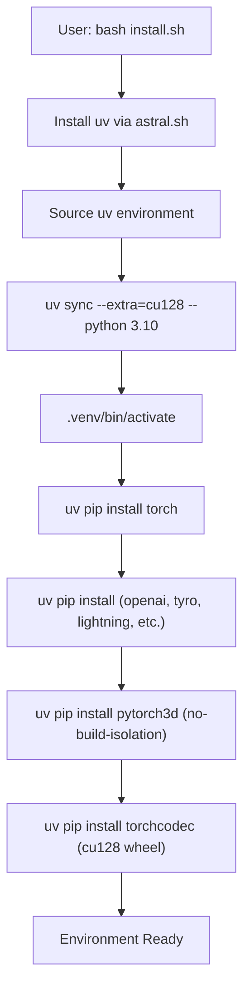
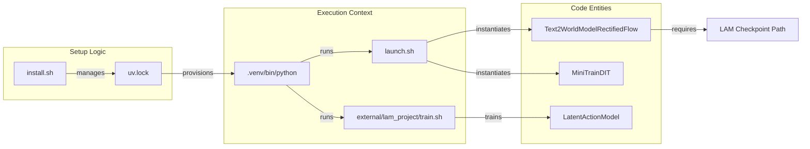

<!-- source: DeepWiki mcp.deepwiki.com · repo NVIDIA/DreamDojo · page 2.1 Environment Setup · fetched 2026-10-26 -->

# Environment Setup

<details>
<summary>Relevant source files</summary>

The following files were used as context for generating this wiki page:

- [docs/PRETRAIN.md](docs/PRETRAIN.md)
- [docs/SETUP.md](docs/SETUP.md)
- [external/lam_project/test.sh](external/lam_project/test.sh)
- [external/lam_project/train.sh](external/lam_project/train.sh)
- [install.sh](install.sh)

</details>


This page provides detailed instructions for installing DreamDojo's dependencies and configuring the development environment. The installation process uses the `uv` package manager and the provided `install.sh` script to set up all required Python packages and system dependencies.

For instructions on downloading pretrained models and datasets after environment setup, see [2.2 Downloading Models and Datasets]().

---

## Overview

DreamDojo uses `uv`, a high-performance Python package installer and resolver, to manage its Python environment. The installation is automated through the `install.sh` script, which handles dependency resolution, virtual environment creation, and specific library pinning (e.g., `torchcodec`, `pytorch3d`) in a single workflow.

**Sources**: [docs/SETUP.md:3-9](), [install.sh:1-10]()

---

## Prerequisites

### Hardware Requirements

The DreamDojo codebase is optimized and tested for NVIDIA Hopper architecture.

| Component | Specification | Purpose |
|-----------|---------------|---------|
| GPU | NVIDIA H100 80GB | Primary target for training and real-time inference |
| VRAM | 80GB | Required for FSDP sharding of 2B/14B models and high-resolution video latents |
| Compute | Multi-node/Multi-GPU | Support for `torchrun` with 8 GPUs per node |

**Sources**: [docs/SETUP.md:5](), [external/lam_project/train.sh:3-5]()

### Software Requirements

- **Operating System**: Linux (Ubuntu 20.04+ recommended)
- **Python**: 3.10 (explicitly targeted by `uv sync`)
- **CUDA**: 12.8 (targeted via `--extra=cu128` and specific `torchcodec` wheels)

**Sources**: [install.sh:4-10]()

---

## Installation Process

### Installation Flow Diagram

The following diagram illustrates the automated setup performed by `install.sh`.



**Sources**: [install.sh:1-10]()

---

## Step-by-Step Installation

### Step 1: Automated Installation

From the DreamDojo repository root, execute:

```bash
bash install.sh
```

This script performs critical environment configuration:
1. **uv Bootstrap**: Downloads and installs the `uv` binary if not present [install.sh:1-2]().
2. **Environment Sync**: Uses `uv sync` to create a `.venv` with Python 3.10 and CUDA 12.8 extras [install.sh:4]().
3. **PyTorch Stack**: Installs `torch` and specialized vision libraries like `pytorch3d` (without build isolation) and `torchcodec` version 0.5 [install.sh:6-10]().
4. **Domain Libraries**: Installs `tianshou` for RL components, `piq` for image quality metrics, and `lightning` for the LAM training framework [install.sh:7-8]().

### Step 2: Environment Activation

After installation, the virtual environment must be manually activated in your shell:

```bash
source .venv/bin/activate
```

For LAM-specific projects, the activation is often hardcoded in execution scripts to ensure consistency:

```bash
# Example from external/lam_project/train.sh
source .venv/bin/activate
```

**Sources**: [install.sh:5](), [external/lam_project/train.sh:1](), [external/lam_project/test.sh:1]()

---

## Environment Variables and Configuration

DreamDojo relies on specific environment variables for path resolution and output management.

### Required Variables

| Variable | Description | Typical Value |
|----------|-------------|---------------|
| `PYTHONPATH` | Ensures modules like `cosmos_predict2` are importable | `export PYTHONPATH=$PYTHONPATH:$(pwd)` |
| `HF_HOME` | Cache directory for Hugging Face models (T5, CLIP) | `/path/to/large/disk/hf_cache` |
| `IMAGINAIRE_OUTPUT_ROOT` | Root directory for logs and checkpoints | `./outputs` |

### Code Entity Mapping

This diagram maps the setup process to the internal code structure and execution entry points.



**Sources**: [docs/PRETRAIN.md:5-11](), [external/lam_project/train.sh:1-8](), [cosmos_predict2/_src/predict2/models/text2world_model_rectified_flow.py:6]()

---

## Post-Installation Configuration

### LAM Checkpoint Path
Before launching pretraining, you must manually update the checkpoint path for the Latent Action Model within the core model file.

File: `cosmos_predict2/_src/predict2/models/text2world_model_rectified_flow.py`
Update the `ckpt_path` variable to point to your local LAM weights.

**Sources**: [docs/PRETRAIN.md:6]()

### Distributed Training Verification
To verify the environment for multi-GPU workloads, use `torchrun`:

```bash
torchrun --nnodes=1 --nproc_per_node=8 main.py fit --config config/lam_0.yaml
```

**Sources**: [external/lam_project/train.sh:3-7]()

---

## Troubleshooting

### Dependency Conflicts
If `uv sync` fails, ensure no existing `.venv` is conflicting. You can force a clean install by removing the environment:
```bash
rm -rf .venv
bash install.sh
```

### Build Isolation Issues
`pytorch3d` requires `--no-build-isolation` during `pip install` to correctly link against the installed `torch` and CUDA headers in the environment. This is handled automatically by `install.sh`.

**Sources**: [install.sh:7]()

### Torchcodec Compatibility
The installation targets `torchcodec==0.5` specifically with the `cu128` index. If using a different CUDA version, this URL must be adjusted.

**Sources**: [install.sh:10]()

---

