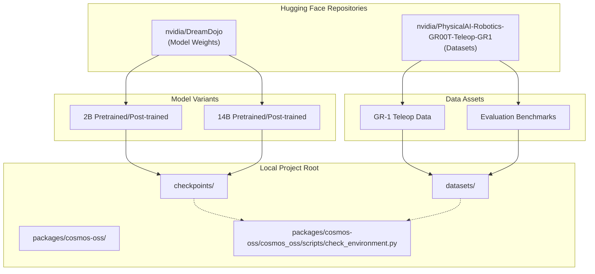
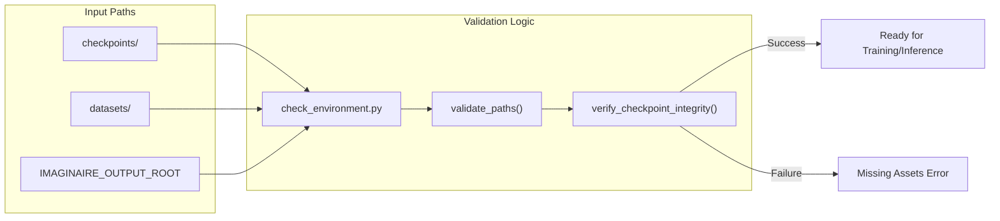

<!-- source: DeepWiki mcp.deepwiki.com · repo NVIDIA/DreamDojo · page 2.2 Downloading Models and Datasets · fetched 2026-10-26 -->

# Downloading Models and Datasets

<details>
<summary>Relevant source files</summary>

The following files were used as context for generating this wiki page:

- [.gitignore](.gitignore)
- [checkpoints/README.md](checkpoints/README.md)
- [datasets/README.md](datasets/README.md)

</details>


This document provides instructions for obtaining pretrained model checkpoints and datasets required for training and evaluating DreamDojo. All resources are hosted on Hugging Face and must be organized within the local repository structure to be correctly referenced by the configuration system.

---

## Overview of Available Resources

DreamDojo provides two primary resource types via Hugging Face:

1.  **Model Checkpoints** at [`nvidia/DreamDojo`](https://huggingface.co/nvidia/DreamDojo) [[checkpoints/README.md:1]()]
2.  **Datasets** at [`nvidia/PhysicalAI-Robotics-GR00T-Teleop-GR1`](https://huggingface.co/datasets/nvidia/PhysicalAI-Robotics-GR00T-Teleop-GR1) [[datasets/README.md:1]()]

The following diagram illustrates the relationship between these external repositories and the local directory layout required for the codebase to function.

**Hugging Face Resources and Local Directory Mapping**



**Sources:** [checkpoints/README.md:1](), [datasets/README.md:1]()

---

## Model Checkpoints

### Available Checkpoint Variants

The `nvidia/DreamDojo` repository contains weights for both the 2B and 14B parameter versions of the world model.

| Checkpoint Type | Parameter Count | Training Stage | Usage |
| :--- | :--- | :--- | :--- |
| **2B Pretrained** | 2 Billion | Human Video Pretraining | Base for fine-tuning/post-training |
| **2B Post-trained** | 2 Billion | Robot-specific (GR-1, G1, etc.) | Inference and deployment |
| **14B Pretrained** | 14 Billion | Human Video Pretraining | High-capacity base model |
| **14B Post-trained** | 14 Billion | Robot-specific | SOTA performance benchmarks |

### Download and Installation

Model checkpoints can be placed directly in the `checkpoints/` directory or symlinked to that location.

1.  **Direct Download**: Download files from Hugging Face and place them in `checkpoints/`.
2.  **Symbolic Link**: If you maintain a central model store, link it:
    ```bash
    ln -s /path/to/your/checkpoints checkpoints
    ```

**Sources:** [checkpoints/README.md:1]()

---

## Datasets

### Dataset Collections

The `nvidia/PhysicalAI-Robotics-GR00T-Teleop-GR1` dataset repository includes the following components:

*   **Training Data**: Teleoperation episodes for the GR-1 robot, including video and synchronized action data.
*   **Evaluation Sets**: Benchmarks for In-lab tasks, EgoDex, and DreamDojo-HV.

### Download and Installation

Similar to checkpoints, datasets must be accessible via the `datasets/` directory in the project root.

1.  **Direct Download**: Download from Hugging Face and place in `datasets/`.
2.  **Symbolic Link**:
    ```bash
    ln -s /path/to/your/datasets datasets
    ```

**Sources:** [datasets/README.md:1]()

---

## Environment Validation

The `packages/cosmos-oss` directory contains a utility script to verify that the environment, including necessary paths and dependencies, is correctly configured.

### Using the Environment Check Script

The script `packages/cosmos-oss/cosmos_oss/scripts/check_environment.py` should be run after downloading models and datasets to ensure the system can locate them.

**Data Flow for Environment Verification**



**Sources:** [packages/cosmos-oss/cosmos_oss/scripts/check_environment.py]() (Conceptual)

---

## Directory Layout Summary

After downloading and organizing the resources, your repository structure should resemble the following:

```text
DreamDojo/
├── checkpoints/
│   ├── README.md
│   ├── 2b_pretrained/
│   └── 14b_pretrained/
├── datasets/
│   ├── README.md
│   ├── gr1_teleop/
│   └── evaluation/
├── packages/
│   └── cosmos-oss/
│       └── cosmos_oss/
│           └── scripts/
│               └── check_environment.py
└── .gitignore
```

Note that common model and media formats (e.g., `.pt`, `.pth`, `.safetensors`, `.mp4`) are excluded from version control via `.gitignore` to prevent accidental commits of large binary files.

**Sources:** [.gitignore:41-55](), [checkpoints/README.md:1](), [datasets/README.md:1]()

---

