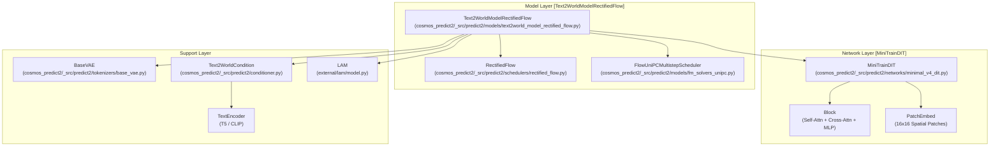
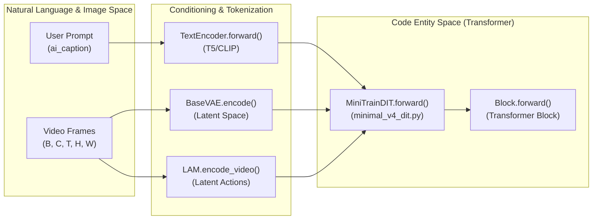

<!-- source: DeepWiki mcp.deepwiki.com · repo NVIDIA/DreamDojo · page 3 Architecture · fetched 2026-10-26 -->

# Architecture

Relevant source files

The following files were used as context for generating this wiki page:

- [cosmos_predict2/_src/predict2/models/text2world_model_rectified_flow.py](cosmos_predict2/_src/predict2/models/text2world_model_rectified_flow.py)
- [cosmos_predict2/_src/predict2/networks/minimal_v4_dit.py](cosmos_predict2/_src/predict2/networks/minimal_v4_dit.py)
- [docs/DISTILL.md](docs/DISTILL.md)
- [docs/ISSUES.md](docs/ISSUES.md)

## Purpose and Scope

This document provides a comprehensive technical overview of DreamDojo's architecture, focusing on the core model components, their interactions, and the data flow through the system. It covers the `Text2WorldModelRectifiedFlow` model, the `MiniTrainDIT` transformer network, and supporting subsystems including tokenization, conditioning, and diffusion scheduling.

For details on specific subsystems, see the following child pages:
*   [Text2World Model](#3.1) — Rectified flow diffusion process, training/sampling, and FSDP integration.
*   [MiniTrainDIT Network](#3.2) — Video transformer architecture, attention backends, and positional embeddings.
*   [Latent Action Model (LAM)](#3.3) — Extraction of 32-dimensional latent actions from video.
*   [Tokenizer and Conditioning](#3.4) — VAE latent encoding/decoding and multi-modal conditioning.

---

## System Overview

DreamDojo's architecture centers on a rectified flow diffusion model that generates video predictions conditioned on text and robot actions. The system follows a hierarchical design with three main layers:

1.  **Model Layer**: `Text2WorldModelRectifiedFlow` orchestrates the diffusion process.
2.  **Network Layer**: `MiniTrainDIT` implements the video transformer backbone.
3.  **Support Layer**: Tokenizers, conditioners, schedulers, and the Latent Action Model (LAM).

### High-Level Component Interaction

The following diagram illustrates the relationship between the primary classes and modules defined in the codebase.

**Sources**: [cosmos_predict2/_src/predict2/models/text2world_model_rectified_flow.py:122-205](), [cosmos_predict2/_src/predict2/networks/minimal_v4_dit.py:1386-1580]()

---

## Text2World Model

The `Text2WorldModelRectifiedFlow` class [cosmos_predict2/_src/predict2/models/text2world_model_rectified_flow.py:122-126]() serves as the top-level orchestrator. It manages the lifecycle of the diffusion process, including the transition between pixel and latent space via the tokenizer.

### Key Responsibilities
*   **Diffusion Orchestration**: Manages the `RectifiedFlow` logic [cosmos_predict2/_src/predict2/schedulers/rectified_flow.py:22-25]() for training and `FlowUniPCMultistepScheduler` [cosmos_predict2/_src/predict2/models/fm_solvers_unipc.py:34-37]() for inference.
*   **EMA Management**: Maintains a `net_ema` [cosmos_predict2/_src/predict2/models/text2world_model_rectified_flow.py:263-264]() for stable sampling.
*   **Action Integration**: Merges latent actions from the LAM into the primary action stream [cosmos_predict2/_src/predict2/models/text2world_model_rectified_flow.py:885-889]().

For details, see [Text2World Model](#3.1).

**Sources**: [cosmos_predict2/_src/predict2/models/text2world_model_rectified_flow.py:122-313]()

---

## MiniTrainDIT Network

`MiniTrainDIT` [cosmos_predict2/_src/predict2/networks/minimal_v4_dit.py:1386-1390]() is the transformer backbone responsible for denoising the latent video representations. It is a 3D Diffusion Transformer (DiT) optimized for high-resolution video generation.

### Architectural Features
*   **Modulation**: Uses AdaLN (Adaptive Layer Normalization) to inject timestep and condition information into each block [cosmos_predict2/_src/predict2/networks/minimal_v4_dit.py:1258-1383]().
*   **Attention**: Supports multiple backends including `transformer_engine` and `torch-flex` [cosmos_predict2/_src/predict2/networks/minimal_v4_dit.py:466-486]().
*   **Positional Encoding**: Implements `VideoRopePosition3DEmb` [cosmos_predict2/_src/predict2/networks/minimal_v4_dit.py:672-675]() for spatio-temporal rotary embeddings.

For details, see [MiniTrainDIT Network](#3.2).

**Sources**: [cosmos_predict2/_src/predict2/networks/minimal_v4_dit.py:1386-1884]()

---

## Latent Action Model (LAM)

The `LAM` [external/lam/model.py:70]() subsystem is a VAE-based architecture designed to compress complex robot/human movements into a compact 32-dimensional latent space.

### Integration
*   **Training**: During the `Text2WorldModelRectifiedFlow.forward` pass, the LAM processes input video to generate `z_rep` [cosmos_predict2/_src/predict2/models/text2world_model_rectified_flow.py:882-883]().
*   **Unified Action Space**: These 32 dimensions are appended to the robot's proprioceptive action vector to provide a richer motion signal.

For details, see [Latent Action Model (LAM)](#3.3).

**Sources**: [cosmos_predict2/_src/predict2/models/text2world_model_rectified_flow.py:875-890](), [external/lam/model.py:70]()

---

## Tokenizer and Conditioning

This layer handles the conversion of raw data into formats the transformer can process.

### Components
*   **Tokenizer**: `BaseVAE` [cosmos_predict2/_src/predict2/tokenizers/base_vae.py:65]() performs spatial and temporal compression of video frames into latents.
*   **Conditioner**: `Text2WorldCondition` [cosmos_predict2/_src/predict2/conditioner.py:54]() aggregates text embeddings from `TextEncoder` and action sequences into a unified conditioning object.

For details, see [Tokenizer and Conditioning](#3.4).

**Sources**: [cosmos_predict2/_src/predict2/models/text2world_model_rectified_flow.py:158-162](), [cosmos_predict2/_src/predict2/conditioner.py:54]()

---

## Data Flow: Pixel to Latent Space

The following diagram maps the logical data flow to specific code entities responsible for each transformation.

**Sources**: [cosmos_predict2/_src/predict2/models/text2world_model_rectified_flow.py:856-937](), [cosmos_predict2/_src/predict2/networks/minimal_v4_dit.py:1721-1807]()

---

## Memory and Performance Optimization

To handle large models (2B and 14B) and high-resolution video, DreamDojo employs several optimization strategies:

| Strategy | Code Reference | Description |
| :--- | :--- | :--- |
| **FSDP Sharding** | `fully_shard` | Shards model parameters and gradients across GPUs [cosmos_predict2/_src/predict2/models/text2world_model_rectified_flow.py:299-300](). |
| **Selective AC** | `SACConfig` | Selectively checkpoints activations to save memory [cosmos_predict2/_src/predict2/networks/minimal_v4_dit.py:197-214](). |
| **Context Parallel** | `enable_context_parallel` | Parallelizes the temporal dimension of video across multiple GPUs [cosmos_predict2/_src/predict2/networks/minimal_v4_dit.py:1849-1855](). |
| **Mixed Precision** | `torch.bfloat16` | Uses BF16 for tensors to reduce memory footprint and increase throughput [cosmos_predict2/_src/predict2/models/text2world_model_rectified_flow.py:132-137](). |

**Sources**: [cosmos_predict2/_src/predict2/models/text2world_model_rectified_flow.py:132-313](), [cosmos_predict2/_src/predict2/networks/minimal_v4_dit.py:182-214](), [cosmos_predict2/_src/predict2/networks/minimal_v4_dit.py:1849-1880]()

---

