<!-- source: DeepWiki mcp.deepwiki.com · repo NVIDIA/DreamDojo · page 3.1 Text2World Model · fetched 2026-10-26 -->

# Text2World Model

<details>
<summary>Relevant source files</summary>

The following files were used as context for generating this wiki page:

- [cosmos_predict2/_src/predict2/models/text2world_model.py](cosmos_predict2/_src/predict2/models/text2world_model.py)
- [cosmos_predict2/_src/predict2/models/text2world_model_rectified_flow.py](cosmos_predict2/_src/predict2/models/text2world_model_rectified_flow.py)

</details>


The **Text2World Model** is the core diffusion model in DreamDojo, implemented in the `Text2WorldModelRectifiedFlow` class. It orchestrates video generation through rectified flow diffusion, managing all components including tokenization, conditioning, denoising networks, and latent action integration. This page covers the model's architecture, configuration, training and sampling workflows, EMA updates, and distributed training support.

For the underlying transformer network architecture, see [MiniTrainDIT Network](#3.2). For the Latent Action Model subsystem, see [Latent Action Model (LAM)](#3.3). For tokenization and conditioning details, see [Tokenizer and Conditioning](#3.4).

**Sources:** [cosmos_predict2/_src/predict2/models/text2world_model_rectified_flow.py:1-1265]()

---

## Architecture Overview

The `Text2WorldModelRectifiedFlow` class serves as the orchestrator for the entire video generation pipeline, integrating multiple subsystems into a unified diffusion model.

### Component Hierarchy

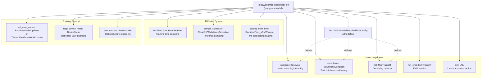

**Sources:** [cosmos_predict2/_src/predict2/models/text2world_model_rectified_flow.py:122-205]()

### Key Attributes

| Attribute | Type | Purpose |
|-----------|------|---------|
| `tokenizer` | `BaseVAE` | Encodes raw video into latent space and decodes back |
| `conditioner` | `Text2WorldCondition` | Processes text captions and robot actions into conditioning embeddings |
| `net` | `MiniTrainDIT` | Main denoising network (trainable) |
| `net_ema` | `MiniTrainDIT` | Exponential Moving Average version for inference |
| `lam` | `LAM` | Latent Action Model for extracting 32-dim action representations |
| `rectified_flow` | `RectifiedFlow` | Manages training time distribution and interpolation |
| `sample_scheduler` | `FlowUniPCMultistepScheduler` | Orchestrates multi-step sampling during inference |
| `precision` | `torch.dtype` | Model precision (bfloat16, float16, or float32) |

**Sources:** [cosmos_predict2/_src/predict2/models/text2world_model_rectified_flow.py:127-205]()

---

## Configuration System

### Text2WorldModelRectifiedFlowConfig

The `Text2WorldModelRectifiedFlowConfig` class uses the `attrs` library to define all model hyperparameters and component configurations.

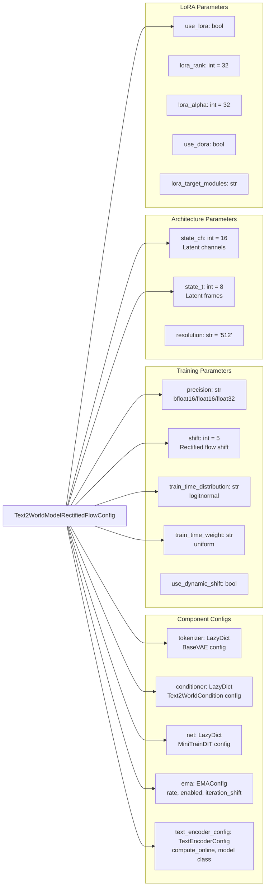

**Key Configuration Fields:**

| Field | Default | Description |
|-------|---------|-------------|
| `state_ch` | 16 | Number of channels in latent space [cosmos_predict2/_src/predict2/models/text2world_model_rectified_flow.py:93]() |
| `state_t` | 8 | Number of frames in latent space [cosmos_predict2/_src/predict2/models/text2world_model_rectified_flow.py:94]() |
| `precision` | "bfloat16" | Training precision [cosmos_predict2/_src/predict2/models/text2world_model_rectified_flow.py:87]() |
| `shift` | 5 | Rectified flow shift parameter [cosmos_predict2/_src/predict2/models/text2world_model_rectified_flow.py:106]() |
| `train_time_distribution` | "logitnormal" | Time sampling distribution [cosmos_predict2/_src/predict2/models/text2world_model_rectified_flow.py:108]() |
| `use_lora` | False | Enable LoRA fine-tuning [cosmos_predict2/_src/predict2/models/text2world_model_rectified_flow.py:99]() |
| `lora_rank` | 32 | Rank of LoRA adaptation matrices [cosmos_predict2/_src/predict2/models/text2world_model_rectified_flow.py:100]() |
| `fsdp_shard_size` | 1 | FSDP sharding group size [cosmos_predict2/_src/predict2/models/text2world_model_rectified_flow.py:86]() |

**Sources:** [cosmos_predict2/_src/predict2/models/text2world_model_rectified_flow.py:75-120]()

---

## Initialization and Setup

### Component Initialization Flow

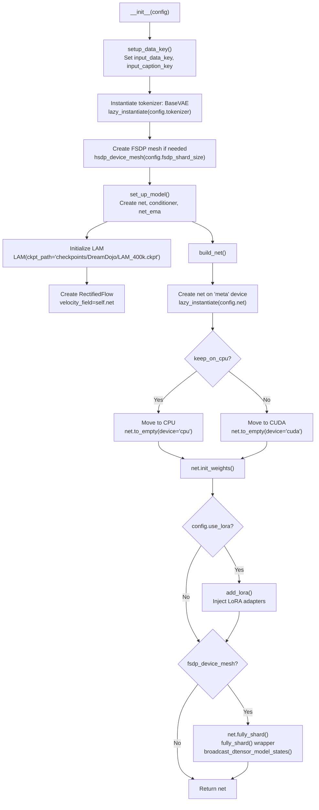

**Initialization Steps:**

1. **Data Keys Setup** [cosmos_predict2/_src/predict2/models/text2world_model_rectified_flow.py:206-209](): Configures `input_data_key` ("video"), `input_image_key` ("images"), and `input_caption_key` ("ai_caption")

2. **Scaling Setup** [cosmos_predict2/_src/predict2/models/text2world_model_rectified_flow.py:142-148](): Creates `RectifiedFlow_sCMWrapper` for time embedding scaling with `sigma_data=1.0`

3. **Tokenizer** [cosmos_predict2/_src/predict2/models/text2world_model_rectified_flow.py:157-161](): Lazy instantiation of `BaseVAE` tokenizer, validates `latent_ch` matches `state_ch`

4. **FSDP Mesh** [cosmos_predict2/_src/predict2/models/text2world_model_rectified_flow.py:164-169](): Creates hierarchical device mesh if `fsdp_shard_size > 1`

5. **Network Creation** [cosmos_predict2/_src/predict2/models/text2world_model_rectified_flow.py:211-263](): 
   - Creates network on "meta" device to avoid immediate memory allocation
   - Moves to CPU (for deferred GPU materialization) or CUDA
   - Initializes weights via `net.init_weights()`
   - Optionally adds LoRA adapters
   - Applies FSDP sharding if configured

6. **EMA Network** [cosmos_predict2/_src/predict2/models/text2world_model_rectified_flow.py:276-293](): If `config.ema.enabled`, creates second network instance kept on CPU initially, computes `ema_exp_coefficient` from `ema.rate`

7. **LAM** [cosmos_predict2/_src/predict2/models/text2world_model_rectified_flow.py:179-188](): Instantiates Latent Action Model with checkpoint path

8. **RectifiedFlow** [cosmos_predict2/_src/predict2/models/text2world_model_rectified_flow.py:196-204](): Creates flow scheduler with `velocity_field=self.net`

**Sources:** [cosmos_predict2/_src/predict2/models/text2world_model_rectified_flow.py:127-205](), [cosmos_predict2/_src/predict2/models/text2world_model_rectified_flow.py:211-294]()

---

## Training Workflow

### Training Step Pipeline

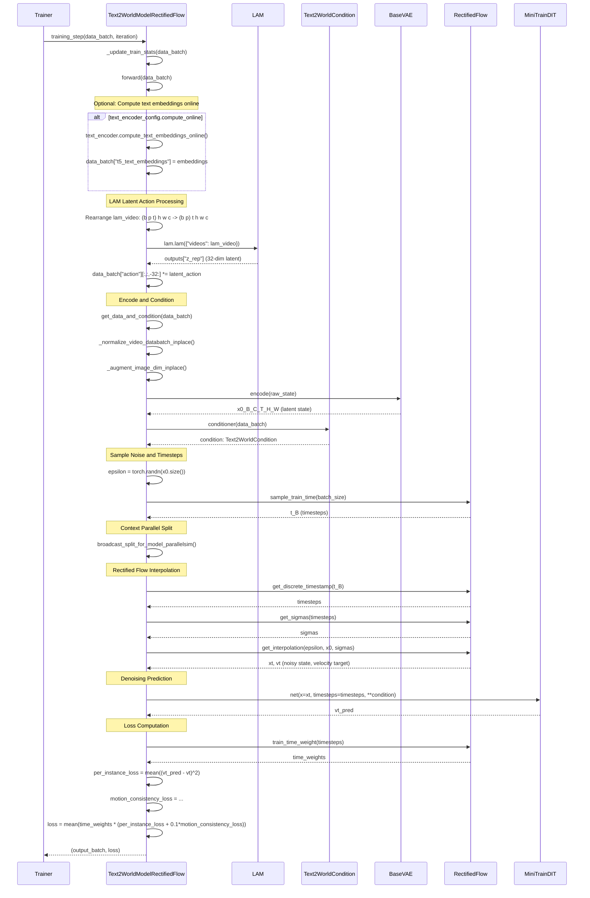

**Training Step Details:**

1. **Text Encoding** [cosmos_predict2/_src/predict2/models/text2world_model_rectified_flow.py:858-861](): If `text_encoder_config.compute_online` is True, computes T5 embeddings on-the-fly

2. **LAM Processing** [cosmos_predict2/_src/predict2/models/text2world_model_rectified_flow.py:863-869]():
   - Rearranges `lam_video` from batch
   - Passes through LAM encoder to get 32-dimensional `z_rep`
   - Multiplies last 32 dimensions of action tensor: `action[:, :, -32:] *= latent_action`

3. **Data Preparation** [cosmos_predict2/_src/predict2/models/text2world_model_rectified_flow.py:939-951]():
   - Normalizes video from uint8 [0,255] to float32 [-1,1]
   - Augments image dimension if needed (adds temporal dimension)
   - Encodes raw state through tokenizer to get latent `x0_B_C_T_H_W`
   - Processes conditioning through `conditioner(data_batch)`

4. **Noise Sampling** [cosmos_predict2/_src/predict2/models/text2world_model_rectified_flow.py:875-878]():
   - Samples Gaussian noise `epsilon ~ N(0,1)` matching x0 shape
   - Samples timesteps from rectified flow distribution via `rectified_flow.sample_train_time(batch_size)`

5. **Context Parallelism** [cosmos_predict2/_src/predict2/models/text2world_model_rectified_flow.py:412-450](): If enabled, splits sequences across context parallel group

6. **High Sigma Strategy** [cosmos_predict2/_src/predict2/models/text2world_model_rectified_flow.py:885-900](): Optionally oversamples high timestep values with probability `high_sigma_ratio`

7. **Rectified Flow Interpolation** [cosmos_predict2/_src/predict2/models/text2world_model_rectified_flow.py:902-909]():
   - Gets discrete timesteps and sigmas
   - Computes `xt = (1-sigma)*x0 + sigma*epsilon` and velocity target `vt`

8. **Denoising** [cosmos_predict2/_src/predict2/models/text2world_model_rectified_flow.py:911-916](): Passes noisy state through network to get velocity prediction

9. **Loss Computation** [cosmos_predict2/_src/predict2/models/text2world_model_rectified_flow.py:918-927]():
   - Base loss: `mean((vt_pred - vt)^2)` weighted by time-dependent weights
   - Motion consistency loss: `mean(((vt_pred[1:] - vt_pred[:-1]) - (vt[1:] - vt[:-1]))^2)` with 0.1 weight [cosmos_predict2/_src/predict2/models/text2world_model_rectified_flow.py:925]()
   - Final loss: `mean(time_weights * (base_loss + 0.1*motion_loss))`

**Sources:** [cosmos_predict2/_src/predict2/models/text2world_model_rectified_flow.py:374-404](), [cosmos_predict2/_src/predict2/models/text2world_model_rectified_flow.py:856-937]()

---

## Sampling and Inference

### Generation Pipeline

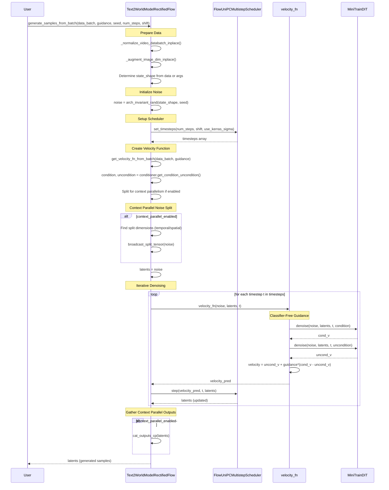

**Inference Methods:**

| Method | Purpose |
|--------|---------|
| `generate_samples_from_batch` | Standard multi-step sampling with classifier-free guidance [cosmos_predict2/_src/predict2/models/text2world_model_rectified_flow.py:513]() |
| `generate_samples_from_batch_lora` | LoRA-aware sampling with adapter switching capabilities [cosmos_predict2/_src/predict2/models/text2world_model_rectified_flow.py:617]() |
| `generate_samples_from_batch_dmd2` | Distilled model inference (4-step) [cosmos_predict2/_src/predict2/models/text2world_model_rectified_flow.py:748]() |

**Key Inference Parameters:**

| Parameter | Default | Description |
|-----------|---------|-------------|
| `guidance` | 1.5 | Classifier-free guidance scale |
| `num_steps` | 35 | Number of denoising steps |
| `shift` | 5.0 | Scheduler shift parameter |
| `seed` | 1 | Random seed for reproducibility |
| `is_negative_prompt` | False | Use negative prompt for unconditioned generation |
| `state_shape` | Auto | Override latent shape (default: from data_batch) |

**Classifier-Free Guidance Implementation** [cosmos_predict2/_src/predict2/models/text2world_model_rectified_flow.py:463-511]():

```python
def velocity_fn(noise, noise_x, timestep):
    cond_v = self.denoise(noise, noise_x, timestep, condition)
    uncond_v = self.denoise(noise, noise_x, timestep, uncondition)
    velocity_pred = uncond_v + guidance * (cond_v - uncond_v)
    return velocity_pred
```

The guidance factor controls the strength of conditioning: higher values increase fidelity to the prompt but may reduce diversity.

**Sources:** [cosmos_predict2/_src/predict2/models/text2world_model_rectified_flow.py:513-615](), [cosmos_predict2/_src/predict2/models/text2world_model_rectified_flow.py:463-511]()

---

## EMA System

### EMA Update Workflow

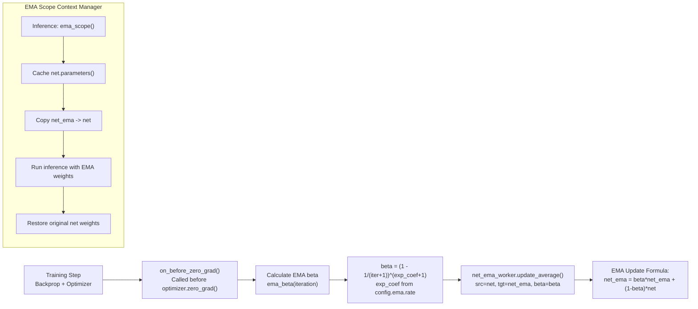

**EMA Configuration and Calculation:**

The EMA rate computation uses a polynomial formula to ensure stable exponential decay [cosmos_predict2/_src/predict2/models/text2world_model_rectified_flow.py:287-289]():

```python
# Compute exponential coefficient from desired EMA rate
s = config.ema.rate
ema_exp_coefficient = np.roots([1, 7, 16 - s**-2, 12 - s**-2]).real.max()
```

The beta calculation [cosmos_predict2/_src/predict2/models/text2world_model_rectified_flow.py:1056-1070]():

```python
def ema_beta(self, iteration: int) -> float:
    iteration = iteration + self.config.ema.iteration_shift
    if iteration < 1:
        return 0.0
    return (1 - 1 / (iteration + 1)) ** (self.ema_exp_coefficient + 1)
```

**EMA Worker Types:**

| Context | Worker Class | Purpose |
|---------|-------------|---------|
| Single GPU / DDP | `FastEmaModelUpdater` | Standard EMA updates on regular tensors [cosmos_predict2/_src/predict2/models/text2world_model_rectified_flow.py:51]() |
| FSDP | `DTensorFastEmaModelUpdater` | EMA updates for distributed DTensor parameters [cosmos_predict2/_src/predict2/models/text2world_model_rectified_flow.py:67]() |

**EMA Scope Context Manager** [cosmos_predict2/_src/predict2/models/text2world_model_rectified_flow.py:1136-1156]():

Used during validation/inference to temporarily swap in EMA weights:

```python
with model.ema_scope("validation"):
    # net now uses net_ema weights
    samples = model.generate_samples_from_batch(data)
# net weights restored to training parameters
```

**Sources:** [cosmos_predict2/_src/predict2/models/text2world_model_rectified_flow.py:276-293](), [cosmos_predict2/_src/predict2/models/text2world_model_rectified_flow.py:332-343](), [cosmos_predict2/_src/predict2/models/text2world_model_rectified_flow.py:1056-1156]()

---

## FSDP and Distributed Training

### FSDP Sharding Architecture

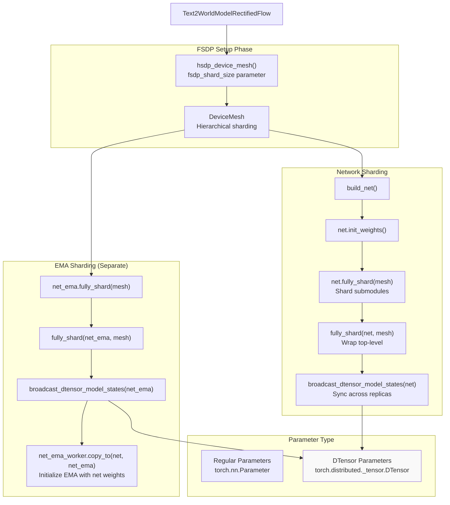

**FSDP Initialization Flow:**

1. **Device Mesh Creation** [cosmos_predict2/_src/predict2/models/text2world_model_rectified_flow.py:164-169]():
   ```python
   if config.fsdp_shard_size > 1:
       self.fsdp_device_mesh = hsdp_device_mesh(
           sharding_group_size=config.fsdp_shard_size,
       )
   ```

2. **Network Sharding** [cosmos_predict2/_src/predict2/models/text2world_model_rectified_flow.py:254-260]():
   - First call to `net.fully_shard(mesh)` shards submodules
   - Second call to `fully_shard(net, mesh, reshard_after_forward=True)` wraps entire network
   - `broadcast_dtensor_model_states()` ensures consistency across replicas
   - All parameters become `DTensor` instances after sharding

3. **EMA Sharding** [cosmos_predict2/_src/predict2/models/text2world_model_rectified_flow.py:302-313]():
   - EMA network kept on CPU during initial checkpoint loading to save memory
   - Moved to CUDA and sharded when `apply_fsdp()` is called
   - Uses separate `DTensorFastEmaModelUpdater` for DTensor-aware EMA updates
   - Final copy from `net` to `net_ema` after both are properly initialized

**apply_fsdp() Method** [cosmos_predict2/_src/predict2/models/text2world_model_rectified_flow.py:296-313]():

Called externally by the trainer to apply FSDP sharding:

```python
def apply_fsdp(self, dp_mesh: DeviceMesh) -> None:
    # Shard main network
    self.net.fully_shard(mesh=dp_mesh)
    self.net = fully_shard(self.net, mesh=dp_mesh, reshard_after_forward=True)
    broadcast_dtensor_model_states(self.net, dp_mesh)
    
    # Shard EMA network if it exists
    if hasattr(self, "net_ema") and self.net_ema:
        if next(self.net_ema.parameters()).device.type == "cpu":
            self.net_ema.to(device="cuda")
        self.net_ema.fully_shard(mesh=dp_mesh)
        self.net_ema = fully_shard(self.net_ema, mesh=dp_mesh)
        broadcast_dtensor_model_states(self.net_ema, dp_mesh)
        self.net_ema_worker = DTensorFastEmaModelUpdater()
        self.net_ema_worker.copy_to(src_model=self.net, tgt_model=self.net_ema)
```

**Context Parallelism Integration** [cosmos_predict2/_src/predict2/models/text2world_model_rectified_flow.py:412-450]():

Context parallelism splits sequences across devices for handling long videos:

- Temporal split: Divides frames across devices
- Spatial split: If temporal split insufficient, divides spatial dimensions
- Uses `broadcast_split_tensor()` and `cat_outputs_cp()` for split/gather operations
- Network enabled/disabled for CP via `net.enable_context_parallel(cp_group)` / `net.disable_context_parallel()`

**Sources:** [cosmos_predict2/_src/predict2/models/text2world_model_rectified_flow.py:164-169](), [cosmos_predict2/_src/predict2/models/text2world_model_rectified_flow.py:254-260](), [cosmos_predict2/_src/predict2/models/text2world_model_rectified_flow.py:296-313](), [cosmos_predict2/_src/predict2/models/text2world_model_rectified_flow.py:412-450]()

---

## LoRA Support

### LoRA Integration

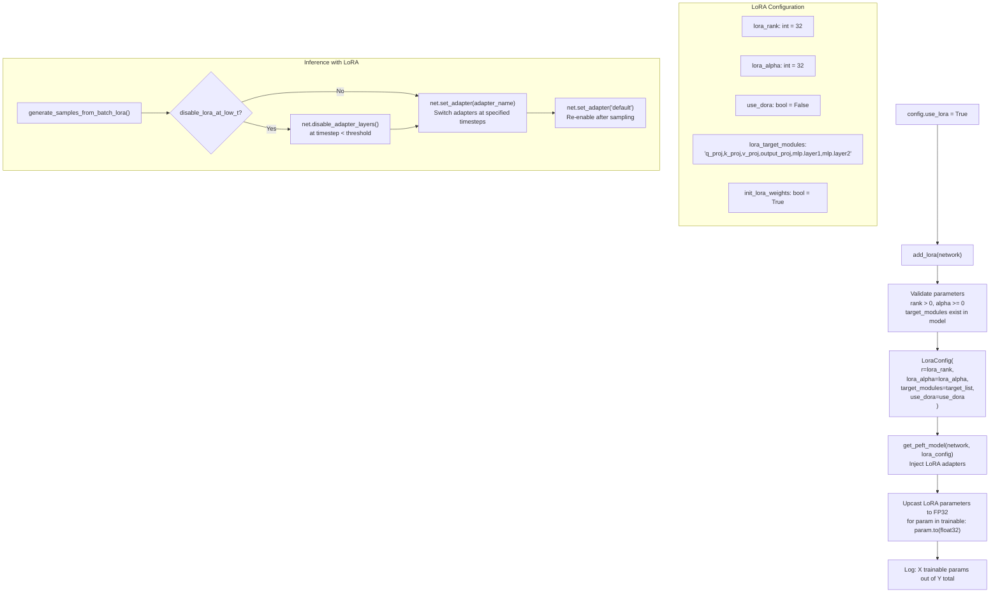

**LoRA Addition** [cosmos_predict2/_src/predict2/models/text2world_model_rectified_flow.py:1173-1264]():

The `add_lora()` method integrates PEFT library for low-rank adaptation:

1. **Validation**: Checks rank > 0, alpha >= 0, and target modules exist in model
2. **Configuration**: Creates `LoraConfig` with specified parameters
3. **Injection**: Uses `get_peft_model()` to inject LoRA adapters into target modules
4. **Upcast**: Converts LoRA parameters to FP32 for stable training
5. **Logging**: Reports trainable vs total parameter counts

**Target Modules:**

Default targets: `"q_proj,k_proj,v_proj,output_proj,mlp.layer1,mlp.layer2"` [cosmos_predict2/_src/predict2/models/text2world_model_rectified_flow.py:103]()

These correspond to:
- Attention projections (Q, K, V, output)
- MLP layers in transformer blocks

**LoRA-Aware Sampling** [cosmos_predict2/_src/predict2/models/text2world_model_rectified_flow.py:617-746]():

The `generate_samples_from_batch_lora()` method provides advanced LoRA control:

| Feature | Parameter | Description |
|---------|-----------|-------------|
| Disable at low t | `disable_lora_at_low_t=True` | Disable LoRA when `t < lora_disable_threshold_step` (default: 900) |
| Adapter switching | `adapter_switch_timesteps=[900, 700]` | Switch between multiple LoRA adapters at specified timesteps |

**Example: Multi-Adapter Switching:**

```python
# Use adapter_0 from t=1000 to t=900
# Switch to adapter_1 at t=900
# Switch to adapter_2 at t=700
samples = model.generate_samples_from_batch_lora(
    data_batch,
    adapter_switch_timesteps=[900, 700],
    ...
)
```

**Sources:** [cosmos_predict2/_src/predict2/models/text2world_model_rectified_flow.py:1173-1264](), [cosmos_predict2/_src/predict2/models/text2world_model_rectified_flow.py:617-746]()

---

## Checkpoint Management

### State Dict Structure

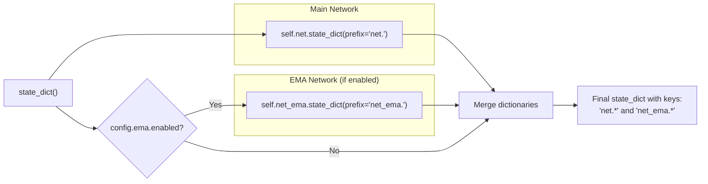

**Saving Checkpoints** [cosmos_predict2/_src/predict2/models/text2world_model_rectified_flow.py:1004-1009]():

```python
def state_dict(self) -> Dict[str, Any]:
    net_state_dict = self.net.state_dict(prefix="net.")
    if self.config.ema.enabled:
        ema_state_dict = self.net_ema.state_dict(prefix="net_ema.")
        net_state_dict.update(ema_state_dict)
    return net_state_dict
```

All network parameters are prefixed with `"net."` or `"net_ema."` to differentiate them.

**Loading Checkpoints** [cosmos_predict2/_src/predict2/models/text2world_model_rectified_flow.py:1011-1053]():

```python
def load_state_dict(self, state_dict, strict=True, assign=False):
    # Separate net and net_ema parameters
    _reg_state_dict = {k.replace("net.", ""): v 
                       for k, v in state_dict.items() 
                       if k.startswith("net.")}
    _ema_state_dict = {k.replace("net_ema.", ""): v 
                       for k, v in state_dict.items() 
                       if k.startswith("net_ema.")}
    
    if strict:
        reg_results = self.net.load_state_dict(_reg_state_dict, strict=True)
        if self.config.ema.enabled:
            ema_results = self.net_ema.load_state_dict(_ema_state_dict, strict=True)
        return _IncompatibleKeys(...)
    else:
        # Non-strict mode: warns about mismatches but doesn't error
        non_strict_load_model(self.net, _reg_state_dict)
        if self.config.ema.enabled:
            non_strict_load_model(self.net_ema, _ema_state_dict)
```

**Non-Strict Loading:**

When `strict=False`, the model uses `non_strict_load_model()` which:
- Loads matching parameters
- Warns about shape mismatches
- Continues loading remaining parameters
- Useful for partial checkpoint loading or architecture changes

**Sources:** [cosmos_predict2/_src/predict2/models/text2world_model_rectified_flow.py:1004-1053]()

---

## Utility Methods

### Core Utility Functions

| Method | Purpose | Returns |
|--------|---------|---------|
| `encode(state)` | Tokenize raw video to latent space [cosmos_predict2/_src/predict2/models/text2world_model_rectified_flow.py:1114]() | `torch.Tensor` (latent) |
| `decode(latent)` | Decode latent back to pixel space [cosmos_predict2/_src/predict2/models/text2world_model_rectified_flow.py:1118]() | `torch.Tensor` (video) |
| `denoise(noise, xt, timesteps, condition)` | Single denoising step through network [cosmos_predict2/_src/predict2/models/text2world_model_rectified_flow.py:1086]() | `torch.Tensor` (velocity) |
| `is_image_batch(data_batch)` | Determine if batch is image or video [cosmos_predict2/_src/predict2/models/text2world_model_rectified_flow.py:1072]() | `bool` |
| `get_video_height_width()` | Get video resolution from config [cosmos_predict2/_src/predict2/models/text2world_model_rectified_flow.py:1122]() | `Tuple[int, int]` |
| `get_video_latent_height_width()` | Get latent resolution [cosmos_predict2/_src/predict2/models/text2world_model_rectified_flow.py:1125]() | `Tuple[int, int]` |
| `get_num_video_latent_frames()` | Get number of latent frames [cosmos_predict2/_src/predict2/models/text2world_model_rectified_flow.py:1130]() | `int` |
| `model_param_stats()` | Count trainable parameters [cosmos_predict2/_src/predict2/models/text2world_model_rectified_flow.py:1076]() | `Dict[str, int]` |
| `clip_grad_norm_(max_norm)` | Gradient clipping [cosmos_predict2/_src/predict2/models/text2world_model_rectified_flow.py:1158]() | `float` (total norm) |

**encode() and decode()** [cosmos_predict2/_src/predict2/models/text2world_model_rectified_flow.py:1114-1120]():

Wrapper methods around the tokenizer:

```python
@torch.no_grad()
def encode(self, state: torch.Tensor) -> torch.Tensor:
    return self.tokenizer.encode(state)

@torch.no_grad()
def decode(self, latent: torch.Tensor) -> torch.Tensor:
    return self.tokenizer.decode(latent)
```

**denoise()** [cosmos_predict2/_src/predict2/models/text2world_model_rectified_flow.py:1086-1112]():

Core denoising operation that passes inputs through the network:

```python
def denoise(self, noise, xt_B_C_T_H_W, timesteps_B_T, condition):
    net_output_B_C_T_H_W = self.net(
        x_B_C_T_H_W=xt_B_C_T_H_W.to(**self.tensor_kwargs),
        timesteps_B_T=timesteps_B_T,
        **condition.to_dict(),
    ).float()
    return net_output_B_C_T_H_W
```

**Resolution Queries** [cosmos_predict2/_src/predict2/models/text2world_model_rectified_flow.py:1122-1130]():

```python
def get_video_height_width(self) -> Tuple[int, int]:
    return VIDEO_RES_SIZE_INFO[self.config.resolution]["9,16"]

def get_video_latent_height_width(self) -> Tuple[int, int]:
    height, width = VIDEO_RES_SIZE_INFO[self.config.resolution]["9,16"]
    return height // self.tokenizer.spatial_compression_factor, \
           width // self.tokenizer.spatial_compression_factor

def get_num_video_latent_frames(self) -> int:
    return self.config.state_t
```

**Gradient Clipping** [cosmos_predict2/_src/predict2/models/text2world_model_rectified_flow.py:1158-1171]():

```python
def clip_grad_norm_(self, max_norm: float, norm_type: float = 2.0):
    return clip_grad_norm_(
        self.net.parameters(),
        max_norm,
        norm_type=norm_type,
        error_if_nonfinite=False,
    )
```

Called externally to clip gradients during training for stability.

**Sources:** [cosmos_predict2/_src/predict2/models/text2world_model_rectified_flow.py:1056-1171]()

---

## Training Hooks

### Optimizer and Scheduler Integration

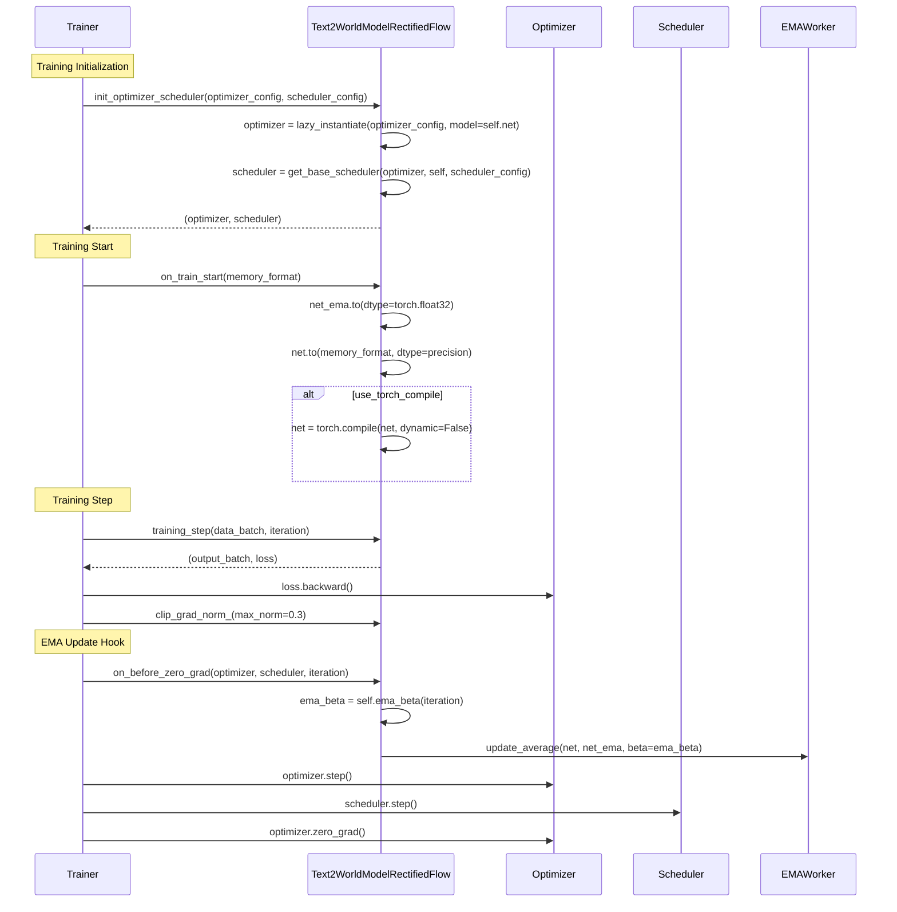

**init_optimizer_scheduler()** [cosmos_predict2/_src/predict2/models/text2world_model_rectified_flow.py:315-329]():

Creates optimizer and scheduler for the model:

```python
def init_optimizer_scheduler(
    self, optimizer_config: LazyDict, scheduler_config: LazyDict
) -> tuple[torch.optim.Optimizer, torch.optim.lr_scheduler.LRScheduler]:
    optimizer = lazy_instantiate(optimizer_config, model=self.net)
    scheduler = get_base_scheduler(optimizer, self, scheduler_config)
    return optimizer, scheduler
```

**on_train_start()** [cosmos_predict2/_src/predict2/models/text2world_model_rectified_flow.py:345-370]():

Prepares model for training:
- Converts EMA network to FP32 for stability
- Sets network to specified memory format and precision
- Optionally compiles network with `torch.compile()` if enabled

**on_before_zero_grad()** [cosmos_predict2/_src/predict2/models/text2world_model_rectified_flow.py:332-343]():

Called before `optimizer.zero_grad()` to update EMA:

```python
def on_before_zero_grad(self, optimizer, scheduler, iteration):
    if self.config.ema.enabled:
        ema_beta = self.ema_beta(iteration)
        self.net_ema_worker.update_average(self.net, self.net_ema, beta=ema_beta)
```

**Sources:** [cosmos_predict2/_src/predict2/models/text2world_model_rectified_flow.py:315-370]()

---

## Data Preprocessing

### In-Place Normalization

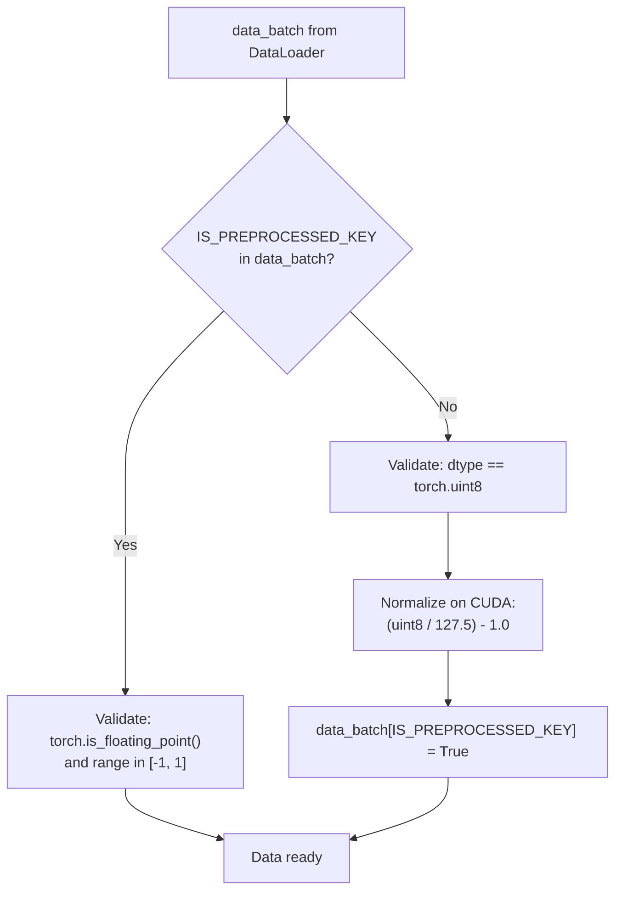

**_normalize_video_databatch_inplace()** [cosmos_predict2/_src/predict2/models/text2world_model_rectified_flow.py:953-987]():

Performs efficient on-device normalization:

```python
def _normalize_video_databatch_inplace(self, data_batch, input_key=None):
    input_key = self.input_data_key if input_key is None else input_key
    if input_key in data_batch:
        if IS_PREPROCESSED_KEY in data_batch and data_batch[IS_PREPROCESSED_KEY]:
            # Already normalized, validate range
            assert torch.all((data_batch[input_key] >= -1.0001) & 
                           (data_batch[input_key] <= 1.0001))
        else:
            # Normalize uint8 [0,255] -> float32 [-1,1]
            assert data_batch[input_key].dtype == torch.uint8
            data_batch[input_key] = data_batch[input_key].to(**self.tensor_kwargs) / 127.5 - 1.0
            data_batch[IS_PREPROCESSED_KEY] = True
```

**Key Features:**
- **In-place modification**: Avoids memory copying overhead
- **On-device processing**: Normalization happens on CUDA to avoid CPU↔GPU transfer
- **Idempotent**: Safe to call multiple times due to `IS_PREPROCESSED_KEY` check
- **Validation**: Ensures data is in expected format (uint8) and range

**_augment_image_dim_inplace()** [cosmos_predict2/_src/predict2/models/text2world_model_rectified_flow.py:989-1000]():

Adds temporal dimension to image batches:

```python
def _augment_image_dim_inplace(self, data_batch, input_key=None):
    input_key = self.input_image_key if input_key is None else input_key
    if input_key in data_batch:
        if not (IS_PREPROCESSED_KEY in data_batch and data_batch[IS_PREPROCESSED_KEY]):
            # b c h w -> b c 1 h w
            data_batch[input_key] = rearrange(data_batch[input_key], "b c h w -> b c 1 h w").contiguous()
            data_batch[IS_PREPROCESSED_KEY] = True
```

**Sources:** [cosmos_predict2/_src/predict2/models/text2world_model_rectified_flow.py:953-1000]()

---

