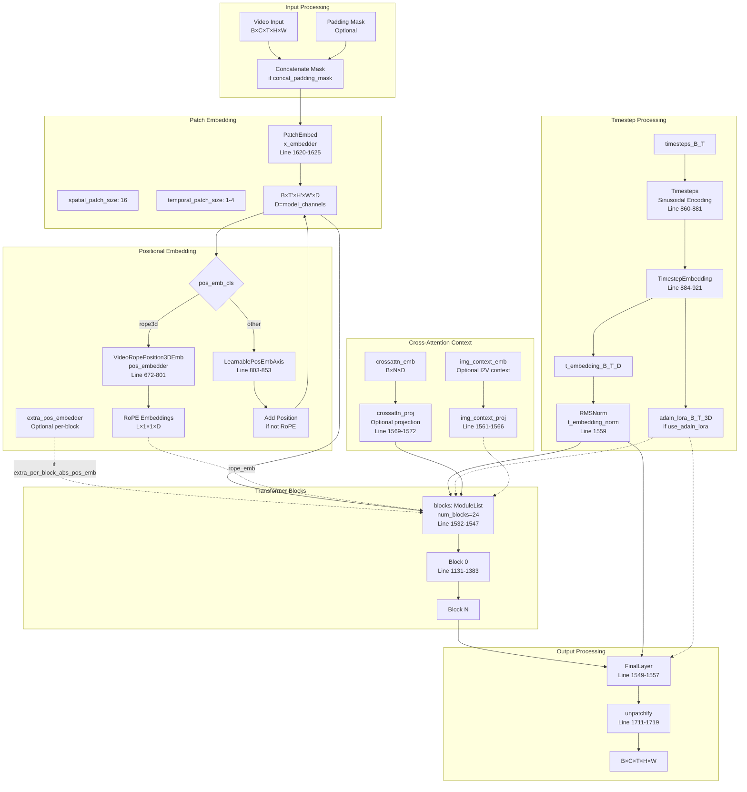

<!-- source: DeepWiki mcp.deepwiki.com · repo NVIDIA/DreamDojo · page 3.2 MiniTrainDIT Network · fetched 2026-10-26 -->

# MiniTrainDIT Network

Relevant source files

The following files were used as context for generating this wiki page:

- [cosmos_predict2/_src/predict2/action/networks/action_conditioned_minimal_v1_lvg_dit.py](cosmos_predict2/_src/predict2/action/networks/action_conditioned_minimal_v1_lvg_dit.py)
- [cosmos_predict2/_src/predict2/networks/minimal_v4_dit.py](cosmos_predict2/_src/predict2/networks/minimal_v4_dit.py)
- [docs/DISTILL.md](docs/DISTILL.md)
- [docs/ISSUES.md](docs/ISSUES.md)

The **MiniTrainDIT Network** is the core video transformer backbone of the DreamDojo model architecture. This document details the implementation of the DiT (Diffusion Transformer) video processing network, including its block structure, attention mechanisms, positional embeddings, and various optimization strategies.

For information about how MiniTrainDIT integrates with the diffusion process, see [Text2World Model](#3.1). For details on the VAE tokenizer that preprocesses inputs before MiniTrainDIT, see [Tokenizer and Conditioning](#3.4).

---

## Architecture Overview

The `MiniTrainDIT` class implements a video transformer architecture with the following key characteristics:

- **Patch-based processing**: Videos are divided into spatio-temporal patches (16×16 spatial, 1-4 temporal) [cosmos_predict2/_src/predict2/networks/minimal_v4_dit.py:979-1046]().
- **Transformer blocks**: Configurable number of blocks (default 24). Each block contains self-attention, cross-attention, and MLP sublayers [cosmos_predict2/_src/predict2/networks/minimal_v4_dit.py:1131-1383]().
- **AdaLN modulation**: Adaptive Layer Normalization conditioned on timestep embeddings and optional LoRA [cosmos_predict2/_src/predict2/networks/minimal_v4_dit.py:1200-1221]().
- **Multi-backend attention**: Supports 5 attention implementations: `transformer_engine`, `torch`, `torch-flex`, `minimal_a2a`, and `i4` [cosmos_predict2/_src/predict2/networks/minimal_v4_dit.py:439-486]().
- **3D positional embeddings**: RoPE3D or learnable axis-wise embeddings [cosmos_predict2/_src/predict2/networks/minimal_v4_dit.py:672-853]().
- **Model sizes**: Typically 2B parameters (1024 hidden dim, 16 heads) or 14B parameters (2048 hidden dim, 32 heads) [cosmos_predict2/_src/predict2/networks/minimal_v4_dit.py:1447-1490]().

**Sources**: [cosmos_predict2/_src/predict2/networks/minimal_v4_dit.py:1386-1490]()

---

## Component Architecture

### Data Flow and Entity Mapping
The following diagram bridges the high-level video processing flow with specific code entities and class names used in the implementation.

Title: MiniTrainDIT Processing Pipeline

**Sources**: [cosmos_predict2/_src/predict2/networks/minimal_v4_dit.py:1386-1807](), [cosmos_predict2/_src/predict2/networks/minimal_v4_dit.py:1605-1660](), [cosmos_predict2/_src/predict2/networks/minimal_v4_dit.py:1721-1807]()

---

## MiniTrainDIT Class

The `MiniTrainDIT` class [cosmos_predict2/_src/predict2/networks/minimal_v4_dit.py:1386]() is the main entry point for the video transformer network.

### Initialization Parameters

| Parameter Category | Key Parameters | Description |
|-------------------|----------------|-------------|
| **Input Dimensions** | `max_img_h`, `max_img_w`, `max_frames` | Maximum spatial and temporal dimensions (e.g., 480×640×49). |
| **Patch Configuration** | `patch_spatial=16`, `patch_temporal=1` | Patch sizes for spatio-temporal tokenization [cosmos_predict2/_src/predict2/networks/minimal_v4_dit.py:1447](). |
| **Channels** | `in_channels`, `out_channels`, `model_channels` | Input channels (4 for VAE latents), output channels, hidden dimension (1024 for 2B, 2048 for 14B) [cosmos_predict2/_src/predict2/networks/minimal_v4_dit.py:1451-1453](). |
| **Architecture** | `num_blocks=24`, `num_heads=16`, `mlp_ratio=4.0` | Transformer hyperparameters [cosmos_predict2/_src/predict2/networks/minimal_v4_dit.py:1455-1457](). |
| **Attention Backend** | `atten_backend` | One of: `transformer_engine`, `torch`, `torch-flex`, `minimal_a2a`, `i4` [cosmos_predict2/_src/predict2/networks/minimal_v4_dit.py:1462](). |
| **Positional Embeddings** | `pos_emb_cls`, `rope_h/w/t_extrapolation_ratio` | Type (`rope3d`), extrapolation ratios for resolution scaling [cosmos_predict2/_src/predict2/networks/minimal_v4_dit.py:1473-1478](). |
| **AdaLN-LoRA** | `use_adaln_lora`, `adaln_lora_dim=256` | Enable low-rank adaptation in AdaLN modulation [cosmos_predict2/_src/predict2/networks/minimal_v4_dit.py:1484-1485](). |

**Sources**: [cosmos_predict2/_src/predict2/networks/minimal_v4_dit.py:1447-1490]()

### Action Conditioning
In robot-specific models, `ActionConditionedMinimalV1LVGDiT` extends `MiniTrainDIT` to inject action embeddings into the timestep and AdaLN-LoRA streams [cosmos_predict2/_src/predict2/action/networks/action_conditioned_minimal_v1_lvg_dit.py:47-65]().

- **Action Embedder**: Uses MLP to map actions to `model_channels` [cosmos_predict2/_src/predict2/action/networks/action_conditioned_minimal_v1_lvg_dit.py:68-81]().
- **Integration**: Action embeddings are added to `t_embedding_B_T_D` and `adaln_lora_B_T_3D` before block processing [cosmos_predict2/_src/predict2/action/networks/action_conditioned_minimal_v1_lvg_dit.py:142-143]().

**Sources**: [cosmos_predict2/_src/predict2/action/networks/action_conditioned_minimal_v1_lvg_dit.py:47-143]()

---

## Block Structure

Each transformer `Block` [cosmos_predict2/_src/predict2/networks/minimal_v4_dit.py:1131]() implements the DiT architecture with three sublayers, each using AdaLN modulation.

Title: Transformer Block Internal Flow

```mermaid
graph TB
    subgraph "Block Sublayers"
        Input["x_B_T_H_W_D"]
        
        subgraph "Self-Attention Path"
            ModSelf["adaln_modulation_self_attn<br/>Line 1218"]
            SelfAttn["self_attn: Attention<br/>Line 1170-1178"]
            AddSelf["x + gated_result"]
        end
        
        subgraph "Cross-Attention Path"
            ModCross["adaln_modulation_cross_attn<br/>Line 1219"]
            CrossAttn["cross_attn: Attention<br/>Line 1183-1195"]
            AddCross["x + gated_result"]
        end
        
        subgraph "MLP Path"
            ModMLP["adaln_modulation_mlp<br/>Line 1220"]
            MLP["mlp: GPT2FeedForward<br/>Line 1198"]
            AddMLP["x + gated_result"]
        end
        
        Output["x_B_T_H_W_D"]
    end
    
    Input --> ModSelf
    ModSelf --> SelfAttn
    SelfAttn --> AddSelf
    
    AddSelf --> ModCross
    ModCross --> CrossAttn
    CrossAttn --> AddCross
    
    AddCross --> ModMLP
    ModMLP --> MLP
    MLP --> AddMLP
    
    AddMLP --> Output
```

### AdaLN Modulation
Each sublayer produces shift, scale, and gate parameters from the timestep embedding [cosmos_predict2/_src/predict2/networks/minimal_v4_dit.py:1258-1383]().
- **Normalization**: `LayerNorm(x) * (1 + scale) + shift` [cosmos_predict2/_src/predict2/networks/minimal_v4_dit.py:1271-1289]().
- **Gating**: The sublayer output is multiplied by a gate parameter before the residual connection [cosmos_predict2/_src/predict2/networks/minimal_v4_dit.py:1301]().

**Sources**: [cosmos_predict2/_src/predict2/networks/minimal_v4_dit.py:1131-1383]()

---

## Attention Mechanisms

The `Attention` class [cosmos_predict2/_src/predict2/networks/minimal_v4_dit.py:389]() provides a multi-backend implementation.

### Backends
1. **`transformer_engine`**: NVIDIA's optimized CUDA kernels for DotProductAttention [cosmos_predict2/_src/predict2/networks/minimal_v4_dit.py:466]().
2. **`torch`**: Standard `scaled_dot_product_attention` [cosmos_predict2/_src/predict2/networks/minimal_v4_dit.py:471]().
3. **`torch-flex`**: Uses `flex_attention` with block masks for sparse patterns [cosmos_predict2/_src/predict2/networks/minimal_v4_dit.py:474]().
4. **`minimal_a2a`**: All-to-all communication for Context Parallelism (CP) [cosmos_predict2/_src/predict2/networks/minimal_v4_dit.py:478]().
5. **`i4`**: Custom spatio-temporal attention [cosmos_predict2/_src/predict2/networks/minimal_v4_dit.py:482]().

### Sparse Attention via NeighborhoodAttention
For very long sequences, dense self-attention can be replaced with sparse Neighborhood Attention (NATTEN) [cosmos_predict2/_src/predict2/networks/minimal_v4_dit.py:1887]().
- **`n_dense_blocks`**: Determines how many blocks remain dense [cosmos_predict2/_src/predict2/networks/minimal_v4_dit.py:1887]().
- **`natten_parameters`**: Configures `window_size`, `stride`, and `dilation` for the neighborhood window [cosmos_predict2/_src/predict2/networks/minimal_v4_dit.py:1420-1445]().

**Sources**: [cosmos_predict2/_src/predict2/networks/minimal_v4_dit.py:389-581](), [cosmos_predict2/_src/predict2/networks/minimal_v4_dit.py:1887-1957]()

---

## Positional Embeddings

### VideoRopePosition3DEmb (RoPE3D)
The default 3D Rotary Positional Embedding [cosmos_predict2/_src/predict2/networks/minimal_v4_dit.py:672]().
- **Axis Partitioning**: Splits head dimension into temporal, height, and width components [cosmos_predict2/_src/predict2/networks/minimal_v4_dit.py:731-750]().
- **NTK Scaling**: Supports resolution extrapolation via NTK factors [cosmos_predict2/_src/predict2/networks/minimal_v4_dit.py:752-760]().
- **FPS Awareness**: Temporal frequencies are scaled by video FPS [cosmos_predict2/_src/predict2/networks/minimal_v4_dit.py:771-784]().

### LearnablePosEmbAxis
A learnable alternative maintaining separate parameters for each axis [cosmos_predict2/_src/predict2/networks/minimal_v4_dit.py:803]().
- `pos_emb_h`, `pos_emb_w`, `pos_emb_t` are summed and normalized before addition to patch tokens [cosmos_predict2/_src/predict2/networks/minimal_v4_dit.py:825-840]().

**Sources**: [cosmos_predict2/_src/predict2/networks/minimal_v4_dit.py:672-853]()

---

## Memory Optimization

### Selective Activation Checkpointing (SAC)
DreamDojo uses fine-grained policies to balance memory and compute [cosmos_predict2/_src/predict2/networks/minimal_v4_dit.py:197]().

| Mode | Policy Logic |
|------|--------------|
| `PREDICT2_2B_720` | Saves matrix multiplications and flash attention outputs selectively to optimize for 2B models [cosmos_predict2/_src/predict2/networks/minimal_v4_dit.py:69-89](). |
| `AGGRESSIVE` | Recomputes everything except Flash Attention outputs [cosmos_predict2/_src/predict2/networks/minimal_v4_dit.py:92-110](). |
| `AGGRESSIVE_V2` | Recomputes all operations for maximum memory savings [cosmos_predict2/_src/predict2/networks/minimal_v4_dit.py:113-124](). |

### Context Parallelism (CP)
Enables splitting long sequences across multiple GPUs [cosmos_predict2/_src/predict2/networks/minimal_v4_dit.py:1865]().
- **Workflow**: Embeddings are generated for the full sequence, then split using `split_inputs_cp` [cosmos_predict2/_src/predict2/networks/minimal_v4_dit.py:668]().
- **Attention**: The `minimal_a2a` backend manages communication between CP ranks [cosmos_predict2/_src/predict2/networks/minimal_v4_dit.py:478]().

**Sources**: [cosmos_predict2/_src/predict2/networks/minimal_v4_dit.py:69-215](), [cosmos_predict2/_src/predict2/networks/minimal_v4_dit.py:1809-1884]()

---

