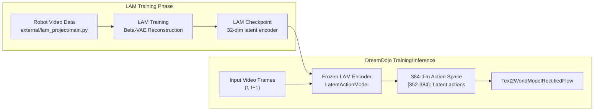
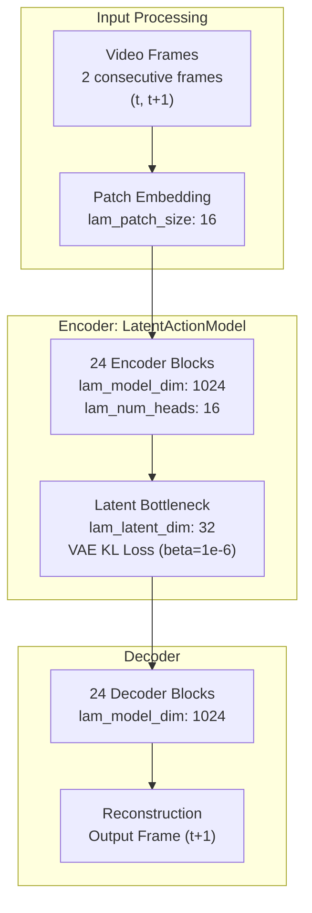
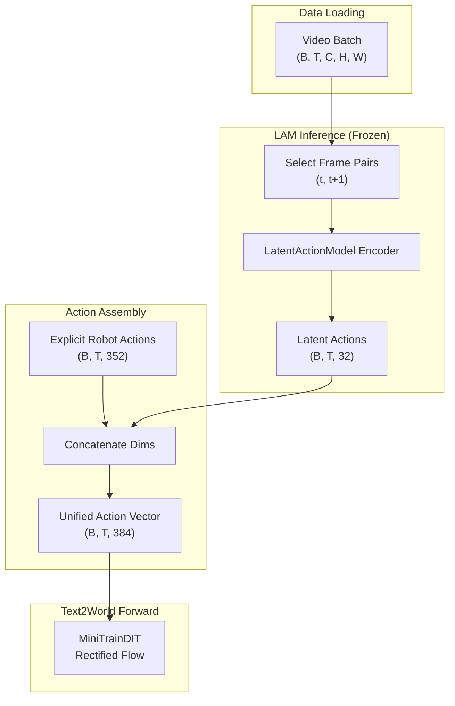

<!-- source: DeepWiki mcp.deepwiki.com · repo NVIDIA/DreamDojo · page 3.3 Latent Action Model (LAM) · fetched 2026-10-26 -->

# Latent Action Model (LAM)

<details>
<summary>Relevant source files</summary>

The following files were used as context for generating this wiki page:

- [docs/LAM.md](docs/LAM.md)
- [external/lam_project/config/lam_0.yaml](external/lam_project/config/lam_0.yaml)
- [external/lam_project/test.sh](external/lam_project/test.sh)
- [external/lam_project/train.sh](external/lam_project/train.sh)
- [install.sh](install.sh)

</details>


## Purpose and Scope

The Latent Action Model (LAM) is a specialized subsystem designed to extract compact 32-dimensional latent action representations from video sequences. These learned latent actions augment explicit robot action inputs (such as joint positions or gripper states), enabling the DreamDojo model to capture implicit motion patterns and dynamics that are difficult to represent in standard explicit action spaces.

This page documents the LAM architecture, training procedures, and its integration into the main Text2World model forward pass.

**Sources:** [docs/LAM.md:1-3](), [external/lam_project/config/lam_0.yaml:4-5]()

---

## System Role

The LAM operates as an independent component in the DreamDojo pipeline. It is first trained as a Video VAE to reconstruct frame transitions, and subsequently, its encoder is used as a frozen feature extractor during the training of the main Text2World model.



**Diagram: LAM in the DreamDojo Ecosystem**

**Sources:** [docs/LAM.md:1-19](), [external/lam_project/config/lam_0.yaml:22-26]()

---

## Architecture

### Model Structure

The LAM implements an encoder-decoder architecture based on Vision Transformers (ViT) with a bottleneck latent space. It is configured as a Variational Autoencoder (VAE) using a KL loss term.



**Diagram: LAM Encoder-Decoder Architecture**

**Sources:** [external/lam_project/config/lam_0.yaml:4-11]()

### Architecture Parameters

The LAM configuration defines the following key hyperparameters:

| Parameter | Value | Description |
|-----------|-------|-------------|
| `lam_model_dim` | 1024 | Hidden dimension of transformer blocks [external/lam_project/config/lam_0.yaml:4]() |
| `lam_latent_dim` | 32 | Dimensionality of latent action space [external/lam_project/config/lam_0.yaml:5]() |
| `lam_patch_size` | 16 | Spatial patch size (16x16 pixels) [external/lam_project/config/lam_0.yaml:6]() |
| `lam_enc_blocks` | 24 | Number of encoder transformer blocks [external/lam_project/config/lam_0.yaml:7]() |
| `lam_dec_blocks` | 24 | Number of decoder transformer blocks [external/lam_project/config/lam_0.yaml:8]() |
| `lam_num_heads` | 16 | Number of attention heads per block [external/lam_project/config/lam_0.yaml:9]() |
| `beta` | 1e-6 | Beta parameter for VAE KL regularization [external/lam_project/config/lam_0.yaml:11]() |

**Sources:** [external/lam_project/config/lam_0.yaml:4-11]()

---

## Training Procedure

### Data Configuration

The LAM is trained on pairs of consecutive video frames extracted from robot datasets. The model learns to encode the transition between frames into the 32-dimensional latent space.

| Parameter | Value | Description |
|-----------|-------|-------------|
| `batch_size` | 20 | Samples per GPU [external/lam_project/config/lam_0.yaml:21]() |
| `num_frames` | 2 | Consecutive frames per sample [external/lam_project/config/lam_0.yaml:26]() |
| `output_format` | `t h w c` | Tensor dimension ordering [external/lam_project/config/lam_0.yaml:27]() |
| `sampling_strategy` | `dataset` | Per-dataset sampling logic [external/lam_project/config/lam_0.yaml:29]() |

The `dataset_paths` field in the configuration is used to point to robot video folders (e.g., GR1_robot). The training script recursively searches these folders for MP4 videos [docs/LAM.md:3](), [external/lam_project/config/lam_0.yaml:22-23]().

**Sources:** [external/lam_project/config/lam_0.yaml:20-29](), [docs/LAM.md:3]()

### Training Execution

Training is managed via PyTorch Lightning and launched using `torchrun`.

**Single-Node Training (8 GPUs):**
```bash
cd external/lam_project
bash train.sh
```
The [external/lam_project/train.sh:3-8]() script executes `main.py fit` with the `lam_0.yaml` configuration, using `16-mixed` precision and `ddp_find_unused_parameters_false` strategy [external/lam_project/config/lam_0.yaml:36-37]().

**Multi-Node Training:**
A multi-node example is provided in `external/lam_project/launch.sh` [docs/LAM.md:12-15]().

**Sources:** [external/lam_project/train.sh:1-8](), [docs/LAM.md:5-16](), [external/lam_project/config/lam_0.yaml:31-40]()

### Optimizer Settings

The LAM uses the AdamW optimizer with a learning rate of 2.5e-5 and weight decay of 1e-2 [external/lam_project/config/lam_0.yaml:14-18](). Gradients are clipped at 0.3 [external/lam_project/config/lam_0.yaml:40]().

**Sources:** [external/lam_project/config/lam_0.yaml:14-18,40]()

---

## Integration with Text2World

### Integration Flow

The trained LAM encoder is integrated into the `Text2WorldModelRectifiedFlow` forward pass to provide "proxy actions."



**Diagram: LAM Integration in Text2World Forward Pass**

**Sources:** [docs/LAM.md:19](), High-level system architecture (Section 3.1, 4.2.1)

### Checkpoint Loading

The LAM checkpoint path is specified within the `Text2WorldModelRectifiedFlow` implementation to load the encoder weights for proxy action extraction [docs/LAM.md:19](). Pretrained weights are hosted on Hugging Face at `nvidia/DreamDojo` [docs/LAM.md:19]().

For testing the LAM independently of the main model, the [external/lam_project/test.sh:3-6]() script can be used to evaluate a specific checkpoint against a config.

**Sources:** [docs/LAM.md:19](), [external/lam_project/test.sh:3-6]()

---

## Checkpoint and Logging

The training process produces several outputs:

*   **Checkpoints**: Saved in `exp_ckpts/`. The system saves the last checkpoint and all intermediate top-k checkpoints [external/lam_project/config/lam_0.yaml:45-48]().
*   **Logs**: TensorBoard logs are stored in `exp_logs/` [external/lam_project/config/lam_0.yaml:53-54]().
*   **Visualizations**: Reconstruction samples are saved to `exp_imgs/` every 1000 steps [external/lam_project/config/lam_0.yaml:12-13]().

**Sources:** [external/lam_project/config/lam_0.yaml:12-13,42-55]()

---

